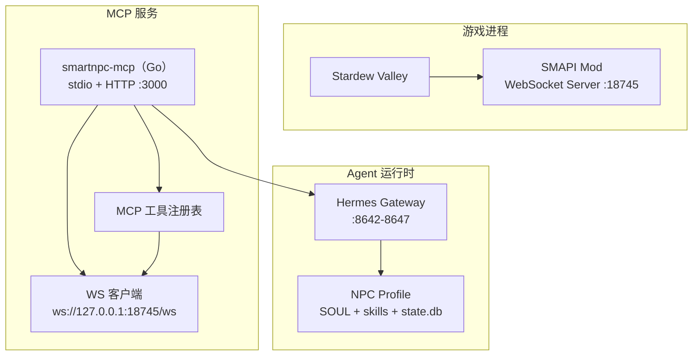
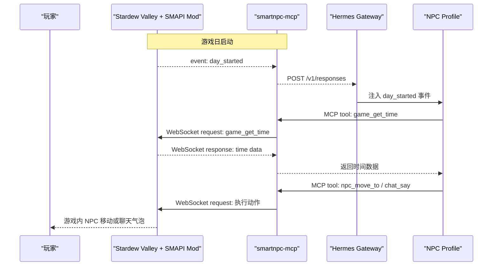
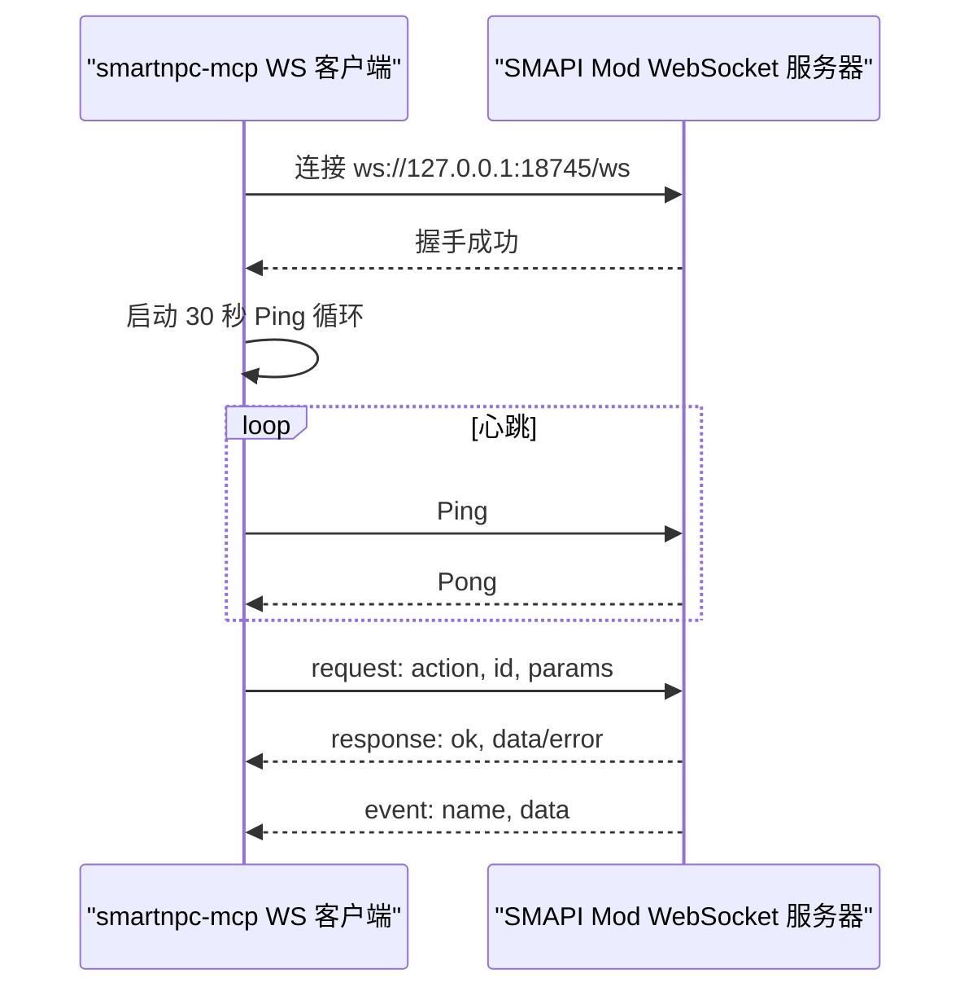
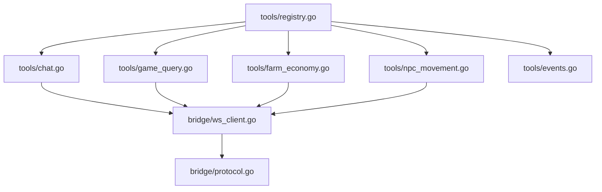

# API 接口参考

<cite>
**本文引用的文件**   
- [README.md](file://SmartNPC/README.md)
- [smartnpc-mcp README.md](file://SmartNPC/smartnpc-mcp/README.md)
- [协议规范](file://SmartNPC/docs/protocol.md)
- [事件目录](file://SmartNPC/docs/events.md)
- [MCP 工具目录](file://SmartNPC/docs/mcp-tools.md)
- [环境配置](file://SmartNPC/docs/setup.md)
- [适配器指南](file://SmartNPC/docs/adapter-guide.md)
- [WebSocket 客户端实现](file://SmartNPC/smartnpc-mcp/adapters/stardew/bridge/ws_client.go)
- [桥接协议类型定义](file://SmartNPC/smartnpc-mcp/adapters/stardew/bridge/protocol.go)
- [工具注册表](file://SmartNPC/smartnpc-mcp/adapters/stardew/tools/registry.go)
- [聊天与限流工具](file://SmartNPC/smartnpc-mcp/adapters/stardew/tools/chat.go)
- [游戏状态查询工具](file://SmartNPC/smartnpc-mcp/adapters/stardew/tools/game_query.go)
- [农场经济工具](file://SmartNPC/smartnpc-mcp/adapters/stardew/tools/farm_economy.go)
- [NPC 移动工具](file://SmartNPC/smartnpc-mcp/adapters/stardew/tools/npc_movement.go)
- [事件转发器](file://SmartNPC/smartnpc-mcp/adapters/stardew/tools/events.go)
</cite>

## 目录

1. [简介](#简介)
2. [项目结构](#项目结构)
3. [核心组件](#核心组件)
4. [架构总览](#架构总览)
5. [WebSocket 协议规范](#websocket-协议规范)
6. [MCP 工具接口](#mcp-工具接口)
7. [事件格式规范](#事件格式规范)
8. [认证、限流与版本兼容](#认证限流与版本兼容)
9. [请求响应示例](#请求响应示例)
10. [客户端集成示例](#客户端集成示例)
11. [调试技巧](#调试技巧)
12. [依赖关系分析](#依赖关系分析)
13. [故障排查](#故障排查)
14. [结论](#结论)

## 简介

本接口参考面向三类读者：

- **Hermes Agent 开发者**：通过 MCP 调用 SmartNPC 暴露的工具，驱动星露谷中的 NPC。
- **自定义 MCP 客户端开发者**：连接 `smartnpc-mcp`，订阅事件并调用工具。
- **SMAPI Mod 或 WebSocket 对接方**：理解 `:18745` 上的 JSON WebSocket 帧格式。

当前仓库包含三层协作系统：

| 层级 | 位置 | 职责 |
|---|---|---|
| 游戏层 | `smapi-mod/` | C# SMAPI Mod，运行在 Stardew Valley 中，负责 UI、NPC 行为、WebSocket Server。 |
| 能力层 | `smartnpc-mcp/` | Go MCP Server，封装 51+ 个工具，连接游戏 WebSocket，将事件转发给 Hermes。 |
| 决策层 | `hermes/profiles/` | 每个 NPC 一个 Hermes Profile，负责人格、记忆、技能和工作流。 |

当前分支是 **2026-10-26 实验构建**，把 SmartNPC 收缩为“单 Agent 自主农场管家 XiaMi”。玩家对话、点击 NPC、群聊等交互已移除；`chat_say` 仅用于单向播报。

**章节来源**
- [README.md:1-120](file://SmartNPC/README.md#L1-L120)
- [README.md:120-220](file://SmartNPC/README.md#L120-L220)

## 项目结构

仓库中与 API 相关的关键路径如下：



**图表来源**
- [README.md:40-120](file://SmartNPC/README.md#L40-L120)
- [WebSocket 客户端实现:1-40](file://SmartNPC/smartnpc-mcp/adapters/stardew/bridge/ws_client.go#L1-L40)

关键目录说明：

| 路径 | 作用 |
|---|---|
| `SmartNPC/docs/` | 协议、事件、工具、架构、安装文档。 |
| `SmartNPC/smartnpc-mcp/adapters/stardew/bridge/` | WebSocket 客户端和协议 DTO。 |
| `SmartNPC/smartnpc-mcp/adapters/stardew/tools/` | MCP 工具实现和注册。 |
| `SmartNPC/smartnpc-mcp/pkg/agentbridge/` | 框架层 server、config、eventsource、relay。 |
| `SmartNPC/hermes/profiles/` | 各 NPC 的 SOUL、skills、cron、配置 overlay。 |
| `SmartNPC/smapi-mod/` | C# 模组，真实接入游戏状态。 |

**章节来源**
- [README.md:140-220](file://SmartNPC/README.md#L140-L220)
- [适配器指南:1-60](file://SmartNPC/docs/adapter-guide.md#L1-L60)

## 核心组件

### smartnpc-mcp

Go 实现的 MCP Server，承担以下职责：

1. **工具注册**：默认注册约 51 个工具，调试模式下额外注册 1 个调试工具。
2. **WebSocket 桥接**：连接 SMAPI Mod 的 `ws://127.0.0.1:18745/ws`。
3. **事件转发**：将游戏事件包装成 MCP LoggingMessage 通知。
4. **Hermes Relay**：按 NPC 过滤后 POST 到 Hermes Gateway。
5. **HTTP MCP 接口**：默认 `/mcp`，开发机常监听 `:3000` 或 `:3001`。

工具分两层：

| 层级 | 是否需要 Mod | 示例 |
|---|---|---|
| 框架级 | 否 | `ping`、`workflow_*`、`diary_write`、`day_review_complete` |
| Mod 级 | 是 | `chat_say`、`game_*`、`npc_*`、`farm_get_economy` |

**章节来源**
- [MCP 工具目录:1-80](file://SmartNPC/docs/mcp-tools.md#L1-L80)
- [工具注册表:1-82](file://SmartNPC/smartnpc-mcp/adapters/stardew/tools/registry.go#L1-L82)

### SMAPI Mod WebSocket Server

C# 端提供 WebSocket 服务，端口固定为 `:18745`。它直接读取 `Game1` 游戏状态，执行 NPC 动作，并向 MCP 推送事件。

**章节来源**
- [协议规范:1-20](file://SmartNPC/docs/protocol.md#L1-L20)

### Hermes Gateway

每个 NPC Profile 运行在一个独立 Gateway 上，默认端口从 `hermes/npcs.yaml` 分配。Hermes 通过 MCP 工具让 Agent 调用游戏能力，并通过 `/v1/responses` 接收事件注入。

**章节来源**
- [README.md:40-120](file://SmartNPC/README.md#L40-L120)
- [适配器指南:140-192](file://SmartNPC/docs/adapter-guide.md#L140-L192)

## 架构总览

SmartNPC 的端到端链路可概括为：



**图表来源**
- [README.md:60-120](file://SmartNPC/README.md#L60-L120)
- [WebSocket 客户端实现:1-40](file://SmartNPC/smartnpc-mcp/adapters/stardew/bridge/ws_client.go#L1-L40)
- [协议规范:20-120](file://SmartNPC/docs/protocol.md#L20-L120)

## WebSocket 协议规范

### 传输层

| 属性 | 值 |
|---|---|
| 协议 | WebSocket |
| URL | `ws://127.0.0.1:18745/ws` |
| 编码 | UTF-8 JSON 文本帧 |
| 服务端 | SMAPI Mod |
| 客户端 | `smartnpc-mcp` |
| 保活 | 客户端每 30 秒发送一次 Ping |
| 重连 | 断线后以默认 2 秒间隔重试 |
| 最大帧大小 | 1 MiB |

默认超时：

| 选项 | 默认值 |
|---|---|
| 单次调用超时 | 60 分钟 |
| 拨号超时 | 5 秒 |
| 重连退避 | 2 秒 |

**章节来源**
- [协议规范:1-20](file://SmartNPC/docs/protocol.md#L1-L20)
- [WebSocket 客户端实现:1-40](file://SmartNPC/smartnpc-mcp/adapters/stardew/bridge/ws_client.go#L1-L40)

### 消息信封

所有帧都是 JSON 对象，使用 `type` 区分方向：

| type | 方向 | 含义 |
|---|---|---|
| `request` | 客户端 → 服务端 | RPC 调用，需要匹配 `response` |
| `response` | 服务端 → 客户端 | 对 `request` 的回复，用 `id` 关联 |
| `event` | 服务端 → 客户端 | 服务端主动推送，无需回复 |

#### Request

| 字段 | 类型 | 必填 | 说明 |
|---|---|---:|---|
| `type` | string | 是 | 固定为 `request` |
| `id` | string | 是 | 唯一标识，建议使用 UUIDv4 |
| `action` | string | 是 | 要调用的动作名称 |
| `params` | object | 否 | 动作参数，可为空对象或省略 |
| `from_npc` | string | 否 | 发起工具的 Hermes Profile NPC 名 |

`from_npc` 由 `smartnpc-mcp` 在工具调用时自动填充；如果为空，Mod 会记录警告并丢弃调试镜像。

#### Response

| 字段 | 类型 | 必填 | 说明 |
|---|---|---:|---|
| `type` | string | 是 | 固定为 `response` |
| `id` | string | 是 | 对应 `request.id` |
| `ok` | boolean | 是 | 成功标志 |
| `data` | object | 条件 | 成功时存在 |
| `error` | object | 条件 | 失败时存在 |

错误对象：

| 字段 | 类型 | 说明 |
|---|---|---|
| `code` | string | 稳定机器可读错误码 |
| `message` | string | 人类可读错误信息 |

#### Event

| 字段 | 类型 | 必填 | 说明 |
|---|---|---:|---|
| `type` | string | 是 | 固定为 `event` |
| `name` | string | 是 | 事件名 |
| `data` | object | 是 | 事件载荷 |
| `timestamp` | number | 是 | Unix 毫秒时间戳 |

**章节来源**
- [协议规范:20-120](file://SmartNPC/docs/protocol.md#L20-L120)
- [桥接协议类型定义:1-172](file://SmartNPC/smartnpc-mcp/adapters/stardew/bridge/protocol.go#L1-L172)

### 连接建立流程



**图表来源**
- [WebSocket 客户端实现:200-510](file://SmartNPC/smartnpc-mcp/adapters/stardew/bridge/ws_client.go#L200-L510)
- [协议规范:20-120](file://SmartNPC/docs/protocol.md#L20-L120)

### 已支持的 WebSocket Action

| Action | 方向 | 当前状态 | 说明 |
|---|---|---|---|
| `chat_say` | 客户端 → 服务端 | 实验构建保留 | 向游戏聊天框显示一行文字 |
| `game_get_time` | 客户端 → 服务端 | 可用 | 读取游戏时间、日期、季节、年份 |
| `game_get_weather` | 客户端 → 服务端 | 可用 | 读取天气和季节 |
| `farm_get_economy` | 客户端 → 服务端 | 实验构建新增 | 农场经济记分板 |
| `npc_get_nearby` | 客户端 → 服务端 | 可用 | 扫描附近角色 |
| `npc_get_environment` | 客户端 → 服务端 | 可用 | 环境上下文打包 |
| `npc_move_to` | 客户端 → 服务端 | 可用 | 寻路或跨地图传送 |
| `npc_face_direction` | 客户端 → 服务端 | 可用 | 设置朝向 |
| `npc_get_position` | 客户端 → 服务端 | 可用 | 读取 NPC 位置 |
| `npc_ship_items` | 客户端 → 服务端 | 实验构建新增 | 向出货箱发货 |
| `npc_emote` | 客户端 → 服务端 | 可用 | 显示表情气泡 |
| `npc_wander` | 客户端 → 服务端 | 可用 | 随机漫步 |
| `npc_clear_debris` | 客户端 → 服务端 | 可用 | 清理杂物 |
| `npc_till_soil` | 客户端 → 服务端 | 可用 | 翻地 |
| `npc_fertilize` | 客户端 → 服务端 | 可用 | 施肥 |
| `npc_plant_seeds` | 客户端 → 服务端 | 可用 | 播种 |
| `npc_water_crops` | 客户端 → 服务端 | 可用 | 浇水 |
| `npc_harvest_crops` | 客户端 → 服务端 | 可用 | 收割 |
| `npc_fill_gaps` | 客户端 → 服务端 | 可用 | 补种补耕 |
| `npc_forage_collect` | 客户端 → 服务端 | 可用 | 采集自然掉落物 |
| `npc_break_resource` | 客户端 → 服务端 | 可用 | 打石头/砍树 |
| `npc_pet_animal` | 客户端 → 服务端 | 可用 | 抚摸动物 |
| `npc_deposit_items` | 客户端 → 服务端 | 可用 | 存入箱子 |
| `npc_withdraw_from_chest` | 客户端 → 服务端 | 可用 | 从箱子取出 |
| `npc_transfer_item` | 客户端 → 服务端 | 可用 | NPC 背包间转移 |
| `npc_inventory_get` | 客户端 → 服务端 | 可用 | 读取背包 |
| `npc_inspect_object` | 客户端 → 服务端 | 可用 | 扫描地块 |
| `npc_place_object` | 客户端 → 服务端 | 可用 | 放置可放置物品 |

**章节来源**
- [协议规范:120-544](file://SmartNPC/docs/protocol.md#L120-L544)
- [桥接协议类型定义:100-172](file://SmartNPC/smartnpc-mcp/adapters/stardew/bridge/protocol.go#L100-L172)

### 已移除的 WebSocket Action

实验构建删除了玩家交互相关动作：

| 已移除 Action | 原用途 |
|---|---|
| `mail_send` | HUD 系统通知 |
| `friendship_get` | 玩家与 NPC 好感度 |
| `player_get_status` | 玩家忙碌/菜单/事件状态 |
| `npc_summon` | 传送到玩家附近 |
| `npc_give_item` | 给玩家礼物 |
| `npc_follow_start` / `npc_follow_stop` | 跟随玩家 |
| `npc_lead_to` | 带玩家去某处 |
| `npc_approach_and_speak` | 走近玩家并说话 |
| `npc_deliver_items` | 给玩家送物品 |

这些动作不再注册，也不再处理。

**章节来源**
- [协议规范:1-20](file://SmartNPC/docs/protocol.md#L1-L20)

## MCP 工具接口

MCP 工具是 Agent 与 SmartNPC 之间的主要编程接口。`smartnpc-mcp` 默认注册约 51 个工具；调试模式增加 `workflow_run_inline`；Hermes Profile 还会通过 `tools.include` 白名单进一步筛选，最终暴露约 50 个工具。

### 工具分类总览

| 功能分类 | 代表工具 | 是否依赖 Mod |
|---|---|---:|
| 会话与播报 | `ping`、`agent_register_self`、`chat_say` | 部分 |
| 游戏状态查询 | `game_get_time`、`game_get_weather`、`farm_get_economy` | 是 |
| 日程与工作流 | `npc_plan_day`、`npc_get_schedule`、`npc_workflow_status`、`workflow_*` | 部分 |
| 日记与复盘 | `diary_write`、`day_review_complete` | 否 |
| 感知与位置 | `npc_get_position`、`npc_get_nearby`、`npc_get_environment`、`npc_get_named_locations` | 是 |
| 移动 | `npc_move_to`、`npc_face_direction`、`npc_wander` | 是 |
| 农务 | `npc_clear_debris`、`npc_till_soil`、`npc_water_crops`、`npc_harvest_crops` 等 | 是 |
| 物流与背包 | `npc_deposit_items`、`npc_ship_items`、`npc_inventory_get` 等 | 是 |
| 表达与装饰 | `npc_emote`、`npc_express_emotion`、`npc_dance_happy` 等 | 部分 |

**章节来源**
- [MCP 工具目录:1-120](file://SmartNPC/docs/mcp-tools.md#L1-L120)
- [工具注册表:1-82](file://SmartNPC/smartnpc-mcp/adapters/stardew/tools/registry.go#L1-L82)

### 通用返回值结构

大多数工具返回结构化输出，常见字段如下：

| 字段 | 类型 | 含义 |
|---|---|---|
| `ok` | boolean | 工具逻辑是否成功 |
| `npc` | string | 被操作或查询的 NPC 内部名 |
| `map` | string | 地图名 |
| `x` | number | 横坐标 |
| `y` | number | 纵坐标 |
| `message` | string | 可选状态提示 |
| `hint` | string | 可选提示，常用于告诉 LLM 本轮已结束 |

如果底层 WebSocket 调用失败，工具可能直接返回错误，而不是返回 `ok=false` 的结构化结果。

### 会话与播报类工具

#### `ping`

- **用途**：存活检查，回显输入和服务端时间。
- **副作用**：无。
- **参数**：`message`。
- **返回**：`message`、`serverNow`。
- **适用场景**：MCP 连接测试、日志采样。

#### `agent_register_self`

- **用途**：绑定当前 MCP 会话到某个 NPC 内部名，使后续工具调用携带 `from_npc`。
- **副作用**：写入会话映射。
- **参数**：`npc`。
- **返回**：注册结果。
- **建议**：在 Profile 启动时调用一次。

#### `chat_say`

- **用途**：在游戏聊天框显示一行 NPC 台词。
- **实验构建限制**：不是玩家对话回合；只用于工作广播。
- **副作用**：可见的游戏内聊天。
- **参数**：

| 字段 | 类型 | 必填 | 说明 |
|---|---|---:|---|
| `speaker` | string | 是 | 聊天框显示的发言者名 |
| `text` | string | 是 | 消息正文 |
| `color` | string | 否 | 颜色，默认黄色 |
| `channel` | string | 否 | 实验构建中不再使用群组频道 |
| `group_id` | string | 否 | 实验构建中不再使用 |

- **返回**：`ok`、可选 `hint`。
- **错误**：`mod_not_ready`、`invalid_params`。
- **限流**：私有频道下每个唤醒周期每个发言者最多一次。

**章节来源**
- [MCP 工具目录:120-200](file://SmartNPC/docs/mcp-tools.md#L120-L200)
- [聊天与限流工具:1-200](file://SmartNPC/smartnpc-mcp/adapters/stardew/tools/chat.go#L1-L200)

### 游戏状态查询类工具

#### `game_get_time`

- **用途**：读取游戏时钟、日期、星期、季节、年份。
- **副作用**：只读。
- **参数**：无。
- **返回**：

| 字段 | 类型 | 说明 |
|---|---|---|
| `ok` | boolean | 成功标志 |
| `hour` | integer | 0–23 |
| `minute` | integer | 通常为 0 或 30 |
| `timeOfDay` | integer | 原始时间值，例如 1430 |
| `day` | integer | 1–28 |
| `day_of_week` | string | Mon/Tue/Wed/Thu/Fri/Sat/Sun |
| `season` | string | spring/summer/fall/winter |
| `year` | integer | 游戏年份 |

- **错误**：`mod_not_ready`。

#### `game_get_weather`

- **用途**：读取当天天气和季节。
- **副作用**：只读。
- **参数**：无。
- **返回**：

| 字段 | 类型 | 说明 |
|---|---|---|
| `ok` | boolean | 成功标志 |
| `weather` | string | sunny/rainy/snowy/stormy |
| `is_raining` | boolean | 是否下雨 |
| `is_snowing` | boolean | 是否下雪 |
| `is_lightning` | boolean | 是否雷暴 |
| `season` | string | 当前季节 |

- **错误**：`mod_not_ready`。

**章节来源**
- [协议规范:120-200](file://SmartNPC/docs/protocol.md#L120-L200)
- [游戏状态查询工具:1-89](file://SmartNPC/smartnpc-mcp/adapters/stardew/tools/game_query.go#L1-L89)

### 农场经济工具

#### `farm_get_economy`

- **用途**：读取农场经济记分板，供计划、复盘和发货校验使用。
- **副作用**：只读。
- **参数**：无。
- **返回**：

| 字段 | 类型 | 说明 |
|---|---|---|
| `ok` | boolean | 成功标志 |
| `day` | integer | 季节中的第几天 |
| `season` | string | spring/summer/fall/winter |
| `year` | integer | 游戏年份 |
| `gold` | integer | 当前金币 |
| `total_money_earned` | integer | 累计赚取金币 |
| `shipping_bin_count` | integer | 出货箱待售物品数量 |
| `shipping_bin_value` | integer | 出货箱内容总价值 |
| `crops_planted` | integer | 已种植作物地块数 |
| `crops_ready` | integer | 可立即收割作物数 |
| `tilled_tiles` | integer | 已耕地数 |
| `watered_tiles` | integer | 已浇水地块数 |
| `animals` | integer | 农场动物数量 |

注意：没有“当日收入”字段；如需比较每日收入，应对比不同天的 `total_money_earned`。

**章节来源**
- [协议规范:200-280](file://SmartNPC/docs/protocol.md#L200-L280)
- [农场经济工具:1-57](file://SmartNPC/smartnpc-mcp/adapters/stardew/tools/farm_economy.go#L1-L57)

### NPC 感知与移动工具

#### `npc_get_position`

- **用途**：读取 NPC 当前位置、地图、朝向和是否正在移动。
- **返回**：`ok`、`npc`、`x`、`y`、`map`、`facing`、`direction`、`is_moving`。

#### `npc_get_nearby`

- **用途**：扫描 NPC 当前地图上指定半径内的其他角色。
- **参数**：`npc`、可选 `radius`。
- **返回**：`ok`、`npc`、`map`、`radius`、`count`、`nearby[]`。

#### `npc_get_environment`

- **用途**：一次性获取 NPC 的位置、地图、朝向、时间、季节、天气和最多 16 个附近对象。
- **推荐**：优先使用这个打包查询，避免多次网络往返。

#### `npc_move_to`

- **用途**：同地图寻路或跨地图瞬移。
- **参数**：`npc`、`x`、`y`、可选 `map`。
- **返回**：`ok`、`npc`、`map`、`x`、`y`、`message`。
- **语义**：调用成功只代表请求入队，实际行走发生在后续游戏 tick。

#### `npc_face_direction`

- **用途**：设置 NPC 面朝方向。
- **参数**：`npc`、`direction`（up/down/left/right）。
- **返回**：`ok`、`npc`、`direction`、`facing`。

**章节来源**
- [协议规范:280-544](file://SmartNPC/docs/protocol.md#L280-L544)
- [NPC 移动工具:1-215](file://SmartNPC/smartnpc-mcp/adapters/stardew/tools/npc_movement.go#L1-L215)

### 农务与物流工具

#### 农务工具

| 工具 | 主要参数 | 副作用 |
|---|---|---|
| `npc_clear_debris` | radius 或 bbox | 清理石头、杂草、原木 |
| `npc_till_soil` | `patch_w` × `patch_h` | 翻地 |
| `npc_fertilize` | `fertilizer_id` | 施肥 |
| `npc_plant_seeds` | `seed_id` | 播种 |
| `npc_water_crops` | 目标区域 | 浇水 |
| `npc_harvest_crops` | 目标区域 | 收割 |
| `npc_fill_gaps` | 地块范围 | 补耕补种 |
| `npc_forage_collect` | 采集点 | 采集自然掉落物 |
| `npc_break_resource` | 资源点 | 打石头/砍树 |
| `npc_pet_animal` | 动物 | 抚摸动物 |

#### 物流工具

| 工具 | 主要参数 | 副作用 |
|---|---|---|
| `npc_deposit_items` | 箱子坐标或 `auto_find`、可选 `item_ids` | 存入箱子 |
| `npc_ship_items` | `npc`、可选 `item_ids[]` | 不可逆，过夜结算 |
| `npc_withdraw_from_chest` | 箱子坐标或 `auto_find`、`item_id`、`count` | 从箱子取出 |
| `npc_transfer_item` | `from_npc`、`to_npc`、`item_id`、`count` | NPC 背包间转移 |
| `npc_inventory_get` | `npc` | 读取背包 |
| `npc_inspect_object` | `what` | 扫描地块 |
| `npc_place_object` | 可放置对象 | 放置家具或道具 |

`npc_ship_items` 是高风险动作：接受请求不等于发货完成，需结合 `farm_get_economy.shipping_bin_count` 和 `shipping_bin_value` 验证。

**章节来源**
- [MCP 工具目录:200-327](file://SmartNPC/docs/mcp-tools.md#L200-L327)

### 表达与装饰工具

| 工具 | 说明 |
|---|---|
| `npc_emote` | 显示原生表情气泡 |
| `npc_express_emotion` | 情感表达 |
| `npc_shy_retreat` | 害羞后退 |
| `npc_show_text_bubble` | 显示文字气泡 |
| `npc_idle_activity` | 空闲活动 |
| `npc_dance_happy` | 开心跳舞 |
| `npc_react_surprise` | 惊讶反应 |
| `npc_pace_anxiously` | 焦虑踱步 |

这些工具主要是视觉效果，不改变世界状态。部分处理器在当前实现中仍为占位符。

**章节来源**
- [MCP 工具目录:120-200](file://SmartNPC/docs/mcp-tools.md#L120-L200)

## 事件格式规范

事件分为两类：

1. **Mod 事件**：由 SMAPI Mod 产生，经 WebSocket 推送到 `smartnpc-mcp`。
2. **合成事件**：由 `smartnpc-mcp` 自身生成，例如调度触发、工作流技能调用、房主指令。

MCP 侧的事件统一包装为 LoggingMessage，形状为：

| 字段 | 类型 | 说明 |
|---|---|---|
| `kind` | string | 固定为 `stardew/event` |
| `name` | string | 事件名 |
| `data` | object | 事件载荷 |
| `timestamp` | number | Unix 毫秒 |

**章节来源**
- [事件目录:1-60](file://SmartNPC/docs/events.md#L1-L60)
- [事件转发器:1-56](file://SmartNPC/smartnpc-mcp/adapters/stardew/tools/events.go#L1-L56)

### 实验构建唤醒白名单

当前实验构建只有四类事件可以唤醒 Hermes：

| 事件 | 来源 | 是否唤醒 |
|---|---|---|
| `day_started` | Mod | 是 |
| `schedule_trigger` | 合成 | 是 |
| `workflow_skill_call` | 合成 | 是 |
| `owner_directive` | 合成 | 是 |

其他事件如 `game_time_tick`、`day_ending`、`forage_collected` 只走本地调度或记账，不唤醒模型。

**章节来源**
- [事件目录:1-40](file://SmartNPC/docs/events.md#L1-L40)

### 生命周期事件

#### `day_started`

- **触发条件**：游戏新的一天开始时由 Mod 发出。
- **作用**：清空旧日程、轮换 Hermes 会话、设置实验日期、唤醒管家提交日程。
- **字段**：

| 字段 | 类型 | 说明 |
|---|---|---|
| `day` | integer | 1–28 |
| `season` | string | spring/summer/fall/winter |
| `year` | integer | 游戏年份 |
| `day_of_week` | string | Mon/Tue/Wed/… |

#### `day_ending`

- **触发条件**：一天结束前、存档前。
- **作用**：仅记账，不唤醒 Agent。
- **字段**：

| 字段 | 类型 | 说明 |
|---|---|---|
| `day` | integer | 1–28 |
| `season` | string | spring/summer/fall/winter |
| `year` | integer | 游戏年份 |

#### `game_time_tick`

- **触发条件**：每小时一次。
- **作用**：驱动本地日程调度，不唤醒 Agent。
- **字段**：`hour`、`time`、`day`、`season`、`year`、`day_of_week`。

#### `forage_collected`

- **触发条件**：NPC 成功从地图移除采集物并存入背包。
- **作用**：记录采集，不唤醒 Agent。
- **字段**：`npc`、`item_id`、`item_name`、`quantity`、`tile_x`、`tile_y`、`location`。

**章节来源**
- [事件目录:120-240](file://SmartNPC/docs/events.md#L120-L240)

### 合成事件

#### `owner_directive`

- **来源**：轮询 `<logDir>/exp/owner-inbox.md`，每行新指令变为一个事件。
- **字段**：

| 字段 | 类型 | 说明 |
|---|---|---|
| `npc` | string | 接收方 NPC 内部名 |
| `text` | string | 一行指令 |
| `seq` | integer | 单调递增序号 |

#### `schedule_trigger`

- **来源**：到达调度条目约定的 `game_hour` 和 `game_minute`。
- **作用**：渲染为“现在是 HH:MM，你的计划活动是……”，工作流引擎处理 `workflow_id` 条目，技能条目唤醒模型。

#### `workflow_skill_call`

- **来源**：本地工作流引擎需要模型判断时发出。
- **字段**：包含 `skill`，可选 `precompile` 或 `plan` 相关字段。

**章节来源**
- [事件目录:240-340](file://SmartNPC/docs/events.md#L240-L340)

### 已移除事件

实验构建整体删除了玩家交互入口，以下事件不再产生：

| 事件 | 原用途 |
|---|---|
| `chat_message` | 玩家通过聊天面板针对某个 NPC 发消息 |
| `chat_received` | 通用聊天频道、Ctrl+T 输入、群聊 |
| `npc_interact` | 玩家点击 Agent NPC |
| `group_create` | 群聊会话创建 |
| `npc_message` | NPC 间私信扇出 |
| `npc_broadcast` | NPC 广播 |

**章节来源**
- [事件目录:60-120](file://SmartNPC/docs/events.md#L60-L120)

## 认证、限流与版本兼容

### 认证机制

当前代码库中未实现基于 Token、API Key 或 JWT 的 WebSocket 认证。连接地址为本地回环地址：

- WebSocket：`ws://127.0.0.1:18745/ws`
- HTTP MCP：`http://127.0.0.1:3000/mcp`（或本机部署时的 `:3001`）

因此安全边界主要依赖：

1. 只监听本地回环地址。
2. 不在公网暴露 `:18745` 或 MCP HTTP 端口。
3. 通过防火墙限制 WSL 与 Windows 主机之间的不必要端口访问。
4. 在生产环境中由反向代理或容器网络策略控制访问源。

**章节来源**
- [协议规范:1-20](file://SmartNPC/docs/protocol.md#L1-L20)
- [MCP 工具目录:20-60](file://SmartNPC/docs/mcp-tools.md#L20-L60)
- [环境配置:120-200](file://SmartNPC/docs/setup.md#L120-L200)

### 限流策略

#### `chat_say` 唤醒预算

`ChatSayGuard` 实现硬限流：

| 场景 | 规则 |
|---|---|
| 私有频道 | 每个唤醒周期每个发言者最多一次 |
| 群组频道 | 每个 `(group_id, speaker)` 每次玩家输入最多一次 |
| 重置时机 | 新的针对该 NPC 的事件进入路由时重置私有预算；群组只在玩家输入时重置 |

第二次调用返回结构化 no-op 结果，`ok=false`，`hint` 指示本轮结束，不应重试。

#### WebSocket 连接限流

代码中没有显式每秒请求数限制。连接管理提供：

- 单次调用超时：默认 60 分钟。
- 拨号超时：默认 5 秒。
- 重连退避：默认 2 秒。
- 帧大小上限：1 MiB。

**章节来源**
- [聊天与限流工具:1-200](file://SmartNPC/smartnpc-mcp/adapters/stardew/tools/chat.go#L1-L200)
- [WebSocket 客户端实现:1-40](file://SmartNPC/smartnpc-mcp/adapters/stardew/bridge/ws_client.go#L1-L40)

### 版本兼容性

当前协议文档标题为 **SmartNPC Bridge Protocol v1**。迁移要点：

| 版本 | 变化 |
|---|---|
| M2 | 使用单个 HTTP POST 端点。 |
| M3 | 迁移到 WebSocket，支持三种消息类型：`request`、`response`、`event`。 |
| 实验构建（2026-10-26） | 移除玩家交互工具、事件和群组聊天；新增 `farm_get_economy`、`npc_ship_items`、`diary_write`、`day_review_complete`、`day_ending`、`owner_directive`。 |

向前兼容规则：

- 消费者遇到未知字段必须忽略，不能报错。
- 未知事件名会通过格式化函数降级为通用描述，避免下游管道在新 Mod 事件出现时崩溃。

**章节来源**
- [协议规范:1-20](file://SmartNPC/docs/protocol.md#L1-L20)
- [事件目录:300-340](file://SmartNPC/docs/events.md#L300-L340)

### 迁移指南

从旧版玩家交互模式迁移到实验构建：

1. **停止调用已移除工具**：`mail_send`、`friendship_get`、`player_get_status`、`npc_summon`、`npc_give_item`、`npc_follow_start`、`npc_follow_stop`、`npc_lead_to`、`npc_approach_and_speak`、`npc_deliver_items`。
2. **停止等待已移除事件**：`chat_message`、`chat_received`、`npc_interact`、`group_create`、`npc_message`、`npc_broadcast`。
3. **改用工作日流程**：监听 `day_started`，提交 `npc_plan_day`，使用 `diary_write` 和 `day_review_complete` 完成日终复盘。
4. **使用经济记分板**：通过 `farm_get_economy` 查看金币、出货箱、作物和动物状态。
5. **使用房主指令**：通过 `<logDir>/exp/owner-inbox.md` 向管家下发指令，对应合成事件 `owner_directive`。

**章节来源**
- [协议规范:1-20](file://SmartNPC/docs/protocol.md#L1-L20)
- [MCP 工具目录:120-200](file://SmartNPC/docs/mcp-tools.md#L120-L200)

## 请求响应示例

### 成功示例：查询游戏时间

#### WebSocket 请求

```json
{
  "type": "request",
  "id": "uuid-v4-string",
  "action": "game_get_time",
  "params": {}
}
```

#### WebSocket 响应

```json
{
  "type": "response",
  "id": "uuid-v4-string",
  "ok": true,
  "data": {
    "ok": true,
    "hour": 9,
    "minute": 0,
    "timeOfDay": 900,
    "day": 5,
    "day_of_week": "Mon",
    "season": "spring",
    "year": 1
  }
}
```

**章节来源**
- [协议规范:120-200](file://SmartNPC/docs/protocol.md#L120-L200)
- [游戏状态查询工具:1-89](file://SmartNPC/smartnpc-mcp/adapters/stardew/tools/game_query.go#L1-L89)

### 成功示例：查询农场经济

#### WebSocket 请求

```json
{
  "type": "request",
  "id": "uuid-v4-string",
  "action": "farm_get_economy",
  "params": {}
}
```

#### WebSocket 响应

```json
{
  "type": "response",
  "id": "uuid-v4-string",
  "ok": true,
  "data": {
    "ok": true,
    "day": 5,
    "season": "spring",
    "year": 1,
    "gold": 1200,
    "total_money_earned": 5000,
    "shipping_bin_count": 3,
    "shipping_bin_value": 450,
    "crops_planted": 20,
    "crops_ready": 5,
    "tilled_tiles": 50,
    "watered_tiles": 18,
    "animals": 4
  }
}
```

**章节来源**
- [协议规范:200-280](file://SmartNPC/docs/protocol.md#L200-L280)
- [农场经济工具:1-57](file://SmartNPC/smartnpc-mcp/adapters/stardew/tools/farm_economy.go#L1-L57)

### 成功示例：移动 NPC

#### WebSocket 请求

```json
{
  "type": "request",
  "id": "uuid-v4-string",
  "action": "npc_move_to",
  "params": {
    "npc": "XiaMi",
    "x": 64,
    "y": 16,
    "map": "Farm"
  }
}
```

#### WebSocket 响应

```json
{
  "type": "response",
  "id": "uuid-v4-string",
  "ok": true,
  "data": {
    "ok": true,
    "npc": "XiaMi",
    "map": "Farm",
    "x": 64,
    "y": 16,
    "message": "pathing"
  }
}
```

注意：`ok=true` 不代表 NPC 已经走到目标，只代表路径请求已被接受。

**章节来源**
- [协议规范:360-440](file://SmartNPC/docs/protocol.md#L360-L440)
- [NPC 移动工具:1-120](file://SmartNPC/smartnpc-mcp/adapters/stardew/tools/npc_movement.go#L1-L120)

### 失败示例：Mod 未就绪

#### WebSocket 请求

```json
{
  "type": "request",
  "id": "uuid-v4-string",
  "action": "game_get_time",
  "params": {}
}
```

#### WebSocket 响应

```json
{
  "type": "response",
  "id": "uuid-v4-string",
  "ok": false,
  "error": {
    "code": "mod_not_ready",
    "message": "no save loaded"
  }
}
```

**章节来源**
- [协议规范:120-200](file://SmartNPC/docs/protocol.md#L120-L200)

### 失败示例：无效参数

#### WebSocket 请求

```json
{
  "type": "request",
  "id": "uuid-v4-string",
  "action": "chat_say",
  "params": {
    "speaker": "",
    "text": ""
  }
}
```

#### WebSocket 响应

```json
{
  "type": "response",
  "id": "uuid-v4-string",
  "ok": false,
  "error": {
    "code": "invalid_params",
    "message": "missing speaker or text"
  }
}
```

**章节来源**
- [协议规范:120-200](file://SmartNPC/docs/protocol.md#L120-L200)

### 失败示例：连接丢失

当 WebSocket 在调用期间断开时，客户端会返回类似“连接丢失”的错误，而不是标准 Mod 错误对象。

**章节来源**
- [WebSocket 客户端实现:200-360](file://SmartNPC/smartnpc-mcp/adapters/stardew/bridge/ws_client.go#L200-L360)

## 客户端集成示例

### 使用 stdio 的 MCP 客户端

`smartnpc-mcp` 支持 stdio 模式：

```powershell
.\smartnpc-mcp.exe --log-level=debug
```

进程通过标准输入输出通信，日志输出到标准错误。

适合 Claude Desktop 等 MCP 客户端的配置方式是把可执行文件和日志级别写在 MCP 服务器配置中。

**章节来源**
- [smartnpc-mcp README.md:1-40](file://SmartNPC/smartnpc-mcp/README.md#L1-L40)

### 使用 Streamable HTTP 的 MCP 客户端

启动 HTTP 模式：

```powershell
smartnpc-mcp --http :3000
```

默认服务 `/mcp`。开发机通常使用 `:3000` 或 `:3001`。

Hermes Profile 通过 `mcp_servers.smartnpc_game.url` 连接，环境变量为 `${SMARTNPC_MCP_URL}`。

**章节来源**
- [MCP 工具目录:20-60](file://SmartNPC/docs/mcp-tools.md#L20-L60)

### 连接 SMAPI WebSocket

客户端应：

1. 连接到 `ws://127.0.0.1:18745/ws`。
2. 维护 `id` 到回调通道的映射。
3. 处理 `request`、`response`、`event` 三种帧。
4. 对未知 `type` 记录警告并忽略。
5. 对未知 `EventName` 保持向前兼容。
6. 实现断线重连和心跳保活。

**章节来源**
- [WebSocket 客户端实现:1-40](file://SmartNPC/smartnpc-mcp/adapters/stardew/bridge/ws_client.go#L1-L40)
- [WebSocket 客户端实现:360-510](file://SmartNPC/smartnpc-mcp/adapters/stardew/bridge/ws_client.go#L360-L510)

### 订阅事件

MCP 客户端应订阅 LoggingMessage，并过滤 `kind == "stardew/event"`。收到后根据 `name` 分发到对应处理器。

**章节来源**
- [事件目录:1-60](file://SmartNPC/docs/events.md#L1-L60)
- [事件转发器:1-56](file://SmartNPC/smartnpc-mcp/adapters/stardew/tools/events.go#L1-L56)

## 调试技巧

### 日志级别

| 组件 | 调试开关 |
|---|---|
| `smartnpc-mcp` | `--log-level=debug` |
| 实验调试工具 | 开启 debug 后注册 `workflow_run_inline` |
| 调度调试 | `schedDebug` 影响调度相关工具注册 |

### 常用诊断步骤

1. **确认 Mod 已加载存档**：否则多数工具返回 `mod_not_ready`。
2. **检查 WebSocket 连接**：`Connected()` 可用于状态页展示。
3. **查看 MCP 日志**：stdio 模式下日志输出到 stderr。
4. **查看实验日志目录**：`<logDir>/exp/y{year}-{season}-d{day}/`。
5. **检查房主指令**：`<logDir>/exp/owner-inbox.md`。
6. **确认 Hermes Gateway 健康**：setup 脚本会探测每个 Profile Gateway。
7. **检查 MCP 工具列表**：确认目标工具未被白名单过滤。

**章节来源**
- [MCP 工具目录:1-60](file://SmartNPC/docs/mcp-tools.md#L1-L60)
- [环境配置:120-200](file://SmartNPC/docs/setup.md#L120-L200)

### 常见问题定位

| 现象 | 可能原因 | 处理建议 |
|---|---|---|
| 所有工具返回 `mod_not_ready` | 没有加载存档 | 先进入游戏并载入存档 |
| `chat_say` 第二次调用被拒绝 | 唤醒预算已用完 | 不要重试，视为本轮结束 |
| NPC 移动后位置没变 | 异步行走未完成 | 用 `npc_get_position` 轮询 |
| 发货成功但金币没增加 | 货物隔夜结算 | 次日再查 `farm_get_economy` |
| WebSocket 频繁断开 | 服务端空闲超时 | 确认客户端实现了 Ping/Pong |
| 事件没有唤醒 Agent | 事件不在唤醒白名单 | 检查是否为 `day_started`、`schedule_trigger`、`workflow_skill_call`、`owner_directive` |

**章节来源**
- [协议规范:120-200](file://SmartNPC/docs/protocol.md#L120-L200)
- [事件目录:1-40](file://SmartNPC/docs/events.md#L1-L40)
- [WebSocket 客户端实现:200-510](file://SmartNPC/smartnpc-mcp/adapters/stardew/bridge/ws_client.go#L200-L510)

## 依赖关系分析

### 模块依赖图



**图表来源**
- [工具注册表:1-82](file://SmartNPC/smartnpc-mcp/adapters/stardew/tools/registry.go#L1-L82)
- [聊天与限流工具:1-200](file://SmartNPC/smartnpc-mcp/adapters/stardew/tools/chat.go#L1-L200)
- [游戏状态查询工具:1-89](file://SmartNPC/smartnpc-mcp/adapters/stardew/tools/game_query.go#L1-L89)
- [农场经济工具:1-57](file://SmartNPC/smartnpc-mcp/adapters/stardew/tools/farm_economy.go#L1-L57)
- [NPC 移动工具:1-215](file://SmartNPC/smartnpc-mcp/adapters/stardew/tools/npc_movement.go#L1-L215)
- [事件转发器:1-56](file://SmartNPC/smartnpc-mcp/adapters/stardew/tools/events.go#L1-L56)
- [WebSocket 客户端实现:1-510](file://SmartNPC/smartnpc-mcp/adapters/stardew/bridge/ws_client.go#L1-L510)
- [桥接协议类型定义:1-172](file://SmartNPC/smartnpc-mcp/adapters/stardew/bridge/protocol.go#L1-L172)

### 耦合与内聚

- `registry.go` 是工具组装配中心，降低具体工具与 MCP server 的耦合。
- 工具包通过 `bridge.WSClient` 与 Mod 解耦，便于单元测试和桥接替换。
- `events.go` 把 Mod 事件转为 MCP LoggingMessage，统一消费通道。
- WebSocket 客户端封装重连、超时、Ping、事件分发和 ID 关联。

**章节来源**
- [工具注册表:1-82](file://SmartNPC/smartnpc-mcp/adapters/stardew/tools/registry.go#L1-L82)
- [WebSocket 客户端实现:1-200](file://SmartNPC/smartnpc-mcp/adapters/stardew/bridge/ws_client.go#L1-L200)

## 故障排查

### 无法连接 WebSocket

**症状**：

- 客户端报连接失败。
- `Connected()` 返回 false。
- 日志中出现 dial 错误或 read ended。

**排查顺序**：

1. 确认 SMAPI Mod 已启动并监听 `:18745`。
2. 确认 URL 是 `ws://127.0.0.1:18745/ws`。
3. 确认没有被防火墙拦截。
4. 检查客户端是否实现重连。
5. 检查服务端是否因空闲断开连接。

**章节来源**
- [WebSocket 客户端实现:200-510](file://SmartNPC/smartnpc-mcp/adapters/stardew/bridge/ws_client.go#L200-L510)

### 工具调用超时

**症状**：

- 调用长时间无响应。
- 日志中出现超时警告。

**原因**：

- Mod 线程阻塞。
- 游戏卡住。
- WebSocket 写失败或连接中断。

**处理**：

- 提高或调整 `CallTimeout`。
- 检查 Mod 日志。
- 确认 `smartnpc-mcp` 与 SMAPI Mod 均正常运行。

**章节来源**
- [WebSocket 客户端实现:200-360](file://SmartNPC/smartnpc-mcp/adapters/stardew/bridge/ws_client.go#L200-L360)

### 事件未唤醒 Agent

**症状**：

- 收到 `game_time_tick` 但没有触发工作流。
- 收到 `day_ending` 但没有唤醒模型。

**原因**：

- 这两个事件不在 Hermes 唤醒白名单。
- 当前实验构建只允许 `day_started`、`schedule_trigger`、`workflow_skill_call`、`owner_directive`。

**处理**：

- 使用白名单事件作为 Agent 唤醒信号。
- 非白名单事件用于本地状态更新或日志记录。

**章节来源**
- [事件目录:1-40](file://SmartNPC/docs/events.md#L1-L40)

### 发货结果不确定

**症状**：

- `npc_ship_items` 返回成功。
- 但出货箱数量或价值没有变化。

**原因**：

- 背包为空。
- 过滤条件不匹配。
- 农场没有出货箱建筑。
- 发货结果异步且隔夜结算。

**处理**：

- 使用 `farm_get_economy.shipping_bin_count` 和 `shipping_bin_value` 验证。
- 第二天再检查金币变化。

**章节来源**
- [协议规范:440-544](file://SmartNPC/docs/protocol.md#L440-L544)
- [MCP 工具目录:200-327](file://SmartNPC/docs/mcp-tools.md#L200-L327)

## 结论

SmartNPC 的 API 接口由三层组成：

- **WebSocket 协议**：定义 `request`、`response`、`event` 三种帧，承载 SMAPI Mod 与 `smartnpc-mcp` 的双向通信。
- **MCP 工具接口**：暴露约 50 个工具，覆盖会话、查询、日程、日记、感知、移动、农务、物流和表达。
- **事件规范**：区分 Mod 事件和合成事件，并在实验构建中严格限定唤醒白名单。

对于新集成者，建议遵循以下优先级：

1. 先连接 `smartnpc-mcp` 的 stdio 或 HTTP MCP 接口。
2. 再连接 SMAPI WebSocket 进行协议调试。
3. 使用 `ping`、`game_get_time`、`farm_get_economy` 验证连通性。
4. 使用 `day_started` 作为工作日入口。
5. 使用 `npc_plan_day` 提交日程，`diary_write` 和 `day_review_complete` 完成复盘。
6. 谨慎使用 `npc_ship_items` 等不可逆写操作。
7. 始终通过 `ok`、`error.code`、`message`、`hint` 判断成功、失败和终止信号。

**章节来源**
- [README.md:1-120](file://SmartNPC/README.md#L1-L120)
- [协议规范:1-200](file://SmartNPC/docs/protocol.md#L1-L200)
- [MCP 工具目录:1-120](file://SmartNPC/docs/mcp-tools.md#L1-L120)
- [事件目录:1-120](file://SmartNPC/docs/events.md#L1-L120)