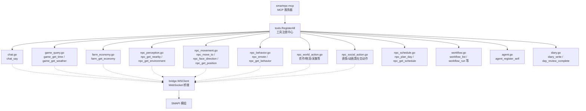
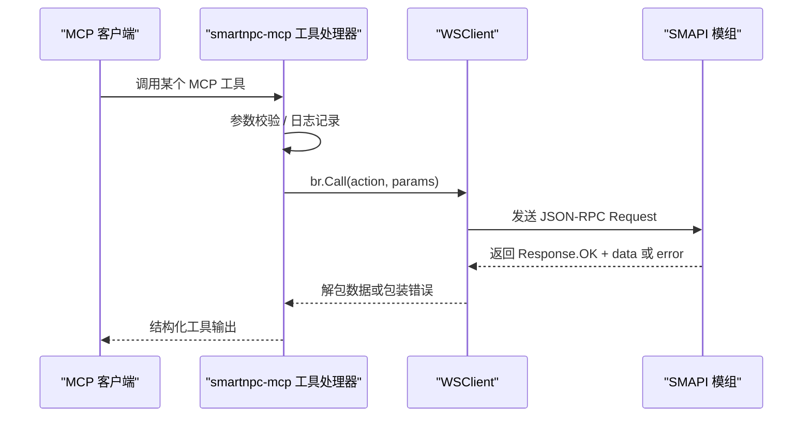
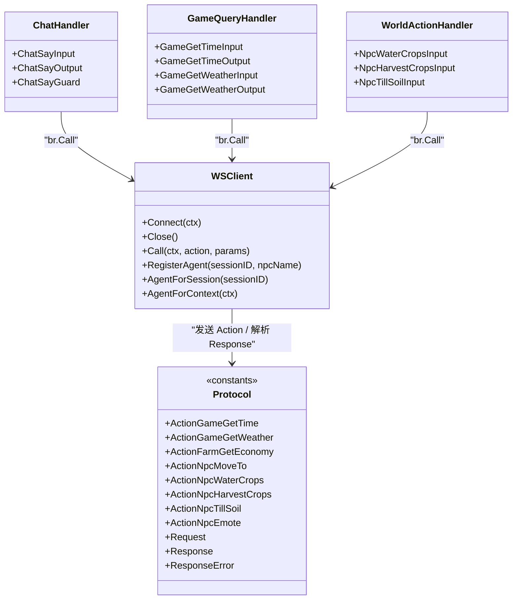

# MCP 工具接口

<cite>
**本文引用的文件**   
- [mcp-tools.md](file://SmartNPC/docs/mcp-tools.md)
- [registry.go](file://SmartNPC/smartnpc-mcp/adapters/stardew/tools/registry.go)
- [chat.go](file://SmartNPC/smartnpc-mcp/adapters/stardew/tools/chat.go)
- [game_query.go](file://SmartNPC/smartnpc-mcp/adapters/stardew/tools/game_query.go)
- [farm_economy.go](file://SmartNPC/smartnpc-mcp/adapters/stardew/tools/farm_economy.go)
- [npc_perception.go](file://SmartNPC/smartnpc-mcp/adapters/stardew/tools/npc_perception.go)
- [npc_movement.go](file://SmartNPC/smartnpc-mcp/adapters/stardew/tools/npc_movement.go)
- [npc_social_action.go](file://SmartNPC/smartnpc-mcp/adapters/stardew/tools/npc_social_action.go)
- [npc_world_action.go](file://SmartNPC/smartnpc-mcp/adapters/stardew/tools/npc_world_action.go)
- [npc_schedule.go](file://SmartNPC/smartnpc-mcp/adapters/stardew/tools/npc_schedule.go)
- [workflow.go](file://SmartNPC/smartnpc-mcp/adapters/stardew/tools/workflow.go)
- [agent.go](file://SmartNPC/smartnpc-mcp/adapters/stardew/tools/agent.go)
- [diary.go](file://SmartNPC/smartnpc-mcp/adapters/stardew/tools/diary.go)
- [action_logger.go](file://SmartNPC/smartnpc-mcp/adapters/stardew/tools/action_logger.go)
- [ws_client.go](file://SmartNPC/smartnpc-mcp/adapters/stardew/bridge/ws_client.go)
- [protocol.go](file://SmartNPC/smartnpc-mcp/adapters/stardew/bridge/protocol.go)
</cite>

## 目录
1. [引言](#引言)
2. [项目结构](#项目结构)
3. [核心组件](#核心组件)
4. [架构总览](#架构总览)
5. [工具分类与详细 API](#工具分类与详细-api)
6. [依赖关系分析](#依赖关系分析)
7. [性能与批量操作](#性能与批量操作)
8. [故障排查指南](#故障排查指南)
9. [结论](#结论)

## 引言
本文件是 SmartNPC 的 MCP（Model Context Protocol）工具接口文档，面向通过 MCP 调用 Stardew Valley SMAPI 扩展的自动化 NPC。系统暴露约 50 个工具，覆盖聊天广播、游戏状态查询、农场经济统计、NPC 感知、移动、社交表达、世界行为、日程计划与工作流执行等能力。所有“需要存档”的工具都通过 WebSocket 桥接（默认 `ws://127.0.0.1:18745/ws`）转发到 SMAPI 游戏进程；纯本地逻辑（如工作流列表、日记、日程存储）可直接在 MCP 服务内处理。

本文按功能分类整理以下目标工具：
- 聊天工具：`chat_say`、`npc_send_mail`
- 游戏查询工具：`game_get_time`、`game_get_weather`、`farm_get_economy`
- NPC 感知工具：`npc_get_nearby`、`npc_get_environment`
- NPC 移动工具：`npc_move_to`、`npc_face_direction`、`npc_get_position`
- NPC 社交工具：`npc_emote`、`npc_greet`、`npc_gift`
- NPC 世界行为工具：`npc_water_crops`、`npc_harvest_crops`、`npc_till_soil`
- 日程与工作流工具：`npc_plan_day`、`workflow_run`

对每个工具提供方法签名、参数定义、返回值结构、错误码、成功与失败示例、调用时机和注意事项。

## 项目结构
MCP 工具注册入口位于 Go 适配器包中；SMAPI 侧协议 DTO 与 WebSocket 客户端封装位于 bridge 包。

**图示来源**
- [registry.go:12-82](file://SmartNPC/smartnpc-mcp/adapters/stardew/tools/registry.go#L12-L82)
- [ws_client.go:1-120](file://SmartNPC/smartnpc-mcp/adapters/stardew/bridge/ws_client.go#L1-L120)

**章节来源**
- [registry.go:12-82](file://SmartNPC/smartnpc-mcp/adapters/stardew/tools/registry.go#L12-L82)
- [mcp-tools.md:1-60](file://SmartNPC/docs/mcp-tools.md#L1-L60)

## 核心组件
- **工具注册器**：`RegisterAll` 根据是否提供 WS 桥接决定是否挂载 SMAPI 相关工具，并返回共享日程调度器实例。
- **会话绑定**：`agent_register_self` 将当前 MCP 会话绑定到一个 NPC 内部名，使后续请求携带 `from_npc`。
- **聊天预算限制**：`ChatSayGuard` 强制每个唤醒周期内每个发言者只能调用一次 `chat_say`，防止 AI 无限复读。
- **日志记录**：所有工具调用经 `logToolCall` 写入 `npc_actions.log`；日程触发写入 `schedule_triggers.log`。
- **WS 桥接**：`WSClient` 维护连接、请求-响应关联、事件订阅、Agent 会话映射，并提供超时、重连、观察回调。
- **协议常量**：`protocol.go` 集中定义 action、event、Request/Response/Error 结构。

**章节来源**
- [registry.go:12-82](file://SmartNPC/smartnpc-mcp/adapters/stardew/tools/registry.go#L12-L82)
- [agent.go:1-95](file://SmartNPC/smartnpc-mcp/adapters/stardew/tools/agent.go#L1-L95)
- [chat.go:20-120](file://SmartNPC/smartnpc-mcp/adapters/stardew/tools/chat.go#L20-L120)
- [action_logger.go:1-120](file://SmartNPC/smartnpc-mcp/adapters/stardew/tools/action_logger.go#L1-L120)
- [ws_client.go:1-120](file://SmartNPC/smartnpc-mcp/adapters/stardew/bridge/ws_client.go#L1-L120)
- [protocol.go:1-172](file://SmartNPC/smartnpc-mcp/adapters/stardew/bridge/protocol.go#L1-L172)

## 架构总览
下图展示一次典型 MCP 工具调用的端到端流程：MCP 服务器接收调用 → 校验参数 → 写入日志 → 通过 WS 桥发送到 SMAPI → 解析响应 → 返回结构化结果。

**图示来源**
- [ws_client.go:120-220](file://SmartNPC/smartnpc-mcp/adapters/stardew/bridge/ws_client.go#L120-L220)
- [protocol.go:120-172](file://SmartNPC/smartnpc-mcp/adapters/stardew/bridge/protocol.go#L120-L172)
- [action_logger.go:60-120](file://SmartNPC/smartnpc-mcp/adapters/stardew/tools/action_logger.go#L60-L120)

## 工具分类与详细 API

### 一、聊天工具

#### 1. chat_say
- **用途**：以 NPC 身份在游戏内聊天框发送一行可见消息。实验模式下作为工作广播使用，不是普通对话回复。
- **是否需要存档**：是（需 WS 桥接）。
- **输入参数**
  - `speaker`：必填。NPC 内部英文名，例如 `XiaMi`、`Abigail`。
  - `text`：必填。纯文本消息，建议 1～3 句。
  - `color`：可选。白/黄/绿/红/青/蓝/紫/灰，默认黄色。
  - `channel`：可选。空或 `private` 表示私聊面板；`group` 表示群聊面板。
  - `group_id`：可选。当 `channel=group` 时必须传入。
- **返回结构**
  - `ok`：布尔值，表示是否实际投递。
  - `hint`：提示语，通常包含 `TURN_END`，表示本轮不再继续调用工具。
- **错误码与语义**
  - `mod_not_ready`：SMAPI 未就绪或无存档。
  - `invalid_params`：缺少必填字段或 channel/group_id 不匹配。
  - 预算耗尽时返回 `ok=false`，`hint` 以 `noop_chat_say_private_quota_exhausted` 或 `noop_chat_say_group_quota_exhausted` 开头，这不是可重试错误。
- **调用时机**
  - 只在确定最终回复后调用一次；不要用于思考、旁白或流式输出。
  - 私聊场景每个唤醒周期最多一次；群聊场景每个玩家回合每组发言者最多一次。
- **成功示例**
  - 请求：`{ "name": "chat_say", "arguments": { "speaker": "XiaMi", "text": "今天天气不错，我去浇水了。" } }`
  - 响应：`{ "ok": true, "hint": "TURN_END" }`
- **失败示例**
  - 重复调用同一唤醒周期：`{ "ok": false, "hint": "noop_chat_say_private_quota_exhausted. TURN_END" }`
  - 群聊漏传 group_id：`{ "error": { "code": "invalid_params", "message": "..." } }`

**章节来源**
- [chat.go:12-120](file://SmartNPC/smartnpc-mcp/adapters/stardew/tools/chat.go#L12-L120)
- [mcp-tools.md:60-120](file://SmartNPC/docs/mcp-tools.md#L60-L120)

#### 2. npc_send_mail
- **当前状态**：**已从实验构建中移除**。
- 官方说明明确列出 `mail_send` 与多个玩家向工具被删除，不再出现在 `ListTools` 中；`npc_send_message`、`npc_inbox_get`、`npc_inbox_ack` 也已移除。
- **替代方案**
  - 如果目标是通知玩家，实验模式仅保留 `chat_say` 作为可见聊天广播。
  - 如果需要 NPC 间通信，应查看 Hermes 事件路由与 profile 层能力，而不是依赖已移除的 MCP 工具。

**章节来源**
- [mcp-tools.md:120-200](file://SmartNPC/docs/mcp-tools.md#L120-L200)

---

### 二、游戏查询工具

#### 1. game_get_time
- **用途**：读取游戏时钟与日历。
- **是否需要存档**：是。
- **输入**：无。
- **返回字段**
  - `ok`：成功标志。
  - `hour`：0～23。
  - `minute`：0 或 30。
  - `timeOfDay`：原始时间值，例如 1430。
  - `day`：1～28。
  - `day_of_week`：短星期名，例如 Mon。
  - `season`：spring / summer / fall / winter。
  - `year`：游戏年份。
- **错误**
  - WS 桥接失败时会包裹为 `game_get_time: ...`。
- **调用建议**
  - 适合做时间门控决策，例如中午前浇水、傍晚前出货。
- **成功示例**
  - 响应：`{ "ok": true, "hour": 10, "minute": 0, "timeOfDay": 1000, "day": 3, "day_of_week": "Mon", "season": "spring", "year": 1 }`
- **失败示例**
  - 无存档：`{ "error": { "code": "mod_not_ready", "message": "..." } }`

**章节来源**
- [game_query.go:12-89](file://SmartNPC/smartnpc-mcp/adapters/stardew/tools/game_query.go#L12-L89)

#### 2. game_get_weather
- **用途**：读取当天天气与季节。
- **是否需要存档**：是。
- **输入**：无。
- **返回字段**
  - `ok`
  - `weather`：sunny / rainy / snowy / stormy。
  - `is_raining`
  - `is_snowing`
  - `is_lightning`
  - `season`
- **调用建议**
  - 雨天不需要浇水；雪天多数户外农活受限，应切换到室内或资源采集。
- **成功示例**
  - 响应：`{ "ok": true, "weather": "rainy", "is_raining": true, "is_snowing": false, "is_lightning": false, "season": "spring" }`
- **失败示例**
  - 桥接错误：`{ "error": { "code": "...", "message": "game_get_weather: ..." } }`

**章节来源**
- [game_query.go:40-89](file://SmartNPC/smartnpc-mcp/adapters/stardew/tools/game_query.go#L40-L89)

#### 3. farm_get_economy
- **用途**：读取农场经营记分板，包括金币、累计收入、发货箱、作物、耕地、动物数量。
- **是否需要存档**：是。
- **输入**：无。
- **返回字段**
  - `ok`
  - `day`、`season`、`year`
  - `gold`：当前钱包金币。
  - `total_money_earned`：累计赚取金币。
  - `shipping_bin_count`：发货箱待售物品数。
  - `shipping_bin_value`：发货箱总价值。
  - `crops_planted`：已种植作物地块数。
  - `crops_ready`：可收获作物数。
  - `tilled_tiles`：已翻耕地块数。
  - `watered_tiles`：当前已浇水地块数。
  - `animals`：农场动物数量。
- **注意**
  - 没有“每日收入”字段；如需跨日比较，应对比 `total_money_earned`。
- **成功示例**
  - 响应：`{ "ok": true, "day": 3, "season": "spring", "year": 1, "gold": 1200, "total_money_earned": 5000, "shipping_bin_count": 2, "shipping_bin_value": 300, "crops_planted": 20, "crops_ready": 5, "tilled_tiles": 30, "watered_tiles": 18, "animals": 4 }`
- **失败示例**
  - 无存档：`{ "error": { "code": "mod_not_ready", "message": "..." } }`

**章节来源**
- [farm_economy.go:12-57](file://SmartNPC/smartnpc-mcp/adapters/stardew/tools/farm_economy.go#L12-L57)
- [mcp-tools.md:80-120](file://SmartNPC/docs/mcp-tools.md#L80-L120)

---

### 三、NPC 感知工具

#### 1. npc_get_nearby
- **用途**：扫描 NPC 所在地图上的其他角色，按距离排序返回。
- **是否需要存档**：是。
- **输入参数**
  - `npc`：必填。观察者 NPC 内部名。
  - `radius`：可选。可视半径（格），默认 10。
- **返回结构**
  - `ok`
  - `npc`：观察者名称。
  - `map`：观察者所在地图。
  - `radius`：实际使用的半径。
  - `count`：返回实体数量。
  - `nearby`：数组，每项含 `name`、`type`、`x`、`y`、`distance`、`facing`、`map`、`action`。
- **错误**
  - 缺少 `npc`：`npc is required`。
  - WS 桥接失败会包裹为 `npc_get_nearby: ...`。
- **调用建议**
  - 在决定打招呼、避让或判断是否独处前先调用。
- **成功示例**
  - 响应：`{ "ok": true, "npc": "XiaMi", "map": "Farm", "radius": 10, "count": 1, "nearby": [{ "name": "Abigail", "type": "npc", "x": 65, "y": 17, "distance": 2.2, "facing": 2 }] }`
- **失败示例**
  - 缺少 npc：`{ "error": { "message": "npc is required" } }`

**章节来源**
- [npc_perception.go:12-129](file://SmartNPC/smartnpc-mcp/adapters/stardew/tools/npc_perception.go#L12-L129)

#### 2. npc_get_environment
- **用途**：一次性获取 NPC 的环境上下文，包括地图、坐标、朝向、时间、季节、天气和附近重要对象。
- **是否需要存档**：是。
- **输入参数**
  - `npc`：必填。
- **返回结构**
  - `ok`
  - `npc`、`map`、`x`、`y`、`facing`
  - `time_of_day`、`hour`、`minute`、`season`、`weather`
  - `nearby_objects`：数组，每项含 `name`、`category`、`x`、`y`、`distance`。
- **错误**
  - 缺少 `npc`：`npc is required`。
- **调用建议**
  - 比分别调用 `game_get_time`、`game_get_weather`、`npc_get_position` 更高效，适合情境对话。
- **成功示例**
  - 响应：`{ "ok": true, "npc": "XiaMi", "map": "Farm", "x": 64, "y": 16, "facing": 2, "time_of_day": 1000, "hour": 10, "minute": 0, "season": "spring", "weather": "rainy", "nearby_objects": [...] }`
- **失败示例**
  - 缺少 npc：`{ "error": { "message": "npc is required" } }`

**章节来源**
- [npc_perception.go:60-129](file://SmartNPC/smartnpc-mcp/adapters/stardew/tools/npc_perception.go#L60-L129)

---

### 四、NPC 移动工具

#### 1. npc_move_to
- **用途**：让 NPC 寻路到指定格子；跨地图时会先折跃，路径规划延后到后续里程碑。
- **是否需要存档**：是。
- **输入参数**
  - `npc`：必填。
  - `x`：目标 X 坐标。
  - `y`：目标 Y 坐标。
  - `map`：可选；默认使用 NPC 当前地图。
- **返回结构**
  - `ok`：是否接受路径请求。
  - `npc`、`map`、`x`、`y`
  - `message`：可选状态提示，例如 `pathing`、`no_route`。
- **错误码**
  - `unknown_npc`
  - `unknown_map`
  - `pathfind_error`
- **调用建议**
  - 不要在闲聊中频繁移动 NPC；这是高影响写入操作。
  - 人类友好地名应先查 `npc_get_named_locations`。
- **成功示例**
  - 响应：`{ "ok": true, "npc": "XiaMi", "map": "Farm", "x": 70, "y": 12, "message": "pathing" }`
- **失败示例**
  - 无效地图：`{ "error": { "code": "unknown_map", "message": "..." } }`

**章节来源**
- [npc_movement.go:12-120](file://SmartNPC/smartnpc-mcp/adapters/stardew/tools/npc_movement.go#L12-L120)

#### 2. npc_face_direction
- **用途**：设置 NPC 面朝方向，不取消已有路径。
- **是否需要存档**：是。
- **输入参数**
  - `npc`：必填。
  - `direction`：必填。必须是 `up`、`down`、`left`、`right`。
- **返回结构**
  - `ok`
  - `npc`
  - `direction`：实际应用的英文方向。
  - `facing`：SDV 整型方向，0=上、1=右、2=下、3=左。
- **错误**
  - 方向非法：`direction must be one of up/down/left/right, got ...`。
- **调用建议**
  - 适合反应演出，例如说话前转向玩家、看向某物。
- **成功示例**
  - 响应：`{ "ok": true, "npc": "XiaMi", "direction": "right", "facing": 1 }`
- **失败示例**
  - 非法方向：`{ "error": { "message": "direction must be one of up/down/left/right, got backward" } }`

**章节来源**
- [npc_movement.go:60-180](file://SmartNPC/smartnpc-mcp/adapters/stardew/tools/npc_movement.go#L60-L180)

#### 3. npc_get_position
- **用途**：读取 NPC 当前位置、地图、朝向与是否正在移动。
- **是否需要存档**：是。
- **输入参数**
  - `npc`：必填。
- **返回结构**
  - `ok`
  - `npc`
  - `x`、`y`：行走中可能为浮点。
  - `map`
  - `facing`
  - `direction`：up/down/left/right。
  - `is_moving`：是否有活跃路径。
- **错误**
  - 缺少 `npc`。
- **调用建议**
  - 验证 `npc_move_to` 是否到达，或在触发场景前计算与玩家距离。
- **成功示例**
  - 响应：`{ "ok": true, "npc": "XiaMi", "x": 64.5, "y": 16.0, "map": "Farm", "facing": 2, "direction": "down", "is_moving": false }`
- **失败示例**
  - 缺少 npc：`{ "error": { "message": "npc is required" } }`

**章节来源**
- [npc_movement.go:120-215](file://SmartNPC/smartnpc-mcp/adapters/stardew/tools/npc_movement.go#L120-L215)

---

### 五、NPC 社交工具

#### 1. npc_emote
- **用途**：在 NPC 头顶显示原生气泡表情，约 1 秒后消失。
- **是否需要存档**：是。
- **输入参数**
  - `npc`：必填。
  - `kind`：可选。exclamation / question / heart / sleep / happy / sad / angry / music / sparkle / pause；默认 sparkle。
- **返回结构**
  - `ok`
  - `npc`
  - `kind`：服务端可能替换未知类型后的实际 kind。
- **错误码**
  - `unknown_npc`
  - `mod_not_ready`
- **调用建议**
  - 作为视觉点缀配合工作广播；没有值得强调的内容时不要滥用。
- **成功示例**
  - 响应：`{ "ok": true, "npc": "XiaMi", "kind": "happy" }`
- **失败示例**
  - 无存档：`{ "error": { "code": "mod_not_ready", "message": "..." } }`

**章节来源**
- [npc_behavior.go:12-108](file://SmartNPC/smartnpc-mcp/adapters/stardew/tools/npc_behavior.go#L12-L108)

#### 2. npc_greet
- **当前状态**：**未在注册表中暴露**。
- 注册表只显式注册聊天、游戏查询、农场经济、感知、移动、行为、世界行为、库存、社交动作、日程和工作流组。`npc_greet` 不在其中。
- **替代建议**
  - 如果想表达问候，可使用 `npc_emote` 搭配 `chat_say`。
  - 如果是复杂社交演出，可使用 `npc_express_emotion`、`npc_idle_activity` 等社交动作工具。

**章节来源**
- [registry.go:30-82](file://SmartNPC/smartnpc-mcp/adapters/stardew/tools/registry.go#L30-L82)
- [npc_social_action.go:120-253](file://SmartNPC/smartnpc-mcp/adapters/stardew/tools/npc_social_action.go#L120-L253)

#### 3. npc_gift
- **当前状态**：**已从实验构建中移除**。
- 官方清单明确列出 `npc_give_item` 被删除；自动农场实验不建模玩家礼物交互。
- **替代方案**
  - 若目标是仓库管理，可使用 `npc_deposit_items`、`npc_ship_items`、`npc_transfer_item`。
  - 若目标是 NPC 间或玩家间礼物，当前 MCP 工具集不提供该能力。

**章节来源**
- [mcp-tools.md:120-200](file://SmartNPC/docs/mcp-tools.md#L120-L200)

---

### 六、NPC 世界行为工具

#### 1. npc_water_crops
- **用途**：浇灌范围内成熟或未成熟的作物。
- **是否需要存档**：是。
- **输入参数**
  - `npc`：必填。
  - `radius`：可选。默认 5，最大 30；bbox 模式下忽略。
  - `max_count`：可选。radius 模式安全上限，默认 5；bbox 模式忽略。
  - `x1`、`y1`、`x2`、`y2`：可选。同时设置四个值启用矩形区域扫描。
- **返回结构**
  - `ok`
  - `npc`
  - `watered`：实际浇水的作物数。
  - `message`：状态提示。
- **调用建议**
  - 优先使用 bbox 模式精确控制面积；避免无界 radius 造成大规模浇水。
- **成功示例**
  - 响应：`{ "ok": true, "npc": "XiaMi", "watered": 8, "message": "done" }`
- **失败示例**
  - 无存档或桥接错误：`{ "error": { "message": "npc_water_crops: ..." } }`

**章节来源**
- [npc_world_action.go:60-140](file://SmartNPC/smartnpc-mcp/adapters/stardew/tools/npc_world_action.go#L60-L140)

#### 2. npc_harvest_crops
- **用途**：收割可收获的作物。
- **是否需要存档**：是。
- **输入参数**
  - `npc`：必填。
  - `radius`、`max_count`、`x1`、`y1`、`x2`、`y2`：同浇水工具。
- **返回结构**
  - `ok`
  - `npc`
  - `harvested`：实际收割作物数。
  - `message`
- **调用建议**
  - 收割前可用 `farm_get_economy` 确认 `crops_ready`，或用 `npc_inspect_object` 定位可操作对象。
- **成功示例**
  - 响应：`{ "ok": true, "npc": "XiaMi", "harvested": 6, "message": "done" }`
- **失败示例**
  - 无可收割作物或桥接错误：`{ "ok": true, "harvested": 0, "message": "none" }`

**章节来源**
- [npc_world_action.go:120-180](file://SmartNPC/smartnpc-mcp/adapters/stardew/tools/npc_world_action.go#L120-L180)

#### 3. npc_till_soil
- **用途**：翻耕一块矩形农田；支持 radius 搜索窗口与 `patch_w` × `patch_h` 自动旋转优化。
- **是否需要存档**：是。
- **输入参数**
  - `npc`：必填。
  - `radius`：可选。默认 3，最大 30；用作搜索窗口。
  - `max_count`：已废弃；不再驱动总面积。
  - `x1`、`y1`、`x2`、`y2`：可选。启用矩形扫描。
  - `patch_w`：可选。矩形宽度，默认 10，最大 12。
  - `patch_h`：可选。矩形高度，默认 6，最大 12。
- **返回结构**
  - `ok`
  - `npc`
  - 服务端可能返回 `tilled`、`message` 等字段。
- **调用建议**
  - 使用合理 patch 尺寸，避免单次翻耕过多格子导致游戏帧卡顿。
  - 优先用 bbox 锁定已有空地，减少无效扫描。
- **成功示例**
  - 响应：`{ "ok": true, "npc": "XiaMi", "tilled": 60, "message": "done" }`
- **失败示例**
  - 无存档：`{ "error": { "message": "npc_till_soil: ..." } }`

**章节来源**
- [npc_world_action.go:200-340](file://SmartNPC/smartnpc-mcp/adapters/stardew/tools/npc_world_action.go#L200-L340)

---

### 七、日程与工作流工具

#### 1. npc_plan_day
- **用途**：提交 NPC 当天的工作流程计划。每个游戏日调用一次。
- **是否需要存档**：否（日程存储在 MCP 进程内存中）。
- **输入参数**
  - `npc`：必填。可为 `*` 表示应用到所有代理 NPC。
  - `day`：1～28。
  - `season`：spring / summer / fall / winter。
  - `year`：可选，默认 1。
  - `entries`：必填数组。每项包含：
    - `game_hour`：6～25。
    - `game_minute`：可选，0/10/20/30/40/50，默认 0。
    - `reason`：可选。
    - `workflow_id`：推荐方式，引用已注册工作流。
    - `args`：可选，工作流输入。
    - `workflow`：可选，内联工作流定义。
    - `action`：已禁用；使用 `workflow_id`。
- **返回结构**
  - `ok`
  - `npc`
  - `accepted`：接受的条目数。
  - `message`：状态信息，可能包含截断或注入 `day_review` 的说明。
- **约束**
  - 推荐 5～7 条，接受 4～8 条；超出 8 条会被截断。
  - `action` 字段会被拒绝。
  - 再次调用会替换整个日程。
- **成功示例**
  - 请求：`{ "npc": "XiaMi", "day": 3, "season": "spring", "year": 1, "entries": [ { "game_hour": 8, "workflow_id": "farm_morning_round", "args": { "target_seed": "(O)472" }, "reason": "晨间农活" }, { "game_hour": 14, "workflow_id": "resource_gather", "reason": "下午采集" } ] }`
  - 响应：`{ "ok": true, "npc": "XiaMi", "accepted": 2, "message": "schedule stored" }`
- **失败示例**
  - 缺少 entries：`{ "error": { "message": "entries is required (at least 1 scheduled activity)" } }`
  - 使用 action：`{ "error": { "message": "action-only entries are rejected" } }`

**章节来源**
- [npc_schedule.go:12-200](file://SmartNPC/smartnpc-mcp/adapters/stardew/tools/npc_schedule.go#L12-L200)
- [mcp-tools.md:120-200](file://SmartNPC/docs/mcp-tools.md#L120-L200)

#### 2. workflow_run
- **实现说明**
  - 注册表中直接暴露的工作流工具包括 `workflow_list`、`workflow_get`、`workflow_choice_reply`、`workflow_precompile_result` 以及调试工具 `workflow_run_inline`。
  - 文档目标中的 `workflow_run` 更可能对应工作流引擎的运行时调用；在当前工具注册中，对外部编排方最接近的是 `workflow_run_inline`（调试）或通过日程系统触发工作流。
- **推荐用法**
  - 日常自动化首选 `npc_plan_day` 引用 `workflow_id`，由日程调度器在工作流引擎中执行。
  - 调试或离线验证时使用 `workflow_run_inline`。
  - 查询可用工作流使用 `workflow_list`，深入查看定义使用 `workflow_get`。
- **workflow_run_inline 示例**
  - 请求：`{ "npc": "XiaMi", "workflow_id": "farm_morning_round", "args": { "target_seed": "(O)472" } }`
  - 响应：`{ "ok": true, "step_count": 3, "tool_calls": 4, "nothing_to_do_ct": 0, "stopped": false, "message": "inline validation passed" }`
- **失败示例**
  - 未找到工作流：`{ "ok": false, "message": "unknown workflow \"...\" — use workflow_list to see available IDs" }`

**章节来源**
- [workflow.go:12-200](file://SmartNPC/smartnpc-mcp/adapters/stardew/tools/workflow.go#L12-L200)
- [registry.go:30-50](file://SmartNPC/smartnpc-mcp/adapters/stardew/tools/registry.go#L30-L50)

---

### 八、补充工具参考

#### agent_register_self
- **用途**：启动时将 MCP 会话绑定到 NPC 内部名，使桥接请求携带 `from_npc`。
- **输入**：`npc`。
- **返回**：`ok`、`npc`、`session_id`。
- **最佳实践**：每个 Hermes profile 启动时调用一次，且不要随意切换绑定。

**章节来源**
- [agent.go:12-95](file://SmartNPC/smartnpc-mcp/adapters/stardew/tools/agent.go#L12-L95)

#### diary_write
- **用途**：写结束当日志，包含工作、问题、经验、明日计划、记忆使用和指标摘要。
- **输入**：`npc`、`work_done`、`problems`、`lessons`、`next_plan`、`memory_used`、`metrics_note`。
- **返回**：`ok`、`npc`、`path`。
- **前置条件**：必须配置实验 tracker 且已获得有效游戏日期。

**章节来源**
- [diary.go:12-173](file://SmartNPC/smartnpc-mcp/adapters/stardew/tools/diary.go#L12-L173)

#### npc_get_behavior
- **用途**：查询 NPC 当前高层行为模式，例如 idle、wander、water_crops、ship_items。
- **输入**：`npc`。
- **返回**：`ok`、`npc`、`mode`。

**章节来源**
- [npc_behavior.go:40-108](file://SmartNPC/smartnpc-mcp/adapters/stardew/tools/npc_behavior.go#L40-L108)

## 依赖关系分析

**图示来源**
- [ws_client.go:120-220](file://SmartNPC/smartnpc-mcp/adapters/stardew/bridge/ws_client.go#L120-L220)
- [protocol.go:80-172](file://SmartNPC/smartnpc-mcp/adapters/stardew/bridge/protocol.go#L80-L172)
- [chat.go:12-120](file://SmartNPC/smartnpc-mcp/adapters/stardew/tools/chat.go#L12-L120)
- [game_query.go:12-89](file://SmartNPC/smartnpc-mcp/adapters/stardew/tools/game_query.go#L12-L89)
- [npc_world_action.go:60-340](file://SmartNPC/smartnpc-mcp/adapters/stardew/tools/npc_world_action.go#L60-L340)

**章节来源**
- [registry.go:30-82](file://SmartNPC/smartnpc-mcp/adapters/stardew/tools/registry.go#L30-L82)
- [protocol.go:1-172](file://SmartNPC/smartnpc-mcp/adapters/stardew/bridge/protocol.go#L1-L172)

## 性能与批量操作

### 调用成本特征
- WS 桥接调用存在网络往返与游戏线程处理延迟；默认调用超时设为 1 小时，但不应依赖超长等待掩盖业务设计问题。
- `npc_get_nearby` 在模组端有约 1 Hz 缓存；自定义 radius 会触发按需扫描。
- 日程触发每 20 分钟检查一次到期项，因此 `game_hour: 6, game_minute: 30` 的实际触发窗口可能是 06:30～06:40。

### 最佳实践
1. **先读后写**：先用 `game_get_time`、`game_get_weather`、`farm_get_economy`、`npc_get_environment` 收集上下文，再发起移动或农作写入。
2. **避免重复聊天**：严格遵守 `chat_say` 每唤醒周期一次的预算；看到 `TURN_END` 就停止继续调用。
3. **优先使用工作流**：多步农活优先使用 `workflow_id`，减少 LLM 逐步骤决策开销。
4. **限制批量范围**：浇水、收割、翻土尽量用 bbox 明确面积，避免超大 radius 造成大量无效判定。
5. **控制日程规模**：每天 5～7 条工作流条目，总条目不超过 8 条，避免中继积压。

### 批量操作指南
- 单个工作流内部可编排多个工具调用，因此不要把“一个工具批一次”误解为“必须串行调用 N 次”。
- 对于跨区域任务，先用 `npc_get_position` 或 `npc_get_named_locations` 定位，再用 `npc_move_to` 分阶段移动。
- 仓库操作优先使用 `npc_deposit_items`、`npc_ship_items`，让模组决定最近箱子或发货箱位置。

[本节为通用性能指导，不直接分析具体代码片段]

## 故障排查指南

### 常见问题与定位方法

| 现象 | 可能原因 | 处理方式 |
| --- | --- | --- |
| 工具调用报错 `mod_not_ready` | SMAPI 未加载存档或 WS 服务不可用 | 检查游戏是否加载存档，确认 `ws://127.0.0.1:18745/ws` 可达 |
| `chat_say` 第二次调用返回 `ok=false` | 聊天预算已耗尽 | 不要重试；遵循 `hint` 中的 `TURN_END` |
| `npc_face_direction` 报方向非法 | direction 不是 up/down/left/right | 修正为小写标准方向词 |
| `npc_plan_day` 报 entries 必需 | 未传 entries 或为空数组 | 至少传入 1 条，推荐 5～7 条 |
| `npc_plan_day` 报 action 被拒绝 | 使用了已禁用的 action 字段 | 改用 `workflow_id` |
| `diary_write` 报 experiment tracker 未配置 | 未设置实验 tracker 或未收到 `day_started` | 等待有效游戏日期，并按部署说明配置 tracker |
| 工作流运行找不到 ID | 未调用 `workflow_list` 或 ID 拼写错误 | 先调用 `workflow_list`，再使用 `workflow_get` 查看定义 |

### 日志位置
- `npc_actions.log`：记录每个 MCP 工具调用及原始参数。
- `schedule.log`：记录日程摘要。
- `mcp/schedule_triggers.log`：记录每个游戏时间 tick 触发的日程条目。
- `logs/mcp/workflow_runs/<npc>-<season>-d<day>-y<year>.jsonl`：记录工作流运行结果。

**章节来源**
- [action_logger.go:1-200](file://SmartNPC/smartnpc-mcp/adapters/stardew/tools/action_logger.go#L1-L200)
- [diary.go:12-173](file://SmartNPC/smartnpc-mcp/adapters/stardew/tools/diary.go#L12-L173)
- [workflow_log.go:12-235](file://SmartNPC/smartnpc-mcp/adapters/stardew/tools/workflow_log.go#L12-L235)

## 结论
SmartNPC 的 MCP 工具体系围绕“可读游戏状态、可调度工作流、可控 NPC 行为”展开。生产环境应优先使用 `agent_register_self`、`workflow_list`、`npc_plan_day` 的组合，通过工作流编排浇水、收割、翻地、发货等重复劳动；`chat_say` 仅在最终回复时调用一次；`npc_move_to`、`npc_water_crops`、`npc_harvest_crops`、`npc_till_soil` 等写入工具应结合感知与日程进行受控调用。对于已移除或不存在的工具（`npc_send_mail`、`npc_greet`、`npc_gift`），应改用现有工具或上层 Hermes 能力，而不是强行适配不存在的 API。