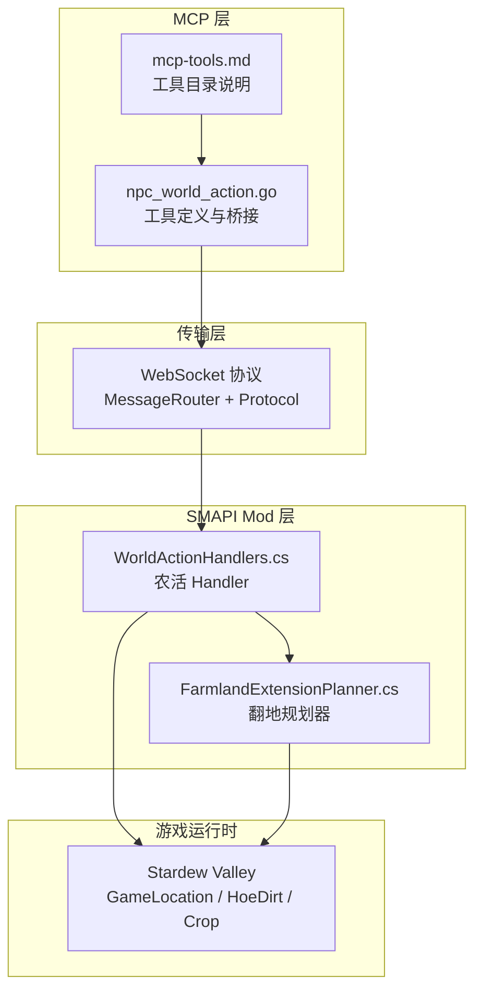
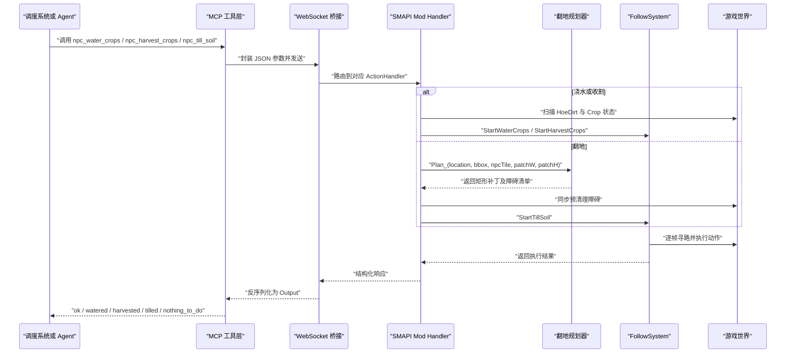
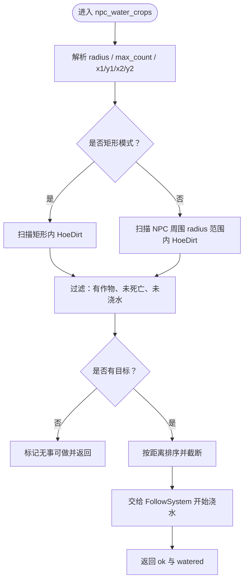
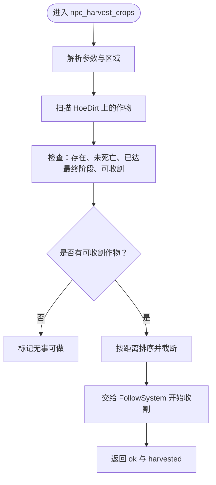
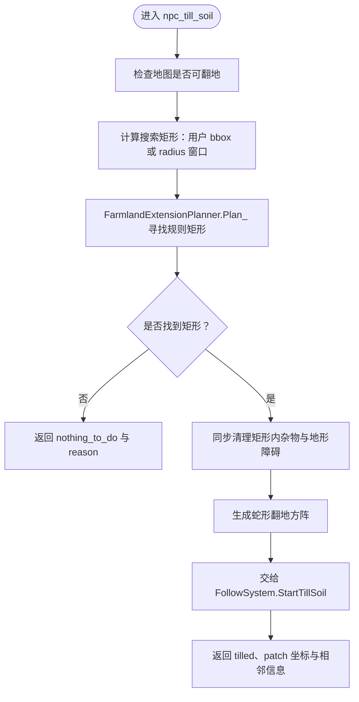
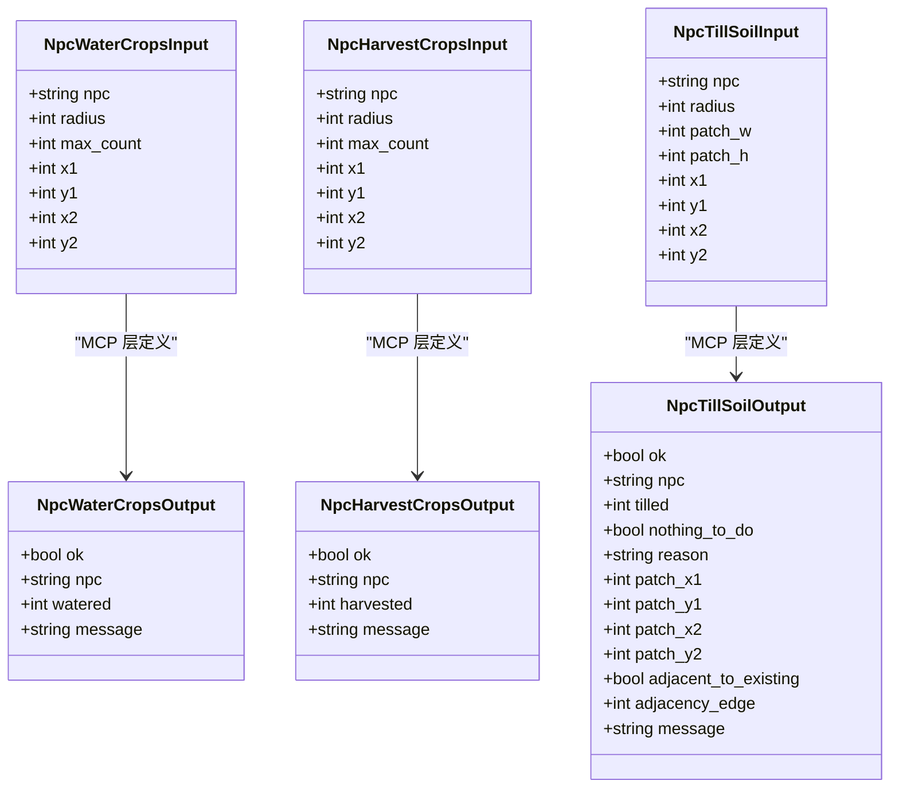
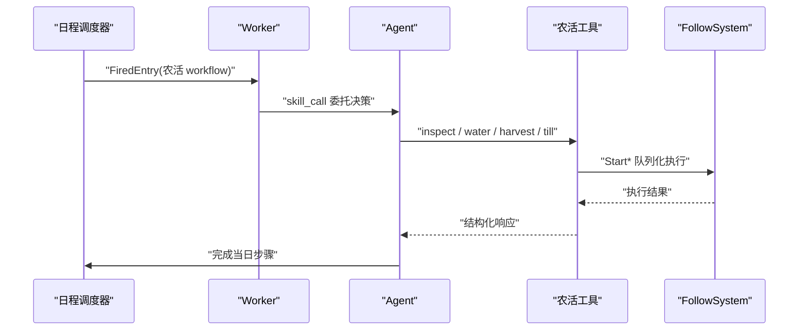
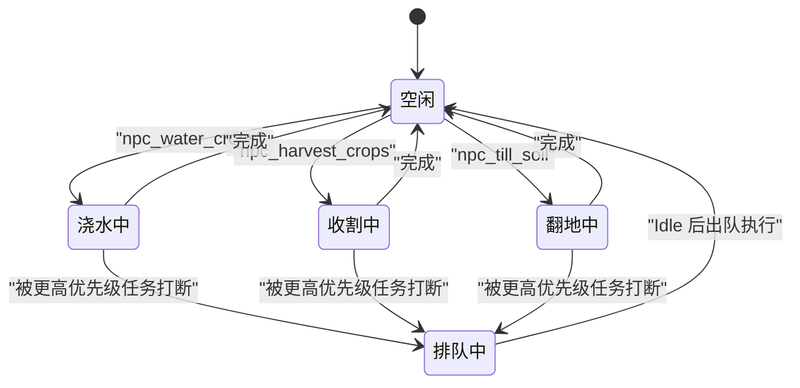
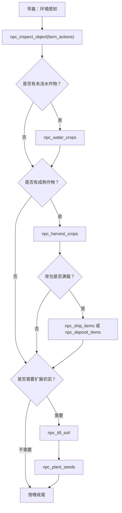

# NPC 世界行为工具

<cite>
**本文引用的文件**   
- [npc_world_action.go](file://SmartNPC/smartnpc-mcp/adapters/stardew/tools/npc_world_action.go)
- [npc_world_action_test.go](file://SmartNPC/smartnpc-mcp/adapters/stardew/tools/npc_world_action_test.go)
- [WorldActionHandlers.cs](file://SmartNPC/smapi-mod/Behavior/WorldActionHandlers.cs)
- [FarmlandExtensionPlanner.cs](file://SmartNPC/smapi-mod/Behavior/FarmlandExtensionPlanner.cs)
- [mcp-tools.md](file://SmartNPC/docs/mcp-tools.md)
- [schedule-system-detail.md](file://SmartNPC/docs/schedule-system-detail.md)
</cite>

## 目录
1. [引言](#引言)
2. [项目结构](#项目结构)
3. [核心工具概览](#核心工具概览)
4. [架构总览](#架构总览)
5. [详细工具说明](#详细工具说明)
6. [依赖与状态分析](#依赖与状态分析)
7. [性能与并发特性](#性能与并发特性)
8. [自动化农场场景示例](#自动化农场场景示例)
9. [故障排查指南](#故障排查指南)
10. [结论](#结论)

## 引言
本文件面向使用 SmartNPC 的农场运营者、工作流作者和 MCP 调用方，聚焦以下高影响农活工具：

- `npc_water_crops`：自动浇水未浇水的作物。
- `npc_harvest_crops`：收割成熟或可再次成熟的作物。
- `npc_till_soil`：在已有农田附近规划并翻地生成规则矩形地块。

这些工具会直接修改游戏世界状态，属于“写操作”工具。文档重点说明参数约束、执行条件、副作用、错误反馈、作物状态判断逻辑、与日程系统的集成方式，以及如何避免重复执行和冲突操作。

## 项目结构
MCP 层通过 Go 代码注册工具描述、输入输出结构，并把调用转发到 SMAPI Mod；Mod 层用 C# Handler 解析参数、扫描地图、规划路径，并通过 FollowSystem 在游戏 tick 中驱动 NPC 完成真实世界改动。

**图示来源**
- [npc_world_action.go:1-200](file://SmartNPC/smartnpc-mcp/adapters/stardew/tools/npc_world_action.go#L1-L200)
- [WorldActionHandlers.cs:1-200](file://SmartNPC/smapi-mod/Behavior/WorldActionHandlers.cs#L1-L200)
- [FarmlandExtensionPlanner.cs:1-200](file://SmartNPC/smapi-mod/Behavior/FarmlandExtensionPlanner.cs#L1-L200)
- [mcp-tools.md:1-200](file://SmartNPC/docs/mcp-tools.md#L1-L200)

**章节来源**
- [npc_world_action.go:1-200](file://SmartNPC/smartnpc-mcp/adapters/stardew/tools/npc_world_action.go#L1-L200)
- [mcp-tools.md:1-200](file://SmartNPC/docs/mcp-tools.md#L1-L200)

## 核心工具概览
| 工具 | 主要副作用 | 关键输入 | 关键输出字段 | 适用时机 |
|---|---|---|---|---|
| `npc_water_crops` | 将指定区域内的未浇水作物标记为已浇水 | `npc`、可选 `radius`/`max_count` 或 `x1/y1/x2/y2` | `ok`、`watered`、`message` | 发现未浇水作物后执行 |
| `npc_harvest_crops` | 从成熟地块收获作物并放入 NPC 背包 | `npc`、可选 `radius`/`max_count` 或 `x1/y1/x2/y2` | `ok`、`harvested`、`message` | 成熟作物或可再熟浆果到达成熟阶段时 |
| `npc_till_soil` | 清除区域内障碍并翻地生成规则矩形农田 | `npc`、`patch_w`、`patch_h`、可选 `radius` 或 `x1/y1/x2/y2` | `ok`、`tilled`、`nothing_to_do`、`adjacent_to_existing`、`patch_x1..patch_y2` | 需要扩展农田且周围存在可翻空地时 |

所有农活工具都遵循统一目标选择约定：

- **半径模式**：以 NPC 当前位置为中心，使用 `radius` 扫描，并用 `max_count` 限制最大目标数。
- **矩形模式**：设置 `x1/y1/x2/y2` 四个非零值形成闭合矩形，此时忽略 `radius`，并以矩形本身作为区域上限。
- 请求被接受只代表“任务入队”，实际行走和执行由 FollowSystem 在后续游戏 tick 中完成。

**章节来源**
- [npc_world_action.go:1-200](file://SmartNPC/smartnpc-mcp/adapters/stardew/tools/npc_world_action.go#L1-L200)
- [mcp-tools.md:120-200](file://SmartNPC/docs/mcp-tools.md#L120-L200)

## 架构总览
农活工具的完整调用链如下：

**图示来源**
- [npc_world_action.go:201-450](file://SmartNPC/smartnpc-mcp/adapters/stardew/tools/npc_world_action.go#L201-L450)
- [WorldActionHandlers.cs:201-1301](file://SmartNPC/smapi-mod/Behavior/WorldActionHandlers.cs#L201-L1301)
- [FarmlandExtensionPlanner.cs:1-200](file://SmartNPC/smapi-mod/Behavior/FarmlandExtensionPlanner.cs#L1-L200)

## 详细工具说明

### `npc_water_crops`：自动浇水

#### 参数要求
| 字段 | 类型 | 是否必填 | 默认值 | 含义 |
|---|---|---|---|---|
| `npc` | 字符串 | 是 | 无 | NPC 内部名称，例如 `XiaMi` |
| `radius` | 整数 | 否 | `5` | 半径模式扫描范围，取值范围 `1` 到 `30` |
| `max_count` | 整数 | 否 | `5` | 半径模式下最多处理的目标数量 |
| `x1/y1/x2/y2` | 整数 | 条件必填 | 无 | 同时设置四个非零值时启用矩形模式，忽略 `radius` |

#### 执行条件
- 当前地图必须存在；否则直接忽略。
- 只扫描 `HoeDirt` 地形特征。
- 地块上必须有作物。
- 作物不能死亡。
- 作物必须是“需要浇水”的状态：内部实现直接读取 `state.Value != 已浇水常量`，而不是依赖可能包含额外失败语义的辅助方法。
- 如果同时存在多个目标，会按距离排序；超出 `max_count`（矩形模式下不截断）时取最近的前若干块。

#### 副作用
- 将选中地块的作物标记为已浇水。
- 不会主动播种或收割。
- 不会消耗种子或肥料。
- 会通过 BBoxOverlay 标记实际工作区域。

#### 结果与错误反馈
- `ok=true`：表示请求被接受并入队。
- `watered`：实际排队等待执行的浇水地块数量。
- `message`：状态提示。
- 如果没有未浇水作物，Handler 会记录日志并标记“无事可做”。
- 空 `npc` 会在测试中被视为无效调用。

**图示来源**
- [WorldActionHandlers.cs:544-892](file://SmartNPC/smapi-mod/Behavior/WorldActionHandlers.cs#L544-L892)

**章节来源**
- [npc_world_action.go:1-200](file://SmartNPC/smartnpc-mcp/adapters/stardew/tools/npc_world_action.go#L1-L200)
- [WorldActionHandlers.cs:544-892](file://SmartNPC/smapi-mod/Behavior/WorldActionHandlers.cs#L544-L892)
- [npc_world_action_test.go:120-200](file://SmartNPC/smartnpc-mcp/adapters/stardew/tools/npc_world_action_test.go#L120-L200)

### `npc_harvest_crops`：自动收割

#### 参数要求
| 字段 | 类型 | 是否必填 | 默认值 | 含义 |
|---|---|---|---|---|
| `npc` | 字符串 | 是 | 无 | NPC 内部名称 |
| `radius` | 整数 | 否 | `5` | 半径模式扫描范围，取值范围 `1` 到 `30` |
| `max_count` | 整数 | 否 | `5` | 半径模式下最多收割的地块数 |
| `x1/y1/x2/y2` | 整数 | 条件必填 | 无 | 同时设置四个非零值时启用矩形模式 |

#### 作物成熟判定
收割不是简单判断“作物存在”，而是采用与 Stardew Valley 原版 `Crop.harvest()` 一致的权威条件：

1. 作物存在且未死亡。
2. 当前生长阶段已达到最终阶段。
3. 满足单收作物或多收作物的成熟分支：
   - 单收作物：达到最终阶段后即可收割。
   - 多收作物：首次成熟后 `fullyGrown` 为真，但再生倒计时期间 `dayOfCurrentPhase > 0`，此时不应收割。

这一逻辑由共享函数维护，并被收割 Handler、`npc_inspect_object` 的 farm_actions 扫描以及 FollowSystem 的单格重试门限共同引用，确保观察、选择和执行三层一致。

#### 副作用
- 从成熟地块收获作物。
- 收获产物放入 NPC 背包。
- 对多收作物而言，成功收获后可能进入再生倒计时。
- 不会自动浇水；因此“成熟但未浇水”的作物仍可被收割，这与浇水工具不同。

#### 结果与错误反馈
- `ok=true`：请求被接受。
- `harvested`：排队收割的地块数量。
- 没有成熟作物时，Handler 记录日志并标记“无事可做”。

**图示来源**
- [WorldActionHandlers.cs:544-892](file://SmartNPC/smapi-mod/Behavior/WorldActionHandlers.cs#L544-L892)

**章节来源**
- [npc_world_action.go:1-200](file://SmartNPC/smartnpc-mcp/adapters/stardew/tools/npc_world_action.go#L1-L200)
- [WorldActionHandlers.cs:544-892](file://SmartNPC/smapi-mod/Behavior/WorldActionHandlers.cs#L544-L892)

### `npc_till_soil`：翻地准备种植

#### 参数要求
| 字段 | 类型 | 是否必填 | 默认值 | 含义 |
|---|---|---|---|---|
| `npc` | 字符串 | 是 | 无 | NPC 内部名称 |
| `patch_w` | 整数 | 否 | `10` | 计划翻地的矩形宽度，最大值 `12` |
| `patch_h` | 整数 | 否 | `6` | 计划翻地的矩形高度，最大值 `12` |
| `radius` | 整数 | 否 | `3` | 搜索窗口大小；用于寻找可翻地区域 |
| `max_count` | 整数 | 否 | — | 已废弃；实际面积由 `patch_w × patch_h` 决定 |
| `x1/y1/x2/y2` | 整数 | 条件必填 | 无 | 同时设置四个非零值时启用矩形模式 |

#### 执行条件
- 地图必须是可翻地图：农场、温室，或名称中包含岛屿农场的地图。
- 规划器必须在搜索窗口内找到一个完整的 `patch_w × patch_h` 矩形。
- 矩形内每个候选格子都必须可扩展（可通过、可挖掘、无对象、无不可移除地形）。
- 规划器优先选择与现有 `HoeDirt` 相邻的矩形，评分公式综合考虑相邻边长度、共享边比例和到 NPC 的距离。
- 如果找不到合适矩形，返回 `nothing_to_do=true`，并附带原因。

#### 预清理机制
一旦选定矩形，翻地在执行前会同步清理该矩形内的障碍：

- 杂物：杂草、树枝、石头等。
- 地形障碍：树桩、小树苗、高草。
- 资源簇：树桩、空心原木中与矩形相交的部分。
- 成熟且未 tapped 的树木会被标记为需要砍伐。

随后，FollowSystem 按蛇形顺序遍历矩形中的每一格进行翻地，避免来回折返。

#### 结果与错误反馈
| 字段 | 含义 |
|---|---|
| `ok` | 请求是否被接受 |
| `tilled` | 实际翻地的方块数量，等于 `patch_w × patch_h` |
| `nothing_to_do` | 是否没有找到可放置矩形 |
| `reason` | 无事做时的原因说明 |
| `patch_x1/patch_y1/patch_x2/patch_y2` | 最终选择的矩形边界 |
| `adjacent_to_existing` | 是否与已有农田相邻 |
| `adjacency_edge` | 与已有农田接触的周长边数 |

**图示来源**
- [WorldActionHandlers.cs:950-1301](file://SmartNPC/smapi-mod/Behavior/WorldActionHandlers.cs#L950-L1301)
- [FarmlandExtensionPlanner.cs:1-200](file://SmartNPC/smapi-mod/Behavior/FarmlandExtensionPlanner.cs#L1-L200)

**章节来源**
- [npc_world_action.go:201-450](file://SmartNPC/smartnpc-mcp/adapters/stardew/tools/npc_world_action.go#L201-L450)
- [WorldActionHandlers.cs:950-1301](file://SmartNPC/smapi-mod/Behavior/WorldActionHandlers.cs#L950-L1301)
- [FarmlandExtensionPlanner.cs:1-200](file://SmartNPC/smapi-mod/Behavior/FarmlandExtensionPlanner.cs#L1-L200)

## 依赖与状态分析

### 工具输入输出模型

**图示来源**
- [npc_world_action.go:1-200](file://SmartNPC/smartnpc-mcp/adapters/stardew/tools/npc_world_action.go#L1-L200)
- [npc_world_action.go:201-450](file://SmartNPC/smartnpc-mcp/adapters/stardew/tools/npc_world_action.go#L201-L450)

### 与日程系统集成
日程系统每天开始时广播 `day_started`，Agent 根据 SOUL、技能和工作流生成当天日程，再通过 `npc_plan_day` 提交内存中的 Entry 列表。到点触发后，MCP Worker 把 workflow 转给 Agent，Agent 调用 MCP 工具执行具体农活。

**图示来源**
- [schedule-system-detail.md:1-200](file://SmartNPC/docs/schedule-system-detail.md#L1-L200)

**章节来源**
- [schedule-system-detail.md:1-200](file://SmartNPC/docs/schedule-system-detail.md#L1-L200)
- [mcp-tools.md:1-200](file://SmartNPC/docs/mcp-tools.md#L1-L200)

## 性能与并发特性

### 幂等性
- 浇水工具只对“未浇水”地块生效，重复调用不会产生重复浇水。
- 收割工具只对成熟或可再次成熟的作物生效，重复调用不会重复收获同一块。
- 翻地工具只在找到未存在的矩形时才创建新农田，不会对已翻好的土地反复翻动。

因此，这些工具在“语义层面”具备较好的幂等性：多次调用不会造成破坏性重复状态变化，但每次调用仍会执行一次扫描和一次入队，并非完全零开销。

### 事务性
- 参数解析、目标筛选和队列入队发生在同一个调用路径中。
- 翻地的“预清理”在游戏线程上同步执行，确保 NPC 开始走位前障碍已被清理。
- 真正的行走、动画、地形修改由 FollowSystem 在后续 game tick 中逐步完成。
- 工具返回值反映的是“入队成功与否”，不是“所有地块都已修改完毕”。上层应通过后续 inspect、库存、日程状态或日志确认最终结果。

### 并发与冲突控制
- 所有农活 Handler 设置“忙碌时拒绝”，并与 FollowSystem 绑定忙闲门控。
- 同 NPC 的工作流严格串行；新 schedule entry 会取消该 NPC 上一个仍在运行的 workflow。
- 长时任务会排入 per-NPC FIFO 队列，空闲时依次出队执行。
- 多个 NPC 可同时运行各自的任务，但单个 NPC 不会并行执行两个农活。

**图示来源**
- [schedule-system-detail.md:120-255](file://SmartNPC/docs/schedule-system-detail.md#L120-L255)
- [WorldActionHandlers.cs:1-200](file://SmartNPC/smapi-mod/Behavior/WorldActionHandlers.cs#L1-L200)

**章节来源**
- [schedule-system-detail.md:120-255](file://SmartNPC/docs/schedule-system-detail.md#L120-L255)
- [WorldActionHandlers.cs:1-200](file://SmartNPC/smapi-mod/Behavior/WorldActionHandlers.cs#L1-L200)

## 自动化农场场景示例

### 场景一：NPC 自动浇水
推荐流程：

1. 先使用 `npc_get_environment` 或 `npc_inspect_object` 获取当前位置、天气、作物状态。
2. 如果检测到未浇水作物，调用 `npc_water_crops`。
3. 若传入矩形区域，建议先用 `npc_inspect_object` 的 `farm_actions` 模式获取 watering 组的 bbox，再回填到 `x1/y1/x2/y2`。
4. 检查返回的 `watered` 是否为 `0`；如果是，说明没有需要浇水的地块，跳过下一步。

注意事项：

- 雨天时是否需要浇水取决于业务策略；MCP 工具不提供自动跳过雨天的逻辑，应由上层日程决定是否调用。
- 如果 NPC 背包为空或正在其他任务中，浇水任务可能被拒绝或排队。

### 场景二：NPC 自动收割成熟作物
推荐流程：

1. 使用 `npc_inspect_object` 的 `farm_actions` 模式查看 harvest 组，或自行扫描成熟作物。
2. 调用 `npc_harvest_crops`。
3. 收割后检查 NPC 背包，必要时调用 `npc_deposit_items` 或 `npc_ship_items`。
4. 对于多收作物，注意收割后可能进入再生倒计时；不要误判为“已经全部成熟”。

注意事项：

- 成熟不等于立即可收割：多收作物需要再生倒计时结束。
- 收割工具不会自动浇水；若作物因缺水死亡，则不会被收割。

### 场景三：NPC 翻地准备种植
推荐流程：

1. 确定目标矩形尺寸 `patch_w` 和 `patch_h`。
2. 使用 `radius` 或 `x1/y1/x2/y2` 划定搜索范围。
3. 调用 `npc_till_soil`。
4. 如果返回 `nothing_to_do=true`，应重新评估搜索范围、矩形尺寸或清理障碍物。
5. 翻地完成后，可继续调用 `npc_plant_seeds` 播种。

注意事项：

- 翻地只创建农田，不播种。
- 翻地会尝试贴合已有农田边缘；冷启动时也会靠近 NPC 位置，便于建立初始田块。
- 如果矩形内有成熟树木或大量障碍，可能需要先分别调用清理或砍伐相关工具。

### 场景四：完整一日农事闭环

[此图为概念流程图，不直接映射单一源码文件]

## 故障排查指南

| 现象 | 可能原因 | 排查建议 |
|---|---|---|
| `npc_water_crops` 返回 `watered=0` | 没有未浇水作物、作物死亡、或区域不包含 `HoeDirt` | 先用 `npc_inspect_object` 检查未浇水数量；确认作物存活 |
| `npc_harvest_crops` 返回 `harvested=0` | 作物未成熟、再生倒计时未结束、或没有成熟作物 | 检查 crop 最终阶段和 `fullyGrown`、`dayOfCurrentPhase` 语义 |
| `npc_till_soil` 返回 `nothing_to_do` | 地图不可翻地、搜索窗口太小、矩形无法放置、或被障碍物占据 | 增大 `radius` 或扩大 `x1/y1/x2/y2`；先清理障碍 |
| 工具被拒绝 | NPC 正在执行长时任务 | 等待 Idle 或让日程系统取消旧任务并重新触发 |
| 浇水/收割没有效果 | 请求已入队但尚未执行完 | 不要只看即时返回值；结合 inspect 和日志确认 |
| 翻地位置不符合预期 | 搜索窗口或矩形尺寸不合适 | 调整 `patch_w`、`patch_h` 或 bbox；观察 `adjacent_to_existing` |

### 常见错误分类
- **参数错误**：空 `npc`、非法 `seed_id`、非法矩形坐标。
- **条件不满足**：地图不可种植、没有可翻地、没有可收割作物、没有未浇水作物。
- **资源不足**：背包没有种子、没有可投递物品、没有可邮寄物品。
- **执行被拒绝**：NPC 忙碌且任务互斥。
- **异步未完成**：工具只表示入队成功，不代表世界状态已稳定变更。

**章节来源**
- [npc_world_action_test.go:1-200](file://SmartNPC/smartnpc-mcp/adapters/stardew/tools/npc_world_action_test.go#L1-L200)
- [WorldActionHandlers.cs:201-1301](file://SmartNPC/smapi-mod/Behavior/WorldActionHandlers.cs#L201-L1301)

## 结论
`npc_water_crops`、`npc_harvest_crops` 和 `npc_till_soil` 是 SmartNPC 自动化农场的核心写操作工具。它们通过 MCP 层暴露参数、通过 WebSocket 路由到 Mod 层、再由 FollowSystem 和游戏运行时完成真实世界状态修改。

使用时应遵循以下原则：

1. **先观察，后行动**：优先使用 `npc_inspect_object` 或环境查询工具确认作物状态。
2. **明确区域**：尽量使用 `x1/y1/x2/y2` 精确框定农活范围，避免大范围盲目扫描。
3. **理解返回值**：`ok` 代表请求被接受，`watered`、`harvested`、`tilled` 代表入队规模，不代表异步执行已完成。
4. **尊重日程串行性**：不要让同一个 NPC 在同一时间并发执行多个农活。
5. **接受幂等但不接受零成本**：重复调用通常安全，但仍会产生扫描和调度开销。
6. **区分浇水与收割**：浇水针对未浇水状态，收割针对成熟状态；两者职责不同，不能互相替代。
7. **翻地是规划型工具**：它不只是挖洞，而是生成贴近现有农田的规则矩形，并负责预清理障碍。