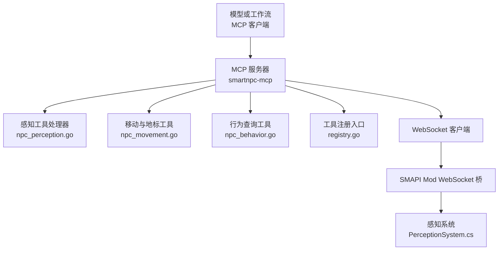
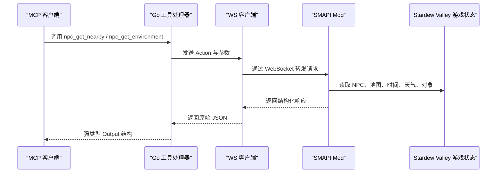
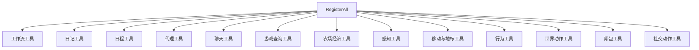
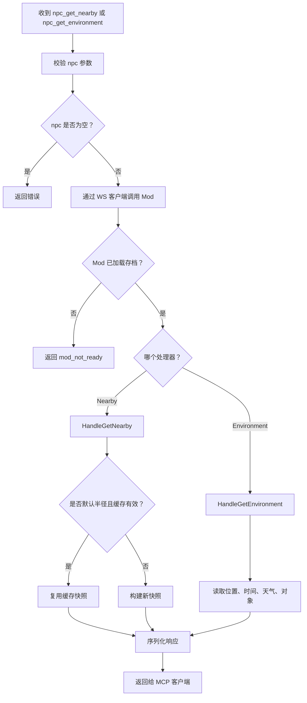
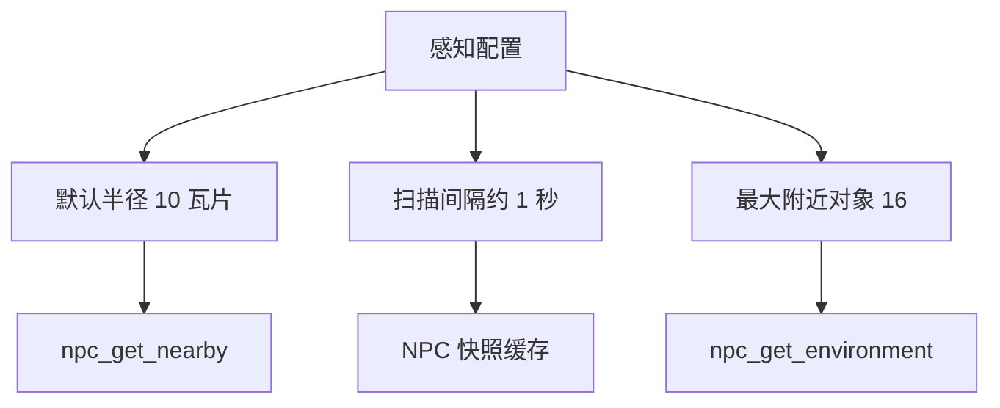
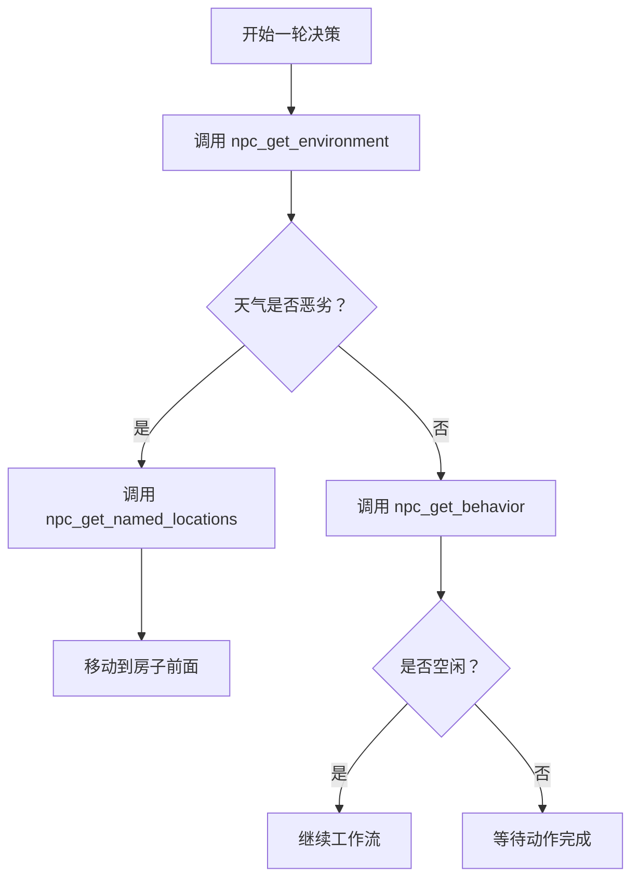
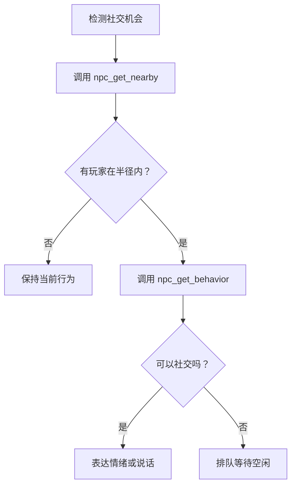

# NPC 感知工具

<cite>
**本文引用的文件**   
- [npc_perception.go](file://SmartNPC/smartnpc-mcp/adapters/stardew/tools/npc_perception.go)
- [npc_movement.go](file://SmartNPC/smartnpc-mcp/adapters/stardew/tools/npc_movement.go)
- [npc_behavior.go](file://SmartNPC/smartnpc-mcp/adapters/stardew/tools/npc_behavior.go)
- [registry.go](file://SmartNPC/smartnpc-mcp/adapters/stardew/tools/registry.go)
- [npc_perception_test.go](file://SmartNPC/smartnpc-mcp/adapters/stardew/tools/npc_perception_test.go)
- [PerceptionSystem.cs](file://SmartNPC/smapi-mod/Perception/PerceptionSystem.cs)
- [mcp-tools.md](file://SmartNPC/docs/mcp-tools.md)
</cite>

## 目录
1. [简介](#简介)
2. [项目结构](#项目结构)
3. [核心感知能力总览](#核心感知能力总览)
4. [架构概览](#架构概览)
5. [详细 API 说明](#详细-api-说明)
6. [依赖与数据流分析](#依赖与数据流分析)
7. [性能与感知范围配置](#性能与感知范围配置)
8. [NPC 自主决策场景示例](#npc-自主决策场景示例)
9. [故障排查](#故障排查)
10. [结论](#结论)

## 简介
本文面向使用 SmartNPC 的 MCP 客户端（例如 Hermes、Agent 或工作流引擎），完整说明 NPC 感知类工具的接口、参数、返回结构、实现位置以及最佳实践。重点覆盖以下能力：

- `npc_get_nearby`：扫描 NPC 当前地图上的其他角色，按距离排序返回。
- `npc_get_environment`：一次性获取位置、时间、季节、天气、附近对象等综合环境信息。
- `npc_get_named_locations`：返回农场地标名称映射，供自然语言目标解析为瓦片坐标。
- `npc_get_behavior`：查询 NPC 当前高层行为模式。

这些工具属于 SmartNPC 的 Stardew Valley 适配器层，Go 侧负责 MCP 协议、输入校验和 JSON 编解码；C# SMAPI Mod 侧负责读取真实游戏状态、执行扫描并缓存结果。

## 项目结构
感知工具涉及两层代码：

| 层级 | 主要职责 | 关键文件 |
|---|---|---|
| MCP Go 适配层 | 定义工具名、描述、输入输出结构体，注册到 MCP Server，转发到 WS Bridge | `npc_perception.go`、`npc_movement.go`、`npc_behavior.go`、`registry.go` |
| SMAPI C# Mod 层 | 在每帧 tick 上扫描 NPC 周围，提供 `npc_get_nearby`、`npc_get_environment` 处理器 | `PerceptionSystem.cs` |
| 文档 | 对外暴露的工具目录、调用时机说明 | `mcp-tools.md` |
| 测试 | 端到端验证工具列表、空 NPC 拒绝、Mod 错误传播 | `npc_perception_test.go` |

**图表来源**
- [registry.go:49-76](file://SmartNPC/smartnpc-mcp/adapters/stardew/tools/registry.go#L49-L76)
- [npc_perception.go:63-129](file://SmartNPC/smartnpc-mcp/adapters/stardew/tools/npc_perception.go#L63-L129)
- [npc_movement.go:198-215](file://SmartNPC/smartnpc-mcp/adapters/stardew/tools/npc_movement.go#L198-L215)
- [npc_behavior.go:73-108](file://SmartNPC/smartnpc-mcp/adapters/stardew/tools/npc_behavior.go#L73-L108)
- [PerceptionSystem.cs:1-40](file://SmartNPC/smapi-mod/Perception/PerceptionSystem.cs#L1-L40)

**章节来源**
- [registry.go:1-82](file://SmartNPC/smartnpc-mcp/adapters/stardew/tools/registry.go#L1-L82)
- [mcp-tools.md:1-30](file://SmartNPC/docs/mcp-tools.md#L1-L30)

## 核心感知能力总览

| 工具 | 作用 | 主要参数 | 关键返回字段 | 是否写入游戏 | 是否需要存档 |
|---|---|---|---|---|---|
| `npc_get_nearby` | 扫描 NPC 附近的 NPC 与玩家 | `npc`、可选 `radius` | `ok`、`npc`、`map`、`radius`、`count`、`nearby[]` | 否 | 是 |
| `npc_get_environment` | 一次获取环境上下文 | `npc` | `ok`、`npc`、`map`、`x`、`y`、`facing`、`time_of_day`、`hour`、`minute`、`season`、`weather`、`nearby_objects[]` | 否 | 是 |
| `npc_get_named_locations` | 返回农场地标名称到坐标映射 | 无 | `ok`、`locations[]` | 否 | 否 |
| `npc_get_behavior` | 查询 NPC 当前行为模式 | `npc` | `ok`、`npc`、`mode` | 否 | 是 |

其中：

- `npc_get_nearby` 的 `radius` 默认值为 10 个瓦片；返回列表中的每个实体包含 `distance`，且整体按距离从小到大排序。
- `npc_get_environment` 是推荐的环境聚合接口，避免分别调用时间、天气、位置等多个工具。
- `npc_get_named_locations` 返回静态地标表，适合把“湖边”“大门”等人类地址解析为 `(map, x, y)`。
- `npc_get_behavior` 返回高层模式字符串，例如 `idle`、`wander`、`water_crops`、`ship_items` 等；具体枚举由 Mod 维护，但文档明确包含 `idle`、`summoning`、`following`、`leading` 作为语义参考。

**章节来源**
- [npc_perception.go:12-61](file://SmartNPC/smartnpc-mcp/adapters/stardew/tools/npc_perception.go#L12-L61)
- [npc_behavior.go:47-68](file://SmartNPC/smartnpc-mcp/adapters/stardew/tools/npc_behavior.go#L47-L68)
- [npc_movement.go:71-102](file://SmartNPC/smartnpc-mcp/adapters/stardew/tools/npc_movement.go#L71-L102)
- [mcp-tools.md:140-160](file://SmartNPC/docs/mcp-tools.md#L140-L160)

## 架构概览

感知工具采用“Go MCP 工具 + WS Bridge + C# Mod 扫描”的分层架构：

**图表来源**
- [npc_perception.go:63-129](file://SmartNPC/smartnpc-mcp/adapters/stardew/tools/npc_perception.go#L63-L129)
- [PerceptionSystem.cs:85-160](file://SmartNPC/smapi-mod/Perception/PerceptionSystem.cs#L85-L160)

## 详细 API 说明

### `npc_get_nearby`

#### 功能
扫描 NPC 所在地图上一定半径内的其他角色，包括其他 NPC 和玩家。返回的 `nearby` 列表按欧几里得距离升序排列。

#### 输入

| 字段 | 类型 | 必填 | 默认值 | 说明 |
|---|---|---:|---:|---|
| `npc` | 字符串 | 是 | — | NPC 内部名称，例如 `XiaMi` |
| `radius` | 浮点数 | 否 | 10 | 可见半径，单位为瓦片 |

#### 输出

| 字段 | 类型 | 说明 |
|---|---|---|
| `ok` | 布尔 | 成功时通常为 `true` |
| `npc` | 字符串 | 观察者 NPC 名称 |
| `map` | 字符串 | 观察者当前地图名称 |
| `radius` | 浮点数 | 实际使用的扫描半径 |
| `count` | 整数 | 返回实体数量 |
| `nearby` | 数组 | 按距离排序的其他角色列表 |

`nearby` 中每项包含：

| 字段 | 类型 | 说明 |
|---|---|---|
| `name` | 字符串 | NPC 内部名称或玩家名称 |
| `type` | 字符串 | `npc` 或 `player` |
| `x` | 浮点数 | 瓦片 X 坐标 |
| `y` | 浮点数 | 瓦片 Y 坐标 |
| `distance` | 浮点数 | 与观察者 NPC 的欧几里得距离 |
| `facing` | 整数 | 朝向方向：0=上、1=右、2=下、3=左；未知时为 -1 |
| `map` | 字符串 | 实体所在地图，通常与观察者相同 |
| `action` | 字符串 | 玩家动作提示，如 `walking`、`using_tool`、`sitting`、`idle`；非必需字段 |

#### 调用时机
- 在回应环境变化前调用，例如向路过的村民打招呼、察觉玩家靠近、或在无人时避免说话。
- 在尝试发起 NPC 间对话前，确认对方确实在可听范围内。

#### 副作用
只读。Go 侧注释说明 Mod 侧缓存约每秒刷新一次；自定义 `radius` 会触发按需扫描。

**章节来源**
- [npc_perception.go:12-61](file://SmartNPC/smartnpc-mcp/adapters/stardew/tools/npc_perception.go#L12-L61)
- [npc_perception.go:63-92](file://SmartNPC/smartnpc-mcp/adapters/stardew/tools/npc_perception.go#L63-L92)
- [npc_perception_test.go:113-172](file://SmartNPC/smartnpc-mcp/adapters/stardew/tools/npc_perception_test.go#L113-L172)
- [PerceptionSystem.cs:104-145](file://SmartNPC/smapi-mod/Perception/PerceptionSystem.cs#L104-L145)
- [PerceptionSystem.cs:201-260](file://SmartNPC/smapi-mod/Perception/PerceptionSystem.cs#L201-L260)

### `npc_get_environment`

#### 功能
一次性获取 NPC 的综合环境信息，包括地图、瓦片坐标、朝向、时钟、季节、天气以及附近重要对象。相比多次调用 `game_get_time`、`game_get_weather`、`npc_get_position`，它减少网络往返并降低模型决策复杂度。

#### 输入

| 字段 | 类型 | 必填 | 说明 |
|---|---|---:|---|
| `npc` | 字符串 | 是 | NPC 内部名称 |

#### 输出

| 字段 | 类型 | 说明 |
|---|---|---|
| `ok` | 布尔 | 成功时通常为 `true` |
| `npc` | 字符串 | 观察者 NPC 名称 |
| `map` | 字符串 | 当前地图名称，例如 `Farm` |
| `x` | 浮点数 | 观察者瓦片 X |
| `y` | 浮点数 | 观察者瓦片 Y |
| `facing` | 整数 | 朝向方向：0=上、1=右、2=下、3=左 |
| `time_of_day` | 整数 | Stardew Valley 原始时间值，例如 1430 |
| `hour` | 整数 | 0–23 |
| `minute` | 整数 | 0–59 |
| `season` | 字符串 | `spring`、`summer`、`fall`、`winter` |
| `weather` | 字符串 | `sunny`、`rainy`、`snowy`、`stormy` |
| `nearby_objects` | 数组 | 附近显著对象，最多 16 项 |

`nearby_objects` 中每项包含：

| 字段 | 类型 | 说明 |
|---|---|---|
| `name` | 字符串 | 对象显示名称或内部名称 |
| `category` | 字符串 | 类别，例如 `object`、`terrain`、`crop`、`building` |
| `x` | 浮点数 | 瓦片 X |
| `y` | 浮点数 | 瓦片 Y |
| `distance` | 浮点数 | 与观察者的瓦片距离 |

#### 调用时机
- 需要情境化对话时使用，例如“下雨了，也许待在室内”“作物看起来成熟了”。
- 希望一次往返获得完整环境时使用。

**章节来源**
- [npc_perception.go:63-129](file://SmartNPC/smartnpc-mcp/adapters/stardew/tools/npc_perception.go#L63-L129)
- [npc_perception_test.go:201-270](file://SmartNPC/smartnpc-mcp/adapters/stardew/tools/npc_perception_test.go#L201-L270)
- [PerceptionSystem.cs:147-195](file://SmartNPC/smapi-mod/Perception/PerceptionSystem.cs#L147-L195)
- [PerceptionSystem.cs:262-380](file://SmartNPC/smapi-mod/Perception/PerceptionSystem.cs#L262-L380)
- [mcp-tools.md:140-160](file://SmartNPC/docs/mcp-tools.md#L140-L160)

### `npc_get_named_locations`

#### 功能
返回农场地标的静态名称映射。该工具不依赖存档，也不读取实时游戏状态，而是直接返回一组预定义的地标条目。

#### 输入
无必填字段。Go SDK 仍生成一个空的输入结构，以保证 schema 合法。

#### 输出

| 字段 | 类型 | 说明 |
|---|---|---|
| `ok` | 布尔 | 成功时通常为 `true` |
| `locations` | 数组 | 地标条目列表 |

每条地标包含：

| 字段 | 类型 | 说明 |
|---|---|---|
| `name` | 字符串 | 规范显示名称，例如 `房子前面` |
| `aliases` | 字符串数组 | 别名，例如 `house`、`door`、`farmhouse` |
| `map` | 字符串 | 地图名称，默认为 `Farm` |
| `x` | 整数 | 瓦片 X |
| `y` | 整数 | 瓦片 Y |

#### 典型用法
当用户或上层工作流说“去湖边”或“到大门口”时，先调用 `npc_get_named_locations`，将自然语言地址匹配到 `(map, x, y)`，再交给 `npc_move_to` 执行路径规划。

**章节来源**
- [npc_movement.go:71-102](file://SmartNPC/smartnpc-mcp/adapters/stardew/tools/npc_movement.go#L71-L102)
- [npc_movement.go:198-215](file://SmartNPC/smartnpc-mcp/adapters/stardew/tools/npc_movement.go#L198-L215)
- [mcp-tools.md:140-160](file://SmartNPC/docs/mcp-tools.md#L140-L160)

### `npc_get_behavior`

#### 功能
查询 NPC 当前的高层行为模式。可用于判断上一个动作是否仍在进行中，或验证工作流结束后 NPC 是否回到空闲状态。

#### 输入

| 字段 | 类型 | 必填 | 说明 |
|---|---|---:|---|
| `npc` | 字符串 | 是 | NPC 内部名称 |

#### 输出

| 字段 | 类型 | 说明 |
|---|---|---|
| `ok` | 布尔 | 成功时通常为 `true` |
| `npc` | 字符串 | 回显的 NPC 名称 |
| `mode` | 字符串 | 当前行为模式，例如 `idle`、`wander`、`water_crops`、`ship_items` 等 |

根据本仓库对 NPC 自主行为的语义设计，常见模式可理解为：

| 模式 | 含义 |
|---|---|
| `idle` | 空闲等待下一步任务 |
| `summoning` | 正在召唤或准备吸引注意 |
| `following` | 跟随某个目标 |
| `leading` | 引导另一个单位前往目标 |
| `wander` | 随机游荡 |
| `water_crops` | 浇水作业 |
| `ship_items` | 运输物品 |

**章节来源**
- [npc_behavior.go:47-68](file://SmartNPC/smartnpc-mcp/adapters/stardew/tools/npc_behavior.go#L47-L68)
- [npc_behavior.go:73-108](file://SmartNPC/smartnpc-mcp/adapters/stardew/tools/npc_behavior.go#L73-L108)
- [mcp-tools.md:140-160](file://SmartNPC/docs/mcp-tools.md#L140-L160)

## 依赖与数据流分析

### 工具注册关系
所有 Stardew 特定工具由 `RegisterAll` 统一注册。感知类工具通过 `registerNpcPerception` 注册，移动与地标工具通过 `registerNpcMovement` 注册，行为工具通过 `registerNpcBehavior` 注册。只有当 WS Bridge 可用时，这些 Mod 相关工具才会被注册。

**图表来源**
- [registry.go:49-76](file://SmartNPC/smartnpc-mcp/adapters/stardew/tools/registry.go#L49-L76)

### 感知数据流

**图表来源**
- [npc_perception.go:63-129](file://SmartNPC/smartnpc-mcp/adapters/stardew/tools/npc_perception.go#L63-L129)
- [PerceptionSystem.cs:104-195](file://SmartNPC/smapi-mod/Perception/PerceptionSystem.cs#L104-L195)

**章节来源**
- [registry.go:49-76](file://SmartNPC/smartnpc-mcp/adapters/stardew/tools/registry.go#L49-L76)
- [npc_perception.go:63-129](file://SmartNPC/smartnpc-mcp/adapters/stardew/tools/npc_perception.go#L63-L129)
- [PerceptionSystem.cs:85-195](file://SmartNPC/smapi-mod/Perception/PerceptionSystem.cs#L85-L195)

## 性能与感知范围配置

### 缓存策略
`PerceptionSystem` 使用基于 NPC 内部名称的字典缓存快照。默认扫描间隔约为 60 tick，即约 1 秒。每次扫描遍历所有注册的 Agent NPC，并为每个 NPC 构建一次快照。

对于 `npc_get_nearby`：

- 如果调用方传入默认半径 10，并且已有对应 NPC 的缓存快照，则直接复用缓存。
- 如果调用方传入自定义 `radius`，或者缓存不可用，则执行按需扫描。

对于 `npc_get_environment`：

- 直接读取当前 NPC 的状态并收集附近对象，不使用 `npc_get_nearby` 的字符快照缓存。

### 性能影响
- `npc_get_nearby` 的默认半径命中缓存时，性能接近 O(1)。
- 自定义 `radius` 会触发重新扫描，时间复杂度与地图上 NPC 和 Farmer 数量线性相关。
- `npc_get_environment` 会扫描放置对象和地形特征，最多返回 16 个最近对象；对象越多，构造 `nearby_objects` 的成本越高。
- 两个工具都是只读操作，不会修改游戏世界状态。

### 感知范围配置
- 默认半径常量在 Mod 侧定义为 10 瓦片。
- Go 侧通过 `NpcGetNearbyInput.Radius` 暴露可选参数，并在为空或无效时使用默认值。
- `MaxNearbyObjects` 常量限制 `npc_get_environment` 的 `nearby_objects` 数量上限为 16。

**图表来源**
- [PerceptionSystem.cs:42-56](file://SmartNPC/smapi-mod/Perception/PerceptionSystem.cs#L42-L56)
- [PerceptionSystem.cs:104-145](file://SmartNPC/smapi-mod/Perception/PerceptionSystem.cs#L104-L145)
- [PerceptionSystem.cs:262-380](file://SmartNPC/smapi-mod/Perception/PerceptionSystem.cs#L262-L380)

**章节来源**
- [PerceptionSystem.cs:1-40](file://SmartNPC/smapi-mod/Perception/PerceptionSystem.cs#L1-L40)
- [PerceptionSystem.cs:42-56](file://SmartNPC/smapi-mod/Perception/PerceptionSystem.cs#L42-L56)
- [PerceptionSystem.cs:104-195](file://SmartNPC/smapi-mod/Perception/PerceptionSystem.cs#L104-L195)
- [PerceptionSystem.cs:262-380](file://SmartNPC/smapi-mod/Perception/PerceptionSystem.cs#L262-L380)

## NPC 自主决策场景示例

### 场景一：根据天气决定留守室内
1. 调用 `npc_get_environment` 获取 `weather`、`time_of_day`、`season`。
2. 如果天气为 `rainy` 或 `stormy`，且 NPC 不在房屋附近，优先选择留在屋内或移动到 `房子前面`。
3. 如果需要精确坐标，先调用 `npc_get_named_locations` 匹配“房子前面”，再调用 `npc_move_to`。
4. 如果 NPC 当前处于长动作中，先调用 `npc_get_behavior` 判断是否仍可中断。

### 场景二：发现玩家靠近时的社交反应
1. 调用 `npc_get_nearby`，检查是否有 `type=player` 且 `distance` 小于阈值。
2. 如果玩家在视线内，可选择表达问候或转向玩家。
3. 如需视觉反馈，可调用 `npc_emote`；如需对话，可使用聊天或广播工具。
4. 如果 NPC 当前正在执行不可中断的工作，应延迟社交反应。

### 场景三：自动农务调度
1. 使用 `npc_get_environment` 判断时间与作物成熟情况。
2. 使用 `npc_get_behavior` 判断是否已在浇水或运输。
3. 使用 `npc_get_named_locations` 将自然语言目标转为坐标。
4. 使用 `npc_move_to` 到达目标区域后执行农务动作。

**章节来源**
- [npc_perception.go:63-129](file://SmartNPC/smartnpc-mcp/adapters/stardew/tools/npc_perception.go#L63-L129)
- [npc_movement.go:71-102](file://SmartNPC/smartnpc-mcp/adapters/stardew/tools/npc_movement.go#L71-L102)
- [npc_behavior.go:47-68](file://SmartNPC/smartnpc-mcp/adapters/stardew/tools/npc_behavior.go#L47-L68)
- [mcp-tools.md:140-160](file://SmartNPC/docs/mcp-tools.md#L140-L160)

## 故障排查

### 常见问题

| 现象 | 可能原因 | 处理建议 |
|---|---|---|
| 调用 `npc_get_nearby` 报错 `npc is required` | 未传入 `npc` 或传空字符串 | 确保传入有效的 NPC 内部名称 |
| 调用 `npc_get_environment` 报错 `npc is required` | 同上 | 检查 MCP 客户端参数 |
| 返回 `mod_not_ready` | 没有加载存档或 Mod 尚未就绪 | 等待存档加载完成后再调用 |
| 返回 `npc_not_found` | 指定 NPC 不存在或未在当前地图 | 确认 NPC 名称是否正确 |
| `nearby` 为空 | 半径太小、NPC 独自在地图上，或缓存尚未更新 | 适当增大 `radius`，或等待下一轮扫描 |
| `nearby_objects` 很少 | 默认最多返回 16 项 | 这是正常上限，不是错误 |
| 自定义 `radius` 比预期慢 | 触发了按需扫描而非缓存 | 优先使用默认半径 10，或使用 `npc_get_environment` 减少往返 |

### 测试覆盖的行为
测试文件覆盖了以下关键路径：

- 工具列表中确实存在 `npc_get_nearby` 和 `npc_get_environment`。
- `npc_get_nearby` 能正确解析 `npc` 和 `radius`，并按距离顺序返回 `nearby`。
- 空 `npc` 会被拒绝。
- Mod 侧错误会传播为 MCP 客户端的错误响应。
- `npc_get_environment` 能返回地图、坐标、时间、季节、天气和附近对象。

**章节来源**
- [npc_perception_test.go:45-111](file://SmartNPC/smartnpc-mcp/adapters/stardew/tools/npc_perception_test.go#L45-L111)
- [npc_perception_test.go:113-200](file://SmartNPC/smartnpc-mcp/adapters/stardew/tools/npc_perception_test.go#L113-L200)
- [npc_perception_test.go:201-305](file://SmartNPC/smartnpc-mcp/adapters/stardew/tools/npc_perception_test.go#L201-L305)

## 结论
SmartNPC 的 NPC 感知工具通过 MCP 协议将 Stardew Valley 的游戏状态安全暴露给模型与工作流：

- `npc_get_nearby` 适合做角色级感知，支持自定义半径并按距离排序。
- `npc_get_environment` 是推荐的环境聚合接口，减少多工具调用的复杂性和延迟。
- `npc_get_named_locations` 提供稳定的地标表，使自然语言地址能够可靠地转换为瓦片坐标。
- `npc_get_behavior` 帮助上层决策判断 NPC 当前是否在忙，避免重复下发冲突指令。

在实际自主 NPC 系统中，推荐以 `npc_get_environment` 为主、`npc_get_named_locations` 辅助地址解析、`npc_get_nearby` 补充角色感知、`npc_get_behavior` 控制动作并发，从而构建稳定、低开销、可解释的 NPC 感知与决策闭环。