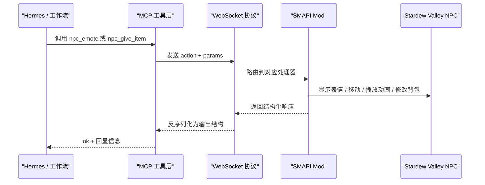
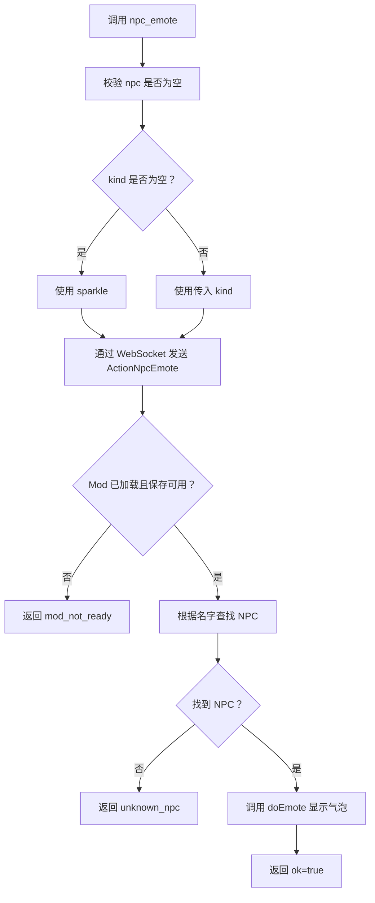
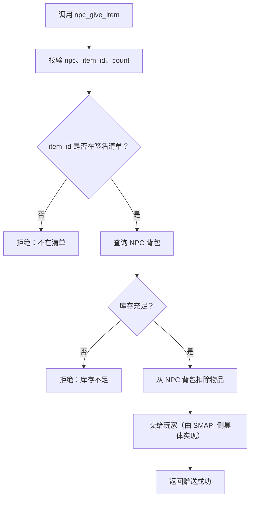

# NPC 社交行为工具

<cite>
**本文引用的文件**   
- [npc_behavior.go](file://SmartNPC/smartnpc-mcp/adapters/stardew/tools/npc_behavior.go)
- [npc_social_action.go](file://SmartNPC/smartnpc-mcp/adapters/stardew/tools/npc_social_action.go)
- [protocol.go](file://SmartNPC/smartnpc-mcp/adapters/stardew/bridge/protocol.go)
- [SocialActionHandlers.cs](file://SmartNPC/smapi-mod/Behavior/SocialActionHandlers.cs)
- [NpcActionHandlerBase.cs](file://SmartNPC/smapi-mod/Behavior/NpcActionHandlerBase.cs)
- [FollowSystem.Animations.cs](file://SmartNPC/smapi-mod/Movement/FollowSystem.Animations.cs)
- [FollowSystem.cs](file://SmartNPC/smapi-mod/Movement/FollowSystem.cs)
- [NpcInventory.cs](file://SmartNPC/smapi-mod/Data/NpcInventory.cs)
- [abigail/SOUL.md](file://SmartNPC/hermes/profiles/abigail/SOUL.md)
- [haley/SOUL.md](file://SmartNPC/hermes/profiles/haley/SOUL.md)
- [harvey/SOUL.md](file://SmartNPC/hermes/profiles/harvey/SOUL.md)
- [penny/SOUL.md](file://SmartNPC/hermes/profiles/penny/SOUL.md)
- [sebastian/SOUL.md](file://SmartNPC/hermes/profiles/sebastian/SOUL.md)
</cite>

## 目录
1. [简介](#简介)
2. [项目结构与调用链路](#项目结构与调用链路)
3. [核心社交工具总览](#核心社交工具总览)
4. [npc_emote 表情气泡工具](#npc_emote-表情气泡工具)
5. [npc_give_item 物品赠送工具](#npc_give_item-物品赠送工具)
6. [其他社交表现工具](#其他社交表现工具)
7. [与友谊度系统的集成关系](#与友谊度系统的集成关系)
8. [错误处理与边界条件](#错误处理与边界条件)
9. [完整场景示例](#完整场景示例)
10. [性能与并发特性](#性能与并发特性)
11. [故障排查指南](#故障排查指南)
12. [最佳实践](#最佳实践)
13. [结论](#结论)

## 简介
本文件为 SmartNPC 项目中 NPC 社交行为工具的完整 API 文档，聚焦以下能力：
- **npc_emote**：在 NPC 头顶显示星露谷原生表情气泡，纯视觉反馈。
- **npc_give_item**：让 NPC 从自身背包中取出并赠送物品，需遵守 SOUL.md 中的“签名礼物清单”。
- 其他社交表现工具：如 `npc_express_emotion`、`npc_shy_retreat`、`npc_show_text_bubble`、`npc_idle_activity`、`npc_dance_happy`、`npc_react_surprise`、`npc_pace_anxiously`。

这些工具通过 MCP 服务器暴露给 Hermes 或工作流调用方，再经 WebSocket 协议路由到 SMAPI Mod，最终驱动 Stardew Valley 的 NPC、动画和背包系统。

## 项目结构与调用链路
MCP 层负责定义工具参数、校验输入并通过 WebSocket 把请求转发给 SMAPI；SMAPI 层负责在游戏线程上查找 NPC、执行动作、展示气泡或更新背包状态。

**图示来源**
- [npc_behavior.go:68-108](file://SmartNPC/smartnpc-mcp/adapters/stardew/tools/npc_behavior.go#L68-L108)
- [npc_social_action.go:119-253](file://SmartNPC/smartnpc-mcp/adapters/stardew/tools/npc_social_action.go#L119-L253)
- [protocol.go:86-172](file://SmartNPC/smartnpc-mcp/adapters/stardew/bridge/protocol.go#L86-L172)
- [NpcActionHandlerBase.cs:122-200](file://SmartNPC/smapi-mod/Behavior/NpcActionHandlerBase.cs#L122-L200)

**章节来源**
- [npc_behavior.go:1-108](file://SmartNPC/smartnpc-mcp/adapters/stardew/tools/npc_behavior.go#L1-L108)
- [npc_social_action.go:119-253](file://SmartNPC/smartnpc-mcp/adapters/stardew/tools/npc_social_action.go#L119-L253)
- [protocol.go:86-172](file://SmartNPC/smartnpc-mcp/adapters/stardew/bridge/protocol.go#L86-L172)

## 核心社交工具总览
| 工具 | 作用 | 是否移动 NPC | 是否改游戏状态 | 典型用途 |
|---|---|---:|---:|---|
| `npc_emote` | 显示星露谷原生表情气泡 | 否 | 否（纯视觉效果） | 发现、疑惑、开心等瞬间情绪 |
| `npc_give_item` | 从 NPC 背包取物品并赠送 | 通常不主动走位 | 是（减少 NPC 背包库存） | 回应玩家索取礼物的对话 |
| `npc_express_emotion` | 组合动画、跳跃、转身和表情气泡 | 否（默认） | 否（视觉为主） | 收到礼物后的复合反应 |
| `npc_shy_retreat` | 后退一步、转身并害羞 | 是（后退一格） | 否（移动+动画） | 被夸奖、告白时害羞 |
| `npc_show_text_bubble` | 在头顶显示短文本气泡 | 否 | 否（约 2 秒消失） | 自言自语、简短反应 |
| `npc_idle_activity` | 锄地、休息、环顾、拿南瓜/作物/花/鸡 | 否 | 否（仅视觉姿势） | 让空闲 NPC 看起来自然 |
| `npc_dance_happy` | 欢呼、旋转、心跳气泡 | 是（跳跃） | 否（视觉庆祝） | 任务完成、收获成功 |
| `npc_react_surprise` | 惊讶跳起 + “!” 气泡 | 是（跳跃） | 否（视觉反应） | 突然现身、意外惊喜 |
| `npc_pace_anxiously` | 原地来回踱步 | 是（小范围） | 否（移动） | 等待、犹豫、焦虑 |

**章节来源**
- [npc_behavior.go:13-108](file://SmartNPC/smartnpc-mcp/adapters/stardew/tools/npc_behavior.go#L13-L108)
- [npc_social_action.go:35-253](file://SmartNPC/smartnpc-mcp/adapters/stardew/tools/npc_social_action.go#L35-L253)
- [SocialActionHandlers.cs:15-151](file://SmartNPC/smapi-mod/Behavior/SocialActionHandlers.cs#L15-L151)

## npc_emote 表情气泡工具
### 功能说明
`npc_emote` 使用星露谷原生的 `Character.doEmote` API，在 NPC 头顶显示一个表情气泡。它不会移动 NPC，也不会发送聊天消息。气泡会在约 1 秒后自动消失，属于纯视觉效果。

### 参数
| 字段 | 类型 | 必填 | 默认值 | 说明 |
|---|---|---:|---|---|
| `npc` | 字符串 | 是 | 无 | NPC 内部英文名，例如 `XiaMi`、`Abigail` |
| `kind` | 字符串 | 否 | `sparkle` | 表情类型，见下方枚举 |

### 支持的 kind 值
- `exclamation`
- `question`
- `heart`
- `sleep`
- `happy`
- `sad`
- `angry`
- `music`
- `sparkle`
- `pause`

未知 `kind` 会回退到 `sparkle`，服务端记录警告。

### 返回值
| 字段 | 类型 | 说明 |
|---|---|---|
| `ok` | 布尔 | 请求是否被接受并排队 |
| `npc` | 字符串 | 回显调用的 NPC 名称 |
| `kind` | 字符串 | 实际使用的表情类型（服务端可能替换未知值） |

### 调用流程

**图示来源**
- [npc_behavior.go:68-108](file://SmartNPC/smartnpc-mcp/adapters/stardew/tools/npc_behavior.go#L68-L108)
- [NpcActionHandlerBase.cs:122-200](file://SmartNPC/smapi-mod/Behavior/NpcActionHandlerBase.cs#L122-L200)

**章节来源**
- [npc_behavior.go:13-108](file://SmartNPC/smartnpc-mcp/adapters/stardew/tools/npc_behavior.go#L13-L108)
- [protocol.go:86-104](file://SmartNPC/smartnpc-mcp/adapters/stardew/bridge/protocol.go#L86-L104)
- [SocialActionHandlers.cs:15-56](file://SmartNPC/smapi-mod/Behavior/SocialActionHandlers.cs#L15-L56)

## npc_give_item 物品赠送工具
### 功能说明
`npc_give_item` 是让 NPC 从自己的背包中取出物品并送给玩家的工具。它不是“凭空变出物品”，而是真实消耗 NPC 背包中的库存。因此，调用前必须确认：
1. 目标 NPC 确实拥有该物品。
2. 物品 ID 符合星露谷带限定符的格式。
3. 物品属于该 NPC 的签名礼物清单。
4. 数量不超过当前库存。

### SDV 物品 ID 格式
仓库中的背包实现明确使用“星露谷限定物品 ID”，例如：
- `(O)66` Amethyst
- `(O)421` Sunflower
- `(O)395` Coffee
- `(O)216` Bread
- `(O)346` Beer
- `(O)390`
- `(O)167` Joja Cola

其中 `(O)` 表示 Object 类物品，后面数字是游戏内物品 ID。质量字段用于区分普通、银、金、铱等品质。

### 各 NPC 签名礼物清单
每个 NPC 的 SOUL.md 都定义了“唯一能从口袋里掏出来给玩家的东西”：

| NPC | 允许赠送的物品 ID | 触发语义 |
|---|---|---|
| Abigail | `(O)66` Amethyst | 紫水晶、宝石、水晶、矿石相关请求 |
| Haley | `(O)421` Sunflower | 向日葵、花、一朵花相关请求 |
| Harvey | `(O)395` Coffee | 咖啡、提神、热饮相关请求 |
| Penny | `(O)216` Bread | 面包、吃的、早饭相关请求 |
| Sebastian | `(O)346` Beer | 啤酒、酒、来一罐相关请求 |

非清单内的物品应拒绝，并使用角色化语言回复，而不是直接暴露错误码。

### 参数设计建议
虽然当前 MCP 层注释指出玩家中心行为工具已从部分入口移除，但协议层仍保留 `ActionNpcGiveItem`，因此对外暴露时应采用如下参数结构：

| 字段 | 类型 | 必填 | 默认值 | 说明 |
|---|---|---:|---|---|
| `npc` | 字符串 | 是 | 无 | NPC 内部英文名 |
| `item_id` | 字符串 | 是 | 无 | 带限定符的 SDV 物品 ID |
| `count` | 整数 | 否 | 1 | 赠送数量 |
| `quality` | 整数 | 否 | 0 | 物品质量：0=普通、1=银、2=金、4=铱 |

### 所有权验证与库存管理
底层 `NpcInventory` 维护每个 Agent 管理 NPC 的背包快照，数据结构包含：
- `ItemId`：SDV 限定物品 ID
- `Count`：堆叠数量
- `Quality`：质量等级

关键操作：
- `Add(npcName, itemId, count, quality)`：添加或合并堆叠，返回新总数。
- `Take(npcName, itemId, count)`：按物品 ID 和质量扣除库存，返回实际扣掉的数量。
- `GetItems(npcName)`：读取某 NPC 的全部槽位。
- `HasItems(npcName)`：判断是否有任意物品。
- `Clear(npcName)`：清空该 NPC 背包。
- `Snapshot()` / `Restore(snapshot)`：序列化存档。

这意味着 `npc_give_item` 的成功与否取决于 NPC 背包中是否存在匹配 `itemId` 和 `quality` 的槽位，以及数量是否足够。

### 错误处理
| 错误场景 | 推荐处理方式 |
|---|---|
| 未指定 `npc` | 返回参数缺失错误，由上层转为角色化提示 |
| 未指定 `item_id` | 返回参数缺失错误 |
| 物品不在签名清单 | 拒绝赠送，并用 NPC 人设语言解释“我没有这个” |
| 物品 ID 无效或未知 | 不创建不存在的游戏物品；可记录日志并返回错误 |
| 库存不足 | 返回“没有那么多”或角色化拒绝 |
| 物品质量不匹配 | 若只允许特定质量，则拒绝；否则按质量维度查找 |
| Mod 未加载 | 返回 `mod_not_ready` |
| NPC 不存在 | 返回 `unknown_npc` |

### 调用流程

**图示来源**
- [NpcInventory.cs:11-116](file://SmartNPC/smapi-mod/Data/NpcInventory.cs#L11-L116)
- [abigail/SOUL.md:64-74](file://SmartNPC/hermes/profiles/abigail/SOUL.md#L64-L74)
- [haley/SOUL.md:64-74](file://SmartNPC/hermes/profiles/haley/SOUL.md#L64-L74)
- [harvey/SOUL.md:63-73](file://SmartNPC/hermes/profiles/harvey/SOUL.md#L63-L73)
- [penny/SOUL.md:62-72](file://SmartNPC/hermes/profiles/penny/SOUL.md#L62-L72)
- [sebastian/SOUL.md:64-74](file://SmartNPC/hermes/profiles/sebastian/SOUL.md#L64-L74)

**章节来源**
- [protocol.go:86-104](file://SmartNPC/smartnpc-mcp/adapters/stardew/bridge/protocol.go#L86-L104)
- [NpcInventory.cs:11-116](file://SmartNPC/smapi-mod/Data/NpcInventory.cs#L11-L116)
- [abigail/SOUL.md:64-74](file://SmartNPC/hermes/profiles/abigail/SOUL.md#L64-L74)
- [haley/SOUL.md:64-74](file://SmartNPC/hermes/profiles/haley/SOUL.md#L64-L74)
- [harvey/SOUL.md:63-73](file://SmartNPC/hermes/profiles/harvey/SOUL.md#L63-L73)
- [penny/SOUL.md:62-72](file://SmartNPC/hermes/profiles/penny/SOUL.md#L62-L72)
- [sebastian/SOUL.md:64-74](file://SmartNPC/hermes/profiles/sebastian/SOUL.md#L64-L74)

## 其他社交表现工具
### npc_express_emotion
这是一个“组合表情表达”工具，不仅显示表情气泡，还会结合动画帧、跳跃、抖动和朝向变化。适合收到礼物、被夸奖、被冒犯等情感事件。

支持 emotion：
- `happy`
- `shy`
- `angry`
- `thinking`
- `sad`

副作用：纯视觉效果，不改游戏状态。

**章节来源**
- [npc_social_action.go:23-44](file://SmartNPC/smartnpc-mcp/adapters/stardew/tools/npc_social_action.go#L23-L44)
- [SocialActionHandlers.cs:15-56](file://SmartNPC/smapi-mod/Behavior/SocialActionHandlers.cs#L15-L56)

### npc_shy_retreat
NPC 向玩家后退一格、转身，并播放害羞或尴尬动画（抖动 + 爱心气泡）。适合被赞美、告白或调侃时的反应。

副作用：移动 NPC 一格，并播放视觉动画。

**章节来源**
- [npc_social_action.go:46-67](file://SmartNPC/smartnpc-mcp/adapters/stardew/tools/npc_social_action.go#L46-L67)
- [SocialActionHandlers.cs:58-78](file://SmartNPC/smapi-mod/Behavior/SocialActionHandlers.cs#L58-L78)
- [FollowSystem.Animations.cs:76-120](file://SmartNPC/smapi-mod/Movement/FollowSystem.Animations.cs#L76-L120)

### npc_show_text_bubble
在 NPC 头顶显示短文本气泡，适合自言自语、小声嘀咕、简短反应。气泡大约 2 秒后消失，不进入聊天面板。

建议文本长度控制在 30 字符以内。

**章节来源**
- [npc_social_action.go:69-90](file://SmartNPC/smartnpc-mcp/adapters/stardew/tools/npc_social_action.go#L69-L90)
- [SocialActionHandlers.cs:80-110](file://SmartNPC/smapi-mod/Behavior/SocialActionHandlers.cs#L80-L110)

### npc_idle_activity
让空闲 NPC 做出自然动作，包括：
- `farm`：锄地手势
- `rest`：站立或困倦姿势
- `look_around`：左右环顾
- `hold_pumpkin`：拿南瓜
- `hold_crop`：拿作物
- `hold_flower`：拿花
- `hold_chicken`：拿鸡

模式：
- `once`：播放一次
- `loop`：循环直到被打断

副作用：纯视觉，不创建或移动真实物品。

**章节来源**
- [npc_social_action.go:92-118](file://SmartNPC/smartnpc-mcp/adapters/stardew/tools/npc_social_action.go#L92-L118)
- [SocialActionHandlers.cs:112-118](file://SmartNPC/smapi-mod/Behavior/SocialActionHandlers.cs#L112-L118)
- [FollowSystem.Animations.cs:39-55](file://SmartNPC/smapi-mod/Movement/FollowSystem.Animations.cs#L39-L55)

### npc_dance_happy 与 npc_react_surprise
- `npc_dance_happy`：欢呼、旋转、心跳气泡，适合好消息、友谊里程碑、任务完成。
- `npc_react_surprise`：惊讶跳起 + “!” 气泡，适合玩家突然出现、意外礼物、惊喜新闻。

两者都会跳跃并播放庆祝或惊讶动画。

**章节来源**
- [npc_social_action.go:203-229](file://SmartNPC/smartnpc-mcp/adapters/stardew/tools/npc_social_action.go#L203-L229)
- [SocialActionHandlers.cs:120-140](file://SmartNPC/smapi-mod/Behavior/SocialActionHandlers.cs#L120-L140)
- [FollowSystem.Animations.cs:56-75](file://SmartNPC/smapi-mod/Movement/FollowSystem.Animations.cs#L56-L75)

### npc_pace_anxiously
NPC 紧张地来回踱步，偶尔出现问号气泡，适合等待、担心、犹豫或纠结场景。可在 `duration_ticks` 中控制持续时间，默认 200 个游戏刻。

**章节来源**
- [npc_social_action.go:231-253](file://SmartNPC/smartnpc-mcp/adapters/stardew/tools/npc_social_action.go#L231-L253)
- [SocialActionHandlers.cs:142-151](file://SmartNPC/smapi-mod/Behavior/SocialActionHandlers.cs#L142-L151)

## 与友谊度系统的集成关系
虽然 `npc_emote` 和多数社交表现工具本身不直接修改友谊度，但它们应与 friendship 系统协同使用：
- 高好感时更频繁使用 `happy`、`heart`、`dance_happy`。
- 低好感时使用 `question`、`angry`、`sad` 或克制表情。
- `npc_give_item` 不应作为刷好感手段，而应作为角色化互动的一部分。
- 礼物是否受欢迎应由上层逻辑判断，而不是由工具本身决定。

SOUL.md 中每个 NPC 都有“好感度对应语气”表，建议将表情与语气统一规划：
- 0-2 心：克制、礼貌、距离感。
- 3-5 心：开始放松，但仍保持角色边界。
- 6-8 心：熟悉、自然、愿意分享。
- 9-10 心：卸下防御，展现真实情感。

**章节来源**
- [abigail/SOUL.md:28-44](file://SmartNPC/hermes/profiles/abigail/SOUL.md#L28-L44)
- [haley/SOUL.md:28-44](file://SmartNPC/hermes/profiles/haley/SOUL.md#L28-L44)
- [harvey/SOUL.md:28-44](file://SmartNPC/hermes/profiles/harvey/SOUL.md#L28-L44)
- [penny/SOUL.md:28-44](file://SmartNPC/hermes/profiles/penny/SOUL.md#L28-L44)
- [sebastian/SOUL.md:28-44](file://SmartNPC/hermes/profiles/sebastian/SOUL.md#L28-L44)

## 错误处理与边界条件
### 通用错误
| 错误 | 含义 | 处理建议 |
|---|---|---|
| `mod_not_ready` | 没有加载存档或 Mod 未就绪 | 重试或告知用户暂时无法行动 |
| `unknown_npc` | 找不到指定 NPC | 检查 NPC 内部名是否正确 |
| `invalid_params` | 缺少必要参数 | 补全 `npc` 等必填字段 |
| 参数校验失败 | 前端或上层未校验 `npc`、`text`、`kind` 等 | 在上层提前拦截 |

### 表情气泡边界
- `npc_emote` 不移动 NPC。
- 不发送聊天消息。
- 不阻塞后续工具调用。
- 气泡约 1 秒后消失。
- 未知 `kind` 降级为 `sparkle`。

### 社交动作并发边界
基础处理器支持三类执行模型：
1. 简单动作：立即执行，不入队。
2. 可抢占动作：当前仅 `npc_wander`。
3. 串行独占动作：长时间任务需要排队，同一 NPC 不能同时执行多个独占动作。

许多社交动作设置 `RefuseWhileBusy = true`，避免在长动作进行中重复触发。

**章节来源**
- [NpcActionHandlerBase.cs:12-60](file://SmartNPC/smapi-mod/Behavior/NpcActionHandlerBase.cs#L12-L60)
- [NpcActionHandlerBase.cs:122-200](file://SmartNPC/smapi-mod/Behavior/NpcActionHandlerBase.cs#L122-L200)
- [npc_behavior.go:68-108](file://SmartNPC/smartnpc-mcp/adapters/stardew/tools/npc_behavior.go#L68-L108)

## 完整场景示例
### 场景一：NPC 主动送礼
适用条件：
- 玩家明确要求礼物。
- 请求语义匹配 NPC 签名礼物清单。
- NPC 背包中有对应物品。

步骤：
1. 根据玩家话语判断是否需要送礼。
2. 对照 SOUL.md 确认 `item_id`。
3. 调用 `npc_give_item`。
4. 如果库存不足，改用角色化拒绝。
5. 成功后可搭配 `happy` 或 `heart` 表情。

### 场景二：表情回应
适用条件：
- NPC 对玩家的话有即时情绪反应。
- 不需要移动或改变世界状态。

步骤：
1. 判断情绪类型。
2. 调用 `npc_emote`，选择 `happy`、`excited`、`question`、`angry`、`sad` 等。
3. 配合聊天回复，不要重复描述气泡内容。

### 场景三：害羞后退
适用条件：
- NPC 被夸奖、表白或调侃。
- 希望表现羞涩或不好意思。

步骤：
1. 调用 `npc_shy_retreat`。
2. 随后用角色化台词回应，例如假装不在意或转移话题。

### 场景四：闲聊中的自然动作
适用条件：
- NPC 空闲但没有任务。
- 不希望 NPC 呆呆站着。

步骤：
1. 调用 `npc_idle_activity`，活动选 `rest`、`look_around` 或 `farm`。
2. 如需持续自然感，可使用 `loop`，但要确保能被后续任务打断。

### 场景五：惊喜反应
适用条件：
- 玩家突然出现在 NPC 面前。
- 给 NPC 意外礼物。
- 说出令人惊讶的消息。

步骤：
1. 调用 `npc_react_surprise`。
2. 随后根据 NPC 性格给出惊讶台词。

**章节来源**
- [abigail/SOUL.md:64-74](file://SmartNPC/hermes/profiles/abigail/SOUL.md#L64-L74)
- [haley/SOUL.md:64-74](file://SmartNPC/hermes/profiles/haley/SOUL.md#L64-L74)
- [harvey/SOUL.md:63-73](file://SmartNPC/hermes/profiles/harvey/SOUL.md#L63-L73)
- [penny/SOUL.md:62-72](file://SmartNPC/hermes/profiles/penny/SOUL.md#L62-L72)
- [sebastian/SOUL.md:64-74](file://SmartNPC/hermes/profiles/sebastian/SOUL.md#L64-L74)
- [npc_behavior.go:68-108](file://SmartNPC/smartnpc-mcp/adapters/stardew/tools/npc_behavior.go#L68-L108)
- [npc_social_action.go:23-253](file://SmartNPC/smartnpc-mcp/adapters/stardew/tools/npc_social_action.go#L23-L253)

## 性能与并发特性
- `npc_emote` 是轻量级视觉操作，不阻塞后续工具调用。
- 大多数社交动作通过 SMAPI 的游戏线程执行，避免直接修改游戏状态造成线程问题。
- 复杂动作（如闲逛、浇水、采集、行走）会进入队列或由 FollowSystem 管理。
- 自定义姿势依赖 XiaMi 资源；如果 NPC 没有自定义精灵表，某些动作会被跳过或抛出异常。
- 表情气泡和文本气泡是短暂 UI 效果，不应频繁刷屏。

**章节来源**
- [npc_behavior.go:68-108](file://SmartNPC/smartnpc-mcp/adapters/stardew/tools/npc_behavior.go#L68-L108)
- [NpcActionHandlerBase.cs:12-60](file://SmartNPC/smapi-mod/Behavior/NpcActionHandlerBase.cs#L12-L60)
- [FollowSystem.Animations.cs:11-38](file://SmartNPC/smapi-mod/Movement/FollowSystem.Animations.cs#L11-L38)

## 故障排查指南
### 表情气泡不显示
- 检查 `npc` 是否拼写正确。
- 检查 SMAPI Mod 是否正常加载。
- 检查是否使用了不支持的 `kind`。
- 查看服务端日志，确认是否发生 `mod_not_ready` 或 `unknown_npc`。

### 物品赠送失败
- 确认 `item_id` 是否为带限定符的 SDV 格式。
- 确认物品是否在 NPC 的签名礼物清单中。
- 检查 NPC 背包中是否有对应物品和数量。
- 注意质量字段：不同质量被视为不同槽位。

### NPC 动不了或动画异常
- 检查是否正在执行其他独占动作。
- 检查是否是自定义姿势但 NPC 没有 XiaMi 精灵表。
- 检查 FollowSystem 是否处于忙碌状态。

**章节来源**
- [NpcActionHandlerBase.cs:122-200](file://SmartNPC/smapi-mod/Behavior/NpcActionHandlerBase.cs#L122-L200)
- [NpcInventory.cs:31-116](file://SmartNPC/smapi-mod/Data/NpcInventory.cs#L31-L116)
- [FollowSystem.Animations.cs:11-38](file://SmartNPC/smapi-mod/Movement/FollowSystem.Animations.cs#L11-L38)

## 最佳实践
1. **先查后说，必要时再行动**：先查询时间、天气、位置、好感度和库存，再组织台词和行动。
2. **表情要克制**：只在有明显情绪信号时调用 `npc_emote`。
3. **礼物必须符合角色设定**：不要随意给 NPC 分配不属于其签名清单的物品。
4. **库存不足要角色化拒绝**：不要直接把 JSON 错误或错误码讲给玩家。
5. **不要滥用移动类社交动作**：`npc_shy_retreat`、`npc_pace_anxiously`、`npc_dance_happy` 会移动或跳跃，应仅在合适时机使用。
6. **避免重复动作**：同一 NPC 短时间内不要连续触发多个长动作。
7. **使用英文内部名**：NPC 名称应使用 `Abigail`、`Haley`、`Harvey`、`Penny`、`Sebastian`、`XiaMi` 等内部名。
8. **把工具结果当作内心参考**：输出给玩家的台词要自然，不要复述原始数据。

**章节来源**
- [abigail/SOUL.md:46-63](file://SmartNPC/hermes/profiles/abigail/SOUL.md#L46-L63)
- [haley/SOUL.md:46-63](file://SmartNPC/hermes/profiles/haley/SOUL.md#L46-L63)
- [harvey/SOUL.md:45-62](file://SmartNPC/hermes/profiles/harvey/SOUL.md#L45-L62)
- [penny/SOUL.md:45-61](file://SmartNPC/hermes/profiles/penny/SOUL.md#L45-L61)
- [sebastian/SOUL.md:46-63](file://SmartNPC/hermes/profiles/sebastian/SOUL.md#L46-L63)

## 结论
SmartNPC 的 NPC 社交行为工具分为两类：
- **轻视觉工具**：`npc_emote`、`npc_show_text_bubble`、`npc_express_emotion` 等，主要提供即时情绪反馈。
- **重行为工具**：`npc_give_item`、`npc_shy_retreat`、`npc_idle_activity`、`npc_dance_happy`、`npc_react_surprise`、`npc_pace_anxiously` 等，涉及背包、移动、动画和状态管理。

正确使用这些工具的关键在于：
- 严格区分“纯视觉反馈”和“真正改变游戏状态”。
- 把 `npc_give_item` 限制在签名礼物清单范围内。
- 将表情、动作、对话和好感度系统视为一个整体体验，而不是孤立调用。
- 始终使用英文内部 NPC 名，并让错误以角色化的方式呈现。