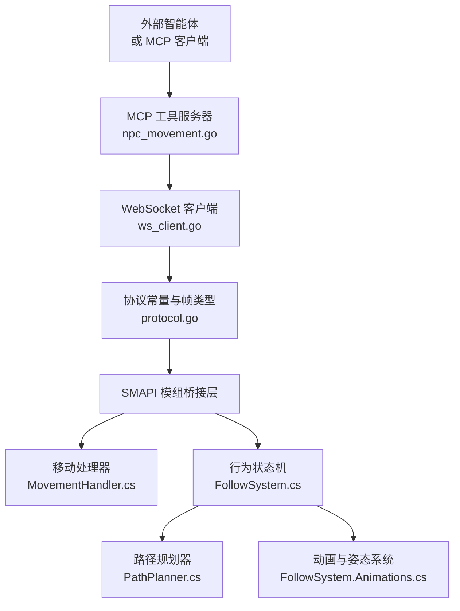
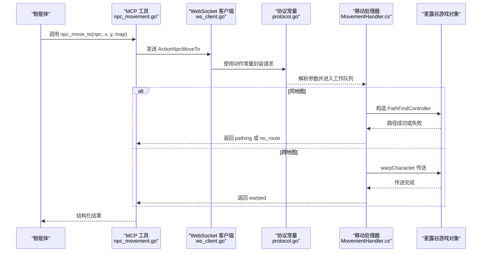
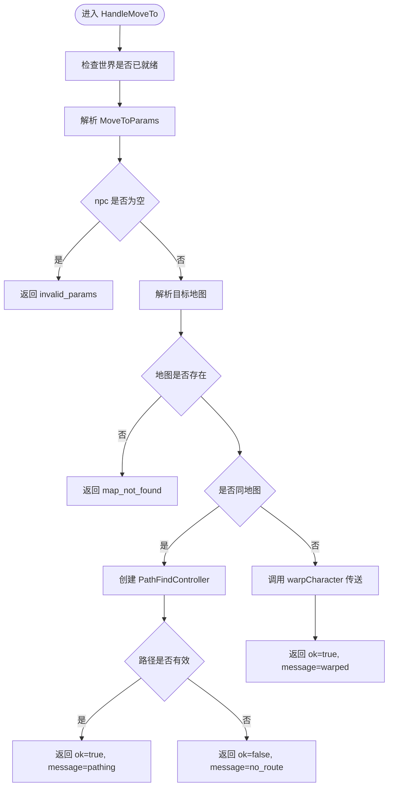
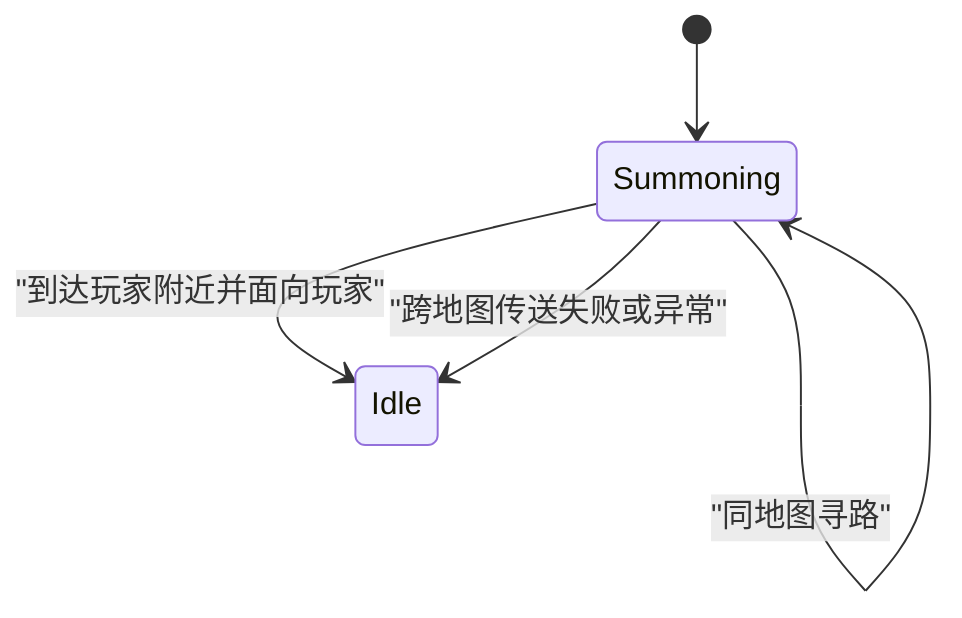
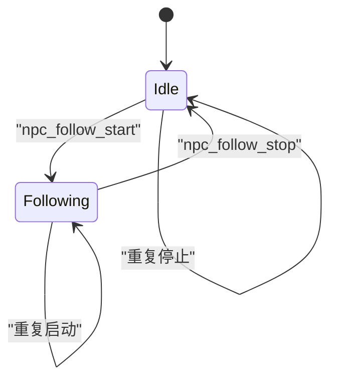
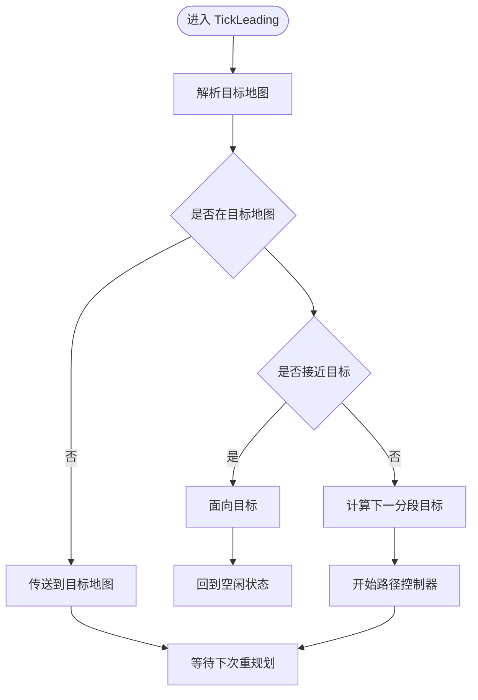
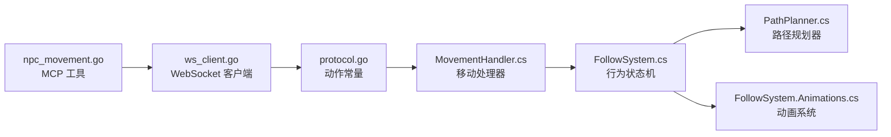

# NPC 移动控制工具

<cite>
**本文引用的文件**   
- [npc_movement.go](file://SmartNPC/smartnpc-mcp/adapters/stardew/tools/npc_movement.go)
- [npc_movement_test.go](file://SmartNPC/smartnpc-mcp/adapters/stardew/tools/npc_movement_test.go)
- [ws_client.go](file://SmartNPC/smartnpc-mcp/adapters/stardew/bridge/ws_client.go)
- [protocol.go](file://SmartNPC/smartnpc-mcp/adapters/stardew/bridge/protocol.go)
- [MovementHandler.cs](file://SmartNPC/smapi-mod/Movement/MovementHandler.cs)
- [FollowSystem.cs](file://SmartNPC/smapi-mod/Movement/FollowSystem.cs)
- [FollowSystem.Animations.cs](file://SmartNPC/smapi-mod/Movement/FollowSystem.Animations.cs)
- [PathPlanner.cs](file://SmartNPC/smapi-mod/Movement/PathPlanner.cs)
</cite>

## 目录
1. [引言](#引言)
2. [项目结构](#项目结构)
3. [核心组件](#核心组件)
4. [架构总览](#架构总览)
5. [详细组件分析](#详细组件分析)
6. [依赖关系分析](#依赖关系分析)
7. [性能与路径规划](#性能与路径规划)
8. [异常处理与恢复策略](#异常处理与恢复策略)
9. [使用示例与导航场景](#使用示例与导航场景)
10. [故障排查指南](#故障排查指南)
11. [结论](#结论)

## 引言
本文件为 SmartNPC 项目中“NPC 移动控制工具”的完整 API 文档。该工具集面向调用方（例如 MCP/LangChain 侧智能体），通过一组结构化动作驱动《星露谷物语》中的 NPC 进行寻路、朝向、召唤、跟随、带领等行为。其中：

- `npc_move_to` 是最复杂的移动入口，支持同地图寻路和跨地图传送，并返回异步状态提示。
- `npc_face_direction` 用于设置 NPC 朝向，不影响已有路径控制器。
- `npc_get_position` 用于查询当前坐标、地图、朝向和是否正在移动。
- `npc_summon`、`npc_follow_start`、`npc_follow_stop`、`npc_lead_to` 由协议层暴露，并由 SMAPI 模组内的行为状态机实现。

本文从接口定义、参数语义、错误码、跨进程通信、游戏线程同步、路径规划算法、状态机和性能优化角度给出系统化说明。

## 项目结构
本项目涉及三层：

1. **MCP 工具层**：在 Go 端注册 `npc_move_to`、`npc_face_direction`、`npc_get_position`、`npc_get_named_locations` 等工具。
2. **桥接通信层**：通过 WebSocket 将 MCP 请求转换为 SMAPI 模组的 JSON-RPC 风格动作。
3. **SMAPI 模组层**：C# 代码执行真正的游戏逻辑，包括路径控制器、跟随状态机、动画播放和多类行为调度。

**图表来源**  
- [npc_movement.go:1-215](file://SmartNPC/smartnpc-mcp/adapters/stardew/tools/npc_movement.go#L1-L215)
- [ws_client.go:1-200](file://SmartNPC/smartnpc-mcp/adapters/stardew/bridge/ws_client.go#L1-L200)
- [protocol.go:1-172](file://SmartNPC/smartnpc-mcp/adapters/stardew/bridge/protocol.go#L1-L172)
- [MovementHandler.cs:1-200](file://SmartNPC/smapi-mod/Movement/MovementHandler.cs#L1-L200)
- [FollowSystem.cs:1-200](file://SmartNPC/smapi-mod/Movement/FollowSystem.cs#L1-L200)
- [PathPlanner.cs:1-120](file://SmartNPC/smapi-mod/Movement/PathPlanner.cs#L1-L120)
- [FollowSystem.Animations.cs:1-120](file://SmartNPC/smapi-mod/Movement/FollowSystem.Animations.cs#L1-L120)

**章节来源**  
- [npc_movement.go:1-215](file://SmartNPC/smartnpc-mcp/adapters/stardew/tools/npc_movement.go#L1-L215)
- [protocol.go:1-172](file://SmartNPC/smartnpc-mcp/adapters/stardew/bridge/protocol.go#L1-L172)

## 核心组件
本节按职责划分核心组件，并说明它们在 NPC 移动流程中的作用。

| 组件 | 语言 | 主要职责 | 关键输出或行为 |
|---|---|---|---|
| `NpcMoveToInput` / `NpcMoveToOutput` | Go | 描述 `npc_move_to` 输入与结果 | 返回是否接受请求、实际目标地图、坐标、状态消息 |
| `NpcFaceDirectionInput` / `NpcFaceDirectionOutput` | Go | 描述方向设置输入与确认 | 返回标准化方向和内部朝向整数 |
| `NpcGetPositionOutput` | Go | 描述 NPC 位置查询结果 | 返回浮点坐标、地图名、朝向、是否移动 |
| `WSClient` | Go | 维护与 SMAPI 模组的 WebSocket 连接、发送请求、关联响应 | 支持超时、重连、事件回调、调用记录 |
| 协议常量 | Go | 定义所有服务端动作名称 | 包含 `npc_move_to`、`npc_summon`、`npc_follow_start`、`npc_follow_stop`、`npc_lead_to` 等 |
| `MovementHandler` | C# | 处理 `npc_move_to`、`npc_face_direction`、`npc_get_position` | 在同地图创建路径控制器；跨地图传送；读取位置 |
| `FollowSystem` | C# | 管理 NPC 行为状态机 | 支持 Summoning、Following、Leading、Wander、Animation 等模式 |
| `PathPlanner` | C# | 对多目标点进行近似最优排序 | 最近邻 + 2-opt，曼哈顿距离 |
| `FollowSystem.Animations` | C# | 管理自定义动画、社交移动、姿态重置 | 播放收集、庆祝、闲逛、社交后退等动画 |

**章节来源**  
- [npc_movement.go:1-215](file://SmartNPC/smartnpc-mcp/adapters/stardew/tools/npc_movement.go#L1-L215)
- [protocol.go:70-172](file://SmartNPC/smartnpc-mcp/adapters/stardew/bridge/protocol.go#L70-L172)
- [MovementHandler.cs:1-324](file://SmartNPC/smapi-mod/Movement/MovementHandler.cs#L1-L324)
- [FollowSystem.cs:1-200](file://SmartNPC/smapi-mod/Movement/FollowSystem.cs#L1-L200)
- [PathPlanner.cs:1-120](file://SmartNPC/smapi-mod/Movement/PathPlanner.cs#L1-L120)
- [FollowSystem.Animations.cs:1-120](file://SmartNPC/smapi-mod/Movement/FollowSystem.Animations.cs#L1-L120)

## 架构总览
NPC 移动控制的调用链分为两个阶段：

1. **MCP 工具阶段**：智能体调用 MCP 工具，Go 端校验参数后通过 WebSocket 转发到 SMAPI 模组。
2. **SMAPI 执行阶段**：C# 侧在工作队列中切换到游戏线程，操作 `PathFindController`、`Game1.warpCharacter`、NPC 朝向和行为状态。

**图表来源**  
- [npc_movement.go:40-110](file://SmartNPC/smartnpc-mcp/adapters/stardew/tools/npc_movement.go#L40-L110)
- [protocol.go:80-172](file://SmartNPC/smartnpc-mcp/adapters/stardew/bridge/protocol.go#L80-L172)
- [MovementHandler.cs:20-180](file://SmartNPC/smapi-mod/Movement/MovementHandler.cs#L20-L180)

## 详细组件分析

### npc_move_to：同地图寻路与跨地图传送
`npc_move_to` 是 NPC 移动的核心入口。它接收 NPC 内部名称和目标瓦片坐标，并可选指定目标地图。其核心语义如下：

| 字段 | 类型 | 必填 | 含义 |
|---|---|---:|---|
| `npc` | 字符串 | 是 | NPC 内部名称，例如 `XiaMi` |
| `x` | 整数 | 是 | 目标瓦片 X 坐标 |
| `y` | 整数 | 是 | 目标瓦片 Y 坐标 |
| `map` | 字符串 | 否 | 目标地图名称；省略时默认使用 NPC 当前地图 |

返回值关键字段：

| 字段 | 类型 | 含义 |
|---|---|---|
| `ok` | 布尔值 | 路径请求是否被接受 |
| `npc` | 字符串 | 回显 NPC 名称 |
| `map` | 字符串 | 实际使用的目标地图名 |
| `x` | 整数 | 目标 X 坐标 |
| `y` | 整数 | 目标 Y 坐标 |
| `message` | 字符串 | 状态提示，例如 `pathing`、`no_route`、`warped` |

#### 处理流程

**图表来源**  
- [MovementHandler.cs:20-180](file://SmartNPC/smapi-mod/Movement/MovementHandler.cs#L20-L180)

#### 错误处理

| 错误场景 | 错误码或结果 | 说明 |
|---|---|---|
| 未加载存档 | `mod_not_ready` | 模组尚未准备好处理游戏状态 |
| 参数为空或格式错误 | `invalid_params` | 常见于缺少 `npc` 或非法方向 |
| 找不到 NPC | `npc_not_found` | 根据名称无法找到对应角色 |
| 找不到地图 | `map_not_found` | 指定地图不存在 |
| 路径控制器创建失败 | `pathfind_error` | 底层寻路失败 |
| 无可行路径 | `no_route` | 路径存在但不可达 |
| 处理器内部异常 | `handler_error` | 未预期异常 |

需要注意：**文档层面常把 `pathfind_error` 和 `unknown_map` 作为用户可见的错误分类**。代码中具体错误码为 `pathfind_error` 和 `map_not_found`；上层调用方应据此映射到业务语义。

**章节来源**  
- [npc_movement.go:10-39](file://SmartNPC/smartnpc-mcp/adapters/stardew/tools/npc_movement.go#L10-L39)
- [MovementHandler.cs:20-180](file://SmartNPC/smapi-mod/Movement/MovementHandler.cs#L20-L180)

### npc_face_direction：NPC 朝向控制
`npc_face_direction` 用于让 NPC 面向四个基本方向之一：`up`、`down`、`left`、`right`。它不会取消已有的路径控制器，因此适合对话演出、注视、转身等低影响视觉反馈。

| 字段 | 类型 | 必填 | 含义 |
|---|---|---:|---|
| `npc` | 字符串 | 是 | NPC 内部名称 |
| `direction` | 字符串 | 是 | 必须为 `up`、`down`、`left`、`right` 之一 |

返回值关键字段：

| 字段 | 类型 | 含义 |
|---|---|---|
| `ok` | 布尔值 | 是否成功 |
| `npc` | 字符串 | 回显 NPC 名称 |
| `direction` | 字符串 | 应用后的方向，通常标准化为小写 |
| `facing` | 整数 | 游戏内部朝向，`0=up`、`1=right`、`2=down`、`3=left` |

#### 验证规则
- MCP 工具层会将方向转为小写。
- 仅允许四种方向，其他值会直接拒绝。
- SMAPI 侧再次校验方向，无效方向返回 `invalid_params`。

**章节来源**  
- [npc_movement.go:41-98](file://SmartNPC/smartnpc-mcp/adapters/stardew/tools/npc_movement.go#L41-L98)
- [MovementHandler.cs:182-240](file://SmartNPC/smapi-mod/Movement/MovementHandler.cs#L182-L240)

### npc_get_position：位置与移动状态查询
`npc_get_position` 是一个只读工具，用于确认前序移动命令是否生效，或计算 NPC 与玩家之间的距离。

| 字段 | 类型 | 含义 |
|---|---|---|
| `ok` | 布尔值 | 查询是否成功 |
| `npc` | 字符串 | 回显 NPC 名称 |
| `x` | 浮点数 | 当前瓦片 X，移动过程中可为小数 |
| `y` | 浮点数 | 当前瓦片 Y，移动过程中可为小数 |
| `map` | 字符串 | 当前地图名 |
| `facing` | 整数 | 内部朝向 |
| `direction` | 字符串 | 文字朝向，如 `up`、`down`、`left`、`right` |
| `is_moving` | 布尔值 | 是否存在活动路径控制器 |

**章节来源**  
- [npc_movement.go:60-90](file://SmartNPC/smartnpc-mcp/adapters/stardew/tools/npc_movement.go#L60-L90)
- [MovementHandler.cs:242-324](file://SmartNPC/smapi-mod/Movement/MovementHandler.cs#L242-L324)

### npc_summon：召唤 NPC 到玩家附近
`npc_summon` 的协议动作名为 `ActionNpcSummon`。它的行为由 `FollowSystem.Summon` 启动，状态机进入 `Summoning` 模式：

1. 如果 NPC 与玩家在同一个地图，则向玩家前方瓦片寻路。
2. 如果不在同一地图，则传送到玩家所在地图的玩家后方相邻瓦片。
3. 当 NPC 靠近玩家且没有活动路径时，面向玩家并回到空闲状态。

**图表来源**  
- [FollowSystem.cs:280-310](file://SmartNPC/smapi-mod/Movement/FollowSystem.cs#L280-L310)
- [FollowSystem.cs:1188-1225](file://SmartNPC/smapi-mod/Movement/FollowSystem.cs#L1188-L1225)

**章节来源**  
- [protocol.go:80-90](file://SmartNPC/smartnpc-mcp/adapters/stardew/bridge/protocol.go#L80-L90)
- [FollowSystem.cs:280-310](file://SmartNPC/smapi-mod/Movement/FollowSystem.cs#L280-L310)
- [FollowSystem.cs:1188-1225](file://SmartNPC/smapi-mod/Movement/FollowSystem.cs#L1188-L1225)

### npc_follow_start 与 npc_follow_stop：跟随行为
`npc_follow_start` 和 `npc_follow_stop` 分别启动和停止跟随。

#### 启动
- 取消现有动画。
- 将 NPC 状态设置为 `Following`。
- 重置路径重规划时间戳。

#### 停止
- 取消动画。
- 将状态设为 `Idle`。
- 尝试停止 NPC 移动并清空路径控制器。
- 恢复默认速度。

#### 幂等性
- 多次调用 `StartFollow`：安全，重复设置相同状态。
- 多次调用 `StopFollow`：安全，找不到 NPC 或已经空闲都不会报错。
- 先 `StopFollow` 再 `StartFollow`：正常切换。
- 在跟随过程中再次 `StartFollow`：覆盖为跟随模式。

**图表来源**  
- [FollowSystem.cs:295-335](file://SmartNPC/smapi-mod/Movement/FollowSystem.cs#L295-L335)

**章节来源**  
- [protocol.go:87-88](file://SmartNPC/smartnpc-mcp/adapters/stardew/bridge/protocol.go#L87-L88)
- [FollowSystem.cs:295-335](file://SmartNPC/smapi-mod/Movement/FollowSystem.cs#L295-L335)

### npc_lead_to：带领玩家到目标位置
`npc_lead_to` 的协议动作名为 `ActionNpcLeadTo`。它让 NPC 移动到目标瓦片，而不是始终跟随玩家。

| 字段 | 类型 | 必填 | 含义 |
|---|---|---:|---|
| `npc` | 字符串 | 是 | NPC 内部名称 |
| `x` | 整数 | 是 | 目标瓦片 X |
| `y` | 整数 | 是 | 目标瓦片 Y |
| `map` | 字符串 | 否 | 目标地图；省略时使用 NPC 当前地图 |

行为要点：

1. 若目标地图为空，则使用 NPC 当前地图。
2. 若 NPC 不在目标地图，则直接传送。
3. 到达目标附近后，调整朝向并回到空闲状态。
4. 长距离移动采用分段寻路，每段最多前进固定格数，避免单次路径过长。

**图表来源**  
- [FollowSystem.cs:400-415](file://SmartNPC/smapi-mod/Movement/FollowSystem.cs#L400-L415)
- [FollowSystem.cs:1255-1295](file://SmartNPC/smapi-mod/Movement/FollowSystem.cs#L1255-L1295)

**章节来源**  
- [protocol.go:89-89](file://SmartNPC/smartnpc-mcp/adapters/stardew/bridge/protocol.go#L89-L89)
- [FollowSystem.cs:400-415](file://SmartNPC/smapi-mod/Movement/FollowSystem.cs#L400-L415)
- [FollowSystem.cs:1255-1295](file://SmartNPC/smapi-mod/Movement/FollowSystem.cs#L1255-L1295)

### 命名地点与模糊目的地
`npc_get_named_locations` 返回农场上的常用地标，例如房子前面、湖边、大门、温室、畜棚、鸡舍、农场中心等。每个地标包含：

| 字段 | 含义 |
|---|---|
| `name` | 标准显示名 |
| `aliases` | 自然语言别名，便于 LLM 理解 |
| `map` | 地图名，默认为农场 |
| `x` | 瓦片 X |
| `y` | 瓦片 Y |

推荐用法：当玩家说“去湖边”或“过来”时，先用 `npc_get_named_locations` 确定精确坐标，再调用 `npc_move_to`。

**章节来源**  
- [npc_movement.go:92-150](file://SmartNPC/smartnpc-mcp/adapters/stardew/tools/npc_movement.go#L92-L150)
- [npc_movement.go:201-215](file://SmartNPC/smartnpc-mcp/adapters/stardew/tools/npc_movement.go#L201-L215)

## 依赖关系分析
MCP 工具层依赖桥接层，桥接层依赖协议常量；SMAPI 侧的移动处理器负责基础移动，行为状态机负责复杂移动。

**图表来源**  
- [npc_movement.go:1-215](file://SmartNPC/smartnpc-mcp/adapters/stardew/tools/npc_movement.go#L1-L215)
- [ws_client.go:1-200](file://SmartNPC/smartnpc-mcp/adapters/stardew/bridge/ws_client.go#L1-L200)
- [protocol.go:1-172](file://SmartNPC/smartnpc-mcp/adapters/stardew/bridge/protocol.go#L1-L172)
- [MovementHandler.cs:1-324](file://SmartNPC/smapi-mod/Movement/MovementHandler.cs#L1-L324)
- [FollowSystem.cs:1-200](file://SmartNPC/smapi-mod/Movement/FollowSystem.cs#L1-L200)
- [PathPlanner.cs:1-120](file://SmartNPC/smapi-mod/Movement/PathPlanner.cs#L1-L120)
- [FollowSystem.Animations.cs:1-120](file://SmartNPC/smapi-mod/Movement/FollowSystem.Animations.cs#L1-L120)

**章节来源**  
- [protocol.go:80-172](file://SmartNPC/smartnpc-mcp/adapters/stardew/bridge/protocol.go#L80-L172)
- [FollowSystem.cs:1080-1110](file://SmartNPC/smapi-mod/Movement/FollowSystem.cs#L1080-L1110)

## 性能与路径规划

### 游戏线程隔离
所有修改游戏状态的移动操作都通过工作队列进入游戏线程。MCP 工具层和 WebSocket 层不直接访问游戏对象，而是提交任务并等待结果。这样可以避免阻塞网络接收循环，也避免在错误线程访问游戏对象。

**章节来源**  
- [MovementHandler.cs:1-20](file://SmartNPC/smapi-mod/Movement/MovementHandler.cs#L1-L20)
- [MovementHandler.cs:300-324](file://SmartNPC/smapi-mod/Movement/MovementHandler.cs#L300-L324)

### 路径规划复杂度
`PathPlanner` 用于多目标行为的路线排序，而不是单次 `npc_move_to` 的瓦片寻路。其复杂度如下：

| 步骤 | 时间复杂度 | 说明 |
|---|---:|---|
| 最近邻初始环游 | O(n²) | 从起点选择最近目标，逐步构建路径 |
| 2-opt 局部优化 | 最多 8 轮，每轮 O(n²) | 反转任意区段以缩短总曼哈顿距离 |
| 总体复杂度 | O(k·n²)，k ≤ 8 | 对小规模目标集合非常高效 |

该规划器使用曼哈顿距离作为启发式度量，虽不考虑障碍物，但对相对顺序稳定且足够实用。

**章节来源**  
- [PathPlanner.cs:1-120](file://SmartNPC/smapi-mod/Movement/PathPlanner.cs#L1-L120)

### 移动频率控制
跟随和带领模式不是每帧重新寻路，而是通过时间戳判断是否需要重规划。这样可以减少频繁路径计算的开销。

**章节来源**  
- [FollowSystem.cs:220-230](file://SmartNPC/smapi-mod/Movement/FollowSystem.cs#L220-L230)
- [FollowSystem.cs:1226-1254](file://SmartNPC/smapi-mod/Movement/FollowSystem.cs#L1226-L1254)
- [FollowSystem.cs:1255-1295](file://SmartNPC/smapi-mod/Movement/FollowSystem.cs#L1255-L1295)

## 异常处理与恢复策略

### 参数校验异常
- MCP 工具层拒绝空 `npc`。
- `npc_face_direction` 拒绝非四方向值。
- SMAPI 侧再次校验参数并返回结构化错误。

**章节来源**  
- [npc_movement.go:100-110](file://SmartNPC/smartnpc-mcp/adapters/stardew/tools/npc_movement.go#L100-L110)
- [MovementHandler.cs:120-180](file://SmartNPC/smapi-mod/Movement/MovementHandler.cs#L120-L180)

### 路径与地图异常
- `pathfind_error`：路径控制器创建失败。
- `no_route`：路径存在但不可达。
- `map_not_found`：目标地图不存在。
- `warped`：跨地图传送成功，后续移动仍可能受游戏内碰撞影响。

**章节来源**  
- [MovementHandler.cs:120-180](file://SmartNPC/smapi-mod/Movement/MovementHandler.cs#L120-L180)

### 状态机异常恢复
行为状态机的主循环捕获异常后：

1. 取消动画。
2. 将状态重置为 `Idle`。
3. 继续处理其他 NPC 的状态。

对于跟随和带领，如果玩家发生跨地图传送，状态机会尝试将 NPC 传送到新地图的目标瓦片，并强制下一次立即重规划。

**章节来源**  
- [FollowSystem.cs:1120-1150](file://SmartNPC/smapi-mod/Movement/FollowSystem.cs#L1120-L1150)
- [FollowSystem.cs:1150-1188](file://SmartNPC/smapi-mod/Movement/FollowSystem.cs#L1150-L1188)

### 动画与姿态恢复
动画系统提供清理方法，防止旧动画或自定义姿态残留：

- `ResetAnimations`：清空动画并重置状态。
- `PumpAnimations`：在游戏帧中更新动画。
- 停止跟随时会取消动画并恢复默认速度。

**章节来源**  
- [FollowSystem.Animations.cs:1-120](file://SmartNPC/smapi-mod/Movement/FollowSystem.Animations.cs#L1-L120)
- [FollowSystem.cs:305-335](file://SmartNPC/smapi-mod/Movement/FollowSystem.cs#L305-L335)

## 使用示例与导航场景

### 场景一：让 NPC 走到农场中心
适用情况：玩家希望 NPC 移动到地图上的固定位置。

推荐步骤：
1. 调用 `npc_move_to`，传入 NPC 名称、目标 X、Y。
2. 如果不需要跨地图，省略 `map`。
3. 检查返回的 `message`：
   - `pathing`：已开始寻路。
   - `no_route`：目标不可达。
   - `warped`：跨地图传送成功。
4. 如需确认到达，调用 `npc_get_position` 检查坐标和 `is_moving`。

**章节来源**  
- [npc_movement.go:10-39](file://SmartNPC/smartnpc-mcp/adapters/stardew/tools/npc_movement.go#L10-L39)
- [MovementHandler.cs:60-160](file://SmartNPC/smapi-mod/Movement/MovementHandler.cs#L60-L160)

### 场景二：对话演出中让 NPC 看向玩家
适用情况：NPC 说话前面向玩家，或生气时背过身。

推荐步骤：
1. 使用 `npc_face_direction` 设置方向。
2. 不要把它当作主要移动手段；它不取消路径控制器。
3. 如果需要同时移动，优先使用 `npc_move_to` 或 `npc_follow_start`。

**章节来源**  
- [npc_movement.go:41-98](file://SmartNPC/smartnpc-mcp/adapters/stardew/tools/npc_movement.go#L41-L98)
- [MovementHandler.cs:182-240](file://SmartNPC/smapi-mod/Movement/MovementHandler.cs#L182-L240)

### 场景三：召唤 NPC 到自己身边
适用情况：NPC 在另一个房间或地图，需要快速出现在玩家附近。

推荐步骤：
1. 调用 `npc_summon`。
2. 如果跨地图，状态机会先传送到玩家地图。
3. 到达玩家附近后自动面向玩家并结束。
4. 可随后启动 `npc_follow_start` 让 NPC 跟随玩家。

**章节来源**  
- [protocol.go:84-90](file://SmartNPC/smartnpc-mcp/adapters/stardew/bridge/protocol.go#L84-L90)
- [FollowSystem.cs:280-310](file://SmartNPC/smapi-mod/Movement/FollowSystem.cs#L280-L310)
- [FollowSystem.cs:1188-1225](file://SmartNPC/smapi-mod/Movement/FollowSystem.cs#L1188-L1225)

### 场景四：NPC 跟随玩家
适用情况：NPC 像宠物一样跟在玩家身后。

推荐步骤：
1. 调用 `npc_follow_start`。
2. 状态机周期性检测距离，超出半径则重新寻路。
3. 玩家跨地图时，状态机会尝试传送 NPC 到新地图。
4. 不再需要时调用 `npc_follow_stop`。

**章节来源**  
- [FollowSystem.cs:295-335](file://SmartNPC/smapi-mod/Movement/FollowSystem.cs#L295-L335)
- [FollowSystem.cs:1226-1254](file://SmartNPC/smapi-mod/Movement/FollowSystem.cs#L1226-L1254)
- [FollowSystem.cs:1150-1188](file://SmartNPC/smapi-mod/Movement/FollowSystem.cs#L1150-L1188)

### 场景五：带领 NPC 到仓库或商店
适用情况：让玩家决定目的地，然后引导 NPC 前往。

推荐步骤：
1. 调用 `npc_lead_to`，传入目标坐标和地图。
2. 如果 NPC 不在目标地图，会自动传送。
3. 到达后自动回到空闲状态。
4. 可结合 `npc_face_direction` 调整到达时的朝向。

**章节来源**  
- [protocol.go:89-89](file://SmartNPC/smartnpc-mcp/adapters/stardew/bridge/protocol.go#L89-L89)
- [FollowSystem.cs:400-415](file://SmartNPC/smapi-mod/Movement/FollowSystem.cs#L400-L415)
- [FollowSystem.cs:1255-1295](file://SmartNPC/smapi-mod/Movement/FollowSystem.cs#L1255-L1295)

### 场景六：用自然语言地址定位
适用情况：玩家说“去湖边”，但 LLM 不知道精确坐标。

推荐步骤：
1. 调用 `npc_get_named_locations`。
2. 匹配“湖边”或相关别名。
3. 取出 `map`、`x`、`y`。
4. 调用 `npc_move_to`。

**章节来源**  
- [npc_movement.go:92-150](file://SmartNPC/smartnpc-mcp/adapters/stardew/tools/npc_movement.go#L92-L150)
- [npc_movement.go:201-215](file://SmartNPC/smartnpc-mcp/adapters/stardew/tools/npc_movement.go#L201-L215)

## 故障排查指南

| 现象 | 可能原因 | 排查建议 |
|---|---|---|
| 调用 `npc_move_to` 后立即返回 `no_route` | 目标瓦片不可达或被阻挡 | 改用更靠近的可通行瓦片，或先传送到附近 |
| 跨地图调用返回 `warped` 但 NPC 没动 | 目标地图正确，但游戏内路径不可走 | 检查目标瓦片是否可通行 |
| 方向设置无效 | 传入的不是 `up/down/left/right` | 确保小写且为四方向之一 |
| 找不到 NPC | NPC 名称错误或尚未加载 | 使用正确的内部名称，例如 `XiaMi` |
| 跟随中途卡住 | 玩家跨地图或路径失效 | 检查 `npc_get_position` 的 `is_moving` 和地图 |
| 动画或姿态异常 | 旧动画未清理 | 使用 `ResetAnimations` 或停止跟随后重试 |
| 长时间无响应 | 游戏线程队列堆积或连接问题 | 检查 WebSocket 连接、日志和模组是否已加载存档 |

**章节来源**  
- [npc_movement_test.go:100-200](file://SmartNPC/smartnpc-mcp/adapters/stardew/tools/npc_movement_test.go#L100-L200)
- [npc_movement_test.go:201-347](file://SmartNPC/smartnpc-mcp/adapters/stardew/tools/npc_movement_test.go#L201-L347)
- [ws_client.go:1-200](file://SmartNPC/smartnpc-mcp/adapters/stardew/bridge/ws_client.go#L1-L200)
- [FollowSystem.cs:1120-1150](file://SmartNPC/smapi-mod/Movement/FollowSystem.cs#L1120-L1150)

## 结论
SmartNPC 的 NPC 移动控制工具通过 MCP 工具、WebSocket 桥接和 SMAPI 行为状态机三层协作，实现了从简单朝向控制到复杂跟随、带领、召唤的全套移动能力。`npc_move_to` 承担最基础的寻路与传送语义；`npc_face_direction` 提供低影响的演出控制；`npc_summon`、`npc_follow_start`、`npc_follow_stop`、`npc_lead_to` 则由状态机统一协调 NPC 的行为生命周期。

在实际使用中，建议遵循以下原则：

- 明确区分“一次性移动”和“持续行为”。
- 使用 `npc_get_position` 做到达校验。
- 用 `npc_get_named_locations` 解决自然语言地址歧义。
- 对跨地图移动做好错误处理和重试。
- 在长时间行为结束后调用停止或空闲恢复逻辑，避免状态残留。