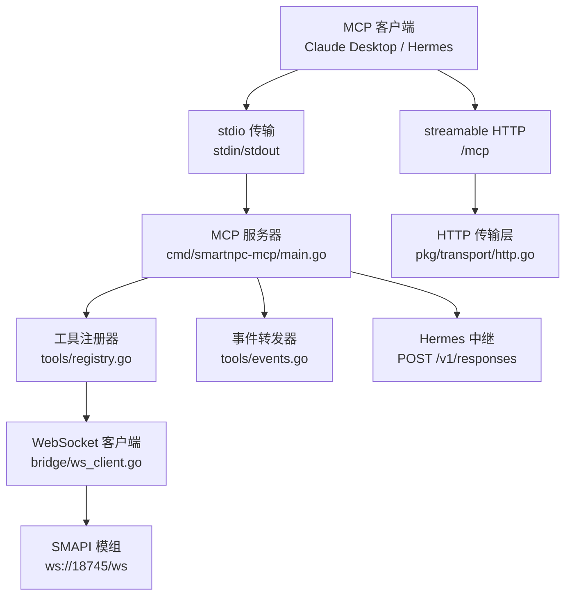
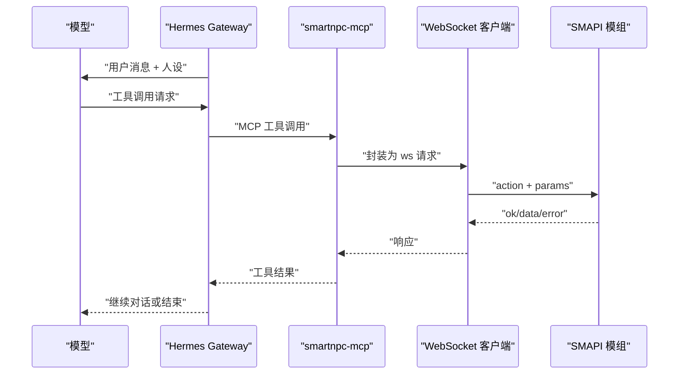
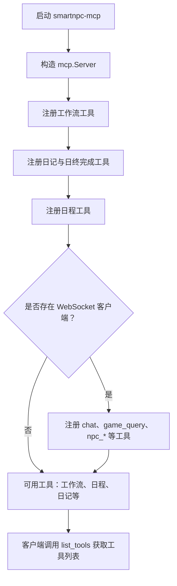
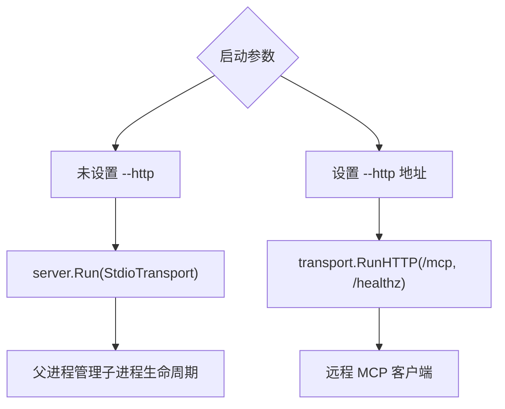
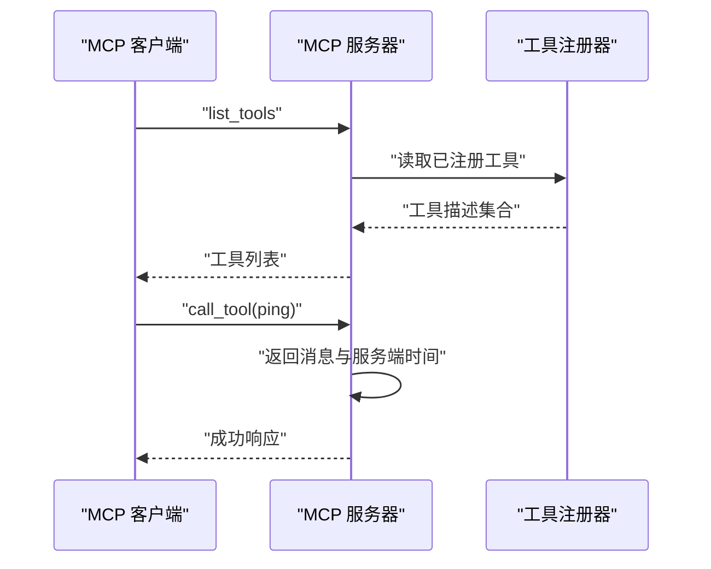
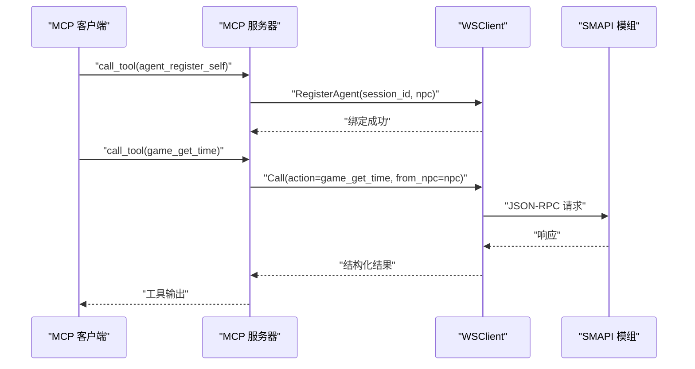
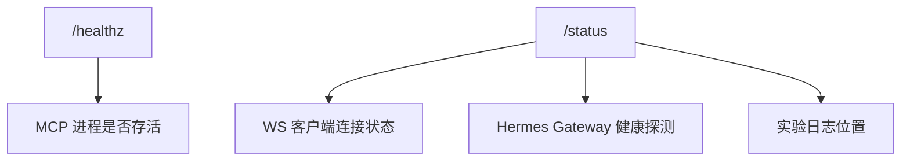
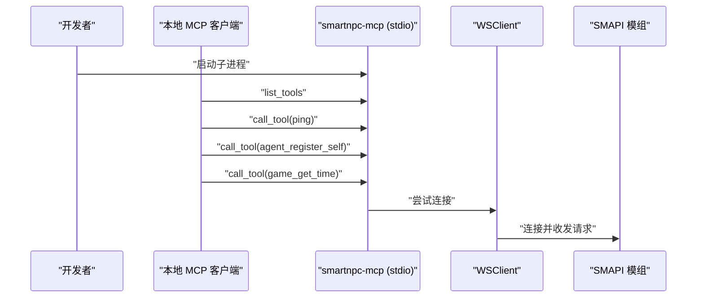
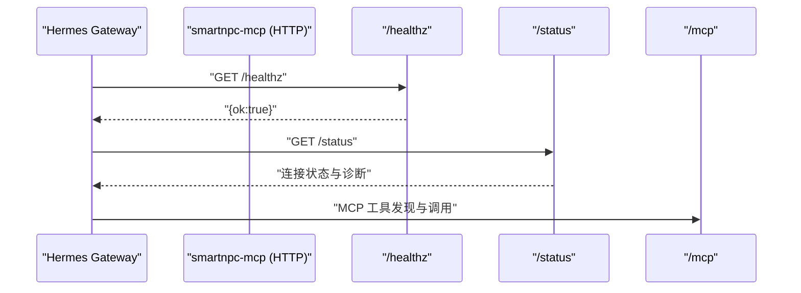
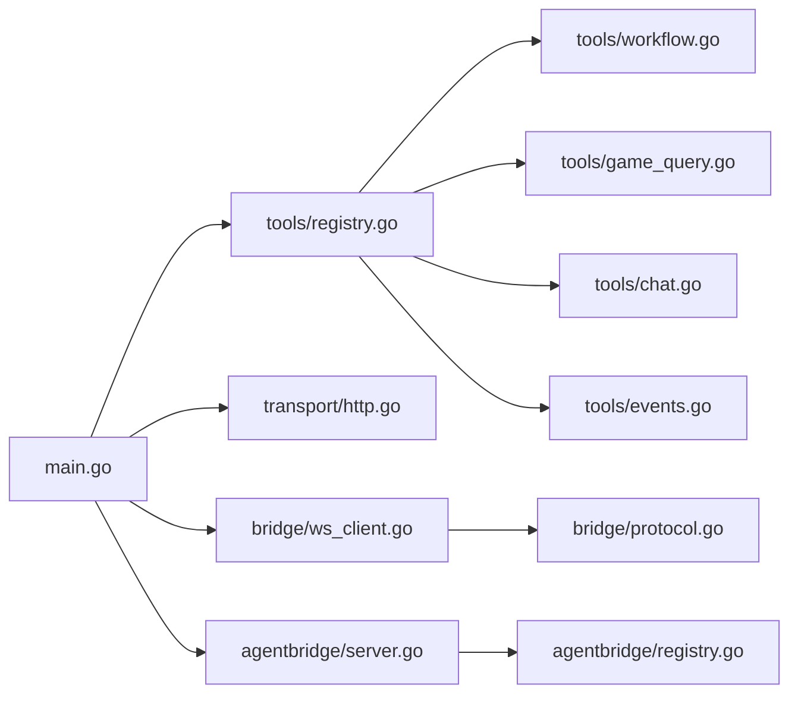

# 工具发现与通用接口

<cite>
**本文引用的文件**   
- [smartnpc-mcp/README.md](file://SmartNPC/smartnpc-mcp/README.md)
- [mcp-tools.md](file://SmartNPC/docs/mcp-tools.md)
- [hermes-event-trigger.md](file://SmartNPC/docs/hermes-event-trigger.md)
- [current-architecture.md](file://SmartNPC/docs/current-architecture.md)
- [cmd/smartnpc-mcp/main.go](file://SmartNPC/smartnpc-mcp/cmd/smartnpc-mcp/main.go)
- [adapters/stardew/adapter.go](file://SmartNPC/smartnpc-mcp/adapters/stardew/adapter.go)
- [adapters/stardew/tools/registry.go](file://SmartNPC/smartnpc-mcp/adapters/stardew/tools/registry.go)
- [adapters/stardew/tools/workflow.go](file://SmartNPC/smartnpc-mcp/adapters/stardew/tools/workflow.go)
- [adapters/stardew/tools/game_query.go](file://SmartNPC/smartnpc-mcp/adapters/stardew/tools/game_query.go)
- [adapters/stardew/tools/chat.go](file://SmartNPC/smartnpc-mcp/adapters/stardew/tools/chat.go)
- [adapters/stardew/tools/events.go](file://SmartNPC/smartnpc-mcp/adapters/stardew/tools/events.go)
- [pkg/agentbridge/registry.go](file://SmartNPC/smartnpc-mcp/pkg/agentbridge/registry.go)
- [pkg/agentbridge/server.go](file://SmartNPC/smartnpc-mcp/pkg/agentbridge/server.go)
- [pkg/transport/http.go](file://SmartNPC/smartnpc-mcp/pkg/transport/http.go)
- [adapters/stardew/bridge/ws_client.go](file://SmartNPC/smartnpc-mcp/adapters/stardew/bridge/ws_client.go)
- [adapters/stardew/bridge/protocol.go](file://SmartNPC/smartnpc-mcp/adapters/stardew/bridge/protocol.go)
</cite>

## 目录
1. [引言](#引言)
2. [项目结构](#项目结构)
3. [核心组件](#核心组件)
4. [架构总览](#架构总览)
5. [详细组件分析](#详细组件分析)
6. [依赖关系分析](#依赖关系分析)
7. [性能特征](#性能特征)
8. [故障排查指南](#故障排查指南)
9. [结论](#结论)
10. [附录：权限、沙箱与安全](#附录权限沙箱与安全)

## 引言
本文件聚焦 SmartNPC 的 MCP 工具发现机制与通用接口，解释以下问题：
- 工具如何注册、分类以及何时对客户端可见。
- `ping` 等 always-available 工具的调用方式。
- mod-backed 工具为何依赖 WebSocket 桥接，以及在本地开发环境与 Hermes 部署中的差异。
- 工具列表查询方法、错误码统一规范、连接健康检查策略。
- 当前实验分支中已移除的 inter-NPC 工具（`npc_send_message`、`npc_broadcast_event`、`npc_inbox_get`、`npc_inbox_ack`）的状态。
- 工具权限模型、沙箱限制和跨进程通信的安全考虑。

## 项目结构
SmartNPC 的工具能力由 Go 服务 `smartnpc-mcp` 暴露，核心代码集中在 `smartnpc-mcp/`；SMAPI 模组位于 `smapi-mod/`；Hermes 配置、profile 和部署脚本位于仓库根目录下的 `hermes/`、`deploy/` 等路径。

**图示来源**
- [cmd/smartnpc-mcp/main.go:201-340](file://SmartNPC/smartnpc-mcp/cmd/smartnpc-mcp/main.go#L201-L340)
- [pkg/transport/http.go:1-124](file://SmartNPC/smartnpc-mcp/pkg/transport/http.go#L1-L124)
- [adapters/stardew/tools/registry.go:1-82](file://SmartNPC/smartnpc-mcp/adapters/stardew/tools/registry.go#L1-L82)
- [adapters/stardew/bridge/ws_client.go:1-200](file://SmartNPC/smartnpc-mcp/adapters/stardew/bridge/ws_client.go#L1-L200)

**章节来源**
- [smartnpc-mcp/README.md:1-40](file://SmartNPC/smartnpc-mcp/README.md#L1-L40)
- [mcp-tools.md:1-40](file://SmartNPC/docs/mcp-tools.md#L1-L40)
- [current-architecture.md:1-60](file://SmartNPC/docs/current-architecture.md#L1-L60)

## 核心组件
| 组件 | 职责 | 关键行为 |
|---|---|---|
| MCP 服务器 | 组装工具、事件转发、启动 stdio 或 HTTP 传输 | 解析命令行参数，构造 `mcp.Server`，根据是否设置 `--http` 选择运行模式 |
| 工具注册器 | 把 Stardew 专用工具挂载到 `mcp.Server` | 按依赖分两批注册；无桥接时仍可暴露工作流、日程、日记等 in-process 工具 |
| WebSocket 客户端 | 向 SMAPI 模组发送请求并接收事件 | 自动重连、关联请求 ID、维护会话到 NPC 的映射 |
| 协议层 | 定义动作名、事件名、请求/响应/事件信封 | 提供统一的 `ok`、`error.code`、`error.message` 结构 |
| HTTP 传输层 | 暴露 streamable HTTP `/mcp` 和 `/healthz` | 可选 Bearer token 鉴权、允许任意 Origin、优雅关闭 |
| agentbridge 框架 | 复用适配器工厂、后端路由、工具组挂载 | 支持通过 YAML 装配不同游戏适配器 |
| 事件转发器 | 把底层事件推送给所有 MCP 会话 | 使用 MCP logging notification 作为带外通道 |

**章节来源**
- [pkg/agentbridge/registry.go:1-119](file://SmartNPC/smartnpc-mcp/pkg/agentbridge/registry.go#L1-L119)
- [pkg/agentbridge/server.go:1-177](file://SmartNPC/smartnpc-mcp/pkg/agentbridge/server.go#L1-L177)
- [adapters/stardew/bridge/protocol.go:1-172](file://SmartNPC/smartnpc-mcp/adapters/stardew/bridge/protocol.go#L1-L172)

## 架构总览
SmartNPC 在“自主农场管家”实验构建中采用单向驱动模型：Hermes 主动发起对话，再调用 MCP 工具；MCP 工具再通过 WebSocket 调用 SMAPI 模组。MCP 自身不直接消费 Hermes 的 MCP notification 来触发 agent loop，而是把游戏事件 POST 到 Hermes Gateway。

**图示来源**
- [hermes-event-trigger.md:60-140](file://SmartNPC/docs/hermes-event-trigger.md#L60-L140)
- [adapters/stardew/bridge/protocol.go:120-172](file://SmartNPC/smartnpc-mcp/adapters/stardew/bridge/protocol.go#L120-L172)

## 详细组件分析

### 工具发现与注册流程
工具注册分为两个层次：

1. **框架级工具**  
   `ping` 等框架级元数据工具由 `agentbridge.RegisterMeta` 注册，独立于 Stardew 适配器。即使没有连接游戏模组，这些工具仍可通过 MCP `list_tools` 看到。

2. **Stardew 工具组**  
   `tools.RegisterAll` 是核心入口。它创建共享日程调度器，先注册与工作流、日记、日程相关的工具；若存在 WebSocket 客户端，则注册需要访问游戏状态的 mod-backed 工具。

**图示来源**
- [adapters/stardew/tools/registry.go:1-82](file://SmartNPC/smartnpc-mcp/adapters/stardew/tools/registry.go#L1-L82)
- [cmd/smartnpc-mcp/main.go:260-340](file://SmartNPC/smartnpc-mcp/cmd/smartnpc-mcp/main.go#L260-L340)

**章节来源**
- [adapters/stardew/tools/registry.go:1-82](file://SmartNPC/smartnpc-mcp/adapters/stardew/tools/registry.go#L1-L82)
- [cmd/smartnpc-mcp/main.go:201-340](file://SmartNPC/smartnpc-mcp/cmd/smartnpc-mcp/main.go#L201-L340)
- [pkg/agentbridge/server.go:70-120](file://SmartNPC/smartnpc-mcp/pkg/agentbridge/server.go#L70-L120)

### 工具分类与可用性分层
当前文档明确区分两类工具：

| 层级 | 典型工具 | 是否需要桥接 | 说明 |
|---|---|---|---|
| Always available | `ping`、`workflow_list`、`workflow_get`、`npc_plan_day`、`npc_get_schedule`、`diary_write`、`day_review_complete` | 否 | 仅操作进程内状态、文件或工作流定义 |
| Mod-backed | `agent_register_self`、`chat_say`、`game_get_time`、`game_get_weather`、`farm_get_economy`、所有 `npc_*` | 是 | 必须通过 WebSocket 客户端与 SMAPI 模组通信 |

此外，debug 工具 `workflow_run_inline` 仅在日志级别为 debug 时注册，且不在 steward 白名单中，因此模型通常不会看到它。

**章节来源**
- [mcp-tools.md:12-39](file://SmartNPC/docs/mcp-tools.md#L12-L39)
- [adapters/stardew/tools/registry.go:18-82](file://SmartNPC/smartnpc-mcp/adapters/stardew/tools/registry.go#L18-L82)
- [cmd/smartnpc-mcp/main.go:300-340](file://SmartNPC/smartnpc-mcp/cmd/smartnpc-mcp/main.go#L300-L340)

### 传输层差异：stdio 与 streamable HTTP
| 特性 | stdio | streamable HTTP |
|---|---|---|
| 启动方式 | 默认模式，不传 `--http` | 传入 `--http :端口` |
| 客户端模型 | 桌面客户端作为子进程启动 MCP 服务 | 远程客户端连接 HTTP `/mcp` |
| 适用场景 | Claude Desktop 等本地 MCP 客户端 | Hermes 在 WSL 或其他主机访问宿主机上的 MCP |
| 健康检查 | 无内置 HTTP 健康端点 | 暴露 `/healthz` |
| 额外诊断端点 | 无 | 自定义 `/status`，同时注册 `/mcp`、`/mcp/` |
| 安全控制 | 依赖操作系统进程隔离 | 可配置 `MCPAPIKey`，要求 `Authorization: Bearer <key>` |
| Origin 校验 | 不适用 | 默认允许任意 Origin，适合跨主机访问 |

**图示来源**
- [cmd/smartnpc-mcp/main.go:340-420](file://SmartNPC/smartnpc-mcp/cmd/smartnpc-mcp/main.go#L340-L420)
- [pkg/transport/http.go:1-124](file://SmartNPC/smartnpc-mcp/pkg/transport/http.go#L1-L124)

**章节来源**
- [smartnpc-mcp/README.md:12-40](file://SmartNPC/smartnpc-mcp/README.md#L12-L40)
- [cmd/smartnpc-mcp/main.go:340-420](file://SmartNPC/smartnpc-mcp/cmd/smartnpc-mcp/main.go#L340-L420)
- [pkg/transport/http.go:1-124](file://SmartNPC/smartnpc-mcp/pkg/transport/http.go#L1-L124)

### Always-available 工具调用方式
`ping` 是最简单的 liveness 检查工具。其语义是：
- 输入包含一条消息。
- 返回 echo 的消息和服务端时间戳。
- 不需要 WebSocket 桥接。
- 常用于确认 MCP server 进程是否存活、stdio 或 HTTP 通道是否正常。

对于 always-available 工具，推荐调用顺序如下：

**图示来源**
- [smartnpc-mcp/README.md:24-40](file://SmartNPC/smartnpc-mcp/README.md#L24-L40)
- [adapters/stardew/tools/registry.go:20-45](file://SmartNPC/smartnpc-mcp/adapters/stardew/tools/registry.go#L20-L45)

**章节来源**
- [smartnpc-mcp/README.md:24-40](file://SmartNPC/smartnpc-mcp/README.md#L24-L40)
- [mcp-tools.md:12-39](file://SmartNPC/docs/mcp-tools.md#L12-L39)

### Mod-backed 工具与 WebSocket 桥接
mod-backed 工具的生命周期依赖 `bridge.WSClient`：
- 启动时可能无法立即连接 WebSocket；服务端会记录警告并在后台重试。
- 每个工具调用通过 `br.Call` 或 `br.CallAs` 发送到 SMAPI 模组。
- 会话绑定由 `agent_register_self` 建立，使后续调用携带 `from_npc`，让模组能将调试镜像路由回正确的聊天面板。

**图示来源**
- [adapters/stardew/tools/agent.go:1-95](file://SmartNPC/smartnpc-mcp/adapters/stardew/tools/agent.go#L1-L95)
- [adapters/stardew/bridge/ws_client.go:120-200](file://SmartNPC/smartnpc-mcp/adapters/stardew/bridge/ws_client.go#L120-L200)
- [adapters/stardew/tools/game_query.go:1-89](file://SmartNPC/smartnpc-mcp/adapters/stardew/tools/game_query.go#L1-L89)

**章节来源**
- [adapters/stardew/tools/agent.go:1-95](file://SmartNPC/smartnpc-mcp/adapters/stardew/tools/agent.go#L1-L95)
- [adapters/stardew/bridge/ws_client.go:1-200](file://SmartNPC/smartnpc-mcp/adapters/stardew/bridge/ws_client.go#L1-L200)
- [cmd/smartnpc-mcp/main.go:260-340](file://SmartNPC/smartnpc-mcp/cmd/smartnpc-mcp/main.go#L260-L340)

### Inter-NPC 工具现状：已移除
当前实验构建明确移除了以下 inter-NPC 工具：
- `npc_send_message`
- `npc_broadcast_event`
- `npc_inbox_get`
- `npc_inbox_ack`

它们不再出现在 `ListTools` 中。文档指出，旧玩家面向表面被删除后，相关工具也从 Go 注册表和模组处理器移除；如果某个 Hermes profile 仍引用这些工具，会被跳过。

这意味着：**不能假设这四个工具仍然可用**。如果业务仍需要 NPC 间通信，应视为未来扩展需求，而不是当前实现。

**章节来源**
- [mcp-tools.md:140-180](file://SmartNPC/docs/mcp-tools.md#L140-L180)

### 工具列表查询方法
MCP 客户端通过标准 `list_tools` 获取工具列表。实际可见数量受以下因素影响：

| 因素 | 影响 |
|---|---|
| 是否连接 WebSocket | 决定 mod-backed 工具是否注册 |
| 日志级别是否为 debug | 决定是否注册 `workflow_run_inline` |
| Hermes profile 白名单 | `mcp_servers.smartnpc_game.tools.include` 可进一步过滤模型看到的工具 |
| 当前实验分支 | 已移除一批玩家交互类工具 |

默认情况下，注册表约包含 51 个工具；debug 模式下增加 1 个 debug 工具。Hermes profile 白名单最终可能让模型只看到约 50 个工具。

**章节来源**
- [mcp-tools.md:12-39](file://SmartNPC/docs/mcp-tools.md#L12-L39)
- [adapters/stardew/tools/registry.go:20-82](file://SmartNPC/smartnpc-mcp/adapters/stardew/tools/registry.go#L20-L82)
- [current-architecture.md:40-80](file://SmartNPC/docs/current-architecture.md#L40-L80)

### 错误码统一规范
WebSocket 桥接使用统一的响应信封：

| 字段 | 含义 |
|---|---|
| `type` | `request`、`response`、`event` |
| `id` | 请求标识，用于关联响应 |
| `action` | 客户端动作名，如 `game_get_time`、`chat_say` |
| `params` | 动作参数 |
| `from_npc` | 发起调用的 NPC 名称，由 agent 注册上下文注入 |
| `ok` | 响应是否成功 |
| `data` | 成功时的结构化数据 |
| `error.code` | 稳定错误码 |
| `error.message` | 人类可读错误信息 |

这种设计让上层工具处理逻辑不必硬编码字符串匹配错误，而可以基于 `ok` 和 `error.code` 判断失败类型。

**章节来源**
- [adapters/stardew/bridge/protocol.go:120-172](file://SmartNPC/smartnpc-mcp/adapters/stardew/bridge/protocol.go#L120-L172)

### 连接健康检查策略
系统提供两层健康检查：

1. **MCP 进程健康**  
   HTTP 模式下暴露 `/healthz`，返回 `{"ok":true}`。适用于 Kubernetes、Docker、负载均衡器或外部监控。

2. **SMAPI 模组连接健康**  
   当通过 HTTP 运行时，还会暴露 `/status`，汇总：
   - 进程启动时间
   - WebSocket URL
   - WS 客户端连接状态
   - 各 Hermes Gateway 的健康探测结果
   - 实验模式日志位置

**图示来源**
- [pkg/transport/http.go:80-124](file://SmartNPC/smartnpc-mcp/pkg/transport/http.go#L80-L124)
- [cmd/smartnpc-mcp/main.go:380-420](file://SmartNPC/smartnpc-mcp/cmd/smartnpc-mcp/main.go#L380-L420)

**章节来源**
- [pkg/transport/http.go:60-124](file://SmartNPC/smartnpc-mcp/pkg/transport/http.go#L60-L124)
- [cmd/smartnpc-mcp/main.go:380-420](file://SmartNPC/smartnpc-mcp/cmd/smartnpc-mcp/main.go#L380-L420)

### 完整工具发现示例

#### 本地开发环境
推荐使用 stdio 模式，便于桌面 MCP 客户端（例如 Claude Desktop）直接管理子进程生命周期。

建议步骤：
1. 启动 SMAPI 模组，确保 WebSocket 监听在默认地址。
2. 启动 `smartnpc-mcp.exe`，不带 `--http`。
3. 客户端先调用 `list_tools`。
4. 如果工具列表缺少 `game_*`、`npc_*`，说明 WebSocket 桥接未连接或 WASMURL 为空。
5. 使用 `ping` 验证 MCP 通道。
6. 首次调用 `agent_register_self` 绑定 NPC。
7. 再调用 `game_get_time` 或 `game_get_weather` 验证桥接。

**图示来源**
- [smartnpc-mcp/README.md:12-40](file://SmartNPC/smartnpc-mcp/README.md#L12-L40)
- [cmd/smartnpc-mcp/main.go:340-360](file://SmartNPC/smartnpc-mcp/cmd/smartnpc-mcp/main.go#L340-L360)

#### Hermes 部署场景
Hermes 通常需要通过 HTTP 反向连接 MCP，避免 stdio 跨 WSL 边界的问题。

建议步骤：
1. 在宿主机启动 `smartnpc-mcp --http :3000`。
2. 如需公网暴露，配置 `--mcp-api-key`。
3. 在 Hermes profile 配置中设置 `mcp_servers.smartnpc_game.url`。
4. 通过 `/healthz` 检查 MCP 进程存活。
5. 通过 `/status` 检查 WS 与 Hermes Gateway 状态。
6. 通过 `list_tools` 确认模型实际可见的工具。
7. 首次对话前调用 `agent_register_self`。

**图示来源**
- [pkg/transport/http.go:60-124](file://SmartNPC/smartnpc-mcp/pkg/transport/http.go#L60-L124)
- [cmd/smartnpc-mcp/main.go:380-420](file://SmartNPC/smartnpc-mcp/cmd/smartnpc-mcp/main.go#L380-L420)

**章节来源**
- [smartnpc-mcp/README.md:12-40](file://SmartNPC/smartnpc-mcp/README.md#L12-L40)
- [current-architecture.md:100-163](file://SmartNPC/docs/current-architecture.md#L100-L163)
- [mcp-tools.md:24-39](file://SmartNPC/docs/mcp-tools.md#L24-L39)

## 依赖关系分析
SmartNPC 的工具发现依赖多个模块协作：

**图示来源**
- [cmd/smartnpc-mcp/main.go:201-340](file://SmartNPC/smartnpc-mcp/cmd/smartnpc-mcp/main.go#L201-L340)
- [adapters/stardew/tools/registry.go:1-82](file://SmartNPC/smartnpc-mcp/adapters/stardew/tools/registry.go#L1-L82)
- [pkg/transport/http.go:1-124](file://SmartNPC/smartnpc-mcp/pkg/transport/http.go#L1-L124)
- [pkg/agentbridge/server.go:1-177](file://SmartNPC/smartnpc-mcp/pkg/agentbridge/server.go#L1-L177)

**章节来源**
- [cmd/smartnpc-mcp/main.go:201-500](file://SmartNPC/smartnpc-mcp/cmd/smartnpc-mcp/main.go#L201-L500)
- [adapters/stardew/adapter.go:1-163](file://SmartNPC/smartnpc-mcp/adapters/stardew/adapter.go#L1-L163)

## 性能特征
- **WS 调用超时**：默认单次调用超时设为 60 分钟，实际上接近禁用超时，适合长耗时游戏动作。
- **重连退避**：WebSocket 断线后会以固定间隔重试，避免快速失败风暴。
- **每 NPC 串行队列**：定时任务触发后进入每 NPC 的缓冲通道，保证同一 NPC 的 WS 调用不会并发竞争。
- **工作流泵**：默认启用本地工作流引擎，减少每个步骤对 Hermes 的 LLM 调用延迟。
- **事件转发**：事件广播到所有 MCP 会话时，单个会话失败不影响其他会话。
- **HTTP 关闭**：上下文取消后使用有限时间的优雅关闭，避免长时间阻塞。

**章节来源**
- [adapters/stardew/bridge/ws_client.go:20-60](file://SmartNPC/smartnpc-mcp/adapters/stardew/bridge/ws_client.go#L20-L60)
- [cmd/smartnpc-mcp/main.go:501-891](file://SmartNPC/smartnpc-mcp/cmd/smartnpc-mcp/main.go#L501-L891)
- [pkg/transport/http.go:60-124](file://SmartNPC/smartnpc-mcp/pkg/transport/http.go#L60-L124)

## 故障排查指南

| 现象 | 可能原因 | 排查步骤 |
|---|---|---|
| `list_tools` 只有 `ping` | 未连接 WebSocket 或未传 `--ws-url` | 检查 WS URL、SMAPI 模组是否运行、日志中的初始连接警告 |
| `game_get_time` 报错 | 存档未加载或 WS 断开 | 查看 WS 响应 error、重启模组后重试 |
| `chat_say` 返回 no-op | 单轮发言配额耗尽 | 等待下一次 inbound event 刷新配额，不要重复重试 |
| Hermes 看不到 MCP 工具 | profile 白名单过滤 | 检查 `mcp_servers.smartnpc_game.tools.include` |
| HTTP 模式无法从 WSL 访问 | Origin 或端口配置问题 | 确认 `--http-allow-any-origin` 和宿主机 IP |
| `/healthz` 正常但 `/status` 异常 | MCP 进程存活但 WS 或 Hermes 不可用 | 检查 WS URL、Hermes Gateway URL 和 API key |
| 模型持续收到 tick 事件 | 工作流泵或 day_started 抑制窗口 | 观察 `/status` 和日志中的 suppress_tick 原因 |

**章节来源**
- [mcp-tools.md:12-39](file://SmartNPC/docs/mcp-tools.md#L12-L39)
- [adapters/stardew/tools/chat.go:60-140](file://SmartNPC/smartnpc-mcp/adapters/stardew/tools/chat.go#L60-L140)
- [cmd/smartnpc-mcp/main.go:380-420](file://SmartNPC/smartnpc-mcp/cmd/smartnpc-mcp/main.go#L380-L420)

## 结论
SmartNPC 的工具发现机制以 `tools.RegisterAll` 为中心，将“always-available”工具与 mod-backed 工具解耦。stdio 适合本地开发，streamable HTTP 适合跨主机部署。错误码通过统一的 WebSocket 响应信封收敛，健康检查通过 `/healthz` 与 `/status` 分层提供。当前实验分支已移除 inter-NPC 私信与收件箱工具，因此不应将其纳入现有自动化流程。

## 附录：权限、沙箱与安全

### 工具权限模型
- **进程边界**：MCP 客户端通过 stdio 或 HTTP 调用 MCP 服务器；MCP 服务器再调用 SMAPI 模组。
- **会话绑定**：`agent_register_self` 将 MCP session 绑定到 NPC，使下游 WS 请求携带 `from_npc`。
- **Hermes 白名单**：即使 Go 注册了工具，Hermes profile 仍可通过 `tools.include` 过滤模型实际可见的工具。
- **互斥执行**：每个 NPC 的定时任务串行执行，避免同角色 WS 调用竞争。

### 沙箱限制
- MCP 工具本身不直接调用模型 API。
- 工作流引擎可在本地执行确定性步骤，减少模型往返。
- 写世界状态的工具只是“接受请求”，真正动画和移动由 SMAPI 模组的后续帧推进。
- `chat_say` 有严格的 per-wake-up 配额，防止 NPC 在同一轮中连续刷屏。

### 跨进程通信安全
- WebSocket 默认监听本机地址，适合本地模组桥接。
- HTTP 模式支持 Bearer token 鉴权，公开暴露时必须配置。
- HTTP 默认允许任意 Origin，适合 WSL 与宿主机互通，但在非可信网络下应关闭该选项。
- stdio 模式禁止向 stdout 写日志，否则会破坏 MCP JSON-RPC 流。

**章节来源**
- [pkg/transport/http.go:20-60](file://SmartNPC/smartnpc-mcp/pkg/transport/http.go#L20-L60)
- [adapters/stardew/tools/chat.go:60-140](file://SmartNPC/smartnpc-mcp/adapters/stardew/tools/chat.go#L60-L140)
- [cmd/smartnpc-mcp/main.go:20-40](file://SmartNPC/smartnpc-mcp/cmd/smartnpc-mcp/main.go#L20-L40)
- [current-architecture.md:40-80](file://SmartNPC/docs/current-architecture.md#L40-L80)