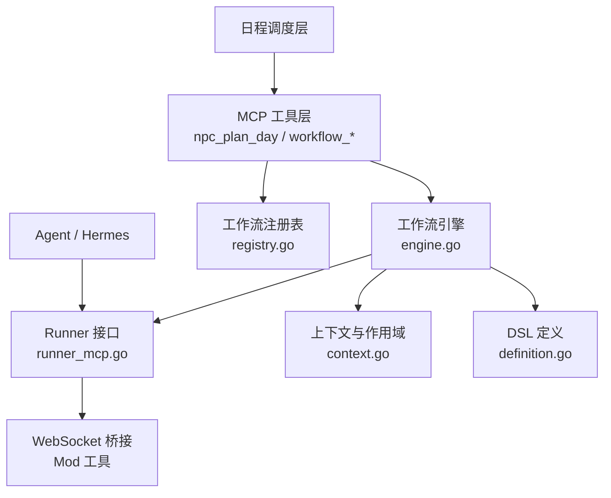
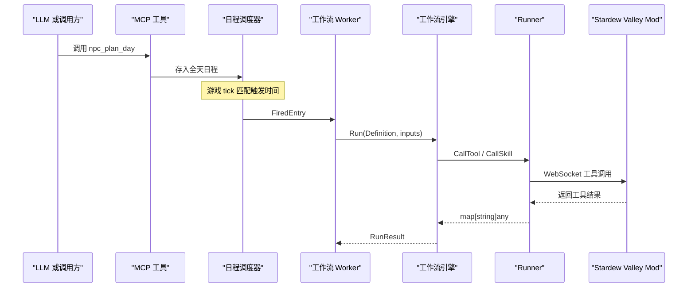
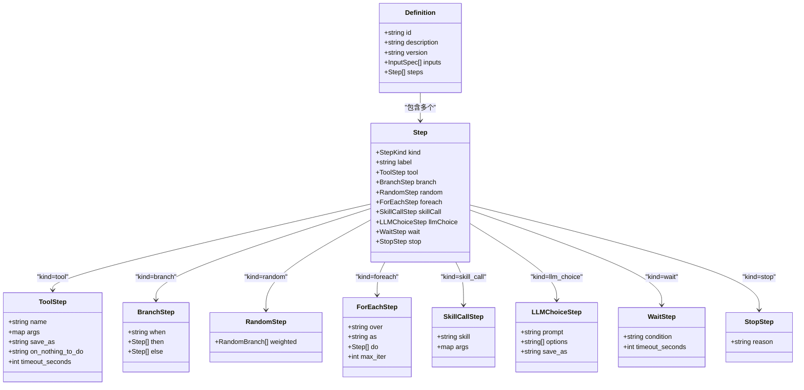
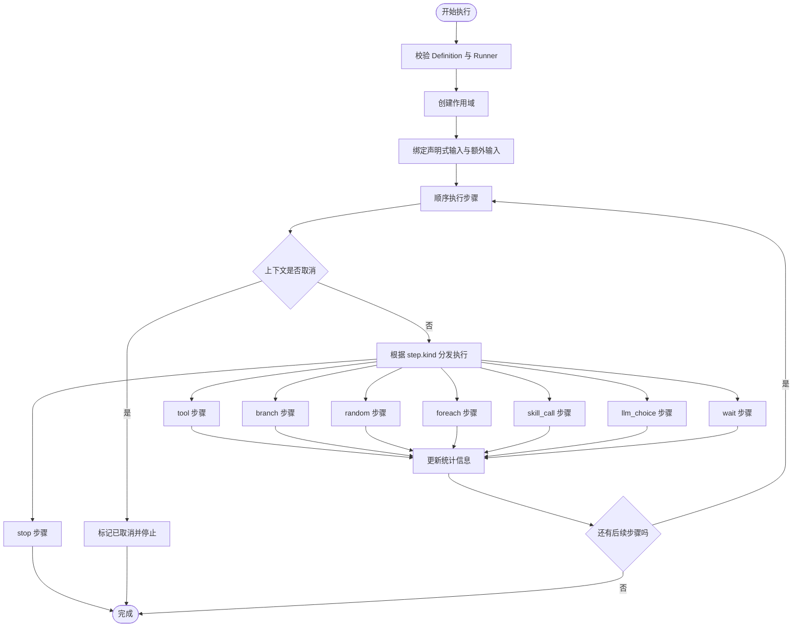
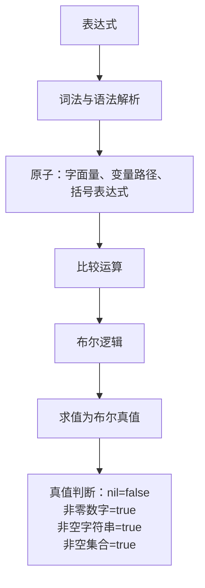
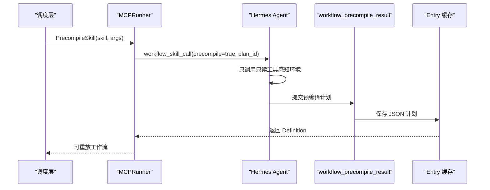
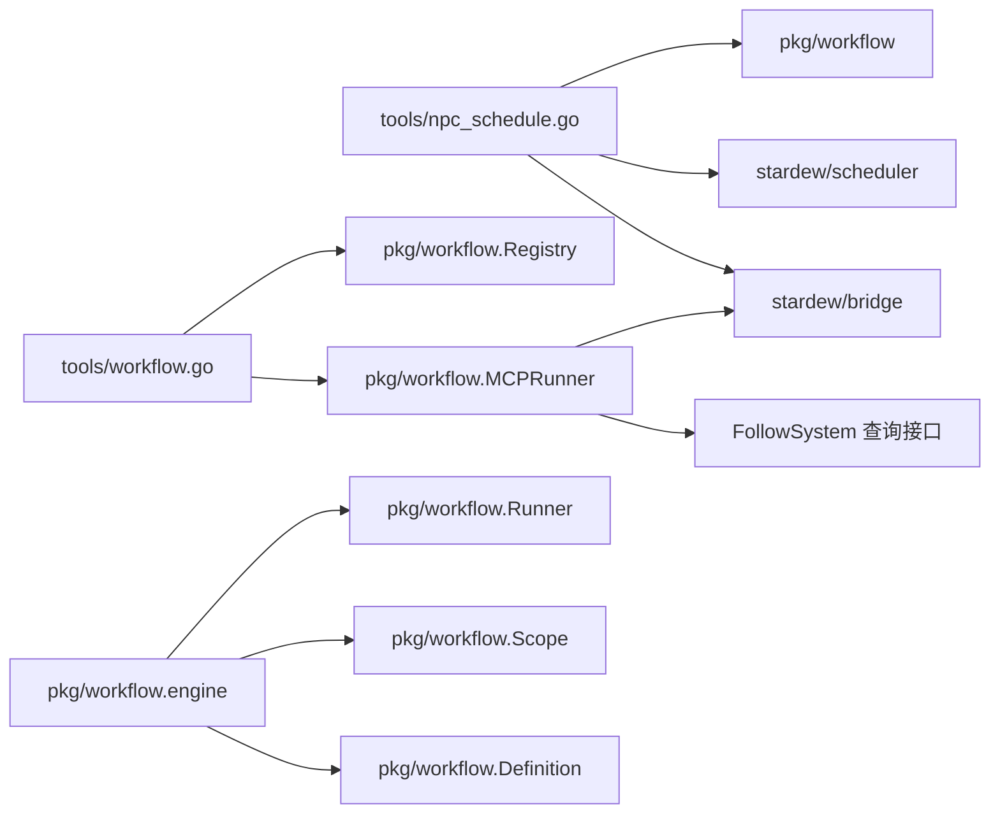
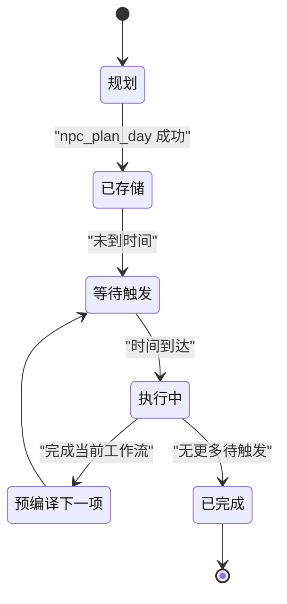

# 日程与工作流工具

<cite>
**本文引用的文件**   
- [npc_schedule.go](file://SmartNPC/smartnpc-mcp/adapters/stardew/tools/npc_schedule.go)
- [workflow.go](file://SmartNPC/smartnpc-mcp/adapters/stardew/tools/workflow.go)
- [definition.go](file://SmartNPC/smartnpc-mcp/pkg/workflow/definition.go)
- [engine.go](file://SmartNPC/smartnpc-mcp/pkg/workflow/engine.go)
- [context.go](file://SmartNPC/smartnpc-mcp/pkg/workflow/context.go)
- [registry.go](file://SmartNPC/smartnpc-mcp/pkg/workflow/registry.go)
- [runner_mcp.go](file://SmartNPC/smartnpc-mcp/pkg/workflow/runner_mcp.go)
- [precompile.go](file://SmartNPC/smartnpc-mcp/pkg/workflow/precompile.go)
- [schedule-system-detail.md](file://SmartNPC/docs/schedule-system-detail.md)
- [workflow-authoring.md](file://SmartNPC/docs/workflow-authoring.md)
</cite>

## 目录

1. [引言](#引言)
2. [项目结构](#项目结构)
3. [核心组件](#核心组件)
4. [架构总览](#架构总览)
5. [详细组件分析](#详细组件分析)
6. [依赖关系分析](#依赖关系分析)
7. [性能与并发特性](#性能与并发特性)
8. [工作流定义规范](#工作流定义规范)
9. [复杂工作流设计示例](#复杂工作流设计示例)
10. [日程系统集成与最佳实践](#日程系统集成与最佳实践)
11. [故障排查指南](#故障排查指南)
12. [结论](#结论)

## 引言

本文件面向需要理解和使用 SmartNPC 日程与工作流能力的开发者、策划和运维人员，目标是给出完整的技术 API 文档。内容覆盖：

- `npc_plan_day` 工作流的定义、输入约束、执行时机与结果语义。
- `workflow_run_inline` 等 MCP 工具的调用方式、参数、输出和调试用途。
- 工作流引擎的数据模型、步骤语法、表达式语言、条件判断、随机分支、循环控制。
- YAML 工作流定义的加载、验证、内置定义与运行时覆盖机制。
- 工作流引擎的执行模型、上下文变量、预编译流程、错误处理与日志。
- 与游戏日程系统的集成链路，包括 NPC 全天计划、时间触发、Worker 串行执行、FollowSystem 状态同步。
- 农场管理、社交活动安排等实际场景的设计建议。

该项目采用分层架构：MCP 工具层负责暴露接口；工作流包提供 DSL、解析器、校验器和引擎；调度层把游戏时间与 NPC 行为串联起来；Mod 层最终驱动寻路、动画和游戏状态修改。

## 项目结构

与日程与工作流直接相关的代码集中在以下位置：

| 路径 | 职责 |
|---|---|
| `SmartNPC/smartnpc-mcp/adapters/stardew/tools/npc_schedule.go` | 注册 `npc_plan_day`、`npc_get_schedule`，把 LLM 提交的全天计划转换为内存调度条目。 |
| `SmartNPC/smartnpc-mcp/adapters/stardew/tools/workflow.go` | 注册 `workflow_list`、`workflow_get`、`workflow_run_inline`、`workflow_choice_reply`、`workflow_precompile_result`、`workflow_run_history`、`npc_workflow_status`。 |
| `SmartNPC/smartnpc-mcp/pkg/workflow/definition.go` | 定义工作流数据模型：`Definition`、`Step`、`ToolStep`、`BranchStep`、`RandomStep`、`ForEachStep`、`SkillCallStep`、`LLMChoiceStep`、`WaitStep`、`StopStep`。 |
| `SmartNPC/smartnpc-mcp/pkg/workflow/engine.go` | 工作流引擎：按顺序执行步骤、解析参数、统计运行指标、处理 `nothing_to_do`、支持提前终止。 |
| `SmartNPC/smartnpc-mcp/pkg/workflow/context.go` | 作用域变量、路径解析、表达式求值器。 |
| `SmartNPC/smartnpc-mcp/pkg/workflow/registry.go` | 内置 YAML 工作流加载、外部目录覆盖、静态校验。 |
| `SmartNPC/smartnpc-mcp/pkg/workflow/runner_mcp.go` | 生产环境 Runner：通过 WebSocket 桥接 Mod，等待 FollowSystem 空闲，处理 Skill 调用、LLM 选择、预编译。 |
| `SmartNPC/smartnpc-mcp/pkg/workflow/precompile.go` | 录制式预编译：拦截写操作、生成可回放工作流定义。 |
| `SmartNPC/docs/schedule-system-detail.md` | 日程系统从事件到游戏动作的完整说明。 |
| `SmartNPC/docs/workflow-authoring.md` | 工作流编写指南、步骤类型、表达式、输入声明与校验。 |

**图表来源**
- [npc_schedule.go:1-200](file://SmartNPC/smartnpc-mcp/adapters/stardew/tools/npc_schedule.go#L1-L200)
- [workflow.go:1-200](file://SmartNPC/smartnpc-mcp/adapters/stardew/tools/workflow.go#L1-L200)
- [engine.go:1-200](file://SmartNPC/smartnpc-mcp/pkg/workflow/engine.go#L1-L200)
- [runner_mcp.go:1-200](file://SmartNPC/smartnpc-mcp/pkg/workflow/runner_mcp.go#L1-L200)
- [definition.go:1-120](file://SmartNPC/smartnpc-mcp/pkg/workflow/definition.go#L1-L120)
- [context.go:1-80](file://SmartNPC/smartnpc-mcp/pkg/workflow/context.go#L1-L80)
- [registry.go:1-80](file://SmartNPC/smartnpc-mcp/pkg/workflow/registry.go#L1-L80)

**章节来源**
- [npc_schedule.go:1-200](file://SmartNPC/smartnpc-mcp/adapters/stardew/tools/npc_schedule.go#L1-L200)
- [workflow.go:1-200](file://SmartNPC/smartnpc-mcp/adapters/stardew/tools/workflow.go#L1-L200)
- [definition.go:1-120](file://SmartNPC/smartnpc-mcp/pkg/workflow/definition.go#L1-L120)
- [engine.go:1-200](file://SmartNPC/smartnpc-mcp/pkg/workflow/engine.go#L1-L200)
- [context.go:1-80](file://SmartNPC/smartnpc-mcp/pkg/workflow/context.go#L1-L80)
- [registry.go:1-80](file://SmartNPC/smartnpc-mcp/pkg/workflow/registry.go#L1-L80)
- [schedule-system-detail.md:1-120](file://SmartNPC/docs/schedule-system-detail.md#L1-L120)
- [workflow-authoring.md:1-60](file://SmartNPC/docs/workflow-authoring.md#L1-L60)

## 核心组件

### npc_plan_day：全天日程提交工具

`npc_plan_day` 是 NPC 在每天开始时提交的计划入口。它接受一个 NPC 标识、游戏日期、季节、年份，以及若干日程条目。每个条目代表一个计划任务，当前推荐且主要支持的形态是引用已注册的工作流。

#### 输入结构

| 字段 | 类型 | 含义 |
|---|---|---|
| `npc` | 字符串 | NPC 内部名称；支持 `*` 表示所有已注册的 Agent NPC。 |
| `day` | 整数 | 游戏日，范围 1-28。 |
| `season` | 字符串 | 季节，取值为春、夏、秋、冬对应的英文值。 |
| `year` | 整数 | 游戏年，默认 1。 |
| `entries` | 数组 | 日程条目数组，推荐 5-7 项，最多接受 8 项，超出会被截断。 |

#### 日程条目字段

| 字段 | 类型 | 含义 |
|---|---|---|
| `game_hour` | 整数 | 游戏小时，6-25；25 表示次日凌晨 1 点。 |
| `game_minute` | 整数 | 可选，分钟精度为 10 分钟步长：0、10、20、30、40、50；无效值向下取整并限制在 0-50。 |
| `reason` | 字符串 | 可选，用于调试的计划原因。 |
| `workflow_id` | 字符串 | 推荐字段，引用已注册工作流 ID。 |
| `args` | 对象 | 可选，传递给工作流的输入参数。 |
| `workflow` | 对象 | 可选，内联工作流定义，包含 `id` 和 `steps`。 |
| `action` | 字符串 | 已禁用；如果单独使用会报错，应改用 `workflow_id`。 |

#### 约束与行为

- 同一游戏日对同一 NPC 重复调用会替换原有日程。
- 超过 8 条的条目会被丢弃，不会保留全部提交量。
- 小时不在 6-25 范围的条目会被跳过。
- 分钟自动四舍五入到 10 分钟边界。
- 实验模式下会自动追加一条 `day_review` 日程（通常在 22:30），除非已经存在该工作流。
- 不支持 `action` 字段；必须通过 `workflow_list` 获取可用工作流后使用 `workflow_id`。
- 支持批量目标：`npc="*"` 时对所有 Agent NPC 应用相同计划。

#### 输出结构

| 字段 | 类型 | 含义 |
|---|---|---|
| `ok` | 布尔 | 是否成功存储日程。 |
| `npc` | 字符串 | 回显调用者传入的 NPC。 |
| `accepted` | 整数 | 实际接受的条目数量。 |
| `message` | 字符串 | 包含截断提示、经验模式注入提示、重复调用警告等信息。 |

**章节来源**
- [npc_schedule.go:1-120](file://SmartNPC/smartnpc-mcp/adapters/stardew/tools/npc_schedule.go#L1-L120)
- [npc_schedule.go:201-453](file://SmartNPC/smartnpc-mcp/adapters/stardew/tools/npc_schedule.go#L201-L453)

### workflow_run_inline：工作流调试执行工具

`workflow_run_inline` 是一个调试工具，用于在不真正修改游戏世界的情况下验证工作流定义的结构和执行路径。它使用空操作 Runner，不调用 Mod，只记录步骤数和工具调用数。

#### 输入结构

| 字段 | 类型 | 含义 |
|---|---|---|
| `npc` | 字符串 | 以哪个 NPC 身份运行；未提供时使用调试名称。 |
| `workflow_id` | 字符串 | 可选，引用已注册工作流。 |
| `inline` | 对象 | 可选，内联工作流定义，需包含 `id`、`steps`。 |
| `args` | 对象 | 可选，工作流输入参数。 |

#### 输出结构

| 字段 | 类型 | 含义 |
|---|---|---|
| `ok` | 布尔 | 是否成功执行。 |
| `step_count` | 整数 | 执行的步骤总数。 |
| `tool_calls` | 整数 | 实际触发的工具步骤数。 |
| `nothing_to_do_ct` | 整数 | 返回 `nothing_to_do=true` 的工具次数。 |
| `stopped` | 布尔 | 是否因 `stop` 或策略提前终止。 |
| `stop_reason` | 字符串 | 提前终止原因。 |
| `message` | 字符串 | 人类可读的运行摘要。 |

**章节来源**
- [workflow.go:1-200](file://SmartNPC/smartnpc-mcp/adapters/stardew/tools/workflow.go#L1-L200)
- [workflow.go:201-350](file://SmartNPC/smartnpc-mcp/adapters/stardew/tools/workflow.go#L201-L350)

### 其他关键 MCP 工具

| 工具 | 用途 |
|---|---|
| `workflow_list` | 列出所有内置或被覆盖的工作流及其输入规格。 |
| `workflow_get` | 获取指定工作流的完整定义。 |
| `workflow_choice_reply` | 响应工作流中 `llm_choice` 的请求。 |
| `workflow_precompile_result` | 提交预编译工作流计划。 |
| `workflow_run_history` | 查询历史工作流运行记录。 |
| `npc_workflow_status` | 查看各 NPC 当前运行的工作流、队列深度和待触发日程。 |

**章节来源**
- [workflow.go:1-200](file://SmartNPC/smartnpc-mcp/adapters/stardew/tools/workflow.go#L1-L200)
- [workflow.go:350-512](file://SmartNPC/smartnpc-mcp/adapters/stardew/tools/workflow.go#L350-L512)

## 架构总览

整个日程与工作流系统可以看作四层：

1. **日程提交层**：LLM 或外部调用者通过 `npc_plan_day` 提交全天计划。
2. **调度层**：Scheduler 维护每个 NPC 的内存日程，根据游戏时间触发。
3. **工作流执行层**：Engine 读取 Definition，按步骤执行；必要时委托 Runner。
4. **Mod 执行层**：Bridge 将工具调用转发给 Stardew Valley Mod，最终由 FollowSystem 驱动 NPC 行为。

**图表来源**
- [npc_schedule.go:1-200](file://SmartNPC/smartnpc-mcp/adapters/stardew/tools/npc_schedule.go#L1-L200)
- [engine.go:1-200](file://SmartNPC/smartnpc-mcp/pkg/workflow/engine.go#L1-L200)
- [runner_mcp.go:1-200](file://SmartNPC/smartnpc-mcp/pkg/workflow/runner_mcp.go#L1-L200)
- [schedule-system-detail.md:120-255](file://SmartNPC/docs/schedule-system-detail.md#L120-L255)

## 详细组件分析

### 工作流数据模型

工作流定义的核心是 `Definition`，它包含：

- `id`：唯一工作流标识。
- `description`：可选的人类可读描述。
- `version`：可选版本。
- `inputs`：声明式输入列表，每个输入可带默认值。
- `steps`：有序步骤列表。

步骤是标签联合结构，通过 `kind` 决定具体子类型：

| kind | 结构 | 作用 |
|---|---|---|
| `tool` | `ToolStep` | 调用 MCP 工具，支持输出绑定和 nothing_to_do 策略。 |
| `branch` | `BranchStep` | if/else 条件分支。 |
| `random` | `RandomStep` | 加权随机选择其中一个分支。 |
| `foreach` | `ForEachStep` | 遍历列表，每次迭代创建子作用域。 |
| `skill_call` | `SkillCallStep` | 调用 Hermes SKILL，让 Agent 动态编排行为。 |
| `llm_choice` | `LLMChoiceStep` | 让 LLM 从固定选项中选择，结果绑定到变量。 |
| `wait` | `WaitStep` | 等待 NPC 进入空闲状态。 |
| `stop` | `StopStep` | 提前终止工作流。 |

**图表来源**
- [definition.go:1-200](file://SmartNPC/smartnpc-mcp/pkg/workflow/definition.go#L1-L200)

**章节来源**
- [definition.go:1-200](file://SmartNPC/smartnpc-mcp/pkg/workflow/definition.go#L1-L200)
- [definition.go:201-234](file://SmartNPC/smartnpc-mcp/pkg/workflow/definition.go#L201-L234)

### 工作流引擎执行模型

引擎是工作流系统的核心执行器。它的公开入口是 `Run`，接收上下文、Runner、NPC 名称、Definition 和输入映射。

执行流程要点：

1. 校验 Definition 和 Runner 不为空。
2. 创建顶层作用域。
3. 绑定声明式输入；调用方传入的值优先，缺失则使用默认值。
4. 额外传入的输入也会绑定到作用域，方便内联工作流。
5. 顺序执行 Steps。
6. 统计步骤数、工具调用数、nothing_to_do 次数、是否提前停止。
7. 记录运行日志，包括耗时和错误信息。

**图表来源**
- [engine.go:1-200](file://SmartNPC/smartnpc-mcp/pkg/workflow/engine.go#L1-L200)
- [engine.go:201-400](file://SmartNPC/smartnpc-mcp/pkg/workflow/engine.go#L201-L400)

#### 工具步骤与 nothing_to_do 策略

工具步骤是工作流中最常见的操作。引擎在执行时会：

- 解析参数中的 `$` 引用。
- 调用 Runner 的 `CallTool`。
- 检查返回值中的 `nothing_to_do`。
- 根据 `on_nothing_to_do` 策略决定继续、停止或失败。

| 策略 | 行为 |
|---|---|
| 空值或 `skip` | 记录 nothing_to_do，继续下一步。 |
| `stop` | 设置停止原因，结束工作流。 |
| `fail` | 返回错误，中断执行。 |
| 其他值 | 报错，视为配置错误。 |

**章节来源**
- [engine.go:201-400](file://SmartNPC/smartnpc-mcp/pkg/workflow/engine.go#L201-L400)

### 上下文与作用域

工作流变量通过 `Scope` 管理。作用域支持父子链式查找，但同一个作用域内不允许重复绑定同名变量。这种设计保证表达式具有引用透明性，减少“变量在不同步骤取值不同”的调试问题。

#### 变量解析规则

- 变量名以 `$` 开头时可省略 `$`。
- 支持点号路径，例如 `$obs.water.count`。
- 路径必须是 `map[string]any` 结构。
- 找不到路径段时返回 nil，而不是直接报错。
- `foreach` 每次迭代创建子作用域，外层变量仍可见，但内层变量不污染外层。

#### 表达式语言

表达式语言刻意保持简单，避免引入完整脚本能力导致性能和安全风险。

| 类别 | 支持内容 |
|---|---|
| 变量 | 路径查找，如 `$obs.water.count`。 |
| 字面量 | 数字、引号字符串、`true`、`false`、`nil`。 |
| 比较 | `==`、`!=`、`<`、`<=`、`>`、`>=`。 |
| 逻辑 | `&&`、`||`、`!`。 |
| 括号 | 支持分组表达式。 |
| 算术 | 不支持。 |
| 函数 | 不支持。 |
| 字符串插值 | 不支持。 |

**图表来源**
- [context.go:1-120](file://SmartNPC/smartnpc-mcp/pkg/workflow/context.go#L1-L120)
- [context.go:120-452](file://SmartNPC/smartnpc-mcp/pkg/workflow/context.go#L120-L452)

**章节来源**
- [context.go:1-120](file://SmartNPC/smartnpc-mcp/pkg/workflow/context.go#L1-L120)
- [context.go:120-452](file://SmartNPC/smartnpc-mcp/pkg/workflow/context.go#L120-L452)

### 工作流注册表与 YAML 加载

工作流定义通常以 YAML 文件形式存在于内置目录中。启动时，注册表会：

1. 扫描嵌入的内置 YAML 文件。
2. 解析并校验每个 Definition。
3. 如果配置了外部目录，则扫描该目录下的 YAML。
4. 相同 ID 的外部定义会覆盖内置定义。
5. 重复 ID 会报错。

注册表是读多写少的结构：Init 阶段写入，之后只提供读操作，并通过读写锁保护并发访问。

#### 校验规则

| 检查项 | 规则 |
|---|---|
| Definition | 不能为空，必须有 id，steps 不能为空。 |
| tool | 必须有 name；save_as 在同一作用域不能重复；on_nothing_to_do 只能是 skip、stop、fail。 |
| branch | 必须有 when；then 和 else 不能同时为空。 |
| random | 至少有一个权重大于 0 的分支；不能有负权重。 |
| foreach | 必须有 over 和 as；do 不能为空。 |
| skill_call | 必须有 skill；禁止直接引用 MCP 工具名称。 |
| llm_choice | 必须有 save_as 和 options。 |
| wait | condition 只能为空或 idle。 |
| stop | 总是合法。 |

**章节来源**
- [registry.go:1-200](file://SmartNPC/smartnpc-mcp/pkg/workflow/registry.go#L1-L200)
- [registry.go:201-376](file://SmartNPC/smartnpc-mcp/pkg/workflow/registry.go#L201-L376)

### Runner 与生产执行路径

Runner 是引擎与外部环境之间的抽象接口。生产实现 `MCPRunner` 负责：

- 调用 Mod 的 MCP 工具。
- 发送 Skill 调用事件给 Hermes Agent。
- 等待 Agent 回合结束。
- 等待 FollowSystem 回到空闲。
- 处理 LLM 选择请求。
- 执行预编译流程。

#### MCPRunner 的关键方法

| 方法 | 行为 |
|---|---|
| `CallTool` | 向 Mod 发起工具调用，自动补充 `npc` 参数，返回结构化结果。 |
| `CallSkill` | 发送 `workflow_skill_call` 事件，等待 Hermes 回合和 FollowSystem 空闲。 |
| `LLMChoice` | 当 Relay 未连接时返回第一个选项；连接后可通过 `workflow_choice_reply` 完成选择。 |
| `PrecompileSkill` | 发送预编译请求，等待 Agent 提交可回放计划。 |
| `WaitIdle` | 每 250ms 轮询 FollowSystem，直到空闲或超时。 |

**章节来源**
- [runner_mcp.go:1-200](file://SmartNPC/smartnpc-mcp/pkg/workflow/runner_mcp.go#L1-L200)
- [runner_mcp.go:201-325](file://SmartNPC/smartnpc-mcp/pkg/workflow/runner_mcp.go#L201-L325)

### 预编译机制

预编译是工作流系统的重要优化手段。其思想是：让 Agent 先走一次真实流程，但只记录写操作，然后生成一个无需再次调用 LLM 的可执行工作流。

#### 预编译流程

**图表来源**
- [precompile.go:1-200](file://SmartNPC/smartnpc-mcp/pkg/workflow/precompile.go#L1-L200)
- [runner_mcp.go:201-325](file://SmartNPC/smartnpc-mcp/pkg/workflow/runner_mcp.go#L201-L325)
- [schedule-system-detail.md:120-255](file://SmartNPC/docs/schedule-system-detail.md#L120-L255)

#### 录制式 Runner

`RecordingRunner` 会拦截写工具调用，将其记录为 `recordedStep`，并在结束时生成一个仅包含 `tool` 步骤的 `Definition`。只读工具前缀包括：

- `npc_inspect_`
- `npc_find_`
- `npc_get_`
- `game_get_`
- `player_get_`
- `player_query_`
- `workflow_list`
- `workflow_get`
- `npc_workflow_status`
- `workflow_run_history`
- `npc_perception_`

**章节来源**
- [precompile.go:1-200](file://SmartNPC/smartnpc-mcp/pkg/workflow/precompile.go#L1-L200)
- [precompile.go:201-226](file://SmartNPC/smartnpc-mcp/pkg/workflow/precompile.go#L201-L226)

## 依赖关系分析

**图表来源**
- [npc_schedule.go:1-120](file://SmartNPC/smartnpc-mcp/adapters/stardew/tools/npc_schedule.go#L1-L120)
- [workflow.go:1-120](file://SmartNPC/smartnpc-mcp/adapters/stardew/tools/workflow.go#L1-L120)
- [engine.go:1-120](file://SmartNPC/smartnpc-mcp/pkg/workflow/engine.go#L1-L120)
- [runner_mcp.go:1-120](file://SmartNPC/smartnpc-mcp/pkg/workflow/runner_mcp.go#L1-L120)

### 耦合与内聚

- 工作流包本身不依赖 MCP 服务器、WebSocket 桥接或 Hermes Relay，便于单元测试。
- 引擎通过 Runner 接口解耦外部执行环境。
- `npc_schedule.go` 依赖调度器和桥接客户端，承担日程持久化和调试消息推送。
- `workflow.go` 依赖注册表和 Runner，承担工具注册、调试和历史查询。
- 注册表通过嵌入文件系统加载内置 YAML，并通过环境变量或目录参数支持运行时覆盖。

### 潜在循环与风险

- 工作流校验阻止 `skill_call` 引用 MCP 工具名称，降低自引用风险。
- 注册表对重复 ID 报错，防止覆盖时产生隐蔽冲突。
- 表达式语言没有算术和函数调用，避免复杂副作用。
- `foreach` 有最大迭代次数限制，默认 50，防止无限循环。

**章节来源**
- [registry.go:1-200](file://SmartNPC/smartnpc-mcp/pkg/workflow/registry.go#L1-L200)
- [definition.go:1-200](file://SmartNPC/smartnpc-mcp/pkg/workflow/definition.go#L1-L200)
- [engine.go:1-200](file://SmartNPC/smartnpc-mcp/pkg/workflow/engine.go#L1-L200)

## 性能与并发特性

### 执行模型

- 工作流引擎按步骤顺序执行，无并行执行单个工作流内的步骤。
- 每个 NPC 的 workflow 执行是串行的；新触发会取消该 NPC 上一个仍在运行的工作流。
- 工具调用是异步网络调用，但引擎层面仍是步骤级顺序推进。
- `foreach` 支持嵌套作用域，但迭代之间仍然顺序执行。

### 并发控制

- 注册表的读取使用读写锁，初始化后只读。
- 预编译通道和 pending choice 通道使用互斥锁保护共享映射。
- Recorder 的步骤记录使用互斥锁保护切片。
- 工作流 Runner 实例通常是每次运行独立创建，避免跨 run 的状态污染。

### 超时与容错

| 组件 | 超时或限制 |
|---|---|
| 工具默认超时 | 120 秒，适合重型操作。 |
| wait 默认超时 | 30 秒。 |
| CallSkill 等待 FollowSystem 空闲 | 最长 300 秒，软超时不直接失败。 |
| 预编译等待 | 60 秒，超时返回 nil，跳过预编译。 |
| foreach 最大迭代 | 默认 50。 |
| npc_plan_day 最大条目 | 8 条。 |

### 监控与日志

- 引擎记录每个步骤的开始、结束、耗时、错误和是否停止。
- Runner 记录工具调用的延迟和响应大小。
- 工作流运行结果包含步骤数、工具调用数、nothing_to_do 计数和错误步骤索引。
- `workflow_run_history` 可从 JSONL 文件读取历史。
- `npc_workflow_status` 可查看当前运行状态、队列深度和剩余日程。

**章节来源**
- [engine.go:1-200](file://SmartNPC/smartnpc-mcp/pkg/workflow/engine.go#L1-L200)
- [engine.go:400-626](file://SmartNPC/smartnpc-mcp/pkg/workflow/engine.go#L400-L626)
- [runner_mcp.go:1-200](file://SmartNPC/smartnpc-mcp/pkg/workflow/runner_mcp.go#L1-L200)
- [workflow.go:350-512](file://SmartNPC/smartnpc-mcp/adapters/stardew/tools/workflow.go#L350-L512)

## 工作流定义规范

### YAML 基本结构

工作流 YAML 至少包含：

- `id`：必填。
- `steps`：必填，不能为空。
- `description`：可选。
- `version`：可选。
- `inputs`：可选，声明工作流输入。

### 步骤语法速查

| 步骤 | 关键字段 | 说明 |
|---|---|---|
| tool | `name`、`args`、`save_as`、`on_nothing_to_do`、`timeout_seconds` | 调用 MCP 工具。 |
| branch | `when`、`then`、`else` | 条件分支。 |
| random | `weighted` | 加权随机选择一个分支。 |
| foreach | `over`、`as`、`do`、`max_iter` | 遍历列表。 |
| skill_call | `skill`、`args` | 调用 Hermes SKILL。 |
| llm_choice | `prompt`、`options`、`save_as` | 让 LLM 做有限选项选择。 |
| wait | `condition`、`timeout_seconds` | 等待 NPC 空闲。 |
| stop | `reason` | 提前终止。 |

### 表达式语法

表达式语法遵循简洁原则：

- 支持变量路径、数字、字符串、布尔、nil。
- 支持 `==`、`!=`、`<`、`<=`、`>`、`>=`。
- 支持 `&&`、`||`、`!`。
- 支持括号分组。
- 不支持算术、函数调用、字符串插值。
- 未找到变量时解析为 nil，便于安全判断。

### 输入与默认值

工作流可以声明命名输入，调用方通过 `args` 传递。若未提供且定义了默认值，则使用默认值；否则变量为 nil。

### 验证与调试

建议使用 `workflow-lint` 工具在工作流提交前校验。调试时可先用 `workflow_run_inline` 在无副作用环境中验证结构和执行路径。

**章节来源**
- [workflow-authoring.md:1-172](file://SmartNPC/docs/workflow-authoring.md#L1-L172)
- [definition.go:1-200](file://SmartNPC/smartnpc-mcp/pkg/workflow/definition.go#L1-L200)
- [context.go:1-200](file://SmartNPC/smartnpc-mcp/pkg/workflow/context.go#L1-L200)
- [registry.go:201-376](file://SmartNPC/smartnpc-mcp/pkg/workflow/registry.go#L201-L376)

## 复杂工作流设计示例

### 农场管理流程

农场管理工作流适合结合 inspect、water、harvest、clear_debris、ship 等工具，配合天气、季节、作物成熟度和库存状态做决策。

#### 典型步骤序列

1. 使用只读工具感知农场状态。
2. 根据天气决定是否执行户外任务。
3. 如果有缺水作物，浇水。
4. 如果有成熟作物，收获。
5. 如果有杂物或可采集资源，清理或采集。
6. 根据角色性格或随机权重选择社交或休息。
7. 收尾动作，如表情或移动回房屋。

#### 设计要点

- 使用 `branch` 区分天气、季节、作物状态。
- 使用 `random` 实现轻度随机行为，例如不同 NPC 的偏好。
- 使用 `foreach` 处理多个地块或多个物品。
- 使用 `save_as` 绑定中间观察结果。
- 使用 `on_nothing_to_do=skip` 避免无工作时中断。
- 使用 `stop` 明确表达“没有可做工作”的意图。

### 社交活动安排

社交工作流更强调人际关系、好感度、节日和对话。

#### 典型步骤序列

1. 查询玩家或其他 NPC 的关系状态。
2. 根据好感度、礼物、最近互动决定社交对象。
3. 使用 `llm_choice` 在有限选项中做选择，例如送什么礼物、去哪里见面。
4. 调用社交工具进行互动。
5. 使用 `wait` 等待 NPC 回到空闲。
6. 记录结果或写入日记。

#### 设计要点

- 谨慎使用 `llm_choice`，只在少量确定性选项中使用。
- 使用 `random` 体现角色性格差异。
- 避免长时间阻塞；社交任务应控制时长。
- 结合日程系统，把社交安排在合适时间段，不要挤占农忙时段。

### 完整一天工作流组合

`npc_plan_day` 不是单个工作流，而是全天多个工作流的编排。推荐组合：

| 时间段 | 推荐工作流 |
|---|---|
| 早上 | 农场巡视、浇水、收获 |
| 上午 | 清理杂物、采集资源 |
| 中午 | 社交、吃饭、短暂休息 |
| 下午 | 扩展农场、整理仓库、交易 |
| 傍晚 | 收尾、关闭农场、回家 |
| 夜间 | 反思、日记归档、记忆归档 |

**章节来源**
- [workflow-authoring.md:1-172](file://SmartNPC/docs/workflow-authoring.md#L1-L172)
- [schedule-system-detail.md:1-120](file://SmartNPC/docs/schedule-system-detail.md#L1-L120)

## 日程系统集成与最佳实践

### 日程生命周期

1. 收到 `day_started` 事件。
2. 加载 NPC 人格和技能。
3. 调用 `workflow_list` 发现可用工作流。
4. 调用 `npc_plan_day` 提交 5-7 条计划。
5. Scheduler 存储计划。
6. 游戏 tick 匹配触发时间。
7. Worker 解析工作流并执行。
8. 完成后预编译下一个待触发条目。
9. 当天结束时清空日程。

**图表来源**
- [schedule-system-detail.md:1-120](file://SmartNPC/docs/schedule-system-detail.md#L1-L120)

### 最佳实践

| 主题 | 建议 |
|---|---|
| 日程数量 | 每天 5-7 条，最多 8 条。 |
| 时间间隔 | 每条工作流间隔 90-150 分钟，避免排队积压。 |
| 工作流粒度 | 每个工作流聚焦一个领域，例如浇水、收获、社交、收尾。 |
| 只读与写操作分离 | 预编译阶段只用只读工具感知环境。 |
| 错误恢复 | 使用 `on_nothing_to_do=skip` 让流程继续；严重异常使用 `stop` 或 `fail`。 |
| 可观测性 | 使用 `workflow_run_history` 和 `npc_workflow_status` 诊断问题。 |
| 覆盖内置工作流 | 通过 `SMARTNPC_WORKFLOW_DIR` 提供自定义 YAML，不重建程序。 |
| 避免重复计划 | 每天只调用一次 `npc_plan_day`；已有计划时用 `npc_get_schedule` 查询。 |
| 资源分配 | 农场维护为主，社交为辅，雨天转室内任务。 |

**章节来源**
- [npc_schedule.go:120-453](file://SmartNPC/smartnpc-mcp/adapters/stardew/tools/npc_schedule.go#L120-L453)
- [schedule-system-detail.md:1-255](file://SmartNPC/docs/schedule-system-detail.md#L1-L255)
- [workflow-authoring.md:120-172](file://SmartNPC/docs/workflow-authoring.md#L120-L172)

## 故障排查指南

### npc_plan_day 常见问题

| 现象 | 可能原因 | 处理方法 |
|---|---|---|
| 返回 action 字段被禁用 | 使用了已禁用的 `action` 字段 | 改用 `workflow_id`，先调用 `workflow_list`。 |
| 日程条目被截断 | 提交了超过 8 条 | 合并低优先级任务，控制在 8 条以内。 |
| 某条日程未触发 | 小时不在 6-25 或分钟格式错误 | 检查 `game_hour` 和 `game_minute`。 |
| 重复计划警告 | 同一天多次调用 `npc_plan_day` | 每天只调用一次；用 `npc_get_schedule` 查询。 |
| 批量目标报错 | `npc="*"` 但没有注册 Agent NPC | 检查 NPC 注册状态。 |

### 工作流执行问题

| 现象 | 可能原因 | 处理方法 |
|---|---|---|
| 工具调用失败 | WebSocket 桥接错误或 Mod 无响应 | 查看 Runner 日志和桥接错误。 |
| nothing_to_do 频繁 | 环境状态不满足工具前提 | 增加 inspect 步骤，调整分支条件。 |
| 工作流卡住 | FollowSystem 未回到空闲 | 检查 NPC 行为模式，确认是否有长任务未完成。 |
| 预编译超时 | Agent 未在 60 秒内提交计划 | 检查 Hermes 连接、Agent 流程和 `workflow_precompile_result`。 |
| 表达式报错 | 语法错误或变量路径不存在 | 简化表达式，确保 save_as 先于引用。 |

### 调试工具

| 工具 | 用途 |
|---|---|
| `workflow_run_inline` | 在无副作用环境中测试工作流。 |
| `workflow_get` | 查看工作流完整定义。 |
| `workflow_run_history` | 查看历史运行结果。 |
| `npc_workflow_status` | 查看当前运行状态和队列。 |
| `npc_get_schedule` | 查看当日待触发日程。 |

**章节来源**
- [npc_schedule.go:201-453](file://SmartNPC/smartnpc-mcp/adapters/stardew/tools/npc_schedule.go#L201-L453)
- [workflow.go:201-512](file://SmartNPC/smartnpc-mcp/adapters/stardew/tools/workflow.go#L201-L512)
- [engine.go:201-626](file://SmartNPC/smartnpc-mcp/pkg/workflow/engine.go#L201-L626)
- [runner_mcp.go:201-325](file://SmartNPC/smartnpc-mcp/pkg/workflow/runner_mcp.go#L201-L325)

## 结论

SmartNPC 的日程与工作流系统通过 MCP 工具、工作流 DSL、引擎和 Runner 实现了从高层计划到低层游戏动作的完整链路。`npc_plan_day` 负责全天规划，`workflow_run_inline` 负责调试，工作流引擎负责步骤执行，Runner 负责桥接 Mod 和 Agent。

该系统的关键优势是：

- 工作流定义与执行解耦。
- 步骤类型丰富，支持条件、随机、循环、技能委托和 LLM 有限选择。
- 表达式语言简洁可控，适合游戏场景。
- 预编译机制显著降低重复任务的延迟。
- 日程系统与游戏 tick、FollowSystem、Hermes Agent 紧密集成。
- 日志、历史和状态工具提供良好可观测性。

在实际使用中，应优先使用 `workflow_id` 引用已注册工作流，保持日程条目数量合理，充分利用预编译和只读感知工具，并通过历史与状态工具持续优化 NPC 行为。