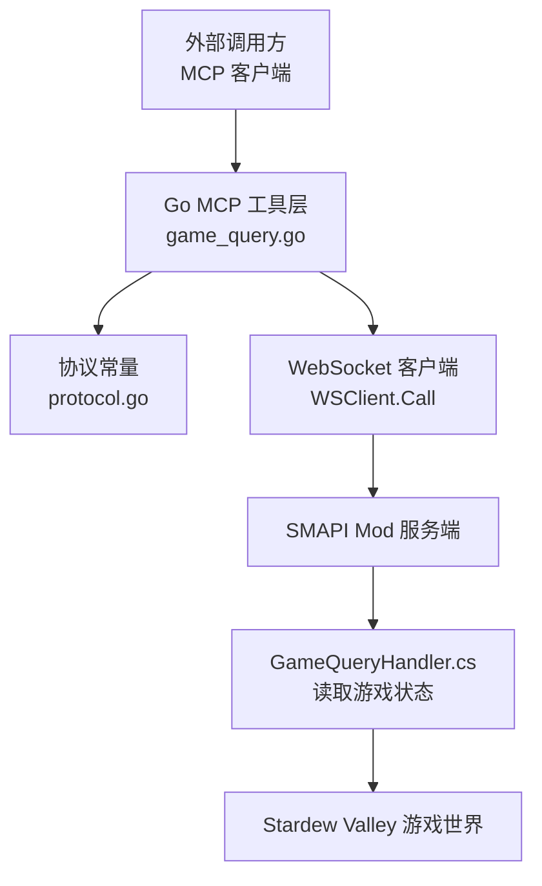
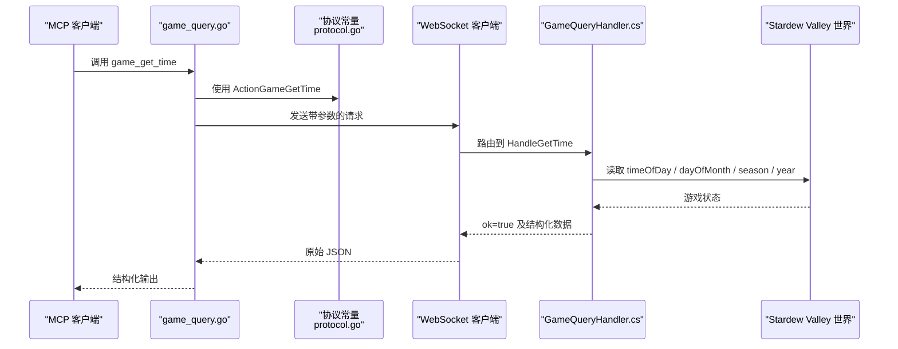
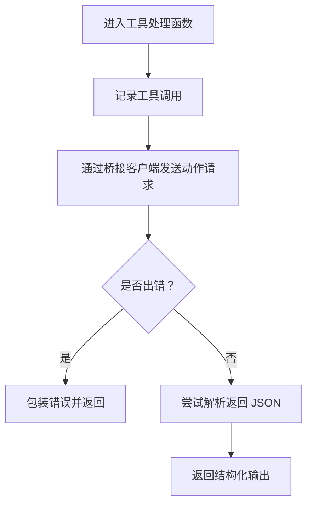
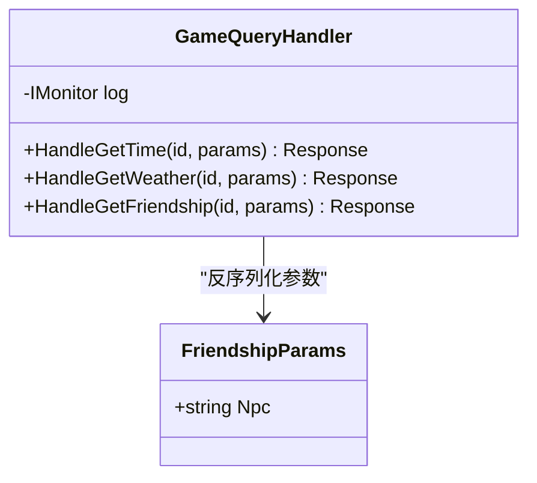
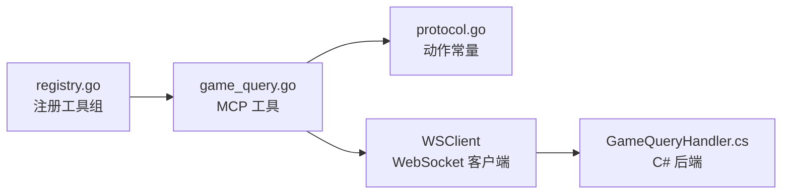
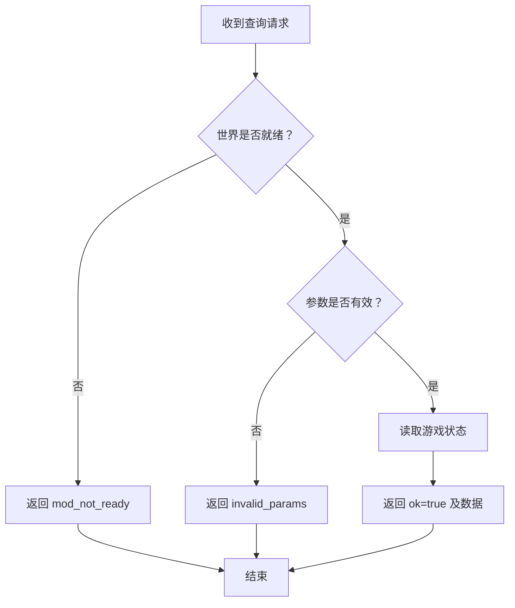

# 游戏状态查询工具

<cite>
**本文引用的文件**   
- [game_query.go](file://SmartNPC/smartnpc-mcp/adapters/stardew/tools/game_query.go)
- [game_query_test.go](file://SmartNPC/smartnpc-mcp/adapters/stardew/tools/game_query_test.go)
- [protocol.go](file://SmartNPC/smartnpc-mcp/adapters/stardew/bridge/protocol.go)
- [registry.go](file://SmartNPC/smartnpc-mcp/adapters/stardew/tools/registry.go)
- [GameQueryHandler.cs](file://SmartNPC/smapi-mod/Query/GameQueryHandler.cs)
- [mcp-tools.md](file://SmartNPC/docs/mcp-tools.md)
</cite>

## 目录
1. [简介](#简介)
2. [项目结构](#项目结构)
3. [核心工具](#核心工具)
4. [架构总览](#架构总览)
5. [详细组件分析](#详细组件分析)
6. [依赖关系分析](#依赖关系分析)
7. [性能与缓存建议](#性能与缓存建议)
8. [常见查询模式](#常见查询模式)
9. [错误处理](#错误处理)
10. [结论](#结论)

## 简介
本文档面向 SmartNPC 的只读游戏状态查询工具，重点说明以下工具：
- `game_get_time`：读取游戏内时钟、日期、季节和年份。
- `game_get_weather`：读取天气、降水类型和当前季节。
- `friendship_get`：读取指定 NPC 的友谊点数、心数、最大心数和关系状态。
- `player_get_status`：在实验构建中已移除；文档保留其历史语义以便迁移旧流程。

这些工具属于“游戏状态、对话、日程”分类下的只读接口，适合用于时间敏感对话、天气相关闲聊、以及检查友谊度后再执行关系操作等场景。

## 项目结构
游戏状态查询工具横跨三层：
- Go MCP 工具层：定义输入输出结构、注册工具、调用桥接客户端。
- WebSocket 协议层：定义动作名称、请求/响应信封。
- SMAPI Mod 后端：从 Stardew Valley 世界对象读取真实数据并返回结构化结果。

**图示来源**
- [game_query.go:1-89](file://SmartNPC/smartnpc-mcp/adapters/stardew/tools/game_query.go#L1-L89)
- [protocol.go:75-91](file://SmartNPC/smartnpc-mcp/adapters/stardew/bridge/protocol.go#L75-L91)
- [GameQueryHandler.cs:1-107](file://SmartNPC/smapi-mod/Query/GameQueryHandler.cs#L1-L107)

**章节来源**
- [registry.go:34-82](file://SmartNPC/smartnpc-mcp/adapters/stardew/tools/registry.go#L34-L82)
- [mcp-tools.md:1-200](file://SmartNPC/docs/mcp-tools.md#L1-L200)

## 核心工具
本节汇总四个工具的用途、输入、输出字段和数据类型。

### `game_get_time`
- 用途：读取当前游戏时钟、日期、星期、季节和年份，用于日间规划、时间门控逻辑、日志记录。
- 输入参数：无。
- 输出字段：
  - `ok`：布尔值，表示成功。
  - `hour`：整数，0–23。
  - `minute`：整数，通常为 0 或 30。
  - `timeOfDay`：整数，原始游戏时间值，例如 1430。
  - `day`：整数，1–28。
  - `day_of_week`：字符串，短星期名，如 Mon。
  - `season`：字符串，spring / summer / fall / winter。
  - `year`：整数，游戏年份。

### `game_get_weather`
- 用途：读取今日天气和季节，用于判断是否需要浇水、是否适合户外农活。
- 输入参数：无。
- 输出字段：
  - `ok`：布尔值，表示成功。
  - `weather`：字符串，sunny / rainy / snowy / stormy。
  - `is_raining`：布尔值，是否下雨。
  - `is_snowing`：布尔值，是否下雪。
  - `is_lightning`：布尔值，是否雷电。
  - `season`：字符串，当前季节。

### `friendship_get`
- 用途：读取玩家与指定 NPC 的友谊数据，常用于确认关系等级后再决定是否送礼、触发事件或改变关系。
- 输入参数：
  - `npc`：字符串，NPC 内部名称。
- 输出字段：
  - `ok`：布尔值，表示成功。
  - `npc`：字符串，传入的 NPC 名称。
  - `points`：整数，友谊点数。
  - `hearts`：整数，心数，通常由点数换算得到。
  - `max_hearts`：整数，最大心数，当前实现为固定值 10。
  - `status`：字符串，关系状态的小写形式。

### `player_get_status`（已移除）
- 历史用途：读取玩家忙碌、菜单、事件、移动、位置等状态。
- 当前状态：在实验构建中已从 MCP 工具注册表中移除，不再出现在 `ListTools`。
- 迁移建议：若旧工作流依赖该工具，应改用 NPC 感知类工具、环境工具或直接基于游戏事件判断上下文。

**章节来源**
- [game_query.go:10-89](file://SmartNPC/smartnpc-mcp/adapters/stardew/tools/game_query.go#L10-L89)
- [GameQueryHandler.cs:14-107](file://SmartNPC/smapi-mod/Query/GameQueryHandler.cs#L14-L107)
- [mcp-tools.md:120-200](file://SmartNPC/docs/mcp-tools.md#L120-L200)

## 架构总览
下图展示一次 `game_get_time` 调用的完整链路：外部 MCP 客户端通过 Go 工具层发起请求，经 WebSocket 协议转发到 SMAPI Mod，Mod 读取游戏世界状态后返回结构化结果。

**图示来源**
- [game_query.go:52-89](file://SmartNPC/smartnpc-mcp/adapters/stardew/tools/game_query.go#L52-L89)
- [protocol.go:75-76](file://SmartNPC/smartnpc-mcp/adapters/stardew/bridge/protocol.go#L75-L76)
- [GameQueryHandler.cs:24-47](file://SmartNPC/smapi-mod/Query/GameQueryHandler.cs#L24-L47)

## 详细组件分析

### Go MCP 工具层
Go 层负责：
- 定义 `GameGetTimeInput`、`GameGetTimeOutput`、`GameGetWeatherInput`、`GameGetWeatherOutput`。
- 注册 `game_get_time` 和 `game_get_weather` 两个工具。
- 将调用包装为桥接请求，解析返回的 JSON。
- 对 `friendship_get` 的工具声明进行了显式移除注释，表明该工具不在当前实验构建中对外暴露。

关键点：
- 工具描述明确标注“只读、无需参数、需要加载存档”。
- 错误路径会包裹上游错误，使上层能够识别 mod 不可用或未加载存档。

**图示来源**
- [game_query.go:52-89](file://SmartNPC/smartnpc-mcp/adapters/stardew/tools/game_query.go#L52-L89)

**章节来源**
- [game_query.go:10-89](file://SmartNPC/smartnpc-mcp/adapters/stardew/tools/game_query.go#L10-L89)
- [registry.go:62-75](file://SmartNPC/smartnpc-mcp/adapters/stardew/tools/registry.go#L62-L75)

### WebSocket 协议层
协议层定义了客户端动作常量，其中与本文相关的包括：
- `ActionGameGetTime`
- `ActionGameGetWeather`
- `ActionFriendshipGet`
- `ActionPlayerGetStatus`

它还定义了统一的请求信封、响应信封、错误结构和事件结构，确保 MCP 客户端与 SMAPI Mod 之间的消息格式一致。

**章节来源**
- [protocol.go:75-91](file://SmartNPC/smartnpc-mcp/adapters/stardew/bridge/protocol.go#L75-L91)
- [protocol.go:120-172](file://SmartNPC/smartnpc-mcp/adapters/stardew/bridge/protocol.go#L120-L172)

### SMAPI Mod 后端
C# 后端根据动作分发处理：
- `HandleGetTime`：校验世界是否就绪，读取 `Game1.timeOfDay`、`Game1.dayOfMonth`、`Game1.shortDayNameFromDayOfSeason`、`Game1.currentSeason`、`Game1.year`。
- `HandleGetWeather`：根据 `isLightning`、`isRaining`、`isSnowing` 推导 `weather`，并返回布尔标志和季节。
- `HandleGetFriendship`：反序列化 `npc` 参数，查找 `Game1.player.friendshipData`，计算心数并返回关系状态。

所有查询都会先检查 `Context.IsWorldReady`；未加载存档时返回 `mod_not_ready`。

**图示来源**
- [GameQueryHandler.cs:14-107](file://SmartNPC/smapi-mod/Query/GameQueryHandler.cs#L14-L107)

**章节来源**
- [GameQueryHandler.cs:14-47](file://SmartNPC/smapi-mod/Query/GameQueryHandler.cs#L14-L47)
- [GameQueryHandler.cs:49-107](file://SmartNPC/smapi-mod/Query/GameQueryHandler.cs#L49-L107)

## 依赖关系分析
- `game_query.go` 依赖 `bridge.WSClient` 发送动作请求。
- 动作名称来自 `protocol.go` 中的常量。
- `registry.go` 在桥接客户端存在时注册 `registerGameQuery`，从而把 MCP 工具挂载到服务器。
- SMAPI 端由 `GameQueryHandler.cs` 直接访问 Stardew Valley 游戏对象。

**图示来源**
- [registry.go:62-75](file://SmartNPC/smartnpc-mcp/adapters/stardew/tools/registry.go#L62-L75)
- [game_query.go:52-89](file://SmartNPC/smartnpc-mcp/adapters/stardew/tools/game_query.go#L52-L89)
- [protocol.go:75-91](file://SmartNPC/smartnpc-mcp/adapters/stardew/bridge/protocol.go#L75-L91)
- [GameQueryHandler.cs:14-107](file://SmartNPC/smapi-mod/Query/GameQueryHandler.cs#L14-L107)

**章节来源**
- [registry.go:34-82](file://SmartNPC/smartnpc-mcp/adapters/stardew/tools/registry.go#L34-L82)
- [protocol.go:75-91](file://SmartNPC/smartnpc-mcp/adapters/stardew/bridge/protocol.go#L75-L91)

## 性能与缓存建议
### 刷新时机
- 这些工具都是只读操作，没有持久化副作用。
- 数据来源于 SMAPI Mod 对 Stardew Valley 世界对象的实时读取，因此每次调用都反映当前游戏状态。
- 官方文档指出这些工具不需要 `PumpOnGameTick`，意味着它们不会引入额外的每帧任务调度。

### 缓存策略
- 工具层本身没有实现跨调用缓存；每次调用都会走桥接客户端和 Mod 后端。
- 如果外层调用频率很高，建议在业务层按合理周期缓存结果，避免重复网络往返。
- 推荐缓存粒度：
  - 分钟级缓存 `game_get_time`，因为 minute 通常是 0 或 30。
  - 日级缓存 `game_get_weather`，除非天气变化频繁且对行为影响很大。
  - NPC 友谊度缓存时间可更长，因为 friendship points 和 hearts 变化相对缓慢。

### 性能优化建议
- 合并查询：如果同一决策同时需要时间和天气，可以在上层一次性获取并复用，而不是分别多次调用。
- 限制高频循环：不要在每一帧或极高频率回调中直接调用工具。
- 失败快速重试：对网络或 mod 不可用错误做有限次重试，但避免无限重试导致阻塞。
- 降级策略：当 mod 不可用时返回保守默认值，例如假设白天或晴天，让主流程继续运行。

[本节为通用性能指导，不直接分析具体代码行]

## 常见查询模式
以下模式描述典型用法，不包含具体代码内容。

### 时间敏感对话
- 适用场景：早晨问候、中午提醒、傍晚关门、夜间日记。
- 步骤：
  1. 调用 `game_get_time`。
  2. 根据 `hour` 选择对话主题。
  3. 结合 `day_of_week`、`season`、`year` 生成更自然的日志或对话。
- 注意事项：
  - 不要仅依赖 `timeOfDay` 数值比较，优先使用 `hour`。
  - 对边界时间（例如临近晚上关闭）增加容差。

参考实现路径：
- [game_query.go:10-51](file://SmartNPC/smartnpc-mcp/adapters/stardew/tools/game_query.go#L10-L51)
- [GameQueryHandler.cs:24-47](file://SmartNPC/smapi-mod/Query/GameQueryHandler.cs#L24-L47)

### 天气相关闲聊
- 适用场景：下雨天不浇水、雪天转室内活动、雷暴天气谨慎行动。
- 步骤：
  1. 调用 `game_get_weather`。
  2. 检查 `is_raining`、`is_snowing`、`is_lightning`。
  3. 根据 `weather` 和 `season` 调整计划。
- 注意事项：
  - 雷暴天气优先级高于普通雨天。
  - 冬季雪天可能锁定部分户外行为，应切换到采集、制作或室内工作。

参考实现路径：
- [game_query.go:52-89](file://SmartNPC/smartnpc-mcp/adapters/stardew/tools/game_query.go#L52-L89)
- [GameQueryHandler.cs:49-73](file://SmartNPC/smapi-mod/Query/GameQueryHandler.cs#L49-L73)

### 友谊度检查后的关系操作
- 适用场景：确认关系等级后再决定送礼、触发特殊对话或推进剧情。
- 步骤：
  1. 调用 `friendship_get`，传入目标 NPC。
  2. 检查 `hearts` 或 `points`。
  3. 根据 `status` 和 `max_hearts` 判断是否接近升级。
- 注意事项：
  - 当前实现中 `max_hearts` 固定为 10，不应假设其他上限。
  - 如果 NPC 不存在于友谊数据中，`points` 为 0，`status` 为默认值。

参考实现路径：
- [GameQueryHandler.cs:75-107](file://SmartNPC/smapi-mod/Query/GameQueryHandler.cs#L75-L107)

### 玩家状态查询的迁移
- 历史行为：`player_get_status` 曾提供 `busy`、`in_menu`、`in_event`、`is_moving`、`location`。
- 当前行为：实验构建已移除该工具。
- 迁移建议：
  - 用 NPC 位置、行为和环境工具替代。
  - 用事件系统判断玩家是否处于菜单或事件中。
  - 对 location 需求改用 NPC 定位和环境扫描工具。

参考信息：
- [mcp-tools.md:120-200](file://SmartNPC/docs/mcp-tools.md#L120-L200)
- [protocol.go:91](file://SmartNPC/smartnpc-mcp/adapters/stardew/bridge/protocol.go#L91)

## 错误处理
### 主要错误码
- `mod_not_ready`：世界未就绪，通常表示尚未加载存档。
- `invalid_params`：参数无效，例如缺少 `npc`。
- 网络或桥接错误：上游连接失败、超时、无法连接 Mod 等。

### 各工具的错误行为
- `game_get_time`：
  - 世界未就绪时返回 `mod_not_ready`。
  - 测试用例验证 Mod 报错时，MCP 响应标记为错误。
- `game_get_weather`：
  - 世界未就绪时返回 `mod_not_ready`。
  - 测试用例验证 Mod 报错时，MCP 响应标记为错误。
- `friendship_get`：
  - 世界未就绪时返回 `mod_not_ready`。
  - 参数缺失或非法时返回 `invalid_params`。

**图示来源**
- [GameQueryHandler.cs:24-107](file://SmartNPC/smapi-mod/Query/GameQueryHandler.cs#L24-L107)

### 上层错误处理建议
- 检查响应的 `ok` 字段，而非仅依赖 HTTP 或通道级别成功。
- 对 `mod_not_ready` 做延迟重试，等待存档加载完成。
- 对 `invalid_params` 做参数校验提示，避免反复提交相同错误请求。
- 对网络错误设置退避重试，避免风暴式重试。
- 对关键路径增加降级逻辑，例如跳过非核心对话或改用默认行为。

**章节来源**
- [GameQueryHandler.cs:24-107](file://SmartNPC/smapi-mod/Query/GameQueryHandler.cs#L24-L107)
- [game_query_test.go:120-199](file://SmartNPC/smartnpc-mcp/adapters/stardew/tools/game_query_test.go#L120-L199)

## 结论
`game_get_time` 和 `game_get_weather` 是当前实验构建中稳定可用的只读工具，适合支撑时间敏感和天气敏感的 NPC 行为。`friendship_get` 提供了基础的关系查询能力，可用于解锁后续关系操作。`player_get_status` 已在实验构建中移除，旧流程应迁移到 NPC 感知、环境和事件体系。

使用时应遵循只读语义、避免高频重复调用、合理缓存结果，并对 `mod_not_ready`、`invalid_params` 和网络异常建立稳健的错误恢复机制。这样可以让 NPC 的行为既贴近游戏世界状态，又具备稳定的运行时表现。