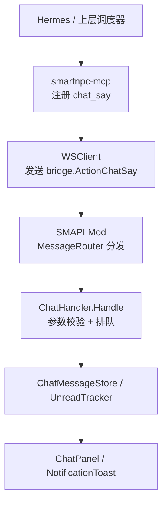
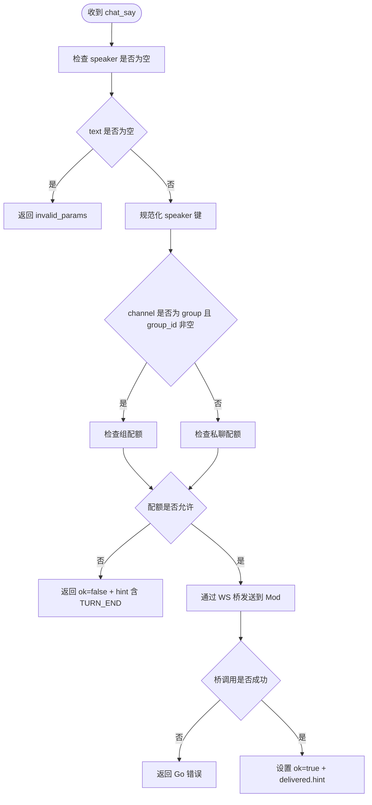
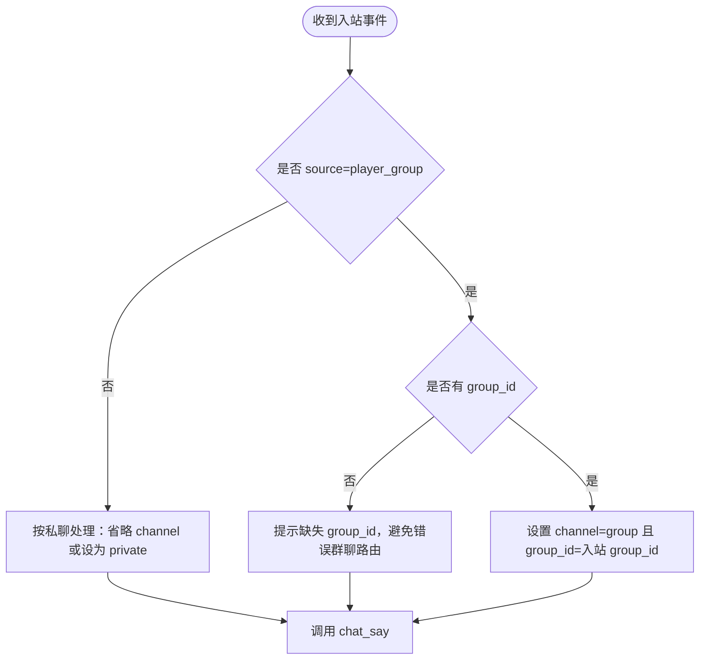
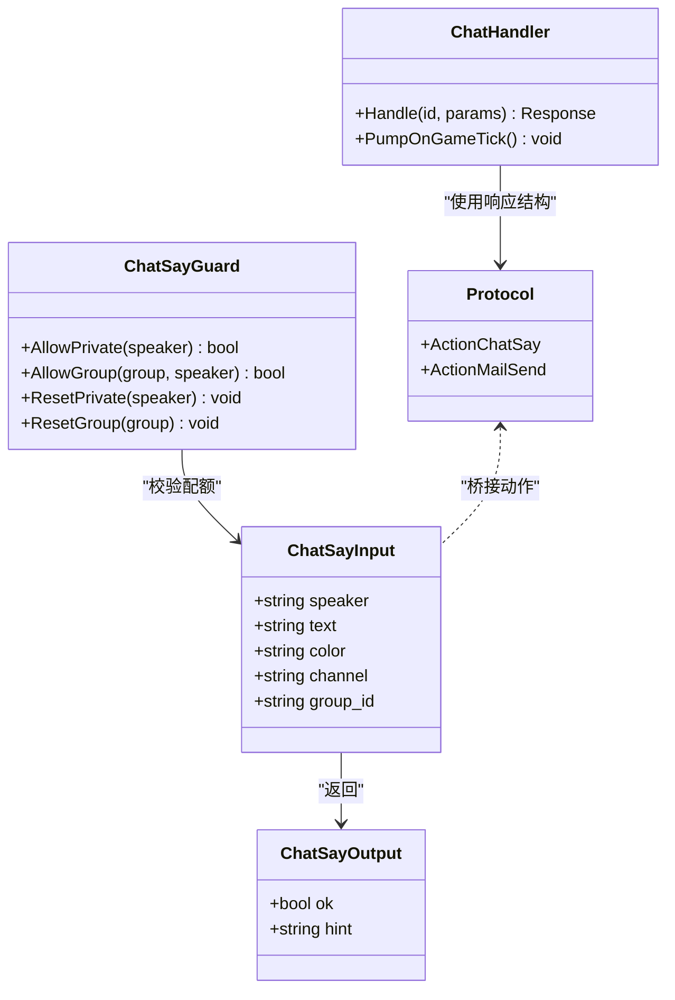

# 聊天与消息工具

<cite>
**本文引用的文件**   
- [chat.go](file://SmartNPC/smartnpc-mcp/adapters/stardew/tools/chat.go)
- [chat_test.go](file://SmartNPC/smartnpc-mcp/adapters/stardew/tools/chat_test.go)
- [registry.go](file://SmartNPC/smartnpc-mcp/adapters/stardew/tools/registry.go)
- [protocol.go](file://SmartNPC/smartnpc-mcp/adapters/stardew/bridge/protocol.go)
- [format.go](file://SmartNPC/smartnpc-mcp/adapters/stardew/events/format.go)
- [ChatHandler.cs](file://SmartNPC/smapi-mod/Chat/ChatHandler.cs)
- [Protocol.cs](file://SmartNPC/smapi-mod/Bridge/Protocol.cs)
- [MessageRouter.cs](file://SmartNPC/smapi-mod/Bridge/MessageRouter.cs)
- [WebSocketServer.cs](file://SmartNPC/smapi-mod/Bridge/WebSocketServer.cs)
- [mcp-tools.md](file://SmartNPC/docs/mcp-tools.md)
- [smapi-mod README.md](file://SmartNPC/smapi-mod/README.md)
</cite>

## 目录
1. [简介](#简介)
2. [项目结构与调用路径](#项目结构与调用路径)
3. [核心工具总览](#核心工具总览)
4. [chat_say 工具 API](#chat_say-工具-api)
5. [mail_send 工具 API](#mail_send-工具-api)
6. [群聊回复最佳实践](#群聊回复最佳实践)
7. [错误处理与故障排查](#错误处理与故障排查)
8. [成功与失败场景示例](#成功与失败场景示例)
9. [依赖关系分析](#依赖关系分析)
10. [结论](#结论)

## 简介
本文件为 SmartNPC 项目中“聊天与消息”相关 MCP 工具的完整 API 文档，重点覆盖：
- `chat_say`：以 NPC 身份在游戏内聊天面板显示一行角色对话。
- `mail_send`：向游戏 HUD 发送系统通知，不用于 NPC 对话或玩家聊天。

当前实验构建中，`mail_send` 已作为“被移除的工具”从 MCP 工具目录中删除，但仍保留在底层桥接协议和最小化 SMAPI mod 的 HTTP 测试端点中；`chat_say` 则保留并用于工作广播、日终总结等可见输出。

## 项目结构与调用路径
MCP 工具定义位于 Go 侧适配器，运行时通过 WebSocket 转发到 SMAPI Mod；Mod 内部将消息写入聊天存储、未读计数器和 UI 回调。

**图表来源**  
- [registry.go:48-82](file://SmartNPC/smartnpc-mcp/adapters/stardew/tools/registry.go#L48-L82)
- [chat.go:157-252](file://SmartNPC/smartnpc-mcp/adapters/stardew/tools/chat.go#L157-L252)
- [protocol.go:68-76](file://SmartNPC/smartnpc-mcp/adapters/stardew/bridge/protocol.go#L68-L76)
- [MessageRouter.cs:21-52](file://SmartNPC/smapi-mod/Bridge/MessageRouter.cs#L21-L52)
- [ChatHandler.cs:24-66](file://SmartNPC/smapi-mod/Chat/ChatHandler.cs#L24-L66)

**章节来源**  
- [registry.go:1-82](file://SmartNPC/smartnpc-mcp/adapters/stardew/tools/registry.go#L1-L82)
- [MessageRouter.cs:1-53](file://SmartNPC/smapi-mod/Bridge/MessageRouter.cs#L1-L53)

## 核心工具总览
| 工具 | 是否保留在实验构建 | 主要用途 | 是否需要存档加载 | 关键返回字段 |
|---|---:|---|---:|---|
| `chat_say` | 是 | NPC 单行对话输出 | 是 | `ok`、`hint` |
| `mail_send` | 否（已从工具目录移除） | HUD 系统通知 | 是（mod 层要求） | 原始响应结构由桥接层封装 |

- `chat_say` 是唯一能产生可见 NPC 对话的工具。
- `mail_send` 仅适合系统提示，例如调试、操作者通知或工作流状态展示；不应把它当作 NPC 回复玩家的方式。

**章节来源**  
- [mcp-tools.md:20-43](file://SmartNPC/docs/mcp-tools.md#L20-L43)
- [mcp-tools.md:230-243](file://SmartNPC/docs/mcp-tools.md#L230-L243)
- [smapi-mod README.md:1-47](file://SmartNPC/smapi-mod/README.md#L1-L47)

## chat_say 工具 API

### 工具定位
`chat_say` 的作用是“说出一句角色台词”，文本会出现在游戏底部左侧聊天面板中，并以 `speaker` 标注说话人。它是 MCP 层向 SMAPI Mod 发送可见对话的核心通道。

### 输入参数
| 参数 | 类型 | 必需 | 默认值 | 格式与约束 |
|---|---|---:|---|---|
| `speaker` | 字符串 | 是 | 无 | NPC 的英文内部名称，使用 PascalCase，例如 `XiaMi`、`Abigail`、`Haley`、`Harvey`、`Penny`、`Sebastian`。不得使用中文显示名。 |
| `text` | 字符串 | 是 | 无 | 纯文本消息体，UTF-8。不支持 Markdown、代码块、JSON、表情图。建议长度为一到三句话；游戏聊天框对长行有截断风险。 |
| `color` | 字符串 | 否 | `yellow` | 可选装饰色，有效值为 `white`、`yellow`、`green`、`red`、`cyan`、`blue`、`purple`、`gray`。应谨慎使用。 |
| `channel` | 字符串 | 否 | 空值，等价于私聊 | 私聊时省略该字段或设为 `private`；群聊回复时必须设为 `group`。 |
| `group_id` | 字符串 | 条件必需 | 无 | 当 `channel="group"` 时必须传入与入站事件一致的群组标识；否则不会进入群聊路由分支。 |

### 返回值
`chat_say` 返回结构化结果，而不是简单的布尔值：
- `ok`：表示消息是否实际投递给 Mod。
- `hint`：给调用方的提示，通常包含终止信号 `TURN_END`，指示本轮不再继续调用工具。

### 参数校验流程

**图表来源**  
- [chat.go:201-252](file://SmartNPC/smartnpc-mcp/adapters/stardew/tools/chat.go#L201-L252)

### 关键行为说明
- **单条限制**：每次唤醒周期内，同一 `speaker` 在私聊最多只能调用一次 `chat_say`。
- **群聊限制**：同一 `(group_id, speaker)` 在每个玩家回合最多只能调用一次。
- **重置时机**：
  - 私聊：下一次指向该 NPC 的入站事件会重置配额。
  - 群聊：只有来自玩家的群聊输入才会重置对应 `group_id` 的配额；NPC 之间的闲聊不会重置。
- **停止信号**：无论成功还是软拒绝，`hint` 中都包含 `TURN_END`。上层调度器看到后应立即停止继续生成工具调用。

**章节来源**  
- [chat.go:16-36](file://SmartNPC/smartnpc-mcp/adapters/stardew/tools/chat.go#L16-L36)
- [chat.go:38-66](file://SmartNPC/smartnpc-mcp/adapters/stardew/tools/chat.go#L38-L66)
- [chat.go:134-155](file://SmartNPC/smartnpc-mcp/adapters/stardew/tools/chat.go#L134-L155)
- [chat.go:160-252](file://SmartNPC/smartnpc-mcp/adapters/stardew/tools/chat.go#L160-L252)

## mail_send 工具 API

### 工具定位
`mail_send` 原本用于通过 HTTP 端点向 SMAPI Mod 发送 HUD 系统通知。在当前实验构建中，它已从 MCP 工具目录移除，因此模型侧通常不再看到该工具。但底层协议常量仍保留，最小化 mod 也保留了 HTTP 测试端点。

### 当前状态
- 工具目录说明明确将其列为“实验构建中被移除的工具”。
- 桥接协议仍定义 `ActionMailSend = "mail_send"`。
- SMAPI Mod 的最小化 README 展示了直接 POST 到 `http://127.0.0.1:18745/mail_send` 的烟雾测试方式。

### 使用场景限制
- **适用**：系统通知、HUD 气泡提示、操作者反馈、工作流调试信息。
- **不适用**：NPC 对话、玩家聊天回复、角色间自然语言交流。
- **不要替代 `chat_say`**：`chat_say` 才是面向玩家可见的 NPC 台词通道；`mail_send` 更接近系统提示。

### 参数与行为
根据最小化 Mod 的 README，HTTP 请求体至少包含 `text` 字段，成功后返回类似 `{ "ok": true, "message": "displayed" }` 的结构。由于该工具不在当前 MCP 工具白名单中，生产调用方应优先使用 `chat_say` 进行 NPC 对话。

**章节来源**  
- [mcp-tools.md:230-243](file://SmartNPC/docs/mcp-tools.md#L230-L243)
- [protocol.go:68-76](file://SmartNPC/smartnpc-mcp/adapters/stardew/bridge/protocol.go#L68-L76)
- [smapi-mod README.md:1-47](file://SmartNPC/smapi-mod/README.md#L1-L47)

## 群聊回复最佳实践

### 何时必须设置 `channel="group"` 和 `group_id`
当入站事件是玩家发到群聊的消息时，渲染后的提示通常会以 `[group_chat group_id=...]` 开头。此时如果决定回复，必须同时满足：
1. `channel="group"`
2. `group_id` 与入站事件的群组 ID 完全一致
3. `speaker` 仍为 NPC 的内部英文名

### 常见错误：消息泄漏到私聊面板
如果群聊回复没有设置 `channel="group"` 或 `group_id` 为空，路由逻辑不会进入群聊分支，而是走私聊路径。结果是消息可能泄漏到单个 NPC 的聊天面板或 Toast 提示，而不是目标群聊面板。

### 推荐决策流程

**图表来源**  
- [chat.go:176-205](file://SmartNPC/smartnpc-mcp/adapters/stardew/tools/chat.go#L176-L205)
- [format.go:68-79](file://SmartNPC/smartnpc-mcp/adapters/stardew/events/format.go#L68-L79)

### 群聊配额规则
- 每个 `(group_id, speaker)` 组合在一个玩家回合内只允许一次 `chat_say`。
- 配额只在玩家再次输入该群聊时重置。
- 其他 NPC 在同一个群聊中可以发言，因为配额是按 `speaker` 区分的。
- 不同 `group_id` 之间互不影响。

**章节来源**  
- [chat.go:38-66](file://SmartNPC/smartnpc-mcp/adapters/stardew/tools/chat.go#L38-L66)
- [chat.go:190-205](file://SmartNPC/smartnpc-mcp/adapters/stardew/tools/chat.go#L190-L205)
- [chat_test.go:227-330](file://SmartNPC/smartnpc-mcp/adapters/stardew/tools/chat_test.go#L227-L330)

## 错误处理与故障排查

### 错误类型对照
| 错误 | 触发条件 | 含义 | 处理建议 |
|---|---|---|---|
| `invalid_params` | `speaker` 或 `text` 为空、无法解析参数 | 参数不合法 | 检查必填字段、编码、空格和大小写。 |
| `mod_not_ready` | 游戏世界未就绪，例如未加载存档 | Mod 尚未准备好执行动作 | 等待存档加载完成后再调用。 |
| `unknown_action` | 请求中没有匹配的 action | 调用了未注册的桥接动作 | 检查 `action` 名称是否正确。 |
| `handler_error` | Mod 处理器抛出异常 | 服务端内部错误 | 查看 SMAPI 日志，确认 Mod 是否正常启动。 |
| 软拒绝：`ok=false` + `noop_chat_say_private_quota_exhausted` | 同一 NPC 私聊在同一唤醒周期重复调用 | 已用完单次对话预算 | 立即停止继续调用，不要重试。 |
| 软拒绝：`ok=false` + `noop_chat_say_group_quota_exhausted` | 同一群聊中同一 NPC 重复调用 | 已用完该群聊本轮预算 | 等待玩家再次输入该群聊后再恢复。 |

### 为什么软拒绝不是普通工具错误
实现刻意将配额耗尽返回为结构化结果，而不是 Go 错误。这样上层不会把它视为“需要修复并重试”的工具失败，从而抑制 `chat_say` 无限重试循环。

### 常见问题排查清单
- 使用了中文 NPC 显示名而非英文内部名。
- 群聊回复忘记传 `group_id`。
- 把 `mail_send` 当成 NPC 对话工具使用。
- 在 `hint` 包含 `TURN_END` 后继续调用 `chat_say`。
- 在未加载存档时调用需要 Mod 支持的工具。
- 字符编码不是 UTF-8，或混入 Markdown、JSON、图片表情。

**章节来源**  
- [ChatHandler.cs:46-66](file://SmartNPC/smapi-mod/Chat/ChatHandler.cs#L46-L66)
- [MessageRouter.cs:33-52](file://SmartNPC/smapi-mod/Bridge/MessageRouter.cs#L33-L52)
- [chat.go:201-252](file://SmartNPC/smartnpc-mcp/adapters/stardew/tools/chat.go#L201-L252)
- [chat_test.go:136-173](file://SmartNPC/smartnpc-mcp/adapters/stardew/tools/chat_test.go#L136-L173)

## 成功与失败场景示例

以下示例描述请求语义和响应语义，不直接粘贴具体源码内容。

### 成功场景一：私聊 NPC 回复
- 请求语义：
  - `speaker`：某个 NPC 的英文内部名。
  - `text`：一句简短的角色台词。
  - `color`：可省略，默认黄色。
  - `channel`：省略或 `private`。
  - `group_id`：省略。
- 预期响应：
  - `ok=true`
  - `hint` 包含 `delivered` 和 `TURN_END`。
  - 游戏聊天面板出现该 NPC 的对话气泡。

**章节来源**  
- [chat.go:241-252](file://SmartNPC/smartnpc-mcp/adapters/stardew/tools/chat.go#L241-L252)
- [chat_test.go:112-133](file://SmartNPC/smartnpc-mcp/adapters/stardew/tools/chat_test.go#L112-L133)

### 成功场景二：群聊回复
- 请求语义：
  - `speaker`：参与群聊的 NPC 内部名。
  - `text`：简短群聊回复。
  - `channel="group"`。
  - `group_id`：与入站群聊事件中的 `group_id` 一致。
- 预期响应：
  - `ok=true`
  - `hint` 包含 `delivered` 和 `TURN_END`。
  - 消息显示在目标群聊面板，而不是私聊面板。

**章节来源**  
- [chat.go:176-205](file://SmartNPC/smartnpc-mcp/adapters/stardew/tools/chat.go#L176-L205)
- [chat_test.go:227-270](file://SmartNPC/smartnpc-mcp/adapters/stardew/tools/chat_test.go#L227-L270)

### 失败场景一：缺少必填参数
- 触发条件：`speaker` 或 `text` 为空。
- 预期响应：
  - 桥接层返回 `ok=false`，错误码 `invalid_params`。
  - 错误消息指出 `speaker` 和 `text` 为必填。

**章节来源**  
- [ChatHandler.cs:46-58](file://SmartNPC/smapi-mod/Chat/ChatHandler.cs#L46-L58)

### 失败场景二：游戏未就绪
- 触发条件：Mod 检测到世界未就绪或未加载存档。
- 预期响应：
  - 桥接层返回 `ok=false`，错误码 `mod_not_ready`。
  - 错误消息提示没有可用存档。

**章节来源**  
- [ChatHandler.cs:58-66](file://SmartNPC/smapi-mod/Chat/ChatHandler.cs#L58-L66)

### 失败场景三：私聊配额耗尽
- 触发条件：同一 NPC 在同一唤醒周期第二次调用 `chat_say`。
- 预期响应：
  - 不是普通工具错误。
  - `ok=false`。
  - `hint` 包含 `noop_chat_say_private_quota_exhausted` 和 `TURN_END`。
  - 调用方应立即停止继续调用。

**章节来源**  
- [chat.go:226-240](file://SmartNPC/smartnpc-mcp/adapters/stardew/tools/chat.go#L226-L240)
- [chat_test.go:136-173](file://SmartNPC/smartnpc-mcp/adapters/stardew/tools/chat_test.go#L136-L173)

### 失败场景四：群聊配额耗尽
- 触发条件：同一 `(group_id, speaker)` 在玩家未重新输入前第二次调用。
- 预期响应：
  - `ok=false`。
  - `hint` 包含 `noop_chat_say_group_quota_exhausted` 和 `TURN_END`。
  - 配额仅在玩家再次输入该群聊时重置。

**章节来源**  
- [chat.go:206-225](file://SmartNPC/smartnpc-mcp/adapters/stardew/tools/chat.go#L206-L225)
- [chat_test.go:227-330](file://SmartNPC/smartnpc-mcp/adapters/stardew/tools/chat_test.go#L227-L330)

### 失败场景五：未知桥接动作
- 触发条件：请求中的 `action` 未被注册。
- 预期响应：
  - 返回 `unknown_action`。
  - 错误消息包含未识别的动作名称。

**章节来源**  
- [MessageRouter.cs:33-46](file://SmartNPC/smapi-mod/Bridge/MessageRouter.cs#L33-L46)

## 依赖关系分析

### 组件职责
| 组件 | 职责 |
|---|---|
| `tools/chat.go` | 定义 `chat_say` 的输入输出、描述、配额守卫和桥接调用。 |
| `adapters/stardew/bridge/protocol.go` | 定义桥接动作常量，包括 `chat_say` 和 `mail_send`。 |
| `Bridge/MessageRouter.cs` | 根据 `action` 分发给对应 Mod 处理器。 |
| `Bridge/ChatHandler.cs` | 校验 `chat_say` 参数、检查 Mod 就绪状态、排队并推送到 UI。 |
| `Bridge/Protocol.cs` | 定义请求、响应、错误和事件的网络传输结构。 |
| `docs/mcp-tools.md` | 对外暴露的工具目录和说明，标记 `mail_send` 已被移除。 |

**图表来源**  
- [chat.go:16-36](file://SmartNPC/smartnpc-mcp/adapters/stardew/tools/chat.go#L16-L36)
- [protocol.go:68-76](file://SmartNPC/smartnpc-mcp/adapters/stardew/bridge/protocol.go#L68-L76)
- [ChatHandler.cs:24-66](file://SmartNPC/smapi-mod/Chat/ChatHandler.cs#L24-L66)
- [Protocol.cs:9-45](file://SmartNPC/smapi-mod/Bridge/Protocol.cs#L9-L45)

**章节来源**  
- [chat.go:16-252](file://SmartNPC/smartnpc-mcp/adapters/stardew/tools/chat.go#L16-L252)
- [protocol.go:1-172](file://SmartNPC/smartnpc-mcp/adapters/stardew/bridge/protocol.go#L1-L172)
- [ChatHandler.cs:1-96](file://SmartNPC/smapi-mod/Chat/ChatHandler.cs#L1-L96)
- [Protocol.cs:1-67](file://SmartNPC/smapi-mod/Bridge/Protocol.cs#L1-L67)

## 结论
- `chat_say` 是 SmartNPC 中唯一用于 NPC 对话输出的工具，必须严格遵守 `speaker`、`text`、`color`、`channel`、`group_id` 的格式。
- 私聊回复省略 `channel`；群聊回复必须设置 `channel="group"` 并匹配入站 `group_id`，否则会泄漏到错误的聊天面板。
- 所有 `chat_say` 结果都携带 `TURN_END`，上层应在第一次调用后立即停止继续生成工具调用。
- `mail_send` 是系统通知通道，不是 NPC 对话工具，且在当前实验构建中已从 MCP 工具目录移除。
- 遇到 `invalid_params`、`mod_not_ready`、`unknown_action` 或配额耗尽软拒绝时，应按错误语义停止重试或等待下一轮入站事件。