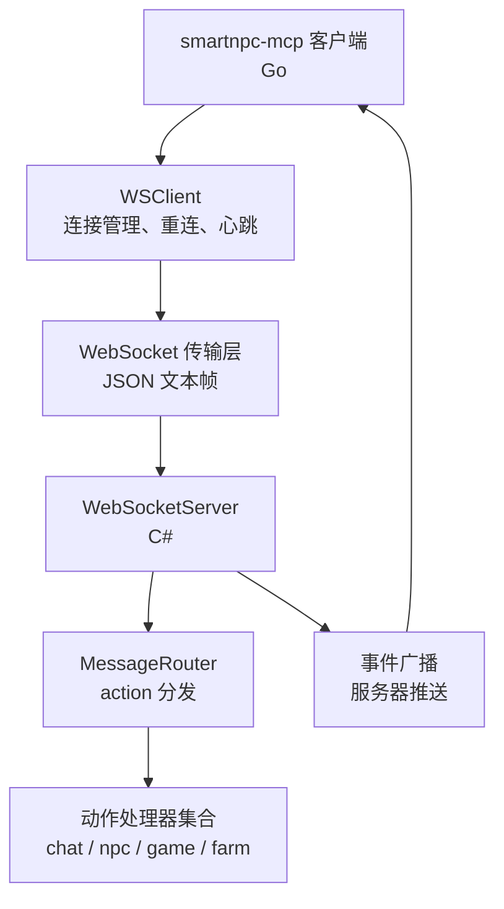
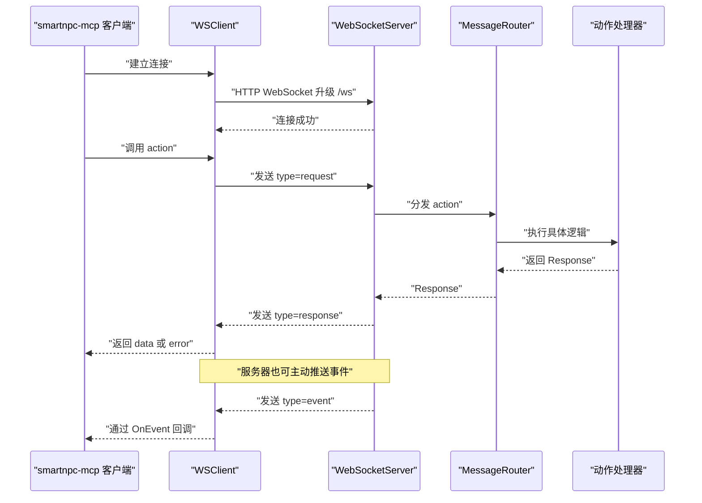
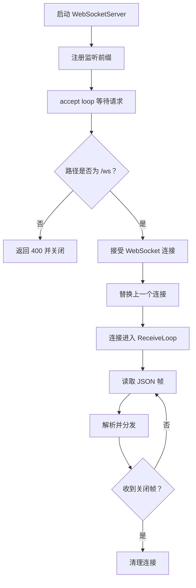
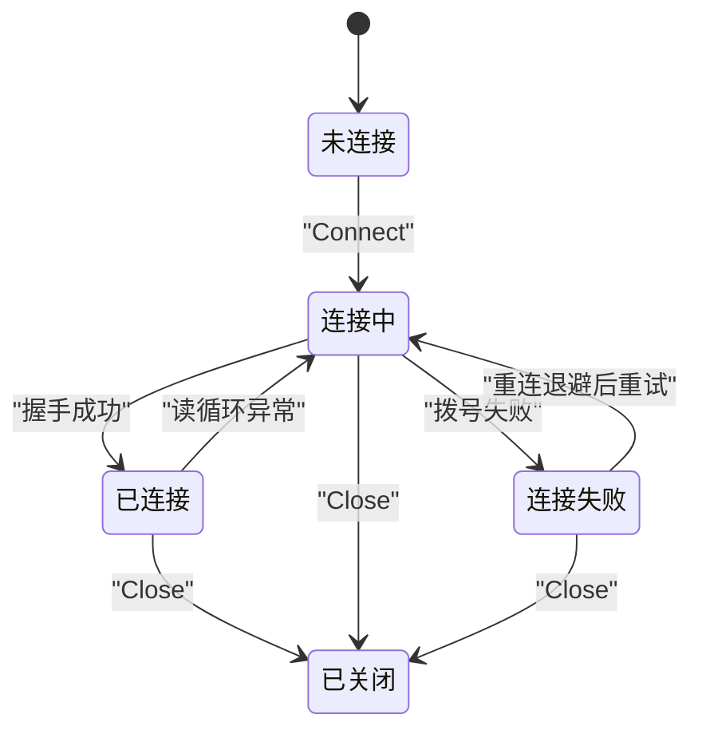
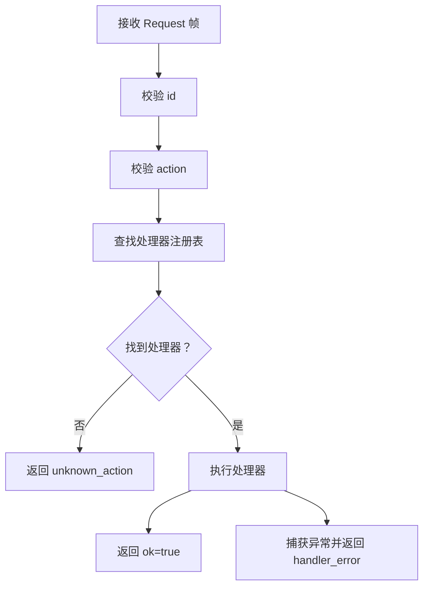
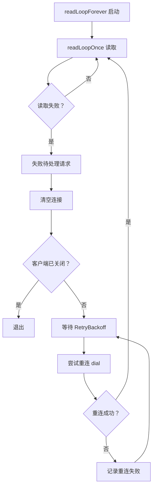
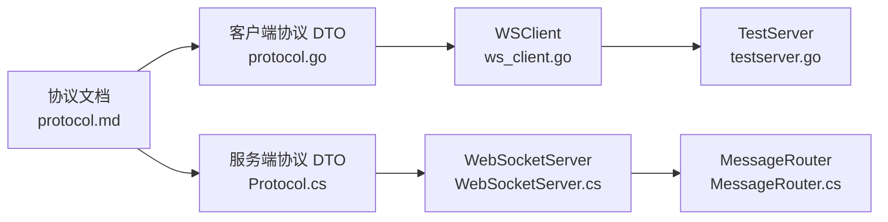

# WebSocket 协议规范

<cite>
**本文引用的文件**   
- [SmartNPC/docs/protocol.md](file://SmartNPC/docs/protocol.md)
- [SmartNPC/smartnpc-mcp/adapters/stardew/bridge/ws_client.go](file://SmartNPC/smartnpc-mcp/adapters/stardew/bridge/ws_client.go)
- [SmartNPC/smartnpc-mcp/adapters/stardew/bridge/protocol.go](file://SmartNPC/smartnpc-mcp/adapters/stardew/bridge/protocol.go)
- [SmartNPC/smartnpc-mcp/adapters/stardew/bridge/testserver.go](file://SmartNPC/smartnpc-mcp/adapters/stardew/bridge/testserver.go)
- [SmartNPC/smapi-mod/Bridge/WebSocketServer.cs](file://SmartNPC/smapi-mod/Bridge/WebSocketServer.cs)
- [SmartNPC/smapi-mod/Bridge/MessageRouter.cs](file://SmartNPC/smapi-mod/Bridge/MessageRouter.cs)
- [SmartNPC/smapi-mod/Bridge/Protocol.cs](file://SmartNPC/smapi-mod/Bridge/Protocol.cs)
- [SV.v1.6.15/Mods/StardewMCPBridge/config.json](file://SV.v1.6.15/Mods/StardewMCPBridge/config.json)
</cite>

## 目录

1. [引言](#引言)
2. [项目结构](#项目结构)
3. [核心组件](#核心组件)
4. [架构总览](#架构总览)
5. [详细组件分析](#详细组件分析)
6. [依赖关系分析](#依赖关系分析)
7. [性能与连接特性](#性能与连接特性)
8. [故障排查指南](#故障排查指南)
9. [结论](#结论)

## 引言

本规范定义 SmartNPC 项目中 SMAPI 模组与 smartnpc-mcp 客户端之间的 **WebSocket 桥接协议**。协议基于 `ws://`，使用 UTF-8 编码的 JSON 文本帧，采用请求-响应与服务器推送事件相结合的半双工模式。

关键要点：

| 类别 | 值 |
|---|---|
| 传输协议 | WebSocket（`ws://`） |
| 服务器地址 | `ws://127.0.0.1:18745/ws` |
| 帧格式 | JSON 文本帧 |
| 字符编码 | UTF-8 |
| 服务端角色 | SMAPI 模组（C#） |
| 客户端角色 | smartnpc-mcp（Go） |
| 设计目标 | 双向消息、RPC 式 action 调用、服务器主动推送事件 |

当前实验分支将 SmartNPC 收缩为单 Agent 农场管家环境，并移除了部分历史 action；文档中保留已移除项的历史说明，但明确其不再实现。

**章节来源**
- [SmartNPC/docs/protocol.md:1-20](file://SmartNPC/docs/protocol.md#L1-L20)

## 项目结构

协议相关代码分布在三个主要位置：

| 位置 | 职责 |
|---|---|
| `SmartNPC/smapi-mod/Bridge` | C# 侧 WebSocket 服务、路由与协议类型定义 |
| `SmartNPC/smartnpc-mcp/adapters/stardew/bridge` | Go 侧 WebSocket 客户端、协议 DTO、测试服务器 |
| `SmartNPC/docs/protocol.md` | 面向集成方的协议规格说明 |

**图表来源**
- [SmartNPC/smartnpc-mcp/adapters/stardew/bridge/ws_client.go:1-40](file://SmartNPC/smartnpc-mcp/adapters/stardew/bridge/ws_client.go#L1-L40)
- [SmartNPC/smapi-mod/Bridge/WebSocketServer.cs:1-40](file://SmartNPC/smapi-mod/Bridge/WebSocketServer.cs#L1-L40)
- [SmartNPC/smapi-mod/Bridge/MessageRouter.cs:1-20](file://SmartNPC/smapi-mod/Bridge/MessageRouter.cs#L1-L20)

**章节来源**
- [SmartNPC/docs/protocol.md:1-20](file://SmartNPC/docs/protocol.md#L1-L20)
- [SmartNPC/smapi-mod/Bridge/WebSocketServer.cs:1-40](file://SmartNPC/smapi-mod/Bridge/WebSocketServer.cs#L1-L40)
- [SmartNPC/smartnpc-mcp/adapters/stardew/bridge/ws_client.go:1-40](file://SmartNPC/smartnpc-mcp/adapters/stardew/bridge/ws_client.go#L1-L40)

## 核心组件

### WebSocket 服务端

SMAPI 模组暴露一个最小化的 WebSocket 服务：

- 监听本地地址与端口，默认来自配置中的 Host 和 Port。
- 仅接受 `/ws` 路径上的 WebSocket 升级请求。
- 每次只保留一个活跃连接；新连接会替换旧连接。
- 接收 JSON 文本帧后交由 `MessageRouter` 处理。
- 支持调试模式下将入站请求镜像到游戏内聊天面板。

服务端状态包括：

| 状态 | 含义 |
|---|---|
| 未启动 | HttpListener 未创建或未监听 |
| 已监听 | 已启动 accept loop |
| 无客户端 | 没有打开的连接 |
| 有客户端 | 存在一个 `WebSocketState.Open` 连接 |
| 客户端断开 | 连接关闭并从 `_current` 清除 |

**章节来源**
- [SmartNPC/smapi-mod/Bridge/WebSocketServer.cs:1-40](file://SmartNPC/smapi-mod/Bridge/WebSocketServer.cs#L1-L40)
- [SmartNPC/smapi-mod/Bridge/WebSocketServer.cs:118-170](file://SmartNPC/smapi-mod/Bridge/WebSocketServer.cs#L118-L170)
- [SV.v1.6.15/Mods/StardewMCPBridge/config.json:1-17](file://SV.v1.6.15/Mods/StardewMCPBridge/config.json#L1-L17)

### WebSocket 客户端

Go 侧客户端负责：

- 连接到 `ws://127.0.0.1:18745/ws`。
- 维护待响应请求映射。
- 根据 `id` 匹配响应。
- 转发服务器推送事件。
- 自动重连。
- 发送 ping 保活。
- 记录调用观察记录，用于实验日志。

客户端关键选项：

| 选项 | 默认行为 | 说明 |
|---|---|---|
| URL | `ws://127.0.0.1:18745/ws` | 服务端地址 |
| CallTimeout | 60 分钟 | 单次 action 调用超时 |
| DialTimeout | 5 秒 | 拨号超时 |
| RetryBackoff | 2 秒 | 断线重连退避间隔 |
| OnEvent | 可选回调 | 接收服务器事件 |
| OnCall | 可选观察者 | 记录每次调用的成功/失败、耗时等 |

**章节来源**
- [SmartNPC/smartnpc-mcp/adapters/stardew/bridge/ws_client.go:1-40](file://SmartNPC/smartnpc-mcp/adapters/stardew/bridge/ws_client.go#L1-L40)
- [SmartNPC/smartnpc-mcp/adapters/stardew/bridge/ws_client.go:41-120](file://SmartNPC/smartnpc-mcp/adapters/stardew/bridge/ws_client.go#L41-L120)

### 协议数据结构

协议定义在 Go 与 C# 两侧保持对称：

| 字段 | 类型 | 方向 | 说明 |
|---|---|---|---|
| `type` | string | 双向 | `request`、`response`、`event` |
| `id` | string | request/response | 请求唯一标识，通常建议 UUIDv4 |
| `action` | string | request | 动作名称 |
| `params` | object | request | 动作参数，可为空 |
| `from_npc` | string | request | 发起方 NPC 名称，可选 |
| `ok` | bool | response | 是否成功 |
| `data` | object | response | 成功时返回的数据 |
| `error.code` | string | response | 机器可读错误码 |
| `error.message` | string | response | 人类可读错误信息 |
| `name` | string | event | 事件名称 |
| `data` | object | event | 事件数据 |
| `timestamp` | number | event | Unix 毫秒时间戳 |

**章节来源**
- [SmartNPC/smartnpc-mcp/adapters/stardew/bridge/protocol.go:1-60](file://SmartNPC/smartnpc-mcp/adapters/stardew/bridge/protocol.go#L1-L60)
- [SmartNPC/smapi-mod/Bridge/Protocol.cs:1-67](file://SmartNPC/smapi-mod/Bridge/Protocol.cs#L1-L67)

## 架构总览

协议整体分为四层：

**图表来源**
- [SmartNPC/smartnpc-mcp/adapters/stardew/bridge/ws_client.go:201-340](file://SmartNPC/smartnpc-mcp/adapters/stardew/bridge/ws_client.go#L201-L340)
- [SmartNPC/smapi-mod/Bridge/WebSocketServer.cs:118-220](file://SmartNPC/smapi-mod/Bridge/WebSocketServer.cs#L118-L220)
- [SmartNPC/smapi-mod/Bridge/MessageRouter.cs:21-53](file://SmartNPC/smapi-mod/Bridge/MessageRouter.cs#L21-L53)

**章节来源**
- [SmartNPC/docs/protocol.md:21-120](file://SmartNPC/docs/protocol.md#L21-L120)
- [SmartNPC/smartnpc-mcp/adapters/stardew/bridge/ws_client.go:201-340](file://SmartNPC/smartnpc-mcp/adapters/stardew/bridge/ws_client.go#L201-L340)
- [SmartNPC/smapi-mod/Bridge/WebSocketServer.cs:118-220](file://SmartNPC/smapi-mod/Bridge/WebSocketServer.cs#L118-L220)

## 详细组件分析

### 连接建立流程

#### 服务器端连接生命周期

**图表来源**
- [SmartNPC/smapi-mod/Bridge/WebSocketServer.cs:118-170](file://SmartNPC/smapi-mod/Bridge/WebSocketServer.cs#L118-L170)
- [SmartNPC/smapi-mod/Bridge/WebSocketServer.cs:170-220](file://SmartNPC/smapi-mod/Bridge/WebSocketServer.cs#L170-L220)

#### 客户端连接与重连

客户端使用 `Connect` 建立连接，并在后台运行 `readLoopForever`。如果连接丢失，客户端会：

1. 标记所有待响应请求为失败。
2. 清空当前连接。
3. 按 `RetryBackoff` 延迟重试。
4. 重新拨号。
5. 若仍失败，继续循环重试，直到上下文取消或客户端显式关闭。

**图表来源**
- [SmartNPC/smartnpc-mcp/adapters/stardew/bridge/ws_client.go:121-200](file://SmartNPC/smartnpc-mcp/adapters/stardew/bridge/ws_client.go#L121-L200)
- [SmartNPC/smartnpc-mcp/adapters/stardew/bridge/ws_client.go:340-510](file://SmartNPC/smartnpc-mcp/adapters/stardew/bridge/ws_client.go#L340-L510)

**章节来源**
- [SmartNPC/smapi-mod/Bridge/WebSocketServer.cs:118-220](file://SmartNPC/smapi-mod/Bridge/WebSocketServer.cs#L118-L220)
- [SmartNPC/smartnpc-mcp/adapters/stardew/bridge/ws_client.go:121-200](file://SmartNPC/smartnpc-mcp/adapters/stardew/bridge/ws_client.go#L121-L200)
- [SmartNPC/smartnpc-mcp/adapters/stardew/bridge/ws_client.go:340-510](file://SmartNPC/smartnpc-mcp/adapters/stardew/bridge/ws_client.go#L340-L510)

### 握手与传输细节

| 阶段 | 行为 |
|---|---|
| HTTP 升级 | 服务端检查 `IsWebSocketRequest` 且路径必须为 `/ws` |
| 最大连接数 | 服务端最多保留一个活跃连接 |
| 帧类型 | 仅接受 JSON 文本帧 |
| 解码方式 | UTF-8 字符串反序列化为 JSON |
| 非法帧 | 服务端记录警告并丢弃，不中断连接 |
| 关闭帧 | 服务端正常关闭连接并清理资源 |

服务端对每个入站帧的处理顺序为：

1. 分片读取直到 `EndOfMessage`。
2. 转换为 UTF-8 字符串。
3. 反序列化为 `Request`。
4. 校验 `type == "request"`。
5. 可选地加入调试队列。
6. 调用 `MessageRouter.Dispatch`。
7. 序列化 `Response` 并发送。

**章节来源**
- [SmartNPC/smapi-mod/Bridge/WebSocketServer.cs:118-220](file://SmartNPC/smapi-mod/Bridge/WebSocketServer.cs#L118-L220)

### 消息格式规范

#### 信封类型

| `type` | 方向 | 用途 |
|---|---|---|
| `request` | 客户端 → 服务端 | RPC 调用，期望对应 `response` |
| `response` | 服务端 → 客户端 | 对 `request` 的回复，通过 `id` 关联 |
| `event` | 服务端 → 客户端 | 服务器主动推送，无需回复 |

#### 请求体

| 字段 | 必填 | 类型 | 说明 |
|---|---|---|---|
| `type` | 是 | string | 固定为 `request` |
| `id` | 是 | string | 唯一标识，建议使用 UUIDv4 |
| `action` | 是 | string | 动作名称 |
| `params` | 否 | object | 动作参数 |
| `from_npc` | 否 | string | 发起 MCP 会话对应的 NPC 名称 |

#### 响应体

| 字段 | 必填 | 类型 | 说明 |
|---|---|---|---|
| `type` | 是 | string | 固定为 `response` |
| `id` | 是 | string | 回显请求 id |
| `ok` | 是 | bool | 是否成功 |
| `data` | 条件 | object | 成功时存在 |
| `error` | 条件 | object | 失败时存在 |

`error` 包含：

| 字段 | 类型 | 说明 |
|---|---|---|
| `code` | string | 稳定机器可读错误码 |
| `message` | string | 人类可读错误信息 |

#### 事件体

| 字段 | 必填 | 类型 | 说明 |
|---|---|---|---|
| `type` | 是 | string | 固定为 `event` |
| `name` | 是 | string | 事件名称 |
| `data` | 是 | object | 事件数据 |
| `timestamp` | 是 | number | Unix 毫秒 |

**章节来源**
- [SmartNPC/docs/protocol.md:21-120](file://SmartNPC/docs/protocol.md#L21-L120)
- [SmartNPC/smartnpc-mcp/adapters/stardew/bridge/protocol.go:61-172](file://SmartNPC/smartnpc-mcp/adapters/stardew/bridge/protocol.go#L61-L172)
- [SmartNPC/smapi-mod/Bridge/Protocol.cs:1-67](file://SmartNPC/smapi-mod/Bridge/Protocol.cs#L1-L67)

### 动作分类与完整枚举

以下枚举来自 Go 侧常量定义，代表客户端可发出的 action 名称。其中部分 action 在当前实验构建中已被移除，但仍在常量表中保留以便向后兼容或测试。

| 分类 | action 名称 | 方向 | 当前状态 |
|---|---|---|---|
| 基础交互 | `mail_send` | 客户端 → 服务端 | 实验构建已移除 |
| 基础交互 | `chat_say` | 客户端 → 服务端 | 可用 |
| 游戏查询 | `game_get_time` | 客户端 → 服务端 | 可用 |
| 游戏查询 | `game_get_weather` | 客户端 → 服务端 | 可用 |
| 玩家关系 | `friendship_get` | 客户端 → 服务端 | 实验构建已移除 |
| 农场经济 | `farm_get_economy` | 客户端 → 服务端 | 实验构建新增 |
| NPC 位置 | `npc_get_nearby` | 客户端 → 服务端 | 可用 |
| NPC 环境 | `npc_get_environment` | 客户端 → 服务端 | 可用 |
| NPC 移动 | `npc_move_to` | 客户端 → 服务端 | 可用 |
| NPC 朝向 | `npc_face_direction` | 客户端 → 服务端 | 可用 |
| NPC 位置查询 | `npc_get_position` | 客户端 → 服务端 | 可用 |
| NPC 召唤 | `npc_summon` | 客户端 → 服务端 | 实验构建已移除 |
| NPC 表情 | `npc_emote` | 客户端 → 服务端 | 可用 |
| NPC 物品赠送 | `npc_give_item` | 客户端 → 服务端 | 实验构建已移除 |
| NPC 跟随开始 | `npc_follow_start` | 客户端 → 服务端 | 实验构建已移除 |
| NPC 跟随停止 | `npc_follow_stop` | 客户端 → 服务端 | 实验构建已移除 |
| NPC 引导 | `npc_lead_to` | 客户端 → 服务端 | 实验构建已移除 |
| NPC 行为查询 | `npc_get_behavior` | 客户端 → 服务端 | 可用 |
| 玩家状态 | `player_get_status` | 客户端 → 服务端 | 可用 |
| NPC 世界交互 | `npc_wander` | 客户端 → 服务端 | 可用 |
| NPC 清理杂物 | `npc_clear_debris` | 客户端 → 服务端 | 可用 |
| NPC 浇水作物 | `npc_water_crops` | 客户端 → 服务端 | 可用 |
| NPC 收割作物 | `npc_harvest_crops` | 客户端 → 服务端 | 可用 |
| NPC 存放物品 | `npc_deposit_items` | 客户端 → 服务端 | 可用 |
| NPC 出货 | `npc_ship_items` | 客户端 → 服务端 | 实验构建新增 |
| NPC 投递物品 | `npc_deliver_items` | 客户端 → 服务端 | 可用 |
| NPC 采集 | `npc_forage_collect` | 客户端 → 服务端 | 可用 |
| NPC 抚摸动物 | `npc_pet_animal` | 客户端 → 服务端 | 可用 |
| NPC 播种 | `npc_plant_seeds` | 客户端 → 服务端 | 可用 |
| NPC 耕地 | `npc_till_soil` | 客户端 → 服务端 | 可用 |
| NPC 检查对象 | `npc_inspect_object` | 客户端 → 服务端 | 可用 |
| NPC 放置对象 | `npc_place_object` | 客户端 → 服务端 | 可用 |
| NPC 破坏资源 | `npc_break_resource` | 客户端 → 服务端 | 可用 |
| NPC 施肥 | `npc_fertilize` | 客户端 → 服务端 | 可用 |
| NPC 填充空隙 | `npc_fill_gaps` | 客户端 → 服务端 | 可用 |
| NPC 背包取物 | `npc_withdraw_from_chest` | 客户端 → 服务端 | 可用 |
| NPC 物品转移 | `npc_transfer_item` | 客户端 → 服务端 | 可用 |
| NPC 背包查询 | `npc_inventory_get` | 客户端 → 服务端 | 可用 |
| NPC 背包放入 | `npc_inventory_put` | 客户端 → 服务端 | 可用 |
| NPC 背包取出 | `npc_inventory_take` | 客户端 → 服务端 | 可用 |
| NPC 社交表现 | `npc_approach_and_speak` | 客户端 → 服务端 | 可用 |
| NPC 表达情绪 | `npc_express_emotion` | 客户端 → 服务端 | 可用 |
| NPC 害羞后退 | `npc_shy_retreat` | 客户端 → 服务端 | 可用 |
| NPC 显示气泡 | `npc_show_text_bubble` | 客户端 → 服务端 | 可用 |
| NPC 空闲活动 | `npc_idle_activity` | 客户端 → 服务端 | 可用 |
| NPC 开心跳舞 | `npc_dance_happy` | 客户端 → 服务端 | 可用 |
| NPC 惊讶反应 | `npc_react_surprise` | 客户端 → 服务端 | 可用 |
| NPC 焦虑踱步 | `npc_pace_anxiously` | 客户端 → 服务端 | 可用 |

**章节来源**
- [SmartNPC/smartnpc-mcp/adapters/stardew/bridge/protocol.go:80-160](file://SmartNPC/smartnpc-mcp/adapters/stardew/bridge/protocol.go#L80-L160)
- [SmartNPC/docs/protocol.md:1-20](file://SmartNPC/docs/protocol.md#L1-L20)

### 重点动作语义

#### chat_say

用于在游戏内聊天框显示一条消息。

| 参数 | 类型 | 必填 | 说明 |
|---|---|---|---|
| `speaker` | string | 是 | 显示名称 |
| `text` | string | 是 | 消息内容 |
| `color` | string | 否 | 颜色，默认黄色 |
| `channel` | string | 否 | 实验构建中不再使用群组通道 |
| `group_id` | string | 条件 | 实验构建中不再使用 |

常见错误：

| 错误码 | 含义 |
|---|---|
| `mod_not_ready` | 未加载存档 |
| `invalid_params` | 缺少必要参数 |

**章节来源**
- [SmartNPC/docs/protocol.md:60-120](file://SmartNPC/docs/protocol.md#L60-L120)

#### npc_move_to

让 NPC 移动到目标格子，或跨地图瞬移。

| 参数 | 类型 | 必填 | 说明 |
|---|---|---|---|
| `npc` | string | 是 | NPC 内部名称 |
| `x` | int | 是 | 目标 X |
| `y` | int | 是 | 目标 Y |
| `map` | string | 否 | 目标地图名，默认为 NPC 当前地图 |

响应可能包含：

| 字段 | 含义 |
|---|---|
| `ok` | 路径找到或传送成功 |
| `message` | `pathing`、`warped`、`no_route` |

**章节来源**
- [SmartNPC/docs/protocol.md:280-340](file://SmartNPC/docs/protocol.md#L280-L340)

#### npc_emote

在 NPC 头顶显示原生表情气泡，持续约一秒。

| 参数 | 类型 | 必填 | 说明 |
|---|---|---|---|
| `npc` | string | 是 | NPC 内部名称 |
| `kind` | string | 否 | 表情类型，未知值回退为感叹号 |

**章节来源**
- [SmartNPC/docs/protocol.md:460-545](file://SmartNPC/docs/protocol.md#L460-L545)

### 消息路由机制

服务端路由表由 `MessageRouter` 维护：

**图表来源**
- [SmartNPC/smapi-mod/Bridge/MessageRouter.cs:21-53](file://SmartNPC/smapi-mod/Bridge/MessageRouter.cs#L21-L53)

路由规则：

1. 如果 `id` 为空，返回 `invalid_request`。
2. 如果 `action` 为空，返回 `invalid_request`。
3. 如果注册表中没有对应 action，返回 `unknown_action`。
4. 执行处理器时发生异常，返回 `handler_error`。
5. 处理器执行完成后记录耗时日志。

**章节来源**
- [SmartNPC/smapi-mod/Bridge/MessageRouter.cs:1-53](file://SmartNPC/smapi-mod/Bridge/MessageRouter.cs#L1-L53)

### 事件系统

事件是服务器主动推送的消息，客户端不需要回复。

已实现和预留的事件名称：

| 事件名称 | 方向 | 说明 |
|---|---|---|
| `chat_message` | 服务端 → 客户端 | 玩家聊天消息 |
| `chat_received` | 服务端 → 客户端 | 历史/群组聊天信号 |
| `npc_interact` | 服务端 → 客户端 | 玩家点击 NPC |
| `group_create` | 服务端 → 客户端 | 群组创建信号 |
| `day_started` | 服务端 → 客户端 | 新一天开始 |
| `location_changed` | 服务端 → 客户端 | 位置变更 |
| `friendship_changed` | 服务端 → 客户端 | 好感度变化 |
| `npc_perception_update` | 服务端 → 客户端 | 预留 |
| `game_time_tick` | 服务端 → 客户端 | 预留，驱动本地日程 |
| `schedule_trigger` | 服务端 → 客户端 | 计划任务触发 |
| `debug_proactive_trigger` | 服务端 → 客户端 | 调试用主动行为触发 |
| `npc_approached_player` | 服务端 → 客户端 | NPC 到达玩家 |
| `day_ending` | 服务端 → 客户端 | 日终结束，仅记账 |
| `owner_directive` | 服务端 → 客户端 | 所有者指令 |
| `npc_message` | 服务端 → 客户端 | 合成事件，NPC 间消息 |
| `npc_broadcast` | 服务端 → 客户端 | 合成事件，NPC 广播 |

**章节来源**
- [SmartNPC/smartnpc-mcp/adapters/stardew/bridge/protocol.go:12-78](file://SmartNPC/smartnpc-mcp/adapters/stardew/bridge/protocol.go#L12-L78)
- [SmartNPC/docs/protocol.md:1-20](file://SmartNPC/docs/protocol.md#L1-L20)

### 连接生命周期与状态管理

#### 客户端状态

| 状态 | 含义 |
|---|---|
| 未连接 | 尚未调用 `Connect` 或连接已断开 |
| 连接中 | 正在拨号或重连 |
| 已连接 | 存在有效连接 |
| 已关闭 | 调用 `Close` 后不再重连 |

#### 服务端状态

| 状态 | 含义 |
|---|---|
| 未监听 | 未启动服务 |
| 已监听 | accept loop 运行中 |
| 有连接 | `_current` 指向打开连接 |
| 无连接 | 上一个连接被关闭或替换 |

**章节来源**
- [SmartNPC/smartnpc-mcp/adapters/stardew/bridge/ws_client.go:121-200](file://SmartNPC/smartnpc-mcp/adapters/stardew/bridge/ws_client.go#L121-L200)
- [SmartNPC/smapi-mod/Bridge/WebSocketServer.cs:220-324](file://SmartNPC/smapi-mod/Bridge/WebSocketServer.cs#L220-L324)

### 重连机制

客户端重连流程如下：

**图表来源**
- [SmartNPC/smartnpc-mcp/adapters/stardew/bridge/ws_client.go:340-510](file://SmartNPC/smartnpc-mcp/adapters/stardew/bridge/ws_client.go#L340-L510)

关键行为：

- 首次连接失败也会启动后台重连循环。
- 连接断开后，所有 pending 请求会被注入空响应，使调用方感知连接丢失。
- 重连间隔由 `RetryBackoff` 控制。
- 上下文取消或 `Close` 会终止重连。

**章节来源**
- [SmartNPC/smartnpc-mcp/adapters/stardew/bridge/ws_client.go:121-200](file://SmartNPC/smartnpc-mcp/adapters/stardew/bridge/ws_client.go#L121-L200)
- [SmartNPC/smartnpc-mcp/adapters/stardew/bridge/ws_client.go:340-510](file://SmartNPC/smartnpc-mcp/adapters/stardew/bridge/ws_client.go#L340-L510)

### 心跳检测

客户端与服务端的心跳策略不同：

| 组件 | 策略 | 周期 | 目的 |
|---|---|---|---|
| Go 客户端 | 每 30 秒发送 WebSocket Ping | 30 秒 | 防止 C# 服务端空闲连接超时 |
| C# 服务端 | 注释中提到每 30 秒 ping，实际由框架处理 ping/pong | 30 秒 | 浏览器兼容性与空闲连接存活 |

客户端 `pingLoop` 的行为：

1. 使用 ticker 每 30 秒触发一次。
2. 检查当前连接是否被替换。
3. 发送带超时的 ping。
4. 如果 ping 失败则退出该 goroutine。

**章节来源**
- [SmartNPC/smartnpc-mcp/adapters/stardew/bridge/ws_client.go:420-470](file://SmartNPC/smartnpc-mcp/adapters/stardew/bridge/ws_client.go#L420-L470)
- [SmartNPC/smapi-mod/Bridge/WebSocketServer.cs:1-20](file://SmartNPC/smapi-mod/Bridge/WebSocketServer.cs#L1-L20)

### 错误处理策略

| 层级 | 错误类型 | 处理方式 |
|---|---|---|
| 客户端写入 | 网络写入失败 | 返回 `ws write` 错误 |
| 客户端超时 | 调用超时 | 返回 context 超时错误 |
| 客户端连接丢失 | readLoop 返回错误 | 清空 pending 并重连 |
| 服务端解析 | JSON 解析失败 | 记录警告并丢弃帧 |
| 服务端路由 | 缺少 id/action | 返回 `invalid_request` |
| 服务端路由 | 未知 action | 返回 `unknown_action` |
| 服务端处理器 | 抛出异常 | 返回 `handler_error` |

**章节来源**
- [SmartNPC/smartnpc-mcp/adapters/stardew/bridge/ws_client.go:240-340](file://SmartNPC/smartnpc-mcp/adapters/stardew/bridge/ws_client.go#L240-L340)
- [SmartNPC/smapi-mod/Bridge/MessageRouter.cs:21-53](file://SmartNPC/smapi-mod/Bridge/MessageRouter.cs#L21-L53)
- [SmartNPC/smapi-mod/Bridge/WebSocketServer.cs:201-220](file://SmartNPC/smapi-mod/Bridge/WebSocketServer.cs#L201-L220)

### 客户端连接示例思路

由于仓库未提供独立示例脚本，下面给出基于现有源码的客户端连接思路，不直接粘贴代码。

参考路径：

- 创建 WSClient：[ws_client.go:41-120](file://SmartNPC/smartnpc-mcp/adapters/stardew/bridge/ws_client.go#L41-L120)
- 设置事件回调：[ws_client.go:201-240](file://SmartNPC/smartnpc-mcp/adapters/stardew/bridge/ws_client.go#L201-L240)
- 建立连接：[ws_client.go:121-200](file://SmartNPC/smartnpc-mcp/adapters/stardew/bridge/ws_client.go#L121-L200)
- 发送请求：[ws_client.go:240-340](file://SmartNPC/smartnpc-mcp/adapters/stardew/bridge/ws_client.go#L240-L340)
- 关闭连接：[ws_client.go:201-220](file://SmartNPC/smartnpc-mcp/adapters/stardew/bridge/ws_client.go#L201-L220)

推荐步骤：

1. 使用 `NewWSClient` 创建客户端实例。
2. 可选设置 `OnEvent` 接收服务器事件。
3. 调用 `Connect` 建立连接。
4. 如需从特定 NPC 身份调用，先注册 agent，再通过 `WithCallSession` 或 `CallAs` 设置 `from_npc`。
5. 调用 `Call` 或 `CallAs` 发送 action。
6. 处理返回的 `data` 或 `error`。
7. 应用退出时调用 `Close`。

**章节来源**
- [SmartNPC/smartnpc-mcp/adapters/stardew/bridge/ws_client.go:41-120](file://SmartNPC/smartnpc-mcp/adapters/stardew/bridge/ws_client.go#L41-L120)
- [SmartNPC/smartnpc-mcp/adapters/stardew/bridge/ws_client.go:201-340](file://SmartNPC/smartnpc-mcp/adapters/stardew/bridge/ws_client.go#L201-L340)

### 测试辅助服务器

仓库提供了一个进程内测试服务器，用于在不启动 SMAPI 模组的情况下测试客户端：

| 能力 | 说明 |
|---|---|
| 监听 `/ws` | 模拟真实服务端路径 |
| 解析 request | 忽略非 request 帧 |
| 调用测试处理器 | 返回成功 data 或错误 |
| 推送事件 | 向已连接客户端发送 event |
| 关闭连接 | 正常关闭测试服务器 |

该测试服务器可用于验证：

- 客户端是否正确解析 response。
- 客户端是否正确转发 event。
- 客户端是否能在连接断开后重连。
- 客户端是否能处理未知 action。

**章节来源**
- [SmartNPC/smartnpc-mcp/adapters/stardew/bridge/testserver.go:1-147](file://SmartNPC/smartnpc-mcp/adapters/stardew/bridge/testserver.go#L1-L147)

## 依赖关系分析

### 组件依赖图

**图表来源**
- [SmartNPC/docs/protocol.md:1-20](file://SmartNPC/docs/protocol.md#L1-L20)
- [SmartNPC/smartnpc-mcp/adapters/stardew/bridge/protocol.go:1-60](file://SmartNPC/smartnpc-mcp/adapters/stardew/bridge/protocol.go#L1-L60)
- [SmartNPC/smapi-mod/Bridge/Protocol.cs:1-67](file://SmartNPC/smapi-mod/Bridge/Protocol.cs#L1-L67)
- [SmartNPC/smartnpc-mcp/adapters/stardew/bridge/ws_client.go:1-40](file://SmartNPC/smartnpc-mcp/adapters/stardew/bridge/ws_client.go#L1-L40)
- [SmartNPC/smapi-mod/Bridge/WebSocketServer.cs:1-40](file://SmartNPC/smapi-mod/Bridge/WebSocketServer.cs#L1-L40)
- [SmartNPC/smapi-mod/Bridge/MessageRouter.cs:1-20](file://SmartNPC/smapi-mod/Bridge/MessageRouter.cs#L1-L20)
- [SmartNPC/smartnpc-mcp/adapters/stardew/bridge/testserver.go:1-40](file://SmartNPC/smartnpc-mcp/adapters/stardew/bridge/testserver.go#L1-L40)

### 耦合性评估

| 组件 | 耦合程度 | 说明 |
|---|---|---|
| WebSocketServer ↔ MessageRouter | 低到中 | 服务端只负责传输和调度，业务逻辑在处理器 |
| WSClient ↔ protocol.go DTO | 低 | 客户端依赖 DTO 类型进行序列化 |
| WebSocketServer ↔ Protocol.cs DTO | 低 | 服务端依赖 C# DTO 类型 |
| 测试服务器 ↔ WSClient | 低 | 测试服务器仅模拟协议，不依赖真实模组 |
| 协议文档 ↔ 实现代码 | 中 | 文档描述协议，实现代码需保持一致 |

**章节来源**
- [SmartNPC/smapi-mod/Bridge/WebSocketServer.cs:1-40](file://SmartNPC/smapi-mod/Bridge/WebSocketServer.cs#L1-L40)
- [SmartNPC/smartnpc-mcp/adapters/stardew/bridge/ws_client.go:1-40](file://SmartNPC/smartnpc-mcp/adapters/stardew/bridge/ws_client.go#L1-L40)

## 性能与连接特性

| 维度 | 特性 |
|---|---|
| 并发模型 | 服务端使用异步接收和分发；客户端支持多 goroutine 并发调用 |
| 连接限制 | 服务端仅支持一个客户端连接 |
| 帧大小限制 | 客户端设置每帧最大 1MiB |
| 调用超时 | 默认 60 分钟，适合长时游戏操作 |
| 拨号超时 | 默认 5 秒 |
| 重连退避 | 默认 2 秒 |
| 心跳间隔 | 客户端每 30 秒 ping |
| 调试日志 | 可选择记录入站请求并推送到游戏聊天面板 |
| 线程安全 | WSClient 对 pending map、agent registry、连接字段加锁 |

优化建议：

- 避免频繁调用高频只读接口，应结合缓存或事件订阅。
- 对长时间运行的 action，优先使用事件通知而非轮询。
- 合理设置 `CallTimeout`，避免挂起请求长期占用 pending 表。
- 在生产环境中启用调试日志前应确认性能影响。
- 客户端应正确处理重连后的 pending 请求失败场景。

**章节来源**
- [SmartNPC/smartnpc-mcp/adapters/stardew/bridge/ws_client.go:41-120](file://SmartNPC/smartnpc-mcp/adapters/stardew/bridge/ws_client.go#L41-L120)
- [SmartNPC/smartnpc-mcp/adapters/stardew/bridge/ws_client.go:420-470](file://SmartNPC/smartnpc-mcp/adapters/stardew/bridge/ws_client.go#L420-L470)
- [SmartNPC/smapi-mod/Bridge/WebSocketServer.cs:1-40](file://SmartNPC/smapi-mod/Bridge/WebSocketServer.cs#L1-L40)
- [SmartNPC/smapi-mod/Bridge/WebSocketServer.cs:220-324](file://SmartNPC/smapi-mod/Bridge/WebSocketServer.cs#L220-L324)

## 故障排查指南

### 无法连接 ws://127.0.0.1:18745/ws

可能原因：

1. SMAPI 模组未启动。
2. 配置文件中 Host 或 Port 不是 `127.0.0.1:18745`。
3. 防火墙阻止本地端口。
4. 端口被其他程序占用。

排查步骤：

1. 检查 `config.json` 中的 `Host` 和 `Port`。
2. 确认 SMAPI 模组已启动并打印监听日志。
3. 检查本地端口 18745 是否监听。
4. 使用客户端日志查看拨号错误。

**章节来源**
- [SV.v1.6.15/Mods/StardewMCPBridge/config.json:1-17](file://SV.v1.6.15/Mods/StardewMCPBridge/config.json#L1-L17)
- [SmartNPC/smartnpc-mcp/adapters/stardew/bridge/ws_client.go:41-60](file://SmartNPC/smartnpc-mcp/adapters/stardew/bridge/ws_client.go#L41-L60)

### 连接后立即断开

可能原因：

1. 第二个客户端连接导致旧连接被替换。
2. 服务端重启。
3. 网络层异常。
4. 客户端主动关闭。

服务端行为：

- 新连接会替换旧连接。
- 旧连接以 `PolicyViolation` 和 reason `replaced` 关闭。
- 客户端应通过重连机制恢复。

**章节来源**
- [SmartNPC/smapi-mod/Bridge/WebSocketServer.cs:140-170](file://SmartNPC/smapi-mod/Bridge/WebSocketServer.cs#L140-L170)
- [SmartNPC/smartnpc-mcp/adapters/stardew/bridge/ws_client.go:340-420](file://SmartNPC/smartnpc-mcp/adapters/stardew/bridge/ws_client.go#L340-L420)

### 收到 unknown_action

可能原因：

1. 客户端使用了未注册的 action。
2. 客户端版本与服务端版本不一致。
3. 使用了实验构建已移除的 action。

处理方法：

1. 核对当前支持的 action 列表。
2. 排除已移除动作，如 `mail_send`、`friendship_get`、`player_get_status`、`npc_summon`、`npc_give_item`、`npc_follow_start`、`npc_follow_stop`、`npc_lead_to`、`npc_approach_and_speak`、`npc_deliver_items`。
3. 检查服务端日志中的 `unknown_action`。

**章节来源**
- [SmartNPC/smapi-mod/Bridge/MessageRouter.cs:21-53](file://SmartNPC/smapi-mod/Bridge/MessageRouter.cs#L21-L53)
- [SmartNPC/docs/protocol.md:1-20](file://SmartNPC/docs/protocol.md#L1-L20)

### 调用超时

可能原因：

1. 服务端阻塞。
2. 网络连接不稳定。
3. `CallTimeout` 设置过短。
4. 服务端无响应。

处理方法：

1. 检查服务端是否正常运行。
2. 增加 `CallTimeout`。
3. 检查客户端日志中的超时记录。
4. 区分“服务端返回 not-ok”和“连接丢失”。

**章节来源**
- [SmartNPC/smartnpc-mcp/adapters/stardew/bridge/ws_client.go:240-340](file://SmartNPC/smartnpc-mcp/adapters/stardew/bridge/ws_client.go#L240-L340)

### 事件未收到

可能原因：

1. 未设置 `OnEvent` 回调。
2. 事件名称不匹配。
3. 客户端连接已断开。
4. 事件被过滤或未被服务端发出。

处理方法：

1. 确认已设置事件处理器。
2. 核对事件名称常量。
3. 检查客户端是否处于已连接状态。
4. 查看服务端是否广播了该事件。

**章节来源**
- [SmartNPC/smartnpc-mcp/adapters/stardew/bridge/ws_client.go:201-240](file://SmartNPC/smartnpc-mcp/adapters/stardew/bridge/ws_client.go#L201-L240)
- [SmartNPC/smartnpc-mcp/adapters/stardew/bridge/protocol.go:12-78](file://SmartNPC/smartnpc-mcp/adapters/stardew/bridge/protocol.go#L12-L78)

### 调试入站请求

服务端支持将入站请求镜像到游戏内聊天面板：

- 开关来自 `DebugLogIncomingRequests`。
- 需要启用 debug sink。
- 请求会在游戏线程中被消费。
- 过长 payload 会被截断。

**章节来源**
- [SmartNPC/smapi-mod/Bridge/WebSocketServer.cs:40-118](file://SmartNPC/smapi-mod/Bridge/WebSocketServer.cs#L40-L118)
- [SmartNPC/smapi-mod/Bridge/WebSocketServer.cs:220-324](file://SmartNPC/smapi-mod/Bridge/WebSocketServer.cs#L220-L324)
- [SV.v1.6.15/Mods/StardewMCPBridge/config.json:1-17](file://SV.v1.6.15/Mods/StardewMCPBridge/config.json#L1-L17)

## 结论

SmartNPC 的 WebSocket 协议是一个围绕 SMAPI 模组与 smartnpc-mcp 客户端之间通信而设计的轻量桥接协议。它以 JSON 文本帧为基础，通过 `request`、`response`、`event` 三种信封类型实现请求-响应与服务器推送。

关键点总结：

- 服务器地址固定为 `ws://127.0.0.1:18745/ws`。
- 服务端为单连接 WebSocket 服务。
- 客户端具备自动重连和心跳保活。
- 动作通过 `action` 字段分发，由 `MessageRouter` 路由到处理器。
- 错误通过稳定的 `error.code` 和 `error.message` 传递。
- 事件由服务器主动推送，客户端通过回调消费。
- 当前实验构建移除了部分历史 action，但仍保留协议常量供兼容。
- 测试服务器提供了无需启动模组的协议验证能力。

对于集成方，建议优先遵循 `protocol.md` 中的契约，并结合 Go 侧 `protocol.go` 与 C# 侧 `Protocol.cs` 的类型定义进行开发。生产环境应重视连接状态管理、错误码处理、重连策略和调试日志。