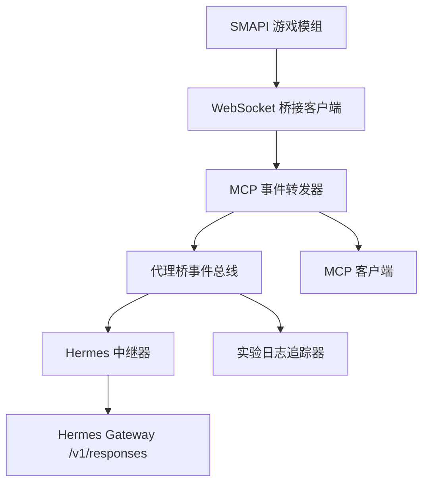
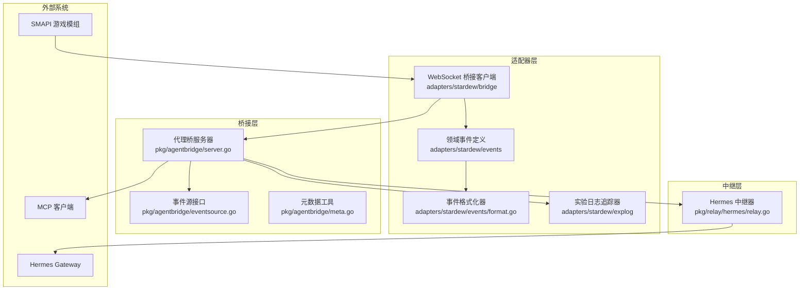
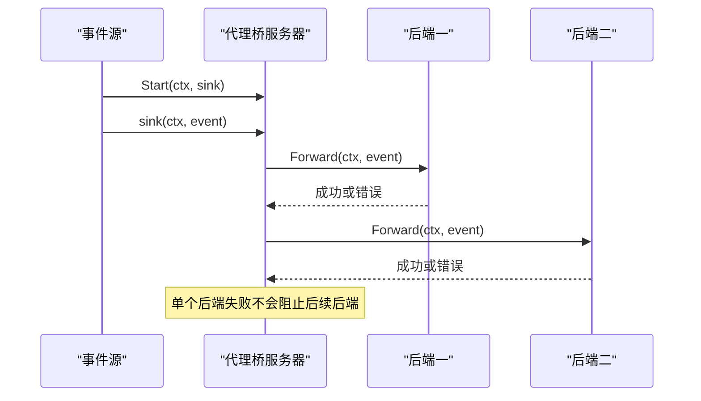
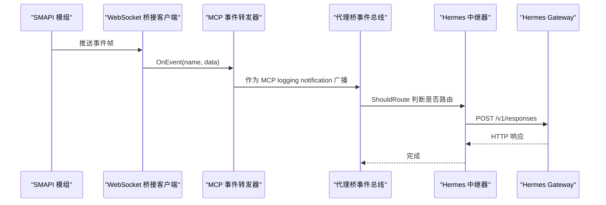
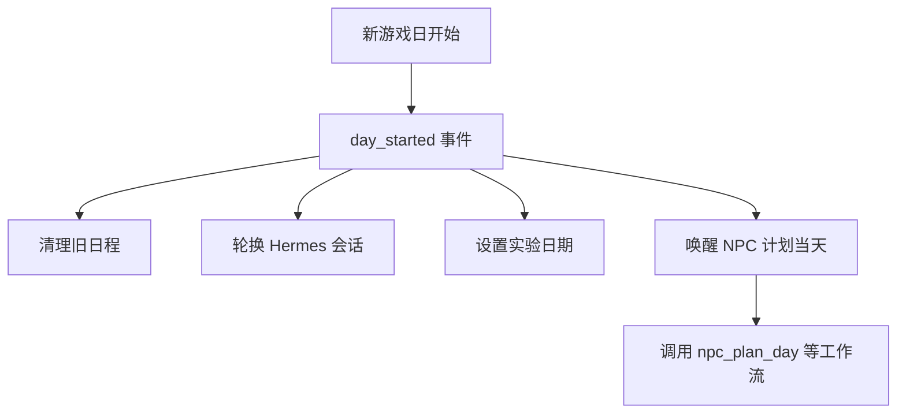
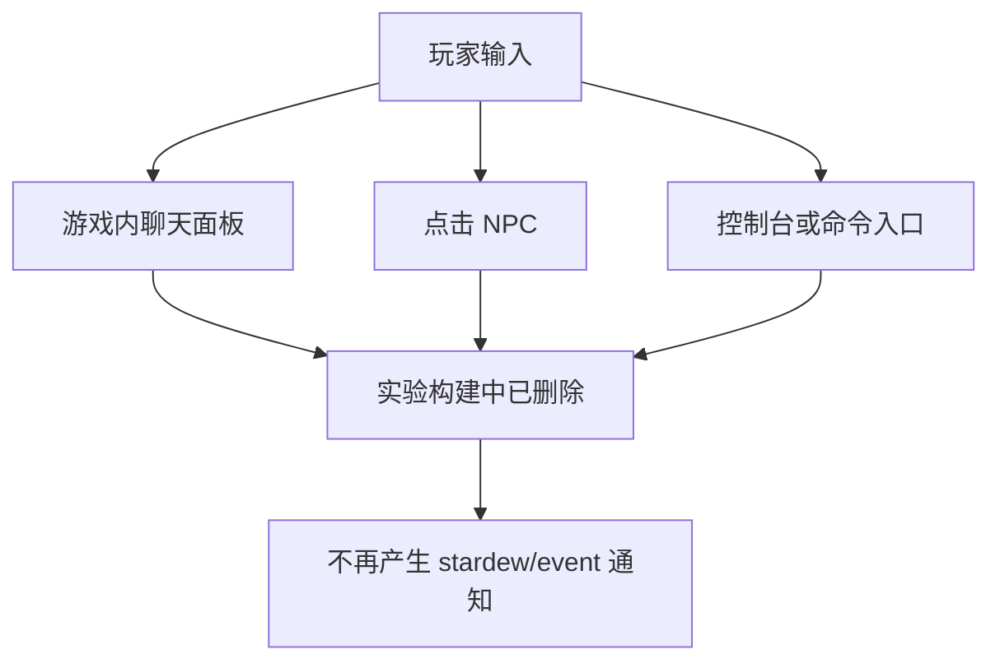
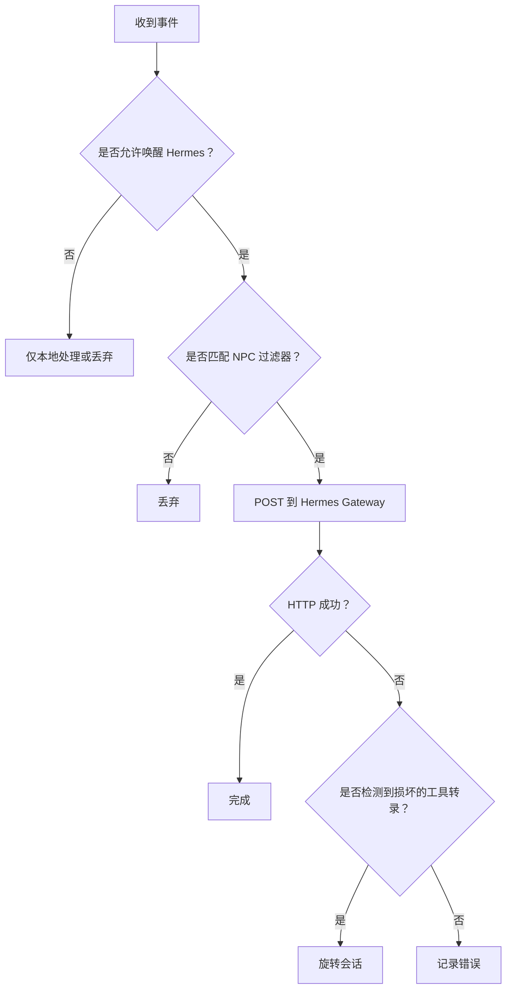
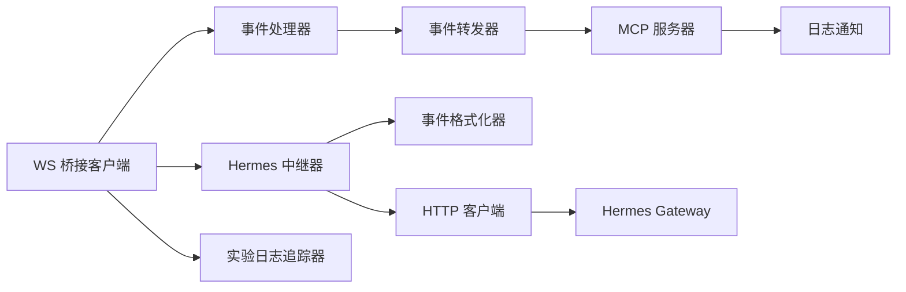
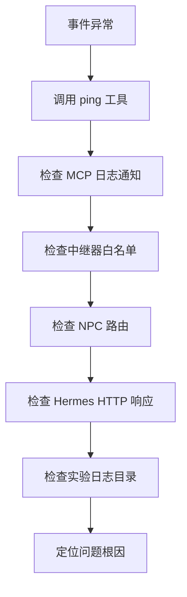

# 事件规范

<cite>
**本文引用的文件**   
- [events.md](file://SmartNPC/docs/events.md)
- [hermes-event-trigger.md](file://SmartNPC/docs/hermes-event-trigger.md)
- [events.go](file://SmartNPC/smartnpc-mcp/adapters/stardew/events/events.go)
- [format.go](file://SmartNPC/smartnpc-mcp/adapters/stardew/events/format.go)
- [logger.go](file://SmartNPC/smartnpc-mcp/internal/log/logger.go)
- [eventsource.go](file://SmartNPC/smartnpc-mcp/pkg/agentbridge/eventsource.go)
- [server.go](file://SmartNPC/smartnpc-mcp/pkg/agentbridge/server.go)
- [meta.go](file://SmartNPC/smartnpc-mcp/pkg/agentbridge/meta.go)
- [relay.go](file://SmartNPC/smartnpc-mcp/pkg/relay/hermes/relay.go)
- [ws_client.go](file://SmartNPC/smartnpc-mcp/adapters/stardew/bridge/ws_client.go)
- [explog.go](file://SmartNPC/smartnpc-mcp/adapters/stardew/explog/explog.go)
</cite>

## 目录

1. [引言](#引言)
2. [项目结构](#项目结构)
3. [核心组件](#核心组件)
4. [架构总览](#架构总览)
5. [详细组件分析](#详细组件分析)
6. [依赖关系分析](#依赖关系分析)
7. [性能与可靠性](#性能与可靠性)
8. [调试与日志分析](#调试与日志分析)
9. [结论](#结论)

## 引言

本文件定义 SmartNPC 中“事件”的完整规范，覆盖以下目标：

- 说明 GameLoop 相关事件的生命周期和触发时机，包括 `day_started`、`game_time_tick`、`day_ending`。
- 文档化玩家输入事件的捕获与处理机制，包括游戏内聊天、点击 NPC 和命令入口，并明确当前实验构建中的启用状态。
- 定义 NPC 状态变化事件的触发条件，包括位置变更、好感度变化和感知更新等预留事件。
- 统一事件数据结构与序列化格式，包括事件元数据、时间戳、来源标识和上下文信息。
- 提供事件订阅、发布、过滤、优先级处理和错误恢复的使用方式。
- 给出事件调试工具和日志分析方法，帮助定位 SMAPI Mod、smartnpc-mcp、Hermes Gateway 之间的断点。

SmartNPC 的事件体系由两层组成：

1. **领域事件层**：位于 `adapters/stardew/events`，定义具体事件类型、名称常量、解析器和 Hermes 可读文本渲染器。
2. **桥接与传输层**：位于 `pkg/agentbridge`、`pkg/relay/hermes`、`internal/log`，负责把领域事件封装成通用信封，转发给 MCP 客户端或 Hermes Gateway。

**图表来源**   
- [ws_client.go:1-80](file://SmartNPC/smartnpc-mcp/adapters/stardew/bridge/ws_client.go#L1-L80)
- [events.go:1-40](file://SmartNPC/smartnpc-mcp/adapters/stardew/events/events.go#L1-L40)
- [server.go:110-177](file://SmartNPC/smartnpc-mcp/pkg/agentbridge/server.go#L110-L177)
- [relay.go:1-60](file://SmartNPC/smartnpc-mcp/pkg/relay/hermes/relay.go#L1-L60)
- [explog.go:1-40](file://SmartNPC/smartnpc-mcp/adapters/stardew/explog/explog.go#L1-L40)

**章节来源**   
- [events.md:1-40](file://SmartNPC/docs/events.md#L1-L40)
- [hermes-event-trigger.md:1-40](file://SmartNPC/docs/hermes-event-trigger.md#L1-L40)

## 项目结构

SmartNPC 中与事件直接相关的代码主要分布在三个子系统中：

| 子系统 | 路径 | 职责 |
|---|---|---|
| SMAPI 模组事件 | `adapters/stardew/bridge` | 通过 WebSocket 连接游戏模组，接收服务器推送的事件帧。 |
| 领域事件定义 | `adapters/stardew/events` | 定义事件结构体、名称常量、解码函数和 Hermes 可读文本格式化器。 |
| 代理桥与中继 | `pkg/agentbridge`、`pkg/relay/hermes` | 管理事件源生命周期，将事件分发给后端，并把允许唤醒的事件 POST 到 Hermes Gateway。 |
| 实验日志 | `adapters/stardew/explog` | 维护游戏日期、小时、分钟，并写入按天组织的 JSON Lines 日志。 |
| 框架日志 | `internal/log` | 提供结构化 JSON 日志，统一输出到标准错误流。 |

**图表来源**   
- [ws_client.go:1-80](file://SmartNPC/smartnpc-mcp/adapters/stardew/bridge/ws_client.go#L1-L80)
- [events.go:1-40](file://SmartNPC/smartnpc-mcp/adapters/stardew/events/events.go#L1-L40)
- [format.go:1-40](file://SmartNPC/smartnpc-mcp/adapters/stardew/events/format.go#L1-L40)
- [explog.go:1-40](file://SmartNPC/smartnpc-mcp/adapters/stardew/explog/explog.go#L1-L40)
- [eventsource.go:1-40](file://SmartNPC/smartnpc-mcp/pkg/agentbridge/eventsource.go#L1-L40)
- [server.go:1-60](file://SmartNPC/smartnpc-mcp/pkg/agentbridge/server.go#L1-L60)
- [relay.go:1-60](file://SmartNPC/smartnpc-mcp/pkg/relay/hermes/relay.go#L1-L60)

**章节来源**   
- [events.md:1-40](file://SmartNPC/docs/events.md#L1-L40)
- [hermes-event-trigger.md:40-120](file://SmartNPC/docs/hermes-event-trigger.md#L40-L120)

## 核心组件

### 领域事件定义

`adapters/stardew/events/events.go` 是 SmartNPC 事件类型的权威定义。它明确了两类事件来源：

1. **SMAPI 模组事件**：从 WebSocket 到达，字段可向前兼容，未知字段必须被忽略。
2. **合成事件**：由 smartnpc-mcp 自身产生，例如日程调度触发、工作流技能调用、农场主指令等。

已定义的主要事件类型如下：

| 类型 | 含义 | 当前来源 | 是否唤醒 Hermes |
|---|---|---|---|
| `ChatMessage` | 玩家向指定 NPC 发送聊天消息 | SMAPI 模组（历史） | 实验构建已移除该入口 |
| `ChatReceived` | 通用聊天频道消息 | SMAPI 模组（历史） | 实验构建已移除该入口 |
| `NpcInteract` | 玩家点击 NPC 精灵 | SMAPI 模组（历史） | 实验构建已移除该入口 |
| `GroupCreate` | 群组聊天会话创建 | SMAPI 模组（历史） | 实验构建已移除该入口 |
| `DayStarted` | 新的一天开始 | SMAPI 模组 | 是 |
| `GameTimeTick` | 游戏内整点时间推进 | SMAPI 模组 | 否，仅本地调度 |
| `DayEnding` | 一天结束前保存 | SMAPI 模组 | 否，仅记账 |
| `ForageCollected` | NPC 采集地图上的可拾取物品 | SMAPI 模组 | 否 |
| `OwnerDirective` | 农场主通过外部收件箱下发指令 | smartnpc-mcp | 是 |
| `ScheduleTrigger` | 计划活动的时间到达 | smartnpc-mcp | 是 |
| `WorkflowLLMChoice` | 工作流引擎请求 LLM 选择选项 | smartnpc-mcp | 是 |
| `LocationChanged` | NPC 或玩家切换地图 | 预留 | 未实现 |
| `FriendshipChanged` | NPC 好感度发生显著变化 | 预留 | 未实现 |
| `NpcPerceptionUpdate` | NPC 感知范围变化 | 预留 | 未实现 |
| `NpcMessage` | NPC 之间私聊消息 | 历史（实验构建已移除） | 历史 |
| `NpcBroadcast` | NPC 广播事件 | 历史（实验构建已移除） | 历史 |

此外，每个事件最终都会被包装为统一信封：

| 字段 | 类型 | 含义 |
|---|---|---|
| `kind` | 字符串 | 固定为 `stardew/event` |
| `name` | 字符串 | 事件名称，如 `day_started` |
| `data` | 原始 JSON | 具体事件负载 |
| `timestamp` | 毫秒级 Unix 时间 | 事件进入 MCP 时的墙钟时间 |

**章节来源**   
- [events.go:1-120](file://SmartNPC/smartnpc-mcp/adapters/stardew/events/events.go#L1-L120)
- [events.go:201-290](file://SmartNPC/smartnpc-mcp/adapters/stardew/events/events.go#L201-L290)
- [events.md:1-120](file://SmartNPC/docs/events.md#L1-L120)

### 事件格式化器

`adapters/stardew/events/format.go` 的 `FormatForHermes` 函数负责把原始 JSON 事件转换成 Hermes 能理解的单行提示文本。它的核心设计原则是：

- 只输出对 NPC 行为有指导意义的上下文。
- 不泄露 MCP、JSON、内部工具名等实现细节。
- 对新事件保持容错：未知事件返回空字符串，中继器会跳过该事件，而不是污染 NPC 对话历史。
- 区分玩家聊天、群组聊天、NPC 私聊、所有者指令、日程触发等不同语义。

例如：

- `day_started` 会强调这是系统日计划入口，要求使用工具调用而非纯文本回复。
- `schedule_trigger` 会说明具体游戏时间和计划动作，但参数由 LLM 根据实时游戏状态决定。
- `owner_directive` 明确指出这不是玩家聊天，不能直接用 `chat_say` 回复。
- `workflow_skill_call` 会指示工作流引擎已经执行确定性步骤，现在需要 LLM 完成动态决策。

**章节来源**   
- [format.go:1-120](file://SmartNPC/smartnpc-mcp/adapters/stardew/events/format.go#L1-L120)
- [format.go:201-290](file://SmartNPC/smartnpc-mcp/adapters/stardew/events/format.go#L201-L290)
- [events.md:120-220](file://SmartNPC/docs/events.md#L120-L220)

### 代理桥事件总线

`pkg/eventbus/event.go` 定义了跨适配器通用的事件信封：

| 字段 | 类型 | 含义 |
|---|---|---|
| `Kind` | 字符串 | 命名空间化的动词，例如 `chat.message`、`world.day_started` |
| `Source` | 字符串 | 生产事件的适配器标识，例如 `sdv` |
| `Subject` | 可选字符串 | 事件主体，通常是 NPC 名称或玩家 |
| `Payload` | 可选 JSON | 适配器定义的领域负载 |
| `Timestamp` | RFC 3339 时间 | 事件在生产端的时间 |

这个包的核心职责是“解耦”：它不解释 `season`、`tile`、`npc` 等字段，这些属于适配器领域。

**章节来源**   
- [event.go:1-76](file://SmartNPC/smartnpc-mcp/pkg/eventbus/event.go#L1-L76)

### 事件源与代理桥服务器

`pkg/agentbridge/eventsource.go` 定义了 `EventSource` 接口：

| 方法 | 含义 |
|---|---|
| `Name()` | 事件源的稳定标识 |
| `Start(ctx, sink)` | 启动事件源；必须在上下文取消时停止 |

`pkg/agentbridge/server.go` 的 `Server` 是组合根节点：

- `AttachEventSource` 注册事件源。
- `AttachBackend` 注册事件后端。
- `Run` 并发启动所有事件源，并将每个事件顺序分发给已注册的后端。
- `dispatch` 在分发失败时记录警告，但不中断其他后端。

**图表来源**   
- [eventsource.go:1-40](file://SmartNPC/smartnpc-mcp/pkg/agentbridge/eventsource.go#L1-L40)
- [server.go:60-177](file://SmartNPC/smartnpc-mcp/pkg/agentbridge/server.go#L60-L177)

**章节来源**   
- [eventsource.go:1-40](file://SmartNPC/smartnpc-mcp/pkg/agentbridge/eventsource.go#L1-L40)
- [server.go:1-177](file://SmartNPC/smartnpc-mcp/pkg/agentbridge/server.go#L1-L177)

### 元数据工具

`pkg/agentbridge/meta.go` 提供 `ping` 工具，用于：

- 检查 MCP 服务存活。
- 获取服务器当前 UTC 时间。
- 验证连接是否可用，而不访问任何游戏状态。

这在事件调试中很有用：如果事件没有到达，先确认 MCP 连接本身是否正常。

**章节来源**   
- [meta.go:1-43](file://SmartNPC/smartnpc-mcp/pkg/agentbridge/meta.go#L1-L43)

## 架构总览

SmartNPC 的事件触发链路采用“方案 B”：smartnpc-mcp 主动 POST 到 Hermes Gateway 的 `/v1/responses` 接口，而不是让 Hermes 直接消费 MCP notification。

**图表来源**   
- [ws_client.go:1-80](file://SmartNPC/smartnpc-mcp/adapters/stardew/bridge/ws_client.go#L1-L80)
- [events.go:1-40](file://SmartNPC/smartnpc-mcp/adapters/stardew/events/events.go#L1-L40)
- [relay.go:120-200](file://SmartNPC/smartnpc-mcp/pkg/relay/hermes/relay.go#L120-L200)
- [hermes-event-trigger.md:120-191](file://SmartNPC/docs/hermes-event-trigger.md#L120-L191)

**章节来源**   
- [hermes-event-trigger.md:1-191](file://SmartNPC/docs/hermes-event-trigger.md#L1-L191)

## 详细组件分析

### GameLoop 事件生命周期

#### `day_started`

触发时机：

- 由 SMAPI 模组在每个游戏日开始时发出。
- 清理旧日程。
- 轮换 Hermes 会话。
- 设置实验日期。
- 唤醒 NPC 进行当日计划。

关键字段：

| 字段 | 类型 | 含义 |
|---|---|---|
| `day` | 整数 | 1–28 |
| `season` | 字符串 | `spring`、`summer`、`fall`、`winter` |
| `year` | 整数 | 游戏年份 |
| `day_of_week` | 字符串 | 短星期名 |

生命周期图：

**图表来源**   
- [events.go:80-120](file://SmartNPC/smartnpc-mcp/adapters/stardew/events/events.go#L80-L120)
- [events.md:140-200](file://SmartNPC/docs/events.md#L140-L200)
- [relay.go:140-200](file://SmartNPC/smartnpc-mcp/pkg/relay/hermes/relay.go#L140-L200)

#### `game_time_tick`

触发时机：

- 每个游戏小时内当时间变为整点时触发。
- 驱动本地日程调度器。
- 不唤醒 Hermes。

关键字段：

| 字段 | 类型 | 含义 |
|---|---|---|
| `hour` | 整数 | 6–25 |
| `time` | 整数 | 原始 SDV 时间值，例如 900 表示 9:00 |
| `day` | 整数 | 1–28 |
| `season` | 字符串 | 季节 |
| `year` | 整数 | 年份 |
| `day_of_week` | 字符串 | 短星期名 |

#### `day_ending`

触发时机：

- 在游戏日切换和存档之前发出。
- 仅用于记账，不在中继白名单中。
- 不唤醒智能体。
- smartnpc-mcp 用它标记 `experiment.game_date.day_ended`。

**章节来源**   
- [events.go:80-120](file://SmartNPC/smartnpc-mcp/adapters/stardew/events/events.go#L80-L120)
- [events.md:140-220](file://SmartNPC/docs/events.md#L140-L220)
- [explog.go:120-200](file://SmartNPC/smartnpc-mcp/adapters/stardew/explog/explog.go#L120-L200)

### 玩家输入事件

当前实验构建对玩家输入做了较大裁剪：

| 事件 | 历史用途 | 当前状态 |
|---|---|---|
| `chat_message` | 玩家通过游戏内聊天面板向指定 NPC 说话 | 已移除 |
| `chat_received` | 通用聊天频道，支持群组聊天 | 已移除 |
| `npc_interact` | 玩家点击 Agent 管理的 NPC 精灵 | 已移除 |
| `group_create` | 打开群组聊天会话 | 已移除 |

历史 schema 仍保留在文档和类型定义中，主要用于向后兼容和历史参考。

**图表来源**   
- [events.md:40-140](file://SmartNPC/docs/events.md#L40-L140)
- [events.go:40-80](file://SmartNPC/smartnpc-mcp/adapters/stardew/events/events.go#L40-L80)

**章节来源**   
- [events.md:40-140](file://SmartNPC/docs/events.md#L40-L140)
- [events.go:40-80](file://SmartNPC/smartnpc-mcp/adapters/stardew/events/events.go#L40-L80)

### NPC 状态变化事件

目前 SMAPI 模组尚未实现以下三类 NPC 状态变化事件，它们被定义为预留模式：

| 事件 | 触发条件 | 关键字段 |
|---|---|---|
| `location_changed` | 受监控 NPC 或玩家切换地图 | `who`、`kind`、`from_map`、`to_map` |
| `friendship_changed` | NPC 好感度超过阈值变化 | `npc`、`points`、`point_delta`、`hearts`、`trigger` |
| `npc_perception_update` | NPC 感知到其他角色进入或离开可见范围 | 尚未确定最终 schema |

这些事件为下游消费者提供稳定的类型契约，便于在模组侧实现前就编写路由逻辑。

**章节来源**   
- [events.go:120-180](file://SmartNPC/smartnpc-mcp/adapters/stardew/events/events.go#L120-L180)
- [events.md:220-280](file://SmartNPC/docs/events.md#L220-L280)

### 事件订阅与发布

#### 订阅端

MCP 客户端通过 `LoggingMessageHandler` 订阅事件，并过滤 `kind == "stardew/event"` 的通知。

#### 发布端

`tools.MakeEventForwarder` 将每个桥接事件包装为 MCP logging notification，并向所有活跃会话广播。

#### 过滤规则

Hermes 中继器使用 `hermesEventAllowed` 白名单控制哪些事件可以唤醒 NPC：

| 允许的事件 | 原因 |
|---|---|
| `day_started` | 每日计划入口 |
| `schedule_trigger` | 计划活动时间到达 |
| `workflow_skill_call` | 工作流需要 LLM 决策 |
| `owner_directive` | 农场主外部指令 |

不允许的事件包括纯时钟 tick、被动状态更新、以及实验构建中移除的玩家交互事件。

#### 优先级与错误恢复

- 中继器按附加顺序串行调用后端，但每个后端内部可以异步处理。
- 单个后端失败不会阻止其他后端继续处理。
- 如果 Hermes 返回包含无效工具调用的错误，中继器会旋转会话 ID，以干净会话重试后续事件。
- 单个事件源启动失败会被记录，但不会终止其他事件源。

**图表来源**   
- [relay.go:160-240](file://SmartNPC/smartnpc-mcp/pkg/relay/hermes/relay.go#L160-L240)
- [relay.go:240-453](file://SmartNPC/smartnpc-mcp/pkg/relay/hermes/relay.go#L240-L453)
- [server.go:130-177](file://SmartNPC/smartnpc-mcp/pkg/agentbridge/server.go#L130-L177)

**章节来源**   
- [events.go:201-290](file://SmartNPC/smartnpc-mcp/adapters/stardew/events/events.go#L201-L290)
- [relay.go:140-240](file://SmartNPC/smartnpc-mcp/pkg/relay/hermes/relay.go#L140-L240)
- [server.go:110-177](file://SmartNPC/smartnpc-mcp/pkg/agentbridge/server.go#L110-L177)

### 事件数据结构与序列化格式

#### 通用信封

| 字段 | 类型 | 必填 | 含义 |
|---|---|---|---|
| `kind` | 字符串 | 是 | 固定为 `stardew/event` |
| `name` | 字符串 | 是 | 事件名称 |
| `data` | 对象 | 是 | 具体事件负载 |
| `timestamp` | 数字 | 是 | 毫秒级 Unix 时间戳 |

#### 通用事件总线信封

| 字段 | 类型 | 必填 | 含义 |
|---|---|---|---|
| `kind` | 字符串 | 是 | 命名空间化事件名 |
| `source` | 字符串 | 是 | 适配器来源，例如 `sdv` |
| `subject` | 字符串 | 否 | 事件主体 |
| `payload` | 对象 | 否 | 适配器领域负载 |
| `timestamp` | 字符串 | 是 | RFC 3339 时间 |

#### 来源标识

- `kind` 描述“发生了什么”。
- `source` 描述“来自哪个适配器”。
- `subject` 描述“关于谁”，可为空。
- `payload` 承载领域数据，核心层不解析其内部字段。

**章节来源**   
- [events.go:160-200](file://SmartNPC/smartnpc-mcp/adapters/stardew/events/events.go#L160-L200)
- [event.go:1-76](file://SmartNPC/smartnpc-mcp/pkg/eventbus/event.go#L1-L76)

## 依赖关系分析

**图表来源**   
- [ws_client.go:1-80](file://SmartNPC/smartnpc-mcp/adapters/stardew/bridge/ws_client.go#L1-L80)
- [events.go:1-40](file://SmartNPC/smartnpc-mcp/adapters/stardew/events/events.go#L1-L40)
- [format.go:1-40](file://SmartNPC/smartnpc-mcp/adapters/stardew/events/format.go#L1-L40)
- [relay.go:1-60](file://SmartNPC/smartnpc-mcp/pkg/relay/hermes/relay.go#L1-L60)
- [explog.go:1-40](file://SmartNPC/smartnpc-mcp/adapters/stardew/explog/explog.go#L1-L40)

关键依赖关系：

1. `adapters/stardew/bridge` 依赖 WebSocket 库连接 SMAPI 模组。
2. `adapters/stardew/events` 不依赖网络，只定义类型、名称常量和格式化逻辑。
3. `pkg/agentbridge` 是通用桥接层，不关心 Stardew Valley 领域字段。
4. `pkg/relay/hermes` 依赖 `events.FormatForHermes` 生成可读输入，并依赖 HTTP 客户端调用 Hermes Gateway。
5. `adapters/stardew/explog` 依赖事件路由来维护游戏日期和时间。

**章节来源**   
- [events.go:1-40](file://SmartNPC/smartnpc-mcp/adapters/stardew/events/events.go#L1-L40)
- [server.go:1-60](file://SmartNPC/smartnpc-mcp/pkg/agentbridge/server.go#L1-L60)
- [relay.go:1-60](file://SmartNPC/smartnpc-mcp/pkg/relay/hermes/relay.go#L1-L60)

## 性能与可靠性

### 性能特性

- WebSocket 读循环在独立 goroutine 中运行，避免阻塞调用方。
- Hermes 中继器的 `HandleEvent` 在独立 goroutine 中发起 HTTP POST，使底层 WebSocket 读取循环不被慢速 LLM 响应阻塞。
- 同一 NPC 的中继器使用互斥锁串行化 turn，防止并发 POST 破坏 Hermes 服务端存储的对话转录。
- 实验日志使用线程安全的 `Tracker`，支持并发写入。
- 结构化日志默认关闭源码跟踪开销，但在开启后提供精确的文件和行号。

### 可靠性特性

| 场景 | 处理策略 |
|---|---|
| WebSocket 断开 | 自动重连，带退避 |
| Hermes HTTP 请求失败 | 记录警告和错误日志 |
| Hermes 返回非 2xx | 记录状态码、耗时和响应体摘要 |
| Hermes 工具转录损坏 | 旋转会话 ID，使用干净会话 |
| 后端转发失败 | 记录警告，不中断其他后端 |
| 事件源启动失败 | 记录警告，不影响其他事件源 |
| 未知事件 | 格式化器返回空字符串，中继器静默丢弃 |

**章节来源**   
- [ws_client.go:1-120](file://SmartNPC/smartnpc-mcp/adapters/stardew/bridge/ws_client.go#L1-L120)
- [relay.go:200-453](file://SmartNPC/smartnpc-mcp/pkg/relay/hermes/relay.go#L200-L453)
- [server.go:110-177](file://SmartNPC/smartnpc-mcp/pkg/agentbridge/server.go#L110-L177)
- [explog.go:40-120](file://SmartNPC/smartnpc-mcp/adapters/stardew/explog/explog.go#L40-L120)

## 调试与日志分析

### 日志分类

| 日志来源 | 用途 | 典型内容 |
|---|---|---|
| `internal/log` | 框架结构化日志 | JSON 格式，包含 source、level、message |
| `tools.LogSessionForward` | 记录发送到 MCP 会话的事件信封 | 事件名称、原始负载、时间戳 |
| `hermesrelay` | 记录与 Hermes Gateway 的交互 | 事件名、会话、耗时、token 用量 |
| `explog` | 记录实验区按天日志 | events.jsonl、tool-calls.jsonl、model-io.jsonl、workflow-runs.jsonl |

### 调试建议

1. **先确认 MCP 连接**  
   使用 `ping` 工具检查服务是否存活，排除基础连接问题。

2. **确认事件是否到达 smartnpc-mcp**  
   查看 MCP 日志通知，确认 `kind == "stardew/event"` 且 `name` 符合预期。

3. **确认是否被中继器过滤**  
   如果事件不在 `hermesEventAllowed` 白名单中，中继器会记录“event filtered”并丢弃。

4. **确认 NPC 路由是否匹配**  
   如果配置了 `NPCName`，只有携带匹配 recipient 字段的事件才会转发。

5. **检查 Hermes 响应**  
   关注 `hermesrelay forwarded event` 日志中的状态码、耗时和 token 使用情况。

6. **检查实验日志目录**  
   按 `y{year}-{season}-d{day}` 目录查找当天的事件、工具调用和工作流记录。

**图表来源**   
- [meta.go:1-43](file://SmartNPC/smartnpc-mcp/pkg/agentbridge/meta.go#L1-L43)
- [events.go:201-290](file://SmartNPC/smartnpc-mcp/adapters/stardew/events/events.go#L201-L290)
- [relay.go:160-240](file://SmartNPC/smartnpc-mcp/pkg/relay/hermes/relay.go#L160-L240)
- [explog.go:40-120](file://SmartNPC/smartnpc-mcp/adapters/stardew/explog/explog.go#L40-L120)

**章节来源**   
- [logger.go:1-35](file://SmartNPC/smartnpc-mcp/internal/log/logger.go#L1-L35)
- [events.go:201-290](file://SmartNPC/smartnpc-mcp/adapters/stardew/events/events.go#L201-L290)
- [relay.go:200-453](file://SmartNPC/smartnpc-mcp/pkg/relay/hermes/relay.go#L200-L453)
- [explog.go:40-120](file://SmartNPC/smartnpc-mcp/adapters/stardew/explog/explog.go#L40-L120)

## 结论

SmartNPC 的事件规范以 `adapters/stardew/events` 为核心，将 SMAPI 模组事件、合成事件和预留事件统一到一致的序列化和格式化通道中。当前实验构建的重点是“自主农场实验”：通过 `day_started`、`schedule_trigger`、`workflow_skill_call` 和 `owner_directive` 唤醒 NPC，而玩家聊天、点击和群组聊天等入口已被移除。

对于开发者来说，最重要的约定有三条：

1. 修改领域事件结构时，同步更新 `events.go`、`format.go` 和 `docs/events.md`。
2. 新增事件时，明确它是模组事件、合成事件还是预留事件，并决定是否加入 Hermes 唤醒白名单。
3. 调试问题时，按 MCP 通知 → 中继器过滤 → NPC 路由 → Hermes 响应 → 实验日志的顺序逐步缩小范围。

这套设计让事件既能在 MCP 客户端中统一消费，又能通过 Hermes Gateway 驱动 NPC 的智能体行为，同时保留未来扩展位置变更、好感度变化和 NPC 感知等新事件的能力。