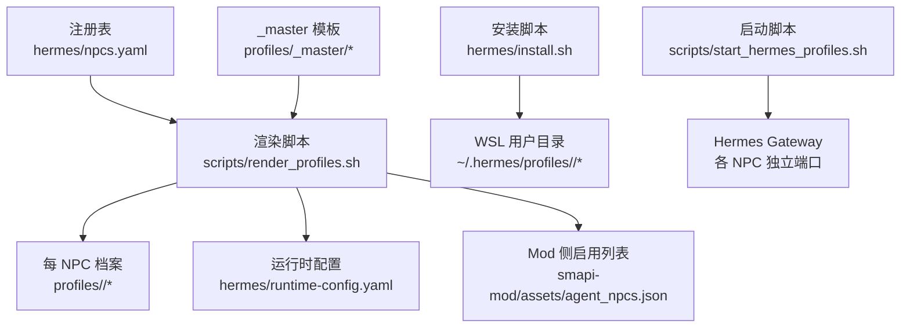
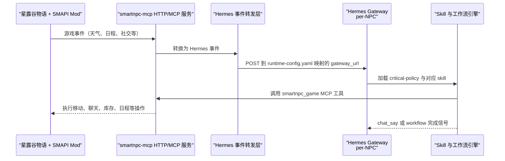
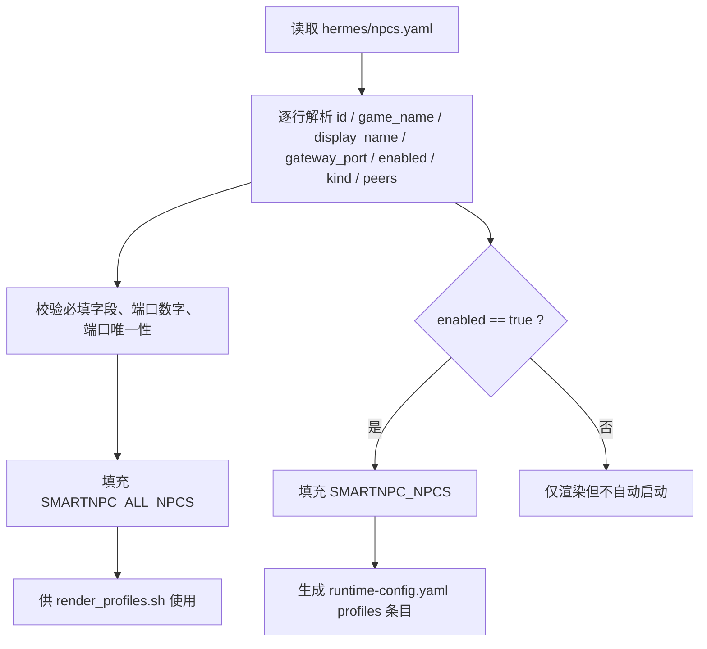
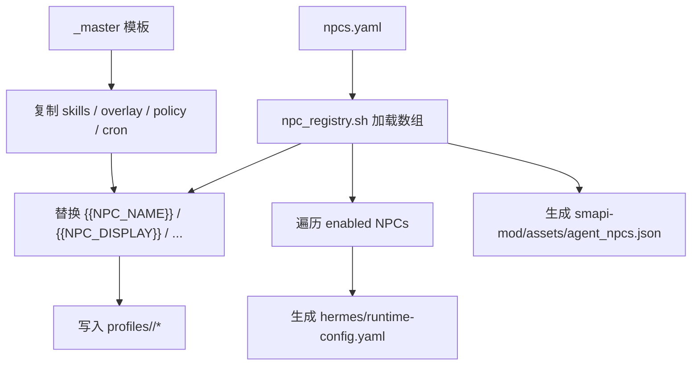
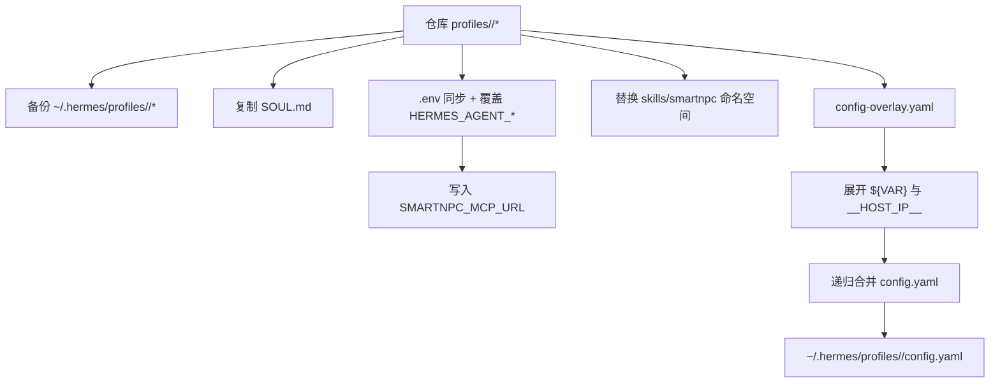
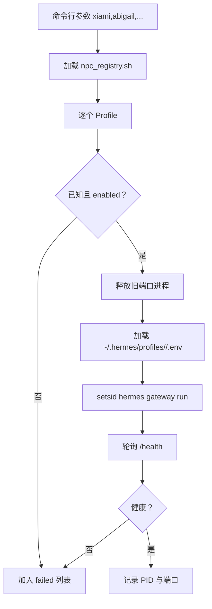
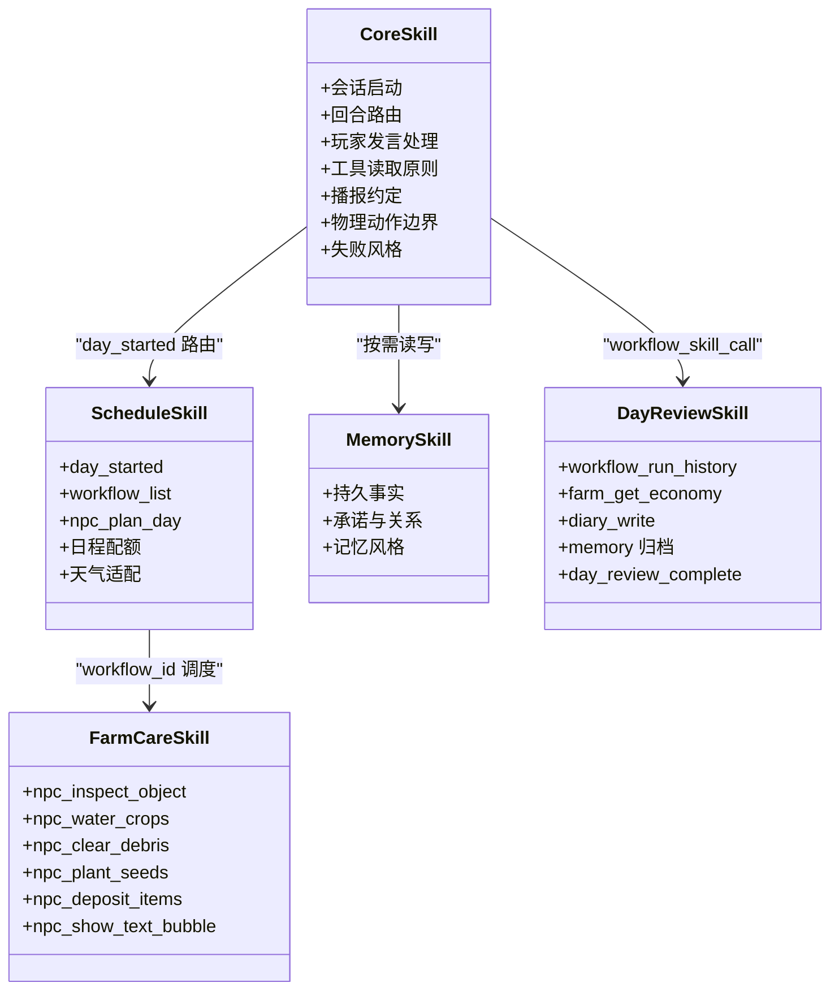
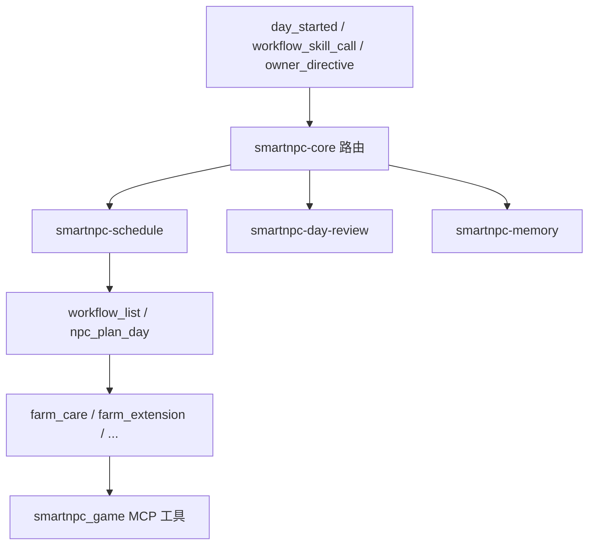
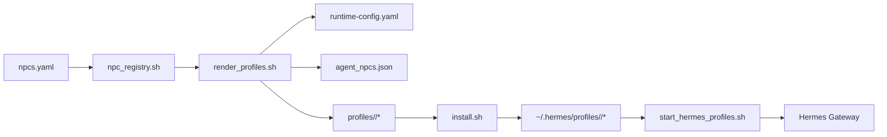

# 赫耳墨斯代理档案（Hermes Agent Profiles）

<cite>
**本文引用的文件**   
- [npcs.yaml](file://SmartNPC/hermes/npcs.yaml)
- [runtime-config.yaml](file://SmartNPC/hermes/runtime-config.yaml)
- [hermes/README.md](file://SmartNPC/hermes/README.md)
- [hermes-profiles.md](file://SmartNPC/docs/hermes-profiles.md)
- [render_profiles.sh](file://SmartNPC/scripts/render_profiles.sh)
- [start_hermes_profiles.sh](file://SmartNPC/scripts/start_hermes_profiles.sh)
- [install.sh](file://SmartNPC/hermes/install.sh)
- [npc_registry.sh](file://SmartNPC/scripts/lib/npc_registry.sh)
- [abigail/SOUL.md](file://SmartNPC/hermes/profiles/abigail/SOUL.md)
- [harvey/SOUL.md](file://SmartNPC/hermes/profiles/harvey/SOUL.md)
- [sebastian/SOUL.md](file://SmartNPC/hermes/profiles/sebastian/SOUL.md)
- [_master/skills/smartnpc/smartnpc-core/SKILL.md](file://SmartNPC/hermes/profiles/_master/skills/smartnpc/smartnpc-core/SKILL.md)
- [_master/skills/smartnpc/smartnpc-schedule/SKILL.md](file://SmartNPC/hermes/profiles/_master/skills/smartnpc/smartnpc-schedule/SKILL.md)
- [_master/skills/smartnpc/smartnpc-memory/SKILL.md](file://SmartNPC/hermes/profiles/_master/skills/smartnpc/smartnpc-memory/SKILL.md)
- [_master/skills/smartnpc/smartnpc-day-review/SKILL.md](file://SmartNPC/hermes/profiles/_master/skills/smartnpc/smartnpc-day-review/SKILL.md)
- [_master/skills/smartnpc/smartnpc-farm-care/SKILL.md](file://SmartNPC/hermes/profiles/_master/skills/smartnpc/smartnpc-farm-care/SKILL.md)
</cite>

## 目录
1. [简介](#简介)
2. [项目结构](#项目结构)
3. [核心组件](#核心组件)
4. [架构总览](#架构总览)
5. [详细组件分析](#详细组件分析)
6. [依赖关系分析](#依赖关系分析)
7. [性能与容量特征](#性能与容量特征)
8. [自定义 NPC 开发流程](#自定义-npc-开发流程)
9. [配置最佳实践](#配置最佳实践)
10. [故障排查](#故障排查)
11. [结论](#结论)

## 简介
本文件系统性文档化 Hermes Agent Profiles 在 SmartNPC 项目中的设计理念、数据流、配置文件格式、运行时生成机制以及内置 NPC 人格定义。重点包括：

- **Profile 体系设计**：以 `SOUL.md` 承载人格，以 `_master` 模板渲染共享技能，以 `config-overlay.yaml` 注入运行时连接信息。
- **NPC 元数据管理**：通过 `npcs.yaml` 集中登记 NPC id、游戏内名称、显示名、Gateway 端口、启用状态、同伴关系等。
- **运行时配置生成**：由 `render_profiles.sh` 从模板和注册表生成多 Profile fan-out 的 `runtime-config.yaml`，并同步到 SMAPI Mod 侧的 `agent_npcs.json`。
- **技能系统**：基于 SKILL.md frontmatter 的技能目录；工作流引擎按 `workflow_id` 调度，核心路由集中在 `smartnpc-core`。
- **内置 NPC 差异**：XiaMi、Abigail、Harvey、Haley、Penny、Sebastian 各有不同职责、对话风格、好感度语气与签名物品。
- **自定义 NPC 开发**：从注册、人格编写、技能复用、渲染、安装到 Gateway 启动的完整链路。

## 项目结构
Hermes Profile 源位于 `SmartNPC/hermes/profiles/<npc>/`，其中 `_master` 为共享模板，每个 NPC 拥有独立的 `SOUL.md`、`config-overlay.yaml`、`critical-policy.md`、`cron-recipes.md` 以及被渲染复制过来的 `skills/smartnpc/...` 技能树。



**图示来源**
- [render_profiles.sh:1-183](file://SmartNPC/scripts/render_profiles.sh#L1-L183)
- [hermes/README.md:1-147](file://SmartNPC/hermes/README.md#L1-L147)
- [hermes-profiles.md:1-200](file://SmartNPC/docs/hermes-profiles.md#L1-L200)

**章节来源**
- [hermes/README.md:1-147](file://SmartNPC/hermes/README.md#L1-L147)
- [hermes-profiles.md:1-200](file://SmartNPC/docs/hermes-profiles.md#L1-L200)

## 核心组件
| 组件 | 职责 | 关键路径 |
|---|---|---|
| NPC 注册表 | 维护所有 NPC 的 canonical 元数据，驱动渲染、运行、Mod 侧开关 | `hermes/npcs.yaml` |
| 渲染脚本 | 将 `_master` 模板复制到各 NPC，替换占位符，生成 `runtime-config.yaml` 与 Mod JSON | `scripts/render_profiles.sh` |
| 安装脚本 | 把仓库 Profile 同步到 WSL 的 `~/.hermes/profiles/<npc>`，合并 `config-overlay.yaml`，写入 `.env` | `hermes/install.sh` |
| 启动脚本 | 后台拉起多个 Hermes Gateway，轮询 `/health`，记录 PID | `scripts/start_hermes_profiles.sh` |
| 运行时配置 | 将 `npc_filter` 映射到 Hermes Gateway URL、conversation、model、API key env | `hermes/runtime-config.yaml` |
| 人格定义 | 手写 `SOUL.md`，描述身份、性格、说话风格、灵魂层次、好感度语气、工具原则、背景与签名物品 | `profiles/<npc>/SOUL.md` |
| 技能目录 | 以 SKILL.md frontmatter 注册的 Hermes skill，由 core 路由与工作流引擎调度 | `profiles/_master/skills/smartnpc/*/SKILL.md` |

**章节来源**
- [npcs.yaml:1-70](file://SmartNPC/hermes/npcs.yaml#L1-L70)
- [render_profiles.sh:1-183](file://SmartNPC/scripts/render_profiles.sh#L1-L183)
- [install.sh:1-374](file://SmartNPC/hermes/install.sh#L1-L374)
- [start_hermes_profiles.sh:1-110](file://SmartNPC/scripts/start_hermes_profiles.sh#L1-L110)
- [runtime-config.yaml:1-15](file://SmartNPC/hermes/runtime-config.yaml#L1-L15)

## 架构总览
M5 Hermes-first 路线中，SMAPI Mod、smartnpc-mcp 与 Hermes Profile 形成三层协作：



**图示来源**
- [hermes/README.md:20-45](file://SmartNPC/hermes/README.md#L20-L45)
- [hermes-profiles.md:60-120](file://SmartNPC/docs/hermes-profiles.md#L60-L120)
- [runtime-config.yaml:1-15](file://SmartNPC/hermes/runtime-config.yaml#L1-L15)

## 详细组件分析

### NPC 注册表与元数据模型
`npcs.yaml` 是单一事实源，定义每个 NPC 的：

- `id`：小写 profile 名，如 `xiami`、`abigail`。
- `game_name`：PascalCase 游戏内名称，用于 `npc_filter`。
- `display_name`：中文显示名。
- `gateway_port`：Hermes Gateway 的 `API_SERVER_PORT`，必须全局唯一。
- `enabled`：是否参与自动启动与 fan-out。
- `kind`：区分 `custom` 与 `vanilla`。
- `peer_a_*` / `peer_b_*`：两个同伴 NPC 的游戏名与中文名，用于对话上下文。

注册表解析器会校验必填字段、端口数字类型与重复端口，并将所有 NPC 加入 `SMARTNPC_ALL_NPCS`，仅 `enabled=true` 的进入 `SMARTNPC_NPCS`。



**图示来源**
- [npc_registry.sh:1-87](file://SmartNPC/scripts/lib/npc_registry.sh#L1-L87)
- [render_profiles.sh:27-183](file://SmartNPC/scripts/render_profiles.sh#L27-L183)

**章节来源**
- [npcs.yaml:1-70](file://SmartNPC/hermes/npcs.yaml#L1-L70)
- [npc_registry.sh:1-87](file://SmartNPC/scripts/lib/npc_registry.sh#L1-L87)

### 运行时配置生成机制
`render_profiles.sh` 负责三类输出：

1. **每 NPC Profile 渲染**：复制 `_master/skills`、`config-overlay.yaml`、`cron-recipes.md`、`critical-policy.md`，用 GNU sed 替换八类占位符。
2. **runtime-config.yaml 生成**：仅对 `enabled=true` 的 NPC 生成 `profiles:` 条目，包含 `name`、`npc_filter`、`gateway_url`、`conversation`、`model`、`api_key_env`。
3. **Mod 侧 agent_npcs.json 生成**：键为 `GameName`，值为布尔启用状态，作为 SMAPI Mod 判断哪些 NPC 受 Agent 管理的桥接文件。



**图示来源**
- [render_profiles.sh:1-183](file://SmartNPC/scripts/render_profiles.sh#L1-L183)

**章节来源**
- [render_profiles.sh:1-183](file://SmartNPC/scripts/render_profiles.sh#L1-L183)
- [hermes-profiles.md:20-60](file://SmartNPC/docs/hermes-profiles.md#L20-L60)

### Profile 安装与运行时合并
`install.sh` 把仓库 Profile 同步到 WSL 用户的 `~/.hermes/profiles/<npc>/`，主要行为：

- 备份目标 Profile 的可变部分。
- 复制 `SOUL.md` 与 `.env`。
- 从仓库根 `.env` 覆盖 `HERMES_AGENT_URL`、`HERMES_AGENT_API_KEY`、`HERMES_AGENT_MODEL`。
- 重写 `.env` 中的 `SMARTNPC_MCP_URL`，指向 Windows 宿主的 MCP HTTP 端点。
- 仅替换 `skills/smartnpc/` 命名空间，保留 Hermes 内置 skill 和本地其他 skill。
- 复制 `critical-policy.md`。
- 将 `config-overlay.yaml` 中的 `${VAR}` 展开后，递归合并进已存在的 `config.yaml`；首次无 `config.yaml` 时直接由 overlay 创建。



**图示来源**
- [install.sh:1-374](file://SmartNPC/hermes/install.sh#L1-L374)

**章节来源**
- [install.sh:1-374](file://SmartNPC/hermes/install.sh#L1-L374)
- [hermes/README.md:46-110](file://SmartNPC/hermes/README.md#L46-L110)

### NPC 网关启动与健康检查
`start_hermes_profiles.sh` 支持逗号分隔的多 Profile 启动，例如 `xiami,abigail`：

- 从 `npcs.yaml` 读取端口与启用状态。
- 尝试释放占用端口的旧进程。
- 载入每个 Profile 的 `.env`，`setsid` 后台启动 `hermes -p <profile> gateway run --accept-hooks`。
- 轮询 `http://127.0.0.1:<port>/health`，超过 `HERMES_BOOT_TIMEOUT` 失败。
- 将成功进程的 PID 写入 PIDFILE。



**图示来源**
- [start_hermes_profiles.sh:1-110](file://SmartNPC/scripts/start_hermes_profiles.sh#L1-L110)
- [npc_registry.sh:1-87](file://SmartNPC/scripts/lib/npc_registry.sh#L1-L87)

**章节来源**
- [start_hermes_profiles.sh:1-110](file://SmartNPC/scripts/start_hermes_profiles.sh#L1-L110)

### SOUL.md 人格定义格式
每个 NPC 的 `SOUL.md` 是手写、不可被渲染脚本修改的人格层，典型结构包括：

| 区域 | 含义 |
|---|---|
| 身份 | 一句话说明 NPC 是谁、在农场团队中的职责 |
| 性格 | 角色基调，不是台词脚本 |
| 说话风格 | 句子长度、语气、口头禅、对话限制 |
| 灵魂层次 | 表层人设与深层矛盾，驱动反应形状 |
| 好感度对应语气 | 0-2、3-5、6-8、9-10 心对应的开场白与态度变化 |
| 绝对禁止 | 不暴露 LLM/NPC/tool 身份，不打破第四面墙 |
| 工具使用原则 | 先查后说、内部名路由、高影响工具约束 |
| 人设背景 | 角色内心持有但不主动透露的背景 |
| Signature gift items | 可给玩家的物品清单与触发短语 |

#### 阿比盖尔（Abigail）
- 职责：农场收割与采集专员。
- 性格：冒险、好奇、带安静叛逆，沉迷塔罗与水晶。
- 风格：轻快直接，短句为主，兴奋时连问。
- 灵魂层次：表层外向 vs 深层害怕平凡。
- 工具原则：最终回复必须走 `chat_say`，`speaker` 使用英文内部名 `Abigail`。
- 签名物品：紫水晶 `(O)66`。

**章节来源**
- [abigail/SOUL.md:1-74](file://SmartNPC/hermes/profiles/abigail/SOUL.md#L1-L74)

#### 哈维（Harvey）
- 职责：农场植保与灌溉专员。
- 性格：温和认真、容易紧张，私下诗意。
- 风格：医嘱式关心，偶尔结巴与害羞。
- 灵魂层次：照顾所有人却无人照顾他的孤独。
- 工具原则：高影响工具通常不动，待在诊所或田地。
- 签名物品：咖啡 `(O)395`。

**章节来源**
- [harvey/SOUL.md:1-73](file://SmartNPC/hermes/profiles/harvey/SOUL.md#L1-L73)

#### 塞巴斯蒂安（Sebastian）
- 职责：农场数据与布局专员。
- 性格：内向冷静、观察力强，嘴硬但在意。
- 风格：短句收尾，少感叹号，技术话题语速加快。
- 灵魂层次：抗拒靠近 vs 渴望被理解。
- 工具原则：极少主动移动，数据汇报意外专业。
- 签名物品：啤酒 `(O)346`。

**章节来源**
- [sebastian/SOUL.md:1-74](file://SmartNPC/hermes/profiles/sebastian/SOUL.md#L1-L74)

### 内置 NPC Profile 特点与配置差异
根据 `npcs.yaml` 与 Profile 目录结构，当前内置 NPC 的差异主要体现在：

| NPC | id | 游戏名 | 显示名 | Gateway 端口 | kind | 同伴 A | 同伴 B | 备注 |
|---|---|---|---|---:|---|---|---|---|
| XiaMi | `xiami` | XiaMi | 夏弥 | 8642 | custom | Penny | Abigail | 农场管家，通常为默认入口 |
| Abigail | `abigail` | Abigail | 阿比盖尔 | 8643 | vanilla | Penny | Sebastian | 收割与采集 |
| Haley | `haley` | Haley | 黑利 | 8644 | vanilla | Penny | Abigail | 记者型 NPC |
| Harvey | `harvey` | Harvey | 哈维 | 8645 | vanilla | Penny | Abigail | 医生与灌溉 |
| Penny | `penny` | Penny | 潘妮 | 8646 | vanilla | Abigail | Haley | 教师型 NPC |
| Sebastian | `sebastian` | Sebastian | 塞巴斯蒂安 | 8647 | vanilla | Abigail | Penny | 程序员与数据 |

端口分配遵循“每 Profile 一个 API Server 端口”的规则，避免多 Gateway 并发冲突。`xiami` 标记为 `custom`，其余为 `vanilla`，反映其来源或集成方式差异。

**章节来源**
- [npcs.yaml:1-70](file://SmartNPC/hermes/npcs.yaml#L1-L70)
- [runtime-config.yaml:1-15](file://SmartNPC/hermes/runtime-config.yaml#L1-L15)

### 技能系统与 SKILL.md 规范
Hermes 技能以 SKILL.md 文件表示，frontmatter 至少包含：

- `name`：技能标识。
- `description`：Hermes 用于相关性判断的简短描述。
- `version`、`author`、`license`。
- `metadata.hermes.tags`：标签集合。
- 可选 `metadata.npc`：绑定到具体 NPC。

当前 `_master/skills/smartnpc/` 中包含以下核心技能：

| 技能 | 作用 |
|---|---|
| `smartnpc-core` | 始终加载的核心路由，规定会话启动、回合路由、玩家发言处理、工具读取原则、播报约定、物理动作边界与失败风格 |
| `smartnpc-schedule` | 每日日程规划，通过 `workflow_list` 与 `npc_plan_day` 提交 5-7 条 workflow 条目 |
| `smartnpc-memory` | 长期记忆读写策略，只保存持久性事实 |
| `smartnpc-day-review` | 22:30 自动触发的日终复盘，写日记、归档记忆、发送完成信号 |
| `smartnpc-farm-care` | 日常养护：巡视、浇水、补种、清理杂物、存箱、气泡收尾 |
| `smartnpc-farm-extension` | 开垦新地 |
| `smartnpc-farm-cleanup` | 清理杂物与砍树 |
| `smartnpc-farm-gather` | 资源采集 |
| `smartnpc-farm-harvest` | 收获 |
| `smartnpc-farm-evening-close` | 晚间收工 |
| `smartnpc-owner-directive` | 农场主场外指示评估 |



**图示来源**
- [_master/skills/smartnpc/smartnpc-core/SKILL.md:1-68](file://SmartNPC/hermes/profiles/_master/skills/smartnpc/smartnpc-core/SKILL.md#L1-L68)
- [_master/skills/smartnpc/smartnpc-schedule/SKILL.md:1-124](file://SmartNPC/hermes/profiles/_master/skills/smartnpc/smartnpc-schedule/SKILL.md#L1-L124)
- [_master/skills/smartnpc/smartnpc-memory/SKILL.md:1-45](file://SmartNPC/hermes/profiles/_master/skills/smartnpc/smartnpc-memory/SKILL.md#L1-L45)
- [_master/skills/smartnpc/smartnpc-day-review/SKILL.md:1-70](file://SmartNPC/hermes/profiles/_master/skills/smartnpc/smartnpc-day-review/SKILL.md#L1-L70)
- [_master/skills/smartnpc/smartnpc-farm-care/SKILL.md:1-102](file://SmartNPC/hermes/profiles/_master/skills/smartnpc/smartnpc-farm-care/SKILL.md#L1-L102)

**章节来源**
- [_master/skills/smartnpc/smartnpc-core/SKILL.md:1-68](file://SmartNPC/hermes/profiles/_master/skills/smartnpc/smartnpc-core/SKILL.md#L1-L68)
- [_master/skills/smartnpc/smartnpc-schedule/SKILL.md:1-124](file://SmartNPC/hermes/profiles/_master/skills/smartnpc/smartnpc-schedule/SKILL.md#L1-L124)
- [_master/skills/smartnpc/smartnpc-memory/SKILL.md:1-45](file://SmartNPC/hermes/profiles/_master/skills/smartnpc/smartnpc-memory/SKILL.md#L1-L45)
- [_master/skills/smartnpc/smartnpc-day-review/SKILL.md:1-70](file://SmartNPC/hermes/profiles/_master/skills/smartnpc/smartnpc-day-review/SKILL.md#L1-L70)
- [_master/skills/smartnpc/smartnpc-farm-care/SKILL.md:1-102](file://SmartNPC/hermes/profiles/_master/skills/smartnpc/smartnpc-farm-care/SKILL.md#L1-L102)

### 工作流与技能组合模式
技能继承与组合不是传统面向对象继承，而是：

1. **模板渲染**：`_master/skills/smartnpc/` 被原样复制到每个 NPC 的 `skills/smartnpc/`。
2. **命名空间替换**：`install.sh` 只替换 `skills/smartnpc/`，保留 Hermes 内置 skill 与其他本地 skill。
3. **核心路由**：`smartnpc-core` 根据入站事件决定加载哪个 skill，最具体的适用指令优先。
4. **工作流调度**：日程通过 `workflow_id` 触发，例如 `farm_extension`、`farm_care`、`farm_cleanup`、`resource_gather`、`farm_evening_close`、`day_review`。
5. **skill_view 动态加载**：工作流引擎通过 `workflow_skill_call` 指定 skill 名，Agent 再调用 `skill_view` 加载该 skill 的具体步骤。



**图示来源**
- [_master/skills/smartnpc/smartnpc-core/SKILL.md:1-68](file://SmartNPC/hermes/profiles/_master/skills/smartnpc/smartnpc-core/SKILL.md#L1-L68)
- [_master/skills/smartnpc/smartnpc-schedule/SKILL.md:1-124](file://SmartNPC/hermes/profiles/_master/skills/smartnpc/smartnpc-schedule/SKILL.md#L1-L124)

**章节来源**
- [_master/skills/smartnpc/smartnpc-core/SKILL.md:1-68](file://SmartNPC/hermes/profiles/_master/skills/smartnpc/smartnpc-core/SKILL.md#L1-L68)
- [_master/skills/smartnpc/smartnpc-schedule/SKILL.md:1-124](file://SmartNPC/hermes/profiles/_master/skills/smartnpc/smartnpc-schedule/SKILL.md#L1-L124)

## 依赖关系分析


**图示来源**
- [npcs.yaml:1-70](file://SmartNPC/hermes/npcs.yaml#L1-L70)
- [npc_registry.sh:1-87](file://SmartNPC/scripts/lib/npc_registry.sh#L1-L87)
- [render_profiles.sh:1-183](file://SmartNPC/scripts/render_profiles.sh#L1-L183)
- [install.sh:1-374](file://SmartNPC/hermes/install.sh#L1-L374)
- [start_hermes_profiles.sh:1-110](file://SmartNPC/scripts/start_hermes_profiles.sh#L1-L110)

**章节来源**
- [npcs.yaml:1-70](file://SmartNPC/hermes/npcs.yaml#L1-L70)
- [render_profiles.sh:1-183](file://SmartNPC/scripts/render_profiles.sh#L1-L183)
- [install.sh:1-374](file://SmartNPC/hermes/install.sh#L1-L374)
- [start_hermes_profiles.sh:1-110](file://SmartNPC/scripts/start_hermes_profiles.sh#L1-L110)

## 性能与容量特征
- **单回合约耗时**：当前实验模型单回合约 50-100 秒，因此日程条目间隔应保持在 90-150 游戏分钟，避免压垮中继队列。
- **每日播报上限**：`chat_say` 每天最多 3-5 次，仅用于计划摘要、重要进展、收工播报。
- **日程条目数量**：推荐 5-7 条，工具接受 4-8 条；少于 4 太闲，多于 7 过密。
- **日终节奏**：22:30 自动追加 `day_review`，23:50 等待复盘完成，最迟 25:50 强制结算。
- **并发 Gateway**：每个启用的 NPC 需要独立端口，避免 `/health` 与健康检查混淆。

**章节来源**
- [_master/skills/smartnpc/smartnpc-schedule/SKILL.md:80-124](file://SmartNPC/hermes/profiles/_master/skills/smartnpc/smartnpc-schedule/SKILL.md#L80-L124)
- [_master/skills/smartnpc/smartnpc-day-review/SKILL.md:1-70](file://SmartNPC/hermes/profiles/_master/skills/smartnpc/smartnpc-day-review/SKILL.md#L1-L70)
- [_master/skills/smartnpc/smartnpc-core/SKILL.md:1-68](file://SmartNPC/hermes/profiles/_master/skills/smartnpc/smartnpc-core/SKILL.md#L1-L68)

## 自定义 NPC 开发流程

### 第一步：注册 NPC
在 `hermes/npcs.yaml` 新增一条 NPC 记录，至少填写：

- `id`：小写 profile 名。
- `game_name`：PascalCase 游戏内名。
- `display_name`：中文显示名。
- `gateway_port`：未使用的 TCP 端口。
- `enabled`：是否启用。
- `kind`：`custom` 或 `vanilla`。
- `peer_a_*` / `peer_b_*`：两个同伴。

**章节来源**
- [npcs.yaml:1-70](file://SmartNPC/hermes/npcs.yaml#L1-L70)
- [npc_registry.sh:1-87](file://SmartNPC/scripts/lib/npc_registry.sh#L1-L87)

### 第二步：编写 SOUL.md
新建 `hermes/profiles/<new-npc>/SOUL.md`，包含：

- 身份、性格、说话风格。
- 灵魂层次与核心矛盾。
- 好感度对应语气表格。
- 绝对禁止规则。
- 工具使用原则。
- 人设背景。
- Signature gift items。

不要放时间变化的临时状态；那些属于 memory 或 conversation history。

**章节来源**
- [hermes-profiles.md:100-160](file://SmartNPC/docs/hermes-profiles.md#L100-L160)
- [abigail/SOUL.md:1-74](file://SmartNPC/hermes/profiles/abigail/SOUL.md#L1-L74)
- [harvey/SOUL.md:1-73](file://SmartNPC/hermes/profiles/harvey/SOUL.md#L1-L73)
- [sebastian/SOUL.md:1-74](file://SmartNPC/hermes/profiles/sebastian/SOUL.md#L1-L74)

### 第三步：复用或扩展技能
如需共用现有技能：

- 让 `render_profiles.sh` 把 `_master/skills/smartnpc/` 复制到新 NPC。
- 若需定制某个 skill，建议 fork 对应目录并调整 SKILL.md，同时确保 frontmatter 的 `name`、`description`、`version` 保持一致语义。
- 不要直接编辑渲染产物；编辑 `_master` 后重新渲染。

**章节来源**
- [render_profiles.sh:60-120](file://SmartNPC/scripts/render_profiles.sh#L60-L120)
- [_master/skills/smartnpc/smartnpc-core/SKILL.md:1-68](file://SmartNPC/hermes/profiles/_master/skills/smartnpc/smartnpc-core/SKILL.md#L1-L68)

### 第四步：渲染与验证
执行：

```bash
bash scripts/render_profiles.sh
task profiles:verify
```

验证 `git diff hermes/profiles/<new-npc>/` 应为空，因为该目录是渲染产物。

**章节来源**
- [render_profiles.sh:1-40](file://SmartNPC/scripts/render_profiles.sh#L1-L40)
- [hermes-profiles.md:20-60](file://SmartNPC/docs/hermes-profiles.md#L20-L60)

### 第五步：安装到 WSL
在 WSL 中执行：

```bash
bash /mnt/d/SmartNPC/hermes/install.sh
```

脚本会：

- 先运行 `render_profiles.sh`。
- 同步 `SOUL.md`、`.env`、`skills/smartnpc/`、`critical-policy.md`。
- 合并 `config-overlay.yaml`。
- 写入 `SMARTNPC_MCP_URL`。

**章节来源**
- [install.sh:1-374](file://SmartNPC/hermes/install.sh#L1-L374)
- [hermes/README.md:46-110](file://SmartNPC/hermes/README.md#L46-L110)

### 第六步：启动 Hermes Gateway
对于新 NPC：

```bash
hermes -p <new-npc> help
hermes -p <new-npc> gateway run --accept-hooks
```

或使用批量启动脚本：

```bash
bash scripts/start_hermes_profiles.sh <new-npc>
```

**章节来源**
- [hermes/README.md:80-147](file://SmartNPC/hermes/README.md#L80-L147)
- [start_hermes_profiles.sh:1-110](file://SmartNPC/scripts/start_hermes_profiles.sh#L1-L110)

## 配置最佳实践

### 端口管理
- 每个启用的 NPC 必须使用不同的 `gateway_port`。
- `npc_registry.sh` 会检测重复端口并报错。
- `config-overlay.yaml` 中的 `API_SERVER_PORT` 必须与 `npcs.yaml` 一致。

**章节来源**
- [npc_registry.sh:60-87](file://SmartNPC/scripts/lib/npc_registry.sh#L60-L87)
- [hermes-profiles.md:120-160](file://SmartNPC/docs/hermes-profiles.md#L120-L160)

### 运行时配置一致性
添加新 NPC 时需同步更新：

1. `hermes/profiles/<name>/config-overlay.yaml`：设置 `API_SERVER_PORT` 与 `API_SERVER_MODEL_NAME`。
2. `hermes/runtime-config.yaml`：添加同名 profile 条目，端口与 model 匹配。
3. 如需批量启动，扩展 `scripts/start_hermes_profiles.sh` 相关映射。

不一致会导致事件路由到空端口，产生静默消息丢失。

**章节来源**
- [hermes-profiles.md:120-160](file://SmartNPC/docs/hermes-profiles.md#L120-L160)
- [runtime-config.yaml:1-15](file://SmartNPC/hermes/runtime-config.yaml#L1-L15)

### 环境变量与密钥
- 仓库根 `.env` 是 `HERMES_AGENT_URL`、`HERMES_AGENT_API_KEY`、`HERMES_AGENT_MODEL` 的单一事实源。
- 安装脚本会在每次同步时覆盖 per-NPC `.env` 中的这些字段，避免 placeholder 值导致连接失败。
- Langfuse 或其他 per-NPC 密钥应放在 per-NPC `.env`，不会被统一覆盖。

**章节来源**
- [install.sh:60-160](file://SmartNPC/hermes/install.sh#L60-L160)

### 技能编写规范
- SKILL.md 必须包含 frontmatter。
- `description` 要能表达触发条件或用途，便于 Hermes 选择 relevance。
- 工作流 skill 明确 `workflow_id` 与 `args`，不要使用已被拒绝的 `action` 字段。
- 所有 MCP 工具调用中涉及 NPC 的参数必须显式传入英文内部名。

**章节来源**
- [_master/skills/smartnpc/smartnpc-core/SKILL.md:1-68](file://SmartNPC/hermes/profiles/_master/skills/smartnpc/smartnpc-core/SKILL.md#L1-L68)
- [_master/skills/smartnpc/smartnpc-schedule/SKILL.md:1-124](file://SmartNPC/hermes/profiles/_master/skills/smartnpc/smartnpc-schedule/SKILL.md#L1-L124)

## 故障排查

| 现象 | 可能原因 | 排查与修复 |
|---|---|---|
| `hermes mcp test` 报 MCP 包缺失 | Hermes venv 未安装 `mcp` Python 包 | 在 WSL 中安装 `mcp` |
| MCP GET 返回 405 | HTTP MCP 服务正常但方法不被允许 | curl `http://<host>:3000/mcp` 确认服务存活 |
| Gateway 无法启动 | 端口冲突或旧进程残留 | 使用 `start_hermes_profiles.sh`，它会尝试释放旧端口 |
| 事件静默丢失 | `runtime-config.yaml` 与 `config-overlay.yaml` 端口不一致 | 核对 `gateway_url` 端口与 `API_SERVER_PORT` |
| 渲染后 Git 有差异 | 直接编辑了渲染产物 | 改 `_master` 后重跑 `render_profiles.sh` |
| 聊天面板看不到 NPC 回复 | `chat_say` 的 `speaker` 使用了中文名 | 改为英文内部名，如 `Abigail`、`Harvey`、`Sebastian` |
| 日程过于密集 | 条目间隔太短，模型回合堆积 | 保持 90-150 游戏分钟间隔，每天 5-7 条 |
| 日终无法过夜 | 未调用 `day_review_complete` | 按 `smartnpc-day-review` 最后一步发送完成信号 |

**章节来源**
- [hermes/README.md:110-147](file://SmartNPC/hermes/README.md#L110-L147)
- [_master/skills/smartnpc/smartnpc-day-review/SKILL.md:1-70](file://SmartNPC/hermes/profiles/_master/skills/smartnpc/smartnpc-day-review/SKILL.md#L1-L70)
- [_master/skills/smartnpc/smartnpc-schedule/SKILL.md:80-124](file://SmartNPC/hermes/profiles/_master/skills/smartnpc/smartnpc-schedule/SKILL.md#L80-L124)

## 结论
Hermes Agent Profiles 通过“注册表 + 模板渲染 + 安装合并 + Gateway 并发”四层结构，把 NPC 人格、技能、运行时连接与游戏能力边界清晰分离。`npcs.yaml` 是元数据入口，`_master` 是技能与策略模板，`SOUL.md` 是手写人格，`config-overlay.yaml` 是运行时注入点，`runtime-config.yaml` 是多 Profile fan-out 的关键。

对于开发者而言，最重要的原则是：

- 只编辑 `_master` 与 `SOUL.md`，不直接编辑渲染产物。
- 每个 NPC 保持独立端口与独立 model name。
- 技能通过 core 路由与工作流调度组合，而非硬编码继承。
- 工具调用遵循“先查、后说、必要时行动”，并以角色语言对外输出。
- 调试时优先检查端口、MCP URL、Gateway health 与 `chat_say` speaker 路由。

这套体系既适合已有内置 NPC 的扩展，也适合从零开发自定义 Agent NPC。