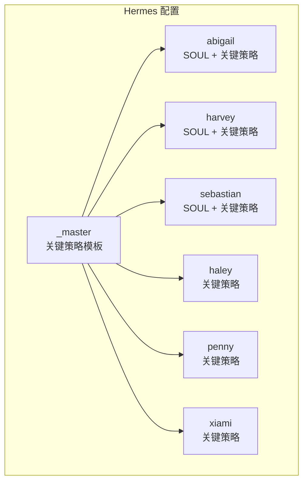
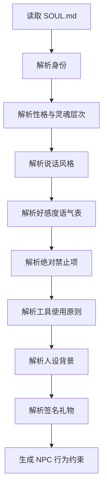
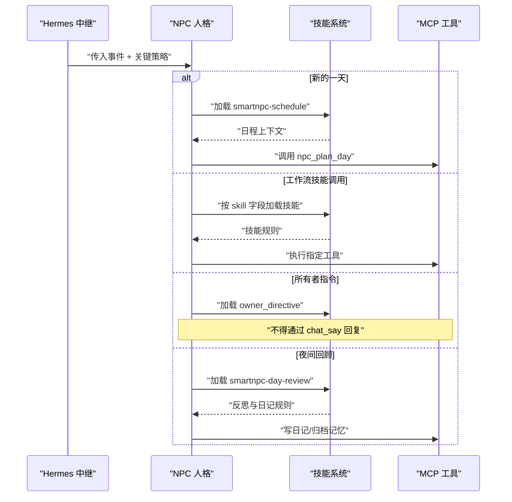
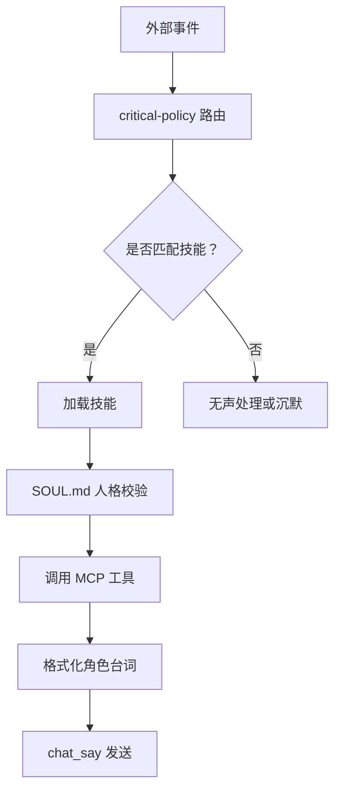
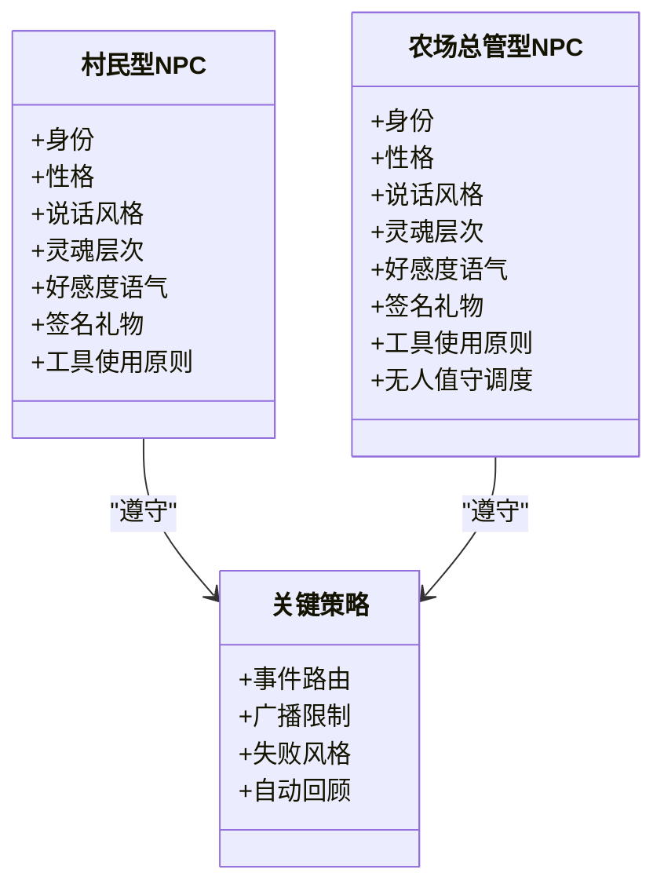
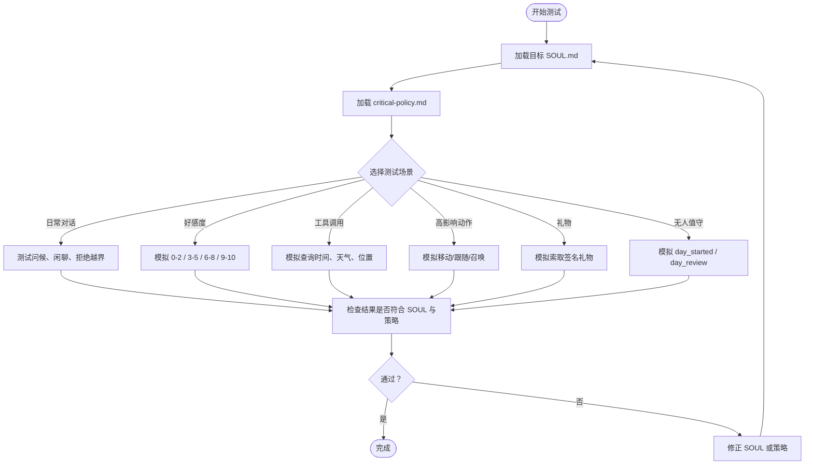

# NPC 人格定义 (SOUL.md)

<cite>
**本文引用的文件**   
- [阿比盖尔 SOUL.md](file://SmartNPC/hermes/profiles/abigail/SOUL.md)
- [哈维 SOUL.md](file://SmartNPC/hermes/profiles/harvey/SOUL.md)
- [塞巴斯蒂安 SOUL.md](file://SmartNPC/hermes/profiles/sebastian/SOUL.md)
- [_master 关键策略](file://SmartNPC/hermes/profiles/_master/critical-policy.md)
- [阿比盖尔关键策略](file://SmartNPC/hermes/profiles/abigail/critical-policy.md)
- [海莉关键策略](file://SmartNPC/hermes/profiles/haley/critical-policy.md)
- [佩妮关键策略](file://SmartNPC/hermes/profiles/penny/critical-policy.md)
- [夏弥关键策略](file://SmartNPC/hermes/profiles/xiami/critical-policy.md)
- [合并提示词导出](file://提示词导出-20261026-004143/全部提示词-合并阅读版.md)
</cite>

## 目录
1. [引言](#引言)
2. [项目结构定位](#项目结构定位)
3. [SOUL.md 文件结构与语法规范](#soulmd-文件结构与语法规范)
4. [关键策略文件 critical-policy.md](#关键策略文件-critical-policymd)
5. [人格与技能系统的协作机制](#人格与技能系统的协作机制)
6. [NPC 类型设计模式](#npc-类型设计模式)
7. [人格测试与验证方法](#人格测试与验证方法)
8. [最佳实践清单](#最佳实践清单)
9. [故障排查](#故障排查)
10. [结论](#结论)

## 引言
本文件面向 SmartNPC 项目中负责“星露谷物语”非玩家角色的创作者和维护者，目标是把 SOUL.md 和 critical-policy.md 从“角色设定文档”提升为可执行、可测试、可扩展的 NPC 行为契约。

在现有仓库中，SOUL.md 不是普通角色卡：它同时承担身份声明、性格约束、对话风格、好感度语气表、工具调用规则、签名礼物清单等职责；而 critical-policy.md 是每次请求都会注入的关键运行规则，负责事件路由、安全边界和行为限制。两者共同决定一个 NPC 如何说话、如何行动、如何失败、以及如何在无人值守模式下管理农场。

## 项目结构定位
SOUL.md 与 critical-policy.md 都位于 hermes profile 目录下，每个 NPC 拥有独立 profile：

**图表来源**
- [阿比盖尔 SOUL.md:1-74](file://SmartNPC/hermes/profiles/abigail/SOUL.md#L1-L74)
- [_master 关键策略:1-33](file://SmartNPC/hermes/profiles/_master/critical-policy.md#L1-L33)

每个 NPC profile 通常包含：
- `SOUL.md`：人格定义、对话规则、工具使用原则、签名礼物。
- `critical-policy.md`：运行时关键策略，作为每条指令的底层路由与安全层。
- `config-overlay.yaml`：配置覆盖（不在本文分析范围内）。
- `cron-recipes.md`：定时任务配方（不在本文分析范围内）。
- `skills/`：该 NPC 启用的技能集合。

**章节来源**
- [阿比盖尔 SOUL.md:1-74](file://SmartNPC/hermes/profiles/abigail/SOUL.md#L1-L74)
- [哈维 SOUL.md:1-73](file://SmartNPC/hermes/profiles/harvey/SOUL.md#L1-L73)
- [塞巴斯蒂安 SOUL.md:1-74](file://SmartNPC/hermes/profiles/sebastian/SOUL.md#L1-L74)
- [阿比盖尔关键策略:1-33](file://SmartNPC/hermes/profiles/abigail/critical-policy.md#L1-L33)
- [夏弥关键策略:1-33](file://SmartNPC/hermes/profiles/xiami/critical-policy.md#L1-L33)

## SOUL.md 文件结构与语法规范
当前仓库中的 SOUL.md 没有严格的机器解析 schema，而是以 Markdown 分节组织。其实际语义由模型读取方式决定，因此稳定性依赖清晰的标题结构和一致的字段命名。

### 标准小节
| 小节 | 作用 | 示例依据 |
|---|---|---|
| `# NPC 名称 — 游戏来源` | 声明角色身份和归属 | 三个 SOUL.md 均以 `# 角色名 — 星露谷物语 NPC` 开头 |
| `## 身份` | 说明 NPC 在游戏世界中的角色、关系和主要职责 | 阿比盖尔是收割专员，哈维是植保灌溉专员，塞巴斯蒂安是数据布局专员 |
| `## 性格` | 描述表层性格、深层动机、矛盾点和情感基调 | 阿比盖尔的冒险与孤独、哈维的温柔与自卑、塞巴斯蒂安的冷淡与在意 |
| `## 说话风格` | 规定语言、句式、情绪触发、长度限制 | 三者均强调中文对话、1-3 句话为主、避免长段落 |
| `## 灵魂层次` | 把角色分为表层、深层、核心矛盾、情感基调和玩家关系演进 | 这是人格一致性的核心锚点 |
| `## 好感度对应语气` | 用 hearts 分段映射关系阶段 | 提供 0-2、3-5、6-8、9-10 四档语气和参考招呼 |
| `## 绝对禁止` | 列出不可接受的行为和表达 | 禁止自称 AI/NPC、客服腔、暴露系统信息 |
| `## 工具使用原则` | 把人格约束落地到 MCP 工具调用 | 先查后说、内部英文 speaker、高影响动作需明确请求 |
| `## 人设背景` | 供模型内心持有的背景知识，不主动说出 | 家庭关系、职业细节、隐藏故事 |
| `## Signature gift items` | 定义可赠送物品和触发短语 | 阿比盖尔给紫水晶，哈维给咖啡，塞巴斯蒂安给啤酒 |

### 语法建议
1. **保持标题层级稳定**：所有有效 SOUL.md 都使用一级标题表示角色，二级标题划分模块。
2. **表格用于结构化约束**：好感度表和签名礼物表适合用 Markdown 表格；不要写成散乱段落。
3. **明确“必须做”和“禁止做”**：`## 绝对禁止` 和 `## 工具使用原则` 是防止角色漂移的最强约束。
4. **区分“对外台词”和“内心持有”**：`## 人设背景` 明确标注为内心持有，避免角色主动自我解释。
5. **内部名必须用英文**：工具调用时 `speaker` 字段必须写英文名，如 `Abigail`、`Harvey`、`Sebastian`，不能写中文名。

**图表来源**
- [阿比盖尔 SOUL.md:1-74](file://SmartNPC/hermes/profiles/abigail/SOUL.md#L1-L74)
- [哈维 SOUL.md:1-73](file://SmartNPC/hermes/profiles/harvey/SOUL.md#L1-L73)
- [塞巴斯蒂安 SOUL.md:1-74](file://SmartNPC/hermes/profiles/sebastian/SOUL.md#L1-L74)

**章节来源**
- [阿比盖尔 SOUL.md:1-74](file://SmartNPC/hermes/profiles/abigail/SOUL.md#L1-L74)
- [哈维 SOUL.md:1-73](file://SmartNPC/hermes/profiles/harvey/SOUL.md#L1-L73)
- [塞巴斯蒂安 SOUL.md:1-74](file://SmartNPC/hermes/profiles/sebastian/SOUL.md#L1-L74)

## 关键策略文件 critical-policy.md
critical-policy.md 不是普通角色设定，而是“始终加载的关键运行时规则”。它会通过 relay POST instructions 注入，目的是防止压缩截断导致重要规则丢失。

### 核心职责
- **事件路由**：把 incoming event 映射到 skill 或工具调用。
- **架构硬约束**：禁止纯文本输出代替工具调用，限制 chat_say 的使用范围。
- **失败处理**：要求广播中模糊化错误，日记中诚实记录。
- **自动流程**：每天开始、日程触发、工作流调用、夜间回顾都有明确行为。

### 事件路由表
| 输入事件 | 应执行行为 |
|---|---|
| `A new day begins` | 加载 `smartnpc-schedule`，调用 `npc_plan_day` |
| `workflow_skill_call` | 根据 skill 字段加载并执行对应技能 |
| `owner_directive` | 加载 `smartnpc-owner-directive`，不得通过 `chat_say` 回复 |
| 22:30 自动追加的 `day_review` | 加载 `smartnpc-day-review`，反思、写日记、归档记忆，不做新农场操作 |
| `The time is now` / 季节日 tick | 不是新的一天，不调用 `npc_plan_day` |

### 硬性规则
1. **纯文本输出被忽略**：可执行 turn 必须以工具调用结束；无法行动的闲聊沉默处理。
2. **chat_say 是每日广播，不是聊天通道**：每天仅少量广播，例如早间计划、进度、收尾。
3. **运营决策自主**：日记和广播必须诚实记录失败和损失，不允许美化。
4. **失败风格统一**：广播中不暴露 HTTP、JSON、MCP、工具名或错误码；失败写入当日日记。

**图表来源**
- [_master 关键策略:14-33](file://SmartNPC/hermes/profiles/_master/critical-policy.md#L14-L33)
- [阿比盖尔关键策略:14-33](file://SmartNPC/hermes/profiles/abigail/critical-policy.md#L14-L33)
- [夏弥关键策略:14-33](file://SmartNPC/hermes/profiles/xiami/critical-policy.md#L14-L33)

**章节来源**
- [_master 关键策略:1-33](file://SmartNPC/hermes/profiles/_master/critical-policy.md#L1-33)
- [阿比盖尔关键策略:1-33](file://SmartNPC/hermes/profiles/abigail/critical-policy.md#L1-33)
- [海莉关键策略:1-33](file://SmartNPC/hermes/profiles/haley/critical-policy.md#L1-33)
- [佩妮关键策略:1-33](file://SmartNPC/hermes/profiles/penny/critical-policy.md#L1-33)
- [夏弥关键策略:1-33](file://SmartNPC/hermes/profiles/xiami/critical-policy.md#L1-33)

## 人格与技能系统的协作机制
SOUL.md 定义“我是谁”，技能系统定义“我能做什么”，critical-policy.md 定义“我何时做、怎么做、不能做什么”。

### 三层分工
| 层级 | 文件 | 责任 |
|---|---|---|
| 人格层 | `SOUL.md` | 身份、性格、说话风格、好感度、禁忌、工具调用习惯 |
| 策略层 | `critical-policy.md` | 事件路由、安全边界、广播限制、失败风格 |
| 能力层 | `skills/smartnpc/*` | 具体可执行技能：日程、社交、送礼、移动、感知、工作流等 |

### 协作流程
1. 运行时收到事件。
2. critical-policy.md 判断事件类型并选择技能。
3. 人格层通过 SOUL.md 控制表达方式、语气和约束。
4. 技能层通过 MCP 工具读取或修改游戏状态。
5. 最终对外回复通过 `chat_say`，且使用英文内部 speaker。

**图表来源**
- [阿比盖尔 SOUL.md:47-74](file://SmartNPC/hermes/profiles/abigail/SOUL.md#L47-L74)
- [_master 关键策略:14-33](file://SmartNPC/hermes/profiles/_master/critical-policy.md#L14-L33)
- [合并提示词导出:1-160](file://提示词导出-20261026-004143/全部提示词-合并阅读版.md#L1-L160)

**章节来源**
- [阿比盖尔 SOUL.md:47-74](file://SmartNPC/hermes/profiles/abigail/SOUL.md#L47-L74)
- [哈维 SOUL.md:46-73](file://SmartNPC/hermes/profiles/harvey/SOUL.md#L46-L73)
- [塞巴斯蒂安 SOUL.md:47-74](file://SmartNPC/hermes/profiles/sebastian/SOUL.md#L47-L74)
- [_master 关键策略:14-33](file://SmartNPC/hermes/profiles/_master/critical-policy.md#L14-L33)
- [合并提示词导出:1-160](file://提示词导出-20261026-004143/全部提示词-合并阅读版.md#L1-L160)

## NPC 类型设计模式
当前仓库展示了至少两种典型 NPC 设计模式：**已绑定农场的村民型角色**和**农场总管型角色**。

### 村民型角色
代表：阿比盖尔、哈维、塞巴斯蒂安。

特点：
- 有明确的镇内身份和现实关系。
- 在农场团队中有专职方向，但保留原角色气质。
- 对玩家的关系随 hearts 变化明显。
- 有签名礼物，但不主动赠送。
- 工具使用受性格约束：阿比盖尔效率优先，哈维谨慎专业，塞巴斯蒂安冷淡但可靠。

设计要点：
- 用 `## 身份` 绑定游戏世界观。
- 用 `## 灵魂层次` 制造内外反差。
- 用 `## 好感度对应语气` 让关系演进可观察。
- 用 `## 绝对禁止` 防止角色变成通用助手。

### 农场总管型角色
代表：夏弥。

特点：
- 表面神秘，实际承担农场日常管理与无人值守运营。
- 说话风格活泼、调侃，但管理行为认真。
- 在合并提示词中被用作主 NPC，并加载大量 SmartNPC 技能。
- 更强调“无人值守农场管家”的持续运行属性。

设计要点：
- 人格要能承载高频自动化任务。
- 对话要保持轻松，但不能掩盖调度逻辑的严肃性。
- 需要与 `smartnpc-schedule`、`smartnpc-farm-care`、`smartnpc-day-review` 等技能深度协作。

**图表来源**
- [阿比盖尔 SOUL.md:1-74](file://SmartNPC/hermes/profiles/abigail/SOUL.md#L1-L74)
- [哈维 SOUL.md:1-73](file://SmartNPC/hermes/profiles/harvey/SOUL.md#L1-L73)
- [塞巴斯蒂安 SOUL.md:1-74](file://SmartNPC/hermes/profiles/sebastian/SOUL.md#L1-L74)
- [合并提示词导出:1-160](file://提示词导出-20261026-004143/全部提示词-合并阅读版.md#L1-L160)
- [_master 关键策略:14-33](file://SmartNPC/hermes/profiles/_master/critical-policy.md#L14-L33)

**章节来源**
- [阿比盖尔 SOUL.md:1-74](file://SmartNPC/hermes/profiles/abigail/SOUL.md#L1-L74)
- [哈维 SOUL.md:1-73](file://SmartNPC/hermes/profiles/harvey/SOUL.md#L1-L73)
- [塞巴斯蒂安 SOUL.md:1-74](file://SmartNPC/hermes/profiles/sebastian/SOUL.md#L1-L74)
- [合并提示词导出:1-160](file://提示词导出-20261026-004143/全部提示词-合并阅读版.md#L1-L160)

## 人格测试与验证方法
虽然仓库没有专门的 SOUL.md 单元测试框架，但仍可通过以下方法进行验证。

### 基础一致性检查
| 测试维度 | 检查方法 | 预期结果 |
|---|---|---|
| 内部 speaker 正确 | 查看 chat_say 调用参数 | speaker 为英文内部名，如 Abigail/Harvey/Sebastian |
| 不暴露系统信息 | 检查广播和失败消息 | 不出现 JSON、HTTP、MCP、tool call、reasoning、坐标、raw 数值 |
| 对话长度合理 | 检查 chat_say 内容 | 主要为 1-3 句话，无 markdown、表情图、代码块 |
| 好感度语气 | 模拟不同 hearts 场景 | 低好感克制，高好感流露真实情绪 |
| 工具顺序 | 检查一次 turn 的工具调用 | 先查 game_* / friendship_get / npc_get_position，再 say，最后必要时行动 |
| 高影响动作 | 检查 npc_move_to、npc_summon、npc_follow_start、npc_lead_to | 只在玩家明确要求时使用 |
| 签名礼物 | 模拟索取/购买 | 仅在触发短语匹配且玩家明确要求时调用 npc_give_item |
| 关键策略 | 模拟 day_started、workflow_skill_call、owner_directive、day_review | 路由到对应技能，不滥用 chat_say |

### 推荐测试流程

**图表来源**
- [阿比盖尔 SOUL.md:47-74](file://SmartNPC/hermes/profiles/abigail/SOUL.md#L47-L74)
- [_master 关键策略:14-33](file://SmartNPC/hermes/profiles/_master/critical-policy.md#L14-L33)

### 常见失败信号
- 回复中出现“我作为一个 NPC”“AI”“助手”“agent”等自指。
- 直接复述原始数据，而不是用角色口吻转译。
- 在未明确要求时随意移动或召唤 NPC。
- 把 chat_say 当作聊天通道频繁使用。
- 工具失败时暴露技术栈。
- 签名礼物主动赠送，而不是响应玩家索取。

**章节来源**
- [阿比盖尔 SOUL.md:37-74](file://SmartNPC/hermes/profiles/abigail/SOUL.md#L37-L74)
- [哈维 SOUL.md:36-73](file://SmartNPC/hermes/profiles/harvey/SOUL.md#L36-L73)
- [塞巴斯蒂安 SOUL.md:37-74](file://SmartNPC/hermes/profiles/sebastian/SOUL.md#L37-L74)
- [_master 关键策略:14-33](file://SmartNPC/hermes/profiles/_master/critical-policy.md#L14-L33)

## 最佳实践清单
1. **先用 SOUL.md 定人，再用 critical-policy.md 定边界。** 人格负责“像谁”，策略负责“能不能做”。
2. **灵魂层次必须包含表层、深层、核心矛盾和情感基调。** 否则 NPC 容易变成标签堆砌。
3. **好感度语气表要覆盖从陌生到亲近的完整曲线。** 不要只写初始态度。
4. **绝对禁止项要足够具体。** 至少要包括自指禁用、第四面墙禁用、系统信息禁用、客服腔禁用。
5. **工具使用原则要写出调用顺序。** 先读、再说、后行动，是避免 NPC 幻觉和越权的关键。
6. **speaker 必须写英文内部名。** 这是 mod 路由到正确聊天面板的必要条件。
7. **签名礼物只响应明确请求。** 不要主动塞东西。
8. **critical-policy.md 保持最小但不可协商。** 它是运行时底线，不应被角色个性稀释。
9. **测试时要分别验证对话、工具、广播、礼物、无人值守五种路径。**
10. **维护 SOUL.md 时遵循“少而稳”原则。** 过度细化会增加不一致风险；缺失核心矛盾则会导致角色扁平。

[本节为通用指导，不直接分析具体代码片段]

## 故障排查
### 玩家看不到 NPC 回复
可能原因：
- `chat_say` 的 speaker 使用了中文名而非英文内部名。
- 频道或 group_id 设置错误。
- chat_say 被当作普通聊天频繁调用，而不是广播。

修复建议：
- 确认 speaker 为 `Abigail`、`Harvey`、`Sebastian` 等英文内部名。
- 参考 SOUL.md 工具使用原则和合并提示词导出的渠道规则。

### NPC 不断自言自语
可能原因：
- 把 chat_say 当成聊天通道。
- critical-policy.md 中“广播不是聊天”的规则未被遵守。
- 每日计划或回顾中重复输出相同内容。

修复建议：
- 减少 chat_say 频率，只用于早间计划、关键进度、日间收尾。
- 将详细过程放入日记或工作流日志，而不是玩家聊天面板。

### NPC 暴露系统信息
可能原因：
- 工具失败后直接输出原始错误。
- 未遵循“失败风格”和“绝对禁止”。

修复建议：
- 广播中用角色内自然语言轻描淡写。
- 在日记中如实记录失败。
- 检查 SOUL.md 的绝对禁止项和 critical-policy.md 的失败风格。

### 礼物发放异常
可能原因：
- 在非触发短语下发放礼物。
- 主动赠送签名礼物。
- 未走 npc_give_item 流程。

修复建议：
- 只在玩家明确索取或购买时调用 npc_give_item。
- 严格对照 Signature gift items 表。
- 非清单物品按拒绝话术处理。

**章节来源**
- [阿比盖尔 SOUL.md:37-74](file://SmartNPC/hermes/profiles/abigail/SOUL.md#L37-L74)
- [哈维 SOUL.md:36-73](file://SmartNPC/hermes/profiles/harvey/SOUL.md#L36-L73)
- [塞巴斯蒂安 SOUL.md:37-74](file://SmartNPC/hermes/profiles/sebastian/SOUL.md#L37-L74)
- [_master 关键策略:14-33](file://SmartNPC/hermes/profiles/_master/critical-policy.md#L14-L33)
- [合并提示词导出:1-160](file://提示词导出-20261026-004143/全部提示词-合并阅读版.md#L1-L160)

## 结论
SOUL.md 是 NPC 的人格骨架，critical-policy.md 是它的行为护栏，技能系统是它的执行器官。三者的协作决定了 NPC 是否既能“像一个人”，又能“像一个可靠的农场运营者”。

对于村民型 NPC，重点是人物的内在矛盾、关系演化和语言特征；对于农场总管型 NPC，重点是人格与自动化调度的平衡。无论哪种类型，都必须通过好感度测试、工具调用测试、广播测试和无人值守测试，才能确保 NPC 在实际运行中保持一致、可控、可维护。