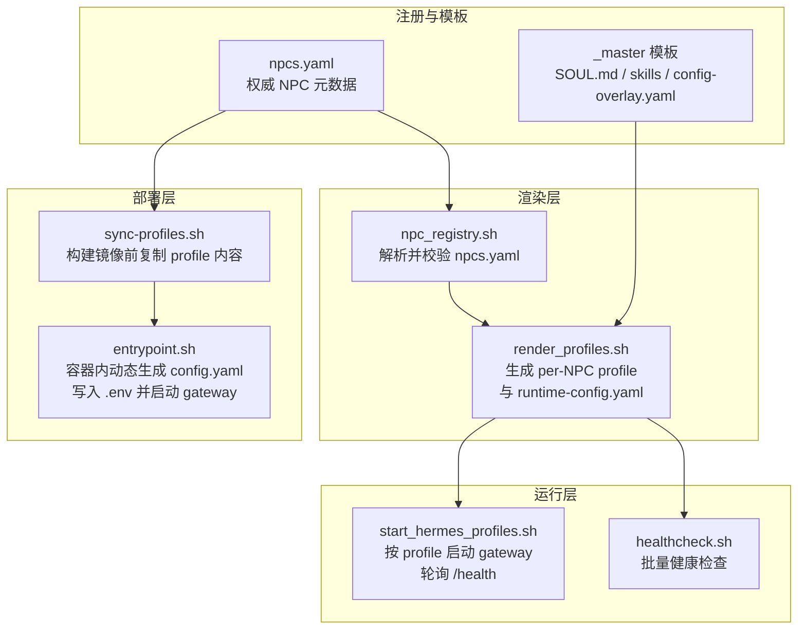
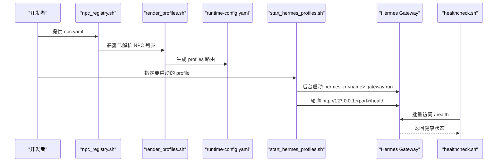
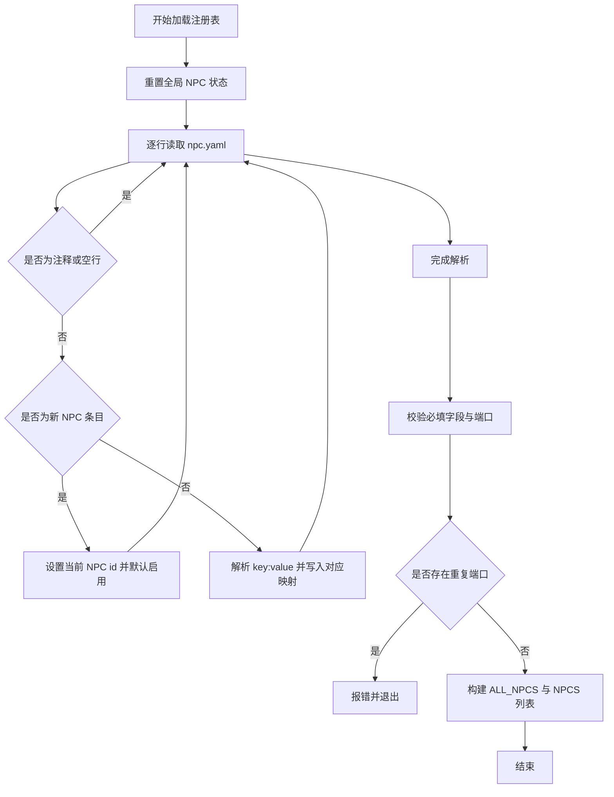
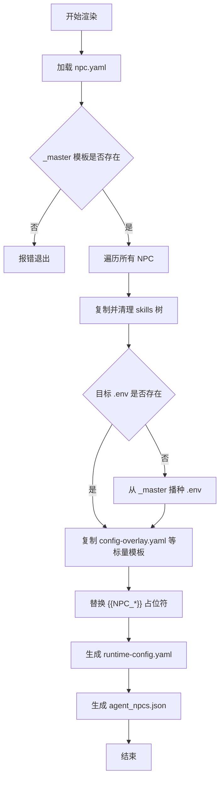
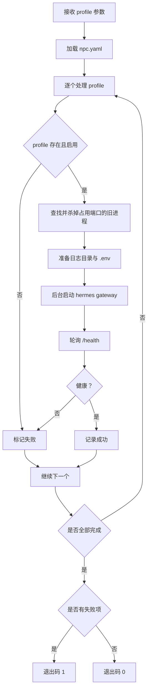
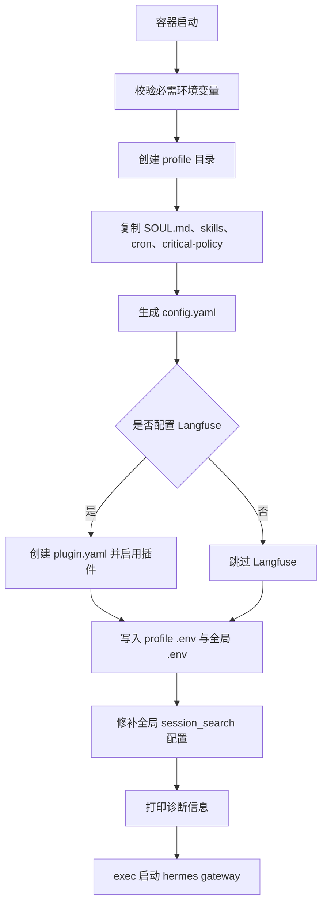
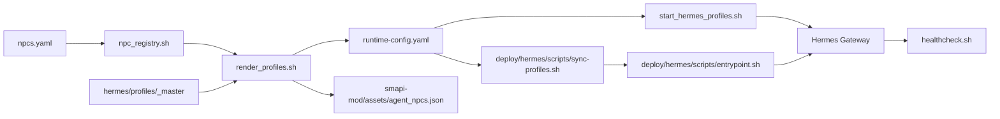

# Profile 注册与管理

<cite>
**本文引用的文件**   
- [npcs.yaml](file://SmartNPC/hermes/npcs.yaml)
- [runtime-config.yaml](file://SmartNPC/hermes/runtime-config.yaml)
- [hermes README.md](file://SmartNPC/hermes/README.md)
- [npc_registry.sh](file://SmartNPC/scripts/lib/npc_registry.sh)
- [render_profiles.sh](file://SmartNPC/scripts/render_profiles.sh)
- [start_hermes_profiles.sh](file://SmartNPC/scripts/start_hermes_profiles.sh)
- [sync-profiles.sh](file://SmartNPC/deploy/hermes/scripts/sync-profiles.sh)
- [entrypoint.sh](file://SmartNPC/deploy/hermes/scripts/entrypoint.sh)
- [healthcheck.sh](file://SmartNPC/deploy/hermes/scripts/healthcheck.sh)
</cite>

## 目录
1. [引言](#引言)
2. [项目结构](#项目结构)
3. [核心组件](#核心组件)
4. [架构总览](#架构总览)
5. [详细组件分析](#详细组件分析)
6. [依赖关系分析](#依赖关系分析)
7. [性能与并发特性](#性能与并发特性)
8. [故障诊断指南](#故障诊断指南)
9. [结论](#结论)
10. [附录：自定义 NPC 注册完整步骤](#附录自定义-npc-注册完整步骤)

## 引言
本文档面向 Hermes Profile 注册与管理系统，目标是帮助开发者与维护者理解以下内容：
- npc.yaml 配置文件的完整字段、语义和约束。
- runtime-config.yaml 的动态生成机制、版本管理策略及与 smartnpc-mcp 的协作方式。
- NPC 生命周期管理，包括启动、停止、重启、健康检查与状态监控。
- 多 NPC 并发管理机制、端口分配算法与资源隔离策略。
- 从编写配置文件到服务启动的端到端自定义 NPC 注册流程。
- 常见配置错误的诊断方法与解决方案。

该系统的核心思想是：**以一份权威元数据 npcs.yaml 驱动 profile 渲染、运行时配置生成、进程启停与健康检查，并通过脚本层保证各阶段一致性。**

## 项目结构
Hermes Profile 注册与管理相关代码集中在以下区域：
- 仓库根下的 `SmartNPC/hermes`：定义 NPC 注册表、profile 模板、已渲染 profile 与运行时配置。
- `SmartNPC/scripts`：解析注册表、渲染 profile、启动 gateway、校验健康等 Shell 工具。
- `SmartNPC/deploy/hermes/scripts`：容器部署场景下的 profile 同步、入口点配置生成、健康检查。



**图表来源**
- [npcs.yaml:1-70](file://SmartNPC/hermes/npcs.yaml#L1-L70)
- [render_profiles.sh:1-183](file://SmartNPC/scripts/render_profiles.sh#L1-L183)
- [npc_registry.sh:1-87](file://SmartNPC/scripts/lib/npc_registry.sh#L1-L87)
- [start_hermes_profiles.sh:1-110](file://SmartNPC/scripts/start_hermes_profiles.sh#L1-L110)
- [sync-profiles.sh:1-65](file://SmartNPC/deploy/hermes/scripts/sync-profiles.sh#L1-L65)
- [entrypoint.sh:1-200](file://SmartNPC/deploy/hermes/scripts/entrypoint.sh#L1-L200)

**章节来源**
- [hermes README.md:1-147](file://SmartNPC/hermes/README.md#L1-L147)

## 核心组件
| 组件 | 职责 | 关键行为 |
|---|---|---|
| npc.yaml | 权威 NPC 注册表 | 声明 NPC ID、游戏名称、显示名称、网关端口、启用状态、类型、对话对等角色等元数据 |
| npc_registry.sh | 注册表解析器 | 将 YAML 解析为 Bash 全局变量，校验必填字段与端口唯一性 |
| render_profiles.sh | 模板渲染器 | 基于 `_master` 模板生成每个 NPC 的 profile 文件，并生成 runtime-config.yaml |
| start_hermes_profiles.sh | 本地启停器 | 读取启用列表，按端口后台启动 hermes gateway，轮询 `/health` |
| healthcheck.sh | 健康检查器 | 遍历固定端口列表，输出每个 NPC gateway 的健康状态 |
| sync-profiles.sh | 部署同步器 | 在 Docker 构建前复制 SOUL.md、skills、cron-recipes、critical-policy 等内容 |
| entrypoint.sh | 容器入口点 | 根据环境变量生成 profile 的 config.yaml 与 .env，可选启用 Langfuse，最终启动 gateway |

**章节来源**
- [npcs.yaml:1-70](file://SmartNPC/hermes/npcs.yaml#L1-L70)
- [npc_registry.sh:1-87](file://SmartNPC/scripts/lib/npc_registry.sh#L1-L87)
- [render_profiles.sh:1-183](file://SmartNPC/scripts/render_profiles.sh#L1-L183)
- [start_hermes_profiles.sh:1-110](file://SmartNPC/scripts/start_hermes_profiles.sh#L1-L110)
- [healthcheck.sh:1-29](file://SmartNPC/deploy/hermes/scripts/healthcheck.sh#L1-L29)
- [sync-profiles.sh:1-65](file://SmartNPC/deploy/hermes/scripts/sync-profiles.sh#L1-L65)
- [entrypoint.sh:1-200](file://SmartNPC/deploy/hermes/scripts/entrypoint.sh#L1-L200)

## 架构总览
Hermes Profile 系统围绕“注册表 → 渲染 → 运行”的主链路展开：



**图表来源**
- [npc_registry.sh:1-87](file://SmartNPC/scripts/lib/npc_registry.sh#L1-L87)
- [render_profiles.sh:1-183](file://SmartNPC/scripts/render_profiles.sh#L1-L183)
- [start_hermes_profiles.sh:1-110](file://SmartNPC/scripts/start_hermes_profiles.sh#L1-L110)
- [healthcheck.sh:1-29](file://SmartNPC/deploy/hermes/scripts/healthcheck.sh#L1-L29)

## 详细组件分析

### NPC 注册表 npc.yaml
npc.yaml 是系统唯一的权威 NPC 元数据来源。它使用 `npcs:` 列表描述每个 NPC，关键字段如下：

| 字段 | 是否必需 | 含义 | 约束与说明 |
|---|---:|---|---|
| id | 是 | NPC 内部标识符，通常是小写英文单词 | 用于 profile 目录名、gateway URL path、conversation 与 model 名称 |
| game_name | 是 | 游戏侧识别用的 PascalCase 名称 | 例如 XiaMi、Abigail；渲染时会映射为 `{{NPC_NAME}}` |
| display_name | 是 | 人类可读的中文显示名称 | 例如 夏弥、阿比盖尔；渲染时会映射为 `{{NPC_DISPLAY}}` |
| gateway_port | 是 | Hermes gateway HTTP 端口 | 必须为正整数，且在同一注册表中不可重复 |
| enabled | 否 | 是否默认启用 | 默认视为 true；false 时不会自动启动 gateway，但 profile 仍会被渲染 |
| kind | 是 | NPC 类型 | 示例中区分 custom 与 vanilla，用于分类或后续扩展 |
| peer_a_name | 否 | 第一对话对等方游戏名称 | 可空，用于技能与提示词中的角色关系 |
| peer_a_display | 否 | 第一对话对等方显示名称 | 配合 peer_a_name |
| peer_b_name | 否 | 第二对话对等方游戏名称 | 可空 |
| peer_b_display | 否 | 第二对话对等方显示名称 | 配合 peer_b_name |

当前仓库包含 xiami、abigail、haley、harvey、penny、sebastian 六个 NPC 条目。其中 xiami 为 custom 类型并启用，其余为 vanilla 类型且默认关闭。

端口分配规则：
- 端口由用户直接填写，系统不做自动递增分配。
- 解析器会校验端口为数字，并拒绝重复端口。
- 健康检查脚本硬编码了 8642–8647 这六个端口，因此新增 NPC 时应同时更新健康检查逻辑。

**章节来源**
- [npcs.yaml:1-70](file://SmartNPC/hermes/npcs.yaml#L1-L70)
- [npc_registry.sh:1-87](file://SmartNPC/scripts/lib/npc_registry.sh#L1-L87)
- [healthcheck.sh:1-29](file://SmartNPC/deploy/hermes/scripts/healthcheck.sh#L1-L29)

### 注册表解析器 npc_registry.sh
npc_registry.sh 是其他脚本共享的基础库，主要职责包括：
- 清空全局数组与关联数组，避免多次加载导致状态残留。
- 逐行解析 npc.yaml，提取 id 及其键值。
- 支持去除引号与回车符，兼容 Windows 编辑后的 YAML。
- 维护两个列表：
  - `SMARTNPC_ALL_NPCS`：所有已注册的 NPC。
  - `SMARTNPC_NPCS`：enabled 为 true 的 NPC。
- 校验必填字段：game_name、display_name、gateway_port、kind。
- 校验 gateway_port 为数字，并检测重复端口。

复杂度分析：
- 解析过程为单遍扫描，时间复杂度 O(n)，n 为 npc.yaml 行数。
- 端口去重通过字符串累积匹配实现，最坏情况下每处理一个 NPC 都要对已有端口集合做一次 grep，整体接近 O(n²)。对于当前少量 NPC 可接受，但如果 NPC 数量增长到数百级，建议改为哈希集合或关联数组去重。

错误处理：
- 找不到 registry 文件时报错退出。
- 缺少必填字段或端口非法时报错退出。
- 发现重复端口时报错退出。
- 未启用任何 NPC 时仅警告，不阻断渲染流程。



**图表来源**
- [npc_registry.sh:1-87](file://SmartNPC/scripts/lib/npc_registry.sh#L1-L87)

**章节来源**
- [npc_registry.sh:1-87](file://SmartNPC/scripts/lib/npc_registry.sh#L1-L87)

### 模板渲染器 render_profiles.sh
render_profiles.sh 负责两件事：
1. 将 `hermes/profiles/_master` 模板渲染到每个 NPC 的 `hermes/profiles/<id>/` 目录。
2. 生成 `hermes/runtime-config.yaml`。

#### 渲染范围
- 复制 skills 树，覆盖目标目录，确保 `_master` 删除的技能不会残留在旧 profile 中。
- 复制 config-overlay.yaml、cron-recipes.md、critical-policy.md。
- **不修改 SOUL.md**：SOUL.md 是手写人格文件，必须由人编辑。
- 如果目标 profile 没有 `.env`，会从 `_master/.env` 播种占位值，但不会覆盖已有的真实密钥。

#### 占位符替换
渲染时使用 sed 替换以下占位符：
- `{{NPC_NAME}}`：PascalCase 游戏名称。
- `{{NPC_DISPLAY}}`：中文显示名称。
- `{{NPC_DIR}}`：小写 profile 目录名。
- `{{NPC_PORT}}`：Hermes Gateway 端口。
- `{{PEER_A_NAME}}`、`{{PEER_A_DISPLAY}}`、`{{PEER_B_NAME}}`、`{{PEER_B_DISPLAY}}`：对话对等角色信息。

#### runtime-config.yaml 生成
生成的 runtime-config.yaml 供 smartnpc-mcp 消费，字段包括：
- name：profile 名称，即 NPC id。
- npc_filter：游戏侧 NPC 名称。
- gateway_url：指向对应 NPC 的 gateway，使用 `${SMARTNPC_HERMES_GATEWAY_HOST}` 作为主机占位符。
- conversation：默认等于 profile 名称。
- model：默认等于 profile 名称。
- api_key_env：API Key 环境变量名，默认为 SMARTNPC_HERMES_KEY。

只有 enabled 为 true 的 NPC 才会进入 runtime-config.yaml 的 profiles 列表。

#### mod 侧 NPC 启用列表
脚本还会生成 `smapi-mod/assets/agent_npcs.json`，把全部 NPC 的 GameName 与 enabled 状态映射为 JSON，供 SMAPI Mod 层读取。



**图表来源**
- [render_profiles.sh:1-183](file://SmartNPC/scripts/render_profiles.sh#L1-L183)

**章节来源**
- [render_profiles.sh:1-183](file://SmartNPC/scripts/render_profiles.sh#L1-L183)

### 本地启停器 start_hermes_profiles.sh
该脚本用于本地 WSL 环境中一次性启动多个 Hermes gateway。

关键行为：
- 接收逗号分隔的 profile 参数。
- 调用 npc_registry.sh 加载注册表。
- 对每个 profile 执行：
  - 校验 profile 存在且 enabled。
  - 若端口已被占用，尝试杀死旧进程。
  - 加载 profile 专属 `.env`（Langfuse 等凭据）。
  - 使用 `setsid` 后台启动 hermes gateway。
  - 轮询 `http://127.0.0.1:<port>/health`，直到超时。
- 记录 PID 到 `/tmp/smartnpc-hermes-pids.txt`。
- 任一 profile 不健康则退出码为 1。

超时控制：
- 可通过 `HERMES_BOOT_TIMEOUT` 调整单个 profile 的等待秒数，默认 90 秒。
- PID 文件路径可通过 `HERMES_PIDFILE` 覆盖。

资源隔离：
- 每个 profile 拥有独立日志目录 `~/.hermes/profiles/<name>/logs/gateway.log`。
- 每个 profile 使用独立端口，避免 HTTP API 冲突。
- 通过子 shell 加载 `.env`，避免污染父进程环境变量。



**图表来源**
- [start_hermes_profiles.sh:1-110](file://SmartNPC/scripts/start_hermes_profiles.sh#L1-L110)

**章节来源**
- [start_hermes_profiles.sh:1-110](file://SmartNPC/scripts/start_hermes_profiles.sh#L1-L110)

### 健康检查脚本 healthcheck.sh
healthcheck.sh 是一个快速运维工具，默认检查 8642–8647 六个端口，分别对应 xiami、abigail、haley、harvey、penny、sebastian。

行为：
- 循环访问 `http://${host}:${port}/health`。
- 输出每个 NPC 的健康状态。
- 若有任意一个 unhealthy，退出码为 1。
- 最后一个 healthy 的实例会输出“All gateways healthy.”。

限制：
- 端口和名称是硬编码数组，新增 NPC 时必须同步更新脚本，否则健康检查无法覆盖新端口。

**章节来源**
- [healthcheck.sh:1-29](file://SmartNPC/deploy/hermes/scripts/healthcheck.sh#L1-L29)

### 部署同步器 sync-profiles.sh
sync-profiles.sh 用于 Docker 镜像构建前的准备阶段。

行为：
- 校验 npc.yaml 存在。
- 如果存在 render_profiles.sh，先执行一次渲染。
- 清空 deploy 目录下的 profiles 目标目录。
- 根据 npc.yaml 中的 id 列表，逐个复制：
  - SOUL.md
  - skills
  - cron-recipes.md
  - critical-policy.md
- 不复制 config.yaml，因为 config.yaml 在容器启动时由 entrypoint.sh 动态生成。

设计要点：
- 将“静态人格与技能”与“动态配置”分离，使镜像只打包稳定内容，运行时凭据通过环境变量注入。

**章节来源**
- [sync-profiles.sh:1-65](file://SmartNPC/deploy/hermes/scripts/sync-profiles.sh#L1-L65)

### 容器入口点 entrypoint.sh
entrypoint.sh 是容器内 Hermes gateway 的实际启动器，也是运行时配置的核心生成器。

#### 必需环境变量
| 变量 | 用途 |
|---|---|
| NPC_PROFILE | 要运行的 Hermes profile 名称 |
| NPC_PORT | Hermes gateway 监听端口 |
| SMARTNPC_MCP_URL | smartnpc-mcp MCP 服务地址 |
| HERMES_AGENT_URL | LLM provider 基础地址 |
| HERMES_AGENT_API_KEY | LLM provider API Key |
| SMARTNPC_HERMES_KEY | Hermes gateway Bearer Token |

#### 配置生成流程
entrypoint.sh 会生成 `$PROFILE_DIR/config.yaml`，内容包括：
- mcp_servers.smartnpc_game：MCP 服务连接配置，包含超时可选项与一组工具白名单。
- API_SERVER_ENABLED、API_SERVER_KEY、API_SERVER_HOST、API_SERVER_PORT、API_SERVER_MODEL_NAME：开启 Hermes REST gateway。
- model.provider：使用自定义 provider `smartnpc-agent`。
- providers.smartnpc-agent：LLM provider 配置，base_url 来自 HERMES_AGENT_URL，key 来自 HERMES_AGENT_API_KEY。
- compression：压缩策略。
- agent.tool_use_enforcement：工具调用强制开关。

此外，entrypoint.sh 还会：
- 生成 profile 级别 `.env`，注入 LLM 与 Langfuse 环境变量。
- 写入全局 `/root/.hermes/.env`，因为 observability/langfuse 插件从全局环境读取。
- 可选启用 Langfuse 插件，并在缺失插件 manifest 时创建软链接修复。
- 预置全局 config.yaml 的 session_search 模型，避免某些默认模型拒绝 temperature=0.1。
- 打印诊断信息，包括生成的 config.yaml、环境变量、Langfuse 连通性测试结果。
- 最后执行 `exec hermes -p ${NPC_PROFILE} gateway run --accept-hooks`。



**图表来源**
- [entrypoint.sh:1-200](file://SmartNPC/deploy/hermes/scripts/entrypoint.sh#L1-L200)
- [entrypoint.sh:201-339](file://SmartNPC/deploy/hermes/scripts/entrypoint.sh#L201-L339)

**章节来源**
- [entrypoint.sh:1-200](file://SmartNPC/deploy/hermes/scripts/entrypoint.sh#L1-L200)
- [entrypoint.sh:201-339](file://SmartNPC/deploy/hermes/scripts/entrypoint.sh#L201-L339)

## 依赖关系分析



**图表来源**
- [npcs.yaml:1-70](file://SmartNPC/hermes/npcs.yaml#L1-L70)
- [npc_registry.sh:1-87](file://SmartNPC/scripts/lib/npc_registry.sh#L1-L87)
- [render_profiles.sh:1-183](file://SmartNPC/scripts/render_profiles.sh#L1-L183)
- [start_hermes_profiles.sh:1-110](file://SmartNPC/scripts/start_hermes_profiles.sh#L1-L110)
- [sync-profiles.sh:1-65](file://SmartNPC/deploy/hermes/scripts/sync-profiles.sh#L1-L65)
- [entrypoint.sh:1-200](file://SmartNPC/deploy/hermes/scripts/entrypoint.sh#L1-L200)
- [healthcheck.sh:1-29](file://SmartNPC/deploy/hermes/scripts/healthcheck.sh#L1-L29)

### 耦合与内聚
- npc_registry.sh 是低层依赖，被 render_profiles.sh 与 start_hermes_profiles.sh 复用，内聚度高。
- render_profiles.sh 同时承担 profile 渲染与 runtime-config 生成，职责略多，但当前规模下仍可接受。
- entrypoint.sh 承担了较多初始化逻辑，包括 Langfuse 插件修复、全局配置修补、诊断输出等，属于部署层面的聚合入口。

### 外部依赖
- 依赖 bash、sed、grep、awk、curl、lsof 等 Linux/WSL 工具。
- 依赖 hermes 命令与 hermes gateway 提供的 `/health` 接口。
- 部署模式依赖 Docker 与 compose。
- Langfuse 可选依赖 Python SDK 与远程服务。

## 性能与并发特性
- 多 NPC 并发通过多进程实现：每个 NPC 独立 hermes gateway 进程，绑定不同端口。
- 端口隔离是主要的资源隔离边界；内存、CPU 由操作系统调度。
- 健康检查采用顺序轮询，简单可靠但不具备并行加速。
- 端口去重在当前小规模注册表中使用线性扫描，性能不是瓶颈。
- 渲染脚本对每个 NPC 的 files 列表执行 sed 替换，整体复杂度约为 O(文件总数 × 占位符数量)。

优化建议：
- 当 NPC 数量较大时，可将端口去重改为哈希结构，减少重复 grep。
- 健康检查可支持并行 curl，但需控制并发上限避免资源抖动。
- 渲染脚本可对大文件列表使用更高效的批量替换策略，但需注意文件名与路径中可能包含特殊字符。

[本节为通用性能讨论，不直接分析具体源码片段]

## 故障诊断指南

### 常见问题与定位思路

| 现象 | 可能原因 | 诊断方法 | 解决建议 |
|---|---|---|---|
| 启动脚本报告 unknown or disabled profile | profile 未在 npc.yaml 中启用，或 id 拼写错误 | 检查 npc.yaml 中对应 id 与 enabled 字段 | 添加或修正 NPC 条目，并确保 enabled 为 true |
| 端口被占用 | 旧进程未释放 | 使用 lsof 查看端口占用 | 手动 kill 旧进程，或让脚本自动清理 |
| gateway 长时间不健康 | LLM provider、MCP URL、API Key 配置错误 | 查看 `~/.hermes/profiles/<name>/logs/gateway.log` | 修正 .env 或 container 环境变量 |
| runtime-config.yaml 缺少某个 NPC | NPC 未启用 | 检查 npc.yaml 中 enabled 字段 | 启用后重新渲染 |
| 健康检查无法识别新端口 | healthcheck.sh 硬编码端口列表 | 查看 healthcheck.sh 中 PORTS 数组 | 新增端口与名称映射 |
| Langfuse 无 trace | 缺少公共密钥或私有密钥 | 查看 entrypoint.sh 诊断输出 | 设置 HERMES_LANGFUSE_PUBLIC_KEY 与 HERMES_LANGFUSE_SECRET_KEY |
| MCP 连不上 | smartnpc-mcp 未启动或地址错误 | 从 WSL 访问 `http://127.0.0.1:3000/mcp` | 确认 smartnpc-mcp 已启动且地址正确 |
| 渲染后 git diff 不为空 | 直接编辑了渲染产物而非模板 | 对比 hermes/profiles/_master 与目标目录 | 只编辑 _master 模板，再执行 render_profiles.sh |

### 推荐诊断顺序
1. 确认 npc.yaml 中 NPC 已启用且端口唯一。
2. 执行 render_profiles.sh，确认 runtime-config.yaml 已生成。
3. 使用 start_hermes_profiles.sh 启动 gateway，观察日志与 `/health`。
4. 使用 healthcheck.sh 做批量健康检查。
5. 若涉及 Langfuse，检查环境变量与全局 `.env`。
6. 若涉及 MCP，确认 smartnpc-mcp 服务可达。

**章节来源**
- [start_hermes_profiles.sh:1-110](file://SmartNPC/scripts/start_hermes_profiles.sh#L1-L110)
- [healthcheck.sh:1-29](file://SmartNPC/deploy/hermes/scripts/healthcheck.sh#L1-L29)
- [entrypoint.sh:1-200](file://SmartNPC/deploy/hermes/scripts/entrypoint.sh#L1-L200)
- [entrypoint.sh:201-339](file://SmartNPC/deploy/hermes/scripts/entrypoint.sh#L201-L339)

## 结论
Hermes Profile 注册与管理系统通过一份权威 npc.yaml 驱动整个生命周期：
- 注册表解析器保证元数据合法。
- 渲染器保证 profile 模板与运行时配置一致。
- 启停器保证每个 NPC 独立进程、独立端口、独立日志。
- 部署脚本将静态人格与动态配置解耦，提升可移植性。
- 健康检查提供快速运维反馈。

该系统适合中小规模 NPC 集合，强调可审计、可复现、可回滚。若未来扩展到大规模 NPC，建议在端口去重、健康检查并发、配置分发机制上进一步工程化。

[本节为总结性内容，不直接分析具体源码片段]

## 附录：自定义 NPC 注册完整步骤

### 前置条件
- 已安装 Hermes，并能执行 `hermes --version`。
- Hermes 的 mcp Python 包已安装。
- Stardew Valley + SMAPI 可用。
- smartnpc-mcp 二进制已编译并可运行。
- 开发环境为 WSL 或通过 wsl 命令访问 Linux 脚本。

### 第一步：编写 NPC 元数据
在 `SmartNPC/hermes/npcs.yaml` 中添加一条新的 NPC 条目，至少包含：
- id：小写英文标识。
- game_name：PascalCase 游戏名称。
- display_name：中文显示名称。
- gateway_port：未被使用的 TCP 端口。
- enabled：true。
- kind：custom 或 vanilla。
- peer_a_name、peer_a_display、peer_b_name、peer_b_display：可选，用于对话关系。

### 第二步：创建人格文件
在 `SmartNPC/hermes/profiles/<new-npc>/SOUL.md` 中编写 NPC 的人格、说话风格与好感度档位。注意不要由脚本生成 SOUL.md。

### 第三步：渲染模板
执行：
```bash
bash scripts/render_profiles.sh
task profiles:verify
```
该步骤会：
- 从 `_master` 模板生成 skills、config-overlay.yaml、cron-recipes.md、critical-policy.md。
- 替换占位符。
- 生成 runtime-config.yaml。
- 生成 smapi-mod/assets/agent_npcs.json。

### 第四步：同步到用户 Hermes 环境
在 WSL 中执行：
```bash
bash /mnt/d/SmartNPC/hermes/install.sh
```
该步骤会：
- 首次触发 hermes profile 初始化。
- 同步 SOUL.md、skills、critical-policy.md。
- 合并 config-overlay.yaml。
- 同步 repo-root .env 中的 LLM 凭据。

### 第五步：启动运行时
启动顺序通常为：
1. 启动 SMAPI 与游戏。
2. 启动 smartnpc-mcp HTTP 服务。
3. 启动对应 Hermes profile 的 gateway。

可使用：
```bash
bash scripts/start_hermes_profiles.sh new-npc
```

### 第六步：验证联通
- 访问 `http://127.0.0.1:<gateway_port>/health`。
- 在 WSL 中执行 `hermes -p new-npc mcp test smartnpc_game`。
- 使用 `bash scripts/healthcheck.sh` 做批量检查。

### 第七步：部署到容器
如需 Docker 部署：
```bash
bash deploy/hermes/scripts/sync-profiles.sh
docker compose build
```
容器启动时 entrypoint.sh 会根据环境变量生成 config.yaml 并启动 gateway。

### 第八步：清理与回滚
- 停止 gateway：kill 对应 PID，或直接释放端口上的进程。
- 回滚 profile：重新执行 install.sh 或恢复 `~/.hermes/profiles/<name>` 备份。
- 回滚配置：重新执行 render_profiles.sh，确保 git 工作区干净。

**章节来源**
- [hermes README.md:1-147](file://SmartNPC/hermes/README.md#L1-L147)
- [npcs.yaml:1-70](file://SmartNPC/hermes/npcs.yaml#L1-L70)
- [render_profiles.sh:1-183](file://SmartNPC/scripts/render_profiles.sh#L1-L183)
- [start_hermes_profiles.sh:1-110](file://SmartNPC/scripts/start_hermes_profiles.sh#L1-L110)
- [sync-profiles.sh:1-65](file://SmartNPC/deploy/hermes/scripts/sync-profiles.sh#L1-L65)
- [entrypoint.sh:1-200](file://SmartNPC/deploy/hermes/scripts/entrypoint.sh#L1-L200)