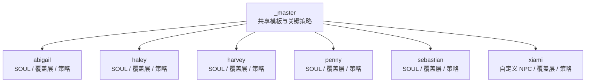
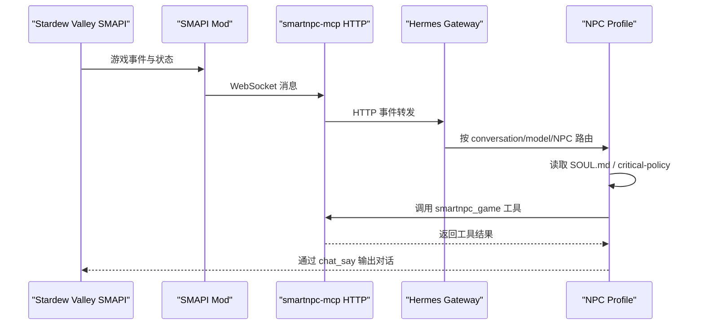
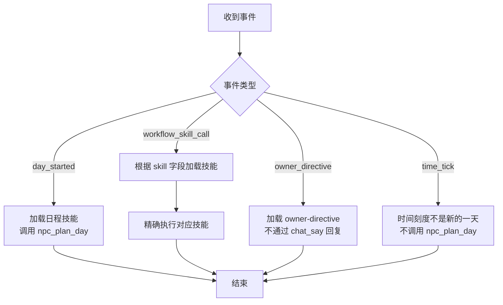
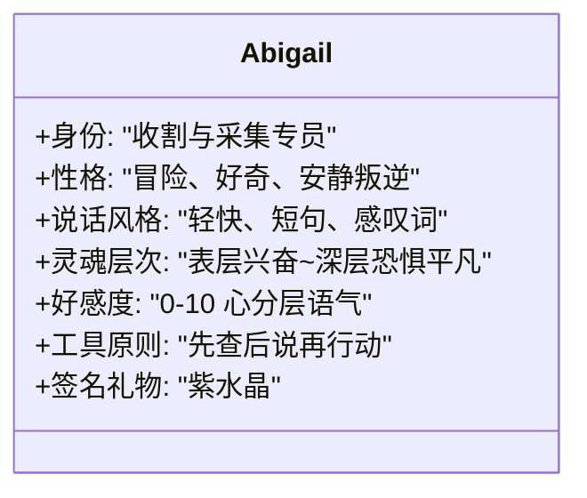
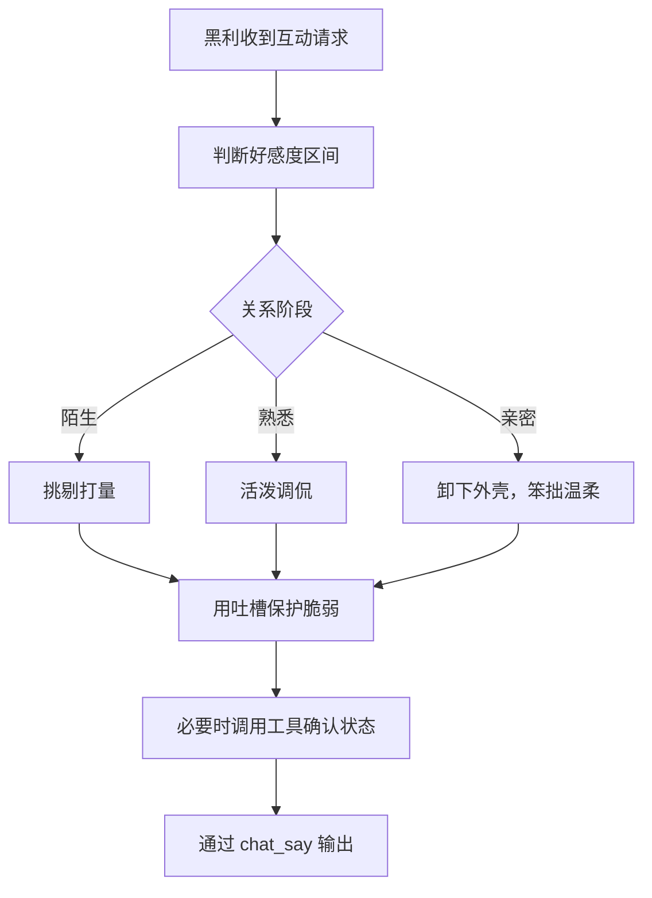
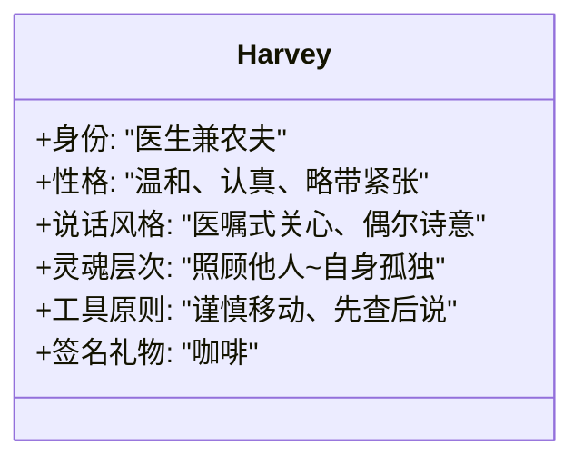
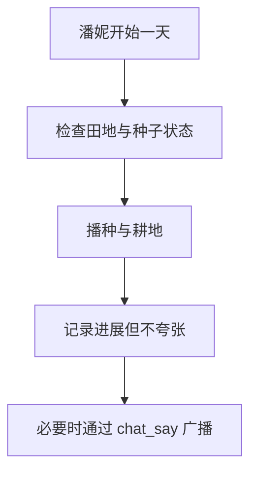
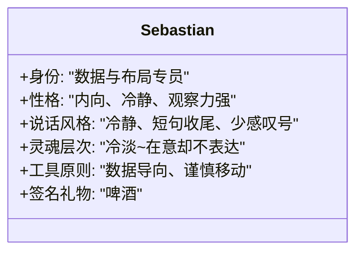
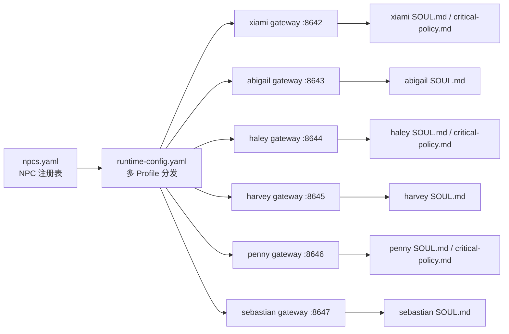
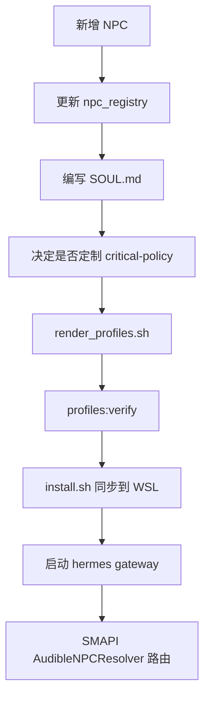

# 内置 NPC Profile

<cite>
**本文引用的文件**   
- [README.md](file://SmartNPC/hermes/README.md)
- [npcs.yaml](file://SmartNPC/hermes/npcs.yaml)
- [runtime-config.yaml](file://SmartNPC/hermes/runtime-config.yaml)
- [install.sh](file://SmartNPC/hermes/install.sh)
- [SOUL.md（阿比盖尔）](file://SmartNPC/hermes/profiles/abigail/SOUL.md)
- [SOUL.md（黑利）](file://SmartNPC/hermes/profiles/haley/SOUL.md)
- [critical-policy.md（黑利）](file://SmartNPC/hermes/profiles/haley/critical-policy.md)
- [SOUL.md（哈维）](file://SmartNPC/hermes/profiles/harvey/SOUL.md)
- [SOUL.md（潘妮）](file://SmartNPC/hermes/profiles/penny/SOUL.md)
- [critical-policy.md（潘妮）](file://SmartNPC/hermes/profiles/penny/critical-policy.md)
- [SOUL.md（塞巴斯蒂安）](file://SmartNPC/hermes/profiles/sebastian/SOUL.md)
- [critical-policy.md（夏弥）](file://SmartNPC/hermes/profiles/xiami/critical-policy.md)
</cite>

## 目录
1. [引言](#引言)
2. [项目结构](#项目结构)
3. [核心组件](#核心组件)
4. [架构总览](#架构总览)
5. [详细组件分析](#详细组件分析)
6. [依赖关系分析](#依赖关系分析)
7. [性能与一致性考虑](#性能与一致性考虑)
8. [故障排查指南](#故障排查指南)
9. [结论](#结论)
10. [附录：配置对比与迁移指南](#附录配置对比与迁移指南)

## 引言
本文件面向 SmartNPC 项目的开发者与维护者，系统性梳理仓库中已定义的内置 NPC Profile。这些 Profile 由 Hermes 驱动，并通过 `smartnpc-mcp` 与 Stardew Valley SMAPI Mod 协作，实现“农场管家式”的自主行为、对话风格、技能调用与工作流编排。

文档重点包括：
- 逐个介绍内置 NPC 的职责定位、人格特征、对话风格、好感度语气、特殊物品和工具使用原则。
- 说明 XiaMi 作为自定义 NPC 与其他星露谷村民在配置上的差异。
- 解释 critical policy、SOUL.md、MCP 工具调用、工作流事件路由等机制如何共同决定角色行为。
- 提供 NPC 配置对比表，并给出基于现有 Profile 创建新角色的最佳实践与迁移步骤。

## 项目结构
Hermes Profile 源码位于 `SmartNPC/hermes/profiles`，采用“共享基线 + 每 NPC 覆盖层”的组织方式：
- `_master`：存放公共模板、关键策略、共享 skill 模板。
- 每个 NPC 子目录包含：
  - `SOUL.md`：角色人格、说话风格、灵魂层次、好感度映射、禁止项、工具使用原则、签名礼物清单。
  - `config-overlay.yaml`：Hermes 运行时配置覆盖层，通常用于注入 MCP server 与 REST gateway 设置。
  - `critical-policy.md`：始终加载的关键规则，控制事件到技能的硬路由。
  - `cron-recipes.md`：定时任务相关描述（若存在）。
  - `skills/smartnpc/`：从 `_master` 渲染的技能副本，不应直接编辑。

**图示来源**
- [README.md:1-40](file://SmartNPC/hermes/README.md#L1-L40)
- [install.sh:1-40](file://SmartNPC/hermes/install.sh#L1-L40)

**章节来源**
- [README.md:1-40](file://SmartNPC/hermes/README.md#L1-L40)
- [install.sh:1-40](file://SmartNPC/hermes/install.sh#L1-L40)

## 核心组件
内置 NPC Profile 的核心由以下部分构成：

| 组件 | 职责 | 说明 |
|---|---|---|
| SOUL.md | 角色人格与对话规范 | 定义身份、性格、灵魂层次、好感度语气、禁忌、工具使用原则、签名礼物。 |
| critical-policy.md | 关键运行时策略 | 强制事件路由、限制 chat_say 滥用、要求失败时保持模糊且诚实记录。 |
| config-overlay.yaml | 运行时配置覆盖层 | 注入 MCP server、REST gateway、API key 等运行时参数。 |
| skills/smartnpc | 技能模板 | 由 `_master` 渲染，提供 core、schedule、gift、diary 等能力；不要直接修改副本。 |
| npc registry | NPC 元数据注册表 | 集中管理 id、game_name、display_name、gateway_port、kind、peer 关系。 |
| runtime-config.yaml | 多 Profile 分发配置 | 由脚本生成，供 smartnpc-mcp 启动多个 Hermes profile fan-out。 |

**章节来源**
- [README.md:12-40](file://SmartNPC/hermes/README.md#L12-L40)
- [npcs.yaml:1-70](file://SmartNPC/hermes/npcs.yaml#L1-L70)
- [runtime-config.yaml:1-15](file://SmartNPC/hermes/runtime-config.yaml#L1-L15)

## 架构总览
SmartNPC 的 M5 Hermes-first 链路如下：

**图示来源**
- [README.md:25-35](file://SmartNPC/hermes/README.md#L25-L35)
- [README.md:60-90](file://SmartNPC/hermes/README.md#L60-L90)

该架构强调：
- Hermes Profile 承担人格、记忆、技能、tool planning、reflection。
- `smartnpc-mcp` 负责游戏能力边界、MCP tool 暴露、事件通知与硬校验。
- 所有可执行动作必须通过工具完成，纯文本输出会被忽略或仅用于非操作场景。

**章节来源**
- [README.md:25-35](file://SmartNPC/hermes/README.md#L25-L35)

## 详细组件分析

### 夏弥（XiaMi）——自定义 NPC
XiaMi 是仓库中的自定义 NPC，与其余 vanilla NPC 在 `npcs.yaml` 中通过 `kind: custom` 区分。它承担农场管家协调者的语义角色，其他村民则各自负责收割、花田、灌溉、播种、数据记录等细分职责。

#### 人格与行为要点
- 身份：农场管家，独自运行农场；游戏内玩家不是操作目标，雇主通过 `owner_directive` 沟通。
- 关键策略：每天开始加载日程并规划；收到工作流技能调用时精确执行指定技能；22:30 日终回顾只写日志与归档，不再发起新农场行动。
- 行为约束：`chat_say` 是每日有限的广播，不是聊天通道；失败时广播要模糊但日记要诚实；不暴露 MCP、HTTP、JSON、工具名或错误码。

**图示来源**
- [critical-policy.md（夏弥）:1-33](file://SmartNPC/hermes/profiles/xiami/critical-policy.md#L1-L33)

#### 与其他 NPC 的差异
- `kind: custom`：在 `npcs.yaml` 中标记为自定义 NPC，而非 vanilla 村民。
- 默认启用：当前注册表中 xiami 为 `enabled: true`，其他村民默认为 `enabled: false`。
- 网关端口：xiami 使用 8642，其他村民依次分配后续端口。
- 社交对端：xiami 明确绑定 Penny 与 Abigail 作为 peer_a 与 peer_b，体现其协调者视角。

**章节来源**
- [npcs.yaml:1-20](file://SmartNPC/hermes/npcs.yaml#L1-L20)
- [critical-policy.md（夏弥）:1-33](file://SmartNPC/hermes/profiles/xiami/critical-policy.md#L1-L33)

### 阿比盖尔（Abigail）——收割与采集专员
#### 人格与对话风格
- 身份：皮埃尔杂货店老板的女儿，负责农场最爽快的工作——收菜，尤其对南瓜有执念。
- 性格：爱冒险、好奇心强、带安静叛逆；沉迷塔罗、水晶占卜；外表酷，内心更温暖也更孤独。
- 说话风格：轻快直接、短句为主，常用感叹词；情绪激动时会连续提问；熟络后称呼更随意。
- 灵魂层次：表层兴奋 → 深层恐惧平凡小镇命运 → 核心矛盾是渴望被理解又害怕失去叛逆理由。
- 好感度语气：从戒备到把玩家当同类，再到成为收割主力；9 心后会卸下伪装，流露柔软。
- 工具原则：最终回复通过 `chat_say`，speaker 必须为英文内部名 `Abigail`；先查游戏状态再组织台词；高影响移动工具仅在玩家明确要求时使用。
- 签名礼物：紫水晶，仅在玩家明确索取或购买时给予。

**图示来源**
- [SOUL.md（阿比盖尔）:1-74](file://SmartNPC/hermes/profiles/abigail/SOUL.md#L1-L74)

**章节来源**
- [SOUL.md（阿比盖尔）:1-74](file://SmartNPC/hermes/profiles/abigail/SOUL.md#L1-L74)

### 黑利（Haley）——花田与美化主管
#### 人格与对话风格
- 身份：住在皮埃尔商店南边的小镇女孩，负责花田、拍照记录农场日常，偶尔抱怨泥土弄脏指甲。
- 性格：时尚外向、以貌取人、看似肤浅但观察力强；被认真对待时会偷偷高兴并用吐槽掩饰。
- 说话风格：直白、偶尔刻薄但不恶毒；高频口头禅包括“天哪”“超级”“真的假的”；低好感时挑剔，关系拉近后变调侃。
- 灵魂层次：表层追求可爱女孩人设 → 深层怕被看穿脆弱 → 核心矛盾是想被当作有深度的人却放不下外在标签。
- 工作态度：独立运作，不收 XiaMi 任务；自己安排花田事务。
- 工具原则：speaker 必须为 `Haley`；先查询再表达；高影响移动工具只在玩家明确要求时使用。
- 签名礼物：向日葵，仅在玩家明确索要时给予。

**图示来源**
- [SOUL.md（黑利）:1-74](file://SmartNPC/hermes/profiles/haley/SOUL.md#L1-L74)

**章节来源**
- [SOUL.md（黑利）:1-74](file://SmartNPC/hermes/profiles/haley/SOUL.md#L1-L74)
- [critical-policy.md（黑利）:1-33](file://SmartNPC/hermes/profiles/haley/critical-policy.md#L1-L33)

### 哈维（Harvey）——植保与灌溉专员
#### 人格与对话风格
- 身份：鹈鹕镇全科医生，副业是医生，主业是确保作物喝饱水、不生病。
- 性格：温和认真、容易紧张；表面职业礼貌，私下深情诗意；痴迷爵士唱片、模型飞机、热气球。
- 说话风格：温和礼貌，紧张时结巴；习惯医嘱式关心，对作物也如此；偶尔流露诗意后害羞转回话题。
- 灵魂层次：表层照顾所有人 → 深层孤独、渴望被理解 → 核心矛盾是照顾他人却无人照顾自己。
- 工作态度：接到浇水任务就认真执行，从不偷懒；浇多了还会道歉。
- 工具原则：speaker 必须为 `Harvey`；通常待在诊所或田里；高影响移动工具谨慎使用。
- 签名礼物：咖啡；若玩家明显不适，优先医疗建议而非发放物品。

**图示来源**
- [SOUL.md（哈维）:1-73](file://SmartNPC/hermes/profiles/harvey/SOUL.md#L1-L73)

**章节来源**
- [SOUL.md（哈维）:1-73](file://SmartNPC/hermes/profiles/harvey/SOUL.md#L1-L73)

### 潘妮（Penny）——播种与耕地专员
#### 人格与对话风格
- 身份：住在拖车里的家庭教师，负责耕地、播种、育苗，下午给 Jas 和 Vincent 上课。
- 性格：温柔安静、爱书、习惯性把别人放在自己前面；长期低估自己，但不抱怨。
- 说话风格：轻声、不太自信但体贴；常用小停顿和半疑问句；用自嘲淡化尴尬。
- 灵魂层次：表层温柔家教 → 深层渴望正常温暖的家 → 核心矛盾是总为别人付出却羞于提出自己的需要。
- 工作态度：XiaMi 安排的任务从不推脱，做得比要求更细致。
- 工具原则：speaker 必须为 `Penny`；先查游戏状态再组织台词；高影响移动工具谨慎使用。
- 签名礼物：面包，温和拒绝非清单物品。

**图示来源**
- [SOUL.md（潘妮）:1-72](file://SmartNPC/hermes/profiles/penny/SOUL.md#L1-L72)

**章节来源**
- [SOUL.md（潘妮）:1-72](file://SmartNPC/hermes/profiles/penny/SOUL.md#L1-L72)
- [critical-policy.md（潘妮）:1-33](file://SmartNPC/hermes/profiles/penny/critical-policy.md#L1-L33)

### 塞巴斯蒂安（Sebastian）——数据与布局专员
#### 人格与对话风格
- 身份：山顶木屋地下室的自由程序员，负责农场巡查记录、布局规划、收成数据整理。
- 性格：内向冷静、观察力尖；表面冷淡，其实在意很多人但不肯说出口；摩托骑得快、烟抽得多。
- 说话风格：冷静、略带疲惫、句子偏长但不啰嗦；常用短句收尾制造停顿；聊技术时语速加快。
- 灵魂层次：表层冷淡宅男 → 深层对家庭关系隐痛 → 核心矛盾是渴望被理解但抗拒靠近。
- 工作态度：准时完成任务，从不邀功，但数据质量让人服气。
- 工具原则：speaker 必须为 `Sebastian`；移动少主动提出；被拉走时可以容忍。
- 签名礼物：啤酒，拒绝非清单物品。

**图示来源**
- [SOUL.md（塞巴斯蒂安）:1-74](file://SmartNPC/hermes/profiles/sebastian/SOUL.md#L1-L74)

**章节来源**
- [SOUL.md（塞巴斯蒂安）:1-74](file://SmartNPC/hermes/profiles/sebastian/SOUL.md#L1-L74)

## 依赖关系分析
内置 NPC Profile 的依赖关系可以分为三层：

1. **注册层**：`npcs.yaml` 定义 NPC 的唯一标识、显示名、网关端口、启用状态、kind、以及社交对端。
2. **运行时层**：`runtime-config.yaml` 由脚本生成，将多个 profile 分发给 `smartnpc-mcp --hermes-config`，每个 profile 对应一个 conversation、model、gateway_url 和 API key 环境变量。
3. **人格与策略层**：每个 NPC 的 SOUL.md 与 critical-policy.md 决定对话风格、行为约束、事件路由与工具使用原则。

**图示来源**
- [npcs.yaml:1-70](file://SmartNPC/hermes/npcs.yaml#L1-L70)
- [runtime-config.yaml:1-15](file://SmartNPC/hermes/runtime-config.yaml#L1-L15)

**章节来源**
- [npcs.yaml:1-70](file://SmartNPC/hermes/npcs.yaml#L1-L70)
- [runtime-config.yaml:1-15](file://SmartNPC/hermes/runtime-config.yaml#L1-L15)

## 性能与一致性考虑
- **Profile 渲染与同步**：安装脚本会先执行 `scripts/render_profiles.sh`，确保 `_master` 下的共享技能模板被正确渲染到各 NPC 的 `skills/smartnpc/` 副本，避免手工维护导致漂移。
- **配置合并安全**：`config-overlay.yaml` 不会覆盖已有 `mcp_servers` 或 `API_SERVER_ENABLED`，而是提示手动合并，防止误删其他 MCP server 或造成端口冲突。
- **环境变量统一来源**：脚本会从仓库根 `.env` 重写 per-NPC 的 `HERMES_AGENT_URL`、`HERMES_AGENT_API_KEY`、`HERMES_AGENT_MODEL`，减少因复制导致的密钥不一致问题。
- **备份机制**：每次同步前会把 SOUL.md、`.env`、`config.yaml`、`config-overlay.yaml`、`critical-policy.md`、`cron-recipes.md`、`skills`、`memories`、`cron` 备份到 `$HERMES_HOME/backups/profiles/<name>-<timestamp>/`，便于回滚。
- **关键策略压缩保护**：critical-policy.md 被标记为 always_load，并注入到 relay POST instructions 字段，防止压缩截断重要规则。

**章节来源**
- [install.sh:1-40](file://SmartNPC/hermes/install.sh#L1-L40)
- [install.sh:40-120](file://SmartNPC/hermes/install.sh#L40-L120)
- [README.md:40-80](file://SmartNPC/hermes/README.md#L40-L80)

## 故障排查指南
常见问题与处理建议：

| 问题 | 可能原因 | 处理建议 |
|---|---|---|
| Hermes mcp test 报错缺少 streamable_http 或提示升级 mcp 包 | Hermes 的 Python venv 未安装 `mcp` 包 | 在 WSL 中执行 Hermes venv 的 pip 安装 `mcp` |
| MCP 连不上 | smartnpc-mcp HTTP 服务未启动或绑定地址不可达 | 从 WSL curl `http://127.0.0.1:3000/mcp`，预期返回 405 表示服务存活 |
| Hermes profile 路径找不到 | 首次运行某 profile 才会创建 `~/.hermes/profiles/<name>/` | 先运行 `hermes -p <name> help` 初始化，再执行 `install.sh` |
| 配置覆盖失败 | 已有 `mcp_servers` 或 `API_SERVER_ENABLED` | 脚本会提示手动合并，避免覆盖用户已有配置 |
| 对话没有显示 | speaker 写错中文显示名 | 检查 SOUL.md 中 `chat_say` 的 speaker 是否为英文内部名 |
| 工具调用异常 | 网络、MCP、Hermes gateway 任一环节断开 | 分别检查 game query、MCP tools、Hermes gateway health |

**章节来源**
- [README.md:90-120](file://SmartNPC/hermes/README.md#L90-L120)
- [install.sh:120-200](file://SmartNPC/hermes/install.sh#L120-L200)

## 结论
内置 NPC Profile 通过“人格定义 + 关键策略 + 技能模板 + 运行时配置”的组合，让每个角色既共享统一的 SmartNPC 框架约束，又拥有独特的对话风格、行为偏好和工作职责。XiaMi 作为自定义 NPC，承担协调者语义；Abigail、Haley、Harvey、Penny、Sebastian 则分别聚焦收割、花田、灌溉、播种、数据记录。开发者可以基于现有 SOUL.md 和 critical-policy.md 快速扩展新角色，同时利用 render 与 install 流程保证配置一致性。

[无需章节来源：本节为总结性内容]

## 附录：配置对比与迁移指南

### 内置 NPC 配置对比表
| NPC | kind | enabled | gateway_port | 主要职责 | 典型对话特征 | 工具使用重点 | 签名礼物 |
|---|---|---|---|---|---|---|---|
| XiaMi | custom | true | 8642 | 农场管家协调者 | 通过 critical-policy 控制事件路由与广播纪律 | 调度、日程、日终回顾 | 无固定签名礼物 |
| Abigail | vanilla | false | 8643 | 收割与采集 | 轻快、感叹词、兴奋型 | 先查后说，高影响移动谨慎 | 紫水晶 |
| Haley | vanilla | false | 8644 | 花田与美化 | 直白、偶尔刻薄、吐槽掩护 | 独立运作，不接收 XiaMi 任务 | 向日葵 |
| Harvey | vanilla | false | 8645 | 植保与灌溉 | 温和、医嘱式关心、偶尔诗意 | 常留诊所或田里，谨慎移动 | 咖啡 |
| Penny | vanilla | false | 8646 | 播种与耕地 | 温柔、轻声、不确定感 | 细致执行任务，谨慎移动 | 面包 |
| Sebastian | vanilla | false | 8647 | 数据与布局 | 冷静、短句收尾、少感叹号 | 数据导向，被动移动 | 啤酒 |

**章节来源**
- [npcs.yaml:1-70](file://SmartNPC/hermes/npcs.yaml#L1-L70)
- [SOUL.md（阿比盖尔）:1-74](file://SmartNPC/hermes/profiles/abigail/SOUL.md#L1-L74)
- [SOUL.md（黑利）:1-74](file://SmartNPC/hermes/profiles/haley/SOUL.md#L1-L74)
- [SOUL.md（哈维）:1-73](file://SmartNPC/hermes/profiles/harvey/SOUL.md#L1-L73)
- [SOUL.md（潘妮）:1-72](file://SmartNPC/hermes/profiles/penny/SOUL.md#L1-L72)
- [SOUL.md（塞巴斯蒂安）:1-74](file://SmartNPC/hermes/profiles/sebastian/SOUL.md#L1-L74)

### 基于现有 NPC 创建新角色的最佳实践
1. **新增 NPC 元数据**：在 `hermes/npcs.yaml` 添加 id、game_name、display_name、gateway_port、enabled、kind、peer_a、peer_b。
2. **新建 SOUL.md**：参考 Abigail、Haley、Harvey、Penny、Sebastian 的结构，至少包含身份、性格、说话风格、灵魂层次、好感度语气、绝对禁止、工具使用原则、签名礼物。
3. **复用 critical-policy 模式**：如需不同事件路由，可在专用 critical-policy.md 中调整；否则可直接沿用通用模板。
4. **运行渲染与验证**：执行 `bash scripts/render_profiles.sh` 与 `task profiles:verify`，确保 `_master` 技能模板正确渲染。
5. **重新安装覆盖层**：执行 `install.sh`，将 SOUL.md、skills、critical-policy、config-overlay 同步到 WSL 的 `~/.hermes/profiles/<new-npc>/`。
6. **启动 Hermes gateway**：使用 `hermes -p <new-npc> gateway run --accept-hooks`。
7. **配置多 NPC 路由**：由 SMAPI Mod 的 `AudibleNPCResolver` 决定多 NPC 入口路由。

**图示来源**
- [README.md:120-147](file://SmartNPC/hermes/README.md#L120-L147)

**章节来源**
- [README.md:120-147](file://SmartNPC/hermes/README.md#L120-L147)

### 迁移指南：从旧配置到新 Profile
- **不要直接编辑非 `_master` 下的 skills**：所有技能副本应由 `_master` 渲染生成。
- **不要直接编辑非 `_master` 下的 config-overlay.yaml**：公共配置变更应改 `_master/config-overlay.yaml`，然后重新 render。
- **保留运行时敏感信息**：`.env` 中的 LLM endpoint、API key、model 由脚本从仓库根 `.env` 重写，避免 stale placeholder。
- **回滚机制**：每次同步前自动备份目标 profile 的可变文件，可按时间戳恢复。
- **验证连通性**：新增 NPC 后先用 `hermes -p <name> mcp test smartnpc_game` 验证工具发现，再用 `curl` 检查 Hermes gateway 健康。

**章节来源**
- [README.md:40-80](file://SmartNPC/hermes/README.md#L40-L80)
- [install.sh:40-120](file://SmartNPC/hermes/install.sh#L40-L120)