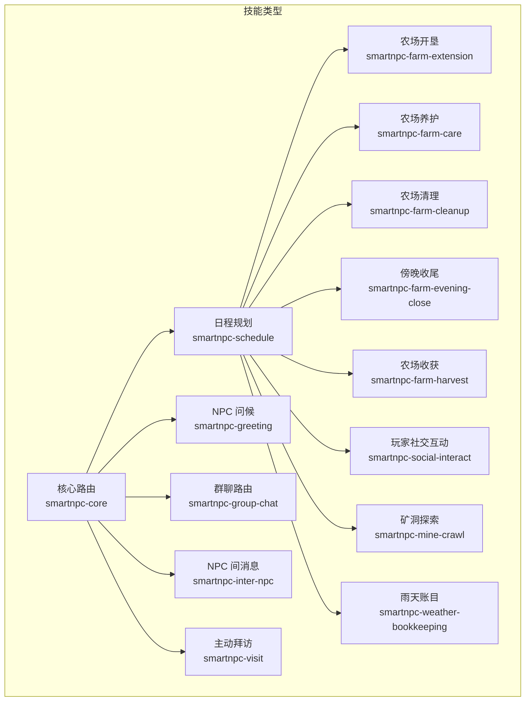
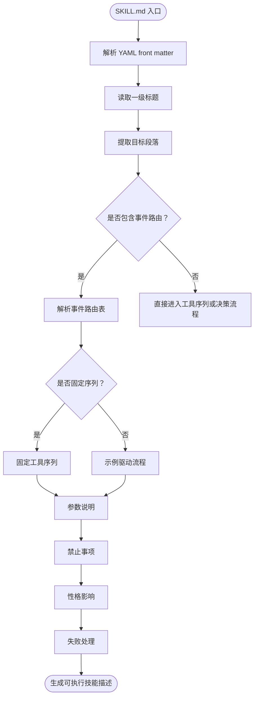
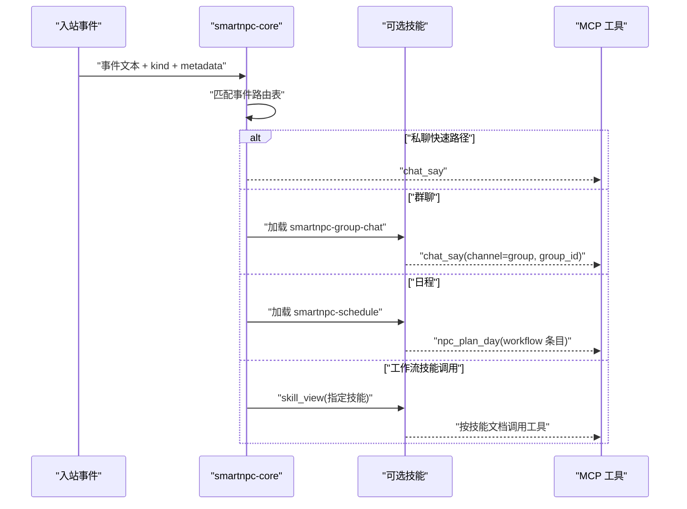
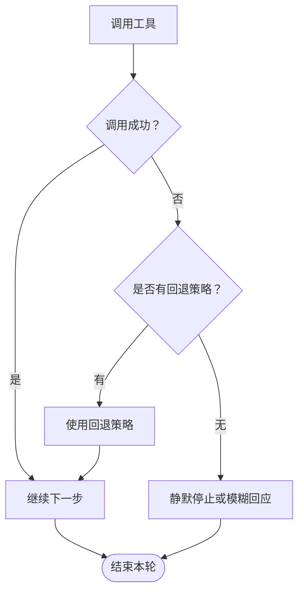
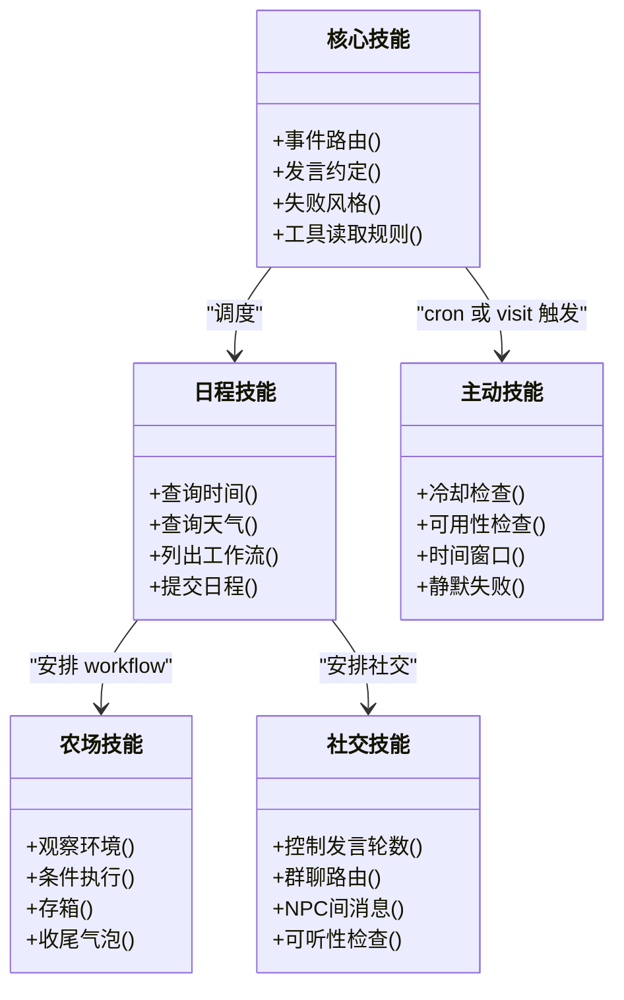
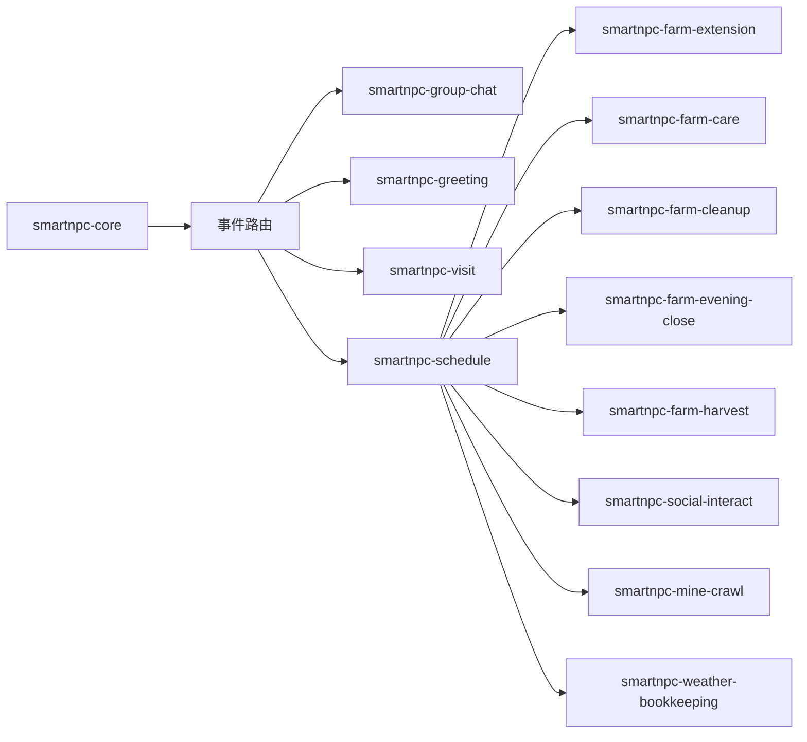
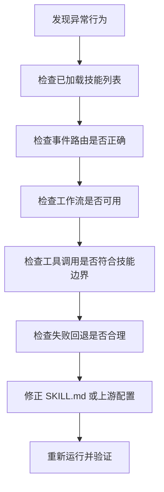

# SKILL.md 文件格式规范

<cite>
**本文引用的文件**
- [SKILL.md](file://SmartNPC/.claude/skills/smartnpc-action-development/SKILL.md)
- [smartnpc-core SKILL.md](file://提示词导出-20261026-004143/04-全部游戏技能/smartnpc/smartnpc-core/SKILL.md)
- [smartnpc-schedule SKILL.md](file://提示词导出-20261026-004143/04-全部游戏技能/smartnpc/smartnpc-schedule/SKILL.md)
- [smartnpc-farm-extension SKILL.md](file://提示词导出-20261026-004143/04-全部游戏技能/smartnpc/smartnpc-farm-extension/SKILL.md)
- [smartnpc-farm-care SKILL.md](file://提示词导出-20261026-004143/04-全部游戏技能/smartnpc/smartnpc-farm-care/SKILL.md)
- [smartnpc-farm-cleanup SKILL.md](file://提示词导出-20261026-004143/04-全部游戏技能/smartnpc/smartnpc-farm-cleanup/SKILL.md)
- [smartnpc-farm-evening-close SKILL.md](file://提示词导出-20261026-004143/04-全部游戏技能/smartnpc/smartnpc-farm-evening-close/SKILL.md)
- [smartnpc-farm-harvest SKILL.md](file://提示词导出-20261026-004143/04-全部游戏技能/smartnpc/smartnpc-farm-harvest/SKILL.md)
- [smartnpc-greeting SKILL.md](file://提示词导出-20261026-004143/04-全部游戏技能/smartnpc/smartnpc-greeting/SKILL.md)
- [smartnpc-group-chat SKILL.md](file://提示词导出-20261026-004143/04-全部游戏技能/smartnpc/smartnpc-group-chat/SKILL.md)
- [smartnpc-inter-npc SKILL.md](file://提示词导出-20261026-004143/04-全部游戏技能/smartnpc/smartnpc-inter-npc/SKILL.md)
- [smartnpc-social-interact SKILL.md](file://提示词导出-20261026-004143/04-全部游戏技能/smartnpc/smartnpc-social-interact/SKILL.md)
- [smartnpc-visit SKILL.md](file://提示词导出-20261026-004143/04-全部游戏技能/smartnpc/smartnpc-visit/SKILL.md)
- [smartnpc-mine-crawl SKILL.md](file://提示词导出-20261026-004143/04-全部游戏技能/smartnpc-mine-crawl/SKILL.md)
- [smartnpc-weather-bookkeeping SKILL.md](file://提示词导出-20261026-004143/04-全部游戏技能/smartnpc-weather-bookkeeping/SKILL.md)
- [当前会话加载过的技能.json](file://提示词导出-20261026-004143/05-当前会话加载过的技能.json)
</cite>

## 目录
1. [引言](#引言)
2. [项目结构中的 SKILL.md 位置](#项目结构中的-skillmd-位置)
3. [YAML front matter 规范](#yaml-front-matter-规范)
4. [Markdown 正文结构与章节约定](#markdown-正文结构与章节约定)
5. [事件路由与可选技能加载](#事件路由与可选技能加载)
6. [工具调用规范](#工具调用规范)
7. [失败处理模式](#失败处理模式)
8. [模板变量与替换机制](#模板变量与替换机制)
9. [完整 SKILL.md 模板](#完整-skillmd-模板)
10. [不同类型技能的写法差异](#不同类型技能的写法差异)
11. [依赖关系与加载顺序](#依赖关系与加载顺序)
12. [常见格式错误与调试方法](#常见格式错误与调试方法)
13. [最佳实践清单](#最佳实践清单)
14. [结论](#结论)

## 引言
SKILL.md 是 SmartNPC 项目中用于描述“可被 Hermes 工作流或核心调度器按需加载的技能”的 Markdown 文档。它同时承担三类职责：

1. **机器可读元数据**：通过 YAML front matter 声明技能名称、版本、作者、许可证以及 hermes 标签和 npc 归属等元信息。
2. **人类可读指令**：用中文 Markdown 描述 NPC 的行为规则、事件路由、工具序列、失败处理和性格适配。
3. **跨层契约边界**：明确 MCP 工具、C# 行为处理器、FollowSystem 状态机、日程规划和工作流引擎之间的交互方式。

该规范适用于所有位于 `hermes/profiles/*/skills/smartnpc/*`、`.claude/skills/*`、`.codebuddy/skills/*` 以及导出包 `提示词导出-20261026-004143/04-全部游戏技能/*` 下的 SKILL.md 文件。

## 项目结构中的 SKILL.md 位置
仓库中已经存在多份真实 SKILL.md，它们共同构成一个参考集合：

| 用途 | 示例路径 |
|---|---|
| 动作开发指南 | [SKILL.md](file://SmartNPC/.claude/skills/smartnpc-action-development/SKILL.md) |
| 核心运行时技能 | [smartnpc-core SKILL.md](file://提示词导出-20261026-004143/04-全部游戏技能/smartnpc/smartnpc-core/SKILL.md) |
| 日程规划 | [smartnpc-schedule SKILL.md](file://提示词导出-20261026-004143/04-全部游戏技能/smartnpc/smartnpc-schedule/SKILL.md) |
| 农场开垦 | [smartnpc-farm-extension SKILL.md](file://提示词导出-20261026-004143/04-全部游戏技能/smartnpc/smartnpc-farm-extension/SKILL.md) |
| 农场养护 | [smartnpc-farm-care SKILL.md](file://提示词导出-20261026-004143/04-全部游戏技能/smartnpc/smartnpc-farm-care/SKILL.md) |
| 农场清理 | [smartnpc-farm-cleanup SKILL.md](file://提示词导出-20261026-004143/04-全部游戏技能/smartnpc/smartnpc-farm-cleanup/SKILL.md) |
| 傍晚收尾 | [smartnpc-farm-evening-close SKILL.md](file://提示词导出-20261026-004143/04-全部游戏技能/smartnpc/smartnpc-farm-evening-close/SKILL.md) |
| 农场收获 | [smartnpc-farm-harvest SKILL.md](file://提示词导出-20261026-004143/04-全部游戏技能/smartnpc/smartnpc-farm-harvest/SKILL.md) |
| NPC 问候 | [smartnpc-greeting SKILL.md](file://提示词导出-20261026-004143/04-全部游戏技能/smartnpc/smartnpc-greeting/SKILL.md) |
| 群聊路由 | [smartnpc-group-chat SKILL.md](file://提示词导出-20261026-004143/04-全部游戏技能/smartnpc/smartnpc-group-chat/SKILL.md) |
| NPC 间消息 | [smartnpc-inter-npc SKILL.md](file://提示词导出-20261026-004143/04-全部游戏技能/smartnpc/smartnpc-inter-npc/SKILL.md) |
| 玩家社交互动 | [smartnpc-social-interact SKILL.md](file://提示词导出-20261026-004143/04-全部游戏技能/smartnpc/smartnpc-social-interact/SKILL.md) |
| 主动拜访 | [smartnpc-visit SKILL.md](file://提示词导出-20261026-004143/04-全部游戏技能/smartnpc/smartnpc-visit/SKILL.md) |
| 矿洞探索 | [smartnpc-mine-crawl SKILL.md](file://提示词导出-20261026-004143/04-全部游戏技能/smartnpc-mine-crawl/SKILL.md) |
| 雨天账目 | [smartnpc-weather-bookkeeping SKILL.md](file://提示词导出-20261026-004143/04-全部游戏技能/smartnpc-weather-bookkeeping/SKILL.md) |



**图表来源**
- [smartnpc-core SKILL.md:1-74](file://提示词导出-20261026-004143/04-全部游戏技能/smartnpc/smartnpc-core/SKILL.md#L1-L74)
- [smartnpc-schedule SKILL.md:1-141](file://提示词导出-20261026-004143/04-全部游戏技能/smartnpc/smartnpc-schedule/SKILL.md#L1-L141)

**章节来源**
- [SKILL.md:1-101](file://SmartNPC/.claude/skills/smartnpc-action-development/SKILL.md#L1-L101)
- [smartnpc-core SKILL.md:1-74](file://提示词导出-20261026-004143/04-全部游戏技能/smartnpc/smartnpc-core/SKILL.md#L1-L74)

## YAML front matter 规范
每个 SKILL.md 必须以标准 YAML front matter 开始，即首行必须是 `---`，并以另一个 `---` 结束。front matter 不是可选注释，而是技能识别和加载的关键部分。

### 必填字段
| 字段 | 类型 | 作用 | 约束 |
|---|---|---|---|
| `name` | 字符串 | 技能的唯一标识名 | 应使用小写、连字符分隔的命名风格，例如 `smartnpc-farm-care`；应与所在目录名一致 |
| `description` | 字符串 | 对技能用途的一句话说明 | 应简洁、面向调用者，便于列表展示和自动索引 |
| `version` | 字符串 | 语义化版本号 | 建议使用 `主版本.次版本.修订号`，如 `0.1.0`、`0.5.0` |
| `author` | 字符串 | 技能维护者或团队 | 通常为 `SmartNPC Project` |
| `license` | 字符串 | 许可证标识 | 示例中使用 `MIT` |

### 可选字段
| 字段 | 类型 | 作用 | 约束 |
|---|---|---|---|
| `metadata` | 对象 | 扩展元数据 | 至少包含 `hermes`；若技能绑定特定 NPC，还应包含 `npc` |
| `metadata.npc` | 字符串 | 该技能默认归属的 NPC 名称 | 示例中多为 `XiaMi`；并非所有技能都绑定 NPC，例如核心路由技能 |
| `metadata.hermes.tags` | 字符串数组 | Hermes 技能标签 | 建议包含领域标签，如 `SmartNPC`、`farm`、`schedule`、`workflow`、`routing` |

### 元数据键值定义
| 键路径 | 含义 | 示例值 | 说明 |
|---|---|---|---|
| `metadata.hermes.tags` | Hermes 侧的技能分类标签 | `[SmartNPC, farm, care, workflow]` | 用于技能发现、过滤和日志归类 |
| `metadata.npc` | 技能绑定的 NPC | `XiaMi` | 表示该技能属于某个角色；核心路由技能通常不设置 |
| `metadata.hermes` | Hermes 扩展元数据容器 | `{ tags: [...] }` | 当前只承载 `tags`，但应保留扩展空间 |

### 示例 front matter 结构
以下是一个通用结构的示意（不包含具体代码内容）：

```text
---
name: smartnpc-example
description: 示例技能的一句话说明
version: 0.1.0
author: SmartNPC Project
license: MIT
metadata:
  npc: XiaMi
  hermes:
    tags: [SmartNPC, example, skill]
---
```

**章节来源**
- [smartnpc-core SKILL.md:1-13](file://提示词导出-20261026-004143/04-全部游戏技能/smartnpc/smartnpc-core/SKILL.md#L1-L13)
- [smartnpc-schedule SKILL.md:1-13](file://提示词导出-20261026-004143/04-全部游戏技能/smartnpc/smartnpc-schedule/SKILL.md#L1-L13)
- [smartnpc-farm-extension SKILL.md:1-13](file://提示词导出-20261026-004143/04-全部游戏技能/smartnpc/smartnpc-farm-extension/SKILL.md#L1-L13)
- [smartnpc-farm-care SKILL.md:1-13](file://提示词导出-20261026-004143/04-全部游戏技能/smartnpc/smartnpc-farm-care/SKILL.md#L1-L13)
- [smartnpc-greeting SKILL.md:1-11](file://提示词导出-20261026-004143/04-全部游戏技能/smartnpc/smartnpc-greeting/SKILL.md#L1-L11)
- [smartnpc-group-chat SKILL.md:1-13](file://提示词导出-20261026-004143/04-全部游戏技能/smartnpc/smartnpc-group-chat/SKILL.md#L1-L13)
- [smartnpc-inter-npc SKILL.md:1-11](file://提示词导出-20261026-004143/04-全部游戏技能/smartnpc/smartnpc-inter-npc/SKILL.md#L1-L11)
- [smartnpc-social-interact SKILL.md:1-13](file://提示词导出-20261026-004143/04-全部游戏技能/smartnpc/smartnpc-social-interact/SKILL.md#L1-L13)
- [smartnpc-visit SKILL.md:1-11](file://提示词导出-20261026-004143/04-全部游戏技能/smartnpc/smartnpc-visit/SKILL.md#L1-L11)
- [smartnpc-mine-crawl SKILL.md:1-11](file://提示词导出-20261026-004143/04-全部游戏技能/smartnpc-mine-crawl/SKILL.md#L1-L11)
- [smartnpc-weather-bookkeeping SKILL.md:1-11](file://提示词导出-20261026-004143/04-全部游戏技能/smartnpc-weather-bookkeeping/SKILL.md#L1-L11)

## Markdown 正文结构与章节约定
虽然 SKILL.md 没有强制的 XML Schema，但从现有实现中可以归纳出稳定结构：

| 层级 | 约定 | 说明 |
|---|---|---|
| 一级标题 | `# 技能名称` | 对应 front matter 的 `name`，作为技能的人类可读标题 |
| 目标段落 | `## 目标` | 描述技能要解决什么问题，避免把工具调用当成最终目的 |
| 事件路由表 | `## 按事件类型路由` 或类似表格 | 将入站事件映射到技能或处理章节 |
| 固定工具序列 | `## 固定工具序列` + 编号步骤 | 用于严格流程型技能，如农场开垦、清理、收尾 |
| 示例驱动流程 | `## 示例工作流` | 用于动态组合型技能，如农场收获 |
| 决策流程 | `## 决策流程` | 用于需要观察→判断→执行的多步推理 |
| 禁止事项 | `## 禁止事项` | 列出不得调用的工具或行为 |
| 参数说明 | `## 参数说明` | 描述 workflow args、默认值和来源 |
| 性格影响 | `## 性格影响` | 描述 SOUL.md 特质如何影响半径、概率或行为选择 |
| 失败模式 | 独立段落或章节 | 描述工具失败、条件不满足时的回退行为 |

### 推荐章节顺序
1. 技能标题
2. 目标
3. 触发条件或事件路由
4. 工具序列或决策流程
5. 参数说明
6. 禁止事项
7. 性格影响
8. 失败处理
9. 备注或护栏规则



**图表来源**
- [smartnpc-farm-extension SKILL.md:14-137](file://提示词导出-20261026-004143/04-全部游戏技能/smartnpc/smartnpc-farm-extension/SKILL.md#L14-L137)
- [smartnpc-farm-harvest SKILL.md:1-200](file://提示词导出-20261026-004143/04-全部游戏技能/smartnpc/smartnpc-farm-harvest/SKILL.md#L1-L200)

**章节来源**
- [smartnpc-core SKILL.md:14-74](file://提示词导出-20261026-004143/04-全部游戏技能/smartnpc/smartnpc-core/SKILL.md#L14-L74)
- [smartnpc-schedule SKILL.md:14-141](file://提示词导出-20261026-004143/04-全部游戏技能/smartnpc/smartnpc-schedule/SKILL.md#L14-L141)
- [smartnpc-farm-extension SKILL.md:14-137](file://提示词导出-20261026-004143/04-全部游戏技能/smartnpc/smartnpc-farm-extension/SKILL.md#L14-L137)
- [smartnpc-farm-harvest SKILL.md:1-200](file://提示词导出-20261026-004143/04-全部游戏技能/smartnpc/smartnpc-farm-harvest/SKILL.md#L1-L200)

## 事件路由与可选技能加载
核心技能 `smartnpc-core` 承担了全局路由职责：它决定哪些入站事件应该加载哪个可选技能，并规定聊天发言、工具读取和失败风格的基本契约。

### 核心路由表
| 入站事件 | 是否加载可选技能 | 行为 |
|---|---|---|
| `[private_chat npc="..."] ...` | 否 | 快速路径，仅调用一次 `chat_say` |
| `[group_chat group_id="..."] ...` | 加载 `smartnpc-group-chat` | 按群聊规则设置 `channel` 和 `group_id` |
| `[inter_npc_message ...]` 或 `npc_message`（kind=behavioral，来自 manager 的农场任务） | 加载 `smartnpc-farm-worker` | 执行分配的农场任务 |
| `[inter_npc_message ...]` 或 `npc_message`（其他） | 加载 `smartnpc-inter-npc` | 收件箱流程，通常无玩家语音 |
| 玩家索要物品、礼物或购买 | 加载 `smartnpc-gift` | 匹配 SOUL.md → 给予物品 → 发言 |
| 玩家点击你（`npc_interact`） | 加载 `smartnpc-greeting` | 读取好感度 → 一条发言 |
| cron 或主动拜访 | 加载 `smartnpc-visit` | 静默决策，可能发起拜访 |
| `A new day begins`（`day_started`） | 加载 `smartnpc-schedule` | 必须调用 `npc_plan_day` |
| `workflow_skill_call`（`skill` 字段指定技能） | 加载事件中指定的技能 | 通过 `skill_view` 动态加载并按该技能指令执行 |
| `[schedule_trigger]` | 加载 `smartnpc-schedule` | 旧版 action 回退路径，正常不应出现 |
| 玩家引用过去事实 | 加载 `smartnpc-memory` | 仅在需要时读写精简记忆 |

### 路由关键约束
1. 当路由表指定某个技能时，应在行动前调用 `skill_view` 加载该技能。
2. 除非回合匹配，不要预加载可选技能。
3. 可选技能与本核心冲突时，以可选技能为准，遵循最具体的适用指令。
4. `skill_view` 是动态加载技能的入口，工作流引擎通过 `kind: skill_call` 步骤触发。



**图表来源**
- [smartnpc-core SKILL.md:14-40](file://提示词导出-20261026-004143/04-全部游戏技能/smartnpc/smartnpc-core/SKILL.md#L14-L40)
- [smartnpc-schedule SKILL.md:14-80](file://提示词导出-20261026-004143/04-全部游戏技能/smartnpc/smartnpc-schedule/SKILL.md#L14-L80)

**章节来源**
- [smartnpc-core SKILL.md:14-40](file://提示词导出-20261026-004143/04-全部游戏技能/smartnpc/smartnpc-core/SKILL.md#L14-L40)

## 工具调用规范
SKILL.md 中描述的工具调用分为两类：**固定序列型** 和 **示例驱动型**。

### 固定序列型
典型代表包括农场开垦、农场养护、农场清理、傍晚收尾等。这类技能强调：

- 步骤编号明确，顺序不可重排。
- 条件执行步骤标注“条件”和“强制执行”。
- 观察环境通常以 `npc_inspect_object(what="farm_actions", radius=...)` 开头。
- 后续步骤从 inspect 结果中提取 `count` 和 `bbox`。
- 最后通常包含存箱和收尾气泡。

| 技能 | 主要工具 | 特点 |
|---|---|---|
| 农场开垦 | `npc_clear_debris`、`npc_till_soil`、`npc_fertilize`、`npc_plant_seeds`、`npc_water_crops` | 完整荒地变农田链路 |
| 农场养护 | `npc_water_crops`、`npc_clear_debris`、`npc_plant_seeds`、`npc_fill_gaps` | 日常维护，不开垦、不收作物 |
| 农场清理 | `npc_clear_debris`、`npc_break_resource`、`npc_forage_collect` | 打扫周边资源 |
| 傍晚收尾 | `npc_harvest_crops`、`npc_deposit_items`、`npc_plant_seeds` | 当天最后一轮 |
| 矿洞探索 | `npc_break_resource(what="stones")`、`npc_forage_collect` | 天气或闲时挖矿 |
| 雨天账目 | `npc_inventory_get`、`npc_deposit_items` | 室内盘点 |

### 示例驱动型
`smartnpc-farm-harvest` 采用示例驱动方式：先观察成熟作物，再匹配示例 A/B/C/D，最后动态组合工具序列。这种方式更适合场景多变、不能硬编码固定分支的情况。

### 聊天工具
- `chat_say` 是回合终止符。
- 每次回复应恰好调用一次，然后停止。
- 私聊省略 `channel` 和 `group_id`。
- 群聊必须设置 `channel="group"` 和确切的 `group_id`。
- 当结果包含 `TURN_END` 时，不再调用其他工具或输出额外文本。

### 物理动作
默认策略是：仅当玩家明确要求时才移动或执行物理动作。例外情况由可选技能授权，例如 `smartnpc-visit` 明确允许 `npc_summon`。

**章节来源**
- [smartnpc-farm-extension SKILL.md:14-137](file://提示词导出-20261026-004143/04-全部游戏技能/smartnpc/smartnpc-farm-extension/SKILL.md#L14-L137)
- [smartnpc-farm-care SKILL.md:14-102](file://提示词导出-20261026-004143/04-全部游戏技能/smartnpc/smartnpc-farm-care/SKILL.md#L14-L102)
- [smartnpc-farm-cleanup SKILL.md:14-90](file://提示词导出-20261026-004143/04-全部游戏技能/smartnpc/smartnpc-farm-cleanup/SKILL.md#L14-L90)
- [smartnpc-farm-evening-close SKILL.md:14-94](file://提示词导出-20261026-004143/04-全部游戏技能/smartnpc/smartnpc-farm-evening-close/SKILL.md#L14-L94)
- [smartnpc-farm-harvest SKILL.md:1-200](file://提示词导出-20261026-004143/04-全部游戏技能/smartnpc/smartnpc-farm-harvest/SKILL.md#L1-L200)
- [smartnpc-mine-crawl SKILL.md:12-30](file://提示词导出-20261026-004143/04-全部游戏技能/smartnpc-mine-crawl/SKILL.md#L12-L30)
- [smartnpc-weather-bookkeeping SKILL.md:12-28](file://提示词导出-20261026-004143/04-全部游戏技能/smartnpc-weather-bookkeeping/SKILL.md#L12-L28)
- [smartnpc-core SKILL.md:28-74](file://提示词导出-20261026-004143/04-全部游戏技能/smartnpc/smartnpc-core/SKILL.md#L28-L74)

## 失败处理模式
失败处理在 SKILL.md 中有三个层次：

| 层次 | 表现 | 示例 |
|---|---|---|
| 核心层 | 工具失败时保持角色一致，模糊处理 | 不暴露 HTTP、MCP、JSON、Hermes、堆栈跟踪或错误码 |
| 路由层 | 群聊缺少 `group_id` 时保持静默或用简短私聊澄清 | 不猜测、不标准化 id |
| 工作层 | 条件为假时跳过步骤；背包空时返回 `nothing_to_do=true` | 存箱、浇水、播种等步骤都有容错 |

### 常见失败模式
- 工具返回 `nothing_to_do=true`：视为正常，继续下一步。
- 玩家忙、在菜单中、在事件中或无存档：主动拜访应静默停止。
- 群聊 `group_id` 缺失或格式错误：保持静默或简短澄清。
- 日程已规划：重复调用 `npc_plan_day` 会覆盖整份日程，应避免。
- 农场工具误用：例如在养护轮调用收获工具，应通过“禁止事项”拦截。



**图表来源**
- [smartnpc-core SKILL.md:66-74](file://提示词导出-20261026-004143/04-全部游戏技能/smartnpc/smartnpc-core/SKILL.md#L66-L74)
- [smartnpc-group-chat SKILL.md:28-36](file://提示词导出-20261026-004143/04-全部游戏技能/smartnpc/smartnpc-group-chat/SKILL.md#L28-L36)
- [smartnpc-visit SKILL.md:12-35](file://提示词导出-20261026-004143/04-全部游戏技能/smartnpc/smartnpc-visit/SKILL.md#L12-L35)

**章节来源**
- [smartnpc-core SKILL.md:66-74](file://提示词导出-20261026-004143/04-全部游戏技能/smartnpc/smartnpc-core/SKILL.md#L66-L74)
- [smartnpc-group-chat SKILL.md:28-36](file://提示词导出-20261026-004143/04-全部游戏技能/smartnpc/smartnpc-group-chat/SKILL.md#L28-L36)
- [smartnpc-visit SKILL.md:12-35](file://提示词导出-20261026-004143/04-全部游戏技能/smartnpc/smartnpc-visit/SKILL.md#L12-L35)

## 模板变量与替换机制
在当前仓库提供的 SKILL.md 文件中，**没有发现 `{{NPC_NAME}}` 形式的模板变量**。实际使用的占位符主要是：

| 占位形式 | 含义 | 使用位置 |
|---|---|---|
| `<inspect_radius>` | workflow args 传入的巡视半径 | 农场类技能的 inspect 调用 |
| `<target_seed>` | workflow args 传入的目标种子 ID | 开垦、傍晚收尾等种植相关技能 |
| `<fertilizer_id>` | workflow args 传入的肥料 ID | 开垦施肥步骤 |
| `{ game_hour, game_minute, workflow_id, args?, reason }` | `npc_plan_day` 的工作流条目模型 | 日程规划 |
| `{ "target_seed": "(O)490" }` | JSON 风格的 workflow args | 日程示例 |

### 模板变量替换机制说明
1. **SKILL.md 本身不是模板引擎输入**：现有示例中没有使用双花括号模板语法。
2. **真正发生替换的位置更可能在 Hermes 渲染层**：`args` 中的值在工作流执行前由系统注入。
3. **SKILL.md 的职责是描述这些占位符的含义、默认值和来源**，而不是实现替换逻辑。
4. 如果未来引入 `{{NPC_NAME}}` 之类的模板变量，应遵循以下原则：
   - 在 front matter 的 `metadata.npc` 或上下文元数据中提供 NPC 名称。
   - 在文档中明确模板变量的替换时机、作用域和失败回退。
   - 不要在 SKILL.md 正文中直接硬编码 NPC 名称，除非该技能确实只属于某个角色。

**章节来源**
- [smartnpc-farm-extension SKILL.md:96-137](file://提示词导出-20261026-004143/04-全部游戏技能/smartnpc/smartnpc-farm-extension/SKILL.md#L96-L137)
- [smartnpc-farm-care SKILL.md:84-102](file://提示词导出-20261026-004143/04-全部游戏技能/smartnpc/smartnpc-farm-care/SKILL.md#L84-L102)
- [smartnpc-schedule SKILL.md:30-70](file://提示词导出-20261026-004143/04-全部游戏技能/smartnpc/smartnpc-schedule/SKILL.md#L30-L70)

## 完整 SKILL.md 模板
以下模板综合了仓库中已有 SKILL.md 的稳定结构。可直接复制后填充具体技能。

```text
---
name: smartnpc-your-skill
description: 一句话描述该技能的作用和适用范围
version: 0.1.0
author: SmartNPC Project
license: MIT
metadata:
  npc: YourNPCName
  hermes:
    tags: [SmartNPC, domain, subtype, workflow]
---

# 技能标题

## 目标

描述该技能解决的问题、目标和边界。

## 触发条件

说明该技能何时被加载，例如：
- 特定事件标记
- `workflow_skill_call` 中指定的 `skill`
- `day_started`
- cron 主动触发

## 工具序列

### 1. 观察环境

描述第一步的观察调用和期望返回。

### 2. 条件执行步骤

说明条件、工具和跳过的情况。

### 3. 强制执行步骤

说明无论条件如何都必须执行的步骤。

## 参数说明

| 参数 | 来源 | 默认值 | 说明 |
|---|---|---|---|
| `inspect_radius` | workflow args | 30 | 巡视半径 |
| `target_seed` | workflow args | 季节默认种子 | 目标种子 QID |
| `fertilizer_id` | workflow args | 基础肥料 | 肥料 QID |

## 禁止事项

列出不得调用的工具或行为。

## 性格影响

描述 SOUL.md 特质如何影响半径、概率、顺序或行为偏好。

## 失败处理

描述工具失败、条件不满足、玩家不可见等情况的回退策略。
```

**章节来源**
- [smartnpc-farm-extension SKILL.md:1-137](file://提示词导出-20261026-004143/04-全部游戏技能/smartnpc/smartnpc-farm-extension/SKILL.md#L1-L137)
- [smartnpc-farm-care SKILL.md:1-102](file://提示词导出-20261026-004143/04-全部游戏技能/smartnpc/smartnpc-farm-care/SKILL.md#L1-L102)
- [smartnpc-farm-cleanup SKILL.md:1-90](file://提示词导出-20261026-004143/04-全部游戏技能/smartnpc/smartnpc-farm-cleanup/SKILL.md#L1-L90)
- [smartnpc-farm-evening-close SKILL.md:1-94](file://提示词导出-20261026-004143/04-全部游戏技能/smartnpc/smartnpc-farm-evening-close/SKILL.md#L1-L94)
- [smartnpc-social-interact SKILL.md:1-104](file://提示词导出-20261026-004143/04-全部游戏技能/smartnpc/smartnpc-social-interact/SKILL.md#L1-L104)

## 不同类型技能的写法差异

### 核心技能
核心技能负责全局行为契约，不承担具体业务细节。它应：
- 始终加载。
- 定义事件路由。
- 规定 `chat_say` 是回合终止符。
- 限制工具读取时机。
- 统一失败风格。

### 日程规划技能
日程技能不负责直接操作农场或社交，而是安排全天 workflow 条目。它应：
- 优先调用 `workflow_list`。
- 提交 10-15 条 `workflow_id` 条目。
- 不写 `action` 字段。
- 根据天气、季节、日期调整配额。
- 避免重复规划。

### 农场工作技能
农场技能通常由日程技能调度，按固定序列或示例驱动执行。它们应：
- 明确区分开垦、养护、清理、收获、收尾的职责。
- 使用 `npc_inspect_object` 获取区域桶。
- 用 `count` 和 `bbox` 控制条件执行。
- 在结尾存箱和显示气泡。
- 通过“禁止事项”防止工具越界。

### 社交与对话技能
社交技能关注 NPC 与玩家或 NPC 之间的关系表达。它们应：
- 控制发言轮数。
- 明确群聊路由。
- 避免伪造同伴对话。
- 使用 `npc_send_message` 进行 NPC 间通信。
- 考虑可听性检查。

### 主动行为技能
主动拜访、矿洞探索、雨天账目等技能在没有玩家直接请求时仍可执行。它们应：
- 显式覆盖核心“仅在玩家请求时行动”的规则。
- 使用冷却、概率、可用性检查等护栏。
- 在失败时静默停止，而不是抛出角色外错误。



**图表来源**
- [smartnpc-core SKILL.md:14-74](file://提示词导出-20261026-004143/04-全部游戏技能/smartnpc/smartnpc-core/SKILL.md#L14-L74)
- [smartnpc-schedule SKILL.md:14-141](file://提示词导出-20261026-004143/04-全部游戏技能/smartnpc/smartnpc-schedule/SKILL.md#L14-L141)
- [smartnpc-farm-extension SKILL.md:14-137](file://提示词导出-20261026-004143/04-全部游戏技能/smartnpc/smartnpc-farm-extension/SKILL.md#L14-L137)
- [smartnpc-social-interact SKILL.md:14-104](file://提示词导出-20261026-004143/04-全部游戏技能/smartnpc/smartnpc-social-interact/SKILL.md#L14-L104)
- [smartnpc-visit SKILL.md:12-35](file://提示词导出-20261026-004143/04-全部游戏技能/smartnpc/smartnpc-visit/SKILL.md#L12-L35)

**章节来源**
- [smartnpc-core SKILL.md:14-74](file://提示词导出-20261026-004143/04-全部游戏技能/smartnpc/smartnpc-core/SKILL.md#L14-L74)
- [smartnpc-schedule SKILL.md:14-141](file://提示词导出-20261026-004143/04-全部游戏技能/smartnpc/smartnpc-schedule/SKILL.md#L14-L141)
- [smartnpc-farm-extension SKILL.md:14-137](file://提示词导出-20261026-004143/04-全部游戏技能/smartnpc/smartnpc-farm-extension/SKILL.md#L14-L137)
- [smartnpc-social-interact SKILL.md:14-104](file://提示词导出-20261026-004143/04-全部游戏技能/smartnpc/smartnpc-social-interact/SKILL.md#L14-L104)
- [smartnpc-visit SKILL.md:12-35](file://提示词导出-20261026-004143/04-全部游戏技能/smartnpc/smartnpc-visit/SKILL.md#L12-L35)

## 依赖关系与加载顺序
SKILL.md 之间并非完全独立：核心技能定义路由，日程技能调度工作流，工作流再通过 `skill_call` 加载具体农场或社交技能。



**图表来源**
- [smartnpc-core SKILL.md:14-40](file://提示词导出-20261026-004143/04-全部游戏技能/smartnpc/smartnpc-core/SKILL.md#L14-L40)
- [smartnpc-schedule SKILL.md:30-110](file://提示词导出-20261026-004143/04-全部游戏技能/smartnpc/smartnpc-schedule/SKILL.md#L30-L110)

当前会话加载过的技能列表也体现了动态加载特征：同一技能可能被多次加载，且不同会话可能加载不同组合。

**章节来源**
- [smartnpc-core SKILL.md:14-40](file://提示词导出-20261026-004143/04-全部游戏技能/smartnpc/smartnpc-core/SKILL.md#L14-L40)
- [smartnpc-schedule SKILL.md:30-110](file://提示词导出-20261026-004143/04-全部游戏技能/smartnpc/smartnpc-schedule/SKILL.md#L30-L110)
- [当前会话加载过的技能.json:1-12](file://提示词导出-20261026-004143/05-当前会话加载过的技能.json#L1-L12)

## 常见格式错误与调试方法

### 常见格式错误
| 错误 | 现象 | 修复方法 |
|---|---|---|
| 缺少 front matter | 技能无法被正确识别 | 添加 `name`、`description`、`version`、`author`、`license`、`metadata` |
| front matter 未闭合 | YAML 解析失败 | 确保首尾各有一个 `---` |
| `name` 与目录不一致 | 技能定位混乱 | 使文件名和目录名与 `name` 保持一致 |
| 在核心技能中重复实现工具调用语法 | 指令冗余 | 核心技能应只描述路由和契约，工具语法放在 MCP 工具描述中 |
| 在日程中使用 `action` 字段 | 被工具拒绝 | 改用 `workflow_id` |
| 重复调用 `npc_plan_day` | 覆盖整份日程 | 先查 `npc_get_schedule`，避免重复规划 |
| 农场工具跨轮混用 | 行为不符合预期 | 严格遵守“开垦”“养护”“清理”“收获”“收尾”的职责边界 |
| 群聊未设置 `group_id` | 消息路由错误 | 原样复制事件中的 `group_id` |
| 暴露原始工具返回值 | 破坏角色一致性 | 将坐标、ID、JSON、错误码转换为自然语言 |

### 调试方法
1. **查看已加载技能列表**：确认当前会话是否加载了预期的 SKILL.md。
2. **检查事件路由**：确认入站事件是否命中核心路由表。
3. **检查 workflow 列表**：日程技能应每次调用 `workflow_list`，因为可用工作流可能变化。
4. **检查农具边界**：确认是否调用了不属于当前轮的农场工具。
5. **检查 NPC 动作开发链路**：新增动作必须完成 Go tool → C# Handler → FollowSystem → Debug 命令四步。
6. **测试原版 NPC**：Silent failure 常出现在原版 NPC 上，需特别验证。



**图表来源**
- [SKILL.md:65-101](file://SmartNPC/.claude/skills/smartnpc-action-development/SKILL.md#L65-L101)
- [当前会话加载过的技能.json:1-12](file://提示词导出-20261026-004143/05-当前会话加载过的技能.json#L1-L12)

**章节来源**
- [SKILL.md:1-101](file://SmartNPC/.claude/skills/smartnpc-action-development/SKILL.md#L1-L101)
- [smartnpc-core SKILL.md:14-74](file://提示词导出-20261026-004143/04-全部游戏技能/smartnpc/smartnpc-core/SKILL.md#L14-L74)
- [smartnpc-schedule SKILL.md:70-141](file://提示词导出-20261026-004143/04-全部游戏技能/smartnpc/smartnpc-schedule/SKILL.md#L70-L141)
- [当前会话加载过的技能.json:1-12](file://提示词导出-20261026-004143/05-当前会话加载过的技能.json#L1-L12)

## 最佳实践清单
1. 每个 SKILL.md 都以标准 YAML front matter 开始。
2. `name` 与目录名保持一致。
3. `description` 写清楚触发范围和职责边界。
4. 使用 `metadata.hermes.tags` 标注领域标签。
5. 只有绑定 NPC 的技能才设置 `metadata.npc`。
6. 核心技能只负责路由和契约，不重复工具调用语法。
7. 固定序列技能明确标注“条件执行”和“强制执行”。
8. 示例驱动技能明确写出示例、匹配规则和组合方式。
9. 日程技能使用 `workflow_id`，不使用 `action`。
10. 日程条目保持在 10-15 条，间隔 30-60 分钟。
11. 农场技能遵守轮次边界，不在养护轮做收获。
12. 群聊技能原样复制 `group_id`，不猜测、不标准化。
13. NPC 间消息使用 `npc_send_message`，不伪造同伴对话。
14. 主动行为技能必须加冷却、可用性、时间窗口等护栏。
15. 失败时保持角色一致，不暴露技术细节。
16. 新动作必须走完整四层联动链路。
17. 定期用原版 NPC 验证持续动作。

## 结论
SKILL.md 是一种介于“机器可解析的元数据”和“人类可维护的行为契约”之间的文档格式。它的核心价值不在于语法复杂度，而在于：

- 用 front matter 明确技能身份和元数据。
- 用 Markdown 章节明确事件路由、工具序列、失败处理和性格适配。
- 让核心技能、日程技能、农场技能、社交技能和主动技能各司其职。
- 让 Hermes、MCP 工具、C# 行为处理器和游戏世界状态之间形成稳定边界。

编写新 SKILL.md 时，应先确定它是核心路由、日程调度、固定工作流、示例驱动工作流还是主动行为，再套用本规范的结构，并对照现有 SKILL.md 示例补齐元数据、参数、禁止事项和失败处理。这样既能保证 Hermes 能正确加载和执行，也能让后续维护者快速理解技能意图。