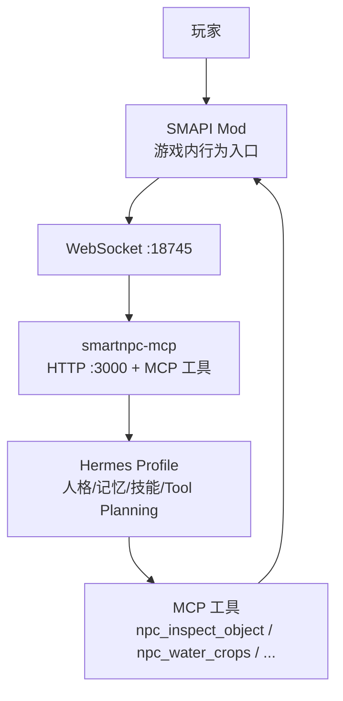
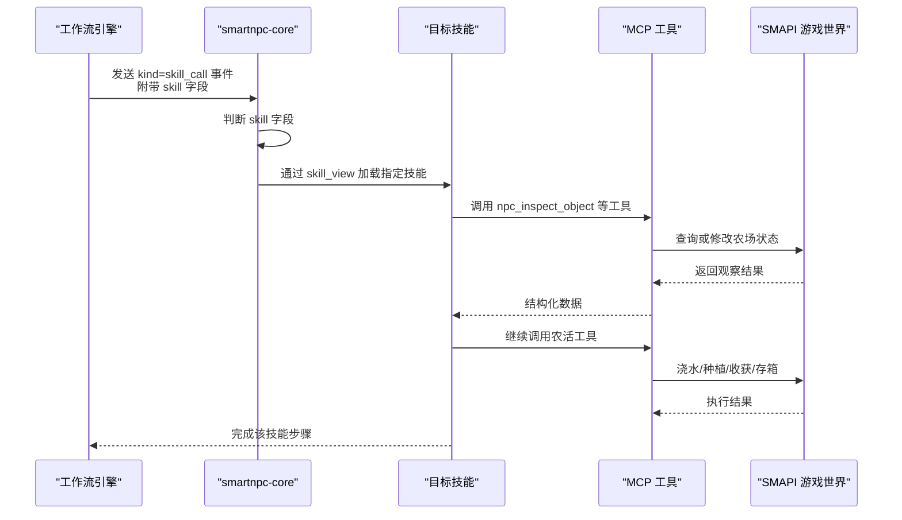
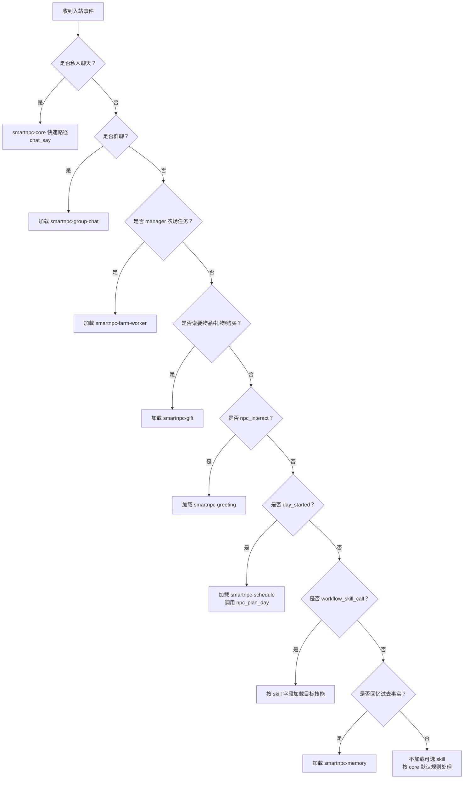
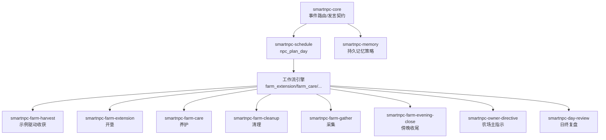

# 内置技能分类与功能说明

<cite>
**本文引用的文件**   
- [SmartNPC/hermes/README.md](file://SmartNPC/hermes/README.md)
- [SmartNPC/hermes/npcs.yaml](file://SmartNPC/hermes/npcs.yaml)
- [SmartNPC/hermes/runtime-config.yaml](file://SmartNPC/hermes/runtime-config.yaml)
- [提示词导出-20261026-004143/04-全部游戏技能/smartnpc/smartnpc-core/SKILL.md](file://提示词导出-20261026-004143/04-全部游戏技能/smartnpc/smartnpc-core/SKILL.md)
- [提示词导出-20261026-004143/04-全部游戏技能/smartnpc/smartnpc-schedule/SKILL.md](file://提示词导出-20261026-004143/04-全部游戏技能/smartnpc/smartnpc-schedule/SKILL.md)
- [提示词导出-20261026-004143/04-全部游戏技能/smartnpc/smartnpc-memory/SKILL.md](file://提示词导出-20261026-004143/04-全部游戏技能/smartnpc/smartnpc-memory/SKILL.md)
- [提示词导出-20261026-004143/04-全部游戏技能/smartnpc/smartnpc-farm-care/SKILL.md](file://提示词导出-20261026-004143/04-全部游戏技能/smartnpc/smartnpc-farm-care/SKILL.md)
- [提示词导出-20261026-004143/04-全部游戏技能/smartnpc/smartnpc-farm-cleanup/SKILL.md](file://提示词导出-20261026-004143/04-全部游戏技能/smartnpc/smartnpc-farm-cleanup/SKILL.md)
- [提示词导出-20261026-004143/04-全部游戏技能/smartnpc/smartnpc-farm-extension/SKILL.md](file://提示词导出-20261026-004143/04-全部游戏技能/smartnpc/smartnpc-farm-extension/SKILL.md)
- [提示词导出-20261026-004143/04-全部游戏技能/smartnpc/smartnpc-farm-gather/SKILL.md](file://提示词导出-20261026-004143/04-全部游戏技能/smartnpc/smartnpc-farm-gather/SKILL.md)
- [提示词导出-20261026-004143/04-全部游戏技能/smartnpc/smartnpc-farm-harvest/SKILL.md](file://提示词导出-20261026-004143/04-全部游戏技能/smartnpc/smartnpc-farm-harvest/SKILL.md)
- [提示词导出-20261026-004143/04-全部游戏技能/smartnpc/smartnpc-farm-evening-close/SKILL.md](file://提示词导出-20261026-004143/04-全部游戏技能/smartnpc/smartnpc-farm-evening-close/SKILL.md)
</cite>

## 目录
1. [引言](#引言)
2. [项目结构与技能加载位置](#项目结构与技能加载位置)
3. [核心运行时 smartnpc-core](#核心运行时-smartnpc-core)
4. [日程规划 smartnpc-schedule](#日程规划-smartnpc-schedule)
5. [记忆管理 smartnpc-memory](#记忆管理-smartnpc-memory)
6. [农场主指示 smartnpc-owner-directive](#农场主指示-smartnpc-owner-directive)
7. [农场维护相关技能](#农场维护相关技能)
8. [日终复盘 smartnpc-day-review](#日终复盘-smartnpc-day-review)
9. [workflow_skill_call 动态技能切换机制](#workflow_skill_call-动态技能切换机制)
10. [技能选择决策树](#技能选择决策树)
11. [依赖关系与执行顺序](#依赖关系与执行顺序)
12. [性能特征与资源使用建议](#性能特征与资源使用建议)
13. [故障排查指南](#故障排查指南)
14. [结论](#结论)

## 引言
本文件对 SmartNPC 中面向《星露谷物语》NPC 的内置技能进行完整分类和功能说明。文档聚焦以下领域：
- 核心运行时：smartnpc-core
- 日程规划：smartnpc-schedule
- 记忆管理：smartnpc-memory
- 农场主指示：smartnpc-owner-directive
- 农场维护：smartnpc-farm-care、smartnpc-farm-cleanup、smartnpc-farm-extension、smartnpc-farm-gather、smartnpc-farm-harvest、smartnpc-farm-evening-close
- 日终复盘：smartnpc-day-review

这些技能并非独立进程，而是由 Hermes profile 加载、由 smartnpc-mcp 暴露 MCP 工具、由 SMAPI Mod 驱动游戏世界动作的“指令+规则”组合。它们通过事件路由、工作流引擎和 `workflow_skill_call` 机制协同运行。

## 项目结构与技能加载位置
Hermes profile 是 NPC 的人格、记忆、技能和 tool planning/calling/reflection 所在层；smartnpc-mcp 负责游戏能力边界（MCP 工具、事件通知、硬校验）；SMAPI Mod 负责 Stardew Valley 内的真实行为。

**图示来源**
- [SmartNPC/hermes/README.md:21-37](file://SmartNPC/hermes/README.md#L21-L37)

Hermes profile 源位于仓库中的 `hermes/profiles/_master/skills/smartnpc/`，并通过安装脚本合并到各 NPC profile 目录；实际渲染后的 profile 会出现在 `~/.hermes/profiles/<npc>/skills/smartnpc/`。

**章节来源**
- [SmartNPC/hermes/README.md:1-20](file://SmartNPC/hermes/README.md#L1-L20)
- [SmartNPC/hermes/README.md:21-37](file://SmartNPC/hermes/README.md#L21-L37)
- [SmartNPC/hermes/README.md:86-116](file://SmartNPC/hermes/README.md#L86-L116)

## 核心运行时 smartnpc-core
smartnpc-core 是始终加载的核心运行时。它不是具体业务技能的实现者，而是“薄路由器”：根据入站事件决定加载哪个可选 skill，并统一约定发言方式、失败风格、会话启动和工具调用边界。

### 触发条件
| 入站事件 | 是否加载可选 skill | 职责 |
|---|---|---|
| `[private_chat]` | 否 | 快速路径：直接调用 `chat_say` |
| `[group_chat]` | 是：`smartnpc-group-chat` | 按群聊规则带 channel/group_id 发言 |
| `[inter_npc_message]` / `npc_message`（kind=behavioral，manager 农场任务） | 是：`smartnpc-farm-worker` | 执行分配的农场任务并回复结果 |
| `[inter_npc_message]` / `npc_message`（其他） | 是：`smartnpc-inter-npc` | 收件箱流程，通常无玩家语音 |
| 玩家索要物品/礼物/购买 | 是：`smartnpc-gift` | 匹配 SOUL.md → `npc_give_item` → `chat_say` |
| 玩家点击你（`npc_interact`） | 是：`smartnpc-greeting` | 读取好感度并 `chat_say` |
| cron/主动拜访 | 是：`smartnpc-visit` | 静默决策，可能拜访 |
| `day_started` | 是：`smartnpc-schedule` | 必须调用 `npc_plan_day` 提交日程 |
| `workflow_skill_call`（skill 字段指定） | 是：事件中指定的 skill | 动态加载并严格按该 skill 指令执行 |
| `[schedule_trigger]`（旧版 action） | 是：`smartnpc-schedule` | 旧版回退路径，正常不应出现 |
| 玩家引用过去事实 | 是：`smartnpc-memory` | 按需读/写精简记忆 |

### 主要职责
- 每个新会话首次调用 `agent_register_self` 注册自身 NPC 名称。
- 在回合开始前根据事件表决定是否加载可选 skill。
- 限制闲聊快速路径只调用一次 `chat_say`。
- 禁止预先读取游戏状态，仅在明确需要时调用读取工具。
- 规定 `chat_say` 是回合终止符；收到 `TURN_END` 后不再调用其他工具。
- 物理动作默认只在玩家明确要求时执行，除非可选 skill 授权。
- 工具失败时必须保持角色一致，不能暴露 HTTP、JSON、MCP、Hermes 或错误码。

### 关键工具与输出
- 会话注册：`agent_register_self`
- 发言：`chat_say`
- 移动/表情：`npc_summon`、`npc_emote`
- 记忆：`smartnpc-memory` 负责持久化事实读写
- 日程：`smartnpc-schedule` 负责 `npc_plan_day`
- 农场工作流：通过 `workflow_skill_call` 动态加载对应 farm skill

### 与其他技能的协作
smartnpc-core 是“调度中心”，其他技能是“被调度的专业模块”。当某个事件命中可选 skill 时，core 先通过 `skill_view` 加载该 skill，再让该 skill 主导本轮决策。

**章节来源**
- [提示词导出-20261026-004143/04-全部游戏技能/smartnpc/smartnpc-core/SKILL.md:1-12](file://提示词导出-20261026-004143/04-全部游戏技能/smartnpc/smartnpc-core/SKILL.md#L1-L12)
- [提示词导出-20261026-004143/04-全部游戏技能/smartnpc/smartnpc-core/SKILL.md:13-22](file://提示词导出-20261026-004143/04-全部游戏技能/smartnpc/smartnpc-core/SKILL.md#L13-L22)
- [提示词导出-20261026-004143/04-全部游戏技能/smartnpc/smartnpc-core/SKILL.md:23-52](file://提示词导出-20261026-004143/04-全部游戏技能/smartnpc/smartnpc-core/SKILL.md#L23-L52)
- [提示词导出-20261026-004143/04-全部游戏技能/smartnpc/smartnpc-core/SKILL.md:53-74](file://提示词导出-20261026-004143/04-全部游戏技能/smartnpc/smartnpc-core/SKILL.md#L53-L74)

## 日程规划 smartnpc-schedule
smartnpc-schedule 负责把全天农活、社交和收尾安排成 workflow 条目，交给工作流引擎自动执行，而不是每次都唤醒 LLM 做零散决策。

### 触发条件
- `day_started`：每天开始时必须规划全天。
- `schedule_trigger`：仅用于旧版 `action` 条目，现已禁用；正常应使用 `workflow_id`。

### 主要职责
1. 确认当前日期、季节、年份。
2. 检查天气状况。
3. 调用 `workflow_list` 发现可用 workflow。
4. 调用 `npc_plan_day` 提交 10-15 条 workflow 条目。

### 每日典型配额
| Workflow | 每天次数 | 时间 |
|---|---:|---|
| `farm_extension` | 1-2 | 早上 6:30-7:00；春/初夏可追加下午第二块 |
| `farm_care` | 2-3 | 上午 8-9、中午 12-13、下午 15-16 |
| `farm_cleanup` | 1-2 | 上午或下午 |
| `resource_gather` | 1-2 | 上午 9-10、下午 14-15 |
| `farm_evening_close` | 1 | 17:30-18:30 |
| `social_round_robin` | 1-2 | 午后 13-14 或傍晚 19-20 |
| `social_interact` | 1-2 | 灵活穿插 |

### 天气与季节适配
- 雨天跳过室外开垦、清理、采集及养护浇水部分。
- 冬天跳过开垦和浇水耕种，保留清理、采集，并用社交补足条目数。
- 早期春季可增加开垦轮；季末不安排开垦，收尾轮做最后一轮收割。
- 勤劳型 NPC 多排农场类；随性型 NPC 多排社交类。

### 关键约束
- 每次规划前必须先调用 `workflow_list`。
- 不要使用已被拒绝的 `action` 字段，必须用 `workflow_id`。
- 如果今天已经规划过，应先查已有日程，避免重复覆盖。
- 计划条目应保持在 10-15 条；超过 16 条属于过度安排。

**章节来源**
- [提示词导出-20261026-004143/04-全部游戏技能/smartnpc/smartnpc-schedule/SKILL.md:1-22](file://提示词导出-20261026-004143/04-全部游戏技能/smartnpc/smartnpc-schedule/SKILL.md#L1-L22)
- [提示词导出-20261026-004143/04-全部游戏技能/smartnpc/smartnpc-schedule/SKILL.md:23-63](file://提示词导出-20261026-004143/04-全部游戏技能/smartnpc/smartnpc-schedule/SKILL.md#L23-L63)
- [提示词导出-20261026-004143/04-全部游戏技能/smartnpc/smartnpc-schedule/SKILL.md:64-141](file://提示词导出-20261026-004143/04-全部游戏技能/smartnpc/smartnpc-schedule/SKILL.md#L64-L141)

## 记忆管理 smartnpc-memory
smartnpc-memory 定义的是“何时写、写什么、何时读”的记忆策略，而不是通用聊天历史存储。

### 触发条件
- 玩家提到“还记得……”等历史相关语句。
- 存在待处理的承诺、人情或延迟 NPC 间回复。
- 当前对话亲密或涉及共同经历。
- 日常问候不需要每次都读记忆。

### 适合写入的内容
- 玩家偏好、个人信息或共同经历。
- 承诺、待办人情或欠款。
- 关系转折点。
- 值得后续提起的延迟 NPC 间回复。
- 反复出现的日程或习惯事实。

### 不适合写入的内容
- 原始对话、工具输出、坐标或时间戳。
- 临时推理或计划。
- 玩家要求忘记的事情。
- 对其他 NPC 的猜测。

### 输出风格
记忆应为简短、符合角色性格的笔记，优先使用季节或日期，而非 Unix 时间戳。例如以“春季某日”开头记录共同经历或承诺。

**章节来源**
- [提示词导出-20261026-004143/04-全部游戏技能/smartnpc/smartnpc-memory/SKILL.md:1-10](file://提示词导出-20261026-004143/04-全部游戏技能/smartnpc/smartnpc-memory/SKILL.md#L1-L10)
- [提示词导出-20261026-004143/04-全部游戏技能/smartnpc/smartnpc-memory/SKILL.md:11-45](file://提示词导出-20261026-004143/04-全部游戏技能/smartnpc/smartnpc-memory/SKILL.md#L11-L45)

## 农场主指示 smartnpc-owner-directive
从当前已分析的代码证据看，`smartnpc-owner-directive` 存在于 master profile 与多个 NPC profile 的技能目录中，但本次未找到其 SKILL.md 内容。因此，只能给出基于命名和项目结构的定位说明：

- 所属域：农场主指令层。
- 预期职责：接收来自玩家或外部系统的“农场主指示”，并将其转化为可执行的日程、工作流或农场任务。
- 与 core 的关系：应由 smartnpc-core 根据事件类型决定是否加载该技能。
- 与 schedule 的关系：最终可能通过 `npc_plan_day` 生成 workflow 条目。
- 与 farm skills 的关系：可能间接调度 `farm_extension`、`farm_care`、`farm_cleanup`、`farm_gather`、`farm_harvest`、`farm_evening_close`。

由于缺少具体 SKILL.md，开发者应以该技能目录中的实际指令为准，不应假设其内部实现细节。

**章节来源**
- [SmartNPC/hermes/README.md:1-20](file://SmartNPC/hermes/README.md#L1-L20)
- [SmartNPC/hermes/README.md:86-116](file://SmartNPC/hermes/README.md#L86-L116)

## 农场维护相关技能
农场相关技能都是“工作流驱动的专项技能”，由日程规划或工作流引擎选择，而不是由玩家直接对话触发。它们共享相同模式：
1. 观察环境：`npc_inspect_object(what="farm_actions", radius)`
2. 条件执行若干动作
3. 存箱：`npc_deposit_items(auto_find=true)`
4. 气泡或情绪收尾：`npc_show_text_bubble` 或 `npc_express_emotion`

### smartnpc-farm-extension：农场开垦
- 目标：将荒地变为可种植农田。
- 固定序列：清杂物 → 翻地 → 施肥 → 播种 → 浇水 → 存箱 → 气泡。
- 硬性依赖：
  - 清杂物后才能翻地。
  - 翻地后可施肥或直接播种。
  - 施肥后播种。
  - 新种子必须浇水。
- 参数：`inspect_radius`、`target_seed`、`fertilizer_id`。
- 季节种子：春/夏/秋有默认种子；冬季停止开垦。
- 禁止：非步骤 7 以外的浇水、收获、砍树、聊天。

**章节来源**
- [提示词导出-20261026-004143/04-全部游戏技能/smartnpc/smartnpc-farm-extension/SKILL.md:1-137](file://提示词导出-20261026-004143/04-全部游戏技能/smartnpc/smartnpc-farm-extension/SKILL.md#L1-L137)

### smartnpc-farm-care：农场日常养护
- 目标：巡视已有农田，浇灌干燥作物、清除杂草、补种空地。
- 固定序列：观察 → 浇水 → 清杂物 → 补种 → 填充空隙 → 存箱 → 气泡。
- 不翻新地、不收作物、不砍树、不施肥。
- 参数：`inspect_radius`、默认种子按季节变化。
- 性格影响半径和是否跳过填充空隙。

**章节来源**
- [提示词导出-20261026-004143/04-全部游戏技能/smartnpc/smartnpc-farm-care/SKILL.md:1-102](file://提示词导出-20261026-004143/04-全部游戏技能/smartnpc/smartnpc-farm-care/SKILL.md#L1-L102)

### smartnpc-farm-cleanup：农场周边清理
- 目标：清除杂草、树枝、石头，砍树砸石，捡采集物。
- 固定序列：观察 → 清杂物 → 砍树砸石 → 捡采集物 → 存箱 → 气泡。
- 不做任何耕种操作。
- 参数：`inspect_radius`。
- 性格影响半径和是否跳过破坏资源。

**章节来源**
- [提示词导出-20261026-004143/04-全部游戏技能/smartnpc/smartnpc-farm-cleanup/SKILL.md:1-90](file://提示词导出-20261026-004143/04-全部游戏技能/smartnpc/smartnpc-farm-cleanup/SKILL.md#L1-L90)

### smartnpc-farm-gather：资源采集
- 目标：收集野生物品、砍树砸石获取木材和石料。
- 固定序列：观察 → 捡采集物 → 砍树砸石 → 存箱 → 气泡。
- 不做任何耕种操作。
- 参数：`inspect_radius`。
- 性格影响半径和资源采集优先级。

**章节来源**
- [提示词导出-20261026-004143/04-全部游戏技能/smartnpc/smartnpc-farm-gather/SKILL.md:1-83](file://提示词导出-20261026-004143/04-全部游戏技能/smartnpc/smartnpc-farm-gather/SKILL.md#L1-L83)

### smartnpc-farm-harvest：农场收获
- 目标：根据成熟作物数量、位置和场景动态组合“收获→存入→交付→补种→浇水”序列。
- 不是固定脚本，而是示例驱动：
  - 大丰收：多次收获、分批存入、补种浇水。
  - 少量收获：速战速决，可交付给玩家。
  - 路过顺手收：小半径、不补种。
  - 收+补循环：收获后立即在同一区域补种。
- 硬性依赖：
  - 收获后必须存入或交付。
  - 补种后可浇水。
- 工具箱包括观察、收获、存箱、交付、补种、浇水、气泡。

**章节来源**
- [提示词导出-20261026-004143/04-全部游戏技能/smartnpc/smartnpc-farm-harvest/SKILL.md:1-200](file://提示词导出-20261026-004143/04-全部游戏技能/smartnpc/smartnpc-farm-harvest/SKILL.md#L1-L200)

### smartnpc-farm-evening-close：傍晚收尾
- 目标：当天最后一轮收割成熟作物、存箱、补种空地。
- 固定序列：观察 → 收割 → 入库 → 补种 → 存箱 → 气泡或情绪。
- 不翻新地、不清杂物、不浇水新种子。
- 参数：`inspect_radius`、`target_seed`。
- 性格影响是否补种和收尾表现方式。

**章节来源**
- [提示词导出-20261026-004143/04-全部游戏技能/smartnpc/smartnpc-farm-evening-close/SKILL.md:1-94](file://提示词导出-20261026-004143/04-全部游戏技能/smartnpc/smartnpc-farm-evening-close/SKILL.md#L1-L94)

## 日终复盘 smartnpc-day-review
从当前可分析的证据看，`smartnpc-day-review` 存在于 `_master` 与多个 NPC profile 的技能目录中，但未找到其 SKILL.md 内容。因此只能给出范围说明：

- 所属域：日终复盘。
- 预期职责：在一天结束或收尾阶段总结当日农场状态、收获、日程执行情况，并可能更新记忆或为次日日程提供依据。
- 与 evening close 的关系：可能在 `farm_evening_close` 之后触发，也可能作为独立复盘工作流。
- 与 memory 的关系：可能写入长期记忆，如今日收成、未完成事项、玩家互动要点。
- 与 schedule 的关系：可能影响下一天的 `npc_plan_day` 决策。

由于缺少具体 SKILL.md，实际行为必须以该技能目录中的指令为准。

**章节来源**
- [SmartNPC/hermes/README.md:1-20](file://SmartNPC/hermes/README.md#L1-L20)
- [SmartNPC/hermes/README.md:86-116](file://SmartNPC/hermes/README.md#L86-L116)

## workflow_skill_call 动态技能切换机制
`workflow_skill_call` 是 SmartNPC 工作流引擎动态加载和切换技能的关键机制。

### 基本流程

**图示来源**
- [提示词导出-20261026-004143/04-全部游戏技能/smartnpc/smartnpc-core/SKILL.md:43-52](file://提示词导出-20261026-004143/04-全部游戏技能/smartnpc/smartnpc-core/SKILL.md#L43-L52)
- [提示词导出-20261026-004143/04-全部游戏技能/smartnpc/smartnpc-farm-harvest/SKILL.md:1-10](file://提示词导出-20261026-004143/04-全部游戏技能/smartnpc/smartnpc-farm-harvest/SKILL.md#L1-L10)

### 关键行为
- 工作流引擎通过 `kind: skill_call` 步骤触发事件。
- 事件中 `skill` 字段指定要加载的技能名。
- smartnpc-core 在该事件上调用 `skill_view` 加载指定技能。
- 加载后，智能体严格按该技能的文档指令执行，而不是继续按 core 的默认规则。
- 这使同一套 MCP 工具可以被不同技能以不同顺序、不同前提、不同输出方式使用。

### 与日程规划的关系
smartnpc-schedule 不直接执行农活，而是把 `farm_extension`、`farm_care`、`farm_cleanup`、`resource_gather`、`farm_evening_close`、`social_round_robin`、`social_interact` 等 workflow 安排进一天的时间槽。工作流引擎随后自动执行这些条目，必要时再通过 `skill_call` 切换到具体 farm skill。

**章节来源**
- [提示词导出-20261026-004143/04-全部游戏技能/smartnpc/smartnpc-core/SKILL.md:43-52](file://提示词导出-20261026-004143/04-全部游戏技能/smartnpc/smartnpc-core/SKILL.md#L43-L52)
- [提示词导出-20261026-004143/04-全部游戏技能/smartnpc/smartnpc-schedule/SKILL.md:23-63](file://提示词导出-20261026-004143/04-全部游戏技能/smartnpc/smartnpc-schedule/SKILL.md#L23-L63)
- [提示词导出-20261026-004143/04-全部游戏技能/smartnpc/smartnpc-farm-harvest/SKILL.md:1-10](file://提示词导出-20261026-004143/04-全部游戏技能/smartnpc/smartnpc-farm-harvest/SKILL.md#L1-L10)

## 技能选择决策树
开发者可根据入站事件和上下文，按以下决策树选择技能组合：

**图示来源**
- [提示词导出-20261026-004143/04-全部游戏技能/smartnpc/smartnpc-core/SKILL.md:23-52](file://提示词导出-20261026-004143/04-全部游戏技能/smartnpc/smartnpc-core/SKILL.md#L23-L52)

### 开发建议
- 如果需求是“玩家直接对话”，优先考虑 core 的快速路径或 greeting/gift/group-chat。
- 如果需求是“每天自动干活”，优先通过 smartnpc-schedule 生成 workflow 条目。
- 如果需求是“按场景动态执行农活”，优先通过 workflow 的 `kind: skill_call` 切换 farm skill。
- 如果需求是“记住玩家偏好或承诺”，使用 smartnpc-memory，但不要保存普通聊天记录。
- 如果需求是“接收农场主指令”，应扩展 smartnpc-owner-directive，但最终仍应落到 schedule 或 workflow。

## 依赖关系与执行顺序
SmartNPC 的运行链路可以理解为三层：

**图示来源**
- [提示词导出-20261026-004143/04-全部游戏技能/smartnpc/smartnpc-core/SKILL.md:23-52](file://提示词导出-20261026-004143/04-全部游戏技能/smartnpc/smartnpc-core/SKILL.md#L23-L52)
- [提示词导出-20261026-004143/04-全部游戏技能/smartnpc/smartnpc-schedule/SKILL.md:23-63](file://提示词导出-20261026-004143/04-全部游戏技能/smartnpc/smartnpc-schedule/SKILL.md#L23-L63)

### 执行顺序总览
1. 游戏事件进入 SMAPI Mod。
2. SMAPI Mod 通过 WebSocket 转发给 smartnpc-mcp。
3. smartnpc-mcp 暴露 MCP 工具并转发事件到 Hermes。
4. Hermes profile 加载对应 NPC 的 skill。
5. smartnpc-core 根据事件路由到具体技能。
6. smartnpc-schedule 在 `day_started` 时提交全天 workflow。
7. 工作流引擎自动执行 workflow 条目。
8. 工作流通过 `skill_call` 动态加载 farm skill。
9. farm skill 调用 MCP 工具操作游戏世界。
10. 结果可能写入记忆或触发后续日程。

**章节来源**
- [SmartNPC/hermes/README.md:21-37](file://SmartNPC/hermes/README.md#L21-L37)
- [提示词导出-20261026-004143/04-全部游戏技能/smartnpc/smartnpc-core/SKILL.md:23-52](file://提示词导出-20261026-004143/04-全部游戏技能/smartnpc/smartnpc-core/SKILL.md#L23-L52)
- [提示词导出-20261026-004143/04-全部游戏技能/smartnpc/smartnpc-schedule/SKILL.md:23-63](file://提示词导出-20261026-004143/04-全部游戏技能/smartnpc/smartnpc-schedule/SKILL.md#L23-L63)

## 性能特征与资源使用建议
### 延迟敏感点
- `day_started` 是高频且重要的全局触发点，应避免不必要的工具调用。
- 记忆读取不应每次问候都执行，否则会增加延迟。
- 农场技能通常包含多次 `npc_inspect_object` 和农活工具调用，属于长链路操作。
- `workflow_skill_call` 会动态加载技能，增加一次技能解析成本，但能避免把所有逻辑塞进 core。

### 工具调用优化
- 使用 smartnpc-core 的快速路径处理闲聊，避免读取时间、天气或好感度。
- 只在明确需要时调用读取工具。
- 农场技能尽量使用固定的 `inspect_radius` 和默认种子，减少参数不确定性。
- 收获技能应根据成熟作物数量分轮处理，避免背包溢出导致状态不一致。

### 内存与日志
- 记忆只保存持久事实，不保存原始对话、坐标、时间戳或临时推理。
- 日程计划应控制在 10-15 条，避免过多条目造成工作流膨胀。
- 失败时应模糊处理，不要向玩家暴露 MCP、HTTP、JSON 或堆栈信息。

### 资源使用建议
| 场景 | 建议 |
|---|---|
| 闲聊 | 直接使用 `chat_say`，不调用游戏状态工具 |
| 日程规划 | 先查已有日程，避免重复 `npc_plan_day` |
| 农场开垦 | 只在有空地和合适季节执行 |
| 农场养护 | 优先浇水和补种，不混入开垦或收获 |
| 清理/采集 | 分开执行，避免语义混淆 |
| 收获 | 按成熟作物数量选择示例 A/B/C/D |
| 傍晚收尾 | 只做收割、存箱、补种，不浇水新种子 |
| 记忆 | 只写长期事实，不写临时推理 |

[本节为通用性能建议，不直接分析具体源码行]

## 故障排查指南
### 常见问题
- **日程重复**：可能是没有先调用 `npc_get_schedule` 检查已有日程，导致重复 `npc_plan_day` 覆盖计划。
- **tool 被拒绝**：使用了已废弃的 `action` 字段，应改用 `workflow_id`。
- **农场动作错乱**：mix 了开垦、养护、收获、清理的职责，应严格遵循各 farm skill 的禁止项。
- **背包物品丢失**：收获后没有立即 `npc_deposit_items` 或 `npc_deliver_items`。
- **玩家看到 JSON 或错误**：违反了 core 的失败风格和发言契约。
- **Hermes 连不上 smartnpc-mcp**：参考 Hermes README 中的网络端口、WSL 网关和 mcp Python 包安装说明。

### 排查顺序
1. 确认 Hermes profile 是否正确安装和渲染。
2. 确认 smartnpc-mcp HTTP 服务是否监听 0.0.0.0:3000。
3. 确认 SMAPI Mod WebSocket 地址与 hermes 配置一致。
4. 检查 `day_started` 是否触发了 `npc_plan_day`。
5. 检查工作流列表是否包含预期的 farm workflow。
6. 检查 `workflow_skill_call` 的 skill 字段是否指向正确技能。
7. 检查 farm skill 是否违反禁止项或固定序列。

**章节来源**
- [SmartNPC/hermes/README.md:38-85](file://SmartNPC/hermes/README.md#L38-L85)
- [SmartNPC/hermes/README.md:117-147](file://SmartNPC/hermes/README.md#L117-L147)
- [提示词导出-20261026-004143/04-全部游戏技能/smartnpc/smartnpc-core/SKILL.md:53-74](file://提示词导出-20261026-004143/04-全部游戏技能/smartnpc/smartnpc-core/SKILL.md#L53-L74)
- [提示词导出-20261026-004143/04-全部游戏技能/smartnpc/smartnpc-schedule/SKILL.md:104-141](file://提示词导出-20261026-004143/04-全部游戏技能/smartnpc/smartnpc-schedule/SKILL.md#L104-L141)

## 结论
SmartNPC 的内置技能体系以 smartnpc-core 为路由中心，以 smartnpc-schedule 为全天计划入口，以 workflow 引擎为执行中枢，以 farm skill 为具体农活实现，以 smartnpc-memory 为长期事实载体。`workflow_skill_call` 机制使得技能不再是静态分支，而是可动态加载、按场景切换的专业模块。

对开发者而言，最重要的设计原则是：
- 用 core 处理事件路由和发言契约。
- 用 schedule 规划全天，而不是让 LLM 每步决策。
- 用 workflow 和 skill_call 驱动具体农活。
- 用 memory 只保存持久事实。
- 严格遵守各 farm skill 的固定序列和禁止项。
- 用失败风格保护玩家体验，不暴露系统细节。