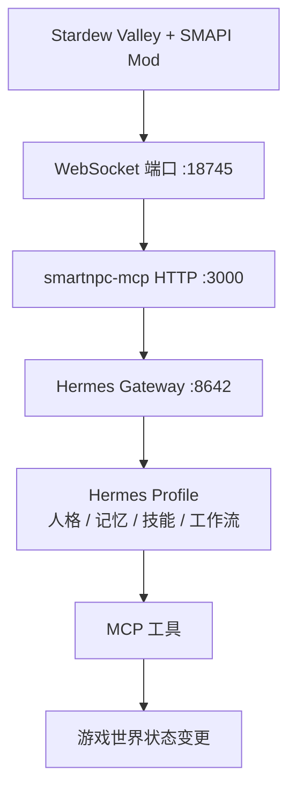
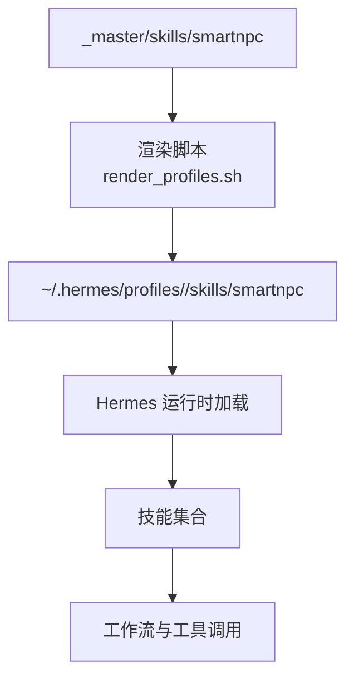
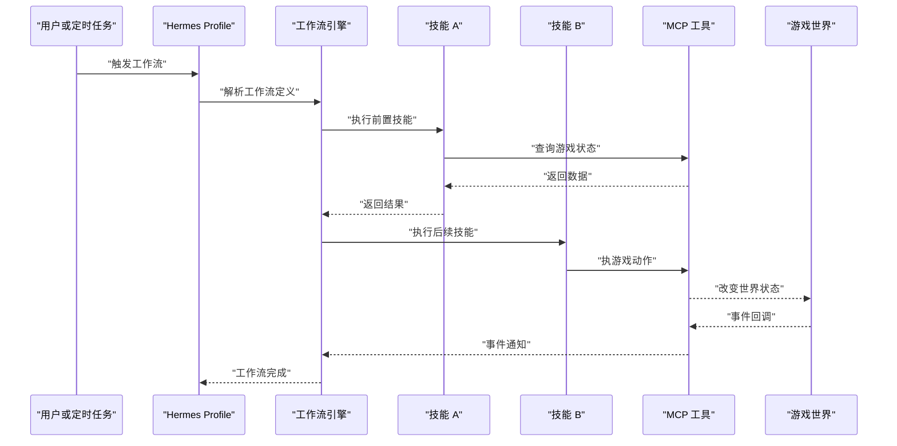
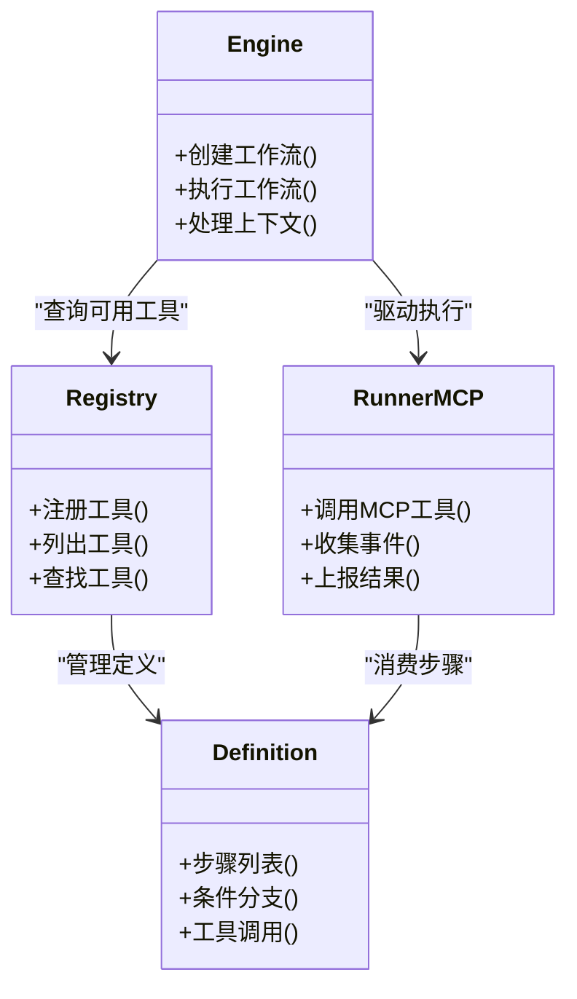
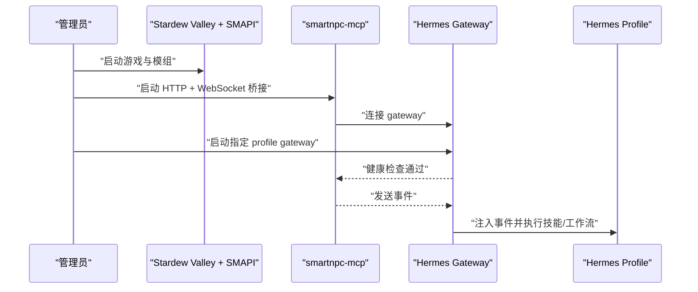
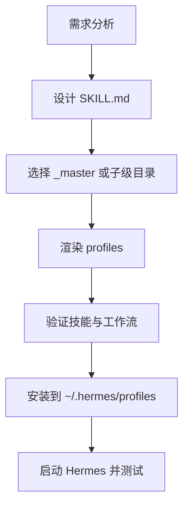
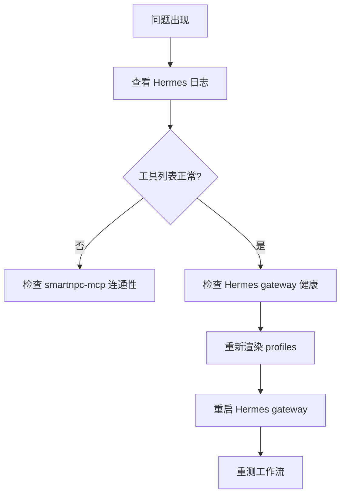
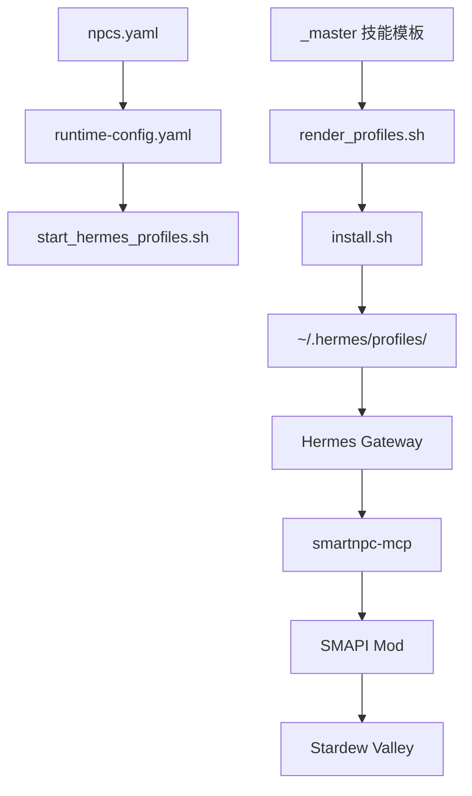

# 技能系统架构

<cite>
**本文引用的文件**   
- [hermes/README.md](file://SmartNPC/hermes/README.md)
- [npcs.yaml](file://SmartNPC/hermes/npcs.yaml)
- [runtime-config.yaml](file://SmartNPC/hermes/runtime-config.yaml)
- [install.sh](file://SmartNPC/hermes/install.sh)
- [render_profiles.sh](file://SmartNPC/scripts/render_profiles.sh)
- [start_hermes_profiles.sh](file://SmartNPC/scripts/start_hermes_profiles.sh)
- [reset_hermes_overlay.sh](file://SmartNPC/scripts/reset_hermes_overlay.sh)
- [hermes_context_projection.py](file://SmartNPC/scripts/hermes_context_projection.py)
- [hermes_model_output.py](file://SmartNPC/scripts/hermes_model_output.py)
- [patch_hermes_transcript.py](file://SmartNPC/scripts/patch_hermes_transcript.py)
- [current-architecture.md](file://SmartNPC/docs/current-architecture.md)
- [technical-architecture.md](file://SmartNPC/docs/technical-architecture.md)
- [hermes-profiles.md](file://SmartNPC/docs/hermes-profiles.md)
- [workflow-authoring.md](file://SmartNPC/docs/workflow-authoring.md)
- [mcp-tools.md](file://SmartNPC/docs/mcp-tools.md)
- [events.md](file://SmartNPC/docs/events.md)
- [registry.go](file://SmartNPC/smartnpc-mcp/adapters/stardew/tools/registry.go)
- [engine.go](file://SmartNPC/smartnpc-mcp/pkg/workflow/engine.go)
- [definition.go](file://SmartNPC/smartnpc-mcp/pkg/workflow/definition.go)
- [runner_mcp.go](file://SmartNPC/smartnpc-mcp/pkg/workflow/runner_mcp.go)
- [agent_bridge_server.go](file://SmartNPC/smartnpc-mcp/pkg/agentbridge/server.go)
- [ws_client.go](file://SmartNPC/smartnpc-mcp/adapters/stardew/bridge/ws_client.go)
</cite>

## 目录
1. [引言](#引言)
2. [项目结构与定位](#项目结构与定位)
3. [Hermes 技能文件格式规范](#hermes-技能文件格式规范)
4. [技能模板、继承与渲染机制](#技能模板继承与渲染机制)
5. [技能组合与工作流](#技能组合与工作流)
6. [技能注册与发现机制](#技能注册与发现机制)
7. [运行时加载与管理流程](#运行时加载与管理流程)
8. [内置技能分类与示例](#内置技能分类与示例)
9. [自定义技能开发指南](#自定义技能开发指南)
10. [性能优化与调试技巧](#性能优化与调试技巧)
11. [依赖关系分析](#依赖关系分析)
12. [故障排查](#故障排查)
13. [结论](#结论)

## 引言
本文件面向 SmartNPC 项目中基于 Hermes profile 的“技能系统”。它不是 Stardew Valley 游戏内直接读取的代码模块，而是由 Hermes 运行时在对话和自动化任务中调用的可复用能力单元。技能以 `SKILL.md` 为主要描述形式，配合 MCP 工具、工作流定义、NPC 人格文件和配置覆盖层共同构成完整的智能体行为体系。

核心目标：
- 说明 `SKILL.md` 的职责边界和常见结构。
- 解释 `_master` 模板目录与子级 NPC profile 的技能继承关系。
- 说明技能如何与工作流、MCP 工具协同完成农场管理、社交互动等复杂任务。
- 给出从需求到部署的自定义技能开发流程。
- 提供性能优化、调试和排错方法。

## 项目结构与定位
SmartNPC 的 Hermes 相关部分位于 `SmartNPC/hermes/`，其 README 明确了当前 M5 路线的整体链路：SMAPI Mod 通过 WebSocket 暴露游戏状态，`smartnpc-mcp` 将其转为 MCP 工具与事件，再交给 Hermes profile 做人格、记忆、技能和工作流编排。

**图表来源**
- [hermes/README.md:24-42](file://SmartNPC/hermes/README.md#L24-L42)
- [current-architecture.md](file://SmartNPC/docs/current-architecture.md)
- [technical-architecture.md](file://SmartNPC/docs/technical-architecture.md)

**章节来源**
- [hermes/README.md:1-23](file://SmartNPC/hermes/README.md#L1-L23)
- [current-architecture.md](file://SmartNPC/docs/current-architecture.md)
- [technical-architecture.md](file://SmartNPC/docs/technical-architecture.md)

## Hermes 技能文件格式规范
Hermes 技能的核心是 `SKILL.md`。它是一个面向大模型的可读描述文件，用于告诉 Hermes 某个技能“是什么、何时使用、需要哪些参数、会调用哪些工具、如何处理上下文和错误”。

典型职责包括：
- **技能描述**：说明该技能解决的问题、适用场景、前置条件和副作用。
- **参数定义**：明确输入参数的含义、必填性、取值范围以及与游戏概念（如物品、NPC、时间、地点）的映射。
- **执行逻辑**：描述步骤顺序、条件分支、失败回退策略，以及结果如何反馈给上层工作流或对话。
- **上下文管理**：说明如何读取或更新 NPC 记忆、日程、好感度、库存、天气、地图位置等上下文信息。
- **约束与策略**：结合 `critical-policy.md` 和行为规则，避免危险操作，例如误删作物、破坏建筑、无限循环交互。

虽然仓库中未直接展开每个 `SKILL.md` 的具体内容，但可以从以下路径确认技能的组织形态：
- `_master/skills/smartnpc/`：共享技能模板。
- `<npc>/skills/smartnpc/`：各 NPC 的子级技能目录，通常从 `_master` 渲染而来，不应直接编辑。

**章节来源**
- [hermes/README.md:1-23](file://SmartNPC/hermes/README.md#L1-L23)
- [hermes-profiles.md](file://SmartNPC/docs/hermes-profiles.md)
- [workflow-authoring.md](file://SmartNPC/docs/workflow-authoring.md)

## 技能模板、继承与渲染机制
### `_master` 模板目录的作用
`_master` 是“权威模板”所在目录。它保存所有共享的 Hermes 原生技能模板，以及全局覆盖配置和关键策略文件。子级 NPC profile 不直接维护重复技能，而是通过渲染脚本将 `_master` 中的技能合并到具体 NPC 的 profile 目录中。

这种设计带来几个好处：
- 统一维护基础技能，减少重复。
- 新增或修改通用技能时，只需改 `_master`。
- 防止非模板文件被意外提交。
- 让不同 NPC 在同一套基础技能之上拥有差异化扩展。

### 子级技能的继承关系
根据 README 的安装说明，安装脚本会把 `_master` 中的技能合并到目标 profile 的 `skills/smartnpc/` 目录；同时保留对 Hermes 内置 skill 的保护，不会覆盖已存在的内置能力。

**图表来源**
- [hermes/README.md:60-110](file://SmartNPC/hermes/README.md#L60-L110)
- [install.sh](file://SmartNPC/hermes/install.sh)

**章节来源**
- [hermes/README.md:1-23](file://SmartNPC/hermes/README.md#L1-L23)
- [hermes/README.md:60-110](file://SmartNPC/hermes/README.md#L60-L110)
- [install.sh](file://SmartNPC/hermes/install.sh)

## 技能组合与工作流
技能本身通常是原子或半原子的能力，比如“查看库存”“向 NPC 打招呼”“关闭农场设施”“采集资源”。复杂任务则由工作流把多个技能串联起来，形成稳定、可复用的自动化流程。

仓库中的“提示词导出”目录展示了典型的内置工作流定义，例如：
- 农场日常：农场照料、农场清理、傍晚关闭、农场扩建、采集资源。
- 社交与探索：社交互动、轮询社交、挖矿。
- 环境辅助：天气记账。

**图表来源**
- [workflow-authoring.md](file://SmartNPC/docs/workflow-authoring.md)
- [mcp-tools.md](file://SmartNPC/docs/mcp-tools.md)
- [events.md](file://SmartNPC/docs/events.md)

**章节来源**
- [workflow-authoring.md](file://SmartNPC/docs/workflow-authoring.md)
- [mcp-tools.md](file://SmartNPC/docs/mcp-tools.md)
- [events.md](file://SmartNPC/docs/events.md)

## 技能注册与发现机制
技能注册与发现涉及两个层面：
1. **Hermes 侧**：Hermes 从 profile 目录中加载 `SOUL.md`、`critical-policy.md`、`config-overlay.yaml` 以及 `skills/smartnpc/` 下的技能模板。
2. **SmartNPC MCP 侧**：MCP 工具在工作流执行阶段被注册、发现和调用，最终映射到 Stardew Valley 游戏能力。

### Hermes 侧技能发现
Hermes profile 的生命周期由 `hermes -p <name>` 控制。安装脚本会把 `_master` 中的技能和配置覆盖层同步到 `~/.hermes/profiles/<npc>/`，使 Hermes 能自动发现对应技能。

### MCP 工具注册与发现
SmartNPC 的 Go 实现中，MCP 工具和工作流有明确的注册表和执行器：

**图表来源**
- [registry.go](file://SmartNPC/smartnpc-mcp/adapters/stardew/tools/registry.go)
- [engine.go](file://SmartNPC/smartnpc-mcp/pkg/workflow/engine.go)
- [definition.go](file://SmartNPC/smartnpc-mcp/pkg/workflow/definition.go)
- [runner_mcp.go](file://SmartNPC/smartnpc-mcp/pkg/workflow/runner_mcp.go)

**章节来源**
- [registry.go](file://SmartNPC/smartnpc-mcp/adapters/stardew/tools/registry.go)
- [engine.go](file://SmartNPC/smartnpc-mcp/pkg/workflow/engine.go)
- [definition.go](file://SmartNPC/smartnpc-mcp/pkg/workflow/definition.go)
- [runner_mcp.go](file://SmartNPC/smartnpc-mcp/pkg/workflow/runner_mcp.go)

## 运行时加载与管理流程
### 多 NPC 配置
`npcs.yaml` 是 SmartNPC 的 NPC 元数据注册中心。每个 NPC 包含 id、游戏内名称、显示名、网关端口、是否启用、同伴等信息。脚本和校验逻辑依赖这个文件，避免 profile、渲染和运行时的配置漂移。

### 运行时配置生成
`runtime-config.yaml` 是由 `scripts/render_profiles.sh` 生成的多 profile fan-out 配置，供 `smartnpc-mcp --hermes-config` 使用。它定义了每个 Hermes profile 的名称、NPC 过滤条件、gateway URL、会话名、模型和 API Key 环境变量。

### 启动顺序
根据 README，典型启动顺序为：
1. 启动 Stardew Valley + SMAPI Mod。
2. 启动 `smartnpc-mcp`，并连接 WebSocket 与 Hermes gateway。
3. 在 WSL 中启动指定 Hermes profile 的 gateway。

**图表来源**
- [hermes/README.md:44-100](file://SmartNPC/hermes/README.md#L44-L100)
- [npcs.yaml](file://SmartNPC/hermes/npcs.yaml)
- [runtime-config.yaml](file://SmartNPC/hermes/runtime-config.yaml)

**章节来源**
- [hermes/README.md:44-100](file://SmartNPC/hermes/README.md#L44-L100)
- [npcs.yaml:1-70](file://SmartNPC/hermes/npcs.yaml#L1-L70)
- [runtime-config.yaml:1-15](file://SmartNPC/hermes/runtime-config.yaml#L1-L15)

## 内置技能分类与示例
从仓库结构和文档可以归纳出以下几类技能与工作流：

| 分类 | 职责 | 典型技能或工作流 | 说明 |
|---|---|---|---|
| 核心技能 | 提供对话、记忆、日程、基础查询等通用能力 | 核心技能、日程管理、对话扩展 | 作为其他技能的基础能力 |
| 农场管理 | 管理作物、设施、资源采集和农场关闭 | 农场照料、农场清理、傍晚关闭、农场扩建、采集资源、收获 | 与游戏世界状态强相关 |
| 社交互动 | 管理 NPC 问候、送礼、聊天、群聊、互访 | 问候、社交互动、轮询社交、与其他 NPC 互动、拜访 | 侧重人际关系和对话行为 |
| 环境与辅助 | 关注天气、挖矿、日志记账等 | 天气记账、挖矿 | 补充主循环之外的行为 |

这些分类来自目录命名和“提示词导出”中的内置工作流定义，实际 `SKILL.md` 内容应由 Hermes 在运行时按 profile 加载。

**章节来源**
- [workflow-authoring.md](file://SmartNPC/docs/workflow-authoring.md)
- [mcp-tools.md](file://SmartNPC/docs/mcp-tools.md)
- [events.md](file://SmartNPC/docs/events.md)

## 自定义技能开发指南
### 第一步：需求分析
明确技能要解决什么问题。建议回答：
- 目标 NPC 是谁？
- 在游戏世界中观察什么状态？
- 需要调用哪些 MCP 工具？
- 成功后有什么副作用？
- 失败时如何回退或告知用户？

### 第二步：确定技能归属
- 如果技能是所有 NPC 共享的基础能力，放到 `_master/skills/smartnpc/`。
- 如果技能只属于某个 NPC，则在对应 `<npc>/skills/smartnpc/` 下创建，并通过渲染脚本合并。

### 第三步：编写 `SKILL.md`
应包含：
- 技能名称与用途。
- 触发条件。
- 输入参数。
- 调用工具和步骤。
- 上下文读写方式。
- 错误处理和重试策略。
- 与现有工作流的集成点。

### 第四步：关联工作流
如果技能需要多步协作，应在工作流定义中声明步骤顺序、条件分支和异常处理。不要把所有逻辑塞进一个技能。

### 第五步：渲染与验证
执行渲染脚本后，使用 profile 验证命令检查技能是否生效，并通过 Hermes 日志确认工具列表是否正常。

### 第六步：安装与部署
重新运行安装脚本，把 `_master` 或子级变化同步到 `~/.hermes/profiles/<npc>/`，然后重启 Hermes gateway。

**图表来源**
- [hermes/README.md:88-110](file://SmartNPC/hermes/README.md#L88-L110)
- [render_profiles.sh](file://SmartNPC/scripts/render_profiles.sh)
- [install.sh](file://SmartNPC/hermes/install.sh)

**章节来源**
- [hermes/README.md:88-110](file://SmartNPC/hermes/README.md#L88-L110)
- [render_profiles.sh](file://SmartNPC/scripts/render_profiles.sh)
- [install.sh](file://SmartNPC/hermes/install.sh)

## 性能优化与调试技巧
### 性能优化建议
- **最小化工具调用**：把多次查询合并到一个步骤，避免频繁跨进程通信。
- **缓存上下文**：对不频繁变化的状态，尽量通过技能内部逻辑缓存，而不是每次重新查询。
- **限制工作流深度**：避免过长链式调用，必要时拆分为多个工作流。
- **避免无限重试**：设置最大重试次数和超时。
- **合理拆分技能**：小粒度、职责单一的技能更容易复用和优化。

### 调试技巧
- 查看 Hermes 日志：`~/.hermes/profiles/<npc>/logs/`。
- 检查工具列表：启动 Hermes profile 后发一条消息，它会先调用 `native-mcp` 列出工具。
- 检查 MCP 连通性：从 WSL 访问 `http://127.0.0.1:3000/mcp`，预期服务存活。
- 检查 Hermes gateway 健康：访问 `http://127.0.0.1:8642/health`。
- 使用渲染脚本重新生成 profile，确保 `_master` 变更生效。
- 使用重置脚本恢复 overlay 配置，避免手动修改导致配置漂移。

**图表来源**
- [hermes/README.md:112-147](file://SmartNPC/hermes/README.md#L112-L147)
- [reset_hermes_overlay.sh](file://SmartNPC/scripts/reset_hermes_overlay.sh)

**章节来源**
- [hermes/README.md:112-147](file://SmartNPC/hermes/README.md#L112-L147)
- [reset_hermes_overlay.sh](file://SmartNPC/scripts/reset_hermes_overlay.sh)

## 依赖关系分析
Hermes 技能系统的依赖可以分为三层：
- **配置层**：`npcs.yaml`、`runtime-config.yaml`、各 NPC 的 `SOUL.md`、`critical-policy.md`、`config-overlay.yaml`。
- **渲染与部署层**：`render_profiles.sh`、`install.sh`、`start_hermes_profiles.sh`。
- **运行时与工具层**：Hermes profile、smartnpc-mcp、SMAPI Mod、Stardew Valley。

**图表来源**
- [npcs.yaml](file://SmartNPC/hermes/npcs.yaml)
- [runtime-config.yaml](file://SmartNPC/hermes/runtime-config.yaml)
- [render_profiles.sh](file://SmartNPC/scripts/render_profiles.sh)
- [install.sh](file://SmartNPC/hermes/install.sh)
- [start_hermes_profiles.sh](file://SmartNPC/scripts/start_hermes_profiles.sh)
- [hermes/README.md:24-42](file://SmartNPC/hermes/README.md#L24-L42)

**章节来源**
- [npcs.yaml:1-70](file://SmartNPC/hermes/npcs.yaml#L1-L70)
- [runtime-config.yaml:1-15](file://SmartNPC/hermes/runtime-config.yaml#L1-L15)
- [hermes/README.md:24-42](file://SmartNPC/hermes/README.md#L24-L42)

## 故障排查
常见问题与处理思路：

| 现象 | 可能原因 | 处理建议 |
|---|---|---|
| Hermes 找不到技能 | `_master` 未正确渲染或未安装 | 重新执行 `render_profiles.sh` 和 `install.sh` |
| MCP 工具不可用 | smartnpc-mcp 未启动或端口不通 | 检查 `:3000` 连通性和日志 |
| Hermes gateway 无响应 | Hermes 未启动或端口冲突 | 检查 `:8642` 和健康端点 |
| 配置不一致 | 手动修改了非 `_master` 的文件 | 使用重置脚本恢复 overlay，再重新渲染 |
| 工作流执行失败 | 工具参数错误或游戏状态不满足条件 | 查看 transcript 和工作流日志，缩小失败步骤 |
| 多 NPC 路由异常 | `npcs.yaml` 与实际 profile 不一致 | 检查 NPC id、game_name、gateway_port |

**章节来源**
- [hermes/README.md:112-147](file://SmartNPC/hermes/README.md#L112-L147)
- [npcs.yaml:1-70](file://SmartNPC/hermes/npcs.yaml#L1-L70)
- [reset_hermes_overlay.sh](file://SmartNPC/scripts/reset_hermes_overlay.sh)

## 结论
Hermes 技能系统在 SmartNPC 中承担的是“智能体行为编排”的角色：它不直接修改游戏代码，而是通过 profile、技能描述、工作流和 MCP 工具与 Stardew Valley 进行双向协作。`SKILL.md` 是技能契约，`_master` 是权威模板，`npcs.yaml` 是多 NPC 注册中心，`runtime-config.yaml` 是运行时 fan-out 配置，而 smartnpc-mcp 则是把游戏能力暴露给 Hermes 的桥梁。

最佳实践是：
- 把通用能力放在 `_master`，把 NPC 特有行为放在子级 profile。
- 用工作流组织多技能协作，而不是让单个技能承担过多职责。
- 始终通过渲染和安装脚本同步配置，避免手工漂移。
- 用日志、健康检查和工具列表快速定位问题。
- 在性能和稳定性之间平衡工具调用频率、重试策略和上下文缓存。