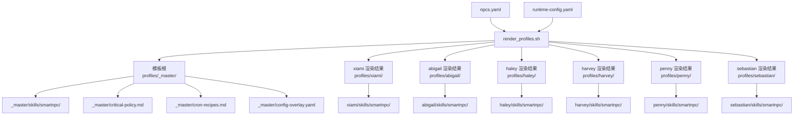
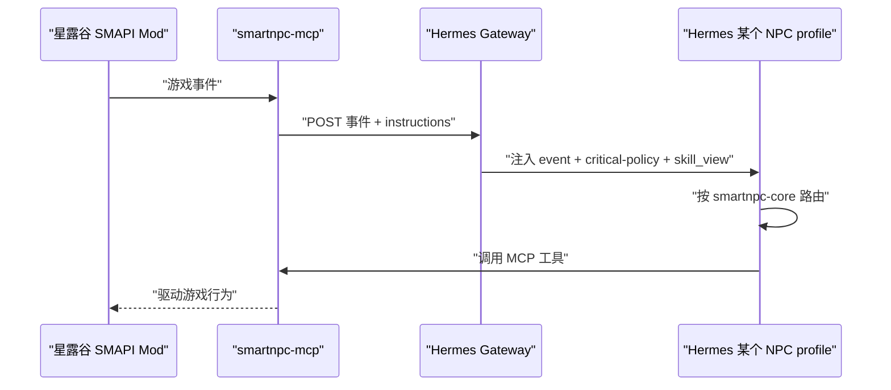
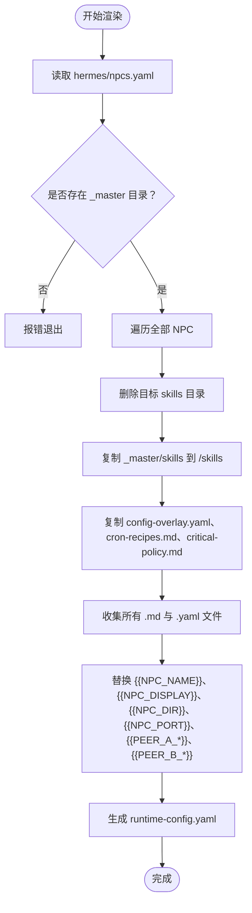
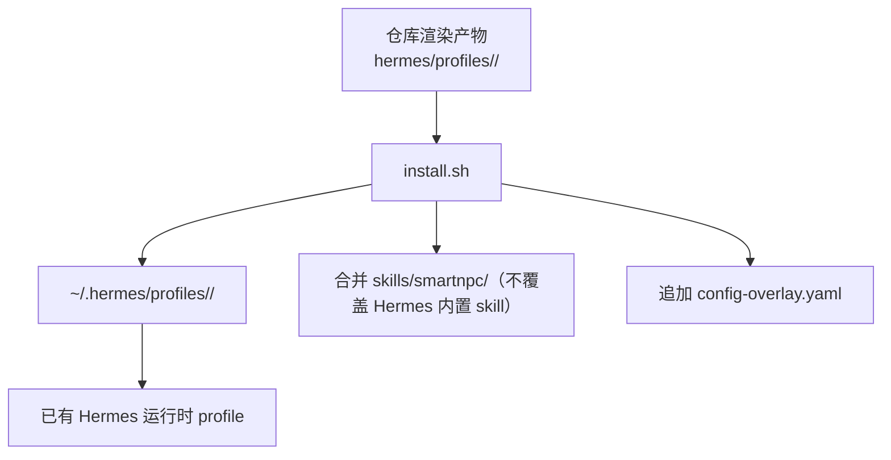
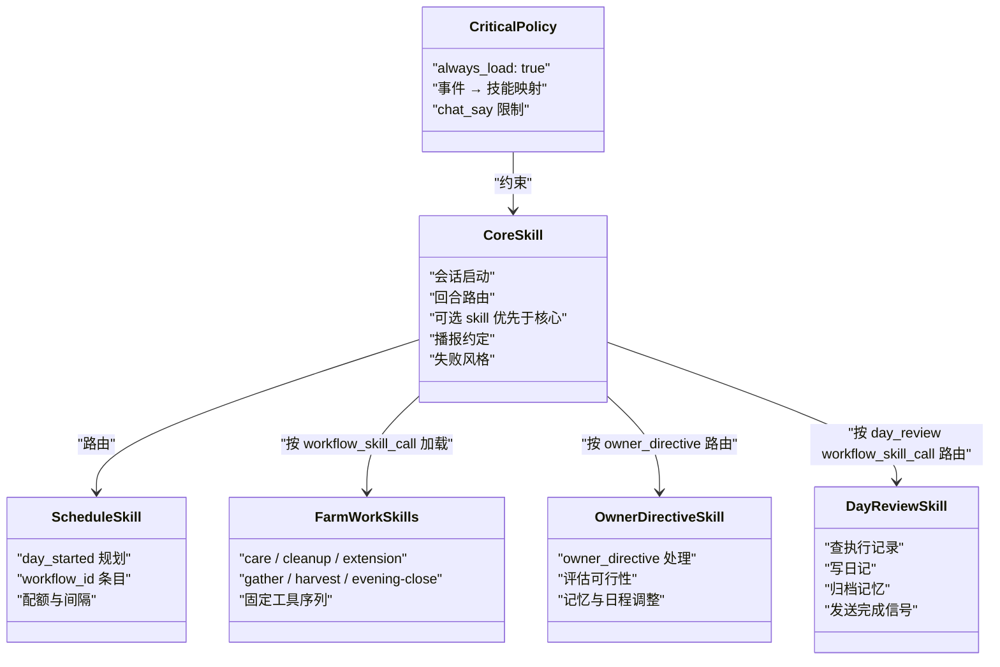
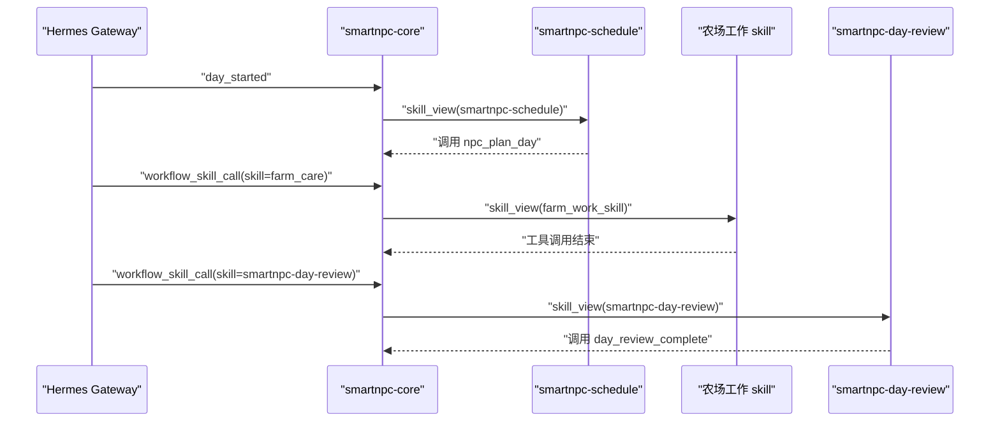
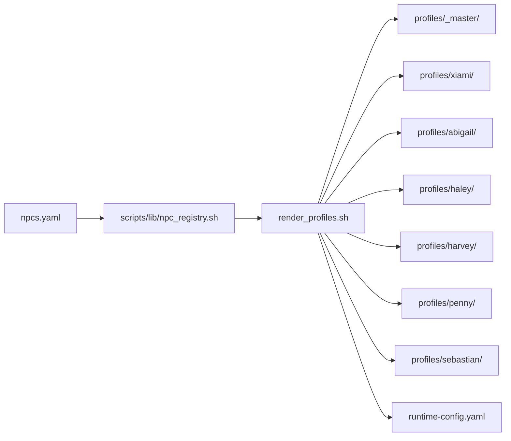

# 技能继承与模板系统

<cite>
**本文引用的文件**   
- [hermes/README.md](file://SmartNPC/hermes/README.md)
- [npcs.yaml](file://SmartNPC/hermes/npcs.yaml)
- [runtime-config.yaml](file://SmartNPC/hermes/runtime-config.yaml)
- [render_profiles.sh](file://SmartNPC/scripts/render_profiles.sh)
- [_master/critical-policy.md](file://SmartNPC/hermes/profiles/_master/critical-policy.md)
- [_master/skills/smartnpc/smartnpc-core/SKILL.md](file://SmartNPC/hermes/profiles/_master/skills/smartnpc/smartnpc-core/SKILL.md)
- [_master/skills/smartnpc/smartnpc-schedule/SKILL.md](file://SmartNPC/hermes/profiles/_master/skills/smartnpc/smartnpc-schedule/SKILL.md)
- [_master/skills/smartnpc/smartnpc-memory/SKILL.md](file://SmartNPC/hermes/profiles/_master/skills/smartnpc/smartnpc-memory/SKILL.md)
- [_master/skills/smartnpc/smartnpc-owner-directive/SKILL.md](file://SmartNPC/hermes/profiles/_master/skills/smartnpc/smartnpc-owner-directive/SKILL.md)
- [_master/skills/smartnpc/smartnpc-day-review/SKILL.md](file://SmartNPC/hermes/profiles/_master/skills/smartnpc/smartnpc-day-review/SKILL.md)
- [_master/skills/smartnpc/smartnpc-farm-care/SKILL.md](file://SmartNPC/hermes/profiles/_master/skills/smartnpc/smartnpc-farm-care/SKILL.md)
- [_master/skills/smartnpc/smartnpc-farm-cleanup/SKILL.md](file://SmartNPC/hermes/profiles/_master/skills/smartnpc/smartnpc-farm-cleanup/SKILL.md)
- [_master/skills/smartnpc/smartnpc-farm-extension/SKILL.md](file://SmartNPC/hermes/profiles/_master/skills/smartnpc/smartnpc-farm-extension/SKILL.md)
- [_master/skills/smartnpc/smartnpc-farm-gather/SKILL.md](file://SmartNPC/hermes/profiles/_master/skills/smartnpc/smartnpc-farm-gather/SKILL.md)
- [_master/skills/smartnpc/smartnpc-farm-harvest/SKILL.md](file://SmartNPC/hermes/profiles/_master/skills/smartnpc/smartnpc-farm-harvest/SKILL.md)
- [_master/skills/smartnpc/smartnpc-farm-evening-close/SKILL.md](file://SmartNPC/hermes/profiles/_master/skills/smartnpc/smartnpc-farm-evening-close/SKILL.md)
</cite>

## 目录
1. [引言](#引言)
2. [项目结构](#项目结构)
3. [核心组件](#核心组件)
4. [架构总览](#架构总览)
5. [详细组件分析](#详细组件分析)
6. [依赖关系分析](#依赖关系分析)
7. [性能考量](#性能考量)
8. [故障排查指南](#故障排查指南)
9. [结论](#结论)
10. [附录：自定义 NPC 配置指南](#附录自定义-npc-配置指南)

## 引言
本文件系统性说明 SmartNPC 的 Hermes 技能继承与模板体系。其核心思想是：`_master` 目录作为基础模板，定义所有 NPC 共享的技能、策略和运行时规则；每个具体 NPC profile（xiami、abigail、haley、harvey、penny、sebastian）通过渲染脚本复制 `_master` 技能树，并在需要时覆盖特定技能文件。

需要特别区分两个层面：
- **仓库中的“渲染后 profile”**：由 `scripts/render_profiles.sh` 从 `_master` 复制并替换占位符生成，位于 `SmartNPC/hermes/profiles/<npc>/skills/...`。
- **Hermes 运行时的“实际 profile”**：首次执行时会创建到 `~/.hermes/profiles/<name>/`，并由 `install.sh` 把仓库中的 SOUL、skills 和 config-overlay 合并进去。

本技术文档聚焦前者——即仓库内的模板机制、继承规则和渲染行为。

## 项目结构
Hermes profile 源组织在 `SmartNPC/hermes/profiles/` 下：
- `_master/`：基础模板，包含共享技能、全局策略、cron 配方和配置覆盖层。
- `<npc>/`：渲染后的具体 NPC profile，结构与 `_master` 镜像一致，但内容来自模板替换。
- `npcs.yaml`：NPC 元数据注册表，决定渲染哪些 NPC、网关端口、对等 NPC 和启用状态。
- `runtime-config.yaml`：由渲染脚本根据 `npcs.yaml` 生成的多 profile 路由配置。
- `scripts/render_profiles.sh`：唯一负责将 `_master` 渲染为各 NPC profile 的工具。

**图表来源**
- [render_profiles.sh:1-183](file://SmartNPC/scripts/render_profiles.sh#L1-L183)
- [npcs.yaml:1-70](file://SmartNPC/hermes/npcs.yaml#L1-L70)
- [runtime-config.yaml:1-15](file://SmartNPC/hermes/runtime-config.yaml#L1-L15)

**章节来源**
- [hermes/README.md:1-147](file://SmartNPC/hermes/README.md#L1-L147)
- [npcs.yaml:1-70](file://SmartNPC/hermes/npcs.yaml#L1-L70)
- [runtime-config.yaml:1-15](file://SmartNPC/hermes/runtime-config.yaml#L1-L15)
- [render_profiles.sh:1-183](file://SmartNPC/scripts/render_profiles.sh#L1-L183)

## 核心组件
本节列出构成技能继承体系的关键文件和职责。

| 组件 | 路径 | 职责 |
|---|---|---|
| 模板根目录 | `SmartNPC/hermes/profiles/_master/` | 提供所有 NPC 共享的 skill、critical policy、cron recipes 和配置覆盖层。 |
| 渲染脚本 | `SmartNPC/scripts/render_profiles.sh` | 读取 `npcs.yaml`，复制 `_master` 技能树到每个 NPC，替换占位符，并生成 `runtime-config.yaml`。 |
| NPC 注册表 | `SmartNPC/hermes/npcs.yaml` | 声明 xiami、abigail、haley、harvey、penny、sebastian 的 id、游戏名、显示名、网关端口、对等 NPC 和启用标志。 |
| 运行时配置 | `SmartNPC/hermes/runtime-config.yaml` | 描述 smartnpc-mcp 应连接到的各 NPC gateway，由渲染脚本自动更新。 |
| 关键策略 | `_master/critical-policy.md` | 以 always-load 标记注入，定义事件到技能的硬性路由和不可协商规则。 |
| 核心技能 | `_master/skills/smartnpc/smartnpc-core/SKILL.md` | 定义会话启动、回合路由、播报约定、失败风格，以及可选 skill 与本核心的冲突优先级。 |
| 日程技能 | `_master/skills/smartnpc/smartnpc-schedule/SKILL.md` | 定义 day_started 时如何规划全天 workflow 条目。 |
| 记忆策略 | `_master/skills/smartnpc/smartnpc-memory/SKILL.md` | 规定长期记忆的写入范围、读取时机和风格。 |
| 农场主指示 | `_master/skills/smartnpc/smartnpc-owner-directive/SKILL.md` | 处理 owner_directive 事件，评估可行性并调整记忆或日程。 |
| 日终复盘 | `_master/skills/smartnpc/smartnpc-day-review/SKILL.md` | 触发于 22:30 自动追加的 day_review，负责写日记、归档记忆并发送完成信号。 |
| 农场工作技能 | `_master/skills/smartnpc/smartnpc-{care,cleanup,extension,gather,harvest,evening-close}/SKILL.md` | 定义各类农活的标准工具调用序列、参数、禁止动作和性格影响。 |

**章节来源**
- [hermes/README.md:1-147](file://SmartNPC/hermes/README.md#L1-L147)
- [render_profiles.sh:1-183](file://SmartNPC/scripts/render_profiles.sh#L1-L183)
- [_master/critical-policy.md:1-33](file://SmartNPC/hermes/profiles/_master/critical-policy.md#L1-L33)
- [_master/skills/smartnpc/smartnpc-core/SKILL.md:1-68](file://SmartNPC/hermes/profiles/_master/skills/smartnpc/smartnpc-core/SKILL.md#L1-L68)
- [_master/skills/smartnpc/smartnpc-schedule/SKILL.md:1-124](file://SmartNPC/hermes/profiles/_master/skills/smartnpc/smartnpc-schedule/SKILL.md#L1-L124)
- [_master/skills/smartnpc/smartnpc-memory/SKILL.md:1-45](file://SmartNPC/hermes/profiles/_master/skills/smartnpc/smartnpc-memory/SKILL.md#L1-L45)
- [_master/skills/smartnpc/smartnpc-owner-directive/SKILL.md:1-50](file://SmartNPC/hermes/profiles/_master/skills/smartnpc/smartnpc-owner-directive/SKILL.md#L1-L50)
- [_master/skills/smartnpc/smartnpc-day-review/SKILL.md:1-70](file://SmartNPC/hermes/profiles/_master/skills/smartnpc/smartnpc-day-review/SKILL.md#L1-L70)

## 架构总览
SmartNPC 的 M5 目标链路如下：SMAPI Mod → WebSocket → smartnpc-mcp HTTP → MCP → Hermes profile。Hermes profile 承担人格、记忆、技能和 tool planning；smartnpc-mcp 只做游戏能力边界，包括 MCP tool、事件通知和硬校验。

**图表来源**
- [hermes/README.md:23-42](file://SmartNPC/hermes/README.md#L23-L42)

该图展示的是整体运行链路，不直接映射到单个 source 文件的内部实现，因此不包含“图表来源”之外的代码级引用。

## 详细组件分析

### 模板渲染与继承模型
仓库中的继承不是运行时动态解析 `_master` 子目录；而是**构建期渲染**。渲染过程如下：

**图表来源**
- [render_profiles.sh:1-183](file://SmartNPC/scripts/render_profiles.sh#L1-L183)

关键点：
- 渲染脚本会先清空目标 `<npc>/skills`，再完整复制 `_master/skills`，因此 `_master` 中删除的 skill 会在下次渲染时被移除。
- 渲染只复制，不会做“同名文件覆盖优先”的合并逻辑。若要在某 NPC 上拥有不同实现，必须在渲染前在该 NPC 目录下放置对应文件，或者使用运行时安装阶段的合并语义（见下一节）。
- 占位符替换发生在每个渲染文件中，因此同一份 `_master/skills/smartnpc/smartnpc-core/SKILL.md` 会被分别渲染成 xiami、abigail 等各自副本。

**章节来源**
- [render_profiles.sh:1-183](file://SmartNPC/scripts/render_profiles.sh#L1-L183)

### 运行时安装与二次合并
仓库中的 render 产物进入版本控制，但真正的运行 profile 位于 `~/.hermes/profiles/<name>/`。根据 `hermes/README.md`，`install.sh` 会：
1. 把每个 `<npc>/SOUL.md` 覆盖到对应运行 profile。
2. 把每个 `<npc>/skills/smartnpc/` 合并到对应 profile，**不覆盖 Hermes 内置 skill**。
3. 把 `config-overlay.yaml` 追加到 `config.yaml`，并跳过已存在的 `mcp_servers` 或 `API_SERVER_ENABLED` 字段。

这意味着：**仓库渲染产物用于保持一致的模板基线，而运行时安装阶段才是真正进行“子级覆盖父级”的位置。**

**图表来源**
- [hermes/README.md:43-103](file://SmartNPC/hermes/README.md#L43-L103)

**章节来源**
- [hermes/README.md:43-103](file://SmartNPC/hermes/README.md#L43-L103)

### 技能加载优先级规则
当前代码库中存在两套“优先级”，但它们作用于不同层次：

| 层次 | 规则 | 依据 |
|---|---|---|
| 模板渲染层 | `_master/skills` 被原样复制到 `<npc>/skills`；不存在“同名覆盖优先”的合并逻辑。 | [render_profiles.sh:83-116](file://SmartNPC/scripts/render_profiles.sh#L83-L116) |
| 运行时安装层 | `<npc>/skills/smartnpc/` 合并到运行 profile，且“不覆盖 Hermes 内置 skill”。 | [hermes/README.md:66-74](file://SmartNPC/hermes/README.md#L66-L74) |
| 运行时推理层 | 当回合触发可选 skill 时，该 skill 的规则在与 smartnpc-core 冲突时优先。 | [_master/skills/smartnpc/smartnpc-core/SKILL.md:10-14](file://SmartNPC/hermes/profiles/_master/skills/smartnpc/smartnpc-core/SKILL.md#L10-L14) |
| 系统提示层 | `critical-policy.md` 标记 `always_load: true`，作为压缩保护下的硬性路由器。 | [_master/critical-policy.md:1-11](file://SmartNPC/hermes/profiles/_master/critical-policy.md#L1-L11) |

因此，“子级与父级技能冲突”的正确理解是：
- 如果希望某个 NPC 拥有不同的技能实现，应在运行时安装阶段让 `<npc>/skills/smartnpc/<skill>/SKILL.md` 存在，从而覆盖从 `_master` 复制过来的默认实现。
- 如果只修改了 `_master`，必须重新运行 `scripts/render_profiles.sh`，否则仓库渲染产物不会反映变更。
- 如果只想改变某个 NPC 的行为而不破坏其他 NPC，应避免直接编辑渲染后的 `<npc>/skills`，而应确保该覆盖存在于渲染流程能写入的位置，或通过运行时安装机制注入。

**章节来源**
- [render_profiles.sh:83-116](file://SmartNPC/scripts/render_profiles.sh#L83-L116)
- [hermes/README.md:66-74](file://SmartNPC/hermes/README.md#L66-L74)
- [_master/skills/smartnpc/smartnpc-core/SKILL.md:10-14](file://SmartNPC/hermes/profiles/_master/skills/smartnpc/smartnpc-core/SKILL.md#L10-L14)
- [_master/critical-policy.md:1-11](file://SmartNPC/hermes/profiles/_master/critical-policy.md#L1-L11)

### 技能目录结构与命名规范
每个 skill 是一个独立文件夹，遵循以下约定：

| 层级 | 含义 | 示例 |
|---|---|---|
| `skills/` | 技能根目录 | `profiles/_master/skills/` |
| `smartnpc/` | SmartNPC 专属 skill 命名空间 | `skills/smartnpc/` |
| `<skill-name>/` | 单个技能包 | `smartnpc-core`、`smartnpc-schedule`、`smartnpc-farm-care` |
| `SKILL.md` | 技能入口文档 | 每个 skill 文件夹下必须包含该文件 |
| `config-overlay.yaml` | 每 NPC 配置覆盖层 | 渲染后复制到 `<npc>/config-overlay.yaml` |
| `critical-policy.md` | 全局关键策略 | 渲染后复制到 `<npc>/critical-policy.md` |
| `cron-recipes.md` | cron 配方 | 渲染后复制到 `<npc>/cron-recipes.md` |
| `SOUL.md` | 手写人格文件 | 不由渲染脚本管理，属于 per-NPC 手动维护 |

现有技能分类如下：

| 类别 | 技能 | 职责 |
|---|---|---|
| 核心路由 | `smartnpc-core` | 会话启动、事件路由、播报约定、失败风格。 |
| 日程规划 | `smartnpc-schedule` | day_started 时调用 npc_plan_day 提交 5-7 条 workflow 条目。 |
| 记忆 | `smartnpc-memory` | 仅保存持久性事实，避免保存原始对话或临时推理。 |
| 农场主指示 | `smartnpc-owner-directive` | 评估 owner_directive，决定是否采纳并调整记忆或日程。 |
| 日终复盘 | `smartnpc-day-review` | 查执行记录、读经济指标、写结构化日记、归档记忆、发送完成信号。 |
| 农场养护 | `smartnpc-farm-care` | 浇水、清杂物、补种、填充空隙、存箱。 |
| 农场清理 | `smartnpc-farm-cleanup` | 清杂物、砍树砸石、捡采集物。 |
| 农场开垦 | `smartnpc-farm-extension` | 清杂物→翻地→施肥→播种→浇水。 |
| 资源采集 | `smartnpc-farm-gather` | 捡野物、砍树砸石。 |
| 农场收获 | `smartnpc-farm-harvest` | 示例驱动的收获、出货、存箱、补种组合。 |
| 傍晚收尾 | `smartnpc-farm-evening-close` | 最后一轮收割、入库、补种。 |

**章节来源**
- [_master/skills/smartnpc/smartnpc-core/SKILL.md:1-68](file://SmartNPC/hermes/profiles/_master/skills/smartnpc/smartnpc-core/SKILL.md#L1-L68)
- [_master/skills/smartnpc/smartnpc-schedule/SKILL.md:1-124](file://SmartNPC/hermes/profiles/_master/skills/smartnpc/smartnpc-schedule/SKILL.md#L1-L124)
- [_master/skills/smartnpc/smartnpc-memory/SKILL.md:1-45](file://SmartNPC/hermes/profiles/_master/skills/smartnpc/smartnpc-memory/SKILL.md#L1-L45)
- [_master/skills/smartnpc/smartnpc-owner-directive/SKILL.md:1-50](file://SmartNPC/hermes/profiles/_master/skills/smartnpc/smartnpc-owner-directive/SKILL.md#L1-L50)
- [_master/skills/smartnpc/smartnpc-day-review/SKILL.md:1-70](file://SmartNPC/hermes/profiles/_master/skills/smartnpc/smartnpc-day-review/SKILL.md#L1-L70)
- [_master/skills/smartnpc/smartnpc-farm-care/SKILL.md:1-102](file://SmartNPC/hermes/profiles/_master/skills/smartnpc/smartnpc-farm-care/SKILL.md#L1-L102)
- [_master/skills/smartnpc/smartnpc-farm-cleanup/SKILL.md:1-90](file://SmartNPC/hermes/profiles/_master/skills/smartnpc/smartnpc-farm-cleanup/SKILL.md#L1-L90)
- [_master/skills/smartnpc/smartnpc-farm-extension/SKILL.md:1-137](file://SmartNPC/hermes/profiles/_master/skills/smartnpc/smartnpc-farm-extension/SKILL.md#L1-L137)
- [_master/skills/smartnpc/smartnpc-farm-gather/SKILL.md:1-83](file://SmartNPC/hermes/profiles/_master/skills/smartnpc/smartnpc-farm-gather/SKILL.md#L1-L83)
- [_master/skills/smartnpc/smartnpc-farm-harvest/SKILL.md:1-200](file://SmartNPC/hermes/profiles/_master/skills/smartnpc/smartnpc-farm-harvest/SKILL.md#L1-L200)
- [_master/skills/smartnpc/smartnpc-farm-evening-close/SKILL.md:1-94](file://SmartNPC/hermes/profiles/_master/skills/smartnpc/smartnpc-farm-evening-close/SKILL.md#L1-L94)

### 运行时继承链解析
Hermes 运行时并不直接扫描 `_master` 目录；它消费的是已安装到 `~/.hermes/profiles/<name>/` 的文件。不过，从智能体视角看，继承链可以理解为：

**图表来源**
- [_master/critical-policy.md:1-33](file://SmartNPC/hermes/profiles/_master/critical-policy.md#L1-L33)
- [_master/skills/smartnpc/smartnpc-core/SKILL.md:1-68](file://SmartNPC/hermes/profiles/_master/skills/smartnpc/smartnpc-core/SKILL.md#L1-L68)
- [_master/skills/smartnpc/smartnpc-schedule/SKILL.md:1-124](file://SmartNPC/hermes/profiles/_master/skills/smartnpc/smartnpc-schedule/SKILL.md#L1-L124)
- [_master/skills/smartnpc/smartnpc-owner-directive/SKILL.md:1-50](file://SmartNPC/hermes/profiles/_master/skills/smartnpc/smartnpc-owner-directive/SKILL.md#L1-L50)
- [_master/skills/smartnpc/smartnpc-day-review/SKILL.md:1-70](file://SmartNPC/hermes/profiles/_master/skills/smartnpc/smartnpc-day-review/SKILL.md#L1-L70)

#### 事件到技能的调度时序

**图表来源**
- [_master/skills/smartnpc/smartnpc-core/SKILL.md:15-41](file://SmartNPC/hermes/profiles/_master/skills/smartnpc/smartnpc-core/SKILL.md#L15-L41)
- [_master/skills/smartnpc/smartnpc-schedule/SKILL.md:14-31](file://SmartNPC/hermes/profiles/_master/skills/smartnpc/smartnpc-schedule/SKILL.md#L14-L31)
- [_master/skills/smartnpc/smartnpc-day-review/SKILL.md:8-23](file://SmartNPC/hermes/profiles/_master/skills/smartnpc/smartnpc-day-review/SKILL.md#L8-L23)

**章节来源**
- [_master/skills/smartnpc/smartnpc-core/SKILL.md:1-68](file://SmartNPC/hermes/profiles/_master/skills/smartnpc/smartnpc-core/SKILL.md#L1-L68)
- [_master/skills/smartnpc/smartnpc-schedule/SKILL.md:1-124](file://SmartNPC/hermes/profiles/_master/skills/smartnpc/smartnpc-schedule/SKILL.md#L1-L124)
- [_master/skills/smartnpc/smartnpc-day-review/SKILL.md:1-70](file://SmartNPC/hermes/profiles/_master/skills/smartnpc/smartnpc-day-review/SKILL.md#L1-L70)

### 各 NPC 的继承与覆盖现状
目前仓库中的渲染结果显示，六个 NPC profile 都具备完整的 `skills/smartnpc/` 目录，且包含与 `_master` 相同的一组技能名称。从仓库快照看，这些 profile 更像是“由 `_master` 渲染出的完整副本”，而不是只包含少量差异覆盖的轻量 profile。

| NPC | 主要角色特征 | 当前继承情况 |
|---|---|---|
| xiami | 自定义 NPC，gateway_port 8642，kind=custom | 继承全部模板技能；作为首个可运行 profile，通常是最贴近期望行为的基准。 |
| abigail | 阿比盖尔，vanilla NPC，peer 为 Penny 与 Sebastian | 继承模板技能；可通过覆盖 `SOUL.md` 改变人格，覆盖具体 skill 改变行为。 |
| haley | 黑利，vanilla NPC，peer 为 Penny 与 Abigail | 同上。 |
| harvey | 哈维，vanilla NPC，peer 为 Penny 与 Abigail | 同上。 |
| penny | 潘妮，vanilla NPC，peer 为 Abigail 与 Haley | 同上。 |
| sebastian | 塞巴斯蒂安，vanilla NPC，peer 为 Abigail 与 Penny | 同上。 |

由于渲染脚本会清空并重建 `<npc>/skills`，若某个 NPC 曾存在本地覆盖文件，下一次渲染可能将其冲掉；因此更安全的做法是：
- 修改 `_master` 中的共享逻辑。
- 或者确认覆盖文件位于渲染流程能保留的位置。
- 或者在渲染完成后，再通过运行时安装阶段或后续步骤注入差异。

**章节来源**
- [npcs.yaml:1-70](file://SmartNPC/hermes/npcs.yaml#L1-L70)
- [render_profiles.sh:83-116](file://SmartNPC/scripts/render_profiles.sh#L83-L116)

## 依赖关系分析
模板渲染依赖关系如下：

**图表来源**
- [render_profiles.sh:1-183](file://SmartNPC/scripts/render_profiles.sh#L1-L183)
- [npcs.yaml:1-70](file://SmartNPC/hermes/npcs.yaml#L1-L70)
- [runtime-config.yaml:1-15](file://SmartNPC/hermes/runtime-config.yaml#L1-L15)

耦合与内聚特点：
- `render_profiles.sh` 是模板渲染的唯一入口，集中处理复制、占位符替换、运行时配置生成和 mod 侧 NPC 启用列表生成。
- `_master` 具有高内聚性：所有共享技能、策略和配置覆盖层集中维护。
- 各 NPC profile 之间没有相互依赖，它们都依赖 `_master` 这一共同基线。
- `npcs.yaml` 是跨层单点：渲染脚本、运行时配置、mod 侧 JSON 都基于它生成。

潜在风险：
- 若新增 NPC 只改 `<npc>/skills` 而未更新 `_master`，会导致多 NPC 行为漂移。
- 若修改 `npcs.yaml` 后未重新渲染，`runtime-config.yaml` 与真实 profile 集合不一致。
- 若直接编辑渲染后的 `<npc>/skills`，下一次渲染可能被覆盖。

**章节来源**
- [render_profiles.sh:1-183](file://SmartNPC/scripts/render_profiles.sh#L1-L183)
- [npcs.yaml:1-70](file://SmartNPC/hermes/npcs.yaml#L1-L70)

## 性能考量
技能系统的性能主要体现在 LLM 决策频率、工具调用数量和 workflow 排队压力上：

- **日程条目数量**：`smartnpc-schedule` 推荐每天 5-7 条，最多接受 4-8 条，并强调条目间隔 90-150 游戏分钟，避免压垮中继队列。
- **单次模型回合成本**：文档指出实验模型单回约 50-100 秒，因此不宜排满过密 workflow。
- **可选 skill 按需加载**：`smartnpc-core` 明确要求仅在匹配回合时使用 `skill_view` 加载可选 skill，不应预先加载所有 skill。
- **记忆读取延迟**：`smartnpc-memory` 明确不建议每次问候都读记忆，以减少延迟。
- **工作播报限制**：`chat_say` 每日限 3-5 次，主要用于计划摘要、重要进展和收工播报，而非对话频道。

优化建议：
- 优先在 `_master` 中统一优化高频 skill 的指令长度和决策分支。
- 避免给每个 NPC 维护完全独立的重复技能；只有确实需要差异化时才覆盖。
- 谨慎增加新的 skill；每个 skill 都可能引入额外 `skill_view` 和 LLM 决策。
- 保持 `npcs.yaml` 与渲染产物一致，减少调试时因配置漂移造成的无效请求。

**章节来源**
- [_master/skills/smartnpc/smartnpc-schedule/SKILL.md:60-124](file://SmartNPC/hermes/profiles/_master/skills/smartnpc/smartnpc-schedule/SKILL.md#L60-L124)
- [_master/skills/smartnpc/smartnpc-core/SKILL.md:23-68](file://SmartNPC/hermes/profiles/_master/skills/smartnpc/smartnpc-core/SKILL.md#L23-L68)
- [_master/skills/smartnpc/smartnpc-memory/SKILL.md:20-45](file://SmartNPC/hermes/profiles/_master/skills/smartnpc/smartnpc-memory/SKILL.md#L20-L45)

## 故障排查指南

### 常见问题与定位方法
| 现象 | 可能原因 | 排查步骤 |
|---|---|---|
| 渲染后 NPC 缺少某个 skill | `_master` 中未包含，或渲染脚本清空了旧 files 但未复制新 skill | 检查 `_master/skills/smartnpc/` 是否包含该 skill；重新运行 `scripts/render_profiles.sh`。 |
| 本地覆盖的 skill 被还原为模板内容 | 渲染脚本会重建 `<npc>/skills` | 确认覆盖位置是否在渲染流程可保留处；必要时改为修改 `_master`。 |
| Hermes 找不到 MCP 工具 | smartnpc-mcp 未启动或端口不通 | 从 WSL 访问 `http://127.0.0.1:3000/mcp`，预期返回 405 表示服务活着。 |
| Hermes profile 路径异常 | 未初始化或未运行 install.sh | 查看 `~/.hermes/profiles/<name>/` 是否存在。 |
| runtime-config.yaml 与实际 NPC 不一致 | 修改 `npcs.yaml` 后未重新渲染 | 运行 `scripts/render_profiles.sh` 并检查 `git diff hermes/profiles/ hermes/runtime-config.yaml`。 |
| 某 NPC 行为与其他 NPC 不一致 | 渲染后本地文件与模板不同步 | 对比 `_master/skills` 与对应 `<npc>/skills`。 |

参考调试入口：
- 工具列表：启动 Hermes profile 后发一条消息，它会先调用 native-mcp 列出工具，日志位于 `~/.hermes/profiles/<name>/logs/`。
- MCP 连通性：WSL 中 curl `http://127.0.0.1:3000/mcp`。
- Hermes profile 目录：`~/.hermes/profiles/<name>/`。

**章节来源**
- [hermes/README.md:104-147](file://SmartNPC/hermes/README.md#L104-L147)
- [render_profiles.sh:160-183](file://SmartNPC/scripts/render_profiles.sh#L160-L183)

### 继承链调试建议
1. **确认渲染产物**：运行 `bash scripts/render_profiles.sh`，观察输出中每个 NPC 的状态。
2. **验证 git diff**：脚本要求渲染后 `git diff hermes/profiles/xiami/` 应为空，因为 xiami 本身也是从 `_master` 渲染而来。
3. **检查 runtime-config.yaml**：确认 enabled NPC 的 name、gateway_url、conversation、model、api_key_env 是否正确。
4. **检查运行时 profile**：登录 WSL，确认 `~/.hermes/profiles/<name>/` 已被 install.sh 同步。
5. **隔离问题**：先让 xiami 正常工作，再逐个启用其他 NPC，避免多 gateway 端口互相干扰。
6. **查看 critical policy**：如果事件未被正确路由，先核对 `critical-policy.md` 中的事件映射。

**章节来源**
- [render_profiles.sh:160-183](file://SmartNPC/scripts/render_profiles.sh#L160-L183)
- [_master/critical-policy.md:1-33](file://SmartNPC/hermes/profiles/_master/critical-policy.md#L1-L33)

## 结论
SmartNPC 的技能继承体系采用“模板渲染 + 运行时合并”的两段式设计：
- `_master` 是单一真相源，定义共享技能、关键策略和配置覆盖层。
- `scripts/render_profiles.sh` 负责把 `_master` 渲染到每个 NPC，并生成运行时配置。
- `install.sh` 负责把仓库产物合并到 Hermes 实际 profile，且不覆盖 Hermes 内置 skill。
- 运行时推理中，`smartnpc-core` 是路由中枢，但被触发的可选 skill 在规则冲突时优先。
- 六名 NPC 目前均继承完整技能集；差异主要通过 `SOUL.md` 和可能的运行时覆盖实现。

这套设计的优势是模板复用性强、一致性高；代价是开发者必须同时理解渲染产物与运行时 profile 的区别，并在修改模板后主动重新渲染。

## 附录：自定义 NPC 配置指南

### 最小化覆盖模式
适用于只需要微调某个 NPC 的行为，而不想复制整个技能树：
1. 在 `npcs.yaml` 中添加新 NPC 元数据。
2. 新建 `hermes/profiles/<new-npc>/SOUL.md`。
3. 如需覆盖个别技能，确保覆盖文件位于渲染流程能保留的位置，或直接在运行时安装阶段注入。
4. 运行 `bash scripts/render_profiles.sh`。
5. 运行 `task profiles:verify`。
6. 运行 `install.sh` 把覆盖同步到 `~/.hermes/profiles/<new-npc>/`。
7. 启动 `hermes -p <new-npc> gateway run --accept-hooks`。

### 完全自定义模式
适用于需要完全重写某个 NPC 的工作流和行为：
1. 复制 `_master/skills/smartnpc/` 到新 NPC 目录。
2. 修改对应 `SKILL.md`，例如重写 `smartnpc-core` 的路由、`smartnpc-schedule` 的日程策略，或添加全新 skill。
3. 注意保持 `SKILL.md` front matter 中的 `name`、`description`、`version`、`metadata.hermes.tags` 等字段与系统预期一致。
4. 修改 `_master/config-overlay.yaml` 或 `<new-npc>/config-overlay.yaml`，加入所需的 MCP server 或 API gateway 配置。
5. 重新渲染并验证。
6. 部署到运行时 profile，并验证 MCP 工具可用。

### 安全修改清单
- 不要直接编辑非 `_master` 下的 `skills/`、`config-overlay.yaml`、`critical-policy.md`，除非你明确知道该文件不在渲染流程中被重建。
- 修改共享行为时，优先改 `_master`。
- 修改 NPC 特有行为时，优先通过运行时安装阶段或受控的覆盖机制注入。
- 每次修改 `npcs.yaml` 后，都要重新渲染 `runtime-config.yaml`。
- 新增 NPC 时，确保 gateway_port 不与已有 NPC 冲突。

**章节来源**
- [hermes/README.md:43-103](file://SmartNPC/hermes/README.md#L43-L103)
- [render_profiles.sh:1-183](file://SmartNPC/scripts/render_profiles.sh#L1-L183)
- [npcs.yaml:1-70](file://SmartNPC/hermes/npcs.yaml#L1-L70)