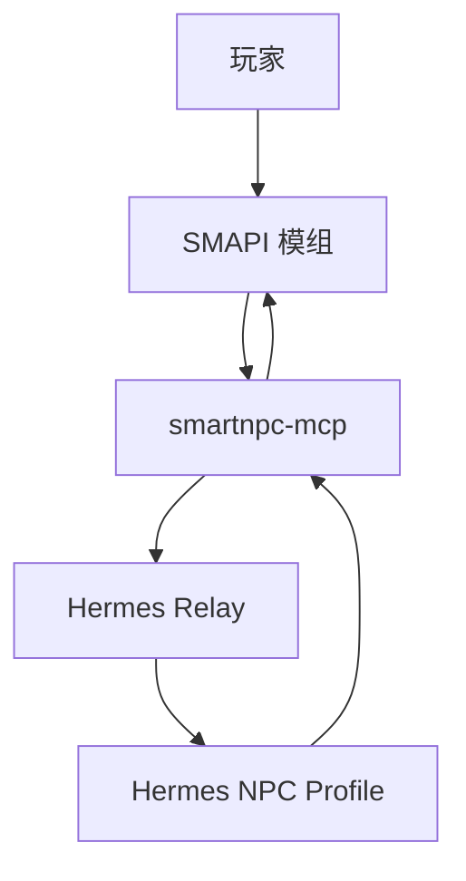
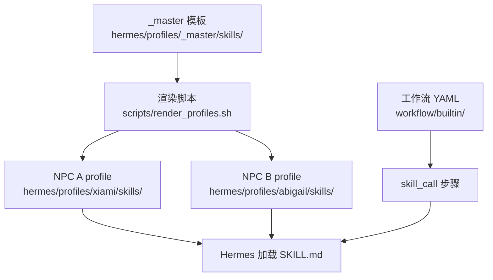
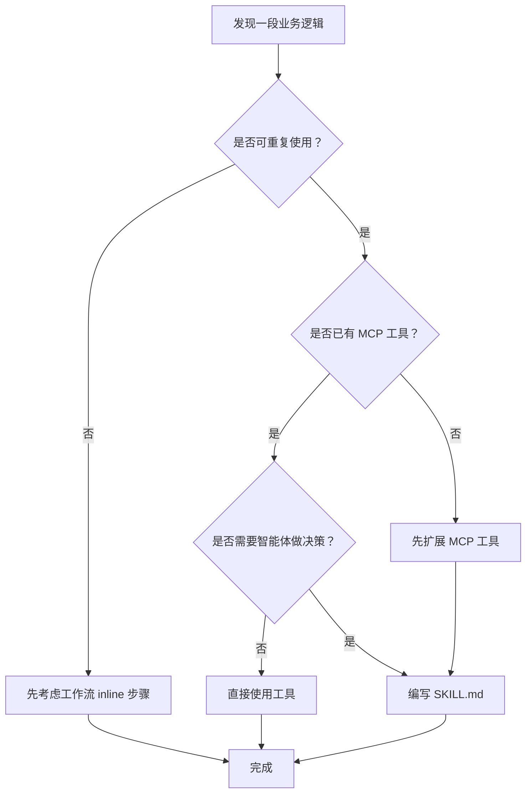
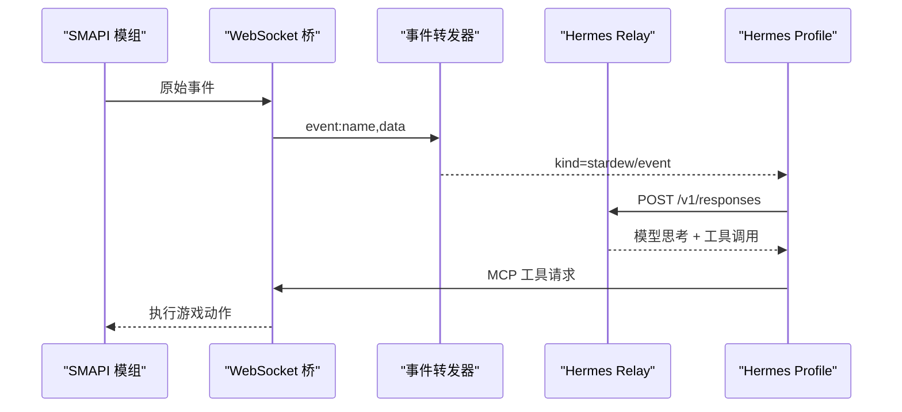
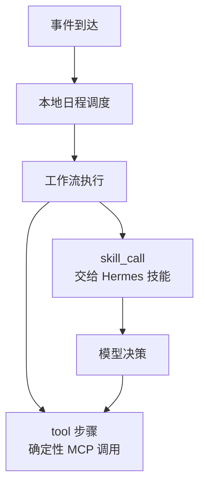
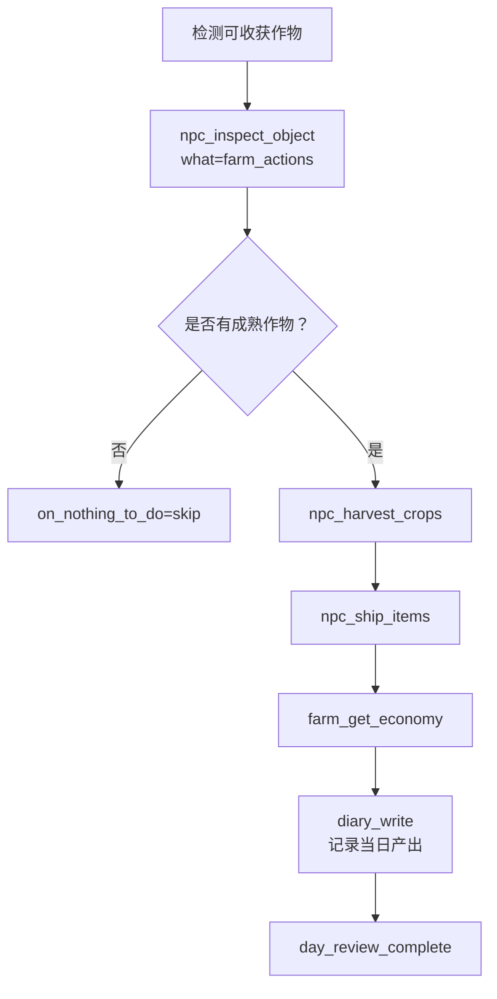
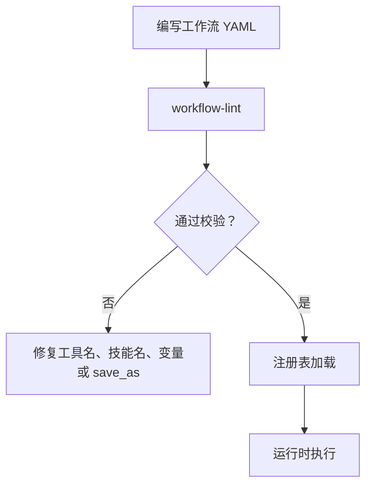

# 自定义技能开发指南

<cite>
**本文引用的文件**   
- [SmartNPC/README.md](file://SmartNPC/README.md)
- [hermes/README.md](file://SmartNPC/hermes/README.md)
- [当前架构与改进](file://SmartNPC/docs/current-architecture.md)
- [事件目录](file://SmartNPC/docs/events.md)
- [Hermes Profile 编写指南](file://SmartNPC/docs/hermes-profiles.md)
- [工作流编排指南](file://SmartNPC/docs/workflow-authoring.md)
- [MCP 工具目录](file://SmartNPC/docs/mcp-tools.md)
- [桥接协议](file://SmartNPC/docs/protocol.md)
- [本地运行时说明](file://SmartNPC/docs/local-runtime.md)
- [critical-policy.md](file://SmartNPC/hermes/profiles/_master/critical-policy.md)
- [npcs.yaml](file://SmartNPC/hermes/npcs.yaml)
- [runtime-config.yaml](file://SmartNPC/hermes/runtime-config.yaml)
- [render_profiles.sh](file://SmartNPC/scripts/render_profiles.sh)
- [events.go](file://SmartNPC/smartnpc-mcp/adapters/stardew/tools/events.go)
- [relay.go](file://SmartNPC/smartnpc-mcp/pkg/relay/hermes/relay.go)
- [definition.go](file://SmartNPC/smartnpc-mcp/pkg/workflow/definition.go)
- [engine.go](file://SmartNPC/smartnpc-mcp/pkg/workflow/engine.go)
- [registry.go](file://SmartNPC/smartnpc-mcp/pkg/workflow/registry.go)
- [workflow-lint/main.go](file://SmartNPC/smartnpc-mcp/cmd/workflow-lint/main.go)
</cite>

## 目录

1. [引言](#引言)
2. [项目结构与技能定位](#项目结构与技能定位)
3. [需求分析：识别适合封装为技能的逻辑](#需求分析识别适合封装为技能的逻辑)
4. [SKILL.md 编写指南](#skillmd-编写指南)
5. [事件路由与执行流程编排](#事件路由与执行流程编排)
6. [将新技能集成到现有架构](#将新技能集成到现有架构)
7. [完整开发示例](#完整开发示例)
8. [调试与排错](#调试与排错)
9. [版本管理与向后兼容](#版本管理与向后兼容)
10. [代码审查清单与最佳实践](#代码审查清单与最佳实践)
11. [结论](#结论)

## 引言

SmartNPC 的目标是让星露谷中的非玩家角色拥有人格、记忆、工具能力和主动行为。其主线架构是 **Hermes-first**：

- SMAPI 模组负责游戏内 UI、输入捕获、动作执行和 WebSocket 服务。
- `smartnpc-mcp` 负责 MCP 工具、协议转换、事件分发和硬校验。
- Hermes profile 负责人格、记忆、技能、工具规划和主动行为。

**图示来源**   
- [SmartNPC/README.md:1-120](file://SmartNPC/README.md#L1-L120)
- [当前架构与改进:1-40](file://SmartNPC/docs/current-architecture.md#L1-L40)

**本节来源**   
- [SmartNPC/README.md:1-120](file://SmartNPC/README.md#L1-L120)
- [当前架构与改进:1-40](file://SmartNPC/docs/current-architecture.md#L1-L40)

## 项目结构与技能定位

仓库中与自定义技能直接相关的结构分为三层：

| 层次 | 路径 | 职责 |
|---|---|---|
| 技能定义层 | `hermes/profiles/_master/skills/smartnpc/<slug>/SKILL.md` | 面向智能体的自然语言技能说明，包含 front matter、触发条件、工具调用规范和错误处理 |
| 配置渲染层 | `scripts/render_profiles.sh`、`hermes/profiles/<npc>/skills/` | 把 `_master` 模板渲染到具体 NPC profile，替换占位符并生成 runtime 配置 |
| 工作流引擎层 | `smartnpc-mcp/pkg/workflow/builtin/*.yaml` | 确定性多步业务编排，通过 `skill_call` 步骤调用 SKILL 或 `tool` 步骤调用 MCP 工具 |

**图示来源**   
- [Hermes Profile 编写指南:1-60](file://SmartNPC/docs/hermes-profiles.md#L1-L60)
- [render_profiles.sh:1-60](file://SmartNPC/scripts/render_profiles.sh#L1-L60)
- [workfow-authoring.md:1-40](file://SmartNPC/docs/workflow-authoring.md#L1-L40)

**本节来源**   
- [Hermes Profile 编写指南:1-120](file://SmartNPC/docs/hermes-profiles.md#L1-L120)
- [render_profiles.sh:1-183](file://SmartNPC/scripts/render_profiles.sh#L1-L183)
- [workfow-authoring.md:1-40](file://SmartNPC/docs/workflow-authoring.md#L1-L40)

## 需求分析：识别适合封装为技能的逻辑

不是所有业务逻辑都应该写成新 SKILL。应该优先筛选满足以下条件的场景：

### 适合封装为 SKILL 的逻辑

1. **可重复使用**：多个 NPC、多个工作流或多次日程触发会用到同一套判断规则。
2. **有明确边界**：输入输出清晰，例如“检查农场可浇水区域”“选择今日问候对象”。
3. **需要智能体决策**：依赖上下文、语气、好感度、失败恢复或人设风格。
4. **容易误用工具**：如果只靠通用提示词，模型可能选错工具、漏传参数或过度发言。
5. **需要长期维护**：随着工具增减、NPC 性格变化或运行模式调整，需要集中修改。

### 不适合单独写 SKILL 的逻辑

1. **一次性的临时脚本**：可以直接在工作流里用 `tool` 步骤实现。
2. **纯数据查询**：已有 MCP 工具时，不需要再用 SKILL 包装一层。
3. **跨进程硬实现**：涉及游戏线程、WebSocket、动画播放等底层细节应放在 C# 模组或 Go 工具中。
4. **过于宽泛的规则**：例如“一切都要聪明”，这类约束更适合放入 `SOUL.md` 或 critical policy。

### 决策流程

**本节来源**   
- [Hermes Profile 编写指南:60-120](file://SmartNPC/docs/hermes-profiles.md#L60-L120)
- [workfow-authoring.md:1-40](file://SmartNPC/docs/workflow-authoring.md#L1-L40)
- [mcp-tools.md:1-60](file://SmartNPC/docs/mcp-tools.md#L1-L60)

## SKILL.md 编写指南

### 文件位置与命名

共享技能模板位于 `_master`，渲染后进入每个 NPC 的 `skills/smartnpc/<slug>/SKILL.md`。推荐 slug 使用小写连字符形式，例如 `smartnpc-greeting`、`smartnpc-farm-harvest`、`smartnpc-owner-directive`。

编辑时应遵循：

1. 在 `hermes/profiles/_master/skills/smartnpc/<slug>/SKILL.md` 新增或修改。
2. 运行 `bash scripts/render_profiles.sh` 生成各 NPC 的副本。
3. 不要直接编辑已渲染出的 per-NPC 技能文件。
4. 如果某个 NPC 需要完全独立的实现，再创建独立目录；否则优先复用 `_master`。

### front matter 设计

SKILL.md 的 YAML front matter 是 Hermes 技能目录的一部分，至少应包含：

| 字段 | 含义 | 建议 |
|---|---|---|
| `name` | 技能唯一标识，工作流通过 `skill_call.skill` 引用 | 使用稳定 slug，避免空格和特殊字符 |
| `description` | 供 Hermes 判断技能相关性的单行描述 | 写明“什么时候该被选中” |
| `version` | 语义化版本 | 破坏性变更才升级主版本 |
| `author` | 维护者 | 项目名或个人标识 |
| `license` | 许可证 | 保持与项目一致 |
| `metadata.hermes.tags` | 技能分类标签 | 便于未来搜索和审计 |
| `metadata.hermes.always_load` | 是否始终加载 | 关键策略类技能可设为 `true` |

front matter 示例字段不必逐字复制，但应体现技能用途、版本控制和必要元信息。

### 事件路由表

SKILL 正文中应明确写出它响应哪些事件或上下文。典型路由包括：

| 事件或上下文 | 技能行为 |
|---|---|
| `day_started` | 加载日程技能并提交当日计划 |
| `workflow_skill_call` | 根据事件中的 `skill` 字段加载并执行对应技能 |
| `owner_directive` | 读取外部指令，决定是否纳入记忆或次日计划 |
| 定时 `day_review` | 复盘计划、记录日记、归档记忆 |
| 普通时间 tick | 不视为新的一天，不应重复提交日程 |

路由表要区分“事件到达”和“真正执行”：relay 白名单决定事件是否发给 Hermes，而 SKILL 内部再决定如何响应。

### 执行流程编排

SKILL 正文应描述步骤顺序，而不是直接写代码。推荐结构：

1. **前置检查**：时间、天气、位置、背包、目标是否存在。
2. **状态观察**：调用 MCP 工具获取真实世界状态。
3. **决策分支**：根据观察结果选择不同子流程。
4. **工具调用**：按 MCP 工具规范调用动作。
5. **异常处理**：工具失败时的重试、降级、记录或跳过策略。
6. **收尾动作**：更新记忆、写入日记、发送广播或结束信号。
7. **返回值约定**：说明成功、部分成功、无操作和失败的区别。

### 工具调用规范

SKILL 中调用工具必须遵守以下原则：

- 使用 MCP 工具注册的真实名称，例如 `npc_water_crops`、`npc_plan_day`、`chat_say`。
- 对目标区域统一使用半径或矩形坐标，避免随意拼参。
- 对长耗时动作理解“接受请求”不等于“全部完成”。
- 对只读工具频繁调用是安全的；对写操作要有幂等性和失败保护。
- 实验模式下 `chat_say` 是单向播报，不是对话回复。
- 工具返回 `nothing_to_do` 时按工作流或 SKILL 约定的策略继续、停止或记录。

### 错误处理

SKILL 的错误处理应覆盖三类情况：

| 类型 | 表现 | 处理建议 |
|---|---|---|
| 参数错误 | 缺少必填参数、非法地图或坐标 | 立即拒绝，记录原因，不继续后续步骤 |
| 工具失败 | 模组未就绪、保存未加载、动作队列不可用 | 降级、重试或记录日志，不要向用户暴露内部错误码 |
| 业务失败 | 没有可浇水地块、出货箱为空 | 正常分支，记录事实，必要时更新记忆或计划 |

**本节来源**   
- [Hermes Profile 编写指南:60-140](file://SmartNPC/docs/hermes-profiles.md#L60-L140)
- [critical-policy.md:1-33](file://SmartNPC/hermes/profiles/_master/critical-policy.md#L1-L33)
- [workfow-authoring.md:1-172](file://SmartNPC/docs/workflow-authoring.md#L1-L172)
- [mcp-tools.md:1-120](file://SmartNPC/docs/mcp-tools.md#L1-L120)

## 事件路由与执行流程编排

### 事件来源

事件来自两个源头：

1. **模组事件**：由 SMAPI 模组产生，经 WebSocket 进入 `smartnpc-mcp`，再通过 logging notification 推送给 MCP 会话。
2. **合成事件**：由 `smartnpc-mcp` 自身产生，例如日程触发、工作流技能调用、农场主指令。

**图示来源**   
- [events.go:1-56](file://SmartNPC/smartnpc-mcp/adapters/stardew/tools/events.go#L1-L56)
- [relay.go:1-120](file://SmartNPC/smartnpc-mcp/pkg/relay/hermes/relay.go#L1-L120)

### 实验分支事件白名单

当前实验分支只允许四类事件唤醒 Hermes：

| 事件 | 是否唤醒 | 用途 |
|---|---:|---|
| `day_started` | 是 | 新日启动，唤醒管家规划日程 |
| `schedule_trigger` | 是 | 本地日程触发工作流 |
| `workflow_skill_call` | 是 | 工作流要求执行某个 SKILL |
| `owner_directive` | 是 | 农场主外部指令 |
| `game_time_tick` | 否 | 驱动本地日程，不落盘唤醒 |
| `day_ending` | 否 | 仅记账，用于自动过夜标志 |

**本节来源**   
- [events.md:1-60](file://SmartNPC/docs/events.md#L1-L60)
- [relay.go:120-220](file://SmartNPC/smartnpc-mcp/pkg/relay/hermes/relay.go#L120-L220)

### 工作流与 SKILL 的关系

工作流是确定性编排，SKILL 是智能体行为说明：

- 工作流适合固定流程：扫描 → 分支 → 循环 → 调用工具。
- SKILL 适合需要语言推理的部分：语气选择、记忆归档、失败解释、人设一致性。
- 工作流可通过 `skill_call` 步骤触发 SKILL，从而把复杂提示流程复用进确定性流水线。
- 预编译模式允许先让模型“观察并计划”，再把可变步骤转为可重放的工作流步骤。

**图示来源**   
- [definition.go:1-120](file://SmartNPC/smartnpc-mcp/pkg/workflow/definition.go#L1-L120)
- [engine.go:1-80](file://SmartNPC/smartnpc-mcp/pkg/workflow/engine.go#L1-L80)

**本节来源**   
- [workfow-authoring.md:1-172](file://SmartNPC/docs/workflow-authoring.md#L1-L172)
- [definition.go:1-200](file://SmartNPC/smartnpc-mcp/pkg/workflow/definition.go#L1-L200)
- [engine.go:1-120](file://SmartNPC/smartnpc-mcp/pkg/workflow/engine.go#L1-L120)

## 将新技能集成到现有架构

### 在 _master 中添加技能

1. 在 `hermes/profiles/_master/skills/smartnpc/<slug>/SKILL.md` 创建文件。
2. 编写 front matter、事件路由、执行流程和工具调用规范。
3. 运行 `bash scripts/render_profiles.sh`。
4. 检查生成的 `hermes/profiles/<npc>/skills/smartnpc/<slug>/SKILL.md` 是否符合预期。
5. 重启对应 Hermes Gateway 以重新加载技能。

### 在 NPC profile 中添加技能

如果某个 NPC 需要覆盖默认行为：

1. 在 `hermes/profiles/<npc>/skills/smartnpc/<slug>/SKILL.md` 提供同 slug 文件。
2. 渲染脚本会按 NPC 维度覆盖 `_master` 中的同名技能。
3. 不要直接编辑其他无关文件或保留旧副本。

### 更新 NPC 注册与运行时配置

新增 NPC 时需要同时更新三处：

| 文件 | 内容 |
|---|---|
| `hermes/npcs.yaml` | NPC id、game_name、display_name、gateway_port、enabled、peer 信息 |
| `hermes/profiles/<npc>/config-overlay.yaml` | `API_SERVER_PORT` 和 `API_SERVER_MODEL_NAME` |
| `hermes/runtime-config.yaml` | 由 `render_profiles.sh` 从启用的 NPC 自动生成 |

**本节来源**   
- [Hermes Profile 编写指南:1-120](file://SmartNPC/docs/hermes-profiles.md#L1-L120)
- [npcs.yaml:1-70](file://SmartNPC/hermes/npcs.yaml#L1-L70)
- [runtime-config.yaml:1-15](file://SmartNPC/hermes/runtime-config.yaml#L1-L15)
- [render_profiles.sh:120-183](file://SmartNPC/scripts/render_profiles.sh#L120-L183)

### 测试技能加载

验证顺序建议如下：

1. 运行 `task profiles:verify`，确认 profile 渲染正确。
2. 在 WSL 中执行 `hermes -p <npc> mcp test smartnpc_game`，确认工具列表可用。
3. 启动 Hermes Gateway：`hermes -p <npc> gateway run --accept-hooks`。
4. 启动 `smartnpc-mcp`，确保 `/healthz` 和 `/status` 正常。
5. 进入游戏存档，触发对应事件或日程，观察日志。
6. 如果是工作流触发的技能，查看工作流运行记录和工具调用镜像。

**本节来源**   
- [hermes/README.md:1-120](file://SmartNPC/hermes/README.md#L1-L120)
- [local-runtime.md:60-117](file://SmartNPC/docs/local-runtime.md#L60-L117)

## 完整开发示例

### 示例一：简单问候技能

#### 需求

为新加入的 NPC 提供一个基础问候能力：当收到交互或日程引导时，根据当前时间和附近 NPC 情况选择一句简短开场白，不执行世界状态变更。

#### SKILL.md 要点

- front matter：`name` 使用稳定 slug，`description` 写明“用于 NPC 初始问候和社交开场”。
- 事件路由：响应 `workflow_skill_call` 中指向该技能的事件，或作为日程中可选问候步骤。
- 执行流程：
  1. 查询当前时间和天气。
  2. 查询附近 NPC。
  3. 如果没有人在附近，选择安静型问候。
  4. 如果有人在附近，选择带称呼的问候。
  5. 可选地通过 `chat_say` 播报一句简短开场。
- 工具调用：只使用只读工具，除非明确需要说话。
- 错误处理：工具失败时退回默认问候，不抛出内部错误。

#### 工作流集成

可在日程中使用 `skill_call` 调用该问候技能，或在更早阶段用 `tool` 步骤做环境检查，再由 SKILL 负责语气和措辞。

### 示例二：农场收获技能

#### 需求

当工作流检测到成熟作物时，自动安排收割、清理、搬运和出售闭环。

#### 工作流设计

**图示来源**   
- [workfow-authoring.md:1-120](file://SmartNPC/docs/workflow-authoring.md#L1-L120)
- [mcp-tools.md:60-180](file://SmartNPC/docs/mcp-tools.md#L60-L180)

#### SKILL 的职责

SKILL 不应重复实现坐标扫描或搬运逻辑，而是负责：

- 解释为什么选择收割。
- 控制 `chat_say` 的使用频率。
- 在工具失败时决定重试、跳过或记录失败。
- 保证日记和记忆与实际经济状态一致。

### 示例三：复杂业务逻辑技能

#### 需求

一个需要结合日程、经济指标、天气和库存的多步技能，例如“根据当日计划和经济目标调整种植与出货策略”。

#### 分层设计

| 层级 | 责任 | 技术位置 |
|---|---|---|
| 感知层 | 读取时间、天气、地形、作物、动物、背包 | MCP 工具 |
| 决策层 | 判断是否需要补种、施肥、收割或出货 | SKILL.md |
| 编排层 | 控制步骤顺序、超时、分支、随机和循环 | 工作流 YAML |
| 持久层 | 日记、记忆、日程、回顾 | MCP 工具 + Hermes 记忆 |
| 安全层 | 禁止泄露内部错误、限制发言、防止过度调用 | critical policy + SKILL 约束 |

#### 错误恢复

复杂技能应避免“一步失败导致整日崩溃”。推荐策略：

1. 对非关键步骤设置 `on_nothing_to_do=skip`。
2. 对关键步骤设置 `on_nothing_to_do=stop` 或 `fail`。
3. 在 SKILL 中记录失败原因，但不向玩家暴露 HTTP/MCP 细节。
4. 在日终回顾中承认失败，而不是假装成功。

**本节来源**   
- [workfow-authoring.md:1-172](file://SmartNPC/docs/workflow-authoring.md#L1-L172)
- [mcp-tools.md:120-240](file://SmartNPC/docs/mcp-tools.md#L120-L240)
- [current-architecture.md:40-120](file://SmartNPC/docs/current-architecture.md#L40-L120)

## 调试与排错

### 日志查看

| 日志或入口 | 用途 |
|---|---|
| `watch-hermes-output.ps1` | 阅读 `[思考]`、`[执行]`、`[回复]` 等阶段 |
| `smartnpc-mcp/logs/hermes/<npc>-readable.log` | Hermes 可读日志副本 |
| `watch-smartnpc-logs.ps1 -Detailed` | 综合查看 SMAPI、Relay、Hermes 日志 |
| `~/.hermes/profiles/<npc>/logs/model-output.log` | Hermes 模型输出原始记录 |
| `smartnpc-mcp/logs/mcp/workflow_runs/` | 工作流运行 JSONL 镜像 |

### 事件追踪

排查事件问题时，按链路自左向右检查：

1. 模组是否发出事件。
2. `events.go` 是否将其转换为 MCP logging notification。
3. `relay.go` 是否通过白名单放行。
4. Hermes 是否收到 `/v1/responses`。
5. 模型是否选择了正确的 SKILL。
6. SKILL 是否调用了正确的 MCP 工具。
7. 工具是否成功排队并执行。

### 性能分析

- 单次模型回合延迟可能在 50–100 秒范围，因此日程密度不宜过高。
- 过密的计划会导致 relay 队列积压，甚至饿死次日规划。
- 工作流中的 `tool` 步骤会增加真实游戏操作次数，应避免无意义循环。
- `chat_say` 应限制为每日有限次数的播报，不要每步都发消息。
- 对长耗时动作，应使用 `wait` 或等待 FollowSystem 空闲，再执行下一步。

### 常见问题

| 现象 | 可能原因 | 处理方法 |
|---|---|---|
| 技能不加载 | 未渲染 `_master` 模板或未重启 Gateway | 运行 `render_profiles.sh` 并重启 Hermes |
| 工具列表为空 | MCP 未启动或 Hermes 连接地址错误 | 检查 `/healthz`、WSL IP、端口和 `mcp_servers.url` |
| 事件不唤醒 | 不在白名单或 render 为空 | 检查事件类型和 `FormatForHermes` 输出 |
| 工作流卡住 | 工具未完成、FollowSystem 仍忙碌或超时 | 检查工作流日志、`on_nothing_to_do` 和 `timeout_seconds` |
| 聊天消息未出现 | `chat_say` 只表示请求被接受 | 查看工具响应和游戏内面板 |

**本节来源**   
- [current-architecture.md:40-120](file://SmartNPC/docs/current-architecture.md#L40-L120)
- [events.go:1-56](file://SmartNPC/smartnpc-mcp/adapters/stardew/tools/events.go#L1-L56)
- [relay.go:120-220](file://SmartNPC/smartnpc-mcp/pkg/relay/hermes/relay.go#L120-L220)
- [local-runtime.md:80-117](file://SmartNPC/docs/local-runtime.md#L80-L117)

## 版本管理与向后兼容

### SKILL.md 版本管理

SKILL 的 `version` 字段应与实际变更强度匹配：

| 变更类型 | 版本策略 |
|---|---|
| 新增字段、增加分支、优化描述 | 次版本升级 |
| 改变事件路由、工具契约、失败语义 | 主版本升级 |
| 仅修复语法或注释 | 补丁版本升级 |
| 删除已弃用字段 | 主版本升级，并提供迁移说明 |

### 向后兼容原则

1. **前端兼容**：新的 SKILL 不应要求旧版 Hermes 解析未知字段。
2. **后端兼容**：新的 MCP 工具应先注册，再逐步启用，避免突然移除。
3. **事件兼容**：新增事件字段时必须忽略未知字段，不能因未知字段报错。
4. **工作流兼容**：新字段应有默认值，旧工作流仍能加载。
5. **工具兼容**：移除工具前需标记废弃，并确认不再被任何 SKILL 或工作流引用。
6. **渲染兼容**：`render_profiles.sh` 不应覆盖 per-NPC 已有的 `.env` 等敏感配置。

### 工作流校验

每次新增或修改工作流都应运行 lint 工具，它会检查：

- 步骤 schema 是否有效。
- `tool.name` 是否在已知工具集合中。
- `skill_call.skill` 是否在已知技能集合中。
- 变量引用是否悬空。
- 同一作用域是否重复使用 `save_as`。

**图示来源**   
- [workflow-lint/main.go:1-120](file://SmartNPC/smartnpc-mcp/cmd/workflow-lint/main.go#L1-L120)
- [registry.go:120-220](file://SmartNPC/smartnpc-mcp/pkg/workflow/registry.go#L120-L220)

**本节来源**   
- [Hermes Profile 编写指南:60-120](file://SmartNPC/docs/hermes-profiles.md#L60-L120)
- [events.md:1-40](file://SmartNPC/docs/events.md#L1-L40)
- [workflow-lint/main.go:1-120](file://SmartNPC/smartnpc-mcp/cmd/workflow-lint/main.go#L1-L120)
- [registry.go:120-220](file://SmartNPC/smartnpc-mcp/pkg/workflow/registry.go#L120-L220)

## 代码审查清单与最佳实践

### SKILL.md 审查清单

- [ ] front matter 包含 `name`、`description`、`version`、`author`、`license`。
- [ ] `name` 与工作流 `skill_call` 引用一致。
- [ ] 事件路由表与实际 relay 白名单不冲突。
- [ ] 工具名称来自 MCP 工具注册表。
- [ ] 对 `chat_say` 的使用符合实验模式的单向播报约束。
- [ ] 错误处理覆盖参数错误、工具失败和业务失败。
- [ ] 没有把内部 HTTP/MCP 错误直接暴露给用户。
- [ ] 没有把 SKILL 写成无法复用的单次脚本。
- [ ] 变更后运行了 `render_profiles.sh` 并验证生成文件。
- [ ] 工作流引用了存在的 SKILL ID。

### 工作流审查清单

- [ ] `id` 唯一且稳定。
- [ ] `steps` 非空，每一步都有明确的 `kind`。
- [ ] `tool.name` 存在于已知工具集合。
- [ ] `skill_call.skill` 存在于已知技能集合。
- [ ] 表达式中的 `$var` 引用已声明。
- [ ] 同一作用域没有重复 `save_as`。
- [ ] 长耗时动作设置了合理超时或等待。
- [ ] `on_nothing_to_do` 策略符合业务语义。
- [ ] 已通过 `workflow-lint`。
- [ ] 没有在预编译阶段执行世界动作或发言。

### 架构与集成审查清单

- [ ] `_master` 模板变更通过 `render_profiles.sh` 同步。
- [ ] 新增 NPC 更新了 `npcs.yaml`、`config-overlay.yaml` 和 `runtime-config.yaml`。
- [ ] Gateway 端口不与其它 profile 冲突。
- [ ] Hermes 和 MCP 的连接地址、端口、密钥配置一致。
- [ ] 没有把真实 API key 提交到仓库。
- [ ] 日志中包含玩家对话时未进入提交。
- [ ] 移除工具前先确认没有被 SKILL 或工作流引用。
- [ ] 新增事件字段保持向后兼容。

### 最佳实践建议

1. **优先确定性，后交给模型**：能用工作流 `branch`、`foreach`、`random` 解决的，不要每次都调用模型。
2. **SKILL 管意图，工具管执行**：SKILL 负责“为什么做”和“怎么做更合适”，工具负责“准确调用游戏能力”。
3. **最小可行技能**：先实现核心路径，再补充边缘分支。
4. **日志可观测**：关键分支、工具调用、失败原因都可追溯。
5. **人设与行为分离**：语气和人格放在 `SOUL.md`，行为策略放在 SKILL。
6. **严格边界**：Go/SMAPI 层做硬校验，Hermes 层做智能决策。
7. **谨慎发言**：实验模式下 `chat_say` 不是对话接口。
8. **可回滚**：SKILL 和工作流都应支持快速禁用或回退到上一版本。

**本节来源**   
- [Hermes Profile 编写指南:60-140](file://SmartNPC/docs/hermes-profiles.md#L60-L140)
- [workfow-authoring.md:120-172](file://SmartNPC/docs/workflow-authoring.md#L120-L172)
- [current-architecture.md:1-80](file://SmartNPC/docs/current-architecture.md#L1-L80)
- [local-runtime.md:1-80](file://SmartNPC/docs/local-runtime.md#L1-L80)

## 结论

自定义技能开发的核心不是写更多代码，而是把重复、易错、需要人设和上下文的业务逻辑收敛到清晰的 SKILL 定义中。SKILL.md 负责“意图和策略”，工作流负责“确定性和编排”，MCP 工具负责“游戏能力”，Hermes profile 负责“人格和记忆”。

开发新技能时应遵循以下顺序：

1. 判断是否值得封装为 SKILL。
2. 先在 `_master` 中编写稳定模板。
3. 明确事件路由、执行流程和错误处理。
4. 使用 MCP 工具而非绕过架构。
5. 通过工作流编排复杂逻辑。
6. 渲染、校验、部署并端到端测试。
7. 记录日志、版本和兼容性影响。
8. 用代码审查清单确保行为可预测、可维护、可回滚。