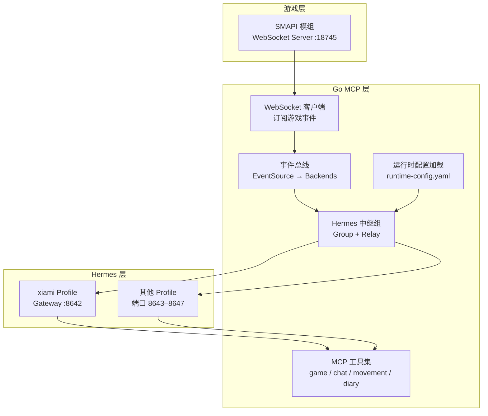
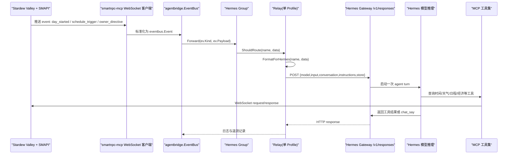
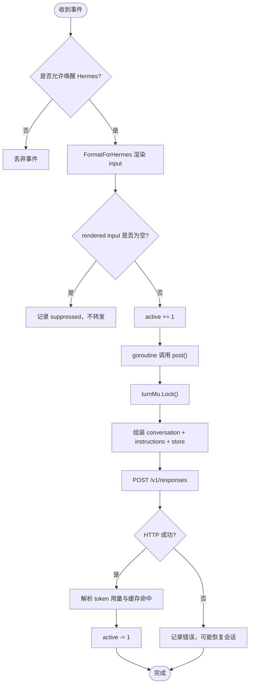
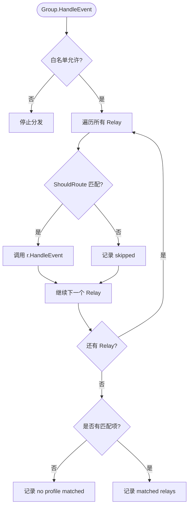
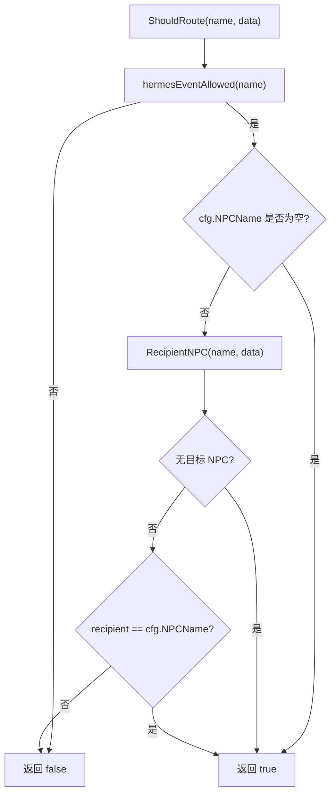
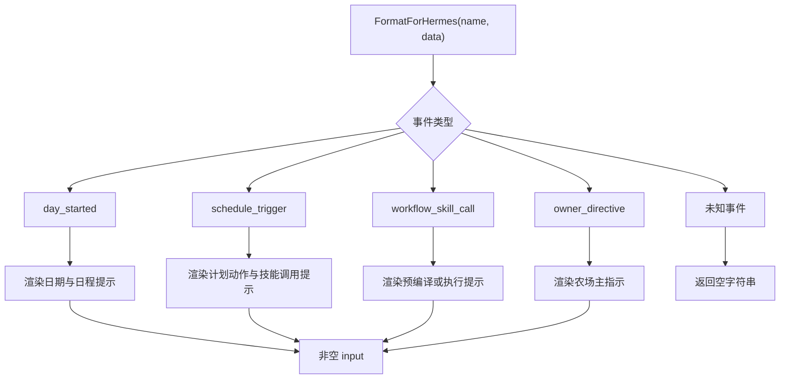
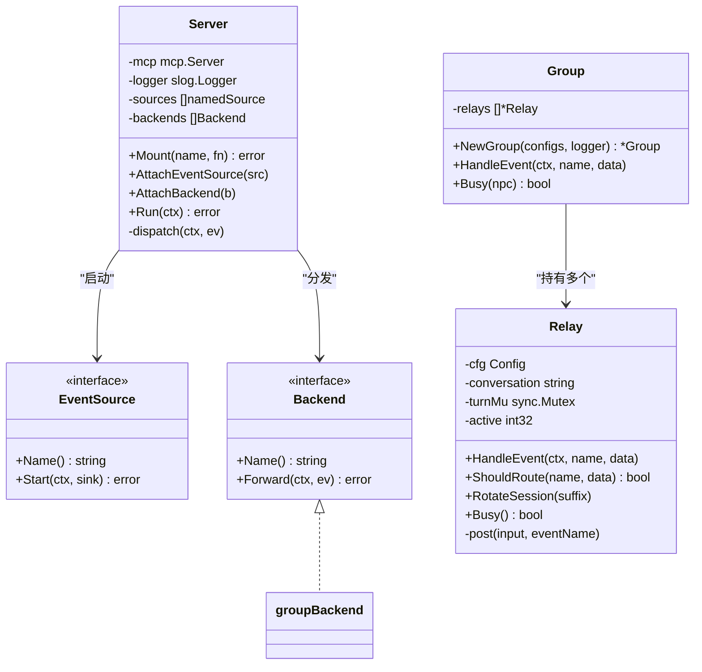
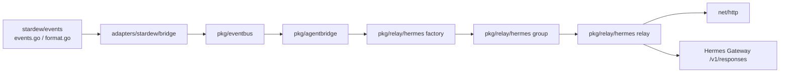
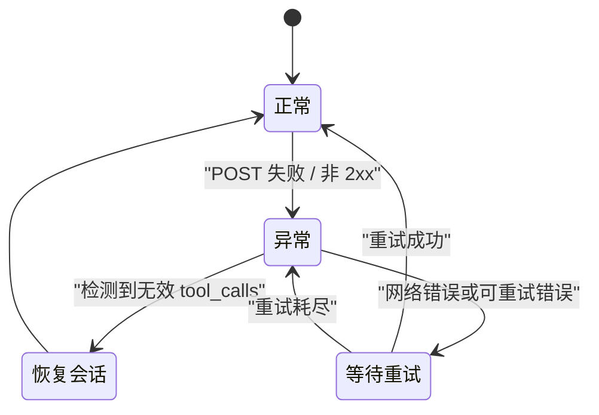

# Hermes 中继系统

<cite>
**本文引用的文件**   
- [README.md](file://SmartNPC/README.md)
- [current-architecture.md](file://SmartNPC/docs/current-architecture.md)
- [hermes-profiles.md](file://SmartNPC/docs/hermes-profiles.md)
- [events.md](file://SmartNPC/docs/events.md)
- [protocol.md](file://SmartNPC/docs/protocol.md)
- [hermes-event-trigger.md](file://SmartNPC/docs/hermes-event-trigger.md)
- [local-runtime.md](file://SmartNPC/docs/local-runtime.md)
- [relay.go](file://SmartNPC/smartnpc-mcp/pkg/relay/hermes/relay.go)
- [group.go](file://SmartNPC/smartnpc-mcp/pkg/relay/hermes/group.go)
- [factory.go](file://SmartNPC/smartnpc-mcp/pkg/relay/hermes/factory.go)
- [config.go](file://SmartNPC/smartnpc-mcp/pkg/relay/hermes/config.go)
- [format.go](file://SmartNPC/smartnpc-mcp/adapters/stardew/events/format.go)
- [server.go](file://SmartNPC/smartnpc-mcp/pkg/agentbridge/server.go)
- [eventsource.go](file://SmartNPC/smartnpc-mcp/pkg/agentbridge/eventsource.go)
- [backend.go](file://SmartNPC/smartnpc-mcp/pkg/agentbridge/backend.go)
- [meta.go](file://SmartNPC/smartnpc-mcp/pkg/agentbridge/meta.go)
- [runtime-config.yaml](file://SmartNPC/hermes/runtime-config.yaml)
- [npcs.yaml](file://SmartNPC/hermes/npcs.yaml)
</cite>

## 目录
1. [引言](#引言)
2. [项目结构](#项目结构)
3. [核心组件](#核心组件)
4. [架构总览](#架构总览)
5. [详细组件分析](#详细组件分析)
6. [依赖关系分析](#依赖关系分析)
7. [性能与优化策略](#性能与优化策略)
8. [高可用与故障转移](#高可用与故障转移)
9. [排错指南](#排错指南)
10. [结论](#结论)

## 引言
Hermes 中继系统是 SmartNPC 项目中连接游戏、MCP 服务与 Hermes Agent Profile 的“事件到推理”桥梁。它负责把 Stardew Valley 事件转成 Hermes Gateway 可消费的 `/v1/responses` 请求，并在多 NPC Profile 环境下完成事件分发、会话隔离、模型调用和工具执行闭环。

当前仓库处于实验分支（2026-10-26）：主线形态是单 Agent 农场管家 XiaMi，玩家聊天、点击、群聊等入口已移除；能唤醒 Hermes 的事件被严格限制为四类：`day_started`、`schedule_trigger`、`workflow_skill_call`、`owner_directive`。但仓库仍保留多 Profile 扇出配置、路由逻辑与文档，因此本文同时说明“单 Profile 模式”的实现细节和多 Profile 扇出的设计。

**章节来源**
- [README.md:1-120](file://SmartNPC/README.md#L1-L120)
- [current-architecture.md:1-60](file://SmartNPC/docs/current-architecture.md#L1-L60)
- [events.md:1-40](file://SmartNPC/docs/events.md#L1-L40)

## 项目结构
Hermes 中继相关代码集中在 Go 侧 `smartnpc-mcp` 中，并配合 `hermes/profiles` 下的 Profile 源文件和运行时配置。

**图示来源**
- [server.go:1-177](file://SmartNPC/smartnpc-mcp/pkg/agentbridge/server.go#L1-L177)
- [factory.go:1-68](file://SmartNPC/smartnpc-mcp/pkg/relay/hermes/factory.go#L1-L68)
- [group.go:1-93](file://SmartNPC/smartnpc-mcp/pkg/relay/hermes/group.go#L1-L93)
- [relay.go:1-120](file://SmartNPC/smartnpc-mcp/pkg/relay/hermes/relay.go#L1-L120)
- [config.go:1-120](file://SmartNPC/smartnpc-mcp/pkg/relay/hermes/config.go#L1-L120)

**章节来源**
- [README.md:80-160](file://SmartNPC/README.md#L80-L160)
- [hermes-profiles.md:1-60](file://SmartNPC/docs/hermes-profiles.md#L1-L60)
- [runtime-config.yaml:1-15](file://SmartNPC/hermes/runtime-config.yaml#L1-L15)
- [npcs.yaml:1-70](file://SmartNPC/hermes/npcs.yaml#L1-L70)

## 核心组件
| 组件 | 职责 | 关键行为 |
|---|---|---|
| `Relay` | 单个 Profile 的中继实例 | 过滤事件、构造 `/v1/responses`、串行化同一 NPC 的回合、旋转会话、统计缓存命中率 |
| `Group` | 多 Profile 扇出器 | 遍历所有 Relay，按 `npc_filter` 匹配后转发 |
| `Config` / `LoadConfigFile` | 解析 `runtime-config.yaml` | 环境变量展开、API Key 注入、超时与存储开关 |
| `FormatForHermes` | 事件过滤器与文本聚合 | 把结构化事件渲染成人类可读的 `input`，未知事件直接丢弃 |
| `Server` | agent-bridge 编排根 | 启动多个 EventSource，顺序分发给多个 Backend |
| `Backend` | 抽象后端接口 | Hermes Relay 通过 `Forward` 接收事件，内部异步 POST |
| `Factory` | 注册 hermes Backend | 从 `relays[i].config.runtime_config` 构建 Group |

**章节来源**
- [relay.go:1-120](file://SmartNPC/smartnpc-mcp/pkg/relay/hermes/relay.go#L1-L120)
- [group.go:1-93](file://SmartNPC/smartnpc-mcp/pkg/relay/hermes/group.go#L1-L93)
- [config.go:1-191](file://SmartNPC/smartnpc-mcp/pkg/relay/hermes/config.go#L1-L191)
- [format.go:1-120](file://SmartNPC/smartnpc-mcp/adapters/stardew/events/format.go#L1-L120)
- [server.go:1-177](file://SmartNPC/smartnpc-mcp/pkg/agentbridge/server.go#L1-L177)
- [backend.go:1-36](file://SmartNPC/smartnpc-mcp/pkg/agentbridge/backend.go#L1-L36)
- [factory.go:1-68](file://SmartNPC/smartnpc-mcp/pkg/relay/hermes/factory.go#L1-L68)

## 架构总览
Hermes 中继系统的整体数据流可以理解为“事件进入 → 协议转换 → 路由选择 → 模型推理 → 工具执行 → 落回游戏”。

**图示来源**
- [hermes-event-trigger.md:120-191](file://SmartNPC/docs/hermes-event-trigger.md#L120-L191)
- [relay.go:120-453](file://SmartNPC/smartnpc-mcp/pkg/relay/hermes/relay.go#L120-L453)
- [format.go:1-290](file://SmartNPC/smartnpc-mcp/adapters/stardew/events/format.go#L1-L290)
- [protocol.md:1-120](file://SmartNPC/docs/protocol.md#L1-L120)

**章节来源**
- [current-architecture.md:1-60](file://SmartNPC/docs/current-architecture.md#L1-L60)
- [hermes-event-trigger.md:1-191](file://SmartNPC/docs/hermes-event-trigger.md#L1-L191)
- [protocol.md:1-120](file://SmartNPC/docs/protocol.md#L1-L120)

## 详细组件分析

### 单 Profile 模式：连接管理与消息转发
单 Profile 模式下，一个 `Relay` 对应一个 Hermes Profile（例如 xiami）。它维护以下状态和行为：

| 关注点 | 实现方式 |
|---|---|
| 连接管理 | 使用 Go `http.Client`，带 `Timeout`；每次 POST 复用连接，不维护长连接池 |
| 消息发送 | `HandleEvent` 先过滤，再格式化，再 `go r.post(...)` 异步发送 |
| 会话管理 | `conversation` 字段由 `RotateSession` 更新，支持按后缀轮换 |
| 并发控制 | 每个 Relay 有 `turnMu`，保证同一 NPC 的模型回合串行 |
| 活跃计数 | `active int32` 表示仍在处理或等待队列中的事件数，供工作流轮询 |

关键流程如下：

**图示来源**
- [relay.go:120-453](file://SmartNPC/smartnpc-mcp/pkg/relay/hermes/relay.go#L120-L453)

**章节来源**
- [relay.go:1-120](file://SmartNPC/smartnpc-mcp/pkg/relay/hermes/relay.go#L1-L120)
- [relay.go:201-453](file://SmartNPC/smartnpc-mcp/pkg/relay/hermes/relay.go#L201-L453)

### 单 Profile 模式：状态同步
Hermes 中继并不在 Go 侧维护完整的对话历史。其状态同步策略是：

1. **对话记忆归属 Hermes**：默认 `Store=true`，由 Hermes Gateway 保存 conversation history。
2. **指令上下文每次携带**：`instructions` 包含 `critical-policy` 和 `SOUL.md` persona，确保即使压缩对话也不会丢失硬规则和人设。
3. **会话轮换**：新的一天触发 `RotateSession`，生成 `<baseConversation>-<suffix>`，避免跨日对话污染。
4. **工具结果由 Hermes 管理**：Go 只看到最终 `/v1/responses` 响应体，不会自行拼接工具调用历史。

这意味着“状态同步”主要由 Hermes 负责，Go 侧重点在于：
- 正确传递 `conversation`
- 正确注入 `instructions`
- 在异常时安全切换会话

**章节来源**
- [relay.go:201-280](file://SmartNPC/smartnpc-mcp/pkg/relay/hermes/relay.go#L201-L280)
- [hermes-profiles.md:120-220](file://SmartNPC/docs/hermes-profiles.md#L120-L220)
- [current-architecture.md:60-120](file://SmartNPC/docs/current-architecture.md#L60-L120)

### 多 Profile 扇出机制：事件分发与负载均衡
多 Profile 扇出由 `Group` 提供。`Group` 持有多个 `Relay`，每个 Relay 来自 `runtime-config.yaml` 中的一条 profile 配置。

分发规则：
- 所有事件先经过 `hermesEventAllowed` 白名单检查。
- 对每个 Relay，调用 `ShouldRoute(name, data)`。
- 如果匹配，则调用 `r.HandleEvent(ctx, name, data)`。
- 如果没有 Relay 匹配，记录警告并丢弃。

**图示来源**
- [group.go:1-93](file://SmartNPC/smartnpc-mcp/pkg/relay/hermes/group.go#L1-L93)

**负载均衡说明**
当前实现不是按负载或权重分配，而是“广播式匹配”：
- 如果多个 Relay 的 `npc_filter` 为空或都匹配，同一个事件会同时投递给多个 Profile。
- 当前 `runtime-config.yaml` 只有 xiami 启用，因此实际是多 Profile 框架、单 Profile 运行。
- 若未来需要负载均衡，应在 Group 层引入选择策略，而不是让多个 Profile 同时消费同一条玩家交互。

**章节来源**
- [group.go:1-93](file://SmartNPC/smartnpc-mcp/pkg/relay/hermes/group.go#L1-L93)
- [factory.go:1-68](file://SmartNPC/smartnpc-mcp/pkg/relay/hermes/factory.go#L1-L68)
- [runtime-config.yaml:1-15](file://SmartNPC/hermes/runtime-config.yaml#L1-L15)

### 多 Profile 扇出机制：隔离策略
隔离主要通过三个维度实现：

| 隔离维度 | 实现位置 | 说明 |
|---|---|---|
| 进程/网关隔离 | `config-overlay.yaml` 中 `API_SERVER_PORT` | 每个 Profile 独立 Gateway 端口 |
| 会话隔离 | `runtime-config.yaml` 中 `conversation` | 不同 NPC 使用不同 named conversation |
| 模型隔离 | `runtime-config.yaml` 中 `model` | 可为不同 NPC 指定不同模型 |
| 人设隔离 | `persona_file` 或 Profile SOUL.md | 每条请求附带对应人设 |
| 工具可见性 | Profile 的 `mcp_servers.smartnpc_game.tools.include` | Hermes 侧筛选工具列表 |
| 事件路由隔离 | `npc_filter` | 按目标 NPC 名称过滤事件 |

**章节来源**
- [hermes-profiles.md:60-220](file://SmartNPC/docs/hermes-profiles.md#L60-L220)
- [current-architecture.md:1-60](file://SmartNPC/docs/current-architecture.md#L1-L60)
- [protocol.md:1-120](file://SmartNPC/docs/protocol.md#L1-L120)

### Profile 路由器：如何根据事件类型和目标 NPC 选择 Profile
Profile 路由器由两层组成：

1. **全局唤醒白名单**：`hermesEventAllowed`
   - 仅允许 `day_started`、`schedule_trigger`、`workflow_skill_call`、`owner_directive`。
   - 其他事件如 `game_time_tick`、`day_ending` 只走本地记账或调度，不唤醒 Hermes。

2. **Profile 级 NPC 过滤**：`Relay.ShouldRoute`
   - 如果 `cfg.NPCName` 为空，表示该 Relay 接收所有允许事件。
   - 如果事件载荷中包含目标 NPC，必须与 `npc_filter` 精确匹配。
   - 没有目标 NPC 的可广播事件（如 `day_started`）对所有 Relay 可见。
   - 载荷无法解析时，保守丢弃。

**图示来源**
- [relay.go:228-280](file://SmartNPC/smartnpc-mcp/pkg/relay/hermes/relay.go#L228-L280)

**章节来源**
- [relay.go:228-280](file://SmartNPC/smartnpc-mcp/pkg/relay/hermes/relay.go#L228-L280)
- [events.md:1-80](file://SmartNPC/docs/events.md#L1-L80)

### 事件过滤器：事件类型匹配、条件过滤与事件聚合
事件过滤器分为两个阶段：

#### 第一阶段：是否允许唤醒 Hermes
由 `hermesEventAllowed` 决定。实验分支下只有四类事件能唤醒模型：
- `day_started`：新一天，唤醒管家规划日程
- `schedule_trigger`：日程触发
- `workflow_skill_call`：工作流需要智能决策
- `owner_directive`：农场主外部指示

#### 第二阶段：是否渲染为有效 input
由 `FormatForHermes` 决定：
- 已知事件类型会尝试解析 JSON 并生成一段面向 Agent 的人类可读提示。
- 如果解析失败或字段为空，通常返回空字符串。
- 未知事件也返回空字符串，避免向模型注入不可解释的通用文本。

**图示来源**
- [format.go:1-290](file://SmartNPC/smartnpc-mcp/adapters/stardew/events/format.go#L1-L290)
- [relay.go:258-280](file://SmartNPC/smartnpc-mcp/pkg/relay/hermes/relay.go#L258-L280)

**章节来源**
- [format.go:1-290](file://SmartNPC/smartnpc-mcp/adapters/stardew/events/format.go#L1-L290)
- [events.md:1-120](file://SmartNPC/docs/events.md#L1-L120)

### 连接池管理：Profile 连接的复用与生命周期
当前实现没有显式的连接池对象，但具备连接复用的基本特征：

| 能力 | 现状 |
|---|---|
| HTTP 连接复用 | Go `http.Client` 默认复用 TCP 连接，除非显式禁用 Keep-Alive |
| 超时控制 | `Timeout` 默认 120 秒，可通过环境变量覆盖 |
| 认证头 | 可选 `Authorization: Bearer <APIKey>` |
| 单次请求生命周期 | `post()` 内创建请求、发起 HTTP、读取响应体、关闭响应体 |
| 无主动连接池参数 | 没有暴露最大空闲连接、连接过期时间等调优选项 |

生命周期要点：
- 每个 Relay 拥有自己的 `http.Client`。
- 连接在请求结束后由底层 HTTP 管理器决定是否复用。
- 如果 Gateway 不可用，`post()` 记录错误但不重试。
- 如果返回体包含损坏的工具调用历史，Relay 会旋转会话作为兼容性修复。

**章节来源**
- [relay.go:280-453](file://SmartNPC/smartnpc-mcp/pkg/relay/hermes/relay.go#L280-L453)
- [config.go:120-191](file://SmartNPC/smartnpc-mcp/pkg/relay/hermes/config.go#L120-L191)

### 架构编排：agent-bridge 如何把事件交给 Hermes
`agentbridge.Server` 是更上层的编排器：
- `EventSource` 负责产生事件。
- `Backend` 负责消费事件。
- `Run` 并行启动所有 Source，并将事件按注册顺序分发给所有 Backends。
- Hermes Relay 通过工厂注册为 `hermes` Backend。

**图示来源**
- [server.go:1-177](file://SmartNPC/smartnpc-mcp/pkg/agentbridge/server.go#L1-L177)
- [eventsource.go:1-40](file://SmartNPC/smartnpc-mcp/pkg/agentbridge/eventsource.go#L1-L40)
- [backend.go:1-36](file://SmartNPC/smartnpc-mcp/pkg/agentbridge/backend.go#L1-L36)
- [group.go:1-93](file://SmartNPC/smartnpc-mcp/pkg/relay/hermes/group.go#L1-L93)
- [relay.go:1-120](file://SmartNPC/smartnpc-mcp/pkg/relay/hermes/relay.go#L1-L120)

**章节来源**
- [server.go:1-177](file://SmartNPC/smartnpc-mcp/pkg/agentbridge/server.go#L1-L177)
- [backend.go:1-36](file://SmartNPC/smartnpc-mcp/pkg/agentbridge/backend.go#L1-L36)
- [factory.go:1-68](file://SmartNPC/smartnpc-mcp/pkg/relay/hermes/factory.go#L1-L68)

## 依赖关系分析

**图示来源**
- [format.go:1-290](file://SmartNPC/smartnpc-mcp/adapters/stardew/events/format.go#L1-L290)
- [server.go:1-177](file://SmartNPC/smartnpc-mcp/pkg/agentbridge/server.go#L1-L177)
- [factory.go:1-68](file://SmartNPC/smartnpc-mcp/pkg/relay/hermes/factory.go#L1-L68)
- [relay.go:1-453](file://SmartNPC/smartnpc-mcp/pkg/relay/hermes/relay.go#L1-L453)

**章节来源**
- [hermes-profiles.md:120-220](file://SmartNPC/docs/hermes-profiles.md#L120-L220)
- [protocol.md:1-120](file://SmartNPC/docs/protocol.md#L1-L120)

## 性能与优化策略

### 批量处理
当前实现不是批量处理器：
- 每个事件独立 `HandleEvent`。
- `post()` 独立发起 HTTP 请求。
- 没有将多个事件合并为一个 `/v1/responses` 请求。

如果要扩展批量能力，可考虑：
- 增加带缓冲的 channel。
- 按窗口大小或时间窗口聚合。
- 保持 `conversation` 和 `npc_filter` 一致后再批量提交。
- 注意 Hermes 的 `/v1/responses` 语义是一次 agent turn，不一定适合任意批量。

**章节来源**
- [relay.go:120-200](file://SmartNPC/smartnpc-mcp/pkg/relay/hermes/relay.go#L120-L200)

### 异步转发
当前已经实现异步转发：
- `HandleEvent` 内部 `go r.post(input, name)`。
- bridge 读循环不会被慢 Hermes 阻塞。
- 调用方 context 取消不会取消已在进行的 POST。

风险：
- 无背压控制：大量事件可能堆积 goroutine。
- 无重试与死信队列：失败仅记录日志。

**章节来源**
- [relay.go:120-180](file://SmartNPC/smartnpc-mcp/pkg/relay/hermes/relay.go#L120-L180)

### 缓存机制
缓存主要体现在两个层面：

1. **Hermes 服务端缓存**：通过 `/v1/responses` 返回的 `usage.input_tokens_details.cached_tokens` 计算缓存比例。
2. **Persona/CriticalPolicy 内存缓存**：Relay 启动时读取 persona 和 critical policy 文件，避免每次请求重新读盘。

未实现：
- 没有对 `FormatForHermes` 结果做缓存。
- 没有对 HTTP 响应做缓存。
- 没有对工具查询结果做缓存（应由上游 MCP 工具或 SMAPI 层决定）。

**章节来源**
- [relay.go:1-120](file://SmartNPC/smartnpc-mcp/pkg/relay/hermes/relay.go#L1-L120)
- [relay.go:360-453](file://SmartNPC/smartnpc-mcp/pkg/relay/hermes/relay.go#L360-L453)

### 会话裁剪与压缩
Go 侧不负责对话压缩：
- `Store=true` 表示由 Hermes 管理历史。
- `context_length`、压缩阈值、保护最近若干条等属于 Hermes 配置，不在 Go 中继中实现。
- Go 侧的关键约束是：不要重复拼接完整历史，避免与 Hermes 的历史叠加。

**章节来源**
- [current-architecture.md:80-140](file://SmartNPC/docs/current-architecture.md#L80-L140)
- [relay.go:280-360](file://SmartNPC/smartnpc-mcp/pkg/relay/hermes/relay.go#L280-L360)

## 高可用与故障转移

### 当前高可用能力
| 能力 | 实现状态 |
|---|---|
| 事件白名单 | ✅ 已实现，防止无关事件唤醒模型 |
| 事件渲染过滤 | ✅ 未知事件不转发 |
| 会话隔离 | ✅ 每 Profile 独立 conversation |
| 会话轮换 | ✅ 新一天可旋转会话 |
| 单 NPC 串行化 | ✅ `turnMu` 防止并发转写 transcript |
| 连接超时 | ✅ 默认 120 秒 |
| 错误日志 | ✅ 记录 URL、耗时、状态码、响应体片段 |
| 损坏转录恢复 | ✅ 检测到无效 tool_calls 数组时旋转会话 |
| 多 Profile 路由 | ✅ Group 按 npc_filter 分发 |
| 自动重连 | ❌ 未在 Relay 层实现指数退避重连 |
| 重试机制 | ❌ 未实现 |
| 健康检查 | ⚠️ 存在 `/healthz` 和 `/status`，但不绑定 Relay 健康状态 |
| 降级路径 | ❌ 未实现离线队列或本地降级 |

### 故障转移建议
基于现有代码，合理的高可用演进方向包括：

1. **Relay 层健康探测**
   - 定期 GET Gateway `/health`。
   - 失败时标记 Relay 为 unhealthy。
   - 不再向 unhealthy Relay 派发新事件。

2. **重试与退避**
   - 对网络错误、5xx 错误进行有限次重试。
   - 使用指数退避，避免雪崩。
   - 区分可重试错误和永久错误（如 400 非法参数）。

3. **死信队列**
   - 将多次失败的事件持久化到文件或消息队列。
   - 提供回放工具。

4. **多 Gateway 冗余**
   - 对同一 Profile 配置多个 Gateway。
   - 主备切换或按延迟路由。

5. **背压控制**
   - 限制并发 POST 数量。
   - 当 `Busy()` 长期为真时暂停下游事件输入。

**图示来源**
- [relay.go:320-453](file://SmartNPC/smartnpc-mcp/pkg/relay/hermes/relay.go#L320-L453)

**章节来源**
- [relay.go:320-453](file://SmartNPC/smartnpc-mcp/pkg/relay/hermes/relay.go#L320-L453)
- [local-runtime.md:60-117](file://SmartNPC/docs/local-runtime.md#L60-L117)

## 排错指南

### 常见问题定位
| 现象 | 可能原因 | 排查步骤 |
|---|---|---|
| Hermes 不响应 | 事件不在白名单 | 检查 `hermesEventAllowed` 与 events.md |
| 事件被抑制 | `FormatForHermes` 返回空 | 查看 suppressed 日志 |
| 多 Profile 未匹配 | `npc_filter` 与事件目标不一致 | 检查 runtime-config.yaml 和 RecipientNPC |
| 端口冲突 | 多个 Profile 使用相同 `API_SERVER_PORT` | 检查 config-overlay.yaml |
| 模型输出损坏 | Hermes 端 transcript 损坏 | 观察是否触发会话恢复 |
| 连接超时 | Gateway 不可用或模型推理过慢 | 调整 `SMARTNPC_RELAY_TIMEOUT_MS` |
| 工具调用未被执行 | Profile 工具白名单未包含 | 检查 `mcp_servers.smartnpc_game.tools.include` |
| 会话未轮换 | 未在新一天调用 `RotateSession` | 检查 day_started 处理链路 |

### 关键日志入口
- `watch-smartnpc-logs.ps1 -Detailed`：综合查看 SMAPI、Relay、Hermes 日志。
- `watch-hermes-output.ps1`：专用阅读入口，展示思考、执行、回复阶段。
- `smartnpc-mcp/logs/hermes/xiami-readable.log`：简洁副本。
- Hermes profile `logs/model-output.log`：模型输出原始记录。

**章节来源**
- [current-architecture.md:100-160](file://SmartNPC/docs/current-architecture.md#L100-L160)
- [local-runtime.md:90-117](file://SmartNPC/docs/local-runtime.md#L90-L117)
- [relay.go:320-453](file://SmartNPC/smartnpc-mcp/pkg/relay/hermes/relay.go#L320-L453)

## 结论
Hermes 中继系统以 `Relay` 为最小单元，以 `Group` 为多 Profile 扇出入口，以 `FormatForHermes` 为事件过滤器，以 `runtime-config.yaml` 为 Profile 路由表，构成了一个清晰、可扩展且目前偏向实验性的 AI NPC 事件通道。

它的优势是：
- 明确区分游戏线程、MCP 工具、Hermes 推理三层边界。
- 使用 Hermes 原生 `/v1/responses` 能力，无需修改 Hermes 核心。
- 支持 per-NPC 会话、人设、模型和工具白名单。
- 对未知事件保持防御性丢弃。

当前限制是：
- 实验分支只启用 xiami。
- 没有显式连接池、重试、死信队列和自动重连。
- 批量处理尚未实现。
- 高可用更多体现在配置隔离和错误日志，而非自动故障转移。

在未来演进中，最优先的改进应是：可靠的重试与超时控制、连接池与背压、健康检查与健康路由、以及可选的消息持久化。这些改进可以在不改变现有 Relay/Group/Backend 抽象的前提下逐步加入。