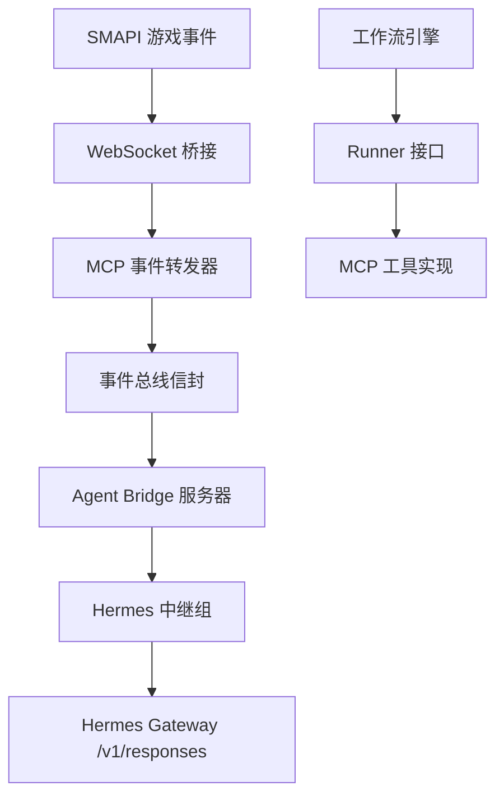
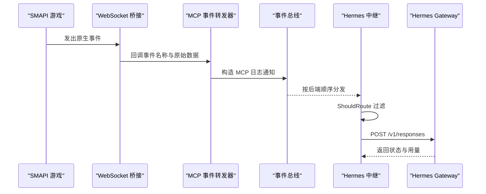
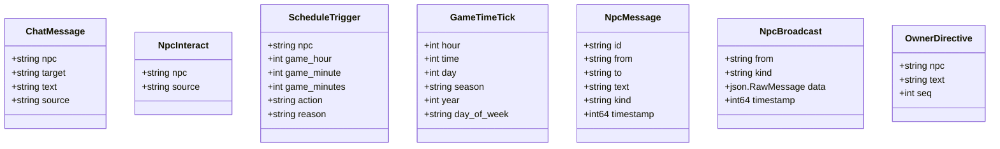
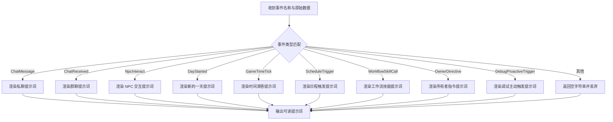
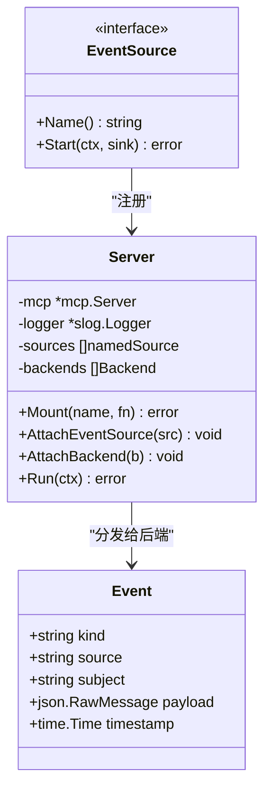
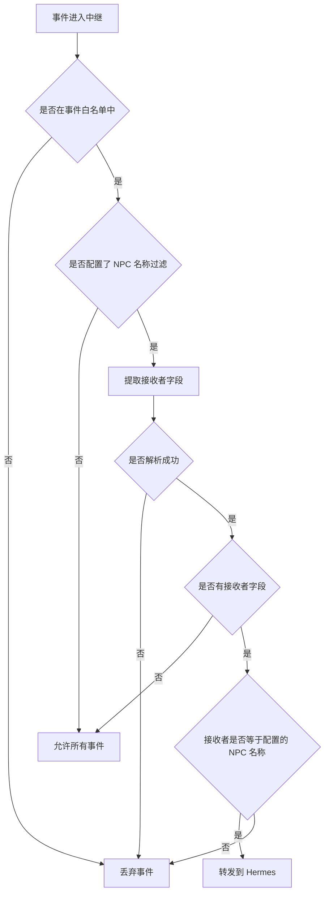
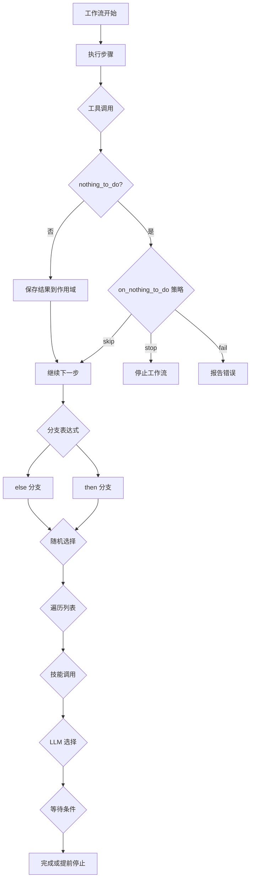
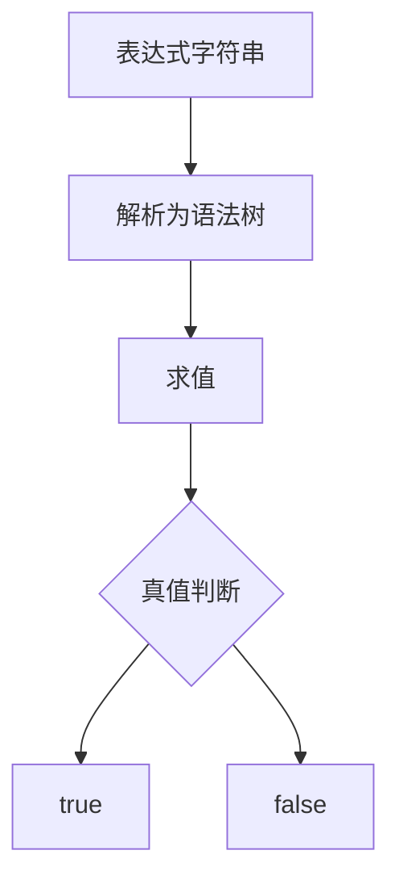
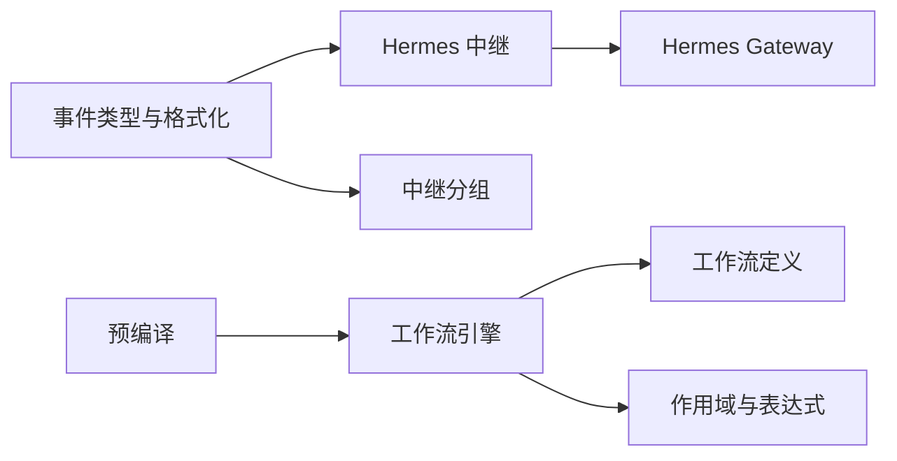

# 事件过滤与路由

<cite>
**本文引用的文件**   
- [format.go](file://SmartNPC/smartnpc-mcp/adapters/stardew/events/format.go)
- [events.go](file://SmartNPC/smartnpc-mcp/adapters/stardew/events/events.go)
- [eventsource.go](file://SmartNPC/smartnpc-mcp/pkg/agentbridge/eventsource.go)
- [server.go](file://SmartNPC/smartnpc-mcp/pkg/agentbridge/server.go)
- [event.go](file://SmartNPC/smartnpc-mcp/pkg/eventbus/event.go)
- [events_forwarder](file://SmartNPC/smartnpc-mcp/adapters/stardew/tools/events.go)
- [relay.go](file://SmartNPC/smartnpc-mcp/pkg/relay/hermes/relay.go)
- [group.go](file://SmartNPC/smartnpc-mcp/pkg/relay/hermes/group.go)
- [definition.go](file://SmartNPC/smartnpc-mcp/pkg/workflow/definition.go)
- [engine.go](file://SmartNPC/smartnpc-mcp/pkg/workflow/engine.go)
- [context.go](file://SmartNPC/smartnpc-mcp/pkg/workflow/context.go)
- [precompile.go](file://SmartNPC/smartnpc-mcp/pkg/workflow/precompile.go)
</cite>

## 目录
1. [引言](#引言)
2. [项目结构](#项目结构)
3. [核心组件](#核心组件)
4. [架构总览](#架构总览)
5. [详细组件分析](#详细组件分析)
6. [依赖关系分析](#依赖关系分析)
7. [性能与优化](#性能与优化)
8. [监控与调试](#监控与调试)
9. [故障排查指南](#故障排查指南)
10. [结论](#结论)

## 引言
本文聚焦 SmartNPC 中“事件过滤与路由”的完整实现，覆盖以下目标：
- 事件匹配引擎：规则匹配、条件判断、表达式语义、复合逻辑组合。
- 路由策略：基于标签的事件白名单、基于内容（接收者 NPC）的路由、广播事件分发、按配置的多 NPC 路由。
- 事件转换机制：原始桥接事件到 Hermes 可读提示词、字段映射、协议封装。
- 事件聚合能力：工作流中的分支、随机选择、循环、等待与停止；预编译工作流对运行时延迟的优化。
- 性能优化：索引化标签过滤、批量会话转发、内存对象复用、HTTP 并发控制与缓存指标。
- 复杂事件处理模式：调度触发、技能调用、所有者指令、跨 NPC 消息等场景的最佳实践。
- 监控指标与调试方法：日志分层、负载记录、错误恢复与会话轮换。

## 项目结构
本项目中与事件过滤和路由相关的代码主要分布在三个层次：
- 适配器层：将 Stardew Valley SMAPI 事件转换为统一事件类型，并生成面向 AI 的可读文本。
- 桥接与总线层：提供事件源接口、统一事件信封、服务端分发。
- 中继与工作流层：按规则筛选事件、转发给 Hermes Gateway，并在工作流中执行条件、循环、工具调用与 LLM 决策。

**图示来源**
- [events_forwarder:10-56](file://SmartNPC/smartnpc-mcp/adapters/stardew/tools/events.go#L10-L56)
- [event.go:20-76](file://SmartNPC/smartnpc-mcp/pkg/eventbus/event.go#L20-L76)
- [server.go:103-177](file://SmartNPC/smartnpc-mcp/pkg/agentbridge/server.go#L103-L177)
- [relay.go:201-453](file://SmartNPC/smartnpc-mcp/pkg/relay/hermes/relay.go#L201-L453)

**章节来源**
- [events_forwarder:10-56](file://SmartNPC/smartnpc-mcp/adapters/stardew/tools/events.go#L10-L56)
- [event.go:20-76](file://SmartNPC/smartnpc-mcp/pkg/eventbus/event.go#L20-L76)
- [server.go:103-177](file://SmartNPC/smartnpc-mcp/pkg/agentbridge/server.go#L103-L177)
- [relay.go:201-453](file://SmartNPC/smartnpc-mcp/pkg/relay/hermes/relay.go#L201-L453)

## 核心组件
本节梳理事件从产生到被 Hermes 消费的关键组件职责：
- 事件类型与格式化：定义结构化事件载荷，并将不同事件渲染为面向 AI 的简短上下文。
- 事件转发器：把桥接事件包装成 MCP 日志通知，广播给所有已连接会话。
- 事件总线信封：定义统一的 `kind`、`source`、`subject`、`payload`、`timestamp` 传输模型。
- 事件源与桥接服务器：抽象事件生产方，按注册顺序串行分发给后端。
- Hermes 中继：根据 NPC 名称过滤事件，组装请求并 POST 到 Hermes Gateway。
- 工作流引擎：执行工具调用、分支、随机、循环、LLM 选择、等待与停止。

**章节来源**
- [events.go:1-110](file://SmartNPC/smartnpc-mcp/adapters/stardew/events/events.go#L1-L110)
- [format.go:18-290](file://SmartNPC/smartnpc-mcp/adapters/stardew/events/format.go#L18-L290)
- [events_forwarder:10-56](file://SmartNPC/smartnpc-mcp/adapters/stardew/tools/events.go#L10-L56)
- [event.go:20-76](file://SmartNPC/smartnpc-mcp/pkg/eventbus/event.go#L20-L76)
- [eventsource.go:1-40](file://SmartNPC/smartnpc-mcp/pkg/agentbridge/eventsource.go#L1-L40)
- [server.go:103-177](file://SmartNPC/smartnpc-mcp/pkg/agentbridge/server.go#L103-L177)
- [relay.go:201-453](file://SmartNPC/smartnpc-mcp/pkg/relay/hermes/relay.go#L201-L453)
- [engine.go:1-200](file://SmartNPC/smartnpc-mcp/pkg/workflow/engine.go#L1-L200)

## 架构总览
事件系统采用“适配器 + 总线 + 中继 + 工作流”的分层设计。适配器负责领域事件标准化，总线提供统一信封和生命周期管理，中继负责按 NPC 路由到 Hermes Gateway，工作流引擎负责在定时或人工触发后执行复杂的动作序列。

**图示来源**
- [events_forwarder:10-56](file://SmartNPC/smartnpc-mcp/adapters/stardew/tools/events.go#L10-L56)
- [server.go:103-177](file://SmartNPC/smartnpc-mcp/pkg/agentbridge/server.go#L103-L177)
- [relay.go:201-453](file://SmartNPC/smartnpc-mcp/pkg/relay/hermes/relay.go#L201-L453)

## 详细组件分析

### 事件类型与格式标准化
事件类型定义集中在适配器包中，包括玩家聊天、NPC 交互、日程触发、时间滴答、跨 NPC 消息、广播、所有者指令等。每个事件都有明确的 JSON 字段语义，并对未来扩展保持前向兼容。

关键职责：
- 定义事件结构体，如聊天消息、NPC 交互、日程触发、时间滴答、跨 NPC 消息、广播等。
- 提供解码函数，将原始 JSON 反序列化为强类型结构。
- 提供分类辅助函数，区分 mod 事件、保留事件与合成事件。
- 提供通用接收者提取函数，用于后续路由判断。

**图示来源**
- [events.go:18-199](file://SmartNPC/smartnpc-mcp/adapters/stardew/events/events.go#L18-L199)

#### 事件到 AI 提示词的转换
`FormatForHermes` 是事件过滤链中的关键转换器：它将结构化事件渲染为一段简短、可操作的提示词，供 Hermes 决定下一步工具调用。

特点：
- 针对聊天消息、群聊、NPC 交互、新的一天、位置变化、好感度变化、NPC 私信、NPC 广播、NPC 主动接近玩家、时间滴答、日程触发、工作流技能调用、所有者指令、调试主动触发等事件分别处理。
- 对未知事件返回空字符串，从而让中继静默丢弃，避免污染 AI 对话历史。
- 对需要严格工具调用的事件（如新的一天、日程触发）加入强约束提示。

**图示来源**
- [format.go:18-290](file://SmartNPC/smartnpc-mcp/adapters/stardew/events/format.go#L18-L290)

**章节来源**
- [events.go:18-290](file://SmartNPC/smartnpc-mcp/adapters/stardew/events/events.go#L18-L290)
- [format.go:18-290](file://SmartNPC/smartnpc-mcp/adapters/stardew/events/format.go#L18-L290)

### 事件转发与 MCP 日志通知
事件转发器将桥接事件包装成 MCP 日志通知，包含统一字段：`kind`、`name`、`data`、`timestamp`。它遍历所有活跃会话并发送通知，失败时仅记录调试日志，不中断整体流程。

关键点：
- 所有事件都通过 MCP 的 logging notification 通道广播。
- 客户端可通过设置日志处理器并过滤 `kind == "stardew/event"` 订阅事件。
- 当前实现注释指出“目前将所有事件发送到 Hermes Agent”，但实际中继还有更严格的白名单与 NPC 过滤。

**章节来源**
- [events_forwarder:10-56](file://SmartNPC/smartnpc-mcp/adapters/stardew/tools/events.go#L10-L56)

### 事件总线信封与生命周期
事件总线定义了跨模块的统一事件类型，强调核心层不应解释领域字段，而应由适配器和下游消费者自行解析。

关键字段：
- `kind`：命名空间化的动词，例如 `chat.message`、`actor.interact`、`world.day_started`。
- `source`：事件来源适配器，例如 `sdv`。
- `subject`：事件主体，通常是 NPC 名称或玩家。
- `payload`：适配器定义的 JSON 载荷。
- `timestamp`：适配器侧的生产时间，RFC 3339 格式。

生命周期：
- `EventSource` 接口抽象事件生产者，`Server.Run` 启动所有事件源。
- `dispatch` 按注册顺序串行调用后端 `Forward`，单个后端错误不会阻止后续后端接收事件。

**图示来源**
- [event.go:10-76](file://SmartNPC/smartnpc-mcp/pkg/eventbus/event.go#L10-L76)
- [eventsource.go:10-40](file://SmartNPC/smartnpc-mcp/pkg/agentbridge/eventsource.go#L10-L40)
- [server.go:18-177](file://SmartNPC/smartnpc-mcp/pkg/agentbridge/server.go#L18-L177)

**章节来源**
- [event.go:10-76](file://SmartNPC/smartnpc-mcp/pkg/eventbus/event.go#L10-L76)
- [eventsource.go:10-40](file://SmartNPC/smartnpc-mcp/pkg/agentbridge/eventsource.go#L10-L40)
- [server.go:18-177](file://SmartNPC/smartnpc-mcp/pkg/agentbridge/server.go#L18-L177)

### 路由策略：标签、内容、优先级与动态规则
路由发生在两个层面：
1. **MCP 层广播**：事件转发器把所有事件广播给所有会话。
2. **Hermes 中继层过滤**：中继根据事件白名单和 NPC 名称决定是否转发。

#### 基于标签的事件白名单
中继使用 `hermesEventAllowed` 允许特定事件唤醒 Hermes：
- `day_started`
- `schedule_trigger`
- `workflow_skill_call`
- `owner_directive`

其他事件在中继层被直接过滤，即使它们已通过 MCP 广播。

#### 基于内容的 NPC 路由
中继通过 `RecipientNPC` 从原始事件中提取接收者字段，支持 `npc`、`to`、`target` 三种常见字段名。如果事件没有接收者字段，则视为广播事件，允许无 NPC 过滤的中继接收。

#### 多 NPC 路由与分组
`Group` 为多个 Hermes Profile 提供统一入口，逐个检查每个中继的 `ShouldRoute`，匹配则转发，未匹配则记录警告。

#### 优先级与短路行为
- 中继按注册顺序串行转发到后端，但内部 HTTP POST 使用独立 goroutine，避免阻塞上游读取循环。
- 工作流引擎在工具调用返回 `nothing_to_do=true` 时，根据 `on_nothing_to_do` 策略跳过、停止或失败。

**图示来源**
- [relay.go:201-320](file://SmartNPC/smartnpc-mcp/pkg/relay/hermes/relay.go#L201-L320)
- [events.go:240-290](file://SmartNPC/smartnpc-mcp/adapters/stardew/events/events.go#L240-L290)
- [group.go:20-93](file://SmartNPC/smartnpc-mcp/pkg/relay/hermes/group.go#L20-L93)

**章节来源**
- [relay.go:201-320](file://SmartNPC/smartnpc-mcp/pkg/relay/hermes/relay.go#L201-L320)
- [events.go:240-290](file://SmartNPC/smartnpc-mcp/adapters/stardew/events/events.go#L240-L290)
- [group.go:20-93](file://SmartNPC/smartnpc-mcp/pkg/relay/hermes/group.go#L20-L93)

### 事件转换机制
事件转换包括三个阶段：
1. **结构化定义**：事件载荷以 Go 结构体定义，JSON 标签明确字段语义。
2. **AI 可读渲染**：`FormatForHermes` 将结构化事件转为简短提示词，指导 AI 工具调用。
3. **协议封装**：中继将输入、模型、会话、指令、存储标志封装为 `/v1/responses` 请求。

数据增强体现在：
- 对时间、季节、星期进行友好格式化。
- 对私聊、群聊、NPC 私信、广播等添加操作约束。
- 对所有者指令和工作流技能调用附加强业务规则。

**章节来源**
- [events.go:18-199](file://SmartNPC/smartnpc-mcp/adapters/stardew/events/events.go#L18-L199)
- [format.go:18-290](file://SmartNPC/smartnpc-mcp/adapters/stardew/events/format.go#L18-L290)
- [relay.go:320-453](file://SmartNPC/smartnpc-mcp/pkg/relay/hermes/relay.go#L320-L453)

### 事件聚合与复杂事件处理
虽然本仓库没有传统意义上的“去重与时间窗口聚合”服务，但工作流引擎提供了强大的事件聚合与处理能力：

- **合并与分支**：`BranchStep` 根据表达式选择 then 或 else 子步骤。
- **随机聚合**：`RandomStep` 按权重选择一个分支执行。
- **列表聚合**：`ForEachStep` 遍历列表变量，每次迭代创建子作用域。
- **等待聚合**：`WaitStep` 等待 NPC 空闲，避免并发工具冲突。
- **停止聚合**：`StopStep` 提前终止工作流并记录原因。
- **LLM 决策聚合**：`LLMChoiceStep` 让 LLM 从固定选项中选择，结果保存为工作流变量。

此外，预编译工作流将 LLM 的动态决策过程录制为确定性工具步骤，减少触发时的延迟。

**图示来源**
- [definition.go:1-200](file://SmartNPC/smartnpc-mcp/pkg/workflow/definition.go#L1-L200)
- [engine.go:201-626](file://SmartNPC/smartnpc-mcp/pkg/workflow/engine.go#L201-L626)
- [precompile.go:1-226](file://SmartNPC/smartnpc-mcp/pkg/workflow/precompile.go#L1-L226)

**章节来源**
- [definition.go:1-200](file://SmartNPC/smartnpc-mcp/pkg/workflow/definition.go#L1-L200)
- [engine.go:201-626](file://SmartNPC/smartnpc-mcp/pkg/workflow/engine.go#L201-L626)
- [precompile.go:1-226](file://SmartNPC/smartnpc-mcp/pkg/workflow/precompile.go#L1-L226)

### 条件判断与表达式引擎
工作流引擎内置一个轻量级表达式求值器，支持：
- 变量查找：`$obs.water.count` 或 `obs.water.count`。
- 字面量：数字、字符串、布尔值、nil。
- 比较运算符：`==`、`!=`、`<`、`<=`、`>`、`>=`。
- 逻辑运算符：`&&`、`||`、`!`。
- 括号分组。

表达式语法有意限制算术与函数调用，以保持解析简单、可预测。缺失变量或类型不匹配会安全地回退为 falsy 或 nil，避免工作流崩溃。

**图示来源**
- [context.go:1-200](file://SmartNPC/smartnpc-mcp/pkg/workflow/context.go#L1-L200)

**章节来源**
- [context.go:1-200](file://SmartNPC/smartnpc-mcp/pkg/workflow/context.go#L1-L200)

## 依赖关系分析
事件系统的依赖关系清晰分层：
- 适配器依赖桥接常量与事件类型。
- 中继依赖事件格式化与接收者提取。
- 工作流引擎依赖 Runner 接口，不直接依赖 MCP 或 WebSocket。
- 预编译功能依赖 RecordingRunner 拦截写入型工具调用。

**图示来源**
- [events.go:18-290](file://SmartNPC/smartnpc-mcp/adapters/stardew/events/events.go#L18-L290)
- [format.go:18-290](file://SmartNPC/smartnpc-mcp/adapters/stardew/events/format.go#L18-L290)
- [relay.go:201-453](file://SmartNPC/smartnpc-mcp/pkg/relay/hermes/relay.go#L201-L453)
- [group.go:20-93](file://SmartNPC/smartnpc-mcp/pkg/relay/hermes/group.go#L20-L93)
- [definition.go:1-200](file://SmartNPC/smartnpc-mcp/pkg/workflow/definition.go#L1-L200)
- [context.go:1-200](file://SmartNPC/smartnpc-mcp/pkg/workflow/context.go#L1-L200)
- [precompile.go:1-226](file://SmartNPC/smartnpc-mcp/pkg/workflow/precompile.go#L1-L226)

**章节来源**
- [events.go:18-290](file://SmartNPC/smartnpc-mcp/adapters/stardew/events/events.go#L18-L290)
- [format.go:18-290](file://SmartNPC/smartnpc-mcp/adapters/stardew/events/format.go#L18-L290)
- [relay.go:201-453](file://SmartNPC/smartnpc-mcp/pkg/relay/hermes/relay.go#L201-L453)
- [group.go:20-93](file://SmartNPC/smartnpc-mcp/pkg/relay/hermes/group.go#L20-L93)
- [definition.go:1-200](file://SmartNPC/smartnpc-mcp/pkg/workflow/definition.go#L1-L200)
- [context.go:1-200](file://SmartNPC/smartnpc-mcp/pkg/workflow/context.go#L1-L200)
- [precompile.go:1-226](file://SmartNPC/smartnpc-mcp/pkg/workflow/precompile.go#L1-L226)

## 性能与优化
当前实现的性能优化主要集中在以下几个方面：

### 索引加速
- 事件白名单使用显式字符串集合判断，O(1) 级别。
- NPC 路由通过一次性解析接收者字段，避免重复解析。
- 预编译工作流将 LLM 决策过程录制为确定化工具步骤，减少触发时的推理延迟。

### 批量处理
- MCP 事件转发器遍历所有会话发送通知，属于广播模式，适合低延迟通知场景。
- 工作流引擎在 foreach 中默认限制最大迭代次数为 50，防止大数据集导致无限循环。

### 内存优化
- 事件载荷使用 `json.RawMessage` 避免重复序列化。
- 工作流作用域采用父子链式结构，foreach 每次迭代创建子作用域，避免污染外层变量。
- 中继加载 persona 与 critical policy 文件一次并缓存。

### 缓存策略
- Hermes Gateway 响应中包含缓存 token 统计，中继记录缓存命中率。
- 当检测到无效工具转录时，中继自动旋转会话 ID，避免持续失败。

建议的进一步优化方向：
- 引入事件去重键，避免短时间内的重复事件。
- 增加滑动时间窗口聚合器，用于统计某段时间内同类事件数量。
- 对高频事件启用本地计数缓存，降低远端查询压力。
- 对工作流中的频繁工具调用引入结果缓存，前提是工具幂等且状态稳定。

**章节来源**
- [relay.go:320-453](file://SmartNPC/smartnpc-mcp/pkg/relay/hermes/relay.go#L320-L453)
- [engine.go:201-626](file://SmartNPC/smartnpc-mcp/pkg/workflow/engine.go#L201-L626)
- [precompile.go:1-226](file://SmartNPC/smartnpc-mcp/pkg/workflow/precompile.go#L1-L226)

## 监控与调试
系统提供多层日志与调试能力：

### 日志层级
- 中继层记录事件接收、POST 请求、响应状态、耗时、token 用量、缓存命中情况。
- 工作流引擎记录每步执行的 step 编号、类型、耗时、是否停止、工具调用次数。
- MCP 事件转发器记录转发负载，失败时记录调试日志。

### 调试指标
- `hermesrelay event received`：中继收到事件。
- `hermesrelay forwarded event`：中继成功转发事件，包含耗时与 token 统计。
- `hermesrelay POST failed`：HTTP 请求失败。
- `hermesrelay non-2xx`：非 2xx 响应。
- `hermesrelay rotated conversation after invalid tool transcript`：会话自动恢复。
- `workflow: step start/done`：工作流步骤执行详情。
- `workflow: tool calling/ok/failed`：工具调用详情。
- `workflow: skill_call start/done`：技能调用详情。

### 调试建议
- 开启中继的 `DebugPayload`，将完整请求与响应输出到专用日志。
- 检查工作流日志中的 `step` 编号与 `elapsed_ms`，定位慢步骤。
- 观察 `nothing_to_do` 计数与 `stop_reason`，确认工作流是否提前终止。
- 若 Hermes 返回无效工具转录错误，检查会话 ID 是否被自动旋转。

**章节来源**
- [relay.go:320-453](file://SmartNPC/smartnpc-mcp/pkg/relay/hermes/relay.go#L320-L453)
- [engine.go:1-200](file://SmartNPC/smartnpc-mcp/pkg/workflow/engine.go#L1-L200)
- [events_forwarder:10-56](file://SmartNPC/smartnpc-mcp/adapters/stardew/tools/events.go#L10-L56)

## 故障排查指南

### 事件未被转发到 Hermes
可能原因：
- 事件不在 `hermesEventAllowed` 白名单中。
- 中继配置了 NPC 名称过滤，但事件接收者不匹配。
- 事件原始数据解析失败，中继安全丢弃。
- `FormatForHermes` 返回空字符串，中继静默丢弃。

排查步骤：
1. 检查事件名称是否在白名单中。
2. 检查中继配置的 `NPCName` 是否与事件接收者一致。
3. 查看中继日志中的 `hermesrelay event filtered` 或 `malformed payload dropped`。
4. 检查 `FormatForHermes` 是否支持该事件类型。

### 工作流提前停止
可能原因：
- 工具返回 `nothing_to_do=true`，且 `on_nothing_to_do=stop`。
- 遇到 `StopStep`。
- 上下文取消或超时。

排查步骤：
1. 检查工作流日志中的 `workflow: tool nothing_to_do`。
2. 检查 `stop_reason` 字段。
3. 检查工作流定义中的 `on_nothing_to_do` 配置。

### 会话异常与工具转录损坏
可能原因：
- Hermes 服务端维护的对话转录损坏。
- 并发 POST 导致工具调用数组交错。

恢复方式：
- 中继检测到相关错误后自动旋转会话 ID。
- 检查日志中的 `rotated conversation after invalid tool transcript`。

**章节来源**
- [relay.go:201-453](file://SmartNPC/smartnpc-mcp/pkg/relay/hermes/relay.go#L201-L453)
- [engine.go:201-626](file://SmartNPC/smartnpc-mcp/pkg/workflow/engine.go#L201-L626)

## 结论
SmartNPC 的事件过滤与路由系统以清晰的分层设计实现了从游戏事件到 AI 决策的完整链路：
- 适配器层负责事件标准化与 AI 可读转换。
- 桥接层提供统一事件信封与生命周期管理。
- 中继层基于标签白名单与 NPC 内容过滤进行精确路由。
- 工作流引擎提供丰富的条件、随机、循环、等待与 LLM 决策能力。
- 预编译机制减少触发延迟，提升调度效率。
- 多层日志与指标支持问题定位与性能调优。

对于更高阶的聚合需求，可在当前工作流与中继基础上扩展去重键、时间窗口聚合器与结果缓存策略，以应对高吞吐、低延迟的复杂事件处理场景。