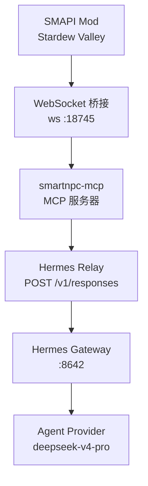
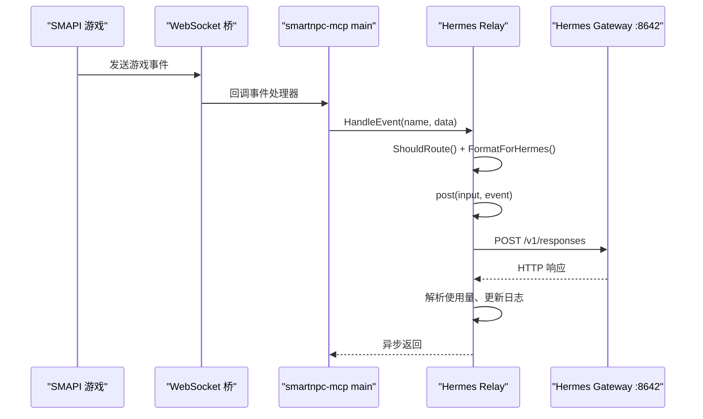
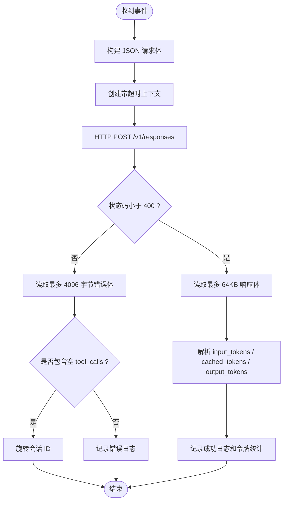
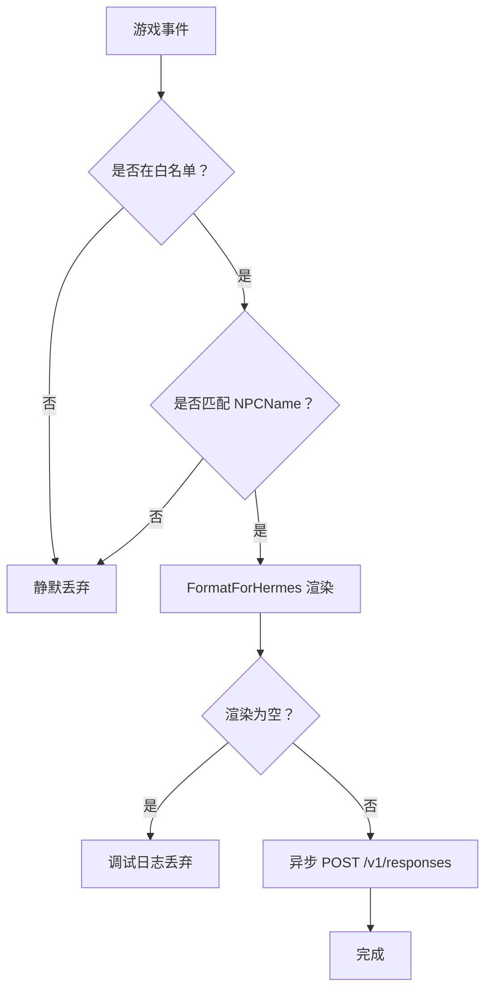
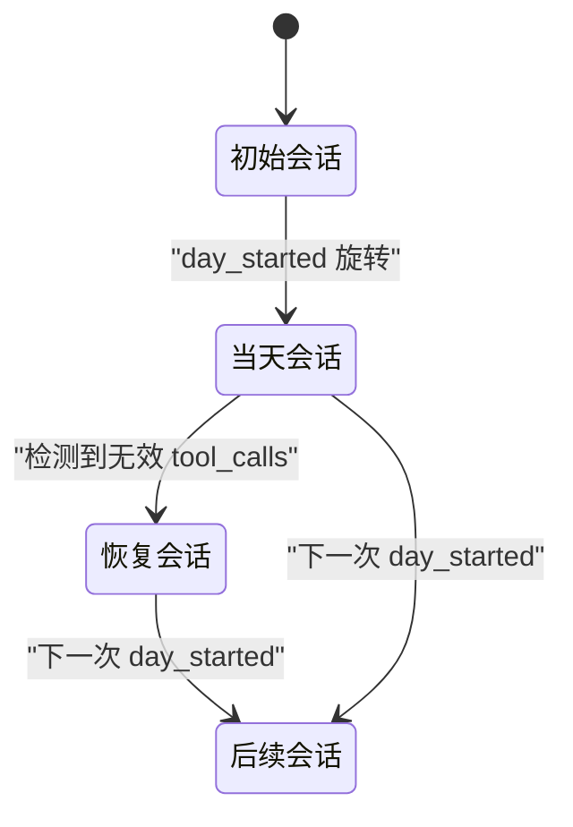
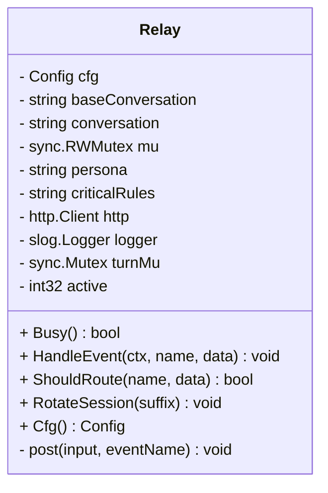
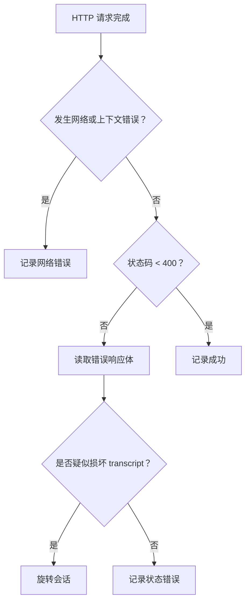
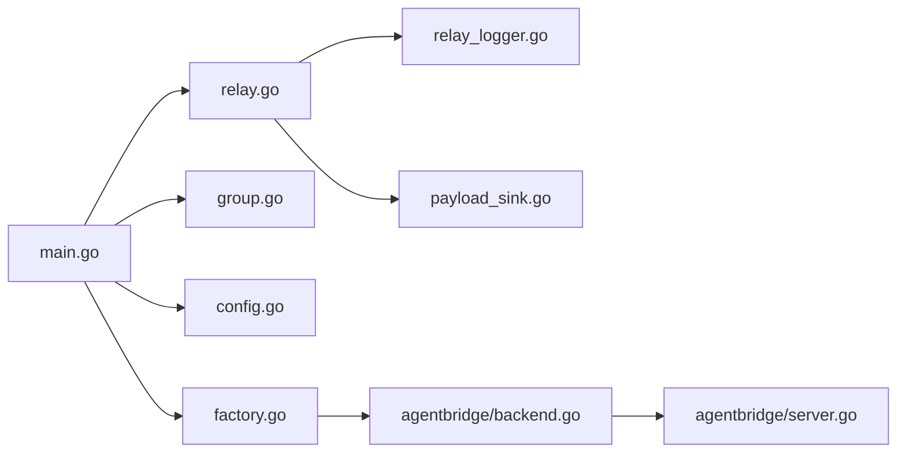

# 单 Profile 模式

<cite>
**本文引用的文件**   
- [smartnpc-mcp/pkg/relay/hermes/relay.go](file://SmartNPC/smartnpc-mcp/pkg/relay/hermes/relay.go)
- [smartnpc-mcp/pkg/relay/hermes/group.go](file://SmartNPC/smartnpc-mcp/pkg/relay/hermes/group.go)
- [smartnpc-mcp/pkg/relay/hermes/config.go](file://SmartNPC/smartnpc-mcp/pkg/relay/hermes/config.go)
- [smartnpc-mcp/pkg/relay/hermes/factory.go](file://SmartNPC/smartnpc-mcp/pkg/relay/hermes/factory.go)
- [smartnpc-mcp/pkg/relay/hermes/payload_sink.go](file://SmartNPC/smartnpc-mcp/pkg/relay/hermes/payload_sink.go)
- [smartnpc-mcp/pkg/relay/hermes/relay_logger.go](file://SmartNPC/smartnpc-mcp/pkg/relay/hermes/relay_logger.go)
- [smartnpc-mcp/cmd/smartnpc-mcp/main.go](file://SmartNPC/smartnpc-mcp/cmd/smartnpc-mcp/main.go)
- [smartnpc-mcp/pkg/agentbridge/server.go](file://SmartNPC/smartnpc-mcp/pkg/agentbridge/server.go)
- [smartnpc-mcp/pkg/agentbridge/backend.go](file://SmartNPC/smartnpc-mcp/pkg/agentbridge/backend.go)
- [hermes/profiles/xiami/SOUL.md](file://SmartNPC/hermes/profiles/xiami/SOUL.md)
- [hermes/profiles/xiami/config-overlay.yaml](file://SmartNPC/hermes/profiles/xiami/config-overlay.yaml)
- [hermes/runtime-config.yaml](file://SmartNPC/hermes/runtime-config.yaml)
- [hermes/npcs.yaml](file://SmartNPC/hermes/npcs.yaml)
- [hermes/README.md](file://SmartNPC/hermes/README.md)
- [deploy/hermes/Dockerfile](file://SmartNPC/deploy/hermes/Dockerfile)
- [deploy/hermes/docker-compose.langfuse.yml](file://SmartNPC/deploy/hermes/docker-compose.langfuse.yml)
- [deploy/hermes/scripts/entrypoint.sh](file://SmartNPC/deploy/hermes/scripts/entrypoint.sh)
- [deploy/hermes/scripts/healthcheck.sh](file://SmartNPC/deploy/hermes/scripts/healthcheck.sh)
- [deploy/hermes/scripts/sync-profiles.sh](file://SmartNPC/deploy/hermes/scripts/sync-profiles.sh)
</cite>

## 目录
1. [引言](#引言)
2. [项目结构与单 Profile 定位](#项目结构与单 Profile 定位)
3. [核心组件](#核心组件)
4. [架构总览](#架构总览)
5. [详细组件分析](#详细组件分析)
6. [依赖关系分析](#依赖关系分析)
7. [性能与资源特性](#性能与资源特性)
8. [单实例部署配置与运维指南](#单实例部署配置与运维指南)
9. [故障排查手册](#故障排查手册)
10. [结论](#结论)

## 引言
本文面向“单 Profile 模式”，即一个 `smartnpc-mcp` 进程只对接一个 Hermes Gateway（例如 `xiami`，端口 `8642`）的实现说明。重点覆盖：

- 连接管理：Hermes REST `/v1/responses` 请求建立、超时控制、无心跳但具备会话恢复。
- 消息转发：SMAPI 事件 → `smartnpc-mcp` → Hermes Gateway 的请求路由、响应处理、错误记录与超时行为。
- 会话管理：对话 ID、按天会话旋转、指令注入、上下文压缩由 Hermes 侧负责。
- 监控指标：延迟、状态码、缓存命中、令牌用量、活跃请求数、日志路径。
- 连接复用与内存：Go `http.Client` 默认复用；Relay 串行化同一 NPC 的转轮；不维护本地聊天历史。
- 部署与排障：Docker 单 Profile 启动方式、健康检查、常见断线及错误恢复策略。

## 项目结构与单 Profile 定位
仓库中与“单 Profile”直接相关的代码位于 Go 程序 `smartnpc-mcp` 中：

| 层级 | 位置 | 职责 |
|---|---|---|
| 入口 | `cmd/smartnpc-mcp/main.go` | 解析命令行参数、选择单 Profile 或全量多 Profile 模式、注册事件路由 |
| 转发核心 | `pkg/relay/hermes/relay.go` | 单个 Hermes Profile 的连接、请求构建、超时、会话旋转、统计日志 |
| 多 Profile 包装 | `pkg/relay/hermes/group.go` | 将多个 Relay 封装为统一事件分发器，单 Profile 时退化为直发 |
| 配置加载 | `pkg/relay/hermes/config.go` | 解析 `runtime-config.yaml`、环境变量、默认超时和调试开关 |
| 工厂注册 | `pkg/relay/hermes/factory.go` | 将 hermes relay 注册到 agentbridge 后端 |
| 调试输出 | `pkg/relay/hermes/relay_logger.go` | 写入 `logs/mcp/relay.log` |
| 实验数据 | `pkg/relay/hermes/payload_sink.go` | 捕获完整请求/响应体用于实验日志 |
| Hermes Profile | `hermes/profiles/<name>/SOUL.md`、`config-overlay.yaml` | 人格、技能、MCP 服务地址、Gateway 端口、模型名 |
| 运行时映射 | `hermes/runtime-config.yaml` | 把游戏内 NPC 名称映射到 Gateway URL、对话名、模型名 |
| 容器化 | `deploy/hermes/*` | Dockerfile、入口脚本、健康检查、Langfuse 可观测性 |



**图表来源**
- [smartnpc-mcp/cmd/smartnpc-mcp/main.go:1-120](file://SmartNPC/smartnpc-mcp/cmd/smartnpc-mcp/main.go#L1-L120)
- [smartnpc-mcp/pkg/relay/hermes/relay.go:1-80](file://SmartNPC/smartnpc-mcp/pkg/relay/hermes/relay.go#L1-L80)
- [hermes/README.md:20-40](file://SmartNPC/hermes/README.md#L20-L40)

**章节来源**
- [hermes/README.md:1-40](file://SmartNPC/hermes/README.md#L1-L40)
- [smartnpc-mcp/cmd/smartnpc-mcp/main.go:1-120](file://SmartNPC/smartnpc-mcp/cmd/smartnpc-mcp/main.go#L1-L120)

## 核心组件
在单 Profile 模式下，关键对象是 `Relay`，它对应一个 Hermes Profile 和一条 HTTP 通道：

| 组件 | 主要字段或方法 | 作用 |
|---|---|---|
| `Config` | `URL`、`APIKey`、`Conversation`、`Model`、`NPCName`、`Timeout`、`Store`、`DebugPayload` | 描述目标 Hermes Gateway、认证、会话名、模型、过滤条件、超时、是否让 Hermes 存储历史 |
| `Relay` | `post()`、`HandleEvent()`、`ShouldRoute()`、`RotateSession()`、`Busy()` | 执行一次请求、接收事件、判断路由、按天切换会话、报告忙闲 |
| `Group` | `NewGroup()`、`HandleEvent()`、`Relays()` | 多 Profile 抽象；单 Profile 场景下内部只有一个 `Relay` |
| `factoryConfig` | `RuntimeConfig` | 声明 `runtime-config.yaml` 路径 |
| `groupBackend` | `Forward()` | 把 agentbridge 事件转换为 `Group.HandleEvent` |
| `payloadSink` | `SetPayloadSink()` | 注入完整请求/响应体观察者 |
| `LogRelayRequest/Response/Error` | 写 `logs/mcp/relay.log` | 结构化日志 |

**章节来源**
- [smartnpc-mcp/pkg/relay/hermes/relay.go:1-80](file://SmartNPC/smartnpc-mcp/pkg/relay/hermes/relay.go#L1-L80)
- [smartnpc-mcp/pkg/relay/hermes/group.go:1-93](file://SmartNPC/smartnpc-mcp/pkg/relay/hermes/group.go#L1-L93)
- [smartnpc-mcp/pkg/relay/hermes/factory.go:1-68](file://SmartNPC/smartnpc-mcp/pkg/relay/hermes/factory.go#L1-L68)
- [smartnpc-mcp/pkg/relay/hermes/payload_sink.go:1-39](file://SmartNPC/smartnpc-mcp/pkg/relay/hermes/payload_sink.go#L1-L39)
- [smartnpc-mcp/pkg/relay/hermes/relay_logger.go:1-126](file://SmartNPC/smartnpc-mcp/pkg/relay/hermes/relay_logger.go#L1-L126)

## 架构总览
单 Profile 模式有两种等价入口：

1. **旧式单 Profile 参数**：通过 `--hermes-url`、`--hermes-api-key`、`--hermes-conversation`、`--hermes-model`、`--hermes-npc`、`--hermes-persona-file` 直接构造一个 `Relay`。
2. **推荐的多 Profile 配置**：通过 `--hermes-config hermes/runtime-config.yaml` 加载 YAML，再根据 NPC 名称匹配一个 Gateway。

无论哪种入口，最终都是同一个 `Relay.post()` 执行 HTTP POST。



**图表来源**
- [smartnpc-mcp/cmd/smartnpc-mcp/main.go:200-400](file://SmartNPC/smartnpc-mcp/cmd/smartnpc-mcp/main.go#L200-L400)
- [smartnpc-mcp/pkg/relay/hermes/relay.go:120-220](file://SmartNPC/smartnpc-mcp/pkg/relay/hermes/relay.go#L120-L220)
- [smartnpc-mcp/pkg/relay/hermes/relay.go:280-453](file://SmartNPC/smartnpc-mcp/pkg/relay/hermes/relay.go#L280-L453)

**章节来源**
- [smartnpc-mcp/cmd/smartnpc-mcp/main.go:60-120](file://SmartNPC/smartnpc-mcp/cmd/smartnpc-mcp/main.go#L60-L120)
- [smartnpc-mcp/cmd/smartnpc-mcp/main.go:200-400](file://SmartNPC/smartnpc-mcp/cmd/smartnpc-mcp/main.go#L200-L400)
- [smartnpc-mcp/pkg/relay/hermes/relay.go:120-220](file://SmartNPC/smartnpc-mcp/pkg/relay/hermes/relay.go#L120-L220)

## 详细组件分析

### 连接管理与生命周期
`Relay` 并不建立长连接、也不维持 WebSocket 到 Hermes 的会话；它使用 Go 标准库的 `http.Client` 向 `URL + "/v1/responses"` 发起 HTTP POST。

关键点如下：

| 方面 | 实现 | 影响 |
|---|---|---|
| 连接建立 | `http.NewRequestWithContext(ctx, http.MethodPost, url, bytes.NewReader(body))` | 每次请求由底层 HTTP 客户端决定 TCP 连接复用 |
| 超时控制 | `context.WithTimeout(context.Background(), r.cfg.Timeout)` | 默认 `120` 秒；网络失败、远端慢、LLM 推理慢都会触发 |
| 连接复用 | 未显式创建自定义 `Transport`，因此使用默认复用 | 短请求可复用同一 TCP 连接，减少握手成本 |
| 心跳机制 | 代码中没有独立心跳线程或周期性 ping | 存活探测依赖 `/health` 接口和健康检查脚本 |
| 断线恢复 | 非 2xx 响应会记录错误；检测到包含 `empty array` 和 `tool_calls` 的错误时会旋转会话 | 适合远端 transcript 损坏时的自愈；普通网络抖动仅靠下次重试 |
| 资源释放 | `defer resp.Body.Close()`，响应体限制读取 `64KB` | 防止异常大响应耗尽内存 |



**图表来源**
- [smartnpc-mcp/pkg/relay/hermes/relay.go:280-453](file://SmartNPC/smartnpc-mcp/pkg/relay/hermes/relay.go#L280-L453)

**章节来源**
- [smartnpc-mcp/pkg/relay/hermes/relay.go:80-120](file://SmartNPC/smartnpc-mcp/pkg/relay/hermes/relay.go#L80-L120)
- [smartnpc-mcp/pkg/relay/hermes/relay.go:280-453](file://SmartNPC/smartnpc-mcp/pkg/relay/hermes/relay.go#L280-L453)

### 消息转发机制

#### 请求路由
路由分为两层：

1. **事件白名单**：只有 `day_started`、`schedule_trigger`、`workflow_skill_call`、`owner_directive` 等事件允许唤醒 Hermes。
2. **NPC 过滤器**：如果配置了 `NPCName`，则从事件负载中解析接收者；无法解析时按“丢弃”安全策略处理；没有接收者的广播事件始终放行。

在单 Profile 模式下，通常通过 `--hermes-npc XiaMi` 或 `runtime-config.yaml` 中的 `npc_filter: XiaMi` 限定只转发给夏弥。

#### 请求体构造
每个请求体包含：

| 字段 | 值来源 | 含义 |
|---|---|---|
| `model` | `Config.Model` | 对应 Profile 的 `API_SERVER_MODEL_NAME` |
| `input` | `events.FormatForHermes(name, data)` | 事件的人类可读渲染 |
| `conversation` | 当前会话 ID | 初始为配置值，可按天旋转 |
| `instructions` | 紧急策略 + 人格 SOUL | 保证每次调用都携带系统级规则和人设 |
| `store` | `Config.Store` | 默认 `true`，表示由 Hermes 保存对话历史 |

#### 响应返回
Relay 不会把 Hermes 的回复直接返回给 SMAPI 或 WebSocket 客户端。它只做三件事：

1. 解析 token 用量并计算缓存命中率。
2. 记录成功或失败的 `relay.log`。
3. 通过 `emitPayload` 暴露原始请求/响应体给实验追踪器。

Hermes 自身通过其 Gateway 和 skill 工具链把结果落回游戏世界，例如发消息、执行工作流、更新日程等。



**图表来源**
- [smartnpc-mcp/pkg/relay/hermes/relay.go:220-280](file://SmartNPC/smartnpc-mcp/pkg/relay/hermes/relay.go#L220-L280)
- [smartnpc-mcp/pkg/relay/hermes/group.go:40-93](file://SmartNPC/smartnpc-mcp/pkg/relay/hermes/group.go#L40-L93)

**章节来源**
- [smartnpc-mcp/pkg/relay/hermes/relay.go:220-280](file://SmartNPC/smartnpc-mcp/pkg/relay/hermes/relay.go#L220-L280)
- [smartnpc-mcp/pkg/relay/hermes/group.go:1-93](file://SmartNPC/smartnpc-mcp/pkg/relay/hermes/group.go#L1-L93)

### 会话管理与生命周期
单 Profile 模式的会话由以下三部分组成：

| 维度 | 实现 | 说明 |
|---|---|---|
| 会话绑定 | `Config.Conversation` | 通常是 Profile 名，例如 `xiami` |
| 上下文传递 | `instructions` + `conversation` | 每次 POST 都带上紧急策略、人格、当前事件和会话 ID |
| 状态保持 | `Store=true` | 对话历史保存在 Hermes 侧；`smartnpc-mcp` 不维护本地聊天窗口 |
| 生命周期 | 每天旋转会话 | `day_started` 时主程序调用 `RotateSession(suffix)` |
| 恢复机制 | 检测无效 `tool_calls` 后自动旋转 | 避免长期损坏 transcript 导致下游模型持续报错 |



**图表来源**
- [smartnpc-mcp/pkg/relay/hermes/relay.go:200-280](file://SmartNPC/smartnpc-mcp/pkg/relay/hermes/relay.go#L200-L280)
- [smartnpc-mcp/pkg/relay/hermes/relay.go:340-420](file://SmartNPC/smartnpc-mcp/pkg/relay/hermes/relay.go#L340-L420)
- [smartnpc-mcp/cmd/smartnpc-mcp/main.go:400-600](file://SmartNPC/smartnpc-mcp/cmd/smartnpc-mcp/main.go#L400-L600)

**章节来源**
- [smartnpc-mcp/pkg/relay/hermes/relay.go:200-280](file://SmartNPC/smartnpc-mcp/pkg/relay/hermes/relay.go#L200-L280)
- [smartnpc-mcp/pkg/relay/hermes/relay.go:340-420](file://SmartNPC/smartnpc-mcp/pkg/relay/hermes/relay.go#L340-L420)
- [smartnpc-mcp/cmd/smartnpc-mcp/main.go:400-600](file://SmartNPC/smartnpc-mcp/cmd/smartnpc-mcp/main.go#L400-L600)

### 并发控制与背压
`Relay` 不是完全无界并发：

| 并发层 | 行为 |
|---|---|
| 事件接收层 | `HandleEvent` 启动 goroutine 调用 `post()`，避免阻塞 WebSocket 读取循环 |
| 请求串行层 | 每个 Relay 持有 `turnMu`，同一 NPC 的 POST 串行执行 |
| 活跃计数 | `active int32` 原子递增/递减，供 `Busy()` 查询 |
| 工作流等待 | 工作流引擎通过 `Busy()` 判断真实模型思考是否结束，而不是只看 NPC 是否空闲 |

这意味着：**不同 NPC 可以并行 POST，但同一个 Profile 的多次回合会被排队**。这避免了 Hermes 服务端 transcript 中插入乱序 tool 消息。



**图表来源**
- [smartnpc-mcp/pkg/relay/hermes/relay.go:1-80](file://SmartNPC/smartnpc-mcp/pkg/relay/hermes/relay.go#L1-L80)

**章节来源**
- [smartnpc-mcp/pkg/relay/hermes/relay.go:1-80](file://SmartNPC/smartnpc-mcp/pkg/relay/hermes/relay.go#L1-L80)
- [smartnpc-mcp/pkg/relay/hermes/relay.go:120-220](file://SmartNPC/smartnpc-mcp/pkg/relay/hermes/relay.go#L120-L220)
- [smartnpc-mcp/cmd/smartnpc-mcp/main.go:400-600](file://SmartNPC/smartnpc-mcp/cmd/smartnpc-mcp/main.go#L400-L600)

### 错误处理
Relay 的错误路径包括：

| 错误类型 | 行为 |
|---|---|
| 配置缺失 | `New()` 对空 URL、空 Conversation、空 Model 返回错误 |
| 请求体序列化失败 | 记录警告并丢弃该次转发 |
| 网络或超时错误 | 记录 `RELAY ✗` 日志，附带耗时和错误信息 |
| 非 2xx 响应 | 读取最多 4096 字节错误体，记录错误日志 |
| 损坏 transcript | 若响应体包含 `empty array` 和 `tool_calls`，旋转会话并重试 |
| 响应体过大 | 限制读取 64KB，剩余内容丢弃以复用 keep-alive |



**图表来源**
- [smartnpc-mcp/pkg/relay/hermes/relay.go:340-453](file://SmartNPC/smartnpc-mcp/pkg/relay/hermes/relay.go#L340-L453)

**章节来源**
- [smartnpc-mcp/pkg/relay/hermes/relay.go:340-453](file://SmartNPC/smartnpc-mcp/pkg/relay/hermes/relay.go#L340-L453)

## 依赖关系分析



**图表来源**
- [smartnpc-mcp/cmd/smartnpc-mcp/main.go:1-120](file://SmartNPC/smartnpc-mcp/cmd/smartnpc-mcp/main.go#L1-L120)
- [smartnpc-mcp/pkg/relay/hermes/factory.go:1-68](file://SmartNPC/smartnpc-mcp/pkg/relay/hermes/factory.go#L1-L68)
- [smartnpc-mcp/pkg/agentbridge/backend.go:1-36](file://SmartNPC/smartnpc-mcp/pkg/agentbridge/backend.go#L1-L36)
- [smartnpc-mcp/pkg/agentbridge/server.go:1-177](file://SmartNPC/smartnpc-mcp/pkg/agentbridge/server.go#L1-L177)

**章节来源**
- [smartnpc-mcp/cmd/smartnpc-mcp/main.go:1-120](file://SmartNPC/smartnpc-mcp/cmd/smartnpc-mcp/main.go#L1-L120)
- [smartnpc-mcp/pkg/relay/hermes/factory.go:1-68](file://SmartNPC/smartnpc-mcp/pkg/relay/hermes/factory.go#L1-L68)
- [smartnpc-mcp/pkg/agentbridge/server.go:1-177](file://SmartNPC/smartnpc-mcp/pkg/agentbridge/server.go#L1-L177)

## 性能与资源特性

### 连接池优化与复用
- `Relay` 使用内置 `http.Client{Timeout: cfg.Timeout}`，未设置自定义 `Transport`。
- Go 标准库默认启用连接复用和连接池。
- 单 Profile 模式下，所有 `/v1/responses` 请求共享该 `http.Client`，从而复用 TCP 连接。
- 由于每个 Relay 串行化一次回合，不会出现同一 Profile 的高频并发请求争用连接。

### 内存管理
- 响应体最多读取 `64KB`，避免大响应占满堆。
- 请求体通过 `bytes.NewReader(body)` 零拷贝提交。
- 不维护本地聊天历史，对话状态交给 Hermes。
- 人格文件和紧急策略在 `New()` 时加载一次并缓存。
- `payloadSink` 是进程级全局钩子，需确保消费端不阻塞。

### 延迟测量
- `time.Since(started)` 记录从发起请求到收到响应的总耗时。
- 日志中包含 `elapsed_ms`、`status`、`input_tokens`、`cached_tokens`、`output_tokens`。
- 缓存命中率可通过 `cached_tokens / input_tokens` 估算。

### 吞吐量监控
- 当前实现没有全局计数器，但可通过以下方式近似评估：
  - 统计 `relay.log` 中成功和失败条目数量。
  - 观察 `active` 计数判断瞬时积压。
  - 使用 `logs/mcp/model-io.jsonl` 查看单位时间内的请求/响应条数。
  - 通过 `/status` 端点获取运行时长、WS 状态、各 Profile 配置摘要。

**章节来源**
- [smartnpc-mcp/pkg/relay/hermes/relay.go:80-120](file://SmartNPC/smartnpc-mcp/pkg/relay/hermes/relay.go#L80-L120)
- [smartnpc-mcp/pkg/relay/hermes/relay.go:340-453](file://SmartNPC/smartnpc-mcp/pkg/relay/hermes/relay.go#L340-L453)
- [smartnpc-mcp/pkg/relay/hermes/relay_logger.go:1-126](file://SmartNPC/smartnpc-mcp/pkg/relay/hermes/relay_logger.go#L1-L126)
- [smartnpc-mcp/pkg/relay/hermes/payload_sink.go:1-39](file://SmartNPC/smartnpc-mcp/pkg/relay/hermes/payload_sink.go#L1-L39)

## 单实例部署配置与运维指南

### 单 Profile 配置要点
对于单 Profile 模式，最简配置应满足：

| 配置项 | 推荐值 | 说明 |
|---|---|---|
| `SMARTNPC_HERMES_GATEWAY_HOST` | WSL 网关 IP 或 `localhost` | 被 `runtime-config.yaml` 展开为 Gateway 主机 |
| `profiles[0].gateway_url` | `http://${SMARTNPC_HERMES_GATEWAY_HOST}:8642` | 指向单一 Hermes Gateway |
| `profiles[0].conversation` | `xiami` | 会话名，一般等于 Profile 名 |
| `profiles[0].model` | `xiami` | 对应 Profile 的 `API_SERVER_MODEL_NAME` |
| `profiles[0].api_key_env` | `SMARTNPC_HERMES_KEY` | 从环境变量读取 Bearer Token |
| `hermes/profiles/xiami/config-overlay.yaml` | `API_SERVER_PORT: 8642` | 必须与 Gateway 端口一致 |
| `hermes/npcs.yaml` | `xiami.gateway_port: 8642` | 作为单 Profile 时也可保留，便于未来扩展 |

**章节来源**
- [hermes/runtime-config.yaml:1-15](file://SmartNPC/hermes/runtime-config.yaml#L1-L15)
- [hermes/npcs.yaml:1-20](file://SmartNPC/hermes/npcs.yaml#L1-L20)
- [hermes/profiles/xiami/config-overlay.yaml](file://SmartNPC/hermes/profiles/xiami/config-overlay.yaml)

### Docker 单实例启动
Dockerfile 将 profile 数据打包进镜像，并在启动时通过环境变量生成 `config.yaml`。

最小必需环境变量：

| 变量 | 示例 | 用途 |
|---|---|---|
| `NPC_PROFILE` | `xiami` | 选择哪个 Profile |
| `NPC_PORT` | `8642` | Hermes Gateway 监听端口 |
| `SMARTNPC_MCP_URL` | `http://your-ip:3000/mcp` | Hermes 要连接的 smartnpc-mcp MCP 地址 |
| `HERMES_AGENT_URL` | `https://...` | Agent provider 基础地址 |
| `HERMES_AGENT_API_KEY` | `sk-...` | Agent provider 密钥 |
| `SMARTNPC_HERMES_KEY` | `smartnpc-test-key` | Gateway Bearer Token，需与 client 一致 |
| `HERMES_LANGFUSE_PUBLIC_KEY` | 可选 | 启用 Langfuse 可观测性 |
| `HERMES_LANGFUSE_SECRET_KEY` | 可选 | 与 public key 配对 |
| `HERMES_LANGFUSE_BASE_URL` | 可选 | Langfuse 服务地址 |

单 Profile 容器命令参考：

```bash
docker run -d \
  --name hermes-xiami \
  -e NPC_PROFILE=xiami \
  -e NPC_PORT=8642 \
  -e SMARTNPC_MCP_URL=http://host.docker.internal:3000/mcp \
  -e HERMES_AGENT_URL=https://your-agent-provider.example.com \
  -e HERMES_AGENT_API_KEY=your-api-key \
  -e SMARTNPC_HERMES_KEY=smartnpc-test-key \
  hermes-image
```

**章节来源**
- [deploy/hermes/Dockerfile:1-28](file://SmartNPC/deploy/hermes/Dockerfile#L1-L28)
- [deploy/hermes/scripts/entrypoint.sh:1-200](file://SmartNPC/deploy/hermes/scripts/entrypoint.sh#L1-L200)

### 启动参数与流程
本地开发时，典型启动顺序为：

1. 启动 Stardew Valley 和 SMAPI。
2. 启动 `smartnpc-mcp`，绑定 HTTP `:3000`。
3. 启动 Hermes Gateway：`hermes -p xiami gateway run --accept-hooks`。
4. 验证连通：
   - `hermes -p xiami mcp test smartnpc_game`
   - `curl http://127.0.0.1:8642/health`

**章节来源**
- [hermes/README.md:40-120](file://SmartNPC/hermes/README.md#L40-L120)

### 运维指南

| 任务 | 操作 | 预期 |
|---|---|---|
| 健康检查 | `bash deploy/hermes/scripts/healthcheck.sh localhost` | 8642-8647 端口逐个检测 |
| 查看 relay 日志 | 打开 `logs/mcp/relay.log` | 查找 `[RELAY →]`、`[RELAY ←]`、`[RELAY ✗]` |
| 查看 model-io | 打开 `logs/mcp/exp/{date}/model-io.jsonl` | 完整请求/响应体 |
| 调整超时 | 设置 `SMARTNPC_RELAY_TIMEOUT_MS` | 默认 120000ms |
| 关闭服务端会话存储 | 设置 `SMARTNPC_RELAY_STORE=0` | 仅用于调试重复记忆问题 |
| 导出调试载荷 | 设置 `SMARTNPC_RELAY_DEBUG_PAYLOAD=1` 或 `SMARTNPC_RELAY_PAYLOAD_LOG=<path>` | 将完整请求/响应写到文件 |
| 同步 Profile 数据 | `bash deploy/hermes/scripts/sync-profiles.sh` | 构建镜像前复制 SOUL.md、skills、cron |
| 启用 Langfuse | 提供 `HERMES_LANGFUSE_PUBLIC_KEY` 和 `HERMES_LANGFUSE_SECRET_KEY` | entrypoint 自动挂载插件并写入 config |

**章节来源**
- [deploy/hermes/scripts/healthcheck.sh:1-29](file://SmartNPC/deploy/hermes/scripts/healthcheck.sh#L1-L29)
- [deploy/hermes/scripts/sync-profiles.sh:1-65](file://SmartNPC/deploy/hermes/scripts/sync-profiles.sh#L1-L65)
- [deploy/hermes/docker-compose.langfuse.yml:1-87](file://SmartNPC/deploy/hermes/docker-compose.langfuse.yml#L1-L87)
- [deploy/hermes/scripts/entrypoint.sh:1-200](file://SmartNPC/deploy/hermes/scripts/entrypoint.sh#L1-L200)
- [smartnpc-mcp/pkg/relay/hermes/config.go:1-191](file://SmartNPC/smartnpc-mcp/pkg/relay/hermes/config.go#L1-L191)

## 故障排查手册

### 常见问题与定位

| 现象 | 可能原因 | 排查步骤 |
|---|---|---|
| Hermes Gateway 无响应 | `SMARTNPC_MCP_URL` 不可达 | curl `http://<mcp-host>:3000/mcp` |
| 事件未转发 | 事件不在白名单或 NPCName 不匹配 | 检查 `hermesEventAllowed` 和 `npc_filter` |
| 单 Profile 端口冲突 | 多个 Profile 都用了 8642 | 修改 `config-overlay.yaml` 和 `npcs.yaml` |
| 长时间无输出 | LLM 推理慢或超时 | 查看 `relay.log` 中 `elapsed_ms`，增大 `SMARTNPC_RELAY_TIMEOUT_MS` |
| 连续 5xx 或工具调用错误 | Hermes transcript 损坏 | 观察是否出现会话旋转，检查 `recovery-` 后缀 |
| 本地无聊天记录 | `Store=false` 或未启用 Hermes 存储 | 检查 `SMARTNPC_RELAY_STORE` |
| 日志过大 | 开启 `DebugPayload` 且未定向文件 | 使用 `SMARTNPC_RELAY_PAYLOAD_LOG` 单独存放 |
| Langfuse 未生效 | 缺少 public/secret key 或插件路径问题 | 检查 entrypoint 中 Langfuse 诊断输出 |
| 构建镜像缺少 Persona | 未执行 `sync-profiles.sh` | 重新运行同步脚本后再构建镜像 |

### 关键日志关键字
在 `logs/mcp/relay.log` 中搜索：

| 关键字 | 含义 |
|---|---|
| `[RELAY → XiaMi]` | 已发出请求，含输入长度和人格长度 |
| `[RELAY ← XiaMi]` | 成功响应，含耗时和 token 统计 |
| `[RELAY ✗ XiaMi]` | 请求失败或非 2xx 响应 |
| `[DELEGATE ...]` | NPC 间任务委派日志 |

**章节来源**
- [smartnpc-mcp/pkg/relay/hermes/relay_logger.go:1-126](file://SmartNPC/smartnpc-mcp/pkg/relay/hermes/relay_logger.go#L1-L126)
- [smartnpc-mcp/pkg/relay/hermes/relay.go:220-453](file://SmartNPC/smartnpc-mcp/pkg/relay/hermes/relay.go#L220-L453)
- [hermes/README.md:100-147](file://SmartNPC/hermes/README.md#L100-L147)

## 结论
单 Profile 模式的核心是一个 `Relay`：它以 HTTP POST 的方式把 SMAPI 事件转发给一个 Hermes Gateway，并通过 `instructions` 注入紧急策略和人格，通过 `conversation` 保持对话上下文。连接复用由 Go 标准库承担，会话持久化和压缩由 Hermes 承担；`smartnpc-mcp` 侧重事件路由、超时控制、错误记录、会话旋转和轻量监控。

在生产环境中，推荐优先使用 `--hermes-config hermes/runtime-config.yaml`，即使当前只启用一个 Profile，也保留多 Profile 扩展能力。运维上应以 `relay.log`、`model-io.jsonl`、Gateway `/health` 和健康检查脚本为主要依据，结合 Langfuse 进行端到端可观测。