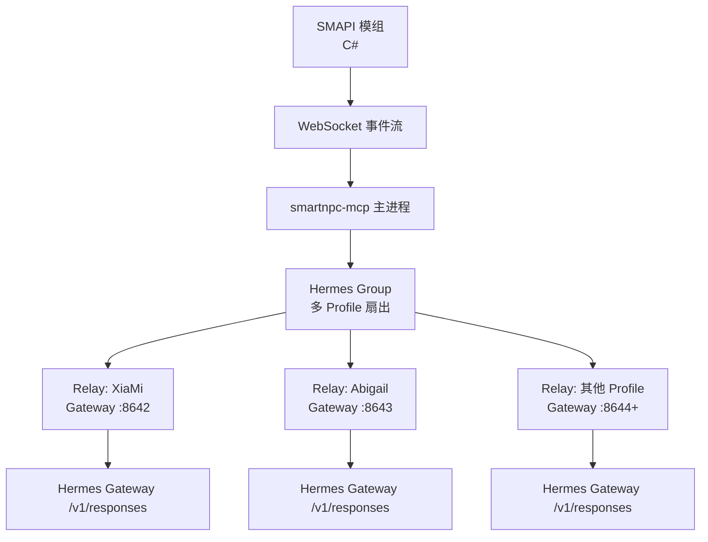
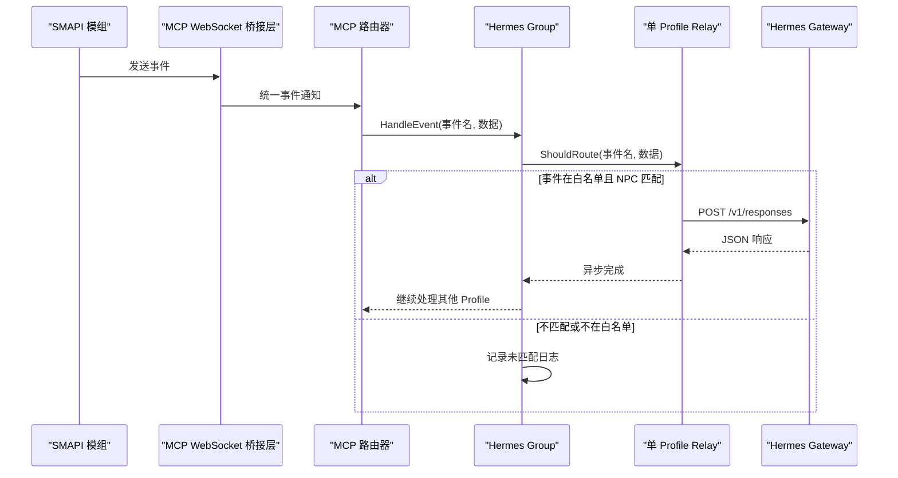
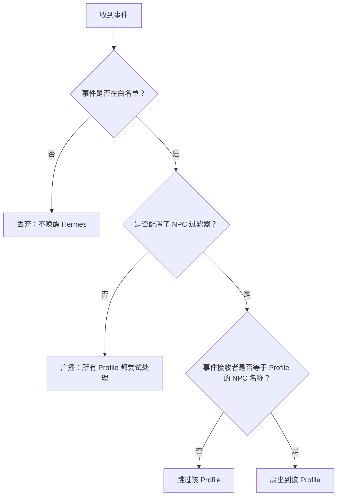
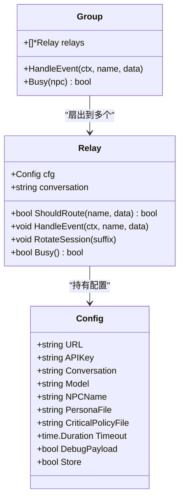
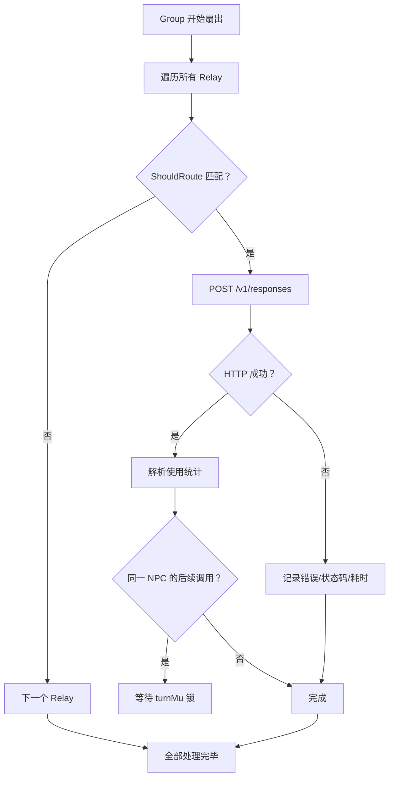
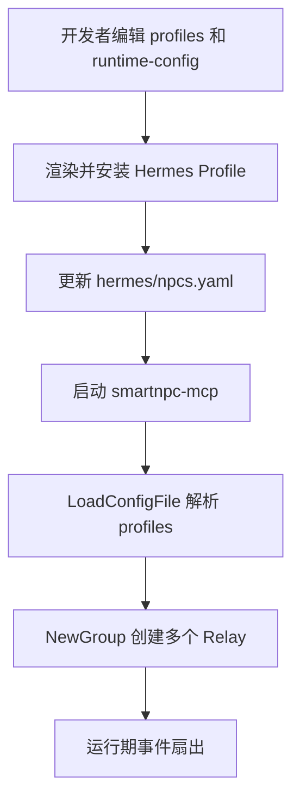
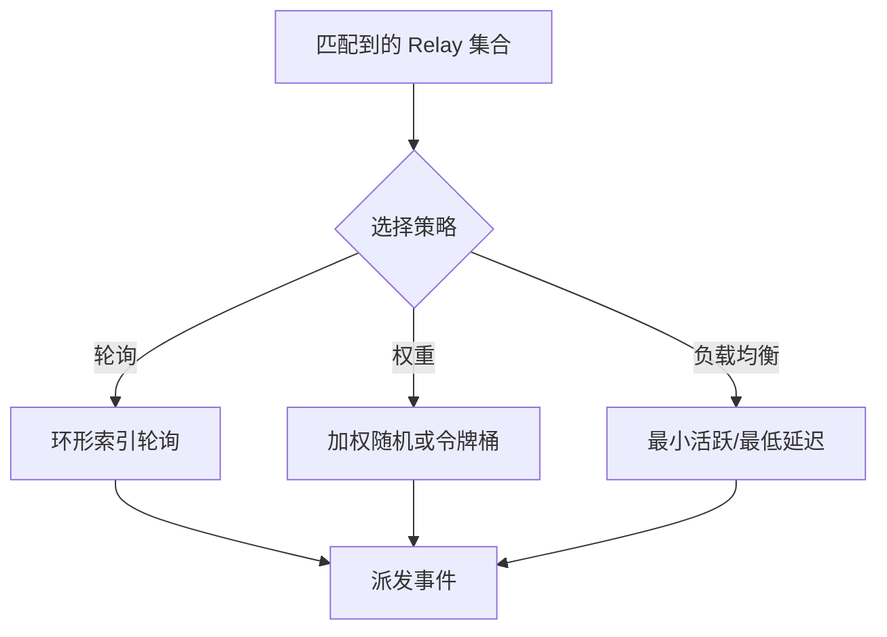
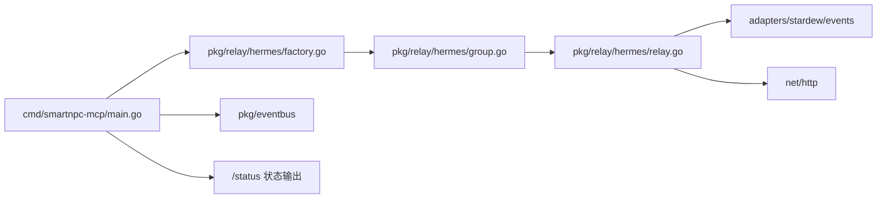

# 多 Profile 扇出

<cite>
**本文引用的文件**   
- [relay.go](file://SmartNPC/smartnpc-mcp/pkg/relay/hermes/relay.go)
- [group.go](file://SmartNPC/smartnpc-mcp/pkg/relay/hermes/group.go)
- [factory.go](file://SmartNPC/smartnpc-mcp/pkg/relay/hermes/factory.go)
- [config_test.go](file://SmartNPC/smartnpc-mcp/pkg/relay/hermes/config_test.go)
- [main.go](file://SmartNPC/smartnpc-mcp/cmd/smartnpc-mcp/main.go)
- [events.md](file://SmartNPC/docs/events.md)
- [hermes-profiles.md](file://SmartNPC/docs/hermes-profiles.md)
- [current-architecture.md](file://SmartNPC/docs/current-architecture.md)
- [npcs.yaml](file://SmartNPC/hermes/npcs.yaml)
- [runtime-config.yaml](file://SmartNPC/hermes/runtime-config.yaml)
- [AgentNpcRegistry.cs](file://SmartNPC/smapi-mod/NPC/AgentNpcRegistry.cs)
</cite>

## 目录
1. [引言](#引言)
2. [项目结构](#项目结构)
3. [核心组件](#核心组件)
4. [架构总览](#架构总览)
5. [详细组件分析](#详细组件分析)
6. [依赖关系分析](#依赖关系分析)
7. [性能与容量规划](#性能与容量规划)
8. [故障排查指南](#故障排查指南)
9. [结论](#结论)

## 引言
本文围绕 SmartNPC 仓库中的“多 Profile 扇出”机制展开，目标是解释事件如何从 SMAPI 模组进入 smartnpc-mcp，再根据 NPC 匹配规则分发到多个 Hermes Gateway Profile。文档覆盖：
- 事件分发算法：白名单过滤、广播模式、按 NPC 名称精确匹配。
- Profile 选择策略：目标 NPC 匹配、无目标时广播、亲和性绑定和会话隔离。
- 扇出结果聚合：并发 POST、串行化单 NPC 模型回合、部分失败处理、超时和恢复会话。
- 动态 Profile 管理：配置文件加载、环境变量扩展、Profile 注册与发现、健康状态上报。
- 大规模 NPC 场景调优：并发控制、内存限制、网络超时、容量规划和多实例部署建议。

需要特别说明的是：当前代码实现的是**按 NPC 名称的确定性路由 + 全量广播（无目标）+ 每 Profile 独立 HTTP POST**。仓库中并未实现轮询模式、权重分配或主动负载均衡算法；这些内容在“概念设计”中以非源码形式给出，供未来扩展参考。

## 项目结构
多 Profile 扇出相关的主要路径如下：
- Go 侧事件扇出逻辑位于 `smartnpc-mcp/pkg/relay/hermes`，包括单个 Relay、Group 分组、工厂注册和配置加载测试。
- 命令行入口在 `smartnpc-mcp/cmd/smartnpc-mcp/main.go`，负责选择多 Profile 模式或单 Profile 遗留模式。
- Profile 源数据在 `hermes/npcs.yaml`，运行时映射在 `hermes/runtime-config.yaml`。
- 文档说明集中在 `docs/hermes-profiles.md`、`docs/events.md` 和 `docs/current-architecture.md`。
- SMAPI 模组中的 Agent 角色注册位于 `smapi-mod/NPC/AgentNpcRegistry.cs`。

**图示来源**
- [main.go:124-178](file://SmartNPC/smartnpc-mcp/cmd/smartnpc-mcp/main.go#L124-L178)
- [group.go:10-93](file://SmartNPC/smartnpc-mcp/pkg/relay/hermes/group.go#L10-L93)
- [relay.go:25-100](file://SmartNPC/smartnpc-mcp/pkg/relay/hermes/relay.go#L25-L100)

**章节来源**
- [current-architecture.md:1-163](file://SmartNPC/docs/current-architecture.md#L1-L163)
- [hermes-profiles.md:1-120](file://SmartNPC/docs/hermes-profiles.md#L1-L120)

## 核心组件
本节聚焦三个核心对象：`Relay`、`Group` 和配置加载器。

| 组件 | 职责 | 关键行为 |
|---|---|---|
| `Relay` | 单个 Hermes Profile 的事件转发器 | 校验事件是否允许、解析接收 NPC、构建请求体、HTTP POST、超时、日志、使用状况统计、会话恢复。 |
| `Group` | 多 Profile 扇出容器 | 遍历所有 Relay，调用各自的 `ShouldRoute`，向匹配的 Profile 并行派发事件。 |
| 配置加载器 | 从 YAML 生成 `[]Config` | 支持 `profiles` 数组、`gateway_url` 环境变量替换、`api_key_env` 环境变量读取、空列表和错误 YAML 处理。 |

**章节来源**
- [relay.go:25-100](file://SmartNPC/smartnpc-mcp/pkg/relay/hermes/relay.go#L25-L100)
- [group.go:10-93](file://SmartNPC/smartnpc-mcp/pkg/relay/hermes/group.go#L10-L93)
- [config_test.go:1-126](file://SmartNPC/smartnpc-mcp/pkg/relay/hermes/config_test.go#L1-L126)

## 架构总览
整体流程分为四层：游戏事件采集、MCP 事件路由、Hermes 扇出、模型响应聚合。

**图示来源**
- [main.go:124-178](file://SmartNPC/smartnpc-mcp/cmd/smartnpc-mcp/main.go#L124-L178)
- [group.go:40-93](file://SmartNPC/smartnpc-mcp/pkg/relay/hermes/group.go#L40-L93)
- [relay.go:100-180](file://SmartNPC/smartnpc-mcp/pkg/relay/hermes/relay.go#L100-L180)

**章节来源**
- [events.md:1-120](file://SmartNPC/docs/events.md#L1-L120)
- [current-architecture.md:1-80](file://SmartNPC/docs/current-architecture.md#L1-L80)

## 详细组件分析

### 事件分发算法
当前实现在两层进行过滤：
1. **全局白名单过滤**：只有 `day_started`、`schedule_trigger`、`workflow_skill_call`、`owner_directive` 能唤醒 Hermes。其余事件如 `game_time_tick`、`day_ending`、`forage_collected` 以及已移除的玩家聊天类事件不会触发 Agent。
2. **Profile NPC 匹配**：每个 `Relay` 可配置 `NPCName`；若为空则视为广播，否则只匹配事件中携带的 NPC 字段。

**图示来源**
- [relay.go:140-180](file://SmartNPC/smartnpc-mcp/pkg/relay/hermes/relay.go#L140-L180)
- [group.go:40-93](file://SmartNPC/smartnpc-mcp/pkg/relay/hermes/group.go#L40-L93)

#### 广播模式
当 `NPCName` 为空时，`ShouldRoute` 直接返回允许。此时 `Group` 会向所有 Profile 发送事件，适合系统级事件，例如每日开始、所有者指令等。

#### 轮询模式
当前代码没有轮询选择器。`Group.HandleEvent` 对每个 Relay 依次检查并调用，不存在“选一个 Profile 轮流服务”的实现。如果未来需要轮询，应在 Group 层维护索引并在匹配集合上做轮转，而不是修改 `Relay.ShouldRoute`。

#### 权重分配
当前没有权重字段或加权随机逻辑。配置文件中只有 `name`、`npc_filter`、`gateway_url`、`conversation`、`model`、`api_key_env`，没有权重、优先级或健康分。

#### 负载均衡策略
当前策略是**确定性匹配 + 全量广播**，不是负载导向的负载均衡。同一时刻，所有匹配成功的 Profile 都会发起 HTTP 请求；没有基于延迟、队列长度、CPU 或 Token 消耗的均衡决策。

**章节来源**
- [relay.go:140-180](file://SmartNPC/smartnpc-mcp/pkg/relay/hermes/relay.go#L140-L180)
- [group.go:40-93](file://SmartNPC/smartnpc-mcp/pkg/relay/hermes/group.go#L40-L93)
- [config_test.go:1-126](file://SmartNPC/smartnpc-mcp/pkg/relay/hermes/config_test.go#L1-L126)

### Profile 选择策略

#### 目标 NPC 匹配
`Relay.ShouldRoute` 通过 `events.RecipientNPC` 解析事件中的接收方。若事件没有接收方字段，则视为广播；若有接收方，则必须严格等于 `cfg.NPCName`。

**图示来源**
- [relay.go:25-100](file://SmartNPC/smartnpc-mcp/pkg/relay/hermes/relay.go#L25-L100)
- [group.go:10-40](file://SmartNPC/smartnpc-mcp/pkg/relay/hermes/group.go#L10-L40)

#### 负载平衡算法
当前没有显式负载平衡算法。`Group` 的顺序是配置文件顺序，每个匹配的 Relay 都执行一次完整 POST。若希望引入最小连接数、最少活跃任务或最低缓存命中率优先的策略，应扩展 `Group` 的选择逻辑，而不是改变 `Relay` 的匹配语义。

#### 亲和性绑定
亲和性已经通过 `npc_filter` 和 `conversation` 实现：
- `npc_filter` 将事件绑定到特定 NPC。
- `conversation` 将对话历史绑定到某个 Profile 的会话 ID。
- 每天通过 `RotateSession` 追加后缀，形成“基础会话名 + 日期后缀”，保证不同游戏日有独立记忆窗口。

#### 故障转移
当前没有跨 Profile 的主备或自动故障转移。如果某个 Hermes Gateway 不可用，只会记录 POST 失败和状态码；不会把请求转移到另一个 Profile。唯一的“恢复”逻辑是针对服务端损坏的工具调用历史：当检测到包含无效工具转录的错误响应时，会切换到新的恢复会话，但这是**单 Profile 内会话恢复**，不是多 Profile 间故障转移。

**章节来源**
- [relay.go:140-180](file://SmartNPC/smartnpc-mcp/pkg/relay/hermes/relay.go#L140-L180)
- [relay.go:201-240](file://SmartNPC/smartnpc-mcp/pkg/relay/hermes/relay.go#L201-L240)
- [runtime-config.yaml:1-15](file://SmartNPC/hermes/runtime-config.yaml#L1-L15)

### 扇出结果聚合

#### 响应合并
当前实现**不合并多个 Profile 的响应**。每个匹配的 Relay 各自 POST 到独立的 Hermes Gateway，并把各自的日志、指标和 payload sink 记录写出来。上层没有聚合器去决定哪个响应胜出、是否需要多数投票或优先级覆盖。

#### 部分失败处理
部分失败是默认行为：
- 某个 Relay 的 HTTP 请求失败、超时或非 2xx 状态码，会被记录为警告，不影响其他 Relay。
- `Group.HandleEvent` 只在没有任何 Profile 匹配时记录“未匹配”告警；单个 Profile 失败不会被视作整个扇出失败。
- 对于特定非法工具转录错误，对应 Relay 会切换会话，但不会重试本次请求。

#### 超时管理
每个 Relay 使用 `http.Client.Timeout`，默认 120 秒。POST 前创建带超时的 context，超时后返回错误。这个超时保护的是单个 Profile 的 HTTP 往返，不是整个 Group 的扇出超时。

#### 结果一致性保证
由于每个 Profile 是独立 LLM 会话，系统不保证多 Profile 输出一致。相反，它更偏向“每个 Profile 保持自己的上下文和决策”。一致性保障体现在：
- 每个 Profile 的模型调用被 `turnMu` 串行化，避免同一 NPC 的并发 POST 交错写入服务端会话。
- 会话按天轮换，减少长上下文累积导致的漂移。
- 事件白名单和 NPC 过滤减少无关事件污染。

**图示来源**
- [group.go:40-93](file://SmartNPC/smartnpc-mcp/pkg/relay/hermes/group.go#L40-L93)
- [relay.go:240-453](file://SmartNPC/smartnpc-mcp/pkg/relay/hermes/relay.go#L240-L453)

**章节来源**
- [relay.go:240-453](file://SmartNPC/smartnpc-mcp/pkg/relay/hermes/relay.go#L240-L453)
- [events.md:1-120](file://SmartNPC/docs/events.md#L1-L120)

### 动态 Profile 管理

#### Profile 注册
Profile 注册由两个层次组成：
- SMAPI 模组侧使用 `AgentNpcRegistry` 登记受外部 Agent 管理的 NPC。
- Hermes 侧使用 `hermes/npcs.yaml` 声明 NPC 元数据和端口，再由脚本和运行时配置生成实际启用的 Profile。

#### Profile 发现
smartnpc-mcp 启动时，如果传入 `--hermes-config`，会通过工厂注册逻辑加载 `runtime-config.yaml`，解析 `profiles` 数组并构造 `Group`。每个 profile 条目对应一个 Relay。

#### 健康检查
当前 `/status` 输出中包含每个 Profile 的基本信息，如 `npc_filter`、`gateway_url`、`conversation`、`model`、`healthy`、`latency_ms`、`error`。但具体健康判定逻辑在当前片段中没有完整展示；现有代码主要暴露配置和状态结构，实际健康值可能由外部监控或 `/status.experiment.*` 等扩展端点补充。

#### 自动扩缩容
当前没有自动扩缩容。新增 Profile 需要手动更新：
- `hermes/profiles/<name>/config-overlay.yaml`
- `hermes/runtime-config.yaml`
- 必要时更新 `scripts/start_hermes_profiles.sh`
- 重启 smartnpc-mcp 以重新加载 Group

**图示来源**
- [hermes-profiles.md:60-120](file://SmartNPC/docs/hermes-profiles.md#L60-L120)
- [npcs.yaml:1-70](file://SmartNPC/hermes/npcs.yaml#L1-L70)
- [runtime-config.yaml:1-15](file://SmartNPC/hermes/runtime-config.yaml#L1-L15)
- [factory.go:10-68](file://SmartNPC/smartnpc-mcp/pkg/relay/hermes/factory.go#L10-L68)

**章节来源**
- [AgentNpcRegistry.cs:1-29](file://SmartNPC/smapi-mod/NPC/AgentNpcRegistry.cs#L1-L29)
- [hermes-profiles.md:60-120](file://SmartNPC/docs/hermes-profiles.md#L60-L120)
- [factory.go:10-68](file://SmartNPC/smartnpc-mcp/pkg/relay/hermes/factory.go#L10-L68)
- [config_test.go:1-126](file://SmartNPC/smartnpc-mcp/pkg/relay/hermes/config_test.go#L1-L126)

### 概念设计：未来可扩展的扇出策略
以下内容为概念性扩展建议，并非当前仓库已实现功能。

#### 轮询模式设计
- 在 `Group` 中维护一个按 NPC 分组的环形索引。
- 当多个 Relay 匹配同一 NPC 时，按索引轮询选择一个。
- 保留广播语义：无 NPC 目标时仍向所有 Profile 广播。

#### 权重分配设计
- 在 Profile 配置中增加 `weight` 或 `capacity`。
- 计算相对权重后做加权随机或令牌桶分流。
- 权重变化应支持热更新并加锁保护。

#### 负载均衡策略
- 最小活跃请求数：优先选择 `active` 计数最低的 Relay。
- 延迟感知：结合最近 POST 延迟拒绝慢节点。
- 容量上限：限制单 Profile 最大并发和队列长度。

[本图为概念设计，不对应具体源码结构]

## 依赖关系分析

**图示来源**
- [main.go:124-178](file://SmartNPC/smartnpc-mcp/cmd/smartnpc-mcp/main.go#L124-L178)
- [factory.go:10-68](file://SmartNPC/smartnpc-mcp/pkg/relay/hermes/factory.go#L10-L68)
- [group.go:10-93](file://SmartNPC/smartnpc-mcp/pkg/relay/hermes/group.go#L10-L93)
- [relay.go:25-100](file://SmartNPC/smartnpc-mcp/pkg/relay/hermes/relay.go#L25-L100)

**章节来源**
- [main.go:124-178](file://SmartNPC/smartnpc-mcp/cmd/smartnpc-mcp/main.go#L124-L178)
- [factory.go:10-68](file://SmartNPC/smartnpc-mcp/pkg/relay/hermes/factory.go#L10-L68)

## 性能与容量规划

### 并发控制
- 每个 Relay 内部使用 `sync.Mutex` 串行化同一 NPC 的模型回合，避免并发 POST 导致服务端工具调用序列错乱。
- 不同 NPC 的 Relay 可以并发运行。
- `active` 计数器用于表示正在处理或排队中的事件，工作流引擎可通过 `Busy()` 判断是否需要等待。

### 内存优化
- 请求体和响应体读取使用 `io.LimitReader`，分别限制为 4KB、64KB，避免大响应撑爆内存。
- 人设文件和关键策略文件在初始化时一次性加载，避免每次事件重复读盘。
- 会话历史由 Hermes 服务端存储，Go 侧不维护冗余短窗口历史。

### 网络调优
- 每个 Relay 使用独立 `http.Client` 并设置超时。
- 鉴权通过 `Authorization: Bearer` 头传递，可选配置。
- 调试模式下可开启 payload 日志，但生产环境应谨慎开启，避免大量 JSON 影响日志吞吐。

### 容量规划
- 单进程可同时承载多个 Profile，但每个 Profile 的 Gateway 端口必须唯一。
- 推荐按 NPC 或业务域拆分 Hermes Gateway 实例，避免单 Gateway 成为瓶颈。
- 模型回合延迟较高时，应避免过密的日程调度，否则 relay 队列会积压并饿死次日规划。
- 日志和实验追踪应分离磁盘路径，避免与业务日志争抢 I/O。

**章节来源**
- [relay.go:25-100](file://SmartNPC/smartnpc-mcp/pkg/relay/hermes/relay.go#L25-L100)
- [relay.go:240-453](file://SmartNPC/smartnpc-mcp/pkg/relay/hermes/relay.go#L240-L453)
- [current-architecture.md:80-163](file://SmartNPC/docs/current-architecture.md#L80-L163)

## 故障排查指南

### 事件没有唤醒任何 Profile
- 检查事件是否在白名单：`day_started`、`schedule_trigger`、`workflow_skill_call`、`owner_directive`。
- 检查 `npc_filter` 是否与事件中的 NPC 名称一致。
- 检查 `Group.HandleEvent` 是否记录“未匹配”告警。

### 单个 Profile 持续失败
- 查看 Relay 的 POST 错误日志、状态码和耗时。
- 确认 Gateway URL、API Key、Conversation、Model 配置正确。
- 如果是非法工具转录错误，检查对应 Relay 是否已切换到恢复会话。

### 配置生效异常
- 确认 `--hermes-config` 指向有效的 `runtime-config.yaml`。
- 检查 `gateway_url` 中的环境变量是否已展开。
- 检查 `api_key_env` 对应的环境变量是否存在；缺失时 API Key 为空字符串。
- 确认 Profile 数量与启用的 Hermes Gateway 数量一致。

### 多 Profile 端口冲突
- 每个 Profile 的 Hermes Gateway 必须使用独立端口。
- 端口冲突会导致消息路由到空端口，产生静默丢失。

**章节来源**
- [group.go:40-93](file://SmartNPC/smartnpc-mcp/pkg/relay/hermes/group.go#L40-L93)
- [relay.go:240-453](file://SmartNPC/smartnpc-mcp/pkg/relay/hermes/relay.go#L240-L453)
- [config_test.go:1-126](file://SmartNPC/smartnpc-mcp/pkg/relay/hermes/config_test.go#L1-L126)
- [hermes-profiles.md:60-120](file://SmartNPC/docs/hermes-profiles.md#L60-L120)

## 结论
SmartNPC 的多 Profile 扇出机制目前是一个**简单但清晰的可扩展基座**：
- 它以白名单 + NPC 名称匹配为核心路由规则。
- 它以 `Group` 聚合多个 `Relay`，实现多 Profile 并行扇出。
- 它以会话轮换、临界策略注入、HTTP 超时和有限响应体读取保障稳定性。
- 它尚未实现轮询、权重分配、主动负载均衡和自动故障转移。

未来演进方向应是先在 `Group` 层抽象扇出策略接口，再逐步加入权重、健康检查、容量上限、延迟感知和故障转移；同时保持现有 NPC 亲和性和会话隔离语义不变。