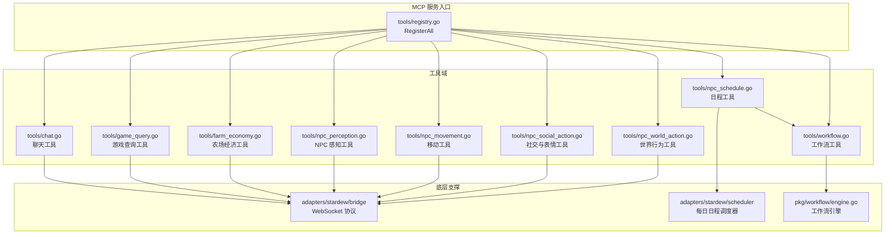
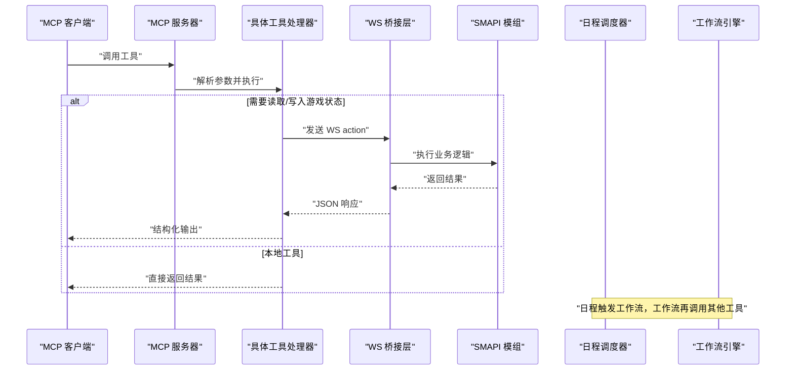
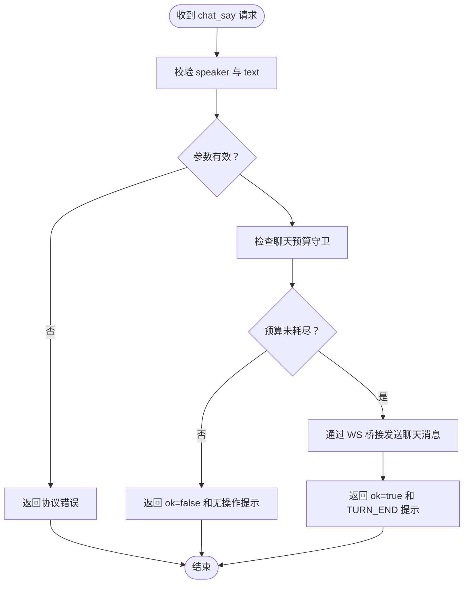
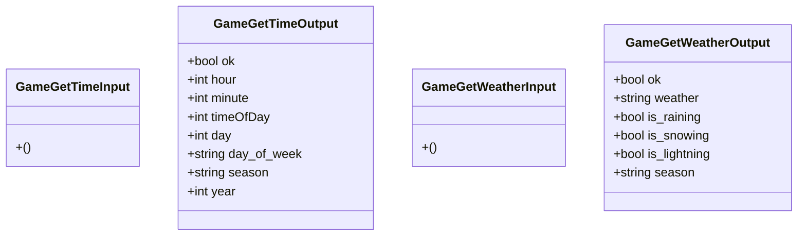
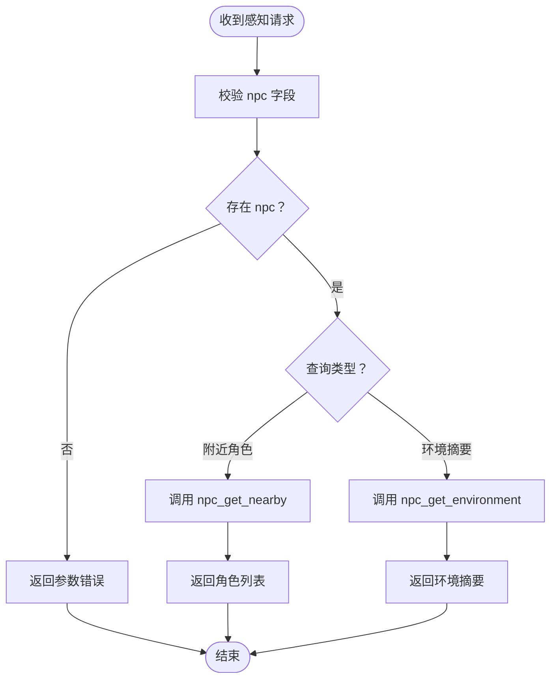
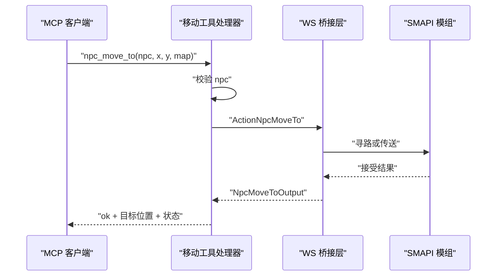
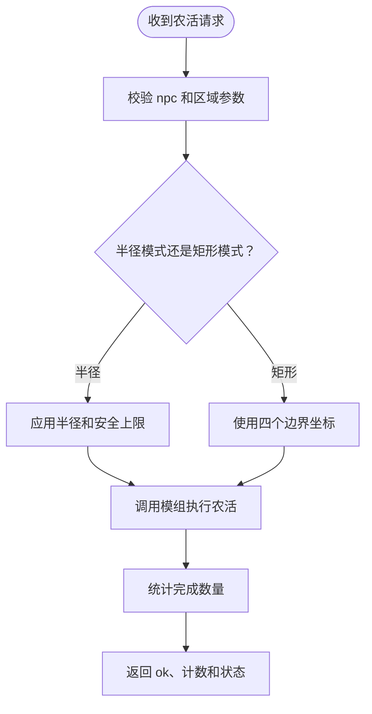
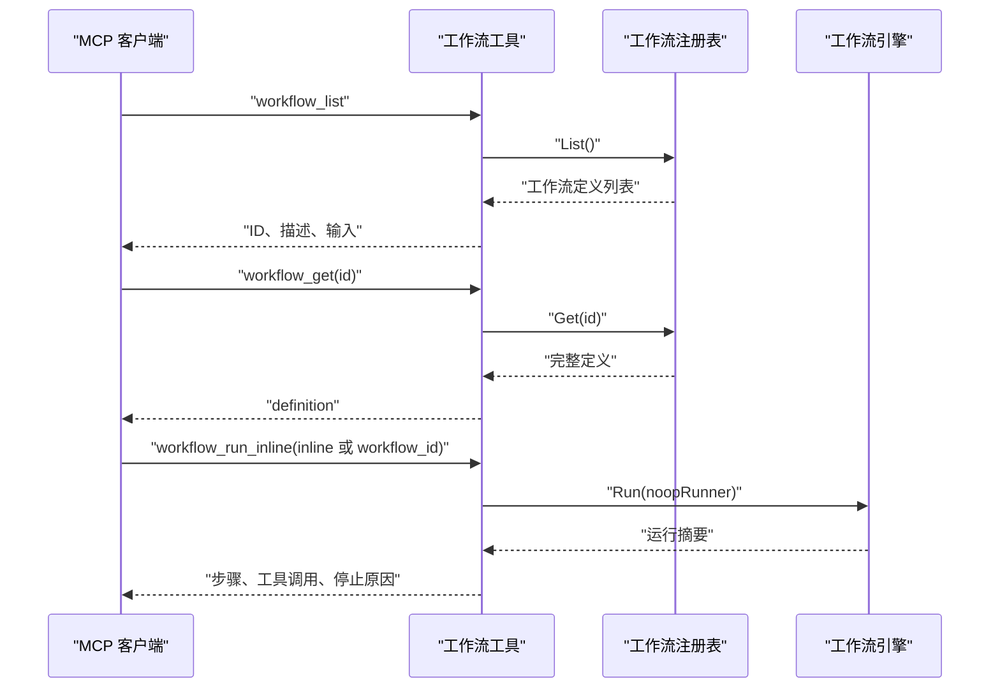
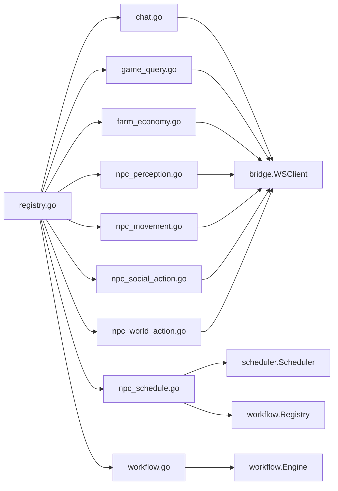

# MCP 工具集

<cite>
**本文引用的文件**   
- [registry.go](file://SmartNPC/smartnpc-mcp/adapters/stardew/tools/registry.go)
- [chat.go](file://SmartNPC/smartnpc-mcp/adapters/stardew/tools/chat.go)
- [game_query.go](file://SmartNPC/smartnpc-mcp/adapters/stardew/tools/game_query.go)
- [farm_economy.go](file://SmartNPC/smartnpc-mcp/adapters/stardew/tools/farm_economy.go)
- [npc_perception.go](file://SmartNPC/smartnpc-mcp/adapters/stardew/tools/npc_perception.go)
- [npc_movement.go](file://SmartNPC/smartnpc-mcp/adapters/stardew/tools/npc_movement.go)
- [npc_social_action.go](file://SmartNPC/smartnpc-mcp/adapters/stardew/tools/npc_social_action.go)
- [npc_world_action.go](file://SmartNPC/smartnpc-mcp/adapters/stardew/tools/npc_world_action.go)
- [npc_schedule.go](file://SmartNPC/smartnpc-mcp/adapters/stardew/tools/npc_schedule.go)
- [workflow.go](file://SmartNPC/smartnpc-mcp/adapters/stardew/tools/workflow.go)
- [mcp-tools.md](file://SmartNPC/docs/mcp-tools.md)
- [mcp-tool-design.mdc](file://SmartNPC/.codebuddy/rules/mcp-tool-design.mdc)
- [engine.go](file://SmartNPC/smartnpc-mcp/pkg/workflow/engine.go)
</cite>

## 目录
1. [引言](#引言)
2. [项目结构](#项目结构)
3. [核心组件](#核心组件)
4. [架构总览](#架构总览)
5. [详细组件分析](#详细组件分析)
6. [依赖关系分析](#依赖关系分析)
7. [性能考虑](#性能考虑)
8. [故障排查指南](#故障排查指南)
9. [结论](#结论)

## 引言
本文件为 SmartNPC 项目中 **MCP（Model Context Protocol）工具系统**的完整文档。它面向两类读者：
- 希望理解 NPC 如何通过 MCP 工具与《星露谷物语》SMAPI 模组交互的开发者；
- 需要编写或维护工具、工作流和调度策略的模型/自动化作者。

仓库中实际暴露给 MCP 客户端的工具注册入口位于 `adapters/stardew/tools/registry.go`，而工具定义、输入输出结构体、参数校验、错误处理和桥接调用分别放在各自领域文件中。

## 项目结构
MCP 工具相关代码集中在以下位置：

**图表来源**
- [registry.go:1-82](file://SmartNPC/smartnpc-mcp/adapters/stardew/tools/registry.go#L1-L82)
- [engine.go:1-200](file://SmartNPC/smartnpc-mcp/pkg/workflow/engine.go#L1-L200)

**章节来源**
- [registry.go:1-82](file://SmartNPC/smartnpc-mcp/adapters/stardew/tools/registry.go#L1-L82)

## 核心组件
### 工具注册机制与扩展点
`RegisterAll` 是 Stardew 工具组的统一注册入口。它接收以下关键参数：
- `*mcp.Server`：MCP 服务器实例，所有工具通过 `mcp.AddTool` 挂载；
- `*bridge.WSClient`：与 SMAPI 模组的 WebSocket 客户端；
- `bridge.EventHandler`：用于将合成事件转发到 Hermes Gateway；
- `ChatSayGuard`：限制每次唤醒周期内 `chat_say` 的调用次数；
- `*slog.Logger`：非致命通知失败日志；
- `*workflow.Registry`：内置工作流注册表；
- `schedDebug`：是否注册调试用 `workflow_run_inline`。

设计要点如下：
1. **分层注册**：工作流、日记、日程等不需要 SMAPI 保存状态的工具始终注册；聊天、游戏查询、NPC 行为等需要桥接的工具仅在 `br != nil` 时注册。
2. **可插拔调度器**：返回共享的 `scheduler.Scheduler`，由调用方在事件路由中将 `game_time_tick` 驱动 `sched.Tick(hour)`。
3. **桥接无关部署**：当没有 WS 桥接时，仍可运行纯进程内工具，如对话预算守卫、日程和工作流发现。
4. **启动顺序约定**：agent 注册优先，使 SOUL/策略可以在会话早期将其作为第一个可用工具引用。

**章节来源**
- [registry.go:1-82](file://SmartNPC/smartnpc-mcp/adapters/stardew/tools/registry.go#L1-L82)
- [mcp-tools.md:1-80](file://SmartNPC/docs/mcp-tools.md#L1-L80)

### 工具开发规范
仓库规则明确定义了新增或修改 MCP 工具的约束：
- 命名采用 `<domain>_<verb>`，全小写下划线；
- 每个工具定义独立的 Input/Output 结构体；
- 字段必须同时包含 `json` 和 `jsonschema` 标签；
- Output 的第一个字段固定为 `OK bool`；
- handler 统一使用泛型 `mcp.AddTool`，业务错误返回 Go error，结构化内容通过 SDK 自动填充；
- 涉及 SMAPI 的工具通过传入的 bridge client 调用，不在 tools 包持有全局连接；
- 每个工具至少有一个基于内存传输的测试；
- 长耗时操作应使用进度通知，异步等待首选带超时的同步阻塞；
- 新增工具需同步更新 ws 协议文档，保持 MCP 工具名与 ws action 名对应。

**章节来源**
- [mcp-tool-design.mdc:1-65](file://SmartNPC/.codebuddy/rules/mcp-tool-design.mdc#L1-L65)

## 架构总览
MCP 工具的执行路径分为两条主线：

**图表来源**
- [registry.go:1-82](file://SmartNPC/smartnpc-mcp/adapters/stardew/tools/registry.go#L1-L82)
- [game_query.go:1-89](file://SmartNPC/smartnpc-mcp/adapters/stardew/tools/game_query.go#L1-L89)
- [engine.go:1-200](file://SmartNPC/smartnpc-mcp/pkg/workflow/engine.go#L1-L200)

## 详细组件分析

### 聊天工具

#### chat_say
- **作用**：以 NPC 身份在游戏内聊天框显示一行文字。它是唯一产生可见 NPC 对话的工具。
- **是否需要存档**：需要 WS 桥接。
- **参数**：
  - `speaker`：NPC 内部英文名，例如 `XiaMi`；
  - `text`：纯文本消息正文；
  - `color`：可选颜色，包括 white、yellow、green、red、cyan、blue、purple、gray；
  - `channel`：可选通道，`private` 或空表示一对一聊天，`group` 表示群聊；
  - `group_id`：群聊时需要填写。
- **返回值**：
  - `ok`：是否成功投递到模组；
  - `hint`：提示词，通常包含 `TURN_END`，表示本轮结束。
- **错误处理**：
  - 参数为空时报错；
  - 同一唤醒周期内重复调用会返回 `ok=false` 的结构化无操作结果，而不是协议错误；
  - 常见错误包括 `mod_not_ready`、`invalid_params`。
- **使用建议**：
  - 只在决定最终回复后调用一次；
  - 不要在思考、旁白或流式输出中使用；
  - 群聊时必须设置 `channel=group` 和对应的 `group_id`；
  - 看到 `TURN_END` 后停止继续生成工具调用。

**图表来源**
- [chat.go:1-200](file://SmartNPC/smartnpc-mcp/adapters/stardew/tools/chat.go#L1-L200)

**章节来源**
- [chat.go:1-200](file://SmartNPC/smartnpc-mcp/adapters/stardew/tools/chat.go#L1-L200)
- [mcp-tools.md:80-140](file://SmartNPC/docs/mcp-tools.md#L80-L140)

> 关于“npc_send_mail”：当前实验构建中玩家相关的邮件发送工具已被移除。文档说明明确指出 `mail_send` 不再出现在 `ListTools` 中。若你确实需要 NPC 间通信，请查看工作流与事件体系，而不是依赖已移除的玩家向工具。

**章节来源**
- [mcp-tools.md:140-200](file://SmartNPC/docs/mcp-tools.md#L140-L200)

### 游戏查询工具

#### game_get_time
- **作用**：读取当前游戏时间与日历信息。
- **参数**：无。
- **返回值**：
  - `ok`：成功标志；
  - `hour`：小时，范围 0–23；
  - `minute`：分钟；
  - `timeOfDay`：原始时间值，例如 1430；
  - `day`：月份日期，1–28；
  - `day_of_week`：短星期名称；
  - `season`：季节；
  - `year`：游戏年份。
- **错误处理**：桥接调用失败时返回包装错误。
- **使用场景**：日程规划、时间门控决策、日志记录。

#### game_get_weather
- **作用**：读取天气和季节。
- **参数**：无。
- **返回值**：
  - `ok`；
  - `weather`：sunny、rainy、snowy、stormy；
  - `is_raining`、`is_snowing`、`is_lightning`；
  - `season`。
- **错误处理**：桥接调用失败时返回包装错误。
- **使用场景**：雨天不浇水、雪天改为室内活动。

**图表来源**
- [game_query.go:1-89](file://SmartNPC/smartnpc-mcp/adapters/stardew/tools/game_query.go#L1-L89)

**章节来源**
- [game_query.go:1-89](file://SmartNPC/smartnpc-mcp/adapters/stardew/tools/game_query.go#L1-L89)
- [mcp-tools.md:80-120](file://SmartNPC/docs/mcp-tools.md#L80-L120)

### 农场经济工具

#### farm_get_economy
- **作用**：读取农场经济记分板。
- **参数**：无。
- **返回值**：
  - `ok`；
  - `day`、`season`、`year`；
  - `gold`：当前金币；
  - `total_money_earned`：累计收入；
  - `shipping_bin_count`、`shipping_bin_value`：邮筒物品数量和估值；
  - `crops_planted`、`crops_ready`：种植数和可收获数；
  - `tilled_tiles`、`watered_tiles`：翻耕数和浇水数；
  - `animals`：动物数量。
- **错误处理**：桥接调用失败时返回包装错误。
- **注意事项**：该接口没有“单日收入”字段，不应自行发明；如需比较收入，应跨天比较 `total_money_earned`。

**章节来源**
- [farm_economy.go:1-57](file://SmartNPC/smartnpc-mcp/adapters/stardew/tools/farm_economy.go#L1-L57)
- [mcp-tools.md:100-140](file://SmartNPC/docs/mcp-tools.md#L100-L140)

### NPC 感知工具

#### npc_get_nearby
- **作用**：扫描 NPC 当前地图内指定半径内的其他角色。
- **参数**：
  - `npc`：观察者 NPC 内部名；
  - `radius`：可选可视半径，默认约 10 格。
- **返回值**：
  - `ok`；
  - `npc`、`map`、`radius`、`count`；
  - `nearby`：按距离排序的角色列表，包含名称、类型、坐标、距离、朝向、地图和动作提示。
- **错误处理**：缺少 `npc` 时报错；桥接失败时返回包装错误。
- **缓存特性**：模组侧约每秒刷新一次缓存，自定义 radius 会触发按需扫描。

#### npc_get_environment
- **作用**：一次性获取 NPC 的环境上下文，包括地图、坐标、朝向、时间、季节、天气和附近重要对象。
- **参数**：
  - `npc`：NPC 内部名。
- **返回值**：
  - `ok`；
  - `npc`、`map`、`x`、`y`、`facing`；
  - `time_of_day`、`hour`、`minute`、`season`、`weather`；
  - `nearby_objects`：附近对象列表。
- **错误处理**：缺少 `npc` 时报错；桥接失败时返回包装错误。

**图表来源**
- [npc_perception.go:1-129](file://SmartNPC/smartnpc-mcp/adapters/stardew/tools/npc_perception.go#L1-L129)

**章节来源**
- [npc_perception.go:1-129](file://SmartNPC/smartnpc-mcp/adapters/stardew/tools/npc_perception.go#L1-L129)

### 移动工具

#### npc_move_to
- **作用**：让 NPC 寻路到目标格子；跨地图时会先传送。
- **参数**：
  - `npc`：NPC 内部名；
  - `x`、`y`：目标格子坐标；
  - `map`：可选目标地图名，默认使用 NPC 当前地图。
- **返回值**：
  - `ok`：是否接受路径请求；
  - `npc`、`map`、`x`、`y`；
  - `message`：可选状态提示，例如“正在寻路”或“无法找到路径”。
- **错误处理**：
  - 缺少 `npc` 时报错；
  - 可能返回 `unknown_npc`、`unknown_map`、`pathfind_error`。
- **注意**：函数立即返回，NPC 行走是异步的。

#### npc_face_direction
- **作用**：设置 NPC 朝向，不影响已有寻路。
- **参数**：
  - `npc`；
  - `direction`：必须是 up、down、left、right。
- **返回值**：
  - `ok`；
  - `npc`；
  - `direction`；
  - `facing`：数值朝向，0=上，1=右，2=下，3=左。
- **错误处理**：方向不是四个合法值时报错。

#### npc_get_position
- **作用**：读取 NPC 当前位置、地图、朝向和是否正在移动。
- **参数**：
  - `npc`。
- **返回值**：
  - `ok`；
  - `npc`；
  - `x`、`y`：移动中可能为小数；
  - `map`；
  - `facing`、`direction`；
  - `is_moving`。
- **错误处理**：缺少 `npc` 时报错；桥接失败时返回包装错误。

**图表来源**
- [npc_movement.go:1-200](file://SmartNPC/smartnpc-mcp/adapters/stardew/tools/npc_movement.go#L1-L200)

**章节来源**
- [npc_movement.go:1-200](file://SmartNPC/smartnpc-mcp/adapters/stardew/tools/npc_movement.go#L1-L200)

### 社交工具
当前实现主要提供视觉表达类社交工具，而不是玩家互动或礼物交换。主要包括：
- `npc_express_emotion`：组合动画、气泡、跳跃、抖动和朝向变化；
- `npc_shy_retreat`：后退一步并表现害羞；
- `npc_show_text_bubble`：头顶显示短文本气泡；
- `npc_idle_activity`：空闲动画，支持单次或循环；
- `npc_dance_happy`、`npc_react_surprise`、`npc_pace_anxiously`：情绪和步态表达。

这些工具大多只改变视觉效果，不改变游戏世界状态。部分处理程序在模组侧仍是占位符，因此效果可能是气泡加确认。

**章节来源**
- [npc_social_action.go:1-200](file://SmartNPC/smartnpc-mcp/adapters/stardew/tools/npc_social_action.go#L1-L200)

> 关于“npc_greet”“npc_gift”：当前实验构建中玩家中心工具已被移除。仓库文档明确列出 `npc_give_item`、`npc_approach_and_speak` 等工具不再注册。如果你需要问候或送礼，应通过工作流、日记、日程或现有视觉表达工具组合实现。

**章节来源**
- [mcp-tools.md:140-200](file://SmartNPC/docs/mcp-tools.md#L140-L200)

### 世界行为工具

#### npc_water_crops
- **作用**：浇灌作物。
- **参数**：
  - `npc`；
  - `radius`：可选扫描半径；
  - `max_count`：半径模式下的安全上限；
  - `x1`、`y1`、`x2`、`y2`：矩形区域模式。
- **返回值**：
  - `ok`；
  - `npc`；
  - `watered`：实际浇灌的作物数；
  - `message`。
- **错误处理**：桥接失败时返回包装错误。

#### npc_harvest_crops
- **作用**：收割成熟作物。
- **参数**：与浇水类似，支持半径或矩形区域。
- **返回值**：
  - `ok`；
  - `npc`；
  - `harvested`：实际收获数量；
  - `message`。

#### npc_till_soil
- **作用**：翻耕矩形地块。
- **参数**：
  - `npc`；
  - `radius`：搜索窗口；
  - `patch_w`、`patch_h`：矩形翻耕宽度与高度；
  - 也支持 `x1/y1/x2/y2` 矩形模式。
- **返回值**：
  - `ok`；
  - `npc`；
  - 以及模组侧返回的状态字段。
- **行为约定**：模组会自动尝试 `(W,H)` 和 `(H,W)` 两种方向并选择更合适的布局。

**图表来源**
- [npc_world_action.go:1-200](file://SmartNPC/smartnpc-mcp/adapters/stardew/tools/npc_world_action.go#L1-L200)

**章节来源**
- [npc_world_action.go:1-200](file://SmartNPC/smartnpc-mcp/adapters/stardew/tools/npc_world_action.go#L1-L200)
- [mcp-tools.md:120-200](file://SmartNPC/docs/mcp-tools.md#L120-L200)

### 日程工具

#### npc_plan_day
- **作用**：提交 NPC 当日日程。
- **参数**：
  - `npc`：NPC 内部名，或 `*` 表示所有代理 NPC；
  - `day`：1–28；
  - `season`：spring、summer、fall、winter；
  - `year`：可选，默认 1；
  - `entries`：日程条目数组。
- **条目形式**：
  1. 推荐：使用 `workflow_id` 引用内置或覆盖的工作流；
  2. 备选：使用 `workflow` 内联工作流定义；
  3. 已废弃：使用 `action`，会被拒绝。
- **时间精度**：`game_hour` 为 6–25，`game_minute` 必须为 0、10、20、30、40、50，无效值向下取整。
- **数量约束**：推荐 5–7 项，接受 4–8 项，超出 8 项会被截断。
- **返回值**：
  - `ok`；
  - `npc`；
  - `accepted`：接受的条目数；
  - `message`：状态信息。
- **错误处理**：
  - 缺少 `npc` 时报错；
  - 空 `entries` 时报错；
  - 使用 `action` 会被拒绝；
  - 非法小时会被跳过。

#### npc_get_schedule
- **作用**：查询尚未触发的剩余日程。
- **参数**：`npc`。
- **返回值**：
  - `ok`；
  - `npc`；
  - `entries`：待执行条目；
  - `message`。

**章节来源**
- [npc_schedule.go:1-200](file://SmartNPC/smartnpc-mcp/adapters/stardew/tools/npc_schedule.go#L1-L200)
- [mcp-tools.md:140-200](file://SmartNPC/docs/mcp-tools.md#L140-L200)

### 工作流工具

#### workflow_list
- **作用**：列出所有可用的内置或被覆盖的工作流。
- **参数**：无。
- **返回值**：
  - `ok`；
  - `workflows`：包含 `id`、`description`、`inputs` 的列表。
- **使用场景**：在 `npc_plan_day` 前发现可调度工作流。

#### workflow_get
- **作用**：获取某个工作流的完整定义。
- **参数**：`id`。
- **返回值**：
  - `ok`；
  - `definition`：工作流定义；
  - `message`：找不到 ID 时的提示信息。

#### workflow_run_inline
- **作用**：调试工具，在工作流引擎的无操作 runner 上验证内联工作流。
- **参数**：
  - `npc`；
  - `workflow_id` 或 `inline`；
  - `args`。
- **返回值**：
  - `ok`；
  - `step_count`；
  - `tool_calls`；
  - `nothing_to_do_ct`；
  - `stopped`、`stop_reason`；
  - `message`。
- **可用性**：仅当调试开关开启时注册。

#### workflow_choice_reply
- **作用**：回答工作流中的 LLM 选择请求。
- **参数**：
  - `request_id`；
  - `choice`：选项列表中完全匹配的字符串。
- **返回值**：
  - `ok`；
  - `message`。

**图表来源**
- [workflow.go:1-200](file://SmartNPC/smartnpc-mcp/adapters/stardew/tools/workflow.go#L1-L200)
- [engine.go:1-200](file://SmartNPC/smartnpc-mcp/pkg/workflow/engine.go#L1-L200)

**章节来源**
- [workflow.go:1-200](file://SmartNPC/smartnpc-mcp/adapters/stardew/tools/workflow.go#L1-L200)
- [engine.go:1-200](file://SmartNPC/smartnpc-mcp/pkg/workflow/engine.go#L1-L200)

## 依赖关系分析

**图表来源**
- [registry.go:1-82](file://SmartNPC/smartnpc-mcp/adapters/stardew/tools/registry.go#L1-L82)
- [npc_schedule.go:1-200](file://SmartNPC/smartnpc-mcp/adapters/stardew/tools/npc_schedule.go#L1-L200)
- [workflow.go:1-200](file://SmartNPC/smartnpc-mcp/adapters/stardew/tools/workflow.go#L1-L200)

### 耦合与内聚
- `registry.go` 负责装配，但不直接实现工具逻辑，内聚性良好；
- 每个工具域文件职责单一，输入输出结构体集中定义；
- 需要 SMAPI 的工具统一通过 `bridge.WSClient` 访问，避免全局状态；
- 工作流工具与工作流引擎解耦，通过 `workflow.Registry` 暴露能力；
- 日程工具与调度器解耦，由外部事件路由驱动。

### 潜在循环依赖
当前工具注册采用显式函数调用链，未发现直接循环导入风险。需要注意：
- 如果新工具既依赖日程又依赖工作流，应在 `RegisterAll` 中保证注册顺序；
- 如果工作流定义中调用的工具尚未注册，可能导致运行时不可用而非编译错误。

**章节来源**
- [registry.go:1-82](file://SmartNPC/smartnpc-mcp/adapters/stardew/tools/registry.go#L1-L82)

## 性能考虑
### 工具调用延迟
- 游戏查询、农场经济和 NPC 行为工具都需要 WS 桥接到 SMAPI 模组，延迟取决于模组线程、保存状态和网络（如果是远程桥接）。
- 感知工具在模组侧有约每秒一次的缓存，自定义半径会触发额外扫描。

### 聊天预算
- `ChatSayGuard` 通过互斥锁保护私人和群聊两个映射，确保同一唤醒周期内每个说话者只能调用一次 `chat_say`；
- 群聊预算只在玩家输入时重置，防止 NPC 间闲聊引发独白式刷屏；
- 并发安全，但实际竞争很低。

### 日程规模
- `npc_plan_day` 强制最多接受 8 个条目，防止计划过大造成中继队列积压；
- 推荐 5–7 个条目，每个工作流本身包含多个工具调用，整体调度要考虑模型推理和工具执行总耗时。

### 工作流执行
- 工作流引擎按步骤顺序执行，每一步都计入 `StepCount`；
- 引擎会统计工具调用次数、`nothing_to_do` 次数、提前停止原因和耗时；
- 支持上下文取消，适合与 NPC 离线检测或任务超时结合。

**章节来源**
- [chat.go:1-200](file://SmartNPC/smartnpc-mcp/adapters/stardew/tools/chat.go#L1-L200)
- [npc_schedule.go:1-200](file://SmartNPC/smartnpc-mcp/adapters/stardew/tools/npc_schedule.go#L1-L200)
- [engine.go:1-200](file://SmartNPC/smartnpc-mcp/pkg/workflow/engine.go#L1-L200)

## 故障排查指南

### 常见问题
1. **工具不存在**
   - 检查是否通过 `RegisterAll` 注册；
   - 确认是否在启用 WS 桥接后才注册模组依赖工具；
   - 检查 Hermes 配置是否过滤了该工具。

2. **聊天重复调用被拒绝**
   - 同一唤醒周期内重复 `chat_say` 会返回 `ok=false`；
   - 不要重试不同文本或颜色，应视为本轮结束；
   - 下一个针对该 NPC 的事件到达后会刷新预算。

3. **NPC 名称错误**
   - 使用英文内部名，不要用中文展示名；
   - 不确定时应复用入站事件的 `npc` 字段。

4. **日程条目被丢弃**
   - 超过 8 条会被截断；
   - 非法小时会被跳过；
   - `action` 字段已被禁用，必须使用 `workflow_id`。

5. **工作流无法运行**
   - 先用 `workflow_list` 确认 ID；
   - 再用 `workflow_get` 查看定义；
   - 调试模式下可使用 `workflow_run_inline` 验证。

### 错误分类
- **协议级错误**：工具不存在、序列化失败，直接返回 Go error；
- **业务级错误**：参数无效、目标不存在，返回结构化错误供模型自我修正；
- **无操作结果**：聊天预算耗尽等场景返回 `ok=false` 和提示，不作为异常重试。

**章节来源**
- [mcp-tool-design.mdc:1-65](file://SmartNPC/.codebuddy/rules/mcp-tool-design.mdc#L1-L65)
- [chat.go:1-200](file://SmartNPC/smartnpc-mcp/adapters/stardew/tools/chat.go#L1-L200)
- [npc_schedule.go:1-200](file://SmartNPC/smartnpc-mcp/adapters/stardew/tools/npc_schedule.go#L1-L200)

## 结论
SmartNPC 的 MCP 工具系统以 `registry.go` 为中心，将聊天、游戏查询、农场经济、NPC 感知、移动、社交、世界行为、日程和工作流工具统一注册到 MCP 服务器。其设计强调：
- 清晰的领域划分；
- 统一的 Input/Output 结构；
- 明确的桥接与本地工具边界；
- 对模型友好的结构化输出；
- 对生产环境鲁棒的预算、日程和工作流控制。

对于使用者而言，最关键的实践是：
- 优先使用 `workflow_id` 编排多步农活；
- 只在真正需要时移动 NPC 或与游戏世界交互；
- 严格遵循聊天预算，看到 `TURN_END` 就停止；
- 通过 `workflow_list` 和 `workflow_get` 理解工作流能力，而不是盲目猜测工具组合。