# NPC 世界行为工具

<cite>
**本文引用的文件**   
- [npc_world_action.go](file://SmartNPC/smartnpc-mcp/adapters/stardew/tools/npc_world_action.go)
- [npc_behavior.go](file://SmartNPC/smartnpc-mcp/adapters/stardew/tools/npc_behavior.go)
- [registry.go](file://SmartNPC/smartnpc-mcp/adapters/stardew/tools/registry.go)
- [workflow.go](file://SmartNPC/smartnpc-mcp/adapters/stardew/tools/workflow.go)
- [action_logger.go](file://SmartNPC/smartnpc-mcp/adapters/stardew/tools/action_logger.go)
- [workflow_log.go](file://SmartNPC/smartnpc-mcp/adapters/stardew/tools/workflow_log.go)
- [engine.go](file://SmartNPC/smartnpc-mcp/pkg/workflow/engine.go)
- [definition.go](file://SmartNPC/smartnpc-mcp/pkg/workflow/definition.go)
- [npc_world_action_test.go](file://SmartNPC/smartnpc-mcp/adapters/stardew/tools/npc_world_action_test.go)
- [resource_gather.yaml](file://提示词导出-20261026-004143/11-内置工作流定义/resource_gather.yaml)
- [farm_care.yaml](file://提示词导出-20261026-004143/11-内置工作流定义/farm_care.yaml)
- [farm_cleanup.yaml](file://提示词导出-20261026-004143/11-内置工作流定义/farm_cleanup.yaml)
</cite>

## 目录
1. [引言](#引言)
2. [项目结构](#项目结构)
3. [核心组件](#核心组件)
4. [架构总览](#架构总览)
5. [详细组件分析](#详细组件分析)
6. [依赖关系分析](#依赖关系分析)
7. [性能与可靠性](#性能与可靠性)
8. [故障排查指南](#故障排查指南)
9. [结论](#结论)
10. [附录：自动化农场工作流示例](#附录自动化农场工作流示例)

## 引言
本文件面向需要理解和扩展“NPC 世界行为工具组”的开发者与维护者，聚焦以下目标：
- 解释农场操作工具（浇水、收获、耕地）的输入输出、安全边界和状态语义。
- 说明资源采集工具（采矿、伐木、钓鱼等）在当前实现中的位置与扩展方式。
- 文档化环境互动工具（拾取、放置、建造、投掷、施肥、填坑、搬运等）。
- 说明行为优先级管理、任务冲突防护和资源竞争避免机制。
- 说明长时间任务的执行跟踪、日志记录与工作流引擎的状态保障。
- 给出基于现有工具的自动化农场管理完整工作流示例。

本项目采用“MCP 工具层 + 工作流引擎 + SMAPI Mod 后端”的分层设计：上层暴露 MCP 工具供智能体调用；中层用工作流编排多步动作；下层通过 WebSocket 将调用转发到 Stardew Valley Mod 的实际游戏逻辑。

## 项目结构
与 NPC 世界行为相关的代码主要分布在以下三个层次：
- MCP 工具注册层：`smartnpc-mcp/adapters/stardew/tools/*`
- 工作流定义与引擎：`smartnpc-mcp/pkg/workflow/*`
- 工作流定义 YAML：`提示词导出-20261026-004143/11-内置工作流定义/*`

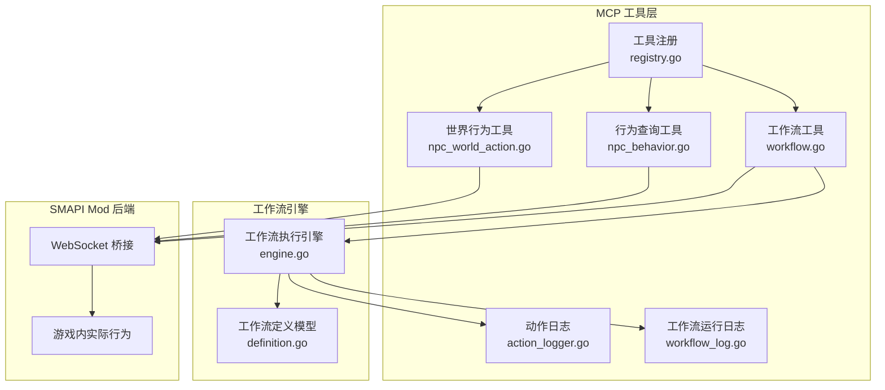

**图表来源**
- [registry.go:37-81](file://SmartNPC/smartnpc-mcp/adapters/stardew/tools/registry.go#L37-L81)
- [npc_world_action.go:454-480](file://SmartNPC/smartnpc-mcp/adapters/stardew/tools/npc_world_action.go#L454-L480)
- [npc_behavior.go:58-107](file://SmartNPC/smartnpc-mcp/adapters/stardew/tools/npc_behavior.go#L58-L107)
- [workflow.go:136-200](file://SmartNPC/smartnpc-mcp/adapters/stardew/tools/workflow.go#L136-L200)
- [definition.go:23-120](file://SmartNPC/smartnpc-mcp/pkg/workflow/definition.go#L23-L120)
- [engine.go:24-120](file://SmartNPC/smartnpc-mcp/pkg/workflow/engine.go#L24-L120)

**章节来源**
- [registry.go:1-82](file://SmartNPC/smartnpc-mcp/adapters/stardew/tools/registry.go#L1-L82)
- [definition.go:1-120](file://SmartNPC/smartnpc-mcp/pkg/workflow/definition.go#L1-L120)

## 核心组件
本节按职责划分核心组件，并说明它们在 NPC 世界行为中的作用。

### 工具注册中心
`RegisterAll` 是 Stardew 专用工具组的统一入口。它负责：
- 创建工作流发现与调试工具。
- 注册日程调度相关工具。
- 在存在桥接客户端时，注册 Agent、聊天、游戏查询、感知、移动、行为、世界行为、背包、社交等行为工具。
- 返回共享的日程调度器实例，供外部事件系统驱动。

这意味着所有“世界行为工具”都通过 `registerNpcWorldAction` 挂载到 MCP 服务器，而不是直接由智能体访问游戏对象。

**章节来源**
- [registry.go:37-81](file://SmartNPC/smartnpc-mcp/adapters/stardew/tools/registry.go#L37-L81)

### 世界行为工具集合
`npc_world_action.go` 集中声明了与游戏世界交互的工具接口，包括：
- 漫游：`npc_wander`
- 清理杂物：`npc_clear_debris`
- 浇水：`npc_water_crops`
- 收获：`npc_harvest_crops`
- 存入箱子：`npc_deposit_items`
- 发货：`npc_ship_items`
- 采集野生物：`npc_forage_collect`
- 抚摸动物：`npc_pet_animal`
- 播种：`npc_plant_seeds`
- 耕地：`npc_till_soil`
- 检查对象：`npc_inspect_object`
- 放置物品：`npc_place_object`
- 从箱子取出：`npc_withdraw_from_chest`
- NPC 间转移物品：`npc_transfer_item`
- 施肥：`npc_fertilize`
- 填坑：`npc_fill_gaps`
- 破坏资源：`npc_break_resource`

这些工具对外提供结构化输入输出，内部统一通过 `callBridge` 转发给 Mod 后端。

**章节来源**
- [npc_world_action.go:1-200](file://SmartNPC/smartnpc-mcp/adapters/stardew/tools/npc_world_action.go#L1-L200)
- [npc_world_action.go:201-453](file://SmartNPC/smartnpc-mcp/adapters/stardew/tools/npc_world_action.go#L201-L453)
- [npc_world_action.go:454-480](file://SmartNPC/smartnpc-mcp/adapters/stardew/tools/npc_world_action.go#L454-L480)

### 行为模式查询
`npc_get_behavior` 用于查询 NPC 当前的高层行为模式，例如空闲、漫游、浇水、发货等。该工具适合在发起新任务前判断 NPC 是否仍占用在长任务中，从而辅助优先级管理与防冲突。

**章节来源**
- [npc_behavior.go:34-57](file://SmartNPC/smartnpc-mcp/adapters/stardew/tools/npc_behavior.go#L34-L57)

### 工作流工具
工作流工具提供三类能力：
- 列出已注册的工作流。
- 获取单个工作流的完整定义。
- 以“无操作运行器”形式演示或预编译工作流。

它们与工作流引擎解耦，便于测试、调试和离线验证。

**章节来源**
- [workflow.go:1-200](file://SmartNPC/smartnpc-mcp/adapters/stardew/tools/workflow.go#L1-L200)

### 日志系统
系统维护两类关键日志：
- `npc_actions.log`：记录每个 MCP 工具调用的名称与原始参数。
- `schedule.log` 与 `mcp/schedule_triggers.log`：记录日程触发情况。
- `mcp/workflow_runs/<npc>-<season>-d<day>-y<year>.jsonl`：记录工作流运行结果、耗时、失败步骤等。

这些日志是诊断长时间任务、资源竞争和工作流中断的核心依据。

**章节来源**
- [action_logger.go:1-200](file://SmartNPC/smartnpc-mcp/adapters/stardew/tools/action_logger.go#L1-L200)
- [workflow_log.go:1-200](file://SmartNPC/smartnpc-mcp/adapters/stardew/tools/workflow_log.go#L1-L200)

## 架构总览
下图展示一次典型的世界行为工具调用路径：智能体调用 MCP 工具 → 工具处理器校验参数 → 通过 WebSocket 桥接发送到 SMAPI Mod → Mod 执行游戏内行为 → 返回结构化结果。

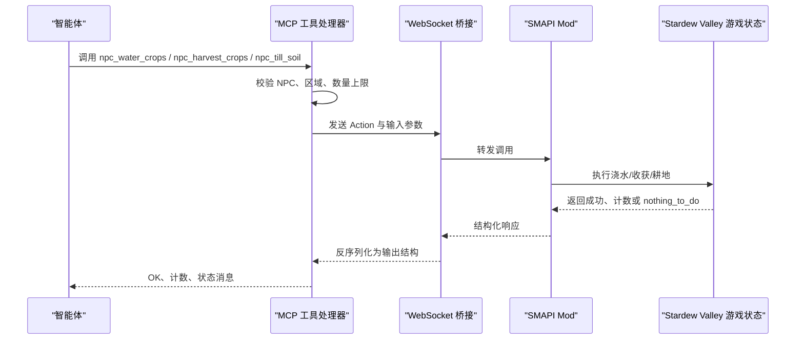

**图表来源**
- [npc_world_action.go:454-480](file://SmartNPC/smartnpc-mcp/adapters/stardew/tools/npc_world_action.go#L454-L480)
- [npc_world_action_test.go:1-120](file://SmartNPC/smartnpc-mcp/adapters/stardew/tools/npc_world_action_test.go#L1-L120)

## 详细组件分析

### 农场操作工具

#### 浇水工具 npc_water_crops
- 输入字段：
  - `npc`：NPC 内部名称。
  - `radius`：半径扫描模式下的搜索范围。
  - `max_count`：半径模式下的安全上限。
  - `x1/y1/x2/y2`：矩形区域模式。
- 输出字段：
  - `ok`：是否接受请求。
  - `npc`：回显 NPC。
  - `watered`：实际浇水的作物格数。
  - `message`：状态信息。
- 行为要点：
  - 支持半径模式和矩形模式两种选择区域方式。
  - 使用 `nothing_to_do` 语义表达“没有可浇水作物”。
  - 适合由工作流根据检查结果动态调用。

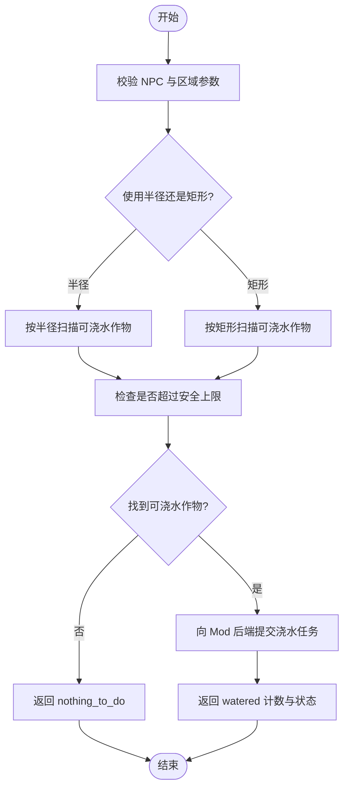

**图表来源**
- [npc_world_action.go:69-115](file://SmartNPC/smartnpc-mcp/adapters/stardew/tools/npc_world_action.go#L69-L115)

**章节来源**
- [npc_world_action.go:69-115](file://SmartNPC/smartnpc-mcp/adapters/stardew/tools/npc_world_action.go#L69-L115)
- [npc_world_action_test.go:121-170](file://SmartNPC/smartnpc-mcp/adapters/stardew/tools/npc_world_action_test.go#L121-L170)

#### 收获工具 npc_harvest_crops
- 输入字段：
  - `npc`：NPC 内部名称。
  - `radius`：半径扫描范围。
  - `max_count`：半径模式安全上限。
  - `x1/y1/x2/y2`：矩形区域。
- 输出字段：
  - `ok`、`npc`、`harvested`、`message`。
- 行为要点：
  - 与浇水类似，但针对成熟作物。
  - 若结合 `npc_inspect_object` 的 `farm_actions` 模式，可先获得“可收获区块”，再把区块坐标传回收获工具，减少重复扫描。

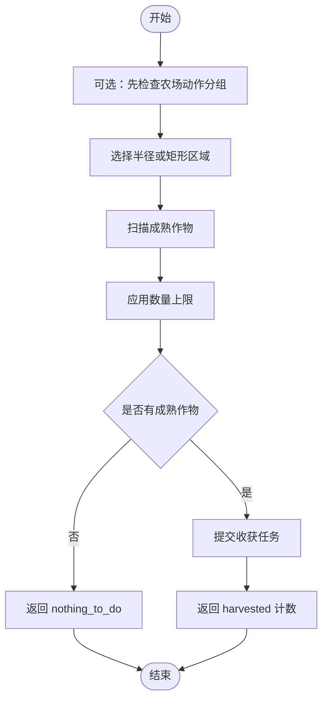

**图表来源**
- [npc_world_action.go:116-160](file://SmartNPC/smartnpc-mcp/adapters/stardew/tools/npc_world_action.go#L116-L160)
- [npc_world_action.go:201-350](file://SmartNPC/smartnpc-mcp/adapters/stardew/tools/npc_world_action.go#L201-L350)

**章节来源**
- [npc_world_action.go:116-160](file://SmartNPC/smartnpc-mcp/adapters/stardew/tools/npc_world_action.go#L116-L160)

#### 耕地工具 npc_till_soil
- 输入字段：
  - `npc`：NPC 内部名称。
  - `radius`：搜索窗口半径。
  - `max_count`：已标记为废弃字段，实际由矩形尺寸决定。
  - `x1/y1/x2/y2`：矩形区域。
  - `patch_w`、`patch_h`：要耕地的矩形地块宽度和高度。
- 输出字段：
  - `ok`、`npc`、`tilled`、`nothing_to_do`、`reason`、`patch_x1/patch_y1/patch_x2/patch_y2`、`adjacent_to_existing`、`adjacency_edge`、`message`。
- 行为要点：
  - 耕地不是简单遍历每个格子，而是寻找“与已有耕地相邻”的矩形地块。
  - 支持尝试 `(W,H)` 与 `(H,W)` 两种方向，择优匹配。
  - 当无法找到合适地块时返回 `nothing_to_do`，并附带原因。
  - 输出包含最终选择的补丁坐标，便于后续播种、浇水等操作精确定位。

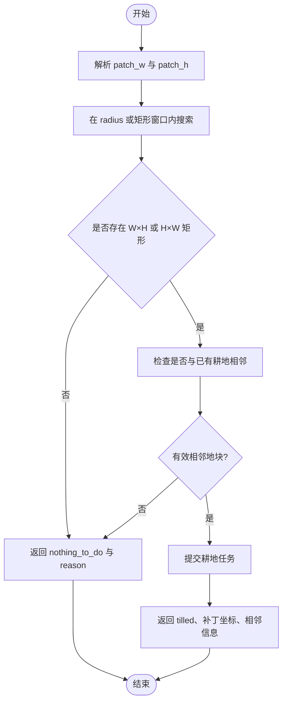

**图表来源**
- [npc_world_action.go:161-245](file://SmartNPC/smartnpc-mcp/adapters/stardew/tools/npc_world_action.go#L161-L245)

**章节来源**
- [npc_world_action.go:161-245](file://SmartNPC/smartnpc-mcp/adapters/stardew/tools/npc_world_action.go#L161-L245)

### 资源采集工具

#### 采矿与伐木：npc_break_resource
- 输入字段：
  - `npc`：NPC 内部名称。
  - `radius`：扫描半径。
  - `max_count`：半径模式安全上限。
  - `what`：过滤类型，支持树木、石头或全部。
  - `x1/y1/x2/y2`：矩形区域。
- 输出字段：
  - `ok`、`npc`、`broken`、`message`。
- 行为要点：
  - 适用于地图上的可破坏资源。
  - 支持按资源类型筛选，便于区分伐木与采矿。
  - 与 `npc_inspect_object` 配合时，可先识别资源分布，再批量处理。

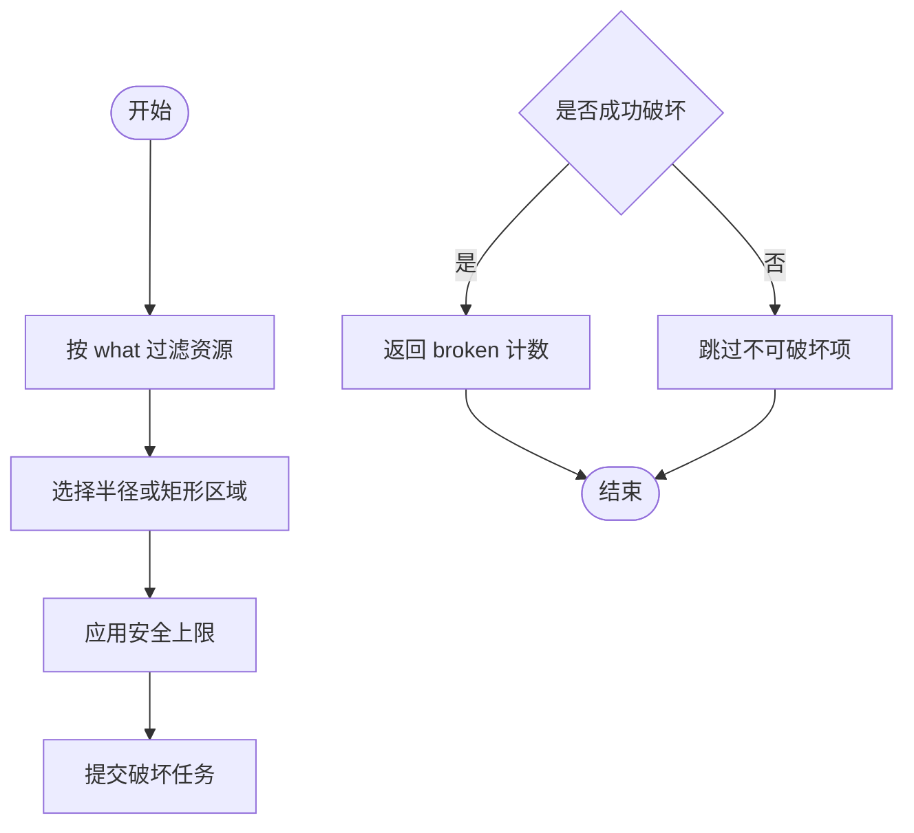

**图表来源**
- [npc_world_action.go:351-420](file://SmartNPC/smartnpc-mcp/adapters/stardew/tools/npc_world_action.go#L351-L420)

**章节来源**
- [npc_world_action.go:351-420](file://SmartNPC/smartnpc-mcp/adapters/stardew/tools/npc_world_action.go#L351-L420)

#### 钓鱼
当前公开工具中没有独立的 `npc_fish` 工具。钓鱼通常由更高层的 Hermes SKILL 或工作流通过对话、技能流程与行为决策组合完成。如果未来需要增加 MCP 工具，建议沿用现有世界行为工具的设计模式：
- 明确输入：目标水域、鱼竿状态、时间天气条件。
- 明确输出：是否钓到、鱼种类、次数、失败原因。
- 使用 `nothing_to_do` 表示没有可钓鱼点。
- 通过 `npc_get_behavior` 避免与浇水、收获等长任务冲突。

[本节为概念性扩展建议，不直接分析具体源码]

### 环境互动工具

#### 拾取与放置
- 放置物品：`npc_place_object`
  - 输入：NPC、物品 ID、目标坐标、地图名。
  - 输出：`ok`、`message`。
  - 用途：把背包中的物品放置在指定方块上，常用于装饰、陷阱、机关或临时存放。
- 放置类操作的坐标必须精确，因为目标方块可能已被占用。

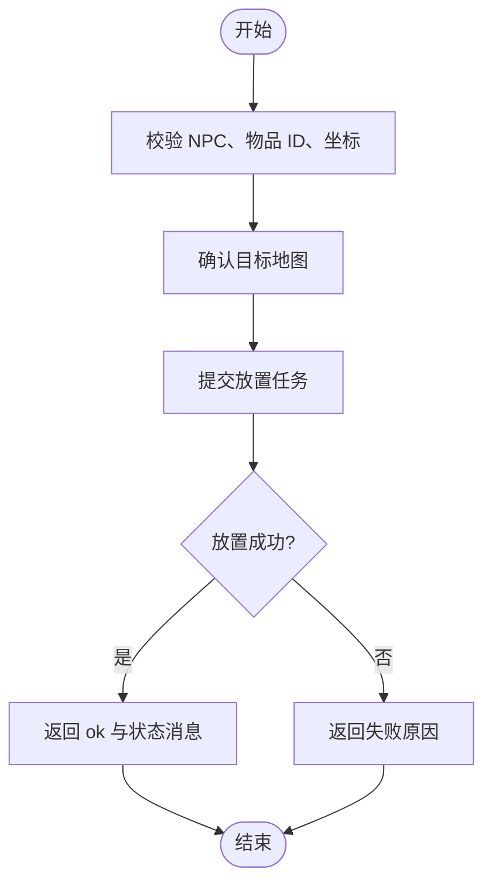

**图表来源**
- [npc_world_action.go:421-450](file://SmartNPC/smartnpc-mcp/adapters/stardew/tools/npc_world_action.go#L421-L450)

**章节来源**
- [npc_world_action.go:421-450](file://SmartNPC/smartnpc-mcp/adapters/stardew/tools/npc_world_action.go#L421-L450)

#### 建造与其他世界操作
当前仓库未提供独立“建造建筑”的 MCP 工具，但可通过以下工具组合间接实现建造流程：
- 收集资源：`npc_break_resource`。
- 从箱子取材料：`npc_withdraw_from_chest`。
- 放置材料：`npc_place_object`。
- 耕地、播种、浇水、收获：`npc_till_soil`、`npc_plant_seeds`、`npc_water_crops`、`npc_harvest_crops`。
- 清理障碍：`npc_clear_debris`。
- 填坑：`npc_fill_gaps`。
- 施肥：`npc_fertilize`。

这种组合方式更适合由工作流编排，而不是一次性调用单一“建造”工具。

**章节来源**
- [npc_world_action.go:246-350](file://SmartNPC/smartnpc-mcp/adapters/stardew/tools/npc_world_action.go#L246-L350)

### 行为优先级管理与冲突防护

#### 行为模式检测
`npc_get_behavior` 可以读取 NPC 当前模式，例如空闲、漫游、浇水、发货等。工作流可以在发起新任务前调用该工具，避免在 NPC 已经执行长任务时重复分配相同资源。

#### nothing_to_do 策略
多个世界行为工具支持 `nothing_to_do` 输出。工作流引擎对这一标志有统一处理策略：
- `skip`：继续执行下一步。
- `stop`：提前结束工作流，并记录停止原因。
- `fail`：作为工作流错误向上抛出。

这使上层工作流能根据“没有可执行内容”自动降级，而不是无限重试。

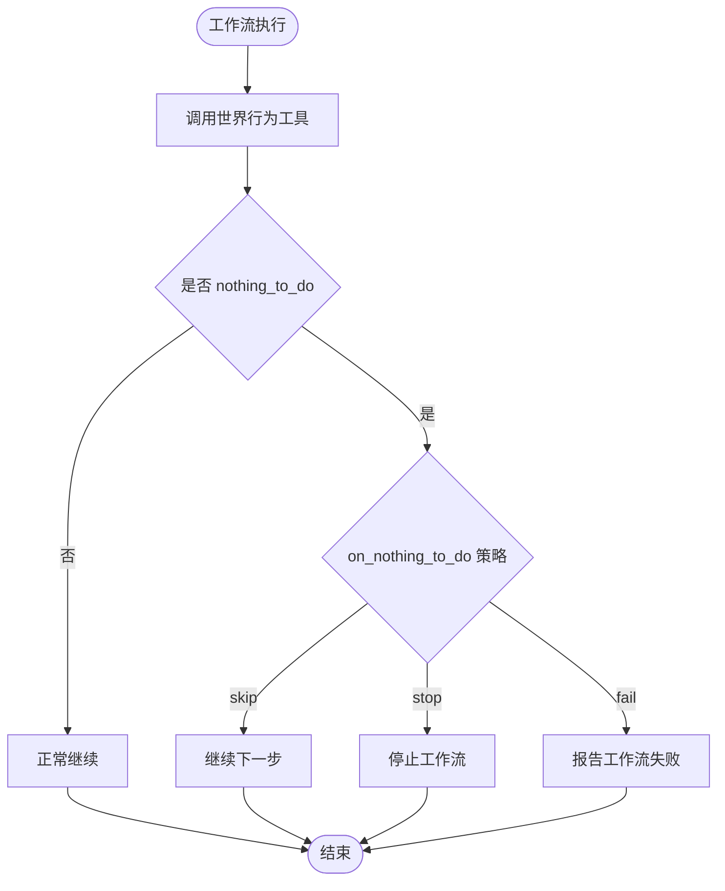

**图表来源**
- [engine.go:241-330](file://SmartNPC/smartnpc-mcp/pkg/workflow/engine.go#L241-L330)
- [definition.go:92-120](file://SmartNPC/smartnpc-mcp/pkg/workflow/definition.go#L92-L120)

**章节来源**
- [npc_behavior.go:34-57](file://SmartNPC/smartnpc-mcp/adapters/stardew/tools/npc_behavior.go#L34-L57)
- [engine.go:241-330](file://SmartNPC/smartnpc-mcp/pkg/workflow/engine.go#L241-L330)
- [definition.go:92-120](file://SmartNPC/smartnpc-mcp/pkg/workflow/definition.go#L92-L120)

### 操作状态跟踪与长时间任务保障

#### 工作流引擎状态
工作流引擎维护以下关键状态：
- `step_count`：执行的步骤总数。
- `tool_calls`：实际触发的工具调用次数。
- `nothing_to_do_ct`：遇到“无可执行内容”的次数。
- `stopped`：是否被主动停止。
- `stop_reason`：停止原因。
- `failed_step`：失败步骤编号。

这些信息写入运行时日志，便于回放和分析。

#### 日志与审计
- `npc_actions.log` 记录每次工具调用及其参数。
- `mcp/workflow_runs/*.jsonl` 记录工作流运行结果。
- `schedule.log` 与 `schedule_triggers.log` 记录日程触发与计划摘要。

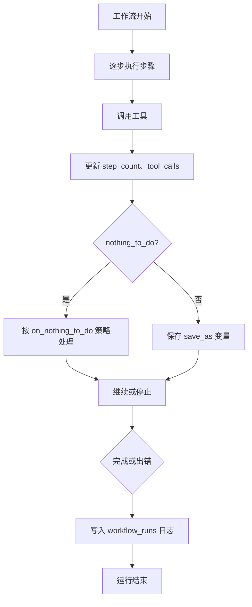

**图表来源**
- [engine.go:24-120](file://SmartNPC/smartnpc-mcp/pkg/workflow/engine.go#L24-L120)
- [engine.go:241-330](file://SmartNPC/smartnpc-mcp/pkg/workflow/engine.go#L241-L330)
- [workflow_log.go:1-120](file://SmartNPC/smartnpc-mcp/adapters/stardew/tools/workflow_log.go#L1-L120)

**章节来源**
- [engine.go:24-120](file://SmartNPC/smartnpc-mcp/pkg/workflow/engine.go#L24-L120)
- [workflow_log.go:1-120](file://SmartNPC/smartnpc-mcp/adapters/stardew/tools/workflow_log.go#L1-L120)

## 依赖关系分析

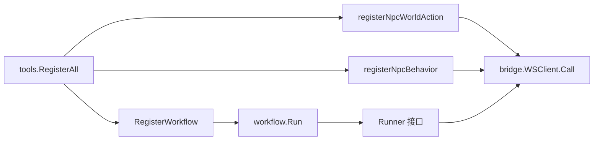

**图表来源**
- [registry.go:37-81](file://SmartNPC/smartnpc-mcp/adapters/stardew/tools/registry.go#L37-L81)
- [npc_world_action.go:454-480](file://SmartNPC/smartnpc-mcp/adapters/stardew/tools/npc_world_action.go#L454-L480)
- [engine.go:24-60](file://SmartNPC/smartnpc-mcp/pkg/workflow/engine.go#L24-L60)

**章节来源**
- [registry.go:1-82](file://SmartNPC/smartnpc-mcp/adapters/stardew/tools/registry.go#L1-L82)
- [engine.go:24-60](file://SmartNPC/smartnpc-mcp/pkg/workflow/engine.go#L24-L60)

## 性能与可靠性

### 超时控制
- 工作流引擎对工具调用默认设置 120 秒超时。
- 每个工具步骤可单独配置 `timeout_seconds`，覆盖默认值。
- 整体工作流也可受父上下文截止时间约束。

### 安全上限
- 半径模式的工具普遍提供 `max_count`，防止 NPC 一次性处理过多格子。
- 矩形模式直接使用矩形面积作为区域上限。
- 耕地工具不再依赖 `max_count`，而是由 `patch_w` 与 `patch_h` 控制地块大小。

### 并发与日志安全
- 工作流运行日志使用按文件互斥的方式写入，避免不同 NPC 或不同日期互相阻塞。
- 工具调用日志使用懒加载单例，失败时回退到默认日志器。

### 推荐优化
- 对重操作（如清理杂物、破坏资源）在工作流 YAML 中显式设置超时。
- 优先使用 `npc_inspect_object` 的 `farm_actions` 模式缩小扫描范围。
- 使用 `on_nothing_to_do=stop` 在完全无工作时快速退出，避免无效重试。
- 通过 `save_as` 缓存检查结果，避免重复扫描。

[本节为通用指导，不直接分析具体源码片段]

## 故障排查指南

### 常见症状与定位方法
- 工具调用无效果：
  - 检查 `npc_actions.log` 是否记录了该工具调用。
  - 检查 NPC 是否在线、是否处于其他长任务。
  - 使用 `npc_get_behavior` 确认当前行为模式。
- 工作流反复执行但无进展：
  - 检查工作流是否设置了合适的 `on_nothing_to_do`。
  - 查看 `mcp/workflow_runs/*.jsonl` 中的 `nothing_to_do` 与 `stop_reason`。
  - 检查工具输出是否缺少必要字段，例如耕地工具的 `patch_*` 坐标。
- 日志缺失：
  - 检查环境变量 `SMARTNPC_LOG_DIR` 是否指向期望目录。
  - 检查程序启动目录下的 `logs` 文件夹权限。

**章节来源**
- [action_logger.go:1-120](file://SmartNPC/smartnpc-mcp/adapters/stardew/tools/action_logger.go#L1-L120)
- [workflow_log.go:1-120](file://SmartNPC/smartnpc-mcp/adapters/stardew/tools/workflow_log.go#L1-L120)
- [npc_behavior.go:34-57](file://SmartNPC/smartnpc-mcp/adapters/stardew/tools/npc_behavior.go#L34-L57)

## 结论
NPC 世界行为工具组通过 MCP 工具暴露统一的农场与环境操作接口，并通过工作流引擎提供多步、可观测、可中断的执行模型。浇水、收获、耕地等资源采集与环境互动工具采用一致的区域选择、安全上限与 `nothing_to_do` 语义，便于智能体和工作流进行优先级管理与冲突规避。对于长时间任务，系统通过工作流状态、工具超时、日志记录和运行历史提供完整的可追踪性。

## 附录：自动化农场工作流示例

下面给出一个“自动化农场管理”参考流程。该流程基于现有工作流定义模式，并结合世界行为工具的能力进行编排。

### 工作流目标
- 每天巡视农场。
- 先浇水，再收获成熟作物。
- 必要时补种并耕地。
- 清理杂物、施肥、整理箱子。
- 最后发货。

### 步骤设计
1. 使用 `skill_call` 调用 `smartnpc-farm-care` 或 `smartnpc-farm-cleanup`，让高层技能根据当前农场状态做决策。
2. 如果需要资源采集，使用 `skill_call` 调用 `smartnpc-farm-gather`。
3. 在低层操作中，使用：
   - `npc_inspect_object` 获取农场动作分组。
   - `npc_water_crops` 浇水。
   - `npc_harvest_crops` 收获。
   - `npc_till_soil` 耕地。
   - `npc_plant_seeds` 播种。
   - `npc_clear_debris` 清理杂物。
   - `npc_fertilize` 施肥。
   - `npc_deposit_items` 存入箱子。
   - `npc_ship_items` 发货。
4. 对工作流中的工具调用设置合理的 `timeout_seconds` 与 `on_nothing_to_do`。
5. 通过 `save_as` 保存检查结果，避免重复扫描。

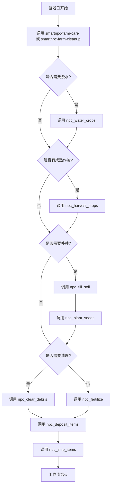

**图表来源**
- [resource_gather.yaml:1-12](file://提示词导出-20261026-004143/11-内置工作流定义/resource_gather.yaml#L1-L12)
- [farm_care.yaml:1-12](file://提示词导出-20261026-004143/11-内置工作流定义/farm_care.yaml#L1-L12)
- [farm_cleanup.yaml:1-12](file://提示词导出-20261026-004143/11-内置工作流定义/farm_cleanup.yaml#L1-L12)
- [definition.go:23-120](file://SmartNPC/smartnpc-mcp/pkg/workflow/definition.go#L23-L120)

### 注意事项
- 工作流应优先使用 Skill 层的高层决策，再由底层工具执行具体动作。
- 对于频繁失败的操作，应加入重试、降级和人工介入选项。
- 生产环境建议启用工作流运行日志，并定期归档 `mcp/workflow_runs` 目录。
- 如果 NPC 行为模式长期不回归空闲，应检查 `npc_get_behavior` 与 `WaitIdle` 配置。

**章节来源**
- [resource_gather.yaml:1-12](file://提示词导出-20261026-004143/11-内置工作流定义/resource_gather.yaml#L1-L12)
- [farm_care.yaml:1-12](file://提示词导出-20261026-004143/11-内置工作流定义/farm_care.yaml#L1-L12)
- [farm_cleanup.yaml:1-12](file://提示词导出-20261026-004143/11-内置工作流定义/farm_cleanup.yaml#L1-L12)
- [definition.go:23-120](file://SmartNPC/smartnpc-mcp/pkg/workflow/definition.go#L23-L120)