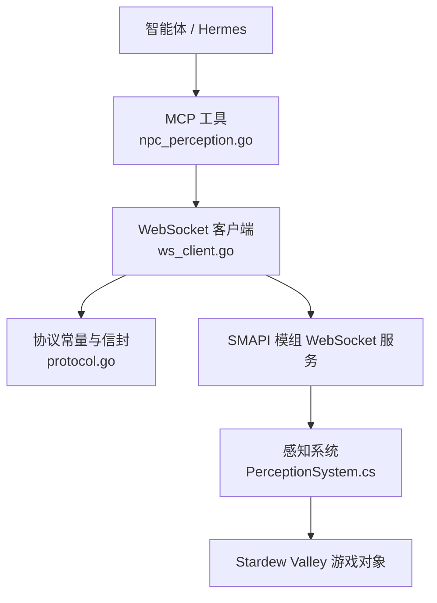
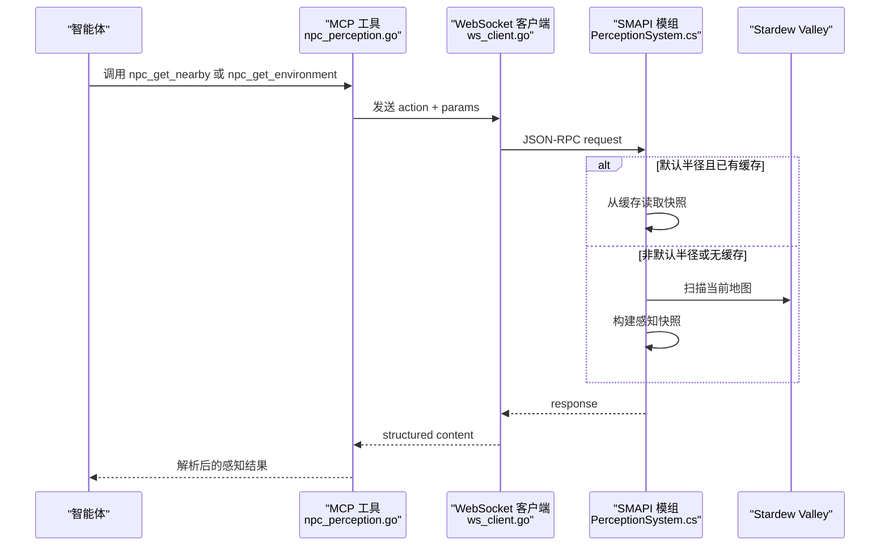
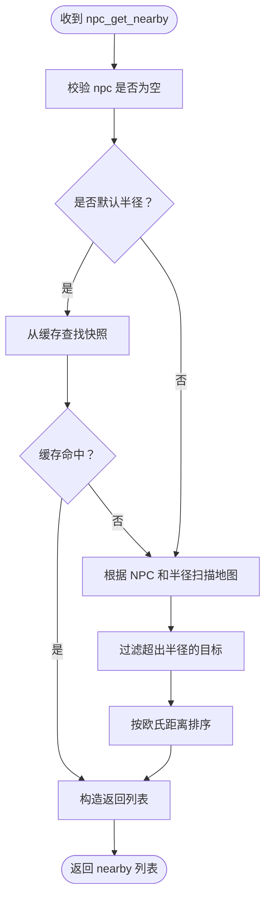
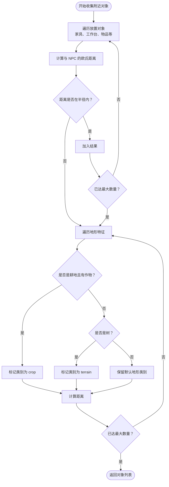
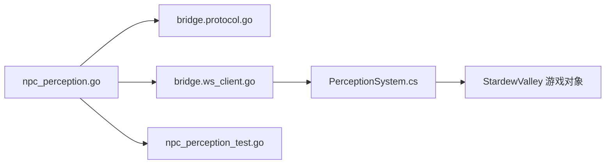
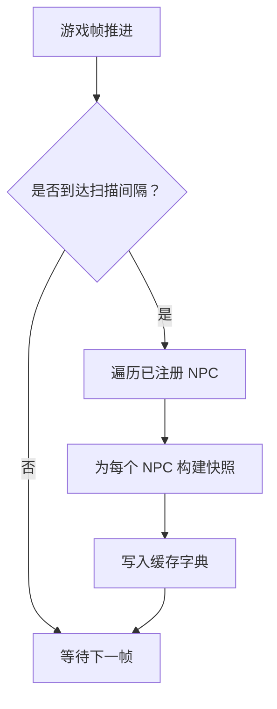

# NPC 感知工具

<cite>
**本文引用的文件**   
- [npc_perception.go](file://SmartNPC/smartnpc-mcp/adapters/stardew/tools/npc_perception.go)
- [PerceptionSystem.cs](file://SmartNPC/smapi-mod/Perception/PerceptionSystem.cs)
- [npc_perception_test.go](file://SmartNPC/smartnpc-mcp/adapters/stardew/tools/npc_perception_test.go)
- [ws_client.go](file://SmartNPC/smartnpc-mcp/adapters/stardew/bridge/ws_client.go)
- [protocol.go](file://SmartNPC/smartnpc-mcp/adapters/stardew/bridge/protocol.go)
- [game_query.go](file://SmartNPC/smartnpc-mcp/adapters/stardew/tools/game_query.go)
- [GameQueryHandler.cs](file://SmartNPC/smapi-mod/Query/GameQueryHandler.cs)
- [mcp-tools.md](file://SmartNPC/docs/mcp-tools.md)
- [current-architecture.md](file://SmartNPC/docs/current-architecture.md)
</cite>

## 目录
1. [引言](#引言)
2. [项目结构](#项目结构)
3. [核心组件](#核心组件)
4. [架构总览](#架构总览)
5. [详细组件分析](#详细组件分析)
6. [依赖关系分析](#依赖关系分析)
7. [性能与缓存策略](#性能与缓存策略)
8. [环境与 NPC 状态数据模型](#环境与-npc-状态数据模型)
9. [使用案例：环境理解智能决策](#使用案例环境理解智能决策)
10. [故障排查](#故障排查)
11. [结论](#结论)

## 引言
本文件面向 SmartNPC 的 NPC 感知子系统，目标是把“游戏世界对某个 NPC 意味着什么”结构化地暴露给上层智能体。当前实现围绕两个 MCP 工具展开：

- `npc_get_nearby`：扫描 NPC 所在地图上的其他角色（NPC 和玩家），返回名称、类型、坐标、欧氏距离、朝向等。
- `npc_get_environment`：一次性读取 NPC 当前位置、朝向、游戏时间、季节、天气以及附近重要对象（家具、作物、地形特征）。

该子系统采用“模组侧周期性扫描 + 结果缓存 + WebSocket 查询”的分层设计，避免每次工具调用都直接访问游戏对象，从而降低线程安全压力和性能抖动。

## 项目结构
NPC 感知工具横跨三层代码：

| 层级 | 职责 | 关键路径 |
|---|---|---|
| Go MCP 工具层 | 定义 JSON 输入输出、注册 MCP 工具、通过 WebSocket 转发请求 | `smartnpc-mcp/adapters/stardew/tools/npc_perception.go` |
| SMAPI 模组层 | 在游戏线程上扫描地图、构建快照、提供 WebSocket 处理器 | `smapi-mod/Perception/PerceptionSystem.cs` |
| 桥接协议层 | 定义动作常量、JSON-RPC 信封、WebSocket 客户端 | `smartnpc-mcp/adapters/stardew/bridge/protocol.go`、`ws_client.go` |

**图表来源** 
- [npc_perception.go:89-129](file://SmartNPC/smartnpc-mcp/adapters/stardew/tools/npc_perception.go#L89-L129)
- [ws_client.go:1-60](file://SmartNPC/smartnpc-mcp/adapters/stardew/bridge/ws_client.go#L1-L60)
- [protocol.go:1-172](file://SmartNPC/smartnpc-mcp/adapters/stardew/bridge/protocol.go#L1-L172)
- [PerceptionSystem.cs:1-40](file://SmartNPC/smapi-mod/Perception/PerceptionSystem.cs#L1-L40)

**章节来源**
- [npc_perception.go:1-129](file://SmartNPC/smartnpc-mcp/adapters/stardew/tools/npc_perception.go#L1-L129)
- [PerceptionSystem.cs:1-40](file://SmartNPC/smapi-mod/Perception/PerceptionSystem.cs#L1-L40)
- [mcp-tools.md:1-60](file://SmartNPC/docs/mcp-tools.md#L1-L60)
- [current-architecture.md:1-40](file://SmartNPC/docs/current-architecture.md#L1-L40)

## 核心组件
### 1. Go 端感知工具
Go 层只负责：
- 声明 `NpcGetNearbyInput`、`NpcGetEnvironmentInput` 及其对应输出结构。
- 校验必填字段（例如 `npc` 不能为空）。
- 调用桥接客户端发送 `ActionNpcGetNearby` 或 `ActionNpcGetEnvironment`。
- 将响应反序列化为结构化输出返回给 MCP 调用方。

这两个工具被描述为“读操作”，需要存档已加载；默认半径下模组侧会复用缓存，非默认半径会触发按需扫描。

**章节来源**
- [npc_perception.go:9-88](file://SmartNPC/smartnpc-mcp/adapters/stardew/tools/npc_perception.go#L9-L88)
- [npc_perception.go:89-129](file://SmartNPC/smartnpc-mcp/adapters/stardew/tools/npc_perception.go#L89-L129)

### 2. SMAPI 模组感知系统
C# 层是感知能力的实际实现者，承担：
- 每约 1 秒（默认 60 tick）在游戏线程扫描所有已注册的 Agent NPC。
- 构建 `PerceptionSnapshot` 并写入按 NPC 内部名索引的缓存字典。
- 处理 `npc_get_nearby` 和 `npc_get_environment` 两个 WebSocket 动作。
- 在 `npc_get_nearby` 中区分默认半径与非默认半径：默认半径可复用缓存，否则立即重建快照。
- 在 `npc_get_environment` 中读取时间、天气、位置、朝向，并收集附近对象。

**章节来源**
- [PerceptionSystem.cs:1-120](file://SmartNPC/smapi-mod/Perception/PerceptionSystem.cs#L1-L120)

### 3. 桥接与协议
- `ActionNpcGetNearby` 和 `ActionNpcGetEnvironment` 是客户端到服务端的标准动作常量。
- WS 客户端维护连接、重试、超时、事件回调，并把每个工具调用记录成观察对象。
- 请求信封支持 `from_npc`，用于标识发起方 NPC；测试和单会话模式也做了兼容。

**章节来源**
- [protocol.go:1-172](file://SmartNPC/smartnpc-mcp/adapters/stardew/bridge/protocol.go#L1-L172)
- [ws_client.go:1-120](file://SmartNPC/smartnpc-mcp/adapters/stardew/bridge/ws_client.go#L1-L120)

## 架构总览
下图展示一次感知调用的端到端流程。

**图表来源**
- [npc_perception.go:89-129](file://SmartNPC/smartnpc-mcp/adapters/stardew/tools/npc_perception.go#L89-L129)
- [PerceptionSystem.cs:60-120](file://SmartNPC/smapi-mod/Perception/PerceptionSystem.cs#L60-L120)
- [protocol.go:100-172](file://SmartNPC/smartnpc-mcp/adapters/stardew/bridge/protocol.go#L100-L172)

## 详细组件分析

### 附近 NPC 检测：`npc_get_nearby`
#### 功能说明
- 输入包含 `npc` 和可选 `radius`。
- 返回当前地图、观察者 NPC、实际半径、实体数量，以及按距离排序的实体列表。
- 实体可以是 NPC 或玩家；玩家条目可能携带动作提示。

#### 算法流程

**图表来源**
- [PerceptionSystem.cs:60-120](file://SmartNPC/smapi-mod/Perception/PerceptionSystem.cs#L60-L120)
- [PerceptionSystem.cs:201-245](file://SmartNPC/smapi-mod/Perception/PerceptionSystem.cs#L201-L245)

#### 数据结构
- 附近实体包含名称、类型、X/Y 坐标、距离、朝向、地图名称，以及可选动作。
- 方向用整数表示：上、右、下、左；未知时允许 `-1`。
- 列表按距离升序排列，便于优先选择最近的 NPC 或玩家。

**章节来源**
- [npc_perception.go:14-45](file://SmartNPC/smartnpc-mcp/adapters/stardew/tools/npc_perception.go#L14-L45)
- [PerceptionSystem.cs:201-245](file://SmartNPC/smapi-mod/Perception/PerceptionSystem.cs#L201-L245)

#### 过滤选项
- 当前实现按“同一地图 + 欧氏距离小于等于半径”过滤。
- 没有显式的 NPC 类型白名单、情感阈值、朝向可见性角度等高级过滤器。
- 若需要更精细筛选，应在上层工作流中对返回结果做二次过滤。

**章节来源**
- [PerceptionSystem.cs:201-245](file://SmartNPC/smapi-mod/Perception/PerceptionSystem.cs#L201-L245)

### 地形与环境识别：`npc_get_environment`
#### 功能说明
- 一次性聚合 NPC 位置、朝向、时间、季节、天气和附近重要对象。
- 适合替代分别调用时间、天气、位置等多个工具，减少往返次数。

#### 环境对象采集逻辑

**图表来源**
- [PerceptionSystem.cs:260-330](file://SmartNPC/smapi-mod/Perception/PerceptionSystem.cs#L260-L330)

#### 数据结构
- 环境对象包含显示名或内部名、类别、坐标和距离。
- 类别包括对象、地形、作物、建筑等；当前实现明确覆盖 `object`、`terrain`、`crop`。
- 对象总数受 `MaxNearbyObjects` 限制，避免单次环境查询返回过多数据。

**章节来源**
- [npc_perception.go:47-88](file://SmartNPC/smartnpc-mcp/adapters/stardew/tools/npc_perception.go#L47-L88)
- [PerceptionSystem.cs:260-330](file://SmartNPC/smapi-mod/Perception/PerceptionSystem.cs#L260-L330)

### NPC 状态查询
#### 位置、朝向、移动状态
- 位置由 `npc_get_environment` 提供 X、Y 和地图名称。
- 朝向同时提供数值方向和可读方向字符串。
- 移动状态可从玩家动作推断：行走、使用工具、坐下、空闲；NPC 本身目前不暴露动作字段，但暴露朝向。

#### 当前动作
- 对于玩家，模组会根据移动、持工具、坐姿等生成动作提示。
- 对于普通 NPC，当前 `nearby` 条目不保证包含动作字段；动作字段属于最佳努力字段。

#### 情感状态
- 当前感知工具不直接返回 NPC 情感值。
- 历史中曾存在好友度相关工具，但在实验分支中被移除；当前仓库中的 `GameQueryHandler` 仍包含好友度查询实现，但不在感知工具中暴露。

**章节来源**
- [PerceptionSystem.cs:201-245](file://SmartNPC/smapi-mod/Perception/PerceptionSystem.cs#L201-L245)
- [GameQueryHandler.cs:60-107](file://SmartNPC/smapi-mod/Query/GameQueryHandler.cs#L60-L107)
- [mcp-tools.md:180-220](file://SmartNPC/docs/mcp-tools.md#L180-L220)

### 感知范围配置
- 默认半径为 10 格。
- `npc_get_nearby` 支持传入自定义 `radius`，但该情况不会走默认缓存路径，而是重新扫描。
- `npc_get_environment` 目前使用默认半径收集对象，并未暴露自定义半径参数。
- 扫描间隔默认为 60 tick，约 1 秒刷新一次所有已注册 NPC。

**章节来源**
- [PerceptionSystem.cs:25-40](file://SmartNPC/smapi-mod/Perception/PerceptionSystem.cs#L25-L40)
- [PerceptionSystem.cs:60-120](file://SmartNPC/smapi-mod/Perception/PerceptionSystem.cs#L60-L120)
- [npc_perception.go:14-25](file://SmartNPC/smartnpc-mcp/adapters/stardew/tools/npc_perception.go#L14-L25)

### 视野角度
- 当前实现未实现扇形视野角度裁剪。
- 距离判断基于二维欧氏距离，不考虑 NPC 朝向或遮挡。
- 如果需要“面向前方”的感知，应由上层工作流结合 `facing` 和 `direction` 自行判断。

**章节来源**
- [PerceptionSystem.cs:201-245](file://SmartNPC/smapi-mod/Perception/PerceptionSystem.cs#L201-L245)

## 依赖关系分析
### 组件依赖图

**图表来源**
- [npc_perception.go:89-129](file://SmartNPC/smartnpc-mcp/adapters/stardew/tools/npc_perception.go#L89-L129)
- [protocol.go:100-172](file://SmartNPC/smartnpc-mcp/adapters/stardew/bridge/protocol.go#L100-L172)
- [ws_client.go:1-120](file://SmartNPC/smartnpc-mcp/adapters/stardew/bridge/ws_client.go#L1-L120)
- [PerceptionSystem.cs:60-120](file://SmartNPC/smapi-mod/Perception/PerceptionSystem.cs#L60-L120)

### 耦合与内聚
- Go 工具层与模组层的耦合集中在两个动作常量，接口边界清晰。
- 模组层封装了游戏线程扫描、缓存和序列化，对外只暴露 WebSocket 处理器。
- 测试层通过内存传输和测试服务器验证工具注册、参数传递和响应结构，降低对真实游戏的依赖。

**章节来源**
- [npc_perception_test.go:1-60](file://SmartNPC/smartnpc-mcp/adapters/stardew/tools/npc_perception_test.go#L1-L60)
- [npc_perception_test.go:201-305](file://SmartNPC/smartnpc-mcp/adapters/stardew/tools/npc_perception_test.go#L201-L305)

## 性能与缓存策略
### 缓存机制
- 模组维护一个以 NPC 内部名为键的快照字典。
- 默认扫描周期约 1 秒，`PumpOnGameTick` 驱动扫描。
- `HandleGetNearby` 在调用半径等于默认半径且已有缓存时直接返回缓存快照。
- 非默认半径会绕过缓存，立即重建快照，确保结果正确。

**图表来源**
- [PerceptionSystem.cs:40-100](file://SmartNPC/smapi-mod/Perception/PerceptionSystem.cs#L40-L100)

### 性能优化要点
1. **减少直接游戏访问**：WebSocket 处理器优先读缓存，避免接收线程直接访问游戏对象。
2. **批量扫描**：一次扫描刷新所有已注册 NPC，而不是每个工具调用单独扫描。
3. **默认半径缓存命中**：常见调用路径不走实时扫描。
4. **对象数量上限**：环境对象最多返回固定数量，防止地图过大导致响应膨胀。
5. **距离快速裁剪**：先算距离再决定是否加入结果，避免不必要的对象属性处理。
6. **测试结果覆盖错误路径**：空 NPC、模组错误、结构体反序列化等场景有单元测试覆盖。

**章节来源**
- [PerceptionSystem.cs:1-40](file://SmartNPC/smapi-mod/Perception/PerceptionSystem.cs#L1-L40)
- [PerceptionSystem.cs:60-120](file://SmartNPC/smapi-mod/Perception/PerceptionSystem.cs#L60-L120)
- [PerceptionSystem.cs:260-330](file://SmartNPC/smapi-mod/Perception/PerceptionSystem.cs#L260-L330)
- [npc_perception_test.go:1-60](file://SmartNPC/smartnpc-mcp/adapters/stardew/tools/npc_perception_test.go#L1-L60)

## 环境与 NPC 状态数据模型
### 附近实体
| 字段 | 类型 | 含义 |
|---|---|---|
| `name` | 字符串 | NPC 内部名或玩家名 |
| `type` | 字符串 | `npc` 或 `player` |
| `x` | 浮点数 | 瓦片 X 坐标 |
| `y` | 浮点数 | 瓦片 Y 坐标 |
| `distance` | 浮点数 | 与观察者 NPC 的欧氏距离 |
| `facing` | 整数 | 朝向：上、右、下、左，未知可为 `-1` |
| `map` | 字符串 | 实体所在地图名称 |
| `action` | 可选字符串 | 当前动作提示，主要用于玩家 |

### 环境对象
| 字段 | 类型 | 含义 |
|---|---|---|
| `name` | 字符串 | 对象显示名或内部名 |
| `category` | 字符串 | 对象、地形、作物、建筑等类别 |
| `x` | 浮点数 | 瓦片 X 坐标 |
| `y` | 浮点数 | 瓦片 Y 坐标 |
| `distance` | 浮点数 | 与观察者 NPC 的距离 |

### 环境摘要
| 字段 | 类型 | 含义 |
|---|---|---|
| `ok` | 布尔值 | 成功标志 |
| `npc` | 字符串 | 观察者 NPC 名称 |
| `map` | 字符串 | 当前地图名称 |
| `x` | 浮点数 | 观察者 X 坐标 |
| `y` | 浮点数 | 观察者 Y 坐标 |
| `facing` | 整数 | 观察者朝向 |
| `time_of_day` | 整数 | 原始游戏时间，如 1430 |
| `hour` | 整数 | 小时 |
| `minute` | 整数 | 分钟 |
| `season` | 字符串 | 春、夏、秋、冬 |
| `weather` | 字符串 | 晴、雨、雪、雷暴 |
| `nearby_objects` | 数组 | 附近重要对象 |

**章节来源**
- [npc_perception.go:14-88](file://SmartNPC/smartnpc-mcp/adapters/stardew/tools/npc_perception.go#L14-L88)
- [PerceptionSystem.cs:330-380](file://SmartNPC/smapi-mod/Perception/PerceptionSystem.cs#L330-L380)

## 使用案例：环境理解智能决策
以下案例强调“感知 → 决策 → 行动”的工作流，而非具体代码片段。

### 案例一：雨天室内行为切换
- 调用 `npc_get_environment`。
- 如果 `weather` 为雨或雪，则优先选择室内对象，例如家具、工作台、储藏箱。
- 如果附近有作物且户外不可行，则放弃浇水任务，改为整理背包或准备出货。
- 若发现玩家或 NPC 靠近，可选择打招呼或让出通道。

### 案例二：遇到玩家时的社交避让
- 调用 `npc_get_nearby`。
- 如果检测到玩家，且距离较近，优先判断玩家动作：
  - 玩家在移动：避免挡路。
  - 玩家在使用工具：暂时不参与互动。
  - 玩家坐着：可按剧情或技能决定对话或离开。
- 若无任何角色，则避免主动发起无对象的社交行为。

### 案例三：资源采集优先级
- 调用 `npc_get_environment` 获取附近对象。
- 优先选择 `category` 为 `crop` 的可收获目标。
- 其次选择可采集的地形对象，例如树木或可破坏资源。
- 最后考虑搬运家具或装饰物，除非工作流明确要求。

这些案例的核心思想是：**先用低成本感知工具建立局部世界模型，再用简单规则或工作流做出确定性决策**。

[本节为概念性使用指南，不直接分析具体源码文件]

## 故障排查
### 常见问题
| 现象 | 可能原因 | 排查建议 |
|---|---|---|
| 工具返回 `mod_not_ready` | 没有加载存档或模组尚未就绪 | 确认游戏已进入存档，SMAPI 模组已加载 |
| 工具返回 `invalid_params` | 缺少 `npc` 或参数格式错误 | 检查 MCP 工具调用参数 |
| `npc_get_nearby` 返回空列表 | 目标 NPC 不存在、地图为空、或半径太小 | 确认 NPC 内部名、地图和半径 |
| 结果未按预期排序 | 距离计算基于欧氏距离 | 检查坐标和半径，必要时在上层二次排序 |
| 环境对象很少 | 默认对象数量上限或半径过小 | 增大半径或接受对象数量有限制 |
| 非默认半径延迟高 | 绕过缓存，触发实时扫描 | 尽量使用默认半径，或减少高频调用 |

### 测试覆盖的行为
- 空 NPC 应被拒绝。
- 模组错误应使工具返回错误。
- 两端结构体应能正确编码、解码。
- 工具注册列表应包含感知工具。

**章节来源**
- [npc_perception_test.go:1-60](file://SmartNPC/smartnpc-mcp/adapters/stardew/tools/npc_perception_test.go#L1-L60)
- [npc_perception_test.go:201-305](file://SmartNPC/smartnpc-mcp/adapters/stardew/tools/npc_perception_test.go#L201-L305)

## 结论
SmartNPC 的 NPC 感知工具以两个 MCP 接口为核心，把“谁在我附近”和“我周围有什么”转化为结构化数据。其优势在于：

- 模组侧周期性扫描，避免频繁直接访问游戏对象。
- 默认半径缓存命中，显著降低常见查询成本。
- 环境查询合并时间、天气、位置和对象，减少往返。
- 数据结构简洁，便于上层工作流进行距离、类型和类别过滤。

当前实现的局限也很明确：
- 没有扇形视野角度、视线遮挡、NPC 情感值等高级感知能力。
- 环境对象数量有上限。
- 非默认半径不会复用缓存。
- 玩家动作可用于辅助判断，NPC 自身动作信息有限。

在现有能力基础上，最实用的优化方式是：
- 优先使用 `npc_get_environment` 减少工具调用。
- 使用默认半径获得缓存收益。
- 在 Go 或上层工作流中对感知结果做轻量二次过滤。
- 将感知结果作为智能决策输入，而不是让模型反复猜测游戏内部状态。