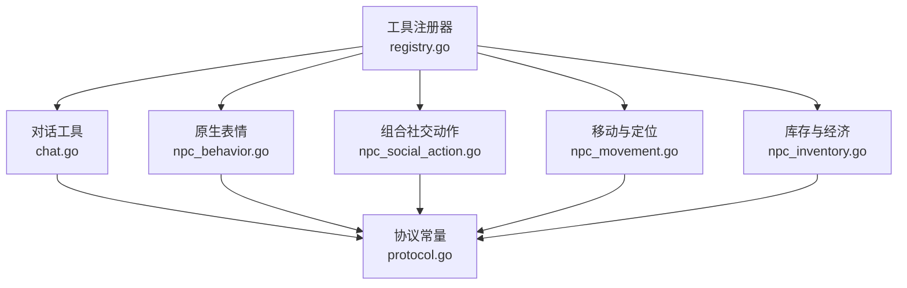
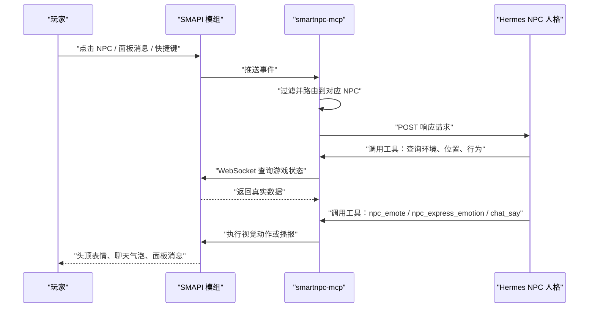
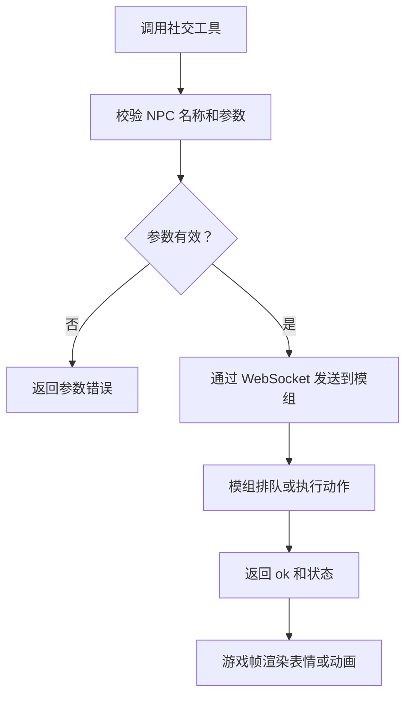
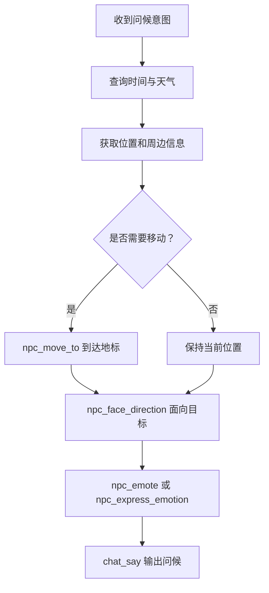
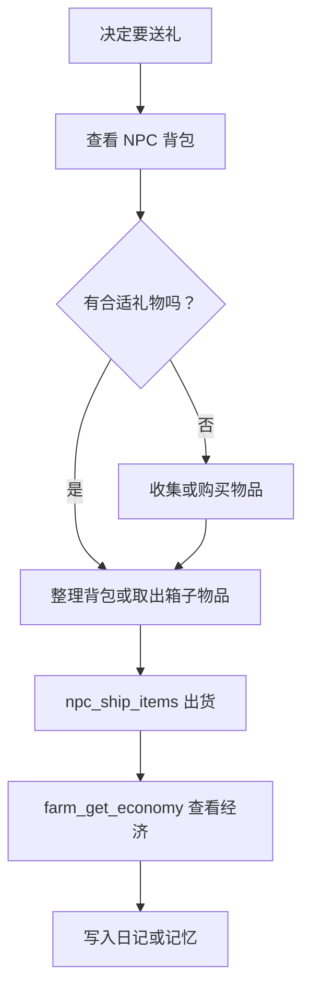
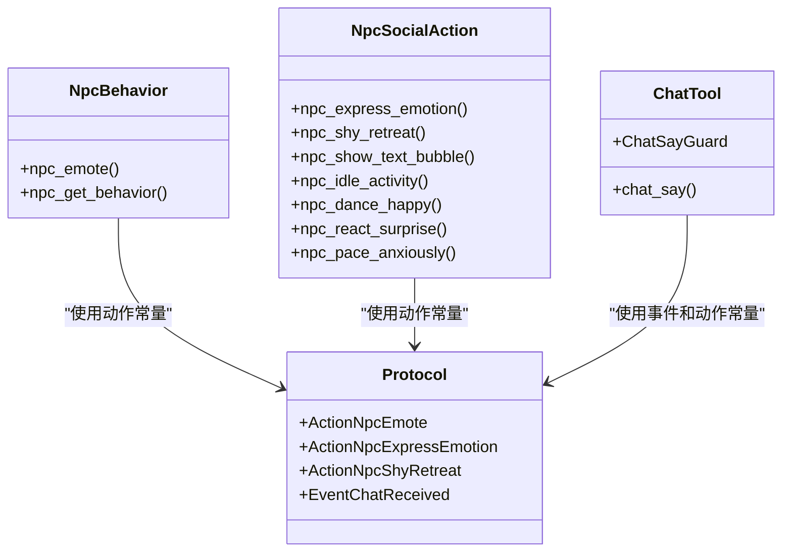

# NPC 社交工具

<cite>
**本文引用的文件**
- [README.md](file://SmartNPC/README.md)
- [mcp-tools.md](file://SmartNPC/docs/mcp-tools.md)
- [current-architecture.md](file://SmartNPC/docs/current-architecture.md)
- [registry.go](file://SmartNPC/smartnpc-mcp/adapters/stardew/tools/registry.go)
- [chat.go](file://SmartNPC/smartnpc-mcp/adapters/stardew/tools/chat.go)
- [npc_behavior.go](file://SmartNPC/smartnpc-mcp/adapters/stardew/tools/npc_behavior.go)
- [npc_social_action.go](file://SmartNPC/smartnpc-mcp/adapters/stardew/tools/npc_social_action.go)
- [npc_movement.go](file://SmartNPC/smartnpc-mcp/adapters/stardew/tools/npc_movement.go)
- [npc_inventory.go](file://SmartNPC/smartnpc-mcp/adapters/stardew/tools/npc_inventory.go)
- [protocol.go](file://SmartNPC/smartnpc-mcp/adapters/stardew/bridge/protocol.go)
- [npc_social_action_test.go](file://SmartNPC/smartnpc-mcp/adapters/stardew/tools/npc_social_action_test.go)
</cite>

## 目录
1. [引言](#引言)
2. [项目结构](#项目结构)
3. [核心组件](#核心组件)
4. [架构总览](#架构总览)
5. [详细组件分析](#详细组件分析)
6. [依赖关系分析](#依赖关系分析)
7. [性能与体验保护](#性能与体验保护)
8. [故障排查](#故障排查)
9. [结论](#结论)
10. [附录：创意实现方案](#附录创意实现方案)

## 引言
本文件聚焦 SmartNPC 的 **NPC 社交工具组**，重点说明三类能力：

- **表情工具（npc_emote 及组合表达）**：在角色头顶显示原生表情气泡，或触发复合情绪动画、害羞退后、文字气泡、待机动作、庆祝和惊讶等。
- **问候与对话工具（chat_say 等）**：通过 MCP 暴露 `chat_say`，让 Hermes 智能体输出“一句可见的 NPC 台词”，并配合位置、行为、表情构建完整问候流程。
- **礼物相关能力（物品选择、好感度影响、偏好匹配）**：实验分支已移除直接送礼给玩家的工具；礼物交互现在主要通过库存读取、仓库存取、出货和经济查询来间接支撑。

同时文档解释社交互动模式中的对话树、响应生成、记忆整合思路，以及运行时如何通过冷却机制防止过度发言。最后给出 NPC 人格化社交的创意设计建议，帮助策划把代码能力转化为可玩内容。

需要特别注意：**当前实验分支是单 Agent 农场管家模式**，玩家聊天、点击、私信、群聊和直接送礼能力已被移除。MCP 工具仍保留，但部分能力仅用于无人值守经营和视觉表现。

**章节来源**
- [README.md:1-120](file://SmartNPC/README.md#L1-L120)
- [current-architecture.md:1-120](file://SmartNPC/docs/current-architecture.md#L1-L120)

## 项目结构
Social 相关能力分布在 Go 层的 MCP 适配器中，由统一注册器装配到 MCP Server：

| 层级 | 主要职责 | 关键路径 |
|---|---|---|
| MCP 工具注册 | 定义工具名称、描述、输入输出、错误处理 | `tools/registry.go` |
| 对话输出 | 控制 `chat_say` 及其“每唤醒一次只能说话一次”的硬限制 | `tools/chat.go` |
| 原生表情 | 调用游戏原生 `doEmote`，显示头顶气泡 | `tools/npc_behavior.go` |
| 组合社交动作 | 情绪动画、害羞、文字气泡、待机、庆祝、惊讶、踱步 | `tools/npc_social_action.go` |
| 移动与定位 | 寻路、朝向、坐标、地名解析，为社交场景提供站位 | `tools/npc_movement.go` |
| 库存与经济 | 背包读写、仓库存取、经济数据，支撑礼物策略 | `tools/npc_inventory.go` |
| 协议常量 | WebSocket 请求动作名、事件名、数据结构 | `bridge/protocol.go` |

**图表来源**
- [registry.go:1-82](file://SmartNPC/smartnpc-mcp/adapters/stardew/tools/registry.go#L1-L82)
- [chat.go:1-200](file://SmartNPC/smartnpc-mcp/adapters/stardew/tools/chat.go#L1-L200)
- [npc_behavior.go:1-108](file://SmartNPC/smartnpc-mcp/adapters/stardew/tools/npc_behavior.go#L1-L108)
- [npc_social_action.go:1-253](file://SmartNPC/smartnpc-mcp/adapters/stardew/tools/npc_social_action.go#L1-L253)
- [npc_movement.go:1-200](file://SmartNPC/smartnpc-mcp/adapters/stardew/tools/npc_movement.go#L1-L200)
- [npc_inventory.go:1-112](file://SmartNPC/smartnpc-mcp/adapters/stardew/tools/npc_inventory.go#L1-L112)
- [protocol.go:1-172](file://SmartNPC/smartnpc-mcp/adapters/stardew/bridge/protocol.go#L1-L172)

**章节来源**
- [registry.go:1-82](file://SmartNPC/smartnpc-mcp/adapters/stardew/tools/registry.go#L1-L82)
- [mcp-tools.md:1-120](file://SmartNPC/docs/mcp-tools.md#L1-L120)

## 核心组件
### 工具注册器
`RegisterAll` 是所有 Stardew 专用工具的装配入口。它创建共享日程调度器，注册工作流和日记工具，再根据是否连接 SMAPI Mod 决定是否注册需要游戏状态的工具。社交工具链位于“丰富 NPC 行为”区域，包括世界动作、库存操作和社交表演。

关键点：
- 没有桥接客户端时，仍可运行纯进程内工具。
- 桥接存在时，会按顺序注册 agent 注册、聊天、游戏查询、农场经济、感知、移动、行为、世界动作、库存、社交动作。
- 返回的调度器供事件路由注入时间推进，驱动日程。

**章节来源**
- [registry.go:1-82](file://SmartNPC/smartnpc-mcp/adapters/stardew/tools/registry.go#L1-L82)

### 对话工具 chat_say
`chat_say` 是 **唯一能产生可见 NPC 台词** 的工具。它的输入包含说话人、文本、可选颜色和频道；输出包含是否实际投递，以及一个 `hint`，其中通常包含终止信号，提示模型本轮不要再继续说话。

运行时通过 `ChatSayGuard` 强制“一问一答”：
- 私聊：每个说话人在每次被唤醒的事件中最多说一次。
- 群聊：每个 `(group_id, speaker)` 在每个玩家回合中最多说一次。
- 第二次调用不会报错，而是返回结构化无操作结果，并要求停止继续发工具。

**章节来源**
- [chat.go:1-200](file://SmartNPC/smartnpc-mcp/adapters/stardew/tools/chat.go#L1-L200)

### 原生表情 npc_emote
`npc_emote` 调用游戏原生表情系统，在 NPC 头顶显示约一秒的表情气泡。它不移动角色、不发送聊天消息，也不会阻塞后续工具调用。默认表情类型为闪烁效果，未知类型会回退并记录警告。

适合搭配广播或工作成果展示，例如收获完成后表达喜悦，检查异常时表达疑问。

**章节来源**
- [npc_behavior.go:1-108](file://SmartNPC/smartnpc-mcp/adapters/stardew/tools/npc_behavior.go#L1-L108)
- [protocol.go:1-172](file://SmartNPC/smartnpc-mcp/adapters/stardew/bridge/protocol.go#L1-L172)

### 组合社交动作
组合动作是对原生表情的扩展，强调“动画 + 表情 + 短距离移动 + 朝向”的整体演出效果：

| 工具 | 作用 | 典型时机 |
|---|---|---|
| `npc_express_emotion` | 组合情绪动画，支持开心、害羞、生气、思考、悲伤 | 收到礼物、被夸奖、被冒犯、陷入犹豫 |
| `npc_shy_retreat` | 后退一格、转身、害羞动画 | 被调侃或告白 |
| `npc_show_text_bubble` | 头顶显示短句气泡 | 内心独白、简短反应 |
| `npc_idle_activity` | 待机动作：耕地、休息、环顾、持物姿势 | 空闲但不想呆站 |
| `npc_dance_happy` | 跳跃、欢呼、旋转、爱心气泡 | 成功收割、达成目标 |
| `npc_react_surprise` | 跳跃 + 惊讶气泡 | 突然出现、意外惊喜 |
| `npc_pace_anxiously` | 原地左右踱步 | 等待、焦虑、犹豫 |

这些动作目前主要是视觉表现，不改变游戏世界状态；部分 handler 在游戏模组侧仍是占位实现，但 MCP 层已经具备完整参数校验和 WebSocket 转发。

**章节来源**
- [npc_social_action.go:1-253](file://SmartNPC/smartnpc-mcp/adapters/stardew/tools/npc_social_action.go#L1-L253)
- [npc_social_action_test.go:1-200](file://SmartNPC/smartnpc-mcp/adapters/stardew/tools/npc_social_action_test.go#L1-L200)

### 移动与定位
社交不是只靠说话，还需要角色站在合适的位置、面对正确方向：

- `npc_move_to`：使用游戏寻路系统移动到指定格子；跨地图时会折返走传送。
- `npc_face_direction`：设置面向上、下、左、右。
- `npc_get_position`：读取坐标、地图、朝向、是否正在移动。
- `npc_get_named_locations`：返回农场地标表，如房子前面、湖边、大门等。

这些工具适合先让 NPC 走到玩家或某个地标附近，再表达情绪、打招呼或播报。

**章节来源**
- [npc_movement.go:1-200](file://SmartNPC/smartnpc-mcp/adapters/stardew/tools/npc_movement.go#L1-L200)

### 库存与经济
虽然直接送礼给玩家的工具在实验分支中被移除，但库存和经济工具仍可用于构建礼物逻辑：

- `npc_inventory_get`：查看 NPC 背包物品、数量、品质。
- `npc_inventory_put` / `npc_inventory_take`：向背包添加或删除物品。
- `npc_deposit_items` / `npc_withdraw_from_chest`：箱子存取。
- `npc_ship_items` / `farm_get_economy`：出货箱与经济记分板。

这些接口适合“收集 → 整理 → 准备礼物 → 存储或出货”的工作流，而不直接模拟“递给玩家”。

**章节来源**
- [npc_inventory.go:1-112](file://SmartNPC/smartnpc-mcp/adapters/stardew/tools/npc_inventory.go#L1-L112)
- [mcp-tools.md:120-220](file://SmartNPC/docs/mcp-tools.md#L120-L220)

## 架构总览
Social 工具属于“模型决策 → MCP 工具 → SMAPI Mod → 游戏线程”链路。Hermes 负责人格、记忆和工具规划；Go 层负责参数校验、协议转换和游戏线程安全；C# 模组负责 UI、动画、寻路和真实世界状态变更。

**图表来源**
- [README.md:1-120](file://SmartNPC/README.md#L1-L120)
- [current-architecture.md:1-120](file://SmartNPC/docs/current-architecture.md#L1-L120)
- [protocol.go:1-172](file://SmartNPC/smartnpc-mcp/adapters/stardew/bridge/protocol.go#L1-L172)

**章节来源**
- [README.md:1-120](file://SmartNPC/README.md#L1-L120)
- [current-architecture.md:1-120](file://SmartNPC/docs/current-architecture.md#L1-L120)

## 详细组件分析

### 表情工具 npc_emote 与组合表达
#### 能力边界
- `npc_emote`：原生头顶气泡，生命周期由游戏控制，约一秒后消失。
- `npc_express_emotion`：组合表情、跳跃、震动、朝向变化。
- `npc_shy_retreat`：后退 + 转身 + 害羞动画。
- `npc_show_text_bubble`：头顶短句气泡。
- `npc_idle_activity`：待机动作，可循环。
- `npc_dance_happy` / `npc_react_surprise`：庆祝和惊讶。
- `npc_pace_anxiously`：原地踱步。

#### 数据流

**图表来源**
- [npc_behavior.go:1-108](file://SmartNPC/smartnpc-mcp/adapters/stardew/tools/npc_behavior.go#L1-L108)
- [npc_social_action.go:1-253](file://SmartNPC/smartnpc-mcp/adapters/stardew/tools/npc_social_action.go#L1-L253)
- [protocol.go:1-172](file://SmartNPC/smartnpc-mcp/adapters/stardew/bridge/protocol.go#L1-L172)

#### 复杂度与性能
- 每个社交工具都是轻量参数校验 + 一次 WebSocket 调用。
- 真正动画由模组在游戏帧中执行，MCP 层不阻塞长动画。
- 大量连续表情可能堆积 WebSocket 请求，应通过冷却和场景编排控制频率。

**章节来源**
- [npc_behavior.go:1-108](file://SmartNPC/smartnpc-mcp/adapters/stardew/tools/npc_behavior.go#L1-L108)
- [npc_social_action.go:1-253](file://SmartNPC/smartnpc-mcp/adapters/stardew/tools/npc_social_action.go#L1-L253)

### 问候工具 npc_greet
项目中没有名为 `npc_greet` 的工具。问候行为是由多个工具组合而成的流程：

1. 查询环境和位置，确认 NPC 与目标对象的关系。
2. 移动到合适距离。
3. 调整朝向。
4. 播放表情或组合情绪。
5. 使用 `chat_say` 输出最终问候语。

**图表来源**
- [npc_movement.go:1-200](file://SmartNPC/smartnpc-mcp/adapters/stardew/tools/npc_movement.go#L1-L200)
- [npc_behavior.go:1-108](file://SmartNPC/smartnpc-mcp/adapters/stardew/tools/npc_behavior.go#L1-L108)
- [npc_social_action.go:1-253](file://SmartNPC/smartnpc-mcp/adapters/stardew/tools/npc_social_action.go#L1-L253)
- [chat.go:1-200](file://SmartNPC/smartnpc-mcp/adapters/stardew/tools/chat.go#L1-L200)

#### 话题选择
当前仓库未提供内置“话题树”工具。话题应由 Hermes profile 的 SOUL 和技能决定，结合以下上下文：
- 游戏时间、季节、天气。
- NPC 当前行为模式。
- 附近人物或事件。
- 记忆和日程计划。

#### 情感表达
可用组合：
- 开心：`npc_dance_happy` + `happy` 原生表情 + 正向问候。
- 害羞：`npc_shy_retreat` + `npc_express_emotion(shy)` + 简短回应。
- 惊讶：`npc_react_surprise` + `question` 或 `exclamation`。
- 思考：`npc_pace_anxiously` + `thinking` + 询问式回复。

**章节来源**
- [npc_movement.go:1-200](file://SmartNPC/smartnpc-mcp/adapters/stardew/tools/npc_movement.go#L1-L200)
- [npc_behavior.go:1-108](file://SmartNPC/smartnpc-mcp/adapters/stardew/tools/npc_behavior.go#L1-L108)
- [npc_social_action.go:1-253](file://SmartNPC/smartnpc-mcp/adapters/stardew/tools/npc_social_action.go#L1-L253)
- [chat.go:1-200](file://SmartNPC/smartnpc-mcp/adapters/stardew/tools/chat.go#L1-L200)

### 礼物工具 npc_gift
项目也没有名为 `npc_gift` 的工具。当前实验分支移除了所有直接送给玩家的行为工具，包括：
- `npc_give_item`
- `npc_deliver_items`
- `npc_follow_start` / `npc_follow_stop`
- `npc_lead_to`
- `npc_approach_and_speak`
- `npc_summon`

因此，“礼物”在当前代码库中更接近 **物品管理 + 经济闭环**，而不是“直接把东西塞给玩家”。

#### 可用能力映射
| 策划概念 | 现有工具 | 说明 |
|---|---|---|
| 选择礼物 | `npc_inventory_get` | 查看背包里有什么 |
| 准备礼物 | `npc_inventory_put` / `npc_deposit_items` | 从箱子取出或整理背包 |
| 消耗礼物 | `npc_inventory_take` / `npc_ship_items` | 丢弃或出货 |
| 评估礼物价值 | `farm_get_economy` | 查看金币、累计收入、出货箱数量和值 |
| 好感度影响 | 无直接工具 | 原 `friendship_get` 已在实验分支移除 |
| 礼物偏好匹配 | 无内置偏好表 | 应由 Hermes profile 的记忆和技能决定 |

#### 推荐工作流

**图表来源**
- [npc_inventory.go:1-112](file://SmartNPC/smartnpc-mcp/adapters/stardew/tools/npc_inventory.go#L1-L112)
- [npc_world_action.go:1-200](file://SmartNPC/smartnpc-mcp/adapters/stardew/tools/npc_world_action.go#L1-L200)
- [mcp-tools.md:120-220](file://SmartNPC/docs/mcp-tools.md#L120-L220)

**章节来源**
- [mcp-tools.md:120-220](file://SmartNPC/docs/mcp-tools.md#L120-L220)
- [npc_inventory.go:1-112](file://SmartNPC/smartnpc-mcp/adapters/stardew/tools/npc_inventory.go#L1-L112)

### 社交互动模式：对话树、响应生成、记忆整合
#### 对话树
当前仓库没有显式的 JSON 对话树工具。对话树更适合放在 Hermes profile 的技能或工作流定义中，由模型根据上下文动态选择节点。

可用的输入源包括：
- 时间、天气、季节。
- NPC 位置、朝向、行为模式。
- 附近角色和环境对象。
- 日程和工作流状态。
- 记忆和历史事件。

#### 响应生成
`chat_say` 是唯一合法输出通道。模型必须：
- 只输出 UTF-8 纯文本。
- 控制长度，因为游戏聊天框会截断过长行。
- 保持角色设定，不暴露 AI 身份。
- 使用英文内部 NPC 名作为说话人。
- 在私聊或群聊中使用正确的频道。

#### 记忆整合
记忆本身由 Hermes profile 管理，不在 MCP 工具层持久化。Go 层主要负责：
- 把游戏事件转成 Hermes 可读的 turn。
- 记录工具调用和日程触发。
- 在实验模式中归档日记、日程回放和经济快照。

**章节来源**
- [current-architecture.md:1-120](file://SmartNPC/docs/current-architecture.md#L1-L120)
- [chat.go:1-200](file://SmartNPC/smartnpc-mcp/adapters/stardew/tools/chat.go#L1-L200)
- [action_logger.go:1-200](file://SmartNPC/smartnpc-mcp/adapters/stardew/tools/action_logger.go#L1-L200)

## 依赖关系分析
社交工具依赖三层：

1. **MCP 层**：定义工具 schema、校验参数、记录调用。
2. **协议层**：统一 action 名称、request/response/event 结构。
3. **SMAPI 模组层**：执行游戏线程安全的动作、动画、寻路和 UI。

**图表来源**
- [npc_behavior.go:1-108](file://SmartNPC/smartnpc-mcp/adapters/stardew/tools/npc_behavior.go#L1-L108)
- [npc_social_action.go:1-253](file://SmartNPC/smartnpc-mcp/adapters/stardew/tools/npc_social_action.go#L1-L253)
- [chat.go:1-200](file://SmartNPC/smartnpc-mcp/adapters/stardew/tools/chat.go#L1-L200)
- [protocol.go:1-172](file://SmartNPC/smartnpc-mcp/adapters/stardew/bridge/protocol.go#L1-L172)

**章节来源**
- [registry.go:1-82](file://SmartNPC/smartnpc-mcp/adapters/stardew/tools/registry.go#L1-L82)
- [protocol.go:1-172](file://SmartNPC/smartnpc-mcp/adapters/stardew/bridge/protocol.go#L1-L172)

## 性能与体验保护
### 社交冷却机制
社交冷却主要体现在两个层面：

1. **对话冷却（ChatSayGuard）**
   - 私聊：每个说话人每次被唤醒最多调用一次 `chat_say`。
   - 群聊：每个 `(group_id, speaker)` 每个玩家回合最多一次。
   - 第二次调用返回结构化 no-op，并携带终止提示，要求模型停止继续调用工具。
   - 新事件到达时会重置对应说话人或群组的预算。

2. **动作冷却（建议由上层控制）**
   - 表情、情绪、移动和问候属于高表现力动作，不应频繁堆叠。
   - 应该由 Hermes skill 或 workflow 控制节奏，避免每秒多次调用社交工具。
   - 对长动画（踱步、待机循环）应设置持续时间或中断条件。

### 防止过度互动的最佳实践
- 一次对话只输出一个 `chat_say`。
- 不要为每个中间步骤都发消息。
- 表情和动画服务于语义，不要作为“废话装饰”。
- 移动类动作只在必要场景触发，例如切换场景、靠近目标。
- 使用行为查询判断 NPC 是否仍在忙碌，避免重复调度。
- 在群聊中避免同一 NPC 连续刷屏。

**章节来源**
- [chat.go:1-200](file://SmartNPC/smartnpc-mcp/adapters/stardew/tools/chat.go#L1-L200)
- [npc_social_action.go:1-253](file://SmartNPC/smartnpc-mcp/adapters/stardew/tools/npc_social_action.go#L1-L253)

## 故障排查
### 常见问题
| 现象 | 可能原因 | 排查方式 |
|---|---|---|
| NPC 没有说话 | `speaker` 为空、文本为空，或已用完本次唤醒配额 | 检查 `chat_say` 输入和 `ok`、`hint` |
| 表情不显示 | 模组尚未加载存档，或 handler 仍是占位实现 | 查看协议 action 和模组日志 |
| 移动失败 | NPC 不存在、地图无效、寻路不可达 | 使用 `npc_get_position` 验证位置 |
| 社交动作无效果 | 当前实验分支部分 handler 为 stub | 以测试服务器验证协议，再做游戏内验收 |
| 礼物无法直接送出 | 实验分支移除了玩家中心工具 | 改用库存、仓库、出货和经济查询 |

### 调试建议
- 使用 `npc_actions.log` 查看工具调用参数。
- 使用 `schedule_triggers.log` 查看日程触发情况。
- 使用 `farm_get_economy` 验证经济闭环是否真正生效。
- 用单元测试中的内存传输和假 WS server 验证 MCP 层行为。
- 区分“请求被接受”和“游戏帧已完成动画”。

**章节来源**
- [npc_social_action_test.go:1-200](file://SmartNPC/smartnpc-mcp/adapters/stardew/tools/npc_social_action_test.go#L1-L200)
- [action_logger.go:1-200](file://SmartNPC/smartnpc-mcp/adapters/stardew/tools/action_logger.go#L1-L200)
- [mcp-tools.md:1-120](file://SmartNPC/docs/mcp-tools.md#L1-L120)

## 结论
SmartNPC 的 NPC 社交工具组以 MCP 为边界，将“语言、表情、动作、移动、库存、经济”拆分为可组合的能力：

- 原生表情 `npc_emote` 是最轻量的视觉反馈。
- 组合社交动作提供更丰富的 NPC 演出。
- `chat_say` 是唯一可见台词通道，并由 `ChatSayGuard` 做硬性冷却。
- 移动工具让问候和社交具有空间感。
- 库存和经济工具支撑礼物相关的间接玩法。
- 当前实验分支不再支持直接送礼和玩家中心交互，重点转向单 Agent 农场管家和自动化叙事。

如果目标是“人格化社交”，建议把表情、问候、礼物、记忆和日程放进 Hermes profile 技能中，让模型决定“什么时候说什么、做什么、在哪里说”，而 Go 层保证参数安全、协议一致和游戏线程安全。

[本节不直接分析具体源码文件]

## 附录：创意实现方案
### 方案一：三段式问候
- 第一阶段：移动到玩家附近，面向玩家。
- 第二阶段：用 `npc_emote` 或 `npc_express_emotion` 表达情绪。
- 第三阶段：用 `chat_say` 输出最终问候。

适用：日常见面、任务开始、节日问候。

### 方案二：害羞型 NPC
- 使用 `npc_shy_retreat` 后退。
- 使用 `npc_express_emotion(shy)`。
- 使用 `npc_show_text_bubble` 显示内心短句。
- 用简短 `chat_say` 结束。

适用：被夸奖、被表白、被调侃。

### 方案三：惊喜型 NPC
- 使用 `npc_react_surprise`。
- 使用 `npc_dance_happy`。
- 搭配 `happy` 或 `sparkle` 原生表情。
- 用兴奋语气完成对话。

适用：收到意外礼物、完成大目标、发现稀有物品。

### 方案四：犹豫型 NPC
- 使用 `npc_pace_anxiously`。
- 使用 `thinking` 情绪。
- 用提问式或半句式问候。
- 随后根据记忆或上下文给出决定。

适用：拒绝邀请、考虑帮忙、回忆往事。

### 方案五：礼物策略
由于不能直接送给玩家，可以设计：
- NPC 收集材料后放入背包。
- 把特定物品存入箱子或出货。
- 通过日记和记忆记录“今天准备了某物”。
- 下次遇到玩家时，用表情和对话表达“我已经准备好了”。

这既符合当前代码限制，也能营造“长期记忆 + 主动行为”的人格感。

[本节为概念性建议，不直接分析具体源码文件]