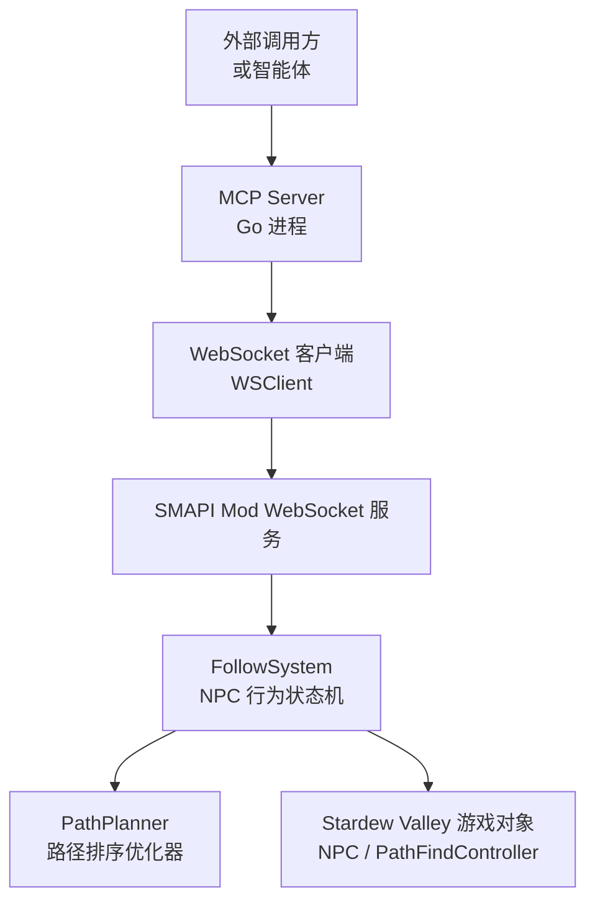
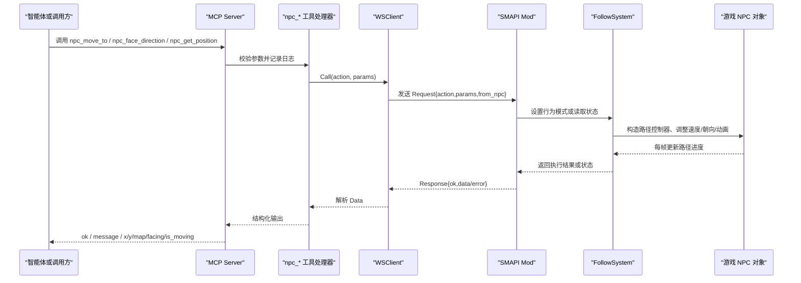
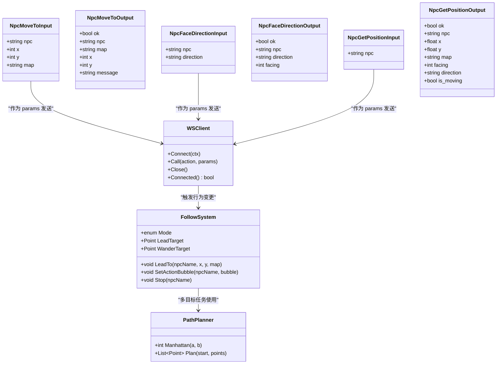
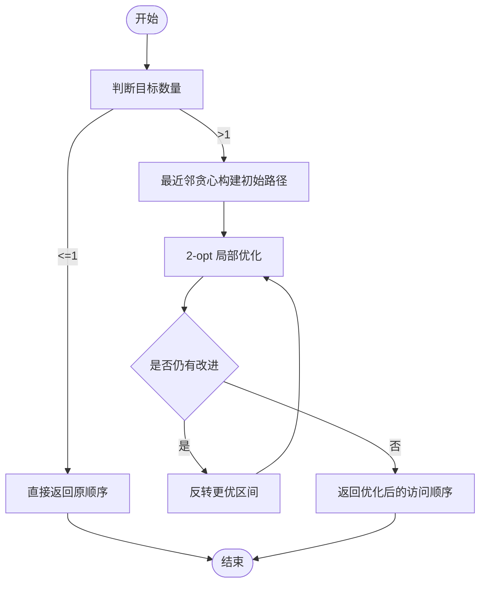
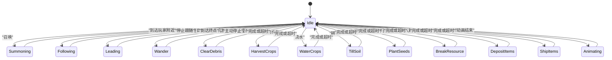

# NPC 移动工具

<cite>
**本文引用的文件**   
- [npc_movement.go](file://SmartNPC/smartnpc-mcp/adapters/stardew/tools/npc_movement.go)
- [registry.go](file://SmartNPC/smartnpc-mcp/adapters/stardew/tools/registry.go)
- [adapter.go](file://SmartNPC/smartnpc-mcp/adapters/stardew/adapter.go)
- [ws_client.go](file://SmartNPC/smartnpc-mcp/adapters/stardew/bridge/ws_client.go)
- [protocol.go](file://SmartNPC/smartnpc-mcp/adapters/stardew/bridge/protocol.go)
- [mcp-tools.md](file://SmartNPC/docs/mcp-tools.md)
- [PathPlanner.cs](file://SmartNPC/smapi-mod/Movement/PathPlanner.cs)
- [FollowSystem.cs](file://SmartNPC/smapi-mod/Movement/FollowSystem.cs)
- [npc_movement_test.go](file://SmartNPC/smartnpc-mcp/adapters/stardew/tools/npc_movement_test.go)
</cite>

## 目录
1. [引言](#引言)
2. [项目结构与职责划分](#项目结构与职责划分)
3. [核心组件总览](#核心组件总览)
4. [架构与数据流](#架构与数据流)
5. [路径规划算法](#路径规划算法)
6. [移动控制工具详解](#移动控制工具详解)
7. [方向控制工具详解](#方向控制工具详解)
8. [位置查询工具详解](#位置查询工具详解)
9. [移动状态管理与冲突死锁防护](#移动状态管理与冲突死锁防护)
10. [复杂移动场景处理方案](#复杂移动场景处理方案)
11. [性能分析与优化建议](#性能分析与优化建议)
12. [故障排查指南](#故障排查指南)
13. [结论](#结论)

## 引言
本文件面向需要理解并扩展 SmartNPC 项目中“NPC 移动工具组”的开发者。该工具组通过 MCP 暴露一组 `npc_*` 移动相关能力，包括：
- 路径寻路与目标定位：`npc_move_to`
- 朝向设置与动画同步：`npc_face_direction`
- 坐标、地图、朝向与移动状态查询：`npc_get_position`
- 名称到固定地块的解析：`npc_get_named_locations`

这些工具由 Go 侧的 MCP server 注册，通过 WebSocket 桥接 SMAPI Mod，最终在 Stardew Valley 游戏线程中驱动 NPC 的路径控制器、速度、朝向和动画。文档将同时覆盖协议层、行为状态机、路径优化器以及防冲突机制。

## 项目结构与职责划分
移动工具涉及三层代码：
- **MCP 工具定义层**：描述参数、错误语义、工具说明，并通过 WebSocket 调用 Mod。
- **WebSocket 桥接层**：负责连接管理、请求关联、超时、断线重连、事件分发。
- **SMAPI Mod 行为层**：维护 NPC 行为状态机、路径规划、动画控制和实际游戏对象操作。

**图表来源**
- [adapter.go:70-140](file://SmartNPC/smartnpc-mcp/adapters/stardew/adapter.go#L70-L140)
- [ws_client.go:1-120](file://SmartNPC/smartnpc-mcp/adapters/stardew/bridge/ws_client.go#L1-L120)
- [protocol.go:1-172](file://SmartNPC/smartnpc-mcp/adapters/stardew/bridge/protocol.go#L1-L172)
- [FollowSystem.cs:1-60](file://SmartNPC/smapi-mod/Movement/FollowSystem.cs#L1-L60)
- [PathPlanner.cs:1-30](file://SmartNPC/smapi-mod/Movement/PathPlanner.cs#L1-L30)

**章节来源**
- [adapter.go:1-163](file://SmartNPC/smartnpc-mcp/adapters/stardew/adapter.go#L1-L163)
- [registry.go:1-82](file://SmartNPC/smartnpc-mcp/adapters/stardew/tools/registry.go#L1-L82)
- [mcp-tools.md:1-60](file://SmartNPC/docs/mcp-tools.md#L1-L60)

## 核心组件总览
| 组件 | 语言 | 主要职责 | 关键输出/接口 |
|---|---|---|---|
| `NpcMoveToInput` / `NpcMoveToOutput` | Go | 定义 `npc_move_to` 的参数与返回结构 | 接受路径请求、返回是否进入寻路 |
| `NpcFaceDirectionInput` / `NpcFaceDirectionOutput` | Go | 定义朝向设置参数与结果 | 返回应用的方向和游戏内朝向整型 |
| `NpcGetPositionInput` / `NpcGetPositionOutput` | Go | 定义位置查询参数与结果 | 返回坐标、地图、朝向、是否正在移动 |
| `registerNpcMovement` | Go | 注册三个移动工具 | 向 MCP Server 暴露工具名和描述 |
| `WSClient.Call` | Go | 发送动作请求、等待响应、记录耗时 | JSON-RPC 风格 Response |
| `Request` / `Response` / `Event` | Go/C# | 定义跨进程协议帧 | `action`、`params`、`from_npc`、`ok` |
| `FollowSystem` | C# | NPC 行为状态机、速度、路径段、动画 | `Mode`、`LeadTarget`、`WanderTarget`、`SetActionBubble` |
| `PathPlanner` | C# | 对多个工作目标进行近似最优访问顺序排序 | `Plan`、`Manhattan` |

**章节来源**
- [npc_movement.go:1-215](file://SmartNPC/smartnpc-mcp/adapters/stardew/tools/npc_movement.go#L1-L215)
- [protocol.go:1-172](file://SmartNPC/smartnpc-mcp/adapters/stardew/bridge/protocol.go#L1-L172)
- [FollowSystem.cs:1-200](file://SmartNPC/smapi-mod/Movement/FollowSystem.cs#L1-L200)
- [PathPlanner.cs:1-120](file://SmartNPC/smapi-mod/Movement/PathPlanner.cs#L1-L120)

## 架构与数据流
### 工具调用序列图

**图表来源**
- [npc_movement.go:80-190](file://SmartNPC/smartnpc-mcp/adapters/stardew/tools/npc_movement.go#L80-L190)
- [ws_client.go:230-380](file://SmartNPC/smartnpc-mcp/adapters/stardew/bridge/ws_client.go#L230-L380)
- [protocol.go:120-172](file://SmartNPC/smartnpc-mcp/adapters/stardew/bridge/protocol.go#L120-L172)
- [FollowSystem.cs:277-405](file://SmartNPC/smapi-mod/Movement/FollowSystem.cs#L277-L405)

### 组件关系类图

**图表来源**
- [npc_movement.go:10-120](file://SmartNPC/smartnpc-mcp/adapters/stardew/tools/npc_movement.go#L10-L120)
- [ws_client.go:1-120](file://SmartNPC/smartnpc-mcp/adapters/stardew/bridge/ws_client.go#L1-L120)
- [FollowSystem.cs:1-200](file://SmartNPC/smapi-mod/Movement/FollowSystem.cs#L1-L200)
- [PathPlanner.cs:1-120](file://SmartNPC/smapi-mod/Movement/PathPlanner.cs#L1-L120)

## 路径规划算法
### 设计目标
路径规划分为两个层次：
1. **短距离精确寻路**：由游戏引擎的 `PathFindController` 负责，考虑墙壁、门、地形和可通行性。
2. **多目标访问顺序优化**：由 `PathPlanner` 提供，用于清理杂物、采集、耕地、种植等批量任务。

### 多目标路径优化
`PathPlanner` 实现的是“开放路径变体 TSP”，即从起点出发访问所有目标一次，不要求返回起点。其流程如下：

**图表来源**
- [PathPlanner.cs:30-120](file://SmartNPC/smapi-mod/Movement/PathPlanner.cs#L30-L120)

### 复杂度分析
| 阶段 | 输入规模 | 时间复杂度 | 空间复杂度 | 说明 |
|---|---|---|---|---|
| 最近邻贪心 | n 个目标 | O(n²) | O(n) | 每次从剩余点中选曼哈顿距离最近的下一个目标 |
| 2-opt 优化 | n 个目标，最多 8 轮 | O(8·n²) ≈ O(n²) | O(n) | 仅检查边界边变化，避免全量求和 |
| 曼哈顿距离 | 两点 | O(1) | O(1) | 轴对齐网格距离 |

由于每个长耗时工具的候选目标通常来自矩形区域或半径扫描，且注释指出“最多约 100 个格子”，因此单次规划开销很小，不会阻塞游戏线程。

### 障碍物避让与真实成本差异
- 曼哈顿距离只反映网格上的直线偏移，不考虑墙、门、水、建筑等障碍。
- 真实路径长度由 `PathFindController` 计算，可能大于曼哈顿距离。
- 但 `PathPlanner` 关注的是**相对顺序稳定性**：即使绝对代价不同，相邻目标的优先关系仍能减少折返和回头。

**章节来源**
- [PathPlanner.cs:1-120](file://SmartNPC/smapi-mod/Movement/PathPlanner.cs#L1-L120)

## 移动控制工具详解

### npc_move_to：目标定位与异步移动
#### 参数与语义
| 字段 | 类型 | 必填 | 含义 |
|---|---|---:|---|
| `npc` | string | 是 | NPC 内部名称，例如 `XiaMi` |
| `x` | int | 是 | 目标格 X 坐标 |
| `y` | int | 是 | 目标格 Y 坐标 |
| `map` | string | 否 | 目标地图；默认使用 NPC 当前地图 |

#### 返回语义
| 字段 | 类型 | 含义 |
|---|---|---|
| `ok` | bool | 是否接受了路径请求 |
| `npc` | string | 回显 NPC 名称 |
| `map` | string | 实际使用的目的地地图 |
| `x` | int | 目的地 X |
| `y` | int | 目的地 Y |
| `message` | string | 可选状态提示，例如 `pathing` 或 `no_route` |

#### 关键行为
- 工具只是**提交路径请求**，不阻塞等待到达。
- 同一地图内使用游戏寻路；跨地图时走传送逻辑，但跨地图寻路被明确标记为后续里程碑。
- 成功返回后，NPC 在游戏 tick 中异步行走。
- 空 `npc` 会在 Go 侧拒绝，不会发送到 Mod。

#### 典型调用时机
- 在对话或工作流中安排 NPC 到达某个场景前。
- 根据玩家指令移动到具体坐标。
- 人类可读地名先通过 `npc_get_named_locations` 解析为地图和坐标。

**章节来源**
- [npc_movement.go:10-60](file://SmartNPC/smartnpc-mcp/adapters/stardew/tools/npc_movement.go#L10-L60)
- [npc_movement.go:60-110](file://SmartNPC/smartnpc-mcp/adapters/stardew/tools/npc_movement.go#L60-L110)
- [npc_movement_test.go:60-140](file://SmartNPC/smartnpc-mcp/adapters/stardew/tools/npc_movement_test.go#L60-L140)

### 目标定位策略
推荐策略：
1. 如果目标是固定地标，优先调用 `npc_get_named_locations`。
2. 如果目标是玩家指令中的模糊词，例如“过来”“来这边”，先用名称解析。
3. 如果目标是精确坐标，再直接调用 `npc_move_to`。
4. 如果目标是动态对象，先用感知工具获取对象位置，再传入坐标。

**章节来源**
- [npc_movement.go:120-215](file://SmartNPC/smartnpc-mcp/adapters/stardew/tools/npc_movement.go#L120-L215)
- [mcp-tools.md:120-170](file://SmartNPC/docs/mcp-tools.md#L120-L170)

## 方向控制工具详解

### npc_face_direction：朝向设置
#### 参数与语义
| 字段 | 类型 | 必填 | 含义 |
|---|---|---:|---|
| `npc` | string | 是 | NPC 内部名称 |
| `direction` | string | 是 | 四个基本方向之一：`up`、`down`、`left`、`right` |

#### 返回语义
| 字段 | 类型 | 含义 |
|---|---|---|
| `ok` | bool | 是否成功 |
| `npc` | string | 回显 NPC 名称 |
| `direction` | string | 应用的方向字符串 |
| `facing` | int | Stardew Valley 内部朝向值：0=上，1=右，2=下，3=左 |

#### 关键行为
- 方向会被标准化为小写。
- 非法方向会返回参数错误。
- 该工具**不会取消正在进行的寻路**，它更像视觉或反应层操作。
- 适合用在“看向玩家”“看向对话目标”“生气时转身”等低影响表达场景。

#### 动画与同步
- 方向设置属于低影响写入，可以在 idle 或移动期间安全调用。
- 若需要与表情、气泡、动作配合，应结合 `NpcAnimationController` 的行为，而不是依赖 `npc_face_direction` 本身完成完整演出。

**章节来源**
- [npc_movement.go:60-110](file://SmartNPC/smartnpc-mcp/adapters/stardew/tools/npc_movement.go#L60-L110)
- [FollowSystem.cs:1-60](file://SmartNPC/smapi-mod/Movement/FollowSystem.cs#L1-L60)

## 位置查询工具详解

### npc_get_position：坐标、区域与边界
#### 参数与语义
| 字段 | 类型 | 必填 | 含义 |
|---|---|---:|---|
| `npc` | string | 是 | NPC 内部名称 |

#### 返回语义
| 字段 | 类型 | 含义 |
|---|---|---|
| `ok` | bool | 是否成功 |
| `npc` | string | 回显 NPC 名称 |
| `x` | float | 格坐标，移动中可能为小数 |
| `y` | float | 格坐标，移动中可能为小数 |
| `map` | string | 当前地图名称 |
| `facing` | int | 游戏内部朝向值 |
| `direction` | string | 文字朝向：`up`/`down`/`left`/`right` |
| `is_moving` | bool | 是否正在跟随路径 |

#### 坐标与区域判断
- 当 NPC 正在移动时，`x` 和 `y` 可以是浮点数，表示像素位置换算到格坐标后的中间值。
- 要判断 NPC 是否已到达目标，不能只看整数格差，还应结合 `is_moving` 和距离阈值。
- 区域判断建议：
  - 用 `map` 判断是否在同一地图。
  - 用 `Math.Abs(x - targetX) + Math.Abs(y - targetY)` 做曼哈顿距离阈值检测。
  - 若需要严格到达，应等待 `is_moving == false` 且距离小于容差。

#### 边界检查建议
- 目标坐标应先在 Mod 或工具侧校验地图边界。
- 对玩家输入的坐标，应避免直接传超大值，防止无意义寻路。
- 对于不可达目标，应依赖 Mod 返回的错误码或 `message` 提示。

**章节来源**
- [npc_movement.go:110-170](file://SmartNPC/smartnpc-mcp/adapters/stardew/tools/npc_movement.go#L110-L170)
- [mcp-tools.md:140-170](file://SmartNPC/docs/mcp-tools.md#L140-L170)

## 移动状态管理与冲突死锁防护

### 行为状态机
`FollowSystem` 为每个受控 NPC 维护一个 `NpcBehaviorState`，包含当前行为模式、目标、队列、路径失败计数等。

**图表来源**
- [FollowSystem.cs:1-60](file://SmartNPC/smapi-mod/Movement/FollowSystem.cs#L1-L60)
- [FollowSystem.cs:200-405](file://SmartNPC/smapi-mod/Movement/FollowSystem.cs#L200-L405)

### 防冲突机制
| 风险 | 防护措施 | 对应实现 |
|---|---|---|
| 多个工具同时改变同一 NPC | 每个 NPC 有独立状态，上层工作流或调度器应串行化长耗时动作 | `FollowSystem` 中 per-NPC state |
| 寻路一直失败导致死循环 | 连续失败计数超过阈值后跳过目标 | `PathFailCount`、`MaxPathFailures` |
| 长任务卡住数分钟 | 强制空闲并清空队列 | `ForceIdle`、`ClearDebrisMaxTicks`、`MaxActionTicks` |
| 动画与移动冲突 | 切换模式时取消动画 | `Animations.Cancel` |
| 速度不一致 | 工作模式提高速度，空闲恢复默认速度 | `WorkSpeed`、`DefaultSpeed` |
| 跨地图状态错乱 | 传送后重新定位到到达格并继续 | `Summoning` 相关逻辑 |

### 关键常量与状态字段
| 成员 | 含义 | 作用 |
|---|---|---|
| `ReplanIntervalTicks = 30` | 重规划间隔 | 每隔约半秒评估是否需要重新寻路 |
| `WorkSpeed = 5` | 工作状态速度 | 比默认走路更快 |
| `DefaultSpeed = 2` | 空闲速度 | 回到 idle 后恢复 |
| `MaxPathFailures = 5` | 最大连续寻路失败次数 | 达到后放弃不可达目标 |
| `FollowRadiusTiles = 3f` | 跟随半径 | 超出半径才重新跟到玩家后方 |
| `LeadSegmentTiles = 5` | 分段路径长度 | 每次只规划不超过 5 格的片段 |
| `ClearDebrisMaxTicks = 900` | 清理杂物超时 | 约 15 秒强制停止 |

**章节来源**
- [FollowSystem.cs:200-405](file://SmartNPC/smapi-mod/Movement/FollowSystem.cs#L200-L405)

## 复杂移动场景处理方案

### 场景一：NPC 走到玩家面前并对话
推荐流程：
1. 使用 `npc_get_position` 确认 NPC 当前位置。
2. 使用 `npc_move_to` 把 NPC 移动到玩家附近的可通行格。
3. 使用 `npc_face_direction` 让 NPC 朝向玩家。
4. 如需表情或气泡，再调用相应表达工具。
5. 对话结束后，恢复 idle 或进入下一个工作流。

注意：`npc_move_to` 不保证到达后才返回，因此后续动作应基于状态或事件，而不是假设立即完成。

### 场景二：多人物协调移动
- 不要让多个工作流同时驱动同一个 NPC。
- 使用工作流引擎或调度器的串行队列，确保一个 NPC 在同一时刻只有一个主导行为。
- 对可抢占行为（如随机游走），允许高优先级任务中断并回到 idle。

### 场景三：大批量田间作业
- 先收集所有目标格子。
- 使用 `PathPlanner` 生成接近最优访问顺序。
- 按顺序逐个触发对应工具。
- 利用 `is_moving` 和计数器判断单步完成，再推进队列。
- 对清理杂物等长任务设置超时，避免长期占用。

### 场景四：跨地图移动
- 同地图：直接使用 `npc_move_to`。
- 跨地图：工具说明明确指出跨地图寻路延后至后续里程碑；当前应先传送，再在同地图内寻路到目标格。
- 避免在传送前后频繁重复发起寻路。

**章节来源**
- [mcp-tools.md:120-170](file://SmartNPC/docs/mcp-tools.md#L120-L170)
- [FollowSystem.cs:1-60](file://SmartNPC/smapi-mod/Movement/FollowSystem.cs#L1-L60)
- [PathPlanner.cs:1-120](file://SmartNPC/smapi-mod/Movement/PathPlanner.cs#L1-L120)

## 性能分析与优化建议

### 网络层性能
- `WSClient` 使用带 ID 的请求-响应关联，支持并发调用。
- 默认调用超时非常大，适合长时间游戏交互，但也意味着异常断开时需要依赖连接状态和日志。
- 心跳 ping 每 30 秒发送一次，避免 .NET HttpListener 空闲断开。
- 断线后自动重试，重试间隔可配置。

| 指标 | 默认值或行为 | 建议 |
|---|---|---|
| 调用超时 | 约 60 分钟 | 对普通移动工具可缩短，但对长任务保持宽松 |
| 拨号超时 | 5 秒 | 本地调试时可接受 |
| 重连退避 | 2 秒 | 生产环境可根据部署情况调大 |
| 单帧读限制 | 1 MiB | 避免过大消息拖慢 read loop |

### 游戏线程性能
- WS 接收 handler 只设置目标模式，真正路径构造和对象操作在 `PumpOnGameTick` 中执行。
- 这避免 WS 接收循环直接访问游戏对象。
- 批量任务使用队列，逐格推进，不一次性创建大量对象。

### 优化建议
1. **合并移动请求**：短时间内多次移动到相近坐标时，应去重或延迟合并。
2. **避免频繁查询位置**：周期性 `npc_get_position` 可用于 UI 展示，但不应每 tick 都调用。
3. **使用名称坐标表**：对常见地点缓存 `npc_get_named_locations` 结果，减少 LLM 反复解析。
4. **限制随机游走范围**：`StartWander` 支持半径、中心约束和矩形边界，避免 NPC 跑太远。
5. **区分可视效果与实际移动**：表情、气泡、表情动作应与移动解耦，避免动画竞争。
6. **监控 WS 耗时**：`WSClient` 会记录 action 耗时，可作为 Hermes 往返和 Mod 执行时间的诊断依据。

**章节来源**
- [ws_client.go:1-120](file://SmartNPC/smartnpc-mcp/adapters/stardew/bridge/ws_client.go#L1-L120)
- [ws_client.go:230-510](file://SmartNPC/smartnpc-mcp/adapters/stardew/bridge/ws_client.go#L230-L510)
- [FollowSystem.cs:1-60](file://SmartNPC/smapi-mod/Movement/FollowSystem.cs#L1-L60)

## 故障排查指南

### 常见问题
| 现象 | 可能原因 | 排查方式 |
|---|---|---|
| `npc_move_to` 返回错误 | NPC 名称为空、地图不存在、无路径 | 检查 Go 侧参数校验和 Mod 返回 error |
| NPC 不动 | WS 未连接、Mod 未加载、保存未加载 | 查看 WS 连接日志和 Mod 日志 |
| NPC 一直原地重试 | 目标不可达 | 检查 `PathFailCount` 和 `message` |
| NPC 卡在某个任务 | 长任务超时或工作流未取消 | 检查 `ForceIdle`、`ClearDebrisMaxTicks` |
| 方向没有变化 | 方向参数非法，或被寻路覆盖 | 检查 `validDirections` 和调用时机 |
| 位置查询返回小数 | NPC 正在移动中 | 结合 `is_moving` 判断 |
| 移动后立即又移动 | 多个工作流并行驱动 | 检查上游调度器或工作流串行化 |

### 单元测试覆盖
移动工具测试覆盖了：
- 工具列表可发现。
- `npc_move_to` 端到端转发参数和结果。
- 空 NPC 参数被拒绝。
- Mod 返回错误时工具返回错误。
- `npc_face_direction` 参数和方向映射。

**章节来源**
- [npc_movement_test.go:1-200](file://SmartNPC/smartnpc-mcp/adapters/stardew/tools/npc_movement_test.go#L1-L200)
- [ws_client.go:380-510](file://SmartNPC/smartnpc-mcp/adapters/stardew/bridge/ws_client.go#L380-L510)
- [FollowSystem.cs:200-405](file://SmartNPC/smapi-mod/Movement/FollowSystem.cs#L200-L405)

## 结论
SmartNPC 的 NPC 移动工具组采用清晰的分层设计：Go 侧 MCP 工具负责参数校验与协议封装，WS 桥接负责可靠通信，C# Mod 负责游戏线程中的行为状态机、路径规划和动画控制。

- 路径规划以游戏引擎的真实寻路为基础，`PathPlanner` 提供多目标访问顺序优化。
- `npc_move_to` 是异步移动入口，不适合当作同步等待。
- `npc_face_direction` 是低影响朝向设置，适合表达层。
- `npc_get_position` 提供坐标、地图、朝向和移动状态，是到达检测和距离计算的基础。
- 防冲突主要依赖 per-NPC 行为状态、路径失败保护、超时强制空闲和动画取消。
- 复杂场景需要在上层工作流中串行化任务、合并移动请求、合理使用名称坐标表和状态查询。

在实际扩展时，建议优先完善跨地图寻路、增加到达回调事件、提供更细粒度的移动状态，并在高频场景中加入移动请求合并和位置查询节流。