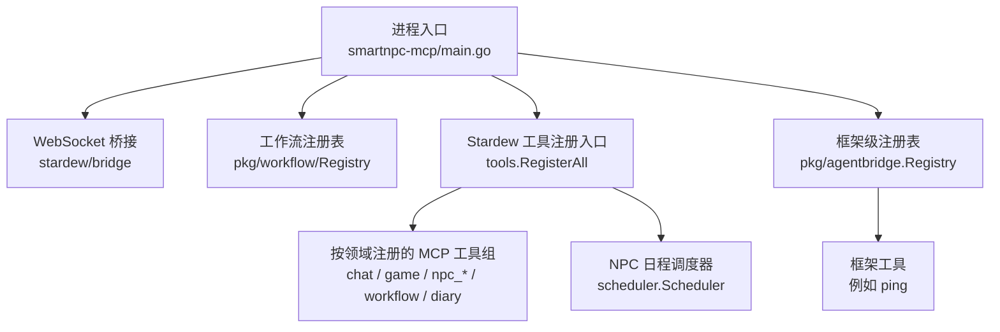
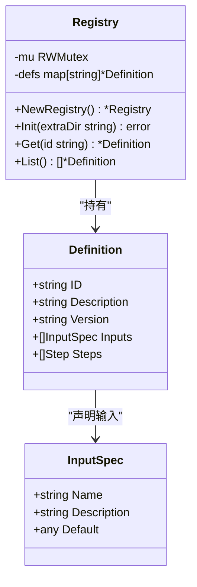
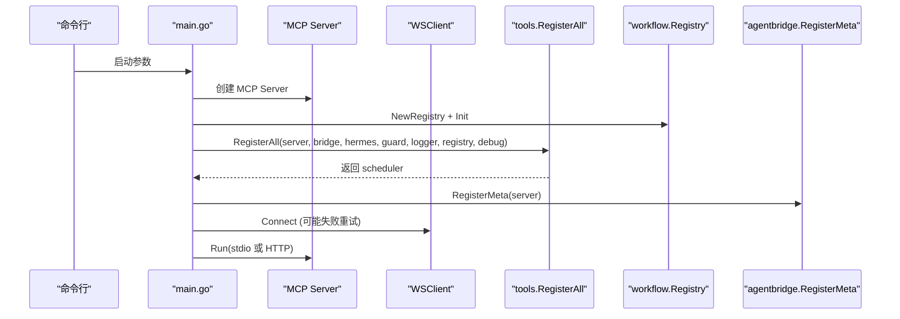
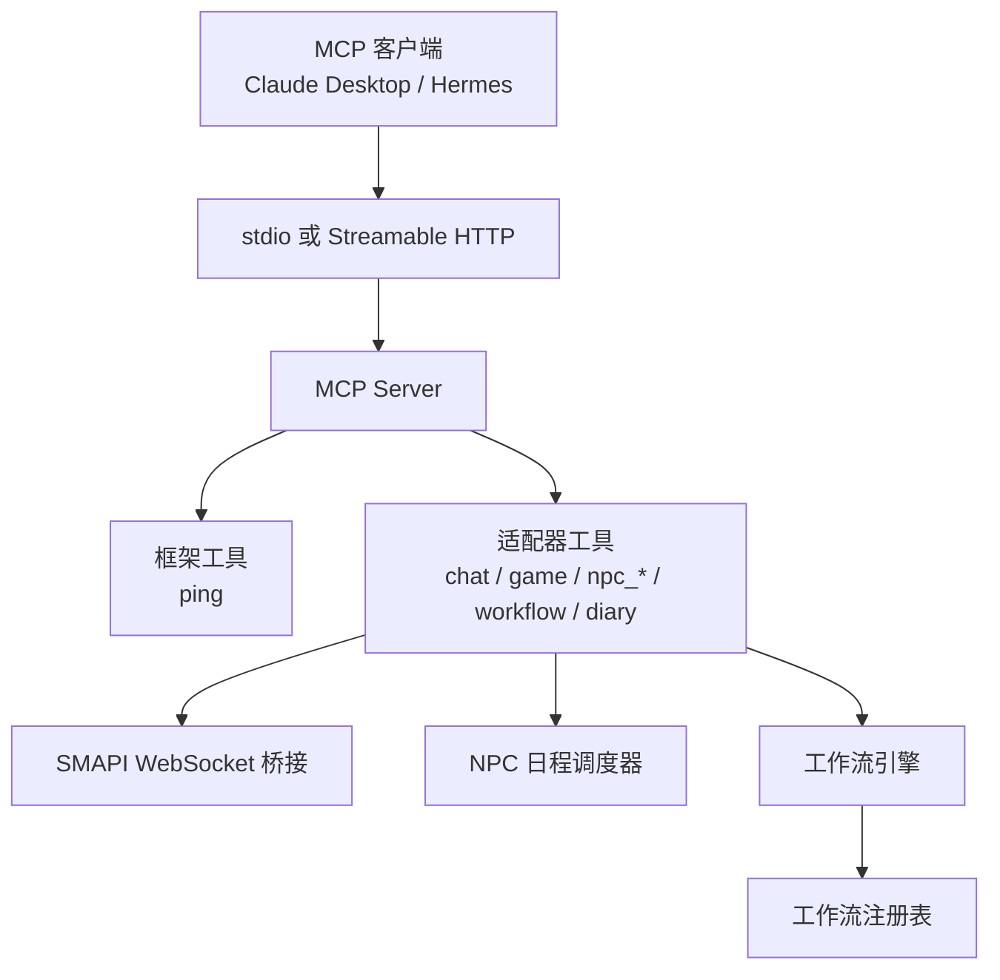
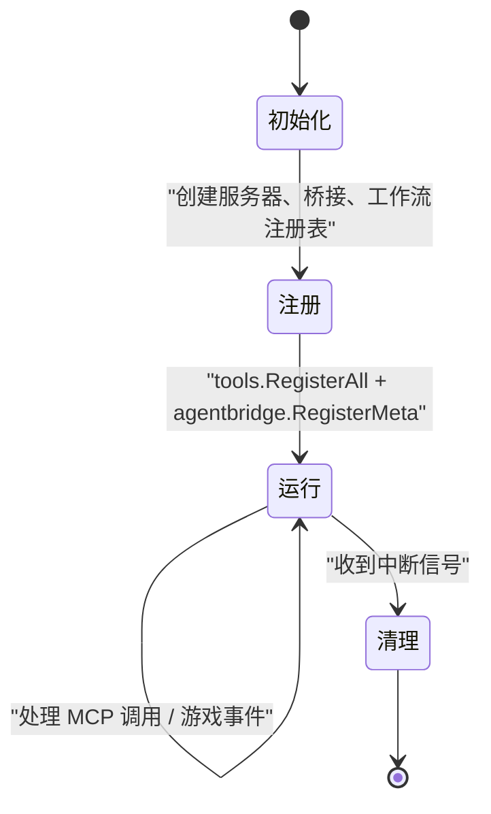
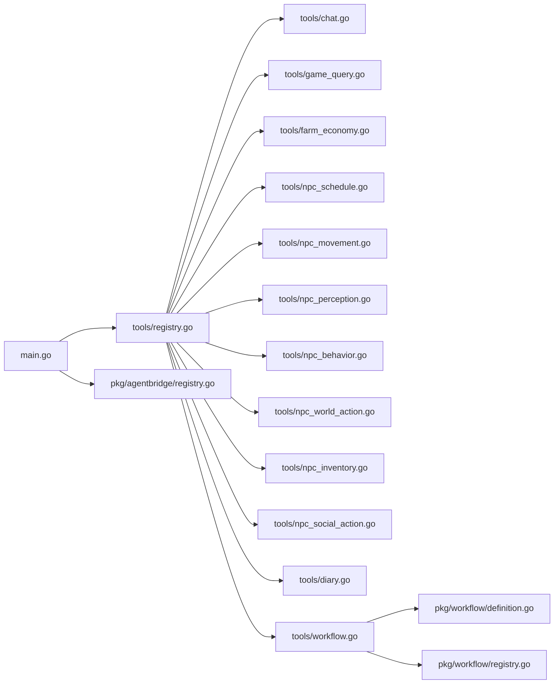
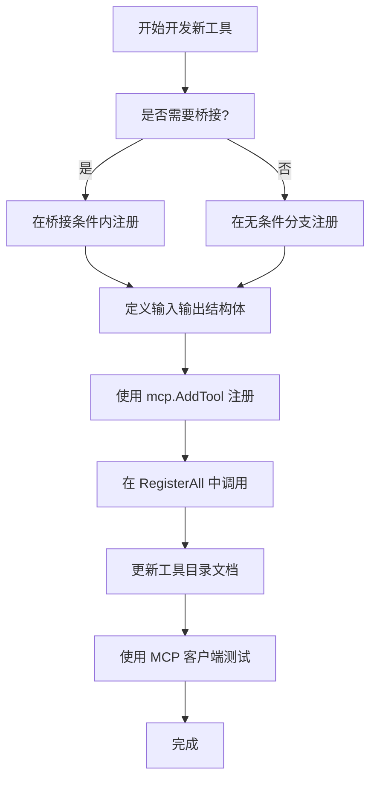

# 工具注册机制

<cite>
**本文引用的文件**   
- [registry.go](file://SmartNPC/smartnpc-mcp/adapters/stardew/tools/registry.go)
- [workflow.go](file://SmartNPC/smartnpc-mcp/adapters/stardew/tools/workflow.go)
- [agent.go](file://SmartNPC/smartnpc-mcp/adapters/stardew/tools/agent.go)
- [chat.go](file://SmartNPC/smartnpc-mcp/adapters/stardew/tools/chat.go)
- [game_query.go](file://SmartNPC/smartnpc-mcp/adapters/stardew/tools/game_query.go)
- [farm_economy.go](file://SmartNPC/smartnpc-mcp/adapters/stardew/tools/farm_economy.go)
- [npc_schedule.go](file://SmartNPC/smartnpc-mcp/adapters/stardew/tools/npc_schedule.go)
- [npc_movement.go](file://SmartNPC/smartnpc-mcp/adapters/stardew/tools/npc_movement.go)
- [npc_perception.go](file://SmartNPC/smartnpc-mcp/adapters/stardew/tools/npc_perception.go)
- [npc_behavior.go](file://SmartNPC/smartnpc-mcp/adapters/stardew/tools/npc_behavior.go)
- [npc_world_action.go](file://SmartNPC/smartnpc-mcp/adapters/stardew/tools/npc_world_action.go)
- [npc_inventory.go](file://SmartNPC/smartnpc-mcp/adapters/stardew/tools/npc_inventory.go)
- [npc_social_action.go](file://SmartNPC/smartnpc-mcp/adapters/stardew/tools/npc_social_action.go)
- [diary.go](file://SmartNPC/smartnpc-mcp/adapters/stardew/tools/diary.go)
- [registry.go](file://SmartNPC/smartnpc-mcp/pkg/agentbridge/registry.go)
- [definition.go](file://SmartNPC/smartnpc-mcp/pkg/workflow/definition.go)
- [registry.go](file://SmartNPC/smartnpc-mcp/pkg/workflow/registry.go)
- [main.go](file://SmartNPC/smartnpc-mcp/cmd/smartnpc-mcp/main.go)
- [mcp-tools.md](file://SmartNPC/docs/mcp-tools.md)
</cite>

## 目录
1. [引言](#引言)
2. [项目结构](#项目结构)
3. [核心组件](#核心组件)
4. [架构总览](#架构总览)
5. [详细组件分析](#详细组件分析)
6. [依赖关系分析](#依赖关系分析)
7. [性能与可扩展性](#性能与可扩展性)
8. [故障排查指南](#故障排查指南)
9. [结论](#结论)
10. [附录：自定义工具开发指南](#附录自定义工具开发指南)

## 引言
本文面向 SmartNPC 项目中“MCP 工具注册机制”的技术文档。该项目通过 Go 实现的 `smartnpc-mcp` 服务，把《星露谷物语》SMAPI 模组能力暴露为 MCP 工具，供 Claude Desktop、Hermes 等 MCP 客户端调用。

围绕“工具注册机制”，本文重点解释：
- 工具注册表的设计模式：集中式入口 + 按功能域分组 + 动态条件注册。
- 工具接口约定：统一的 MCP 工具描述、参数类型和错误返回方式。
- 工具元数据管理：名称、描述、输入规范、运行时权限控制（是否需要桥接）。
- 工具分组和组织方式：会话/状态、日程与工作流、日记、感知、移动、农场、库存、行为、社交、世界交互等。
- 工作流定义注册、版本化、覆盖加载以及调试执行。
- 如何扩展新工具类别，并给出最小可复现的开发模板路径。

## 项目结构
工具注册主要分布在以下三个层次：

| 层次 | 职责 | 关键文件 |
| --- | --- | --- |
| 进程启动层 | 创建 MCP Server、构建 WebSocket 桥接、初始化工作流注册表、装配事件路由 | `cmd/smartnpc-mcp/main.go` |
| 适配器工具层 | 按 Stardew Valley 领域分组注册具体 MCP 工具 | `adapters/stardew/tools/registry.go` 及各 `registerXxx` 文件 |
| 框架与引擎层 | 提供全局适配器/中继工厂注册表、工作流 DSL 模型、YAML 注册与校验 | `pkg/agentbridge/registry.go`、`pkg/workflow/registry.go`、`pkg/workflow/definition.go` |

**图示来源**
- [main.go:1-120](file://SmartNPC/smartnpc-mcp/cmd/smartnpc-mcp/main.go#L1-L120)
- [registry.go:19-82](file://SmartNPC/smartnpc-mcp/adapters/stardew/tools/registry.go#L19-L82)
- [registry.go:1-119](file://SmartNPC/smartnpc-mcp/pkg/agentbridge/registry.go#L1-L119)
- [registry.go:1-60](file://SmartNPC/smartnpc-mcp/pkg/workflow/registry.go#L1-L60)

**章节来源**
- [main.go:1-120](file://SmartNPC/smartnpc-mcp/cmd/smartnpc-mcp/main.go#L1-L120)
- [registry.go:19-82](file://SmartNPC/smartnpc-mcp/adapters/stardew/tools/registry.go#L19-L82)
- [mcp-tools.md:1-40](file://SmartNPC/docs/mcp-tools.md#L1-L40)

## 核心组件
### 1. 工具注册入口：`tools.RegisterAll`
`tools.RegisterAll` 是 Stardew Valley 适配器的唯一注册入口。它负责：
- 创建共享的 NPC 日程调度器。
- 注册与工作流相关的工具。
- 注册实验日记、日终审查等文件型工具。
- 注册 NPC 日程工具。
- 在存在 WebSocket 桥接时，注册所有依赖 SMAPI 模组的工具。
- 返回调度器实例，供上层事件路由使用。

它的签名已经体现“动态注册”的核心约束：是否注册 mod-backed 工具取决于传入的 WSClient 是否为 nil；是否启用 debug 工具取决于日志级别；是否启用 Hermes 转发取决于配置。

**章节来源**
- [registry.go:19-82](file://SmartNPC/smartnpc-mcp/adapters/stardew/tools/registry.go#L19-L82)

### 2. 框架级工具注册表：`pkg/agentbridge/registry`
这个注册表不是 MCP 工具的注册表，而是“适配器工厂”和“中继工厂”的全局注册表。它提供：
- `RegisterAdapter` / `RegisterRelay`：以字符串 kind 注册工厂。
- `LookupAdapter` / `LookupRelay`：根据 kind 查找工厂。
- `RegisteredAdapterKinds` / `RegisteredRelayKinds`：列出已注册 kind，用于 CLI 错误提示。
- 线程安全保护：读写锁保护全局 map。
- 重复注册 panic：重复注册同一 kind 被视为编程错误。

这是“发现机制”的基础：CLI 启动时根据配置中的 adapter/relay kind 动态查找并构建对应实现，而不是硬编码分支。

**章节来源**
- [registry.go:1-119](file://SmartNPC/smartnpc-mcp/pkg/agentbridge/registry.go#L1-L119)

### 3. 工作流注册表：`pkg/workflow.Registry`
工作流注册表负责加载和管理工作流定义。其关键特性：
- 从内嵌的 `builtin/*.yaml` 加载默认工作流。
- 支持外部目录覆盖：通过环境变量 `SMARTNPC_WORKFLOW_DIR` 注入 YAML 文件。
- ID 冲突检测：内置 ID 与覆盖 ID 冲突会替换而非合并。
- 同一目录内重复 ID 直接报错。
- 提供 `Get`、`List` 查询接口。
- 加载前运行 `Validate`，尽早暴露 YAML 结构问题。

**图示来源**
- [registry.go:1-60](file://SmartNPC/smartnpc-mcp/pkg/workflow/registry.go#L1-L60)
- [definition.go:23-60](file://SmartNPC/smartnpc-mcp/pkg/workflow/definition.go#L23-L60)

**章节来源**
- [registry.go:1-120](file://SmartNPC/smartnpc-mcp/pkg/workflow/registry.go#L1-L120)
- [definition.go:1-120](file://SmartNPC/smartnpc-mcp/pkg/workflow/definition.go#L1-L120)

### 4. 进程启动装配：`cmd/smartnpc-mcp/main.go`
`main` 是组合根：
- 解析命令行参数，包括 WebSocket URL、HTTP 地址、Hermes 配置、MCP API Key。
- 初始化日志系统。
- 构建 Hermes 事件处理器（单目标或配置文件多目标）。
- 创建 WSClient（可选）。
- 初始化工作流注册表，并允许外部 YAML 覆盖。
- 调用 `tools.RegisterAll` 注册 Stardew 工具。
- 调用 `agentbridge.RegisterMeta` 注册框架级工具。
- 设置事件路由、连接 WebSocket、选择 stdio 或 HTTP 传输。

**图示来源**
- [main.go:1-120](file://SmartNPC/smartnpc-mcp/cmd/smartnpc-mcp/main.go#L1-L120)
- [main.go:201-320](file://SmartNPC/smartnpc-mcp/cmd/smartnpc-mcp/main.go#L201-L320)
- [registry.go:19-82](file://SmartNPC/smartnpc-mcp/adapters/stardew/tools/registry.go#L19-L82)
- [registry.go:1-119](file://SmartNPC/smartnpc-mcp/pkg/agentbridge/registry.go#L1-L119)

**章节来源**
- [main.go:1-120](file://SmartNPC/smartnpc-mcp/cmd/smartnpc-mcp/main.go#L1-L120)
- [main.go:201-450](file://SmartNPC/smartnpc-mcp/cmd/smartnpc-mcp/main.go#L201-L450)

## 架构总览
工具注册机制采用“分层 + 条件注册 + 统一描述”的模式：

| 层级 | 说明 |
| --- | --- |
| 启动层 | 决定哪些子系统可用：WS 桥接、Hermes 中继、工作流泵、日志级别、HTTP 或 stdio。 |
| 框架层 | 提供与 Stardew 无关的工具，如 `ping`。 |
| 适配器层 | 按游戏领域分组注册工具；依赖桥接的工具仅在桥接可用时注册。 |
| 工作流层 | 定义可编排的多步骤流程，支持内置、覆盖、调试执行。 |
| 调度层 | 将工作流或动作按游戏时间触发到具体 NPC。 |

**图示来源**
- [main.go:1-120](file://SmartNPC/smartnpc-mcp/cmd/smartnpc-mcp/main.go#L1-L120)
- [registry.go:19-82](file://SmartNPC/smartnpc-mcp/adapters/stardew/tools/registry.go#L19-L82)
- [mcp-tools.md:1-40](file://SmartNPC/docs/mcp-tools.md#L1-L40)

## 详细组件分析

### 1. 工具分组与注册顺序
`tools.RegisterAll` 明确区分两类工具：

| 分组 | 是否依赖桥接 | 典型工具 |
| --- | --- | --- |
| 始终可用 | 否 | `ping`、`workflow_*`、`npc_plan_day`、`npc_get_schedule`、`diary_write`、`day_review_complete` |
| 需要桥接 | 是 | `agent_register_self`、`chat_say`、`game_*`、`farm_get_economy`、所有 `npc_*` |

注册顺序也有语义：
1. 工作流工具优先，因为日程规划需要发现工作流。
2. 日记和日终审查独立于桥接。
3. NPC 日程工具先注册，以便后续工具引用调度器。
4. 桥接存在时再注册 agent、聊天、游戏状态、农场经济、感知、移动、行为、世界交互、库存、社交工具。

**章节来源**
- [registry.go:19-82](file://SmartNPC/smartnpc-mcp/adapters/stardew/tools/registry.go#L19-L82)
- [mcp-tools.md:1-40](file://SmartNPC/docs/mcp-tools.md#L1-L40)

### 2. 工具接口定义与错误处理约定
每个工具都通过 `mcp.AddTool` 注册，统一包含：
- `Name`：工具名，通常是小写英文单词，部分带下划线。
- `Description`：面向 LLM 的描述文本，包含用途、何时调用、副作用说明。
- 输入结构体：使用 JSON/YAML 标签描述字段。
- 输出结构体：统一包含 `OK` 标志位，部分工具包含 `Message`。
- 错误处理：严重错误返回 Go error；业务错误通常通过输出结构体的 `OK=false` 或消息字段表达。

常见错误来源包括：
- 参数缺失或格式错误。
- 桥接未就绪。
- 游戏保存尚未加载。
- 工作流 ID 未知。
- 调度器中无有效日程条目。

**章节来源**
- [agent.go:64-80](file://SmartNPC/smartnpc-mcp/adapters/stardew/tools/agent.go#L64-L80)
- [chat.go:159-180](file://SmartNPC/smartnpc-mcp/adapters/stardew/tools/chat.go#L159-L180)
- [game_query.go:47-80](file://SmartNPC/smartnpc-mcp/adapters/stardew/tools/game_query.go#L47-L80)
- [farm_economy.go:38-60](file://SmartNPC/smartnpc-mcp/adapters/stardew/tools/farm_economy.go#L38-L60)
- [npc_schedule.go:125-160](file://SmartNPC/smartnpc-mcp/adapters/stardew/tools/npc_schedule.go#L125-L160)
- [mcp-tools.md:1-120](file://SmartNPC/docs/mcp-tools.md#L1-L120)

### 3. 工具元数据管理
工具元数据由三部分组成：

| 元数据 | 位置 | 作用 |
| --- | --- | --- |
| 工具名称 | `mcp.Tool.Name` | 客户端发现和调用依据 |
| 工具描述 | `mcp.Tool.Description` | 向 LLM 说明工具用途、副作用、调用时机 |
| 输入结构体 | 各工具文件中的输入结构体 | 参数验证、JSON Schema 生成、LLM 理解参数含义 |

工作流定义的元数据更丰富：
- `id`：工作流唯一标识。
- `description`：人类可读说明。
- `version`：可选版本字段。
- `inputs`：声明命名输入及默认值。
- `steps`：有序步骤列表。

**章节来源**
- [definition.go:23-120](file://SmartNPC/smartnpc-mcp/pkg/workflow/definition.go#L23-L120)
- [workflow.go:1-120](file://SmartNPC/smartnpc-mcp/adapters/stardew/tools/workflow.go#L1-L120)
- [mcp-tools.md:1-120](file://SmartNPC/docs/mcp-tools.md#L1-L120)

### 4. 权限控制与条件注册
权限控制主要通过“桥接可用性”和“配置开关”实现：

| 控制点 | 实现方式 |
| --- | --- |
| 是否需要 SMAPI 模组 | 若 WSClient 为 nil，则不注册 mod-backed 工具 |
| 是否暴露调试工具 | 仅当日志级别为 debug 时注册 `workflow_run_inline` |
| 是否启用 Hermes 中继 | 根据 `--hermes-url`、`--hermes-config` 决定是否构造事件处理器 |
| 是否启用本地工作流泵 | 通过环境变量 `SMARTNPC_WORKFLOW_PUMP` 控制 |
| 是否启用实验模式 | 通过 `SMARTNPC_EXP_MODE` 控制额外行为 |
| 群聊发言预算 | 通过 `ChatSayGuard` 限制每次唤醒的 `chat_say` 次数 |

**章节来源**
- [registry.go:19-82](file://SmartNPC/smartnpc-mcp/adapters/stardew/tools/registry.go#L19-L82)
- [main.go:201-320](file://SmartNPC/smartnpc-mcp/cmd/smartnpc-mcp/main.go#L201-L320)
- [mcp-tools.md:1-40](file://SmartNPC/docs/mcp-tools.md#L1-L40)

### 5. 生命周期管理
工具的生命周期可分为四个阶段：

| 阶段 | 行为 |
| --- | --- |
| 初始化 | 启动层创建服务器、桥接、工作流注册表、日志、Hermes 中继。 |
| 注册 | `tools.RegisterAll` 注册 Stardew 工具；`agentbridge.RegisterMeta` 注册框架工具。 |
| 运行 | MCP Server 通过 stdio 或 HTTP 接收调用；事件路由分发游戏事件。 |
| 清理 | 信号处理取消上下文；标准退出或 HTTP 关闭后记录干净终止日志。 |

**图示来源**
- [main.go:1-120](file://SmartNPC/smartnpc-mcp/cmd/smartnpc-mcp/main.go#L1-L120)
- [main.go:450-520](file://SmartNPC/smartnpc-mcp/cmd/smartnpc-mcp/main.go#L450-L520)

**章节来源**
- [main.go:1-120](file://SmartNPC/smartnpc-mcp/cmd/smartnpc-mcp/main.go#L1-L120)
- [main.go:450-520](file://SmartNPC/smartnpc-mcp/cmd/smartnpc-mcp/main.go#L450-L520)

### 6. 工具版本管理与兼容性检查
当前代码库对“工具版本”的管理主要体现在工作流定义上：
- 工作流 `Definition` 包含可选 `Version` 字段。
- 工作流加载过程执行静态校验，防止未知 step kind、空 steps、重复 `save_as` 等问题。
- 工作流注册表支持“覆盖”语义：外部 YAML 中相同 ID 的定义完全替换内置定义。
- 目前未发现对 MCP 工具本身进行严格语义版本检查的代码；工具兼容性更多通过“是否注册该工具”和“桥接可用性”判断。

因此，若未来需要工具级版本管理，建议在工作流之外，为 MCP 工具增加：
- 工具最小版本要求。
- 工具废弃标记。
- 客户端能力协商。

**章节来源**
- [definition.go:23-60](file://SmartNPC/smartnpc-mcp/pkg/workflow/definition.go#L23-L60)
- [registry.go:60-160](file://SmartNPC/smartnpc-mcp/pkg/workflow/registry.go#L60-L160)
- [registry.go:160-376](file://SmartNPC/smartnpc-mcp/pkg/workflow/registry.go#L160-L376)

### 7. 热重载机制
现有实现没有显式的“热重载工具定义”机制：
- 工作流注册表在启动时加载一次，之后通过 `Get`、`List` 读取。
- 外部工作流目录只在 `Init` 时扫描。
- 工具注册发生在进程启动阶段，重启进程才能重新加载。

如果需要热重载，可以考虑：
- 监听工作流目录变更。
- 提供 `/reload-workflows` 管理端点。
- 对已运行的工作流实例做优雅迁移策略。

当前仓库中属于“概念性建议”，未见对应实现。

**章节来源**
- [registry.go:20-60](file://SmartNPC/smartnpc-mcp/pkg/workflow/registry.go#L20-L60)
- [main.go:260-320](file://SmartNPC/smartnpc-mcp/cmd/smartnpc-mcp/main.go#L260-L320)

## 依赖关系分析

**图示来源**
- [main.go:1-120](file://SmartNPC/smartnpc-mcp/cmd/smartnpc-mcp/main.go#L1-L120)
- [registry.go:19-82](file://SmartNPC/smartnpc-mcp/adapters/stardew/tools/registry.go#L19-L82)
- [workflow.go:152-220](file://SmartNPC/smartnpc-mcp/adapters/stardew/tools/workflow.go#L152-L220)
- [definition.go:1-120](file://SmartNPC/smartnpc-mcp/pkg/workflow/definition.go#L1-L120)
- [registry.go:1-60](file://SmartNPC/smartnpc-mcp/pkg/workflow/registry.go#L1-L60)
- [registry.go:1-119](file://SmartNPC/smartnpc-mcp/pkg/agentbridge/registry.go#L1-L119)

**章节来源**
- [registry.go:19-82](file://SmartNPC/smartnpc-mcp/adapters/stardew/tools/registry.go#L19-L82)
- [workflow.go:152-220](file://SmartNPC/smartnpc-mcp/adapters/stardew/tools/workflow.go#L152-L220)
- [definition.go:1-120](file://SmartNPC/smartnpc-mcp/pkg/workflow/definition.go#L1-L120)
- [registry.go:1-60](file://SmartNPC/smartnpc-mcp/pkg/workflow/registry.go#L1-L60)
- [registry.go:1-119](file://SmartNPC/smartnpc-mcp/pkg/agentbridge/registry.go#L1-L119)

## 性能与可扩展性

### 性能特征
- 工具注册发生在进程启动阶段，对运行时影响很小。
- 工作流注册表使用读写锁保护定义 map，读操作并发安全。
- 工作流步骤数量通常较小（文档提到最多约 50 步），因此内存和 CPU 开销可控。
- 桥接不可用时跳过 mod-backed 工具注册，避免无效依赖。

### 可扩展性
- 新增 MCP 工具：在 `tools` 包中添加注册函数，并在 `RegisterAll` 中调用。
- 新增工作流定义：添加 YAML 文件到 `pkg/workflow/builtin` 或通过 `SMARTNPC_WORKFLOW_DIR` 覆盖。
- 新增适配器或中继：实现工厂并通过 `agentbridge.RegisterAdapter` / `RegisterRelay` 注册。
- 新增工具分组：保持“按功能域分文件”的组织方式，避免把所有工具塞进一个文件。

**章节来源**
- [registry.go:1-120](file://SmartNPC/smartnpc-mcp/pkg/workflow/registry.go#L1-L120)
- [mcp-tools.md:1-40](file://SmartNPC/docs/mcp-tools.md#L1-L40)

## 故障排查指南

### 常见问题
| 现象 | 可能原因 | 排查建议 |
| --- | --- | --- |
| 工具数量为 50 或 52 | 是否启用 debug 模式；是否使用 Hermes profile 白名单过滤 | 检查日志级别和 Hermes 配置 |
| mod-backed 工具不存在 | WS 桥接未连接或 WS URL 为空 | 检查 `--ws-url` 和 SMAPI 模组状态 |
| 工作流执行失败 | YAML 结构错误或步骤校验失败 | 使用 `workflow_run_inline` 调试（debug 模式） |
| 工作流 ID 重复 | 内置定义与外部覆盖定义冲突，或同一目录重复 | 检查工作流 YAML 的 id 字段 |
| Hermes 事件未转发 | Hermes URL 或配置文件未启用 | 检查 `--hermes-url` 或 `--hermes-config` |
| 群聊发言被限 | `ChatSayGuard` 限制单次唤醒发言次数 | 检查玩家输入重置逻辑 |

**章节来源**
- [mcp-tools.md:1-40](file://SmartNPC/docs/mcp-tools.md#L1-L40)
- [registry.go:160-376](file://SmartNPC/smartnpc-mcp/pkg/workflow/registry.go#L160-L376)
- [main.go:201-450](file://SmartNPC/smartnpc-mcp/cmd/smartnpc-mcp/main.go#L201-L450)

## 结论
SmartNPC 的工具注册机制以 `tools.RegisterAll` 为核心入口，结合 `agentbridge` 的全局工厂注册表和 `workflow.Registry` 的工作流定义注册表，形成“进程启动装配 + 条件注册 + 领域分组 + 静态校验”的完整体系。

它适合当前“自主农场管家”的实验构建：工具数量稳定、分组清晰、工作流可编排、桥接可选。若未来扩展到多游戏适配器、插件热加载、工具语义版本协商，则需要在此基础之上增加更细粒度的版本管理和生命周期钩子。

## 附录：自定义工具开发指南

### 新增 MCP 工具的最小步骤
1. 在 `adapters/stardew/tools` 中新建一个 Go 文件，例如 `my_feature.go`。
2. 定义输入结构体和输出结构体，使用 JSON/YAML 标签描述字段。
3. 编写工具处理函数，遵循统一错误约定：严重错误返回 error，业务错误通过输出结构体表达。
4. 使用 `mcp.AddTool` 注册工具，提供明确的 `Name`、`Description` 和处理函数。
5. 在 `registry.go` 的 `RegisterAll` 中调用新的注册函数。
6. 如果工具依赖 SMAPI 模组，放在 `if br != nil` 分支内。
7. 如果工具不需要桥接，放在桥接条件之外。
8. 更新 `docs/mcp-tools.md`，记录工具用途、副作用和错误。

### 新增工作流定义的最小步骤
1. 在 `pkg/workflow/builtin` 中添加 YAML 文件，或在 `SMARTNPC_WORKFLOW_DIR` 指定目录中添加同名 ID 文件以覆盖内置定义。
2. 确保 YAML 包含 `id`、`steps`，可选 `description`、`version`、`inputs`。
3. 使用支持的 step kind：`tool`、`branch`、`random`、`foreach`、`skill_call`、`llm_choice`、`wait`、`stop`。
4. 在 debug 模式下使用 `workflow_run_inline` 验证工作流结构。
5. 在生产环境中使用 `workflow_list` 和 `workflow_get` 确认工作流可见性和定义。

### 新增适配器或中继的最小步骤
1. 实现 `AdapterFactory` 或 `RelayFactory`。
2. 在包的 `init` 中调用 `agentbridge.RegisterAdapter` 或 `agentbridge.RegisterRelay`。
3. 使用小写 ASCII 单一词作为 kind。
4. 避免重复注册，否则程序会 panic。

**图示来源**
- [registry.go:19-82](file://SmartNPC/smartnpc-mcp/adapters/stardew/tools/registry.go#L19-L82)
- [workflow.go:152-220](file://SmartNPC/smartnpc-mcp/adapters/stardew/tools/workflow.go#L152-L220)
- [registry.go:1-119](file://SmartNPC/smartnpc-mcp/pkg/agentbridge/registry.go#L1-L119)