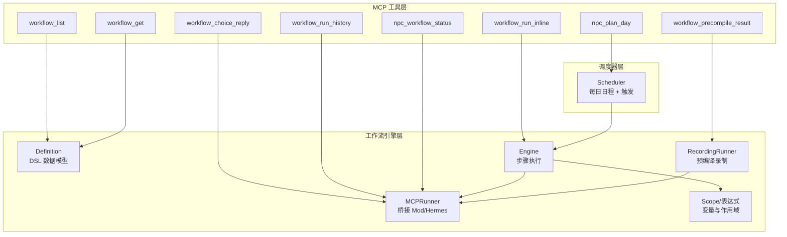
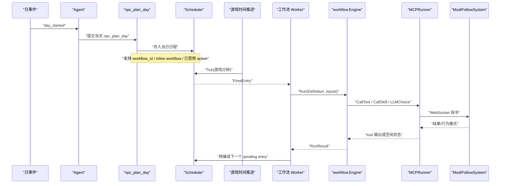
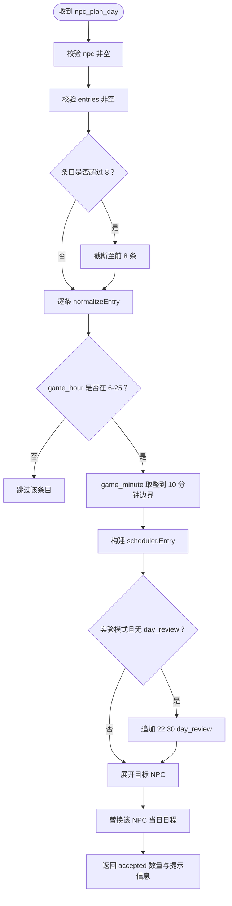
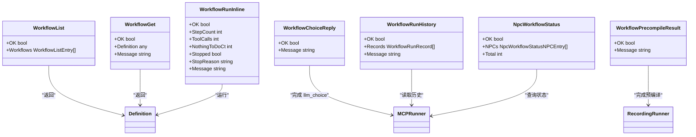
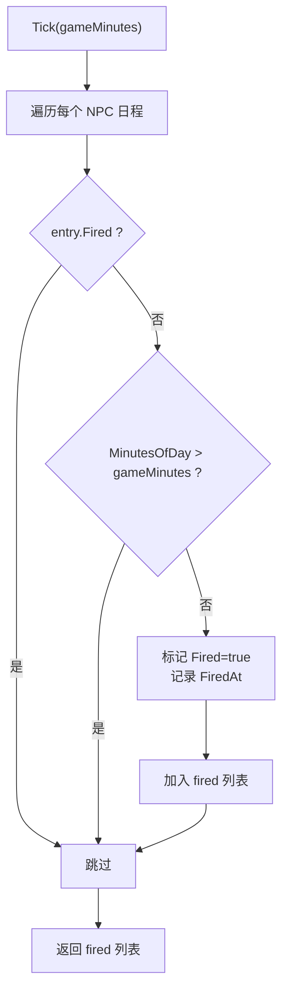
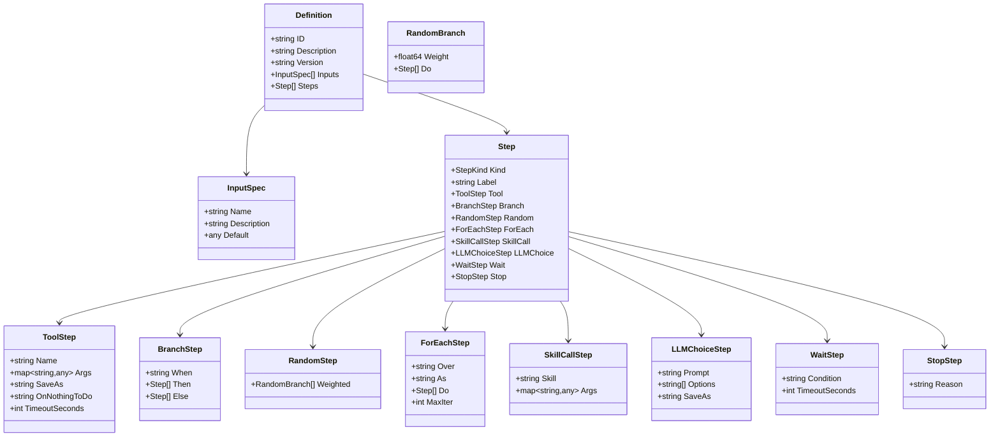
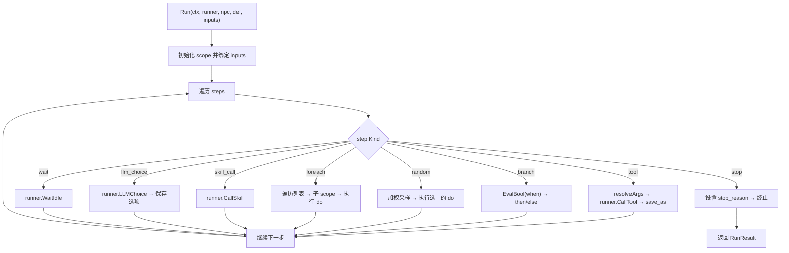
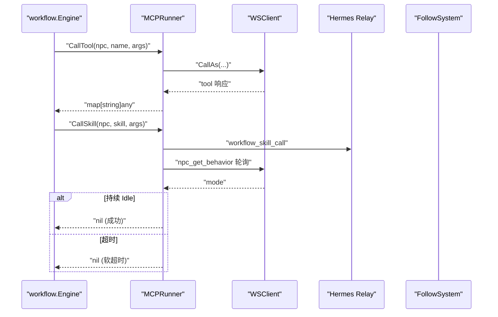
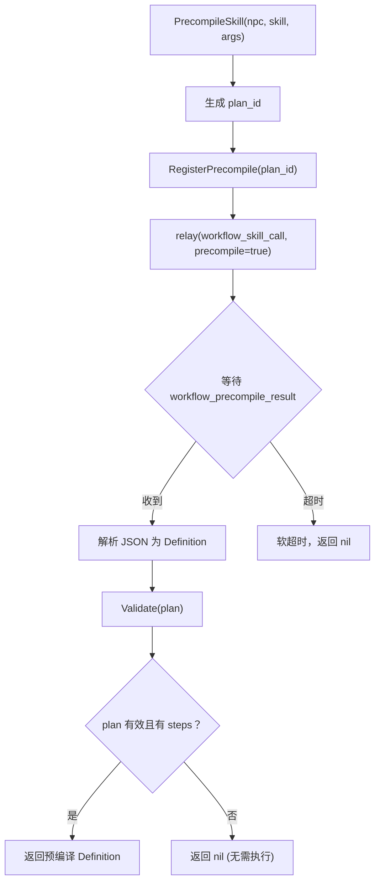
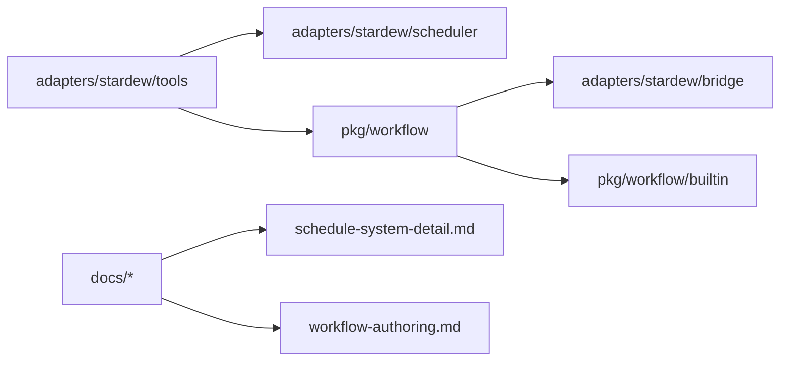

# 日程与工作流工具

<cite>
**本文引用的文件**   
- [npc_schedule.go](file://SmartNPC/smartnpc-mcp/adapters/stardew/tools/npc_schedule.go)
- [workflow.go](file://SmartNPC/smartnpc-mcp/adapters/stardew/tools/workflow.go)
- [scheduler.go](file://SmartNPC/smartnpc-mcp/adapters/stardew/scheduler/scheduler.go)
- [definition.go](file://SmartNPC/smartnpc-mcp/pkg/workflow/definition.go)
- [engine.go](file://SmartNPC/smartnpc-mcp/pkg/workflow/engine.go)
- [runner_mcp.go](file://SmartNPC/smartnpc-mcp/pkg/workflow/runner_mcp.go)
- [precompile.go](file://SmartNPC/smartnpc-mcp/pkg/workflow/precompile.go)
- [context.go](file://SmartNPC/smartnpc-mcp/pkg/workflow/context.go)
- [schedule-system-detail.md](file://SmartNPC/docs/schedule-system-detail.md)
- [workflow-authoring.md](file://SmartNPC/docs/workflow-authoring.md)
</cite>

## 目录
1. [引言](#引言)
2. [项目结构](#项目结构)
3. [核心组件](#核心组件)
4. [架构总览](#架构总览)
5. [详细组件分析](#详细组件分析)
6. [依赖关系分析](#依赖关系分析)
7. [性能与调度特性](#性能与调度特性)
8. [工作流状态管理](#工作流状态管理)
9. [编排最佳实践与设计模式](#编排最佳实践与设计模式)
10. [自动化 NPC 行为模板与实例](#自动化-npc-行为模板与实例)
11. [故障排查指南](#故障排查指南)
12. [结论](#结论)

## 引言
本文件面向 SmartNPC 的“日程与工作流工具组”，聚焦以下目标：
- 解释日程规划工具 `npc_plan_day` 的时间安排、任务调度与优先级约束。
- 文档化工作流执行工具 `workflow_run` 系列，包括工作流定义解析、步骤执行、条件分支。
- 说明定时任务机制：基于游戏分钟进度的调度、触发策略、队列与串行模型。
- 梳理工作流状态管理：进度跟踪、错误恢复、重试机制与预编译回放。
- 总结工作流编排最佳实践，并给出完整自动化 NPC 行为模板与实例。

该方案的核心思想是：**日程层只负责时间槽和 workflow_id，真正的工作流程由引擎或 Agent 在触发时实时生成与执行**。

## 项目结构
SmartNPC 中与日程和工作流相关的代码分布在三层：
- MCP 工具层：暴露 `npc_plan_day`、`workflow_list`、`workflow_get`、`workflow_run_inline`、`workflow_choice_reply`、`workflow_precompile_result`、`workflow_run_history`、`npc_workflow_status` 等工具。
- 调度器层：维护每个 NPC 当天的日程表，按游戏分钟驱动触发。
- 工作流引擎层：解析 YAML/JSON 定义的步骤，执行 tool、branch、random、foreach、skill_call、llm_choice、wait、stop。

**图表来源**
- [npc_schedule.go:1-453](file://SmartNPC/smartnpc-mcp/adapters/stardew/tools/npc_schedule.go#L1-L453)
- [workflow.go:1-512](file://SmartNPC/smartnpc-mcp/adapters/stardew/tools/workflow.go#L1-L512)
- [scheduler.go:1-299](file://SmartNPC/smartnpc-mcp/adapters/stardew/scheduler/scheduler.go#L1-L299)
- [definition.go:1-234](file://SmartNPC/smartnpc-mcp/pkg/workflow/definition.go#L1-L234)
- [engine.go:1-626](file://SmartNPC/smartnpc-mcp/pkg/workflow/engine.go#L1-L626)
- [runner_mcp.go:1-325](file://SmartNPC/smartnpc-mcp/pkg/workflow/runner_mcp.go#L1-L325)
- [precompile.go:1-226](file://SmartNPC/smartnpc-mcp/pkg/workflow/precompile.go#L1-L226)
- [context.go:1-452](file://SmartNPC/smartnpc-mcp/pkg/workflow/context.go#L1-L452)

**章节来源**
- [npc_schedule.go:1-453](file://SmartNPC/smartnpc-mcp/adapters/stardew/tools/npc_schedule.go#L1-L453)
- [workflow.go:1-512](file://SmartNPC/smartnpc-mcp/adapters/stardew/tools/workflow.go#L1-L512)
- [scheduler.go:1-299](file://SmartNPC/smartnpc-mcp/adapters/stardew/scheduler/scheduler.go#L1-L299)
- [definition.go:1-234](file://SmartNPC/smartnpc-mcp/pkg/workflow/definition.go#L1-L234)
- [engine.go:1-626](file://SmartNPC/smartnpc-mcp/pkg/workflow/engine.go#L1-L626)
- [runner_mcp.go:1-325](file://SmartNPC/smartnpc-mcp/pkg/workflow/runner_mcp.go#L1-L325)
- [precompile.go:1-226](file://SmartNPC/smartnpc-mcp/pkg/workflow/precompile.go#L1-L226)
- [context.go:1-452](file://SmartNPC/smartnpc-mcp/pkg/workflow/context.go#L1-L452)

## 核心组件
本节从职责角度划分五个关键组件。

| 组件 | 职责 | 关键类型/方法 |
|---|---|---|
| 日程规划工具 | 接收 LLM 提交的日程，校验时间、条目数、workflow_id，写入 Scheduler | `NpcPlanDayInput`、`normalizeEntry`、`registerNpcSchedule` |
| 工作流发现与调试工具 | 列出可调度工作流、获取定义、无副作用运行调试 | `WorkflowListOutput`、`WorkflowRunInlineOutput`、`noopRunner` |
| 调度器 | 存储每日日程，按游戏分钟触发未 firing 条目 | `Scheduler.Tick`、`SetPrecompiled`、`NextPendingEntry`、`PendingEntries` |
| 工作流引擎 | 解析 Definition，顺序执行 step，支持分支、随机、循环、skill_call、llm_choice、wait、stop | `Run`、`runSteps`、`runStep` |
| 运行时 Runner | 把 engine 调用映射到 WebSocket Mod、Hermes relay、FollowSystem | `MCPRunner.CallTool`、`CallSkill`、`LLMChoice`、`WaitIdle`、`PrecompileSkill` |

**章节来源**
- [npc_schedule.go:1-453](file://SmartNPC/smartnpc-mcp/adapters/stardew/tools/npc_schedule.go#L1-L453)
- [workflow.go:1-512](file://SmartNPC/smartnpc-mcp/adapters/stardew/tools/workflow.go#L1-L512)
- [scheduler.go:1-299](file://SmartNPC/smartnpc-mcp/adapters/stardew/scheduler/scheduler.go#L1-L299)
- [engine.go:1-626](file://SmartNPC/smartnpc-mcp/pkg/workflow/engine.go#L1-L626)
- [runner_mcp.go:1-325](file://SmartNPC/smartnpc-mcp/pkg/workflow/runner_mcp.go#L1-L325)

## 架构总览
日程到动作的完整链路如下：

**图表来源**
- [schedule-system-detail.md:1-200](file://SmartNPC/docs/schedule-system-detail.md#L1-L200)
- [npc_schedule.go:1-453](file://SmartNPC/smartnpc-mcp/adapters/stardew/tools/npc_schedule.go#L1-L453)
- [scheduler.go:1-299](file://SmartNPC/smartnpc-mcp/adapters/stardew/scheduler/scheduler.go#L1-L299)
- [engine.go:1-626](file://SmartNPC/smartnpc-mcp/pkg/workflow/engine.go#L1-L626)
- [runner_mcp.go:1-325](file://SmartNPC/smartnpc-mcp/pkg/workflow/runner_mcp.go#L1-L325)

## 详细组件分析

### 日程规划工具 `npc_plan_day`
`npc_plan_day` 是每天一次的核心入口。它不直接执行农活或社交动作，而是把“时间槽 + workflow_id + 参数”交给调度器。

#### 输入结构与约束
- 必填字段：`npc`、`day`、`season`、`entries`。
- 可选字段：`year`、`game_minute`（默认 0）。
- 每条 entry 支持三种互斥形式：
  1. `workflow_id`：引用内置或覆盖工作流（推荐）。
  2. `workflow`：内联 JSON 定义。
  3. `action`：遗留单工具字段，当前被拒绝。
- 时间精度为 10 分钟；无效分钟会被向下取整到 0/10/20/30/40/50。
- 条目数量合同：推荐 5-7 条，接受 4-8 条，超过 8 条截断。
- 如果 `npc="*"`，会展开为所有 agent-managed NPC。
- 实验模式下会自动追加 22:30 的 `day_review` 日程，除非已有该 workflow_id。

#### 处理流程

**图表来源**
- [npc_schedule.go:1-453](file://SmartNPC/smartnpc-mcp/adapters/stardew/tools/npc_schedule.go#L1-L453)

#### 优先级与管理语义
- **优先级**：`workflow_id` > `workflow` > `action`。
- **旧字段拒绝**：`action` 不再被接受，必须通过 `workflow_list` 选择 workflow_id。
- **重复计划保护**：同一 NPC 在同一天同季节已有日程时会记录警告，新调用会完全替换旧计划。
- **查询接口**：`npc_get_schedule` 返回尚未触发的剩余条目，便于 Agent 回顾当日计划。

**章节来源**
- [npc_schedule.go:1-453](file://SmartNPC/smartnpc-mcp/adapters/stardew/tools/npc_schedule.go#L1-L453)

### 工作流发现与调试工具
工作流系统提供两类能力：
- **开发期能力**：`workflow_list`、`workflow_get`、`workflow_run_inline`。
- **运行期能力**：`workflow_choice_reply`、`workflow_precompile_result`、`workflow_run_history`、`npc_workflow_status`。

#### `workflow_list`
- 返回所有注册工作流的 id、描述、inputs 规范。
- 供 `npc_plan_day` 在提交日程前发现可用工作流。

#### `workflow_get`
- 根据 id 返回完整工作流定义，包含 steps、inputs、分支逻辑。
- 适合在排程前检查某个 workflow 具体会做什么。

#### `workflow_run_inline`
- 仅用于调试，使用 `noopRunner` 运行工作流，不调用真实 Mod。
- 返回 step_count、tool_calls、nothing_to_do_ct、stopped、stop_reason。
- 支持传入 `workflow_id` 或 `inline` 定义。

#### `workflow_choice_reply`
- 当工作流执行 `llm_choice` 时，等待 Agent 通过该工具回复确切选项。
- 内部使用 `pendingChoices` 通道注册 requestID，完成即删除。

#### `workflow_precompile_result`
- 在预编译模式中，Agent 提交一个合法的 workflow definition JSON。
- 内部调用 `CompletePrecompile(plan_id, plan_json)` 唤醒等待的 precompile runner。

#### `workflow_run_history`
- 从 jsonl 文件中读取过去的工作流运行记录。
- 可按 npc、season、day、year、limit 过滤。

#### `npc_workflow_status`
- 查询每个 NPC 当前是否正在运行工作流、已运行多久、队列深度、待触发日程数。

**图表来源**
- [workflow.go:1-512](file://SmartNPC/smartnpc-mcp/adapters/stardew/tools/workflow.go#L1-L512)
- [definition.go:1-234](file://SmartNPC/smartnpc-mcp/pkg/workflow/definition.go#L1-L234)
- [runner_mcp.go:1-325](file://SmartNPC/smartnpc-mcp/pkg/workflow/runner_mcp.go#L1-L325)
- [precompile.go:1-226](file://SmartNPC/smartnpc-mcp/pkg/workflow/precompile.go#L1-L226)

**章节来源**
- [workflow.go:1-512](file://SmartNPC/smartnpc-mcp/adapters/stardew/tools/workflow.go#L1-L512)

### 定时任务机制：游戏分钟驱动的调度
调度器不是传统 Cron 表达式引擎，而是以“游戏分钟”作为时间轴：
- 游戏小时范围 6-25（Stardew Valley 中 25 表示次日凌晨 1 点）。
- 日程条目按 `game_hour` 和 `game_minute` 计算 `MinutesOfDay()`。
- `Scheduler.Tick(gameMinutes)` 会扫描所有 NPC 的日程，把所有 `MinutesOfDay() <= gameMinutes` 且未 fired 的条目标记为 fired 并返回。
- 这使 20 分钟 tick 错过 10 分钟条目也不会丢失任务。

**图表来源**
- [scheduler.go:1-299](file://SmartNPC/smartnpc-mcp/adapters/stardew/scheduler/scheduler.go#L1-L299)

#### 与 Cron 的关系
仓库中没有实现标准 Cron 表达式解析器。日程机制更接近“游戏日内时间表”，并通过以下方式模拟周期性：
- 每天 `day_started` 清空全部日程，重新规划。
- 可通过多个 workflow_id 拆分全天任务，例如早晨巡视、中午清理、傍晚收尾。
- 实验模式自动注入 `day_review`，模拟“每日复盘”。

因此，若需要复杂周期规则，应在上层（hermes profiles、cron-recipes、外部编排）决定何时调用 `npc_plan_day`，而不是在 SmartNPC 调度器里扩展 Cron 语法。

**章节来源**
- [scheduler.go:1-299](file://SmartNPC/smartnpc-mcp/adapters/stardew/scheduler/scheduler.go#L1-L299)
- [schedule-system-detail.md:1-200](file://SmartNPC/docs/schedule-system-detail.md#L1-L200)

### 工作流定义与 DSL
工作流定义是一个有序 step 列表，step 类型由 `Kind` 区分：
- `tool`：调用 MCP 工具。
- `branch`：if/else。
- `random`：加权随机选择一条分支。
- `foreach`：遍历列表。
- `skill_call`：委托给 Hermes SKILL。
- `llm_choice`：让 LLM 从固定选项中选择一个值。
- `wait`：等待 NPC 空闲。
- `stop`：提前终止。

#### 数据结构图

**图表来源**
- [definition.go:1-234](file://SmartNPC/smartnpc-mcp/pkg/workflow/definition.go#L1-L234)

#### 变量与作用域
- 工作流通过 `scope` 管理变量。
- `save_as` 将工具输出绑定到变量名，后续 step 可通过 `$obs.water.count` 访问。
- `foreach` 会为每次迭代创建子作用域，外层变量仍可见。
- 表达式支持路径查找、比较、布尔运算和括号，但不支持算术函数。
- 未解析的 `$ref` 会解析为 nil，由下游工具决定是否报错。

**章节来源**
- [definition.go:1-234](file://SmartNPC/smartnpc-mcp/pkg/workflow/definition.go#L1-L234)
- [context.go:1-452](file://SmartNPC/smartnpc-mcp/pkg/workflow/context.go#L1-L452)

### 工作流引擎执行逻辑
引擎是纯 Go 实现，不依赖 MCP、WebSocket 或 Hermes；它只关心 Definition、Scope、Runner 和计时日志。

**图表来源**
- [engine.go:1-626](file://SmartNPC/smartnpc-mcp/pkg/workflow/engine.go#L1-L626)

#### 关键执行语义
- `tool` 失败会直接中断工作流。
- `tool` 返回 `nothing_to_do=true` 时：
  - `skip`：继续下一步。
  - `stop`：设置 `StopReason` 并提前结束。
  - `fail`：返回错误。
  - 未知策略会报错。
- `branch` 表达式为 falsy 时走 `else`，否则走 `then`。
- `random` 权重归一化后采样；全零权重时静默跳过。
- `foreach` 默认最多 50 次迭代，避免无限列表。
- `skill_call` 阻塞等待 runner 完成。
- `llm_choice` 校验返回值是否在 options 中，否则回退到第一个选项。
- `wait` 默认 30 秒超时，目前仅支持 `idle`。

**章节来源**
- [engine.go:1-626](file://SmartNPC/smartnpc-mcp/pkg/workflow/engine.go#L1-L626)

### 运行时 Runner：Mod、Hermes 与空闲检测
`MCPRunner` 是生产环境 Runner，连接三个子系统：
1. **Mod 层**：通过 `bridge.WSClient.CallAs` 调用 MCP 工具。
2. **Hermes 层**：通过 relay 发送 `workflow_skill_call` 事件，触发 Agent 执行 SKILL。
3. **FollowSystem 层**：轮询 NPC 行为模式，判断是否空闲。

**图表来源**
- [runner_mcp.go:1-325](file://SmartNPC/smartnpc-mcp/pkg/workflow/runner_mcp.go#L1-L325)

#### 重要行为
- `CallTool` 会自动补上 `npc` 参数。
- `CallSkill` 先等待 Hermes relay 队列空闲，再等待 FollowSystem 稳定空闲至少 5 秒。
- `LLMChoice` 在未接入 relay 时回退到 options[0]；完整同步轮询由上层集成激活。
- `WaitIdle` 每 250ms 轮询一次，超时返回 false 而非 error。
- `PrecompileSkill` 通过 channel 等待 Agent 提交预编译 plan。

**章节来源**
- [runner_mcp.go:1-325](file://SmartNPC/smartnpc-mcp/pkg/workflow/runner_mcp.go#L1-L325)

### 预编译机制
预编译的目标是：**让 Agent 在录制模式下跑一次 SKILL，把实际要执行的 tool 序列记录下来，触发时直接回放，消除 LLM 延迟**。

**图表来源**
- [precompile.go:1-226](file://SmartNPC/smartnpc-mcp/pkg/workflow/precompile.go#L1-L226)
- [runner_mcp.go:201-325](file://SmartNPC/smartnpc-mcp/pkg/workflow/runner_mcp.go#L201-L325)

#### 录制 Runner
`RecordingRunner` 包装真实 Runner：
- 只读工具：`npc_inspect_*`、`npc_find_*`、`npc_get_*`、`game_get_*`、`player_get_*`、`player_query_*`、`workflow_list`、`workflow_get`、`npc_workflow_status`、`workflow_run_history`、`npc_perception_*`，会代理到真实 runner，保证环境数据准确。
- 修改型工具：只记录 tool_name 和 args，不真正执行。
- `BuildDefinition` 会把录制的修改型步骤转换为 concrete `tool` step。
- 如果没有录制到任何修改步骤，返回 nil，表示“今天没有要做的事”。

**章节来源**
- [precompile.go:1-226](file://SmartNPC/smartnpc-mcp/pkg/workflow/precompile.go#L1-L226)

## 依赖关系分析

**图表来源**
- [npc_schedule.go:1-453](file://SmartNPC/smartnpc-mcp/adapters/stardew/tools/npc_schedule.go#L1-L453)
- [workflow.go:1-512](file://SmartNPC/smartnpc-mcp/adapters/stardew/tools/workflow.go#L1-L512)
- [scheduler.go:1-299](file://SmartNPC/smartnpc-mcp/adapters/stardew/scheduler/scheduler.go#L1-L299)
- [runner_mcp.go:1-325](file://SmartNPC/smartnpc-mcp/pkg/workflow/runner_mcp.go#L1-L325)

### 耦合与内聚
- `tools` 包负责 MCP 协议边界和输入校验，耦合较低。
- `scheduler` 包只关心游戏分钟和日程状态，内聚高。
- `workflow` 包是纯逻辑层，通过 `Runner` 接口解耦 Mod、Hermes、FollowSystem。
- `runner_mcp` 是唯一知道 WebSocket、relay、behavior mode 的实现。

### 潜在循环依赖
- 当前设计避免了循环：tools → scheduler + workflow；workflow → bridge；没有反向依赖。
- 如果需要扩展，应优先通过接口（如 `Runner`、`FollowSystemQuery`）注入，而不是直接导入 main 或 tools。

**章节来源**
- [definition.go:1-234](file://SmartNPC/smartnpc-mcp/pkg/workflow/definition.go#L1-L234)
- [engine.go:1-626](file://SmartNPC/smartnpc-mcp/pkg/workflow/engine.go#L1-L626)
- [runner_mcp.go:1-325](file://SmartNPC/smartnpc-mcp/pkg/workflow/runner_mcp.go#L1-L325)

## 性能与调度特性

### 时间复杂度
- `Scheduler.Tick`：O(N×E)，N 为有日程的 NPC 数，E 为每个 NPC 的条目数。
- `workflow.Run`：O(S)，S 为 step 总数；`foreach` 会放大为 O(S×I)，I 为迭代次数。
- `resolveArgs`：O(V)，V 为参数字符串或嵌套结构大小。
- `Eval`：表达式解析线性于表达式长度。

### 空间复杂度
- 日程表：O(N×E)。
- 工作流 scope：链式父子作用域，内存占用与嵌套深度成正比。
- 预编译录制：O(M)，M 为录制到的修改型工具调用数。

### 调度特性
- 10 分钟时间精度。
- 20 分钟 tick 不会丢任务，因为 `Tick` 匹配 ≤ 当前分钟的条目。
- 每个 NPC 的工作流执行是串行的，防止并发冲突。
- 预编译可把 LLM 延迟从每次触发降到接近零。

### 优化建议
- 尽量使用 `workflow_id` 复用内置工作流，减少 LLM 每次推理成本。
- 对高频重复任务启用预编译。
- 在 workflow 中使用 `on_nothing_to_do=skip` 避免无效动作堆积。
- 合理分配 workflow_id 的数量，保持 5-7 条/天。
- 避免过长 `foreach`，利用 `max_iter` 防护。

[本节为通用性能讨论，不直接分析具体代码行]

## 工作流状态管理

### 进度跟踪
- `RunResult.StepCount`：统计已执行 step。
- `RunResult.ToolCalls`：统计实际调用的 tool 数量。
- `RunResult.NothingToDoCt`：统计 nothing_to_do 响应次数。
- `RunResult.Stopped` 与 `RunResult.StopReason`：标识是否提前停止及原因。
- `RunResult.FailedStep`：记录出错 step 索引。
- `workflow_run_history` 提供持久化历史查询。
- `npc_workflow_status` 提供运行中工作流、耗时、队列深度、待触发日程。

### 错误恢复
- 单个 tool 失败会中断当前工作流，但不会破坏其他 NPC 或下一天的日程。
- `nothing_to_do=stop` 属于“有意停止”，不算硬错误。
- `nothing_to_do=fail` 会将错误向上抛出。
- `CallSkill` 的 idle 等待采用软超时，不会直接失败工作流。
- `PrecompileSkill` 超时会返回 nil，表示跳过预编译，不影响正常触发。

### 重试机制
- 当前代码没有显式的“自动重试”机制。
- 推荐做法：
  - 在 workflow 中用 `branch` 判断环境状态，必要时重入。
  - 在上层通过 `day_review` 或下一次 `npc_plan_day` 重排。
  - 对短暂网络错误，可在 Runner 或上游 retry 层封装，但需注意不要掩盖业务级 `nothing_to_do`。

**章节来源**
- [engine.go:1-626](file://SmartNPC/smartnpc-mcp/pkg/workflow/engine.go#L1-L626)
- [workflow.go:1-512](file://SmartNPC/smartnpc-mcp/adapters/stardew/tools/workflow.go#L1-L512)
- [runner_mcp.go:1-325](file://SmartNPC/smartnpc-mcp/pkg/workflow/runner_mcp.go#L1-L325)

## 编排最佳实践与设计模式

### 最佳实践
1. **始终使用 `workflow_id`**  
   避免 `action` 单工具模式，利用多步骤工作流保证 inspect→execute→bubble 链条。
2. **先用 `workflow_list`，再用 `workflow_get`**  
   在排程前确认工作流能力，再决定是否纳入当天日程。
3. **把复杂决策留给 Agent，把确定性动作留给引擎**  
   内置 workflow 通常只有少量 steps；更复杂的对话、社交、回忆归档交给 `skill_call`。
4. **合理使用 `on_nothing_to_do`**  
   - 普通农活：`skip`。
   - 关键流程：`stop`。
   - 必须完成的任务：`fail`。
5. **控制 `foreach` 规模**  
   设置 `max_iter`，避免数据异常导致长循环。
6. **预编译高频任务**  
   农场日常、资源采集这类环境变化小的任务适合预编译。
7. **保留 `day_review`**  
   实验模式自动注入，用于日记与记忆归档。

### 常见设计模式
| 模式 | 适用场景 | 推荐实现 |
|---|---|---|
| 观察-行动-收尾 | 浇水、收获、清理 | tool(inspect) → branch → tool(action) → wait(stop) |
| 条件分流 | 晴天户外 / 雨天室内 | branch when season/weather/crop state |
| 随机性格 | 不同 NPC 偏好不同活动 | random weighted branches |
| 批量操作 | 多个地块、多个作物 | foreach over list with max_iter |
| 人类介入选择 | 天气、礼物、对话风格 | llm_choice + workflow_choice_reply |
| 录制回放 | 高频重复任务 | RecordingRunner + workflow_precompile_result |
| 每日复盘 | 日记、记忆归档 | day_review skill_call |

**章节来源**
- [workflow-authoring.md:1-172](file://SmartNPC/docs/workflow-authoring.md#L1-L172)
- [schedule-system-detail.md:1-200](file://SmartNPC/docs/schedule-system-detail.md#L1-L200)

## 自动化 NPC 行为模板与实例

### 全天日程模板
典型 NPC 的一天可以拆分为：
- 早晨：农场巡视、基础维护。
- 上午：社交或资源采集。
- 中午：清理杂物、整理农场。
- 下午：采集、挖矿或探索。
- 傍晚：收尾、关闭农场。
- 夜间：复盘、日记、记忆归档。

日程条目建议：
- 2-3 个 `farm_care` 相关 workflow。
- 1 个 `farm_extension`。
- 1-2 个 `farm_cleanup`。
- 1-2 个 `resource_gather`。
- 1 个 `farm_evening_close`。
- 1 个 `day_review`（可自动注入）。

### 工作流模板参考
仓库提供了内置工作流定义导出目录，可作为模板阅读：
- `提示词导出-20261026-004143/11-内置工作流定义/farm_care.yaml`
- `提示词导出-20261026-004143/11-内置工作流定义/farm_cleanup.yaml`
- `提示词导出-20261026-004143/11-内置工作流定义/farm_evening_close.yaml`
- `提示词导出-20261026-004143/11-内置工作流定义/farm_extension.yaml`
- `提示词导出-20261026-004143/11-内置工作流定义/mine_crawl.yaml`
- `提示词导出-20261026-004143/11-内置工作流定义/resource_gather.yaml`
- `提示词导出-20261026-004143/11-内置工作流定义/social_interact.yaml`
- `提示词导出-20261026-004143/11-内置工作流定义/social_round_robin.yaml`
- `提示词导出-20261026-004143/11-内置工作流定义/weather_bookkeeping.yaml`

这些 YAML 展示了：
- 如何声明 `inputs`。
- 如何用 `save_as` 绑定 inspect 结果。
- 如何用 `branch` 做条件分支。
- 如何用 `foreach` 遍历作物或地块。
- 如何用 `skill_call` 调用对话、社交、复盘等复杂行为。

### 工作流编写快速示例
下面给出一个概念性模板，对应仓库文档中的写法，但不在本文件中粘贴源码：
- 第一步：inspect 农场状态。
- 第二步：如果有缺水作物，则浇水。
- 第三步：如果有成熟作物，则收获。
- 第四步：如果有杂物，则清理。
- 第五步：等待 NPC 空闲。
- 第六步：结束。

该模式适用于 `farm_care`、`farm_cleanup`、`resource_gather` 等基础工作流。

**章节来源**
- [workflow-authoring.md:1-172](file://SmartNPC/docs/workflow-authoring.md#L1-L172)

## 故障排查指南

### 常见问题与定位方式
| 现象 | 可能原因 | 排查手段 |
|---|---|---|
| `npc_plan_day` 报错 | npc 为空、entries 为空、使用了已禁用的 `action` | 检查输入结构 |
| 日程被截断 | 提交了超过 8 条 | 查看返回 message 中的 truncated 提示 |
| 日程未触发 | game_hour 超出 6-25，或 minute 非法 | 检查 normalizeEntry 后的 GameMinute |
| 工作流没有调用工具 | `nothing_to_do=true` 且 on_nothing_to_do=skip | 查看 `workflow_run_history` |
| 工作流提前停止 | `on_nothing_to_do=stop` 或遇到 `stop` step | 查看 `stop_reason` |
| Skill 一直 busy | Hermes relay 或 FollowSystem 未回到 idle | 查看 runner 日志中的 poll 次数和 last_mode |
| 预编译超时 | Agent 未在 60 秒内提交 plan | 检查 `workflow_precompile_result` 是否被调用 |
| 无法查询运行状态 | 未正确注入 `WorkflowTracker` | 检查 `npc_workflow_status` 配置 |

### 关键日志关键字
- `workflow: run start`
- `workflow: tool calling`
- `workflow: tool ok`
- `workflow: tool failed`
- `workflow: tool nothing_to_do`
- `workflow: skill_call start`
- `workflow: skill_call done`
- `workflow: wait start/done`
- `MCPRunner.CallTool: bridge call failed`
- `MCPRunner.CallSkill: wait for idle timed out`
- `MCPRunner.PrecompileSkill: timed out`

**章节来源**
- [engine.go:1-626](file://SmartNPC/smartnpc-mcp/pkg/workflow/engine.go#L1-L626)
- [runner_mcp.go:1-325](file://SmartNPC/smartnpc-mcp/pkg/workflow/runner_mcp.go#L1-L325)
- [workflow.go:1-512](file://SmartNPC/smartnpc-mcp/adapters/stardew/tools/workflow.go#L1-L512)

## 结论
SmartNPC 的日程与工作流体系由三层组成：
- 日程层通过 `npc_plan_day` 把“时间槽 + workflow_id”交给调度器。
- 调度器按游戏分钟驱动触发，确保 10 分钟精度不丢任务。
- 工作流引擎以 DSL 驱动 tool、branch、random、foreach、skill_call、llm_choice、wait、stop，并通过 `MCPRunner` 桥接 Mod、Hermes 和 FollowSystem。

这套设计的关键优势是：
- 日程与执行分离：日程只承诺“什么时候做什么类型的任务”，不提前锁定具体坐标、物品 ID 等细节。
- 两种执行路径：实时编排灵活，预编译回放高效。
- 明确的状态与日志：每一步都有 step_count、tool_calls、nothing_to_do、stop_reason。
- 可扩展性强：新增 workflow、skill 或 Runner 不需要改动引擎核心。

对于开发者，建议从 `workflow-authoring.md` 和内置 YAML 出发，先在 `workflow_run_inline` 中验证流程，再放入 `npc_plan_day` 日程；对于运维者，应关注 `npc_workflow_status`、`workflow_run_history` 和 runner 日志，以便及时发现队列积压、idle 卡住或预编译超时问题。