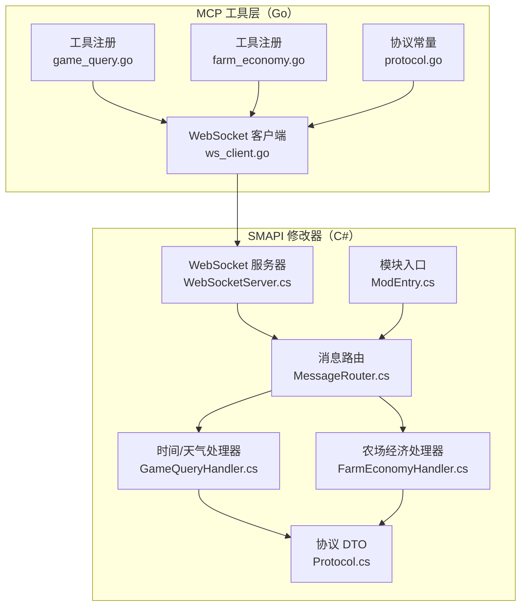
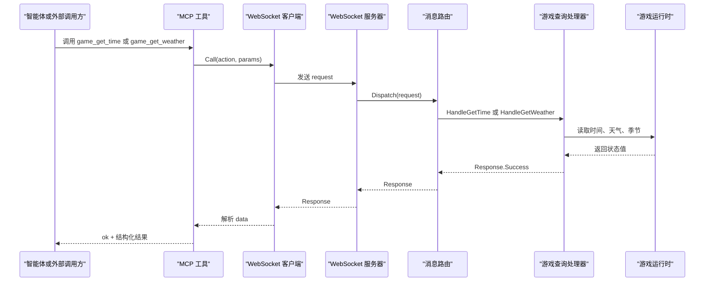
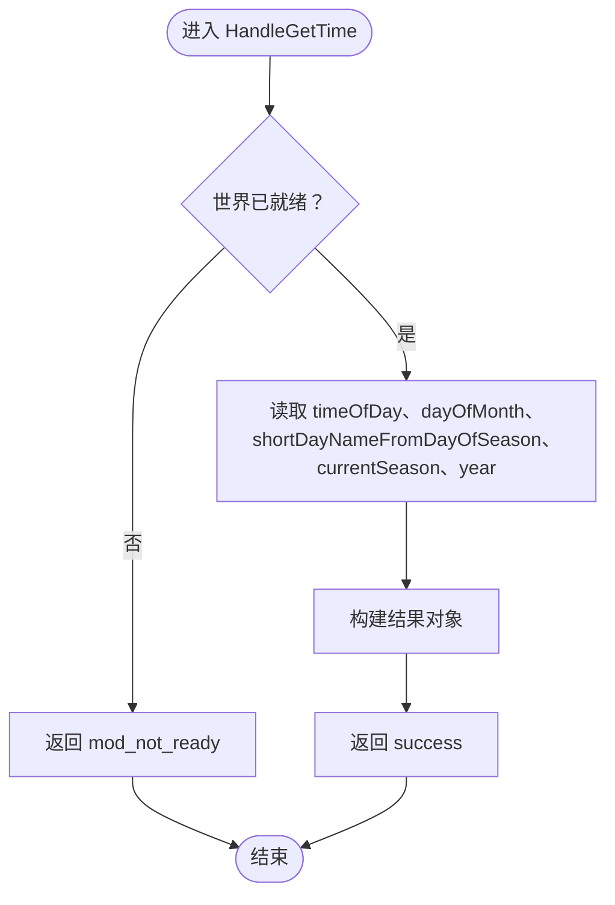
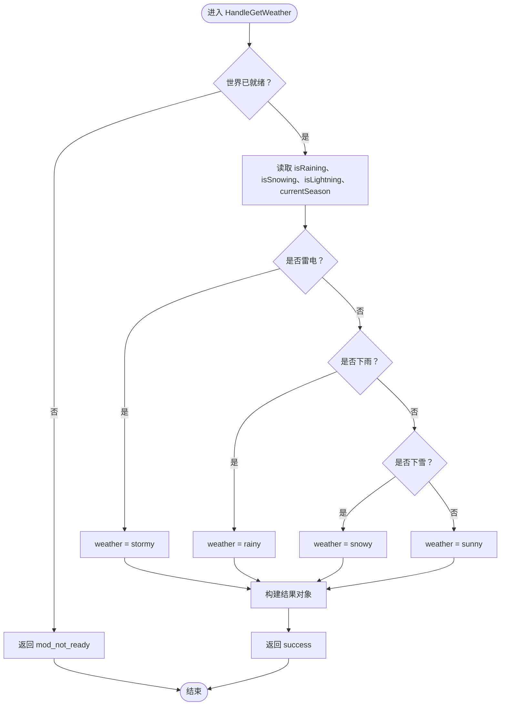
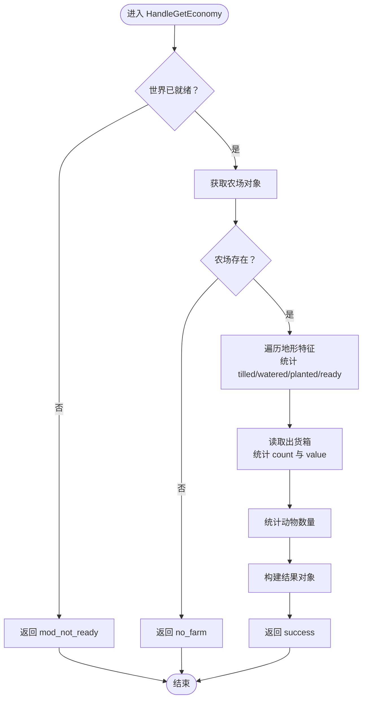
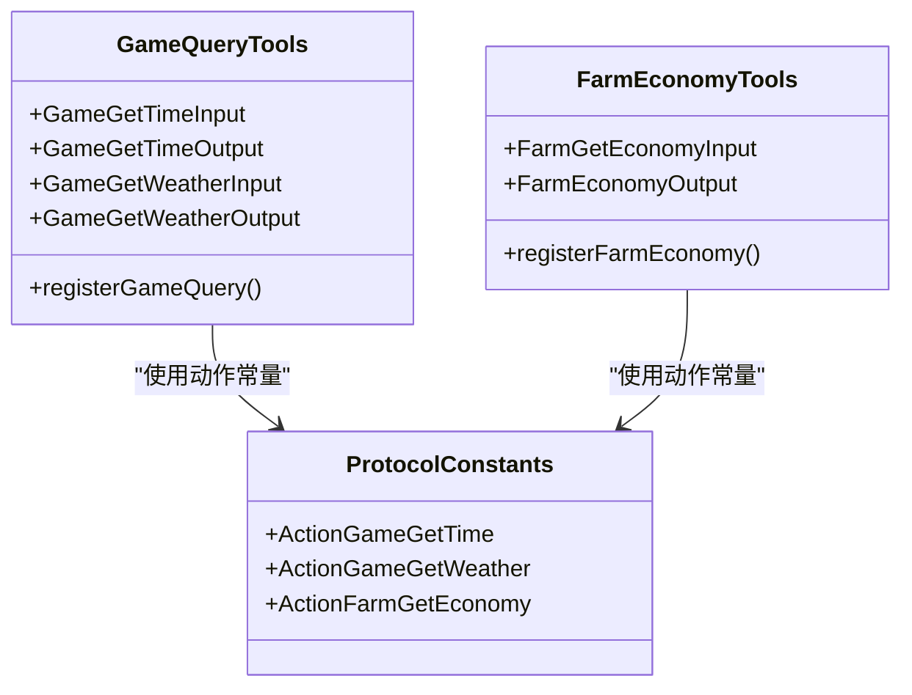
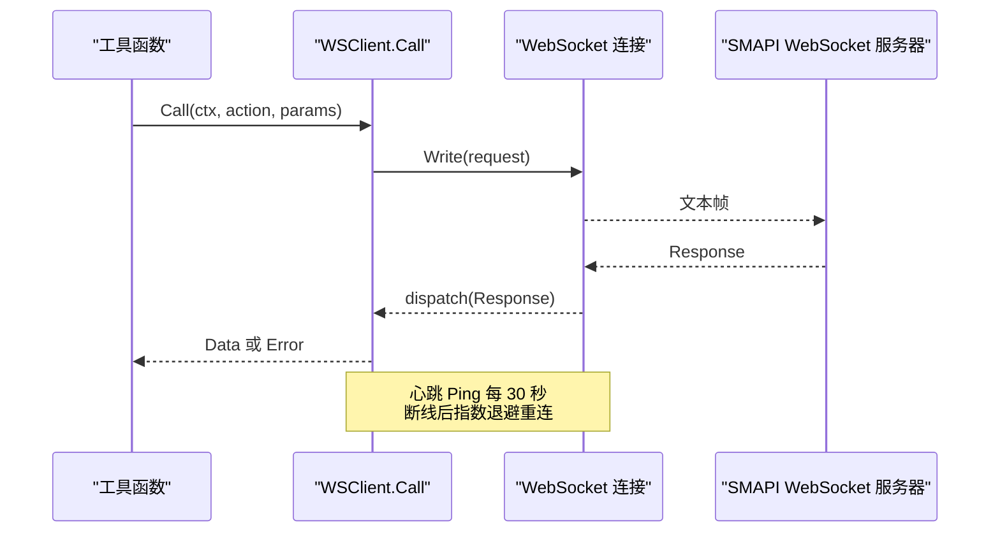
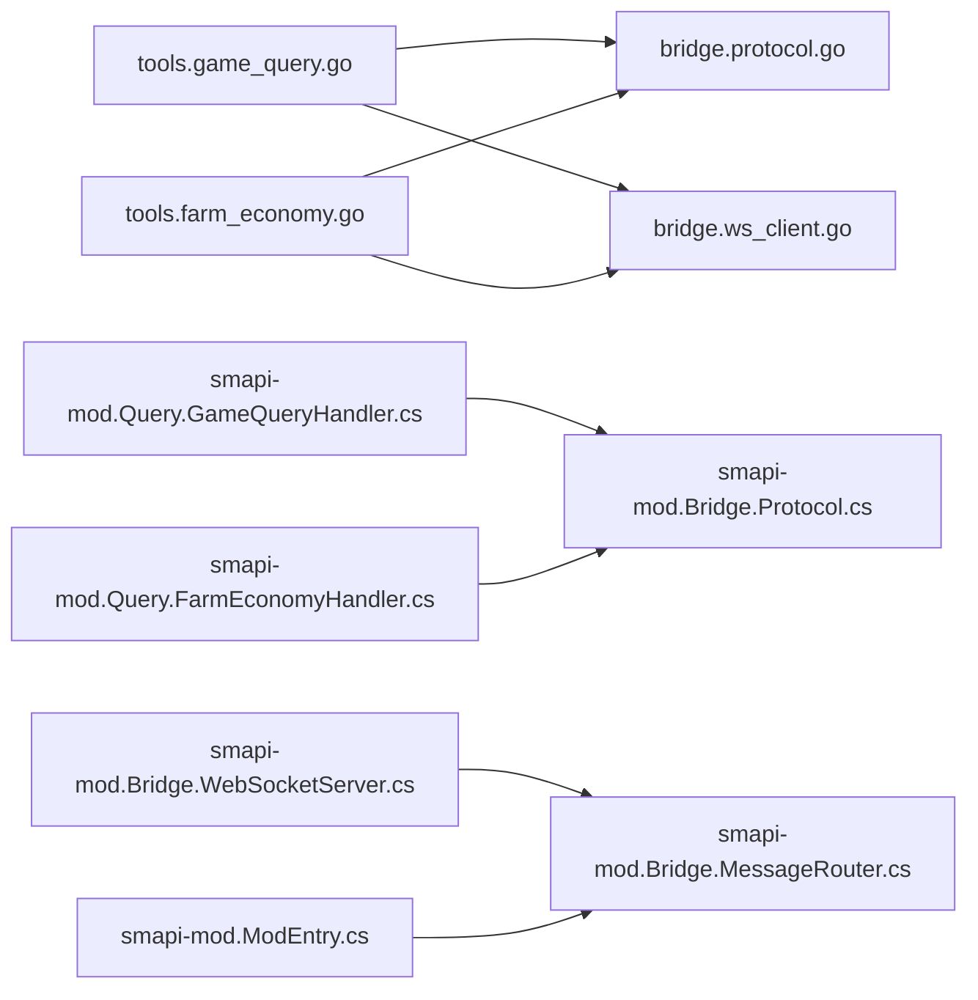

# 游戏查询工具

<cite>
**本文引用的文件**   
- [game_query.go](file://SmartNPC/smartnpc-mcp/adapters/stardew/tools/game_query.go)
- [farm_economy.go](file://SmartNPC/smartnpc-mcp/adapters/stardew/tools/farm_economy.go)
- [registry.go](file://SmartNPC/smartnpc-mcp/adapters/stardew/tools/registry.go)
- [protocol.go](file://SmartNPC/smartnpc-mcp/adapters/stardew/bridge/protocol.go)
- [ws_client.go](file://SmartNPC/smartnpc-mcp/adapters/stardew/bridge/ws_client.go)
- [GameQueryHandler.cs](file://SmartNPC/smapi-mod/Query/GameQueryHandler.cs)
- [FarmEconomyHandler.cs](file://SmartNPC/smapi-mod/Query/FarmEconomyHandler.cs)
- [Protocol.cs](file://SmartNPC/smapi-mod/Bridge/Protocol.cs)
- [MessageRouter.cs](file://SmartNPC/smapi-mod/Bridge/MessageRouter.cs)
- [WebSocketServer.cs](file://SmartNPC/smapi-mod/Bridge/WebSocketServer.cs)
- [ModEntry.cs](file://SmartNPC/smapi-mod/ModEntry.cs)
</cite>

## 目录
1. [简介](#简介)
2. [项目结构](#项目结构)
3. [核心工具](#核心工具)
4. [架构总览](#架构总览)
5. [组件详细分析](#组件详细分析)
6. [依赖关系分析](#依赖关系分析)
7. [性能与缓存策略](#性能与缓存策略)
8. [数据分析与报告示例](#数据分析与报告示例)
9. [故障排查指南](#故障排查指南)
10. [结论](#结论)

## 简介
本文件面向“游戏查询工具组”，重点覆盖以下能力：
- 时间查询工具 `game_get_time`：获取当前游戏内小时、分钟、原始时间值、日期、星期、季节和年份。
- 天气查询工具 `game_get_weather`：返回当前天气类型、降雨/降雪/雷电标志以及当前季节。
- 农场经济查询工具 `farm_get_economy`：汇总金币、累计收入、出货箱物品数量与价值、种植作物状态、耕地与浇水情况、动物数量等。
- 地图位置查询：仓库中未提供专用 MCP 工具；本节给出概念性坐标转换与距离计算思路，并说明如何扩展现有桥接机制接入地图数据。
- 缓存与性能优化：结合 WebSocket 客户端的长连接、自动重连、心跳保活与调用观测记录，降低重复查询开销。
- 数据分析与报告：基于查询结果给出可复用的统计与报表生成思路，包括日终回顾、季节趋势、农场健康度评分等。

## 项目结构
该功能横跨两层实现：
- Go 侧 MCP 工具层：定义工具输入输出结构、注册工具、通过 WebSocket 调用 SMAPI 修改器。
- C# 侧 SMAPI 修改器层：监听本地 WebSocket，分发到具体处理器，读取《星露谷物语》运行时状态后返回结构化 JSON。

**图表来源**
- [game_query.go:24-89](file://SmartNPC/smartnpc-mcp/adapters/stardew/tools/game_query.go#L24-L89)
- [farm_economy.go:12-57](file://SmartNPC/smartnpc-mcp/adapters/stardew/tools/farm_economy.go#L12-L57)
- [protocol.go:103-130](file://SmartNPC/smartnpc-mcp/adapters/stardew/bridge/protocol.go#L103-L130)
- [ws_client.go:229-346](file://SmartNPC/smartnpc-mcp/adapters/stardew/bridge/ws_client.go#L229-L346)
- [WebSocketServer.cs:119-231](file://SmartNPC/smapi-mod/Bridge/WebSocketServer.cs#L119-L231)
- [MessageRouter.cs:24-52](file://SmartNPC/smapi-mod/Bridge/MessageRouter.cs#L24-L52)
- [GameQueryHandler.cs:16-67](file://SmartNPC/smapi-mod/Query/GameQueryHandler.cs#L16-L67)
- [FarmEconomyHandler.cs:17-88](file://SmartNPC/smapi-mod/Query/FarmEconomyHandler.cs#L17-L88)
- [Protocol.cs:9-66](file://SmartNPC/smapi-mod/Bridge/Protocol.cs#L9-L66)
- [ModEntry.cs:100-105](file://SmartNPC/smapi-mod/ModEntry.cs#L100-L105)

**章节来源**
- [game_query.go:24-89](file://SmartNPC/smartnpc-mcp/adapters/stardew/tools/game_query.go#L24-L89)
- [farm_economy.go:12-57](file://SmartNPC/smartnpc-mcp/adapters/stardew/tools/farm_economy.go#L12-L57)
- [registry.go:39-82](file://SmartNPC/smartnpc-mcp/adapters/stardew/tools/registry.go#L39-L82)
- [protocol.go:103-130](file://SmartNPC/smartnpc-mcp/adapters/stardew/bridge/protocol.go#L103-L130)
- [ws_client.go:229-346](file://SmartNPC/smartnpc-mcp/adapters/stardew/bridge/ws_client.go#L229-L346)
- [WebSocketServer.cs:119-231](file://SmartNPC/smapi-mod/Bridge/WebSocketServer.cs#L119-L231)
- [MessageRouter.cs:24-52](file://SmartNPC/smapi-mod/Bridge/MessageRouter.cs#L24-L52)
- [GameQueryHandler.cs:16-67](file://SmartNPC/smapi-mod/Query/GameQueryHandler.cs#L16-L67)
- [FarmEconomyHandler.cs:17-88](file://SmartNPC/smapi-mod/Query/FarmEconomyHandler.cs#L17-L88)
- [Protocol.cs:9-66](file://SmartNPC/smapi-mod/Bridge/Protocol.cs#L9-L66)
- [ModEntry.cs:100-105](file://SmartNPC/smapi-mod/ModEntry.cs#L100-L105)

## 核心工具
### 时间查询工具 `game_get_time`
- 作用：读取当前游戏时钟与日历信息，包括小时、分钟、原始时间值、月份中的日期、短星期名、季节、年份。
- 输入：无参数。
- 输出字段：
  - `ok`：是否成功。
  - `hour`：0-23 的小时数。
  - `minute`：分钟，通常为 0 或 30。
  - `timeOfDay`：原始时间值，例如 1430。
  - `day`：月份中的日期，范围 1-28。
  - `day_of_week`：短星期名称，如 Mon。
  - `season`：spring / summer / fall / winter。
  - `year`：游戏年份。
- 适用场景：按时间做决策，例如上午浇水、傍晚前发货、日志中记录时间戳。
- 行为约束：只读操作，需要已加载存档。

**章节来源**
- [game_query.go:12-23](file://SmartNPC/smartnpc-mcp/adapters/stardew/tools/game_query.go#L12-L23)
- [game_query.go:24-53](file://SmartNPC/smartnpc-mcp/adapters/stardew/tools/game_query.go#L24-L53)
- [GameQueryHandler.cs:19-36](file://SmartNPC/smapi-mod/Query/GameQueryHandler.cs#L19-L36)

### 天气查询工具 `game_get_weather`
- 作用：读取当天天气与当前季节，并提供细粒度布尔标志，区分下雨、下雪、雷暴。
- 输入：无参数。
- 输出字段：
  - `ok`：是否成功。
  - `weather`：sunny / rainy / snowy / stormy。
  - `is_raining`：是否下雨。
  - `is_snowing`：是否下雪。
  - `is_lightning`：是否雷电。
  - `season`：当前季节。
- 适用场景：决定是否浇水、安排户外农活、为室内活动准备备选方案。
- 行为约束：只读操作，需要已加载存档。

**章节来源**
- [game_query.go:25-38](file://SmartNPC/smartnpc-mcp/adapters/stardew/tools/game_query.go#L25-L38)
- [game_query.go:55-89](file://SmartNPC/smartnpc-mcp/adapters/stardew/tools/game_query.go#L55-L89)
- [GameQueryHandler.cs:39-67](file://SmartNPC/smapi-mod/Query/GameQueryHandler.cs#L39-L67)

### 农场经济查询工具 `farm_get_economy`
- 作用：提供农场经济记分板，包括钱包金币、累计收入、出货箱待售物品数量与总价值、已种植作物数量、可收获作物数量、翻耕土地数量、当前浇水土地数量、农场动物数量。
- 输入：无参数。
- 输出字段：
  - `ok`：是否成功。
  - `day`：季节中的日期。
  - `season`：当前季节。
  - `year`：游戏年份。
  - `gold`：当前钱包金币。
  - `total_money_earned`：历史累计收入。
  - `shipping_bin_count`：出货箱中等待过夜出售的物品堆叠总数。
  - `shipping_bin_value`：出货箱物品总售价。
  - `crops_planted`：当前种植的作物地块数。
  - `crops_ready`：当前可收获的作物地块数。
  - `tilled_tiles`：已翻耕的泥土地块数。
  - `watered_tiles`：当前已浇水的泥土地块数。
  - `animals`：农场动物数量。
- 适用场景：每日计划、夜间总结、发货前后校验销售流水线。
- 行为约束：只读操作，需要已加载存档和农场。

**章节来源**
- [farm_economy.go:9-33](file://SmartNPC/smartnpc-mcp/adapters/stardew/tools/farm_economy.go#L9-L33)
- [farm_economy.go:35-57](file://SmartNPC/smartnpc-mcp/adapters/stardew/tools/farm_economy.go#L35-L57)
- [FarmEconomyHandler.cs:17-88](file://SmartNPC/smapi-mod/Query/FarmEconomyHandler.cs#L17-L88)

## 架构总览
工具调用从 MCP 侧发起，经 WebSocket 到达 SMAPI 修改器，再由消息路由分发给具体处理器，最终读取游戏状态并返回结构化响应。

**图表来源**
- [game_query.go:24-89](file://SmartNPC/smartnpc-mcp/adapters/stardew/tools/game_query.go#L24-L89)
- [ws_client.go:229-346](file://SmartNPC/smartnpc-mcp/adapters/stardew/bridge/ws_client.go#L229-L346)
- [WebSocketServer.cs:119-231](file://SmartNPC/smapi-mod/Bridge/WebSocketServer.cs#L119-L231)
- [MessageRouter.cs:24-52](file://SmartNPC/smapi-mod/Bridge/MessageRouter.cs#L24-L52)
- [GameQueryHandler.cs:16-67](file://SmartNPC/smapi-mod/Query/GameQueryHandler.cs#L16-L67)

## 组件详细分析

### 时间查询处理流程
时间查询工具将游戏内原始时间值拆分为小时、分钟，同时读取日期、短星期名、季节和年份。处理器会先检查世界是否就绪，再构造结果对象并通过成功响应返回。

**图表来源**
- [GameQueryHandler.cs:19-36](file://SmartNPC/smapi-mod/Query/GameQueryHandler.cs#L19-L36)

**章节来源**
- [GameQueryHandler.cs:19-36](file://SmartNPC/smapi-mod/Query/GameQueryHandler.cs#L19-L36)

### 天气查询处理流程
天气查询根据降雨、降雪、雷电标志确定天气字符串，并附带当前季节。逻辑优先级为：雷电优先判定为 stormy，其次为 rainy，其次为 snowy，否则为 sunny。

**图表来源**
- [GameQueryHandler.cs:39-67](file://SmartNPC/smapi-mod/Query/GameQueryHandler.cs#L39-L67)

**章节来源**
- [GameQueryHandler.cs:39-67](file://SmartNPC/smapi-mod/Query/GameQueryHandler.cs#L39-L67)

### 农场经济统计流程
农场经济处理器遍历农场地形特征，统计翻耕地、已浇水地、已种植作物和可收获作物；随后读取出货箱物品数量和总价值，并统计农场动物数量。异常读取会降级为警告日志而不中断整体结果。

**图表来源**
- [FarmEconomyHandler.cs:21-88](file://SmartNPC/smapi-mod/Query/FarmEconomyHandler.cs#L21-L88)

**章节来源**
- [FarmEconomyHandler.cs:21-88](file://SmartNPC/smapi-mod/Query/FarmEconomyHandler.cs#L21-L88)

### MCP 工具注册与动作常量
Go 侧通过 `registerGameQuery` 和 `registerFarmEconomy` 把 MCP 工具挂载到服务器，并在注册表中统一启用。动作名称由协议常量集中管理，确保客户端与服务端使用一致的动作标识。

**图表来源**
- [game_query.go:12-89](file://SmartNPC/smartnpc-mcp/adapters/stardew/tools/game_query.go#L12-L89)
- [farm_economy.go:9-57](file://SmartNPC/smartnpc-mcp/adapters/stardew/tools/farm_economy.go#L9-L57)
- [protocol.go:103-130](file://SmartNPC/smartnpc-mcp/adapters/stardew/bridge/protocol.go#L103-L130)

**章节来源**
- [registry.go:39-82](file://SmartNPC/smartnpc-mcp/adapters/stardew/tools/registry.go#L39-L82)
- [protocol.go:103-130](file://SmartNPC/smartnpc-mcp/adapters/stardew/bridge/protocol.go#L103-L130)

### WebSocket 客户端与连接管理
WebSocket 客户端负责建立连接、发送请求、关联响应、处理事件、保持连接活跃，并在断开后自动重连。每次调用可配置超时，支持观察者记录调用耗时与出入参，便于诊断和实验日志。

**图表来源**
- [ws_client.go:229-346](file://SmartNPC/smartnpc-mcp/adapters/stardew/bridge/ws_client.go#L229-L346)
- [ws_client.go:348-510](file://SmartNPC/smartnpc-mcp/adapters/stardew/bridge/ws_client.go#L348-L510)
- [WebSocketServer.cs:119-231](file://SmartNPC/smapi-mod/Bridge/WebSocketServer.cs#L119-L231)

**章节来源**
- [ws_client.go:229-346](file://SmartNPC/smartnpc-mcp/adapters/stardew/bridge/ws_client.go#L229-L346)
- [ws_client.go:348-510](file://SmartNPC/smartnpc-mcp/adapters/stardew/bridge/ws_client.go#L348-L510)

## 依赖关系分析
- MCP 工具层依赖协议常量与 WebSocket 客户端，用于向 SMAPI 修改器发起只读查询。
- SMAPI 修改器层依赖 WebSocket 服务器、消息路由与具体处理器，处理器直接访问游戏运行时状态。
- 模块入口负责组装处理器、注册动作、启动 WebSocket 服务器，并将调试请求镜像到聊天面板。

**图表来源**
- [game_query.go:24-89](file://SmartNPC/smartnpc-mcp/adapters/stardew/tools/game_query.go#L24-L89)
- [farm_economy.go:35-57](file://SmartNPC/smartnpc-mcp/adapters/stardew/tools/farm_economy.go#L35-L57)
- [protocol.go:103-130](file://SmartNPC/smartnpc-mcp/adapters/stardew/bridge/protocol.go#L103-L130)
- [ws_client.go:229-346](file://SmartNPC/smartnpc-mcp/adapters/stardew/bridge/ws_client.go#L229-L346)
- [GameQueryHandler.cs:16-67](file://SmartNPC/smapi-mod/Query/GameQueryHandler.cs#L16-L67)
- [FarmEconomyHandler.cs:17-88](file://SmartNPC/smapi-mod/Query/FarmEconomyHandler.cs#L17-L88)
- [WebSocketServer.cs:119-231](file://SmartNPC/smapi-mod/Bridge/WebSocketServer.cs#L119-L231)
- [MessageRouter.cs:24-52](file://SmartNPC/smapi-mod/Bridge/MessageRouter.cs#L24-L52)
- [ModEntry.cs:100-105](file://SmartNPC/smapi-mod/ModEntry.cs#L100-L105)

**章节来源**
- [registry.go:39-82](file://SmartNPC/smartnpc-mcp/adapters/stardew/tools/registry.go#L39-L82)
- [ModEntry.cs:100-105](file://SmartNPC/smapi-mod/ModEntry.cs#L100-L105)

## 性能与缓存策略
当前工具本身没有内置内存缓存，但可通过以下机制减少重复查询开销：
- 长连接复用：WebSocket 客户端在进程生命周期内保持连接，避免每次查询重新握手。
- 自动重连与心跳：断线后按配置退避重连，定时 Ping 防止空闲连接被服务端关闭。
- 调用观测记录：每次调用可记录耗时、成功状态、入参与出参，便于定位慢查询与异常。
- 建议的外部缓存策略：
  - 在同一游戏日内对相同工具调用结果进行短期缓存，例如按“季节+日期+小时”作为键缓存时间与天气。
  - 农场经济可在玩家未移动或未改变农活状态时缓存一段时间，以减少频繁扫描地形和出货箱的成本。
  - 对于高频聚合指标，可维护一个轻量级内存表，在工具返回时更新，供上层统计使用。

**章节来源**
- [ws_client.go:229-346](file://SmartNPC/smartnpc-mcp/adapters/stardew/bridge/ws_client.go#L229-L346)
- [ws_client.go:348-510](file://SmartNPC/smartnpc-mcp/adapters/stardew/bridge/ws_client.go#L348-L510)
- [FarmEconomyHandler.cs:21-88](file://SmartNPC/smapi-mod/Query/FarmEconomyHandler.cs#L21-L88)

## 数据分析与报告示例
以下示例以查询结果为输入，描述如何形成实用报告。为避免暴露具体代码内容，这里以步骤和字段说明为主。

### 时间分析与日程规划
- 输入字段：`hour`、`minute`、`timeOfDay`、`day`、`day_of_week`、`season`、`year`。
- 分析要点：
  - 判断上午时段用于浇水与资源收集。
  - 判断傍晚前完成发货与清理。
  - 根据季节决定作物轮作与室内活动替代方案。
- 输出示例：
  - “当前季节为春季第 X 天，时间为 Y 点 Z 分，适合继续种植或前往矿洞。”

### 天气影响分析
- 输入字段：`weather`、`is_raining`、`is_snowing`、`is_lightning`、`season`。
- 分析要点：
  - 雨天无需浇水。
  - 雪天限制户外农活，转向采集、钓鱼、制作或社交。
  - 雷雨天气注意安全和室内活动。
- 输出示例：
  - “今天天气为雪天，建议改为室内任务；若需外出，请携带防寒装备。”

### 农场经济日报
- 输入字段：`gold`、`total_money_earned`、`shipping_bin_count`、`shipping_bin_value`、`crops_planted`、`crops_ready`、`tilled_tiles`、`watered_tiles`、`animals`。
- 分析要点：
  - 比较今日出货价值与累计收入增长。
  - 统计可收获作物比例，评估产出效率。
  - 对比翻耕地与浇水地，识别漏浇水地块。
  - 跟踪动物数量变化，辅助畜牧收益估算。
- 输出示例：
  - “今日出货价值为 V，累计收入达到 E；可收获作物占比 R%，建议明早优先收割。”

### 地图位置查询（概念性扩展）
仓库未提供专用地图坐标转换或距离计算工具。可按以下思路扩展：
- 新增 MCP 工具，例如 `game_get_player_position` 与 `game_get_location_distance`。
- 在 SMAPI 处理器中读取玩家坐标、目标地点坐标，计算欧几里得距离或网格步数。
- 通过 WebSocket 协议返回坐标、距离与导航建议。
- 可复用现有 `ws_client.go` 与 `Protocol.cs` 结构，仅增加新动作常量与处理器。

[本节为概念性设计，不直接分析具体源码文件]

## 故障排查指南
常见错误与定位方式：
- 未加载存档：处理器返回 `mod_not_ready`，表示 `Context.IsWorldReady` 为假。
- 未找到农场：农场经济查询返回 `no_farm`，表示 `Game1.getFarm()` 为空。
- WebSocket 连接失败：客户端抛出连接、写入或读取错误，需检查本地端口与 SMAPI 服务状态。
- 超时：默认调用超时很长，但若网络或服务卡顿，仍可能触发上下文取消。
- 出货箱或动物读取异常：处理器捕获异常并记录警告日志，不会导致整个查询失败，但仍应检查存档完整性。

建议排查步骤：
1. 确认 SMAPI 已启动且 WebSocket 监听地址可达。
2. 查看 MCP 侧日志中的 `elapsed_ms` 与错误码。
3. 查看 SMAPI 侧 `[timing]` 与 handler 异常日志。
4. 对于农场经济，检查农场是否存在、出货箱是否可枚举、动物列表是否可用。
5. 如需调试请求内容，启用 SMAPI 的调试请求镜像开关，观察聊天面板或日志中的 inbound request。

**章节来源**
- [GameQueryHandler.cs:19-36](file://SmartNPC/smapi-mod/Query/GameQueryHandler.cs#L19-L36)
- [FarmEconomyHandler.cs:21-88](file://SmartNPC/smapi-mod/Query/FarmEconomyHandler.cs#L21-L88)
- [MessageRouter.cs:24-52](file://SmartNPC/smapi-mod/Bridge/MessageRouter.cs#L24-L52)
- [ws_client.go:229-346](file://SmartNPC/smartnpc-mcp/adapters/stardew/bridge/ws_client.go#L229-L346)
- [WebSocketServer.cs:119-231](file://SmartNPC/smapi-mod/Bridge/WebSocketServer.cs#L119-L231)

## 结论
本工具组围绕时间、天气与农场经济三个只读维度，构建了清晰的 MCP 工具到 SMAPI 处理器的调用链路。其优势在于：
- 数据结构稳定，字段语义明确，便于上层智能体或自动化流程消费。
- 通信层具备长连接、心跳保活与自动重连能力，适合长期运行的自动化农场管理。
- 处理器对异常做了降级处理，保证基础查询可用性。

未来可扩展方向包括：
- 增加地图位置与距离计算工具。
- 引入短期内存缓存以降低重复查询成本。
- 扩展季节性经济趋势报表与农场健康评分模型。
- 结合工作流与调度系统，将查询结果驱动自动化农事决策。