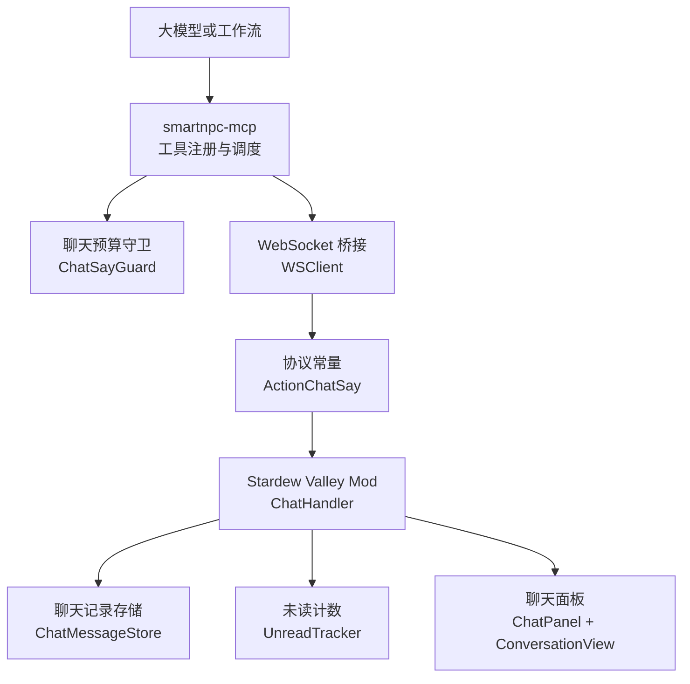
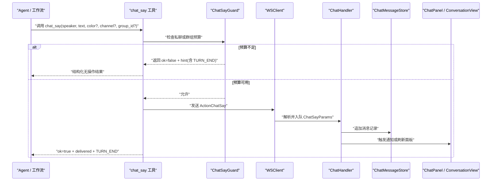
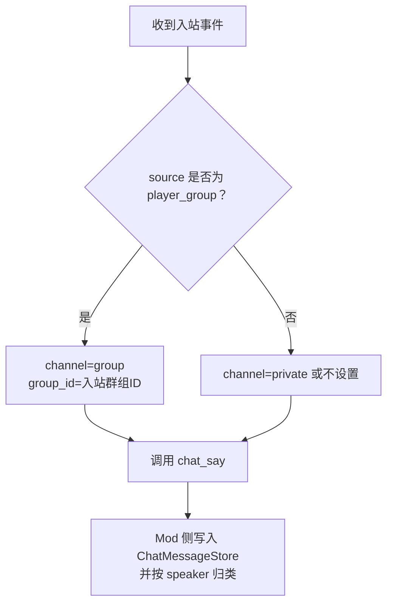
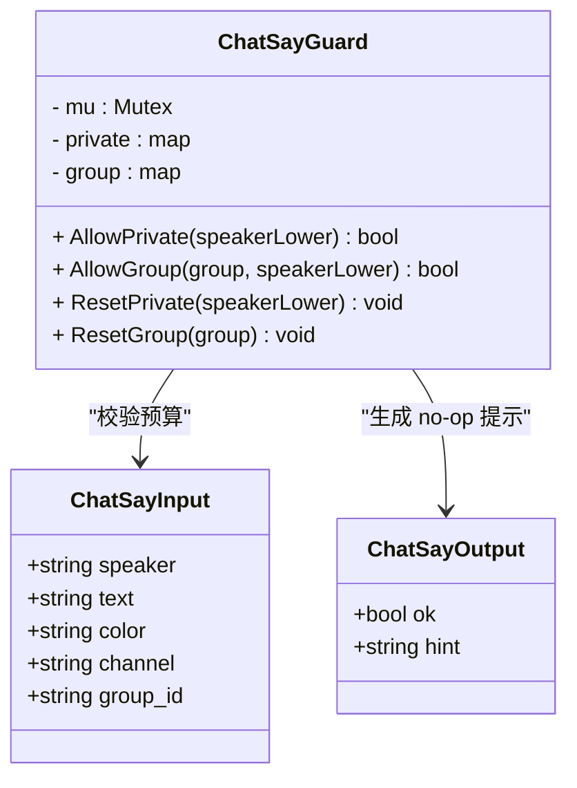
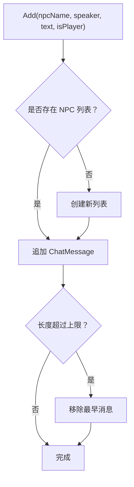
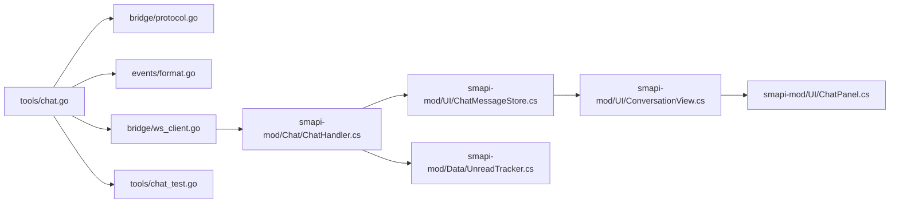
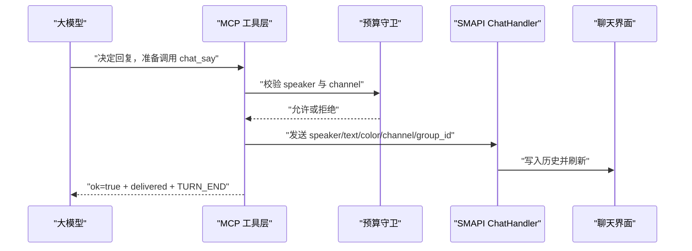

# 聊天工具

<cite>
**本文引用的文件**   
- [chat.go](file://SmartNPC/smartnpc-mcp/adapters/stardew/tools/chat.go)
- [chat_test.go](file://SmartNPC/smartnpc-mcp/adapters/stardew/tools/chat_test.go)
- [format.go](file://SmartNPC/smartnpc-mcp/adapters/stardew/events/format.go)
- [protocol.go](file://SmartNPC/smartnpc-mcp/adapters/stardew/bridge/protocol.go)
- [ChatHandler.cs](file://SmartNPC/smapi-mod/Chat/ChatHandler.cs)
- [ChatMessageStore.cs](file://SmartNPC/smapi-mod/UI/ChatMessageStore.cs)
- [ConversationView.cs](file://SmartNPC/smapi-mod/UI/ConversationView.cs)
- [ChatPanel.cs](file://SmartNPC/smapi-mod/UI/ChatPanel.cs)
- [UnreadTracker.cs](file://SmartNPC/smapi-mod/Data/UnreadTracker.cs)
- [mcp-tools.md](file://SmartNPC/docs/mcp-tools.md)
</cite>

## 目录
1. [简介](#简介)
2. [项目结构](#项目结构)
3. [核心组件](#核心组件)
4. [架构总览](#架构总览)
5. [详细组件分析](#详细组件分析)
6. [依赖关系分析](#依赖关系分析)
7. [性能与扩展性](#性能与扩展性)
8. [故障排查指南](#故障排查指南)
9. [结论](#结论)
10. [附录：调用示例与最佳实践](#附录调用示例与最佳实践)

## 简介
本文件面向 SmartNPC 聊天工具组，重点说明 `chat_say` 工具的实现、上下文路由机制、消息持久化与界面展示，并解释当前仓库中关于邮件能力、历史检索、安全过滤和违规处理的实现边界。文档同时给出实际调用流程、错误处理方案和对话管理最佳实践，帮助开发者在“一问一答”约束下稳定地驱动聊天机器人行为。

需要特别说明的是：当前仓库的 MCP 工具目录中**没有**名为 `npc_send_mail` 的工具；协议层存在 `mail_send` 动作常量，但未见对应 Go 注册器或 SMAPI 处理器。因此邮件部分以“协议能力已预留但工具未暴露”为准进行说明，避免把尚未实现的假设写成既定事实。

## 项目结构
聊天相关代码横跨两个子系统：

- **MCP 适配层（Go）**：对外暴露 `chat_say` 等工具，负责参数校验、预算守卫、事件格式化，并通过 WebSocket 桥接调用 SMAPI Mod。
- **SMAPI Mod（C#）**：接收桥接请求，把聊天写入内存存储、更新未读计数、刷新游戏内 UI，并提供快照/恢复接口用于存档。

**图表来源**
- [chat.go:158-252](file://SmartNPC/smartnpc-mcp/adapters/stardew/tools/chat.go#L158-L252)
- [protocol.go:74-75](file://SmartNPC/smartnpc-mcp/adapters/stardew/bridge/protocol.go#L74-L75)
- [ChatHandler.cs:1-96](file://SmartNPC/smapi-mod/Chat/ChatHandler.cs#L1-L96)
- [ChatMessageStore.cs:1-87](file://SmartNPC/smapi-mod/UI/ChatMessageStore.cs#L1-L87)
- [ChatPanel.cs:1-178](file://SmartNPC/smapi-mod/UI/ChatPanel.cs#L1-L178)

**章节来源**
- [chat.go:1-255](file://SmartNPC/smartnpc-mcp/adapters/stardew/tools/chat.go#L1-L255)
- [protocol.go:1-172](file://SmartNPC/smartnpc-mcp/adapters/stardew/bridge/protocol.go#L1-L172)
- [ChatHandler.cs:1-96](file://SmartNPC/smapi-mod/Chat/ChatHandler.cs#L1-L96)
- [ChatMessageStore.cs:1-87](file://SmartNPC/smapi-mod/UI/ChatMessageStore.cs#L1-L87)
- [ChatPanel.cs:1-178](file://SmartNPC/smapi-mod/UI/ChatPanel.cs#L1-L178)

## 核心组件
- **ChatSayInput / ChatSayOutput**：`chat_say` 工具的输入输出结构。输入包含说话者、正文、可选颜色、会话频道和群组标识；输出包含是否成功、提示信息和 TURN_END 停止信号。
- **ChatSayGuard**：运行时预算守卫，保证每个唤醒周期内同一说话者在私聊或群组中最多只能调用一次 `chat_say`。
- **MaybeResetGuard**：路由器侧辅助函数，根据入站事件重置私聊或群组预算。
- **ChatHandler**：SMAPI 侧消息处理队列，解析请求、入队、在游戏主循环中落盘并通知 UI。
- **ChatMessageStore**：按 NPC 分组的聊天记录内存存储，支持追加、查询、清空、快照与恢复。
- **ConversationView / ChatPanel / UnreadTracker**：聊天界面、滚动浏览、联系人列表和未读计数。

**章节来源**
- [chat.go:16-150](file://SmartNPC/smartnpc-mcp/adapters/stardew/tools/chat.go#L16-L150)
- [ChatHandler.cs:10-96](file://SmartNPC/smapi-mod/Chat/ChatHandler.cs#L10-L96)
- [ChatMessageStore.cs:12-87](file://SmartNPC/smapi-mod/UI/ChatMessageStore.cs#L12-L87)
- [ConversationView.cs:1-175](file://SmartNPC/smapi-mod/UI/ConversationView.cs#L1-L175)
- [ChatPanel.cs:1-178](file://SmartNPC/smapi-mod/UI/ChatPanel.cs#L1-L178)
- [UnreadTracker.cs:1-56](file://SmartNPC/smapi-mod/Data/UnreadTracker.cs#L1-L56)

## 架构总览
`chat_say` 的执行路径可以理解为一条从 MCP 工具到游戏 UI 的消息流水线：

**图表来源**
- [chat.go:158-252](file://SmartNPC/smartnpc-mcp/adapters/stardew/tools/chat.go#L158-L252)
- [ChatHandler.cs:33-96](file://SmartNPC/smapi-mod/Chat/ChatHandler.cs#L33-L96)
- [ChatMessageStore.cs:39-87](file://SmartNPC/smapi-mod/UI/ChatMessageStore.cs#L39-L87)

## 详细组件分析

### `chat_say` 工具：消息格式化、角色选择与上下文管理

#### 输入字段与语义
| 字段 | 类型 | 是否必填 | 含义 |
|---|---|---:|---|
| `speaker` | 字符串 | 是 | 英文内部 NPC 名，例如 `XiaMi`、`Abigail`。不能写中文显示名。 |
| `text` | 字符串 | 是 | 纯文本消息体，建议一到三句。 |
| `color` | 字符串 | 否 | 可选装饰色，如 `yellow`、`red`、`blue` 等。 |
| `channel` | 字符串 | 否 | 默认私聊；设为 `group` 时用于群聊面板。 |
| `group_id` | 字符串 | 条件必填 | 当 `channel=group` 时必须提供群组标识。 |

这些字段由 Go 端 JSON 反序列化为 `ChatSayInput`，并在注册时作为 MCP 工具描述的一部分暴露给大模型。

**章节来源**
- [chat.go:16-35](file://SmartNPC/smartnpc-mcp/adapters/stardew/tools/chat.go#L16-L35)

#### 角色选择规则
- 必须使用 PascalCase 英文内部名称。
- SMAPI 侧通过 `Game1.getCharacterFromName(speaker)` 查找 NPC。
- 如果找不到 NPC，显示名回退为传入的 `speaker`，但不会自动修复路由问题。
- 测试用例验证了 `speaker` 和 `text` 会透传到桥接层。

这意味着：如果外部系统把中文显示名传给 `speaker`，很可能出现“消息被接受但没有正确映射到预期面板”的问题。

**章节来源**
- [chat.go:160-175](file://SmartNPC/smartnpc-mcp/adapters/stardew/tools/chat.go#L160-L175)
- [ChatHandler.cs:62-70](file://SmartNPC/smapi-mod/Chat/ChatHandler.cs#L62-L70)
- [chat_test.go:110-134](file://SmartNPC/smartnpc-mcp/adapters/stardew/tools/chat_test.go#L110-L134)

#### 上下文管理与频道路由
- 私聊频道：默认或空 `channel`，表示一对一聊天。
- 群聊频道：`channel=group` 且携带 `group_id`。
- 事件格式层会把玩家进入群聊的事件渲染为带 `group_id` 的前缀提示，要求后续 `chat_say` 使用相同频道和群组标识。
- 如果群聊回复忘记设置 `channel=group` 和 `group_id`，消息可能泄漏到私聊面板，而不是群聊面板。

**图表来源**
- [format.go:60-85](file://SmartNPC/smartnpc-mcp/adapters/stardew/events/format.go#L60-L85)
- [chat.go:160-198](file://SmartNPC/smartnpc-mcp/adapters/stardew/tools/chat.go#L160-L198)

#### 消息格式化与显示
- 工具描述明确要求纯 UTF-8 文本，不要 Markdown、代码块、JSON 或图片型 emoji。
- SMAPI 侧 `ChatHandler` 只保存 `speaker`、`text`、时间戳和游戏内时间。
- `ConversationView` 会按气泡宽度折行，区分玩家消息和 NPC 消息的背景颜色，并显示游戏内时间。

这决定了：即使 MCP 层接受了长文本，游戏聊天框也可能截断，界面也更适合短对话。

**章节来源**
- [chat.go:160-175](file://SmartNPC/smartnpc-mcp/adapters/stardew/tools/chat.go#L160-L175)
- [ChatHandler.cs:62-90](file://SmartNPC/smapi-mod/Chat/ChatHandler.cs#L62-L90)
- [ConversationView.cs:70-155](file://SmartNPC/smapi-mod/UI/ConversationView.cs#L70-L155)

### 聊天预算守卫：防止重复发言
`ChatSayGuard` 是本轮对话的关键安全阀：

| 场景 | 规则 | 重置时机 |
|---|---|---|
| 私聊 | 每个 NPC 每轮最多一个 `chat_say` | 下一个针对该 NPC 的入站事件 |
| 群聊 | 每个 `(group_id, speaker)` 每轮最多一个 `chat_say` | 下一次玩家在该群组发言 |
| 空说话者 | 跳过守卫 | 不适用 |
| 空群组 | 视为非群聊调用，允许通过 | 不适用 |

二次调用不会抛 Go 异常，而是返回结构化无操作结果：`ok=false`，`hint` 中包含类似 `noop_chat_say_private_quota_exhausted` 或 `noop_chat_say_group_quota_exhausted`，并附带 `TURN_END`。这是为了避免大模型重试造成“无限重发”循环。

**图表来源**
- [chat.go:39-150](file://SmartNPC/smartnpc-mcp/adapters/stardew/tools/chat.go#L39-L150)

**章节来源**
- [chat.go:39-150](file://SmartNPC/smartnpc-mcp/adapters/stardew/tools/chat.go#L39-L150)
- [chat_test.go:136-175](file://SmartNPC/smartnpc-mcp/adapters/stardew/tools/chat_test.go#L136-L175)
- [chat_test.go:227-321](file://SmartNPC/smartnpc-mcp/adapters/stardew/tools/chat_test.go#L227-L321)

### 消息持久化机制：聊天记录存储与检索
聊天记录的持久化采用“会话内存 + 快照/恢复”的模式：

- `ChatMessageStore` 维护 `Dictionary<string, List<ChatMessage>>`，键为 NPC 名。
- 每条消息包含说话者、正文、是否玩家消息、创建时间和游戏内时间。
- 单 NPC 超过最大长度后删除最早消息，默认上限为 100。
- `Snapshot()` 返回最近若干条消息的字典，用于存档。
- `Restore()` 用快照替换内存状态。
- `GetHistory(npcName)` 是主要检索接口。

**图表来源**
- [ChatMessageStore.cs:12-60](file://SmartNPC/smapi-mod/UI/ChatMessageStore.cs#L12-L60)

**章节来源**
- [ChatMessageStore.cs:12-87](file://SmartNPC/smapi-mod/UI/ChatMessageStore.cs#L12-L87)
- [ChatHandler.cs:62-70](file://SmartNPC/smapi-mod/Chat/ChatHandler.cs#L62-L70)

### 聊天历史管理、消息过滤与搜索
当前实现提供的是**基础历史管理**，而不是完整搜索系统：

- 可获取某 NPC 的历史消息。
- 可按 NPC 清空历史。
- 可快照最近 N 条消息。
- 界面上支持鼠标滚轮滚动浏览。
- **没有**基于关键词的全文搜索、模糊匹配、分页游标或高级过滤器。
- **没有**显式的敏感词检测、内容过滤、屏蔽词替换或违规内容拦截模块。

如果需要搜索和过滤，应在现有 `ChatMessageStore` 之上扩展，例如增加索引、过滤条件和排序策略，而不是直接修改现有的快照/恢复契约，否则会影响存档兼容性。

**章节来源**
- [ChatMessageStore.cs:39-87](file://SmartNPC/smapi-mod/UI/ChatMessageStore.cs#L39-L87)
- [ConversationView.cs:120-175](file://SmartNPC/smapi-mod/UI/ConversationView.cs#L120-L175)

### 邮件能力：`npc_send_mail` 的当前状态
仓库中没有 `npc_send_mail` 工具。协议层定义了 `ActionMailSend = "mail_send"`，但：

- Go 工具注册目录中没有对应的 `registerMail` 或 `registerNpcMail`。
- SMAPI 侧也没有发现 `MailHandler.cs`。
- MCP 工具文档明确列出 `mail_send` 已被移除。

因此，邮件功能在当前实验构建中属于**协议预留但未暴露的能力**。若未来要实现 `npc_send_mail`，应同时补充：

1. MCP 工具定义与参数校验。
2. 收件人解析逻辑。
3. 邮件正文模板和内容生成。
4. 附件处理（物品 ID、数量、来源背包）。
5. SMAPI 侧邮件写入与 UI 通知。
6. 错误码、权限校验和失败重试策略。

目前不应假设这些字段已经生效。

**章节来源**
- [protocol.go:68-76](file://SmartNPC/smartnpc-mcp/adapters/stardew/bridge/protocol.go#L68-L76)
- [mcp-tools.md:230-260](file://SmartNPC/docs/mcp-tools.md#L230-L260)

### 消息安全过滤与敏感词检测
当前代码库中未发现敏感词检测、违规内容过滤或内容安全拦截实现。`chat_say` 的描述强调“纯文本、保持角色、简短”，但并没有运行时的黑名单、正则过滤、评分模型或人工审核通道。

建议在以下位置新增安全层：

- MCP 工具入口：对 `text` 做快速校验，拒绝明显非法字符或超长内容。
- 预算守卫之后、桥接之前：统一安全管道，避免不同工具绕过检查。
- SMAPI `ChatHandler.PumpOnGameTick`：最终落盘前再做一次安全确认。
- 审计日志：记录被过滤的消息、原因和处理方式，便于调试和运营。

由于仓库未实现该内容，这部分应视为设计建议而非既有行为。

**章节来源**
- [chat.go:160-175](file://SmartNPC/smartnpc-mcp/adapters/stardew/tools/chat.go#L160-L175)
- [ChatHandler.cs:62-90](file://SmartNPC/smapi-mod/Chat/ChatHandler.cs#L62-L90)

## 依赖关系分析

**图表来源**
- [chat.go:1-255](file://SmartNPC/smartnpc-mcp/adapters/stardew/tools/chat.go#L1-L255)
- [protocol.go:1-172](file://SmartNPC/smartnpc-mcp/adapters/stardew/bridge/protocol.go#L1-L172)
- [ChatHandler.cs:1-96](file://SmartNPC/smapi-mod/Chat/ChatHandler.cs#L1-L96)
- [ChatMessageStore.cs:1-87](file://SmartNPC/smapi-mod/UI/ChatMessageStore.cs#L1-L87)
- [ConversationView.cs:1-175](file://SmartNPC/smapi-mod/UI/ConversationView.cs#L1-L175)
- [ChatPanel.cs:1-178](file://SmartNPC/smapi-mod/UI/ChatPanel.cs#L1-L178)

**章节来源**
- [chat.go:1-255](file://SmartNPC/smartnpc-mcp/adapters/stardew/tools/chat.go#L1-L255)
- [protocol.go:1-172](file://SmartNPC/smartnpc-mcp/adapters/stardew/bridge/protocol.go#L1-L172)
- [ChatHandler.cs:1-96](file://SmartNPC/smapi-mod/Chat/ChatHandler.cs#L1-L96)

## 性能与扩展性
- **预算守卫使用细粒度互斥锁**，但每次唤醒只执行一次 Allow/Reset，竞争很低。
- **消息入队采用并发队列**，避免阻塞工具调用线程；实际写入和 UI 刷新发生在游戏主循环。
- **历史存储使用数组式列表**，追加均摊 O(1)，查询 O(n)，删除头部 O(n)。默认上限 100 条，适合小窗口聊天历史。
- **未读计数使用字典**，增量、标记已读和统计均为近似 O(1)。
- 如果要加入搜索和过滤，应避免每次扫描全部历史；可为每个 NPC 建立倒排索引或轻量级全文索引，并根据 NPC 数量控制内存增长。

[本节为通用性能讨论，不直接分析具体文件]

## 故障排查指南

| 现象 | 可能原因 | 排查与修复 |
|---|---|---|
| 第二次 `chat_say` 返回 `ok=false` | 同一唤醒周期内重复发言 | 检查是否在同一轮多次调用；读取 `hint` 中的 `TURN_END`，停止继续调用。 |
| 群聊回复出现在私聊面板 | 忘记设置 `channel=group` 或 `group_id` | 对照入站事件的 `group_id`，确保两者一致。 |
| 消息没有出现在游戏中 | Mod 未加载或世界未就绪 | 检查 `mod_not_ready` 或 `no save loaded` 类错误。 |
| 消息显示名不对 | `speaker` 不是有效内部 NPC 名 | 改用 PascalCase 英文内部名，不要使用中文显示名。 |
| 聊天历史丢失 | 进程重启或快照未恢复 | 检查存档快照/恢复逻辑是否覆盖历史数据。 |
| 无法搜索历史 | 当前无搜索功能 | 如需搜索，扩展 `ChatMessageStore` 并新增查询 API。 |
| 想发送邮件但工具不存在 | `npc_send_mail` 未注册 | 当前仓库只有协议常量，需自行实现工具与处理器。 |

**章节来源**
- [chat.go:184-252](file://SmartNPC/smartnpc-mcp/adapters/stardew/tools/chat.go#L184-L252)
- [chat_test.go:136-175](file://SmartNPC/smartnpc-mcp/adapters/stardew/tools/chat_test.go#L136-L175)
- [ChatHandler.cs:33-70](file://SmartNPC/smapi-mod/Chat/ChatHandler.cs#L33-L70)
- [mcp-tools.md:230-260](file://SmartNPC/docs/mcp-tools.md#L230-L260)

## 结论
`chat_say` 是 SmartNPC 当前唯一可见的 NPC 对话工具。它通过 MCP 工具描述、预算守卫、WebSocket 桥接和 SMAPI 消息队列，把 Agent 的回复可靠地投递到游戏聊天面板和历史记录中。其设计重点在于“一问一答”、频道路由、结构化无操作提示和 TURN_END 终止信号。

对于更完整的聊天工具组，当前仓库仍缺少：

- `npc_send_mail` 工具及其后端实现。
- 历史消息的高级检索和过滤。
- 敏感词检测、内容安全过滤和违规处理。
- 多模态消息（富文本、附件、结构化卡片）的统一规范。

开发团队可以在现有 `ChatMessageStore`、`ChatHandler` 和协议基础上扩展这些能力，同时注意保持快照/恢复兼容性和预算守卫的一致性。

[本节为总结性内容，不直接分析具体文件]

## 附录：调用示例与最佳实践

### `chat_say` 典型调用流程

**图表来源**
- [chat.go:158-252](file://SmartNPC/smartnpc-mcp/adapters/stardew/tools/chat.go#L158-L252)
- [ChatHandler.cs:33-90](file://SmartNPC/smapi-mod/Chat/ChatHandler.cs#L33-L90)

### 实际调用示例（概念性）

- 私聊回复：
  - 调用方：Agent 或工作流
  - 参数：`speaker="XiaMi"`，`text="今天农场天气很好。"`，可选 `color="yellow"`
  - 行为：写入 XiaMi 的聊天历史，刷新面板或未读计数。

- 群聊回复：
  - 参数：`channel="group"`，`group_id="某个群组ID"`，`speaker="Abigail"`，`text="收到，我去看看。"`
  - 行为：写入群组面板，避免泄漏到私聊。

- 预算耗尽：
  - 同轮再次调用同一 `speaker` 或同一群组内的同一 `speaker`。
  - 返回 `ok=false`，`hint` 包含 quota exhausted 和 `TURN_END`。
  - 不应重试不同 text/color/speaker，而应结束本轮工具调用。

**章节来源**
- [chat.go:158-252](file://SmartNPC/smartnpc-mcp/adapters/stardew/tools/chat.go#L158-L252)
- [chat_test.go:136-175](file://SmartNPC/smartnpc-mcp/adapters/stardew/tools/chat_test.go#L136-L175)
- [chat_test.go:227-321](file://SmartNPC/smartnpc-mcp/adapters/stardew/tools/chat_test.go#L227-L321)

### 对话管理与最佳实践
- 始终使用英文内部 NPC 名作为 `speaker`。
- 只在最终回复时调用一次 `chat_say`，不要在思考过程中调用。
- 群聊事件必须带上正确的 `channel` 和 `group_id`。
- 看到 `TURN_END` 就停止继续生成工具调用。
- 不要把长段落、Markdown、JSON 或图片型表情放入 `text`。
- 如果需要更多交互能力，优先使用其他 MCP 工具，而不是重复 `chat_say`。
- 对聊天历史只做追加和快照，避免频繁重建整个存储。
- 对安全过滤和邮件能力，建议先写测试，再逐步接入 MCP 工具与 SMAPI 处理层。

[本节为通用最佳实践，不直接分析具体文件]

## 状态更新：chat_say 已移出管家工具白名单（2026-10-27，提交 42e1abf）

在当前的自主农场管家实验中，`chat_say` 已从
`hermes/profiles/_master/config-overlay.yaml` 的 `include` 列表移除——管家循环里
没有任何环节需要游戏内聊天（种植技能原本只"禁止"调用它，day_review 也不使用）。
工具本体（MCP `chat_say` 与模组动作）仍然注册，供运营与调试使用；本页其余内容
（参数、配额、TURN_END 约定）在工具被重新启用时依然适用。修改白名单后需
`task profiles:render` 重新渲染 profiles 并用 `task profiles:verify` 校验。