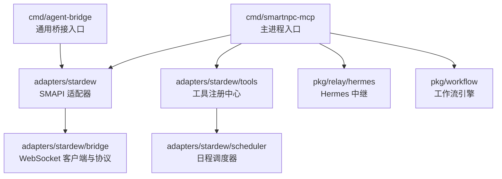
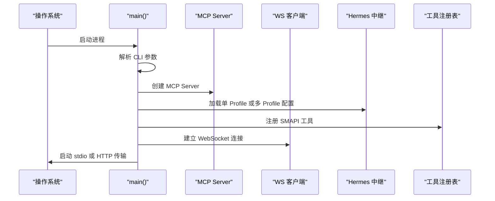
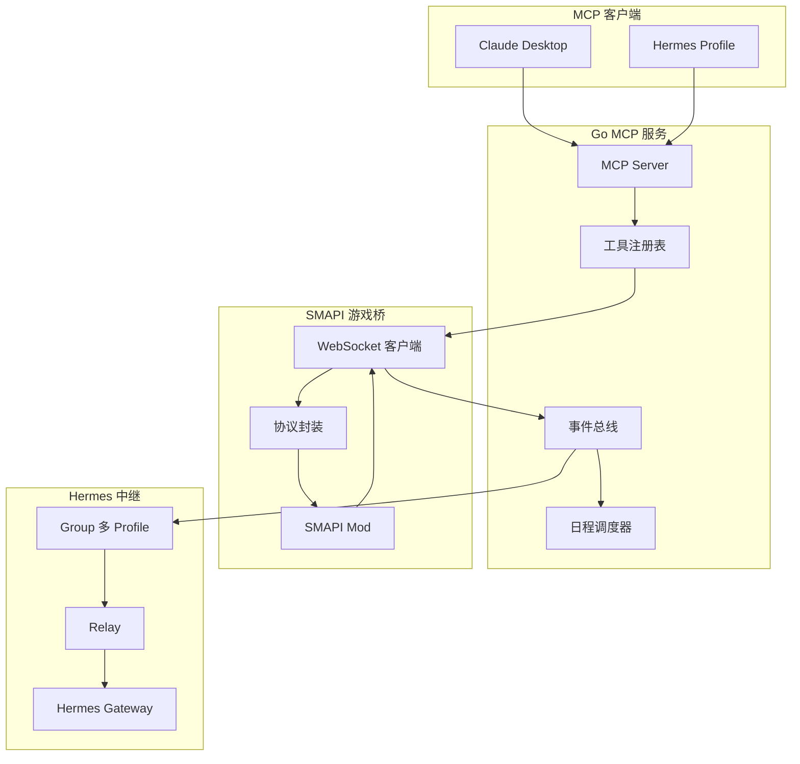
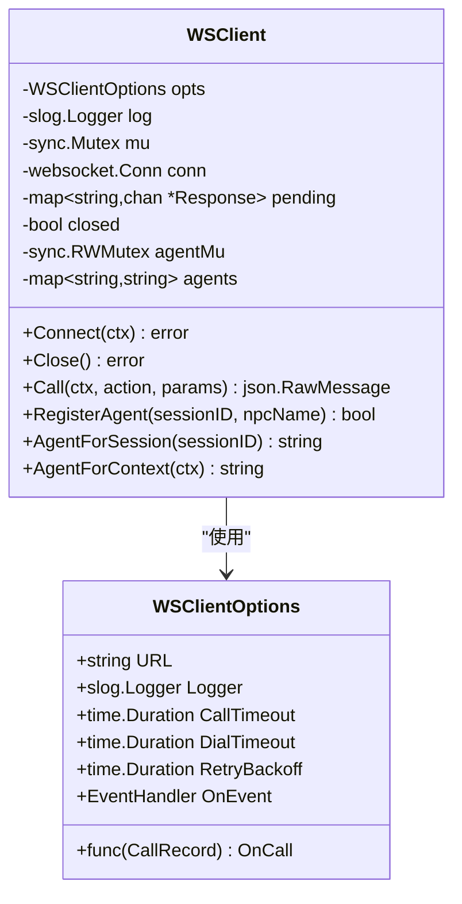
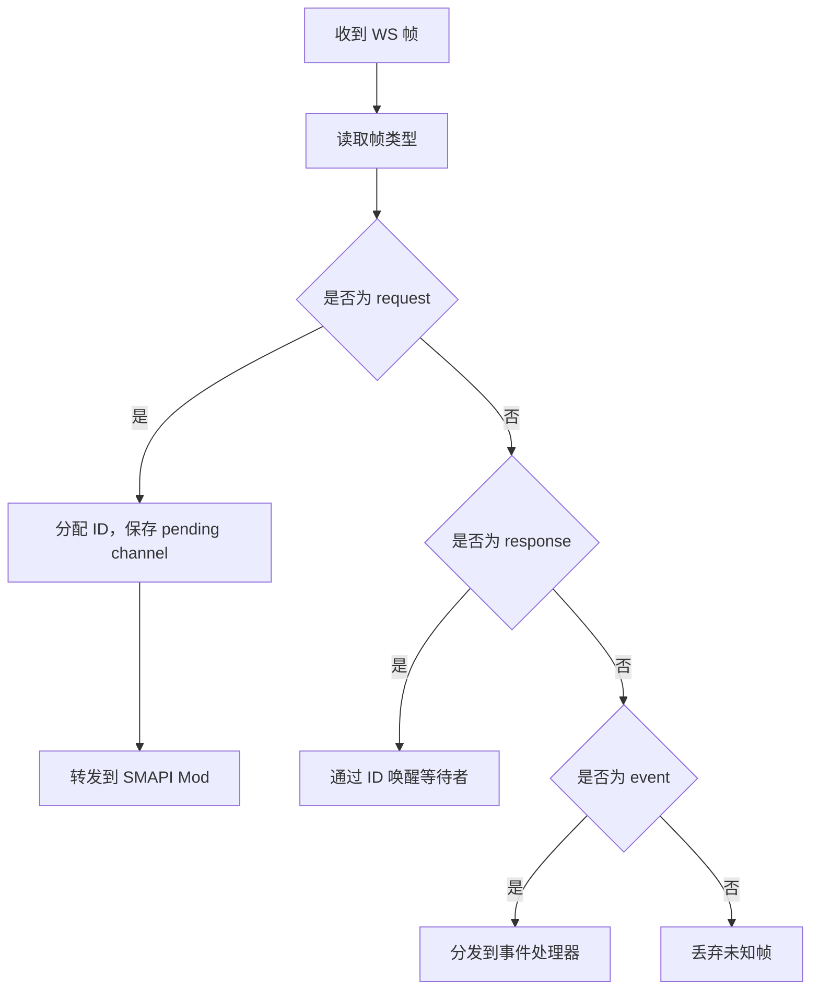
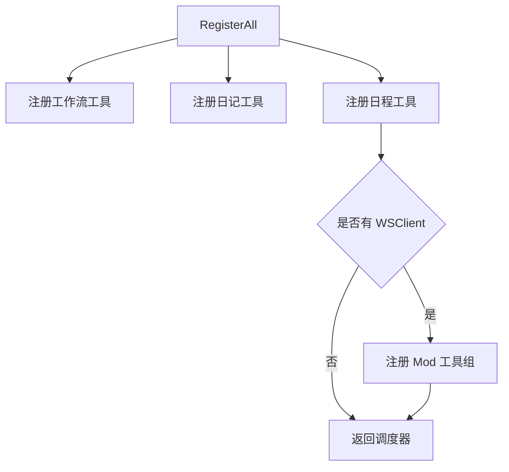
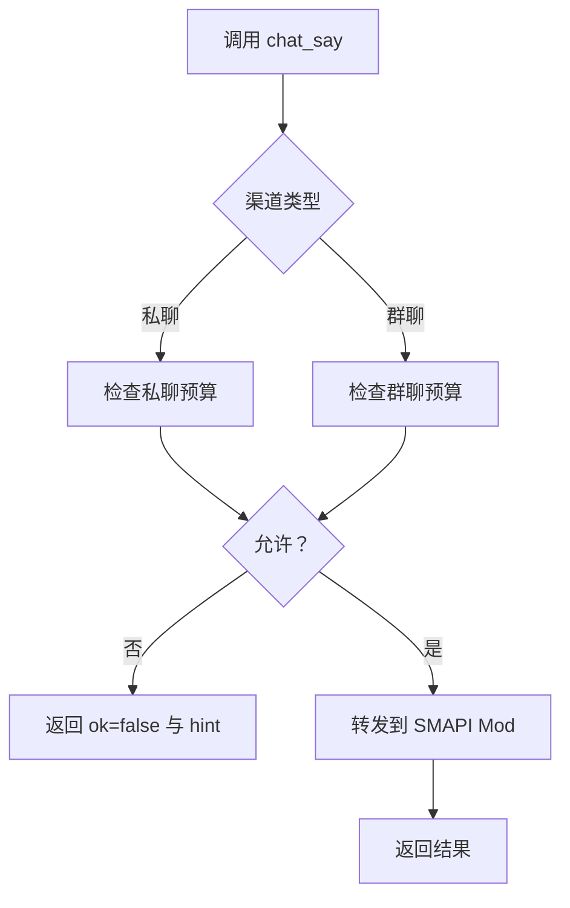
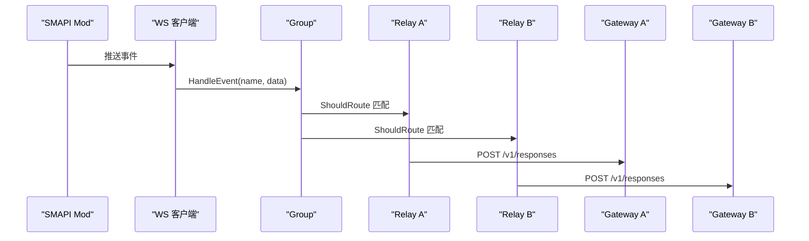
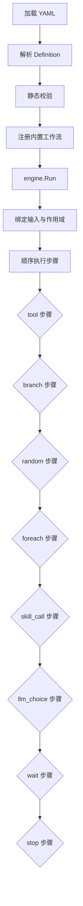
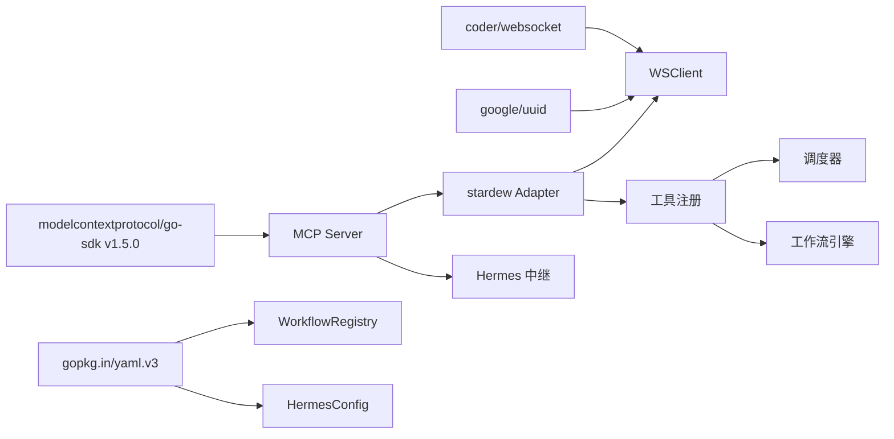

# MCP 服务开发

<cite>
**本文引用的文件**   
- [go.mod](file://SmartNPC/smartnpc-mcp/go.mod)
- [README.md](file://SmartNPC/smartnpc-mcp/README.md)
- [mcp-tools.md](file://SmartNPC/docs/mcp-tools.md)
- [workflow-authoring.md](file://SmartNPC/docs/workflow-authoring.md)
- [hermes README.md](file://SmartNPC/hermes/README.md)
- [runtime-config.yaml](file://SmartNPC/hermes/runtime-config.yaml)
- [npcs.yaml](file://SmartNPC/hermes/npcs.yaml)
- [main.go](file://SmartNPC/smartnpc-mcp/cmd/smartnpc-mcp/main.go)
- [agent-bridge main.go](file://SmartNPC/smartnpc-mcp/cmd/agent-bridge/main.go)
- [stardew adapter.go](file://SmartNPC/smartnpc-mcp/adapters/stardew/adapter.go)
- [ws_client.go](file://SmartNPC/smartnpc-mcp/adapters/stardew/bridge/ws_client.go)
- [protocol.go](file://SmartNPC/smartnpc-mcp/adapters/stardew/bridge/protocol.go)
- [registry.go](file://SmartNPC/smartnpc-mcp/adapters/stardew/tools/registry.go)
- [chat.go](file://SmartNPC/smartnpc-mcp/adapters/stardew/tools/chat.go)
- [game_query.go](file://SmartNPC/smartnpc-mcp/adapters/stardew/tools/game_query.go)
- [npc_perception.go](file://SmartNPC/smartnpc-mcp/adapters/stardew/tools/npc_perception.go)
- [npc_movement.go](file://SmartNPC/smartnpc-mcp/adapters/stardew/tools/npc_movement.go)
- [npc_social_action.go](file://SmartNPC/smartnpc-mcp/adapters/stardew/tools/npc_social_action.go)
- [npc_world_action.go](file://SmartNPC/smartnpc-mcp/adapters/stardew/tools/npc_world_action.go)
- [workflow.go](file://SmartNPC/smartnpc-mcp/adapters/stardew/tools/workflow.go)
- [npc_schedule.go](file://SmartNPC/smartnpc-mcp/adapters/stardew/tools/npc_schedule.go)
- [hermes config.go](file://SmartNPC/smartnpc-mcp/pkg/relay/hermes/config.go)
- [hermes group.go](file://SmartNPC/smartnpc-mcp/pkg/relay/hermes/group.go)
- [hermes relay.go](file://SmartNPC/smartnpc-mcp/pkg/relay/hermes/relay.go)
- [workflow engine.go](file://SmartNPC/smartnpc-mcp/pkg/workflow/engine.go)
- [workflow definition.go](file://SmartNPC/smartnpc-mcp/pkg/workflow/definition.go)
- [workflow registry.go](file://SmartNPC/smartnpc-mcp/pkg/workflow/registry.go)
</cite>

## 目录
1. [引言](#引言)
2. [项目结构](#项目结构)
3. [核心组件](#核心组件)
4. [架构总览](#架构总览)
5. [详细组件分析](#详细组件分析)
6. [依赖关系分析](#依赖关系分析)
7. [性能与可靠性特性](#性能与可靠性特性)
8. [故障排查指南](#故障排查指南)
9. [新工具开发指南](#新工具开发指南)
10. [结论](#结论)

## 引言
本仓库围绕“把《星露谷物语》SMAPI Mod 的 NPC 行为暴露为 MCP 工具”这一目标，构建了三层体系：

- **MCP 服务端**：`smartnpc-mcp` 基于 Go 1.25.0 和 `modelcontextprotocol/go-sdk v1.5.0`，提供 stdio 与 Streamable HTTP 两种传输。
- **SMAPI 适配器**：通过 WebSocket 客户端连接 SMAPI Mod，封装请求/响应/事件协议，并把游戏内事件路由到 Hermes、调度器或日志系统。
- **Hermes 中继与工作流引擎**：支持单 Profile 和多 Profile 扇出；工作流引擎执行 YAML 定义的多步骤 NPC 任务，而不需要每步调用 LLM。

项目当前默认注册约 51 个工具；在 debug 模式下还会额外注册一个调试用 `workflow_run_inline` 工具。实验构建中移除了玩家交互相关工具，保留自治农场管家能力。

**章节来源**
- [go.mod:1-19](file://SmartNPC/smartnpc-mcp/go.mod#L1-L19)
- [README.md:1-40](file://SmartNPC/smartnpc-mcp/README.md#L1-L40)
- [mcp-tools.md:1-120](file://SmartNPC/docs/mcp-tools.md#L1-L120)

## 项目结构
仓库中与 MCP 服务直接相关的代码集中在 `SmartNPC/smartnpc-mcp`，关键路径如下：

**图表来源**
- [main.go:1-120](file://SmartNPC/smartnpc-mcp/cmd/smartnpc-mcp/main.go#L1-L120)
- [agent-bridge main.go:1-123](file://SmartNPC/smartnpc-mcp/cmd/agent-bridge/main.go#L1-L123)
- [stardew adapter.go:1-163](file://SmartNPC/smartnpc-mcp/adapters/stardew/adapter.go#L1-L163)

### 主要模块职责
| 模块 | 职责 |
|---|---|
| `cmd/smartnpc-mcp` | 解析 CLI 参数、创建 MCP Server、选择单 Profile 或多 Profile Hermes 配置、挂载工具、启动 stdio 或 HTTP 传输 |
| `cmd/agent-bridge` | 从 `bridge.yaml` 动态装配适配器与中继，适合扩展其他后端 |
| `adapters/stardew` | 封装 WSClient、事件源、以及将 SMAPI 事件转为 `eventbus.Event` |
| `adapters/stardew/bridge` | 定义 JSON-RPC 帧、动作名、事件名，管理 WebSocket 连接与会话绑定 |
| `adapters/stardew/tools` | 按类别注册 MCP 工具，并共享调度器和聊天预算守卫 |
| `pkg/relay/hermes` | 向 Hermes Gateway POST 事件，支持多 Profile 过滤与扇出 |
| `pkg/workflow` | 定义 YAML DSL、加载内置工作流、运行步骤引擎 |

**章节来源**
- [main.go:1-120](file://SmartNPC/smartnpc-mcp/cmd/smartnpc-mcp/main.go#L1-L120)
- [agent-bridge main.go:1-123](file://SmartNPC/smartnpc-mcp/cmd/agent-bridge/main.go#L1-L123)
- [stardew adapter.go:1-163](file://SmartNPC/smartnpc-mcp/adapters/stardew/adapter.go#L1-L163)
- [registry.go:1-82](file://SmartNPC/smartnpc-mcp/adapters/stardew/tools/registry.go#L1-L82)

## 核心组件
本节聚焦五个对 MCP 服务开发最关键的组件：服务启动流程、CLI 参数解析、服务器配置、SMAPI 适配器、工具注册机制。

### 服务启动流程
`smartnpc-mcp` 的主函数完成以下顺序操作：

1. 启用 UTF-8 控制台输出，避免 Windows 下中文乱码。
2. 解析所有 flag。
3. 初始化 slog logger 并写入启动信息。
4. 使用信号上下文处理中断和终止。
5. 创建 MCP Server，标识名称、标题和版本。
6. 根据 `--hermes-config`、`--hermes-url` 等参数选择 Hermes 事件处理器。
7. 创建聊天预算守卫、实验日志追踪器，并设置全局 payload 回调。
8. 组装并挂载工具组。
9. 最终根据是否传入 `--http` 选择 stdio 或 HTTP 传输。

**图表来源**
- [main.go:1-120](file://SmartNPC/smartnpc-mcp/cmd/smartnpc-mcp/main.go#L1-L120)

**章节来源**
- [main.go:1-120](file://SmartNPC/smartnpc-mcp/cmd/smartnpc-mcp/main.go#L1-L120)

### CLI 参数解析
`smartnpc-mcp` 使用标准库 `flag` 解析参数，关键参数分类如下：

| 参数 | 用途 | 说明 |
|---|---|---|
| `--version` | 打印版本并退出 | 便于 CI 或部署检查 |
| `--log-level` | 日志级别 | `debug|info|warn|error` |
| `--ws-url` | SMAPI Mod WebSocket URL | 为空时禁用 Mod 工具，只保留纯进程内工具 |
| `--echo-mode` / `--echo-speaker` | 回显模式 | 把收到的聊天事件直接转发为 `chat_say`，用于无 LLM 验证 |
| `--http` | 开启 Streamable HTTP | 替代 stdio，供 WSL 或其他主机访问 |
| `--http-allow-any-origin` | HTTP 跨域控制 | 生产环境建议关闭 |
| `--hermes-url` 及附属参数 | 单 Profile 中继 | 旧式单目标配置 |
| `--hermes-config` | 多 Profile 扇出配置 | 优先于旧式参数 |
| `--mcp-api-key` | HTTP 鉴权 Bearer Token | 暴露公网端口时使用 |

**章节来源**
- [main.go:1-120](file://SmartNPC/smartnpc-mcp/cmd/smartnpc-mcp/main.go#L1-L120)

### 服务器配置
MCP Server 通过 `mcp.NewServer` 创建，并传入实现信息与选项。`smartnpc-mcp` 固定使用：

- 名称：`smartnpc-mcp`
- 标题：`Stardew Valley NPC Bridge`
- 版本：由变量注入，通常是 `0.1.0-dev`

`agent-bridge` 则是一个更通用的装配入口，它不硬编码 SMAPI 适配器，而是从配置文件动态组装适配器、中继和传输层。

**章节来源**
- [main.go:1-120](file://SmartNPC/smartnpc-mcp/cmd/smartnpc-mcp/main.go#L1-L120)
- [agent-bridge main.go:1-123](file://SmartNPC/smartnpc-mcp/cmd/agent-bridge/main.go#L1-L123)

## 架构总览
整个系统可以理解为一条“游戏事件 → MCP 工具 → SMAPI Mod → Hermes Agent”的双向链路：

**图表来源**
- [main.go:1-120](file://SmartNPC/smartnpc-mcp/cmd/smartnpc-mcp/main.go#L1-L120)
- [stardew adapter.go:1-163](file://SmartNPC/smartnpc-mcp/adapters/stardew/adapter.go#L1-L163)
- [protocol.go:1-172](file://SmartNPC/smartnpc-mcp/adapters/stardew/bridge/protocol.go#L1-L172)
- [hermes group.go:1-81](file://SmartNPC/smartnpc-mcp/pkg/relay/hermes/group.go#L1-L81)

**章节来源**
- [hermes README.md:1-147](file://SmartNPC/hermes/README.md#L1-L147)

## 详细组件分析

### SMAPI 适配器与 WebSocket 客户端
SMAPI 适配器的目标是把 SMAPI Mod 的 WebSocket 事件转换成 MCP 生态可用的事件源，同时挂载一组 SMAPI 专属工具。

#### WSClient 连接管理
`WSClient` 是连接 SMAPI Mod 的核心对象，负责：

- 使用默认地址 `ws://127.0.0.1:18745/ws` 拨号。
- 维护 pending 请求映射，按 ID 关联 Response。
- 后台读循环接收 Event。
- 自动重连与退避。
- 记录 MCP 会话到 NPC 的绑定关系，用于给请求打上 `from_npc`。

**图表来源**
- [ws_client.go:1-200](file://SmartNPC/smartnpc-mcp/adapters/stardew/bridge/ws_client.go#L1-L200)

#### 协议封装与消息路由
协议包定义了三种帧类型：Request、Response、Event。ActionName 枚举覆盖游戏查询、NPC 感知、移动、世界行为、社交、库存等动作；EventName 覆盖聊天、NPC 交互、日程触发、昼夜边界等事件。

**图表来源**
- [protocol.go:1-172](file://SmartNPC/smartnpc-mcp/adapters/stardew/bridge/protocol.go#L1-L172)

**章节来源**
- [stardew adapter.go:1-163](file://SmartNPC/smartnpc-mcp/adapters/stardew/adapter.go#L1-L163)
- [ws_client.go:1-200](file://SmartNPC/smartnpc-mcp/adapters/stardew/bridge/ws_client.go#L1-L200)
- [protocol.go:1-172](file://SmartNPC/smartnpc-mcp/adapters/stardew/bridge/protocol.go#L1-L172)

### 工具注册机制（Tools Registry）
工具注册由 `tools.RegisterAll` 集中管理。它会先注册框架级工具，再根据是否提供 WSClient 决定是否需要 SMAPI Mod 工具。

注册顺序体现设计意图：

1. 工作流工具与日记工具：不需要 Mod 桥。
2. 日程工具：共享调度器实例。
3. 若存在 WSClient：注册代理注册、聊天、游戏查询、农场经济、NPC 感知、移动、行为、世界行为、库存、社交工具。
4. 返回共享调度器，供事件路由器在 `game_time_tick` 时驱动。

**图表来源**
- [registry.go:1-82](file://SmartNPC/smartnpc-mcp/adapters/stardew/tools/registry.go#L1-L82)

**章节来源**
- [registry.go:1-82](file://SmartNPC/smartnpc-mcp/adapters/stardew/tools/registry.go#L1-L82)
- [mcp-tools.md:1-120](file://SmartNPC/docs/mcp-tools.md#L1-L120)

### 工具分类说明

#### 聊天工具
聊天工具以 `chat_say` 为核心，它是唯一产生可见 NPC 对话的工具。实现中包含一个强约束：每个唤醒周期只能发言一次。

关键点：

- `ChatSayGuard` 区分私聊与群聊预算。
- 私聊按说话人维度限制。
- 群聊按 `(group_id, speaker)` 维度限制。
- 每次新的针对该 NPC 的事件到达时重置预算。
- 返回值中的 `hint` 会提示 LLM 停止继续调用工具。

**图表来源**
- [chat.go:1-200](file://SmartNPC/smartnpc-mcp/adapters/stardew/tools/chat.go#L1-L200)

**章节来源**
- [chat.go:1-200](file://SmartNPC/smartnpc-mcp/adapters/stardew/tools/chat.go#L1-L200)

#### 游戏查询工具
游戏查询工具包括时间查询和天气查询。它们只读游戏状态，不修改世界。

- `game_get_time`：返回小时、分钟、原始时间值、日期、星期、季节、年份。
- `game_get_weather`：返回天气类型与降雨、降雪、闪电布尔标志。

这类工具适合在制定日程前读取环境，帮助模型决定浇水、收割或室内活动。

**章节来源**
- [game_query.go:1-89](file://SmartNPC/smartnpc-mcp/adapters/stardew/tools/game_query.go#L1-L89)

#### NPC 感知工具
感知工具让 NPC 知道自身位置和周围实体：

- `npc_get_position`：当前位置、地图、朝向、是否移动。
- `npc_get_nearby`：半径内的角色列表，按距离排序。
- `npc_get_environment`：合并位置、时间、天气、附近对象的综合视图。
- `npc_get_named_locations`：农场静态地标表，便于人类地名转坐标。

**章节来源**
- [npc_perception.go:1-129](file://SmartNPC/smartnpc-mcp/adapters/stardew/tools/npc_perception.go#L1-L129)

#### 移动工具
移动工具负责 NPC 的路径规划、转向、定位和地标解析：

- `npc_move_to`：在同一地图内寻路，跨地图走传送。
- `npc_face_direction`：面向上、下、左、右。
- `npc_get_position`：查询移动结果是否生效。
- `npc_get_named_locations`：提供“房子前面”“湖边”“大门”等地标。

这些工具接受 `radius`+`max_count` 或矩形 `x1/y1/x2/y2` 两种目标约定。

**章节来源**
- [npc_movement.go:1-200](file://SmartNPC/smartnpc-mcp/adapters/stardew/tools/npc_movement.go#L1-L200)

#### 社交工具
社交工具偏向表达性动画和轻量视觉反馈，例如：

- `npc_express_emotion`
- `npc_shy_retreat`
- `npc_show_text_bubble`
- `npc_idle_activity`
- `npc_dance_happy`
- `npc_react_surprise`
- `npc_pace_anxiously`

它们通常不改变游戏状态，而是驱动动画、表情气泡或空闲动作。部分 handler 仍可能处于占位阶段，但工具注册和协议通道是完整的。

**章节来源**
- [npc_social_action.go:1-200](file://SmartNPC/smartnpc-mcp/adapters/stardew/tools/npc_social_action.go#L1-L200)

#### 世界行为工具
世界行为工具是农场与资源管理的核心：

- `npc_wander`：随机游走，支持中心束缚或矩形区域。
- `npc_clear_debris`：清理石头、杂草、木头。
- `npc_till_soil`：耕整矩形地块。
- `npc_fertilize`：施肥。
- `npc_plant_seeds`：播种种子。
- `npc_water_crops`：浇水。
- `npc_harvest_crops`：收割成熟作物。
- `npc_fill_gaps`：补耕补种。
- `npc_forage_collect`：采集自然刷新物。
- `npc_break_resource`：敲矿石或砍树。
- `npc_pet_animal`：抚摸农场动物。
- `npc_deposit_items`：存入箱子。
- `npc_ship_items`：寄售物品。
- `npc_withdraw_from_chest`：从箱子取出。
- `npc_transfer_item`：背包间转移。
- `npc_inventory_get/put/take`：背包读写。
- `npc_inspect_object`：扫描可互动对象。
- `npc_place_object`：放置可放置对象。

**章节来源**
- [npc_world_action.go:1-200](file://SmartNPC/smartnpc-mcp/adapters/stardew/tools/npc_world_action.go#L1-L200)

#### 日程与工作流工具
日程与工作流工具是自治农场的计划中枢：

- `npc_plan_day`：提交当天日程，支持引用内置工作流、内联工作流或遗留 action。
- `npc_get_schedule`：查看未触发的日程条目。
- `npc_workflow_status`：查看运行中工作流、队列深度。
- `workflow_list`：列出可用工作流。
- `workflow_get`：查看工作流完整定义。
- `workflow_choice_reply`：回答工作流中的 LLM 选择题。
- `diary_write`：写日记。
- `day_review_complete`：标记日终复盘完成。

**章节来源**
- [npc_schedule.go:1-200](file://SmartNPC/smartnpc-mcp/adapters/stardew/tools/npc_schedule.go#L1-L200)
- [workflow.go:1-200](file://SmartNPC/smartnpc-mcp/adapters/stardew/tools/workflow.go#L1-L200)

### Hermes 中继系统：单 Profile 与多 Profile 扇出
Hermes 中继负责把 SMAPI 事件转发给 Hermes Gateway。系统支持两种配置方式：

| 配置方式 | 适用场景 | 特点 |
|---|---|---|
| 单 Profile | 开发、调试、单一 NPC | 通过 `--hermes-url` 等旧式参数 |
| 多 Profile | 多 NPC 运行时 | 通过 `--hermes-config` 指向 `runtime-config.yaml` |

`runtime-config.yaml` 定义多个 profile 条目，每个条目包含网关地址、对话 ID、模型名、API Key 环境变量名等。脚本生成后由 `smartnpc-mcp --hermes-config` 消费。

**图表来源**
- [hermes group.go:1-81](file://SmartNPC/smartnpc-mcp/pkg/relay/hermes/group.go#L1-L81)
- [hermes relay.go:1-200](file://SmartNPC/smartnpc-mcp/pkg/relay/hermes/relay.go#L1-L200)
- [runtime-config.yaml:1-15](file://SmartNPC/hermes/runtime-config.yaml#L1-L15)

**章节来源**
- [hermes config.go:1-191](file://SmartNPC/smartnpc-mcp/pkg/relay/hermes/config.go#L1-L191)
- [hermes group.go:1-81](file://SmartNPC/smartnpc-mcp/pkg/relay/hermes/group.go#L1-L81)
- [hermes relay.go:1-200](file://SmartNPC/smartnpc-mcp/pkg/relay/hermes/relay.go#L1-L200)
- [runtime-config.yaml:1-15](file://SmartNPC/hermes/runtime-config.yaml#L1-L15)
- [npcs.yaml:1-70](file://SmartNPC/hermes/npcs.yaml#L1-L70)

### 工作流引擎设计
工作流引擎是一个独立于 MCP、WebSocket 和 Hermes 的 DSL 执行器。它以 YAML 文件描述多步骤 NPC 行为，并通过 `Runner` 接口对接真实工具、技能、LLM 选择和空闲等待。

#### YAML 定义格式
工作流定义包含：

- `id`：唯一标识。
- `description`：人类可读说明。
- `version`：工作流版本。
- `inputs`：可选输入参数，带默认值。
- `steps`：有序步骤列表。

步骤类型包括：

| 步骤类型 | 作用 |
|---|---|
| `tool` | 调用 MCP 工具 |
| `branch` | if/else 分支 |
| `random` | 加权随机选择 |
| `foreach` | 遍历列表 |
| `skill_call` | 触发 Hermes SKILL |
| `llm_choice` | 让 LLM 在固定选项中选择一个 |
| `wait` | 等待条件，目前支持 idle |
| `stop` | 提前结束 |

**图表来源**
- [workflow definition.go:1-200](file://SmartNPC/smartnpc-mcp/pkg/workflow/definition.go#L1-L200)
- [workflow engine.go:1-200](file://SmartNPC/smartnpc-mcp/pkg/workflow/engine.go#L1-L200)
- [workflow registry.go:1-200](file://SmartNPC/smartnpc-mcp/pkg/workflow/registry.go#L1-L200)

#### 执行流程
引擎在执行时会：

1. 校验定义非空、Runner 非空。
2. 绑定声明的 inputs 与额外传入的 inputs。
3. 初始化 RNG、RunResult、Scope。
4. 顺序执行 steps。
5. 统计 step 数量、工具调用次数、nothing_to_do 次数、是否提前停止。
6. 返回 RunResult 和错误。

**章节来源**
- [workflow authoring guide](file://SmartNPC/docs/workflow-authoring.md#L1-L172)
- [workflow definition.go:1-200](file://SmartNPC/smartnpc-mcp/pkg/workflow/definition.go#L1-L200)
- [workflow engine.go:1-200](file://SmartNPC/smartnpc-mcp/pkg/workflow/engine.go#L1-L200)
- [workflow registry.go:1-200](file://SmartNPC/smartnpc-mcp/pkg/workflow/registry.go#L1-L200)

## 依赖关系分析
MCP 服务的依赖可以分为三类：框架依赖、游戏桥依赖、运行时依赖。

**图表来源**
- [go.mod:1-19](file://SmartNPC/smartnpc-mcp/go.mod#L1-L19)
- [stardew adapter.go:1-163](file://SmartNPC/smartnpc-mcp/adapters/stardew/adapter.go#L1-L163)
- [ws_client.go:1-200](file://SmartNPC/smartnpc-mcp/adapters/stardew/bridge/ws_client.go#L1-L200)
- [workflow registry.go:1-200](file://SmartNPC/smartnpc-mcp/pkg/workflow/registry.go#L1-L200)
- [hermes config.go:1-191](file://SmartNPC/smartnpc-mcp/pkg/relay/hermes/config.go#L1-L191)

**章节来源**
- [go.mod:1-19](file://SmartNPC/smartnpc-mcp/go.mod#L1-L19)

## 性能与可靠性特性
系统在性能和可靠性方面做了若干明确取舍：

- **WS 调用超时**：默认 60 分钟，实际接近“不超时”，因为工具调用由 SMAPI Mod 异步执行，返回较快。
- **拨号超时**：默认 5 秒。
- **重连退避**：默认 2 秒，避免频繁重试。
- **Hermes POST 超时**：默认 120 秒，预留冷启动 LLM 响应时间。
- **并发安全**：WSClient 的请求映射、Agent 映射、Hermes Relay 的 turn 串行化都使用锁保护。
- **背景 goroutine**：Hermis Relay 的 `HandleEvent` 使用独立 goroutine POST，不会阻塞 WS 读循环。
- **对话存储开关**：可通过环境变量关闭 Hermes 侧 conversation store，用于调试重复记忆问题。
- **负载隔离**：Debug Payload 日志可单独写入文件，避免污染主日志流。

**章节来源**
- [ws_client.go:1-200](file://SmartNPC/smartnpc-mcp/adapters/stardew/bridge/ws_client.go#L1-L200)
- [hermes relay.go:1-200](file://SmartNPC/smartnpc-mcp/pkg/relay/hermes/relay.go#L1-L200)
- [hermes config.go:1-191](file://SmartNPC/smartnpc-mcp/pkg/relay/hermes/config.go#L1-L191)

## 故障排查指南

### 无法连接 SMAPI Mod
现象：工具调用失败或日志显示初始连接失败。

排查要点：

- 确认 SMAPI Mod 已启动且监听 `ws://127.0.0.1:18745/ws`。
- 如果传入了自定义 `--ws-url`，确认地址正确。
- 初次连接失败会被记录为警告，但 WSClient 会在后台重试；不要因此立即判定服务崩溃。
- 如果没有 WSClient，Mod 工具不会被注册，只保留工作流、日程、日记等纯进程内工具。

**章节来源**
- [stardew adapter.go:1-163](file://SmartNPC/smartnpc-mcp/adapters/stardew/adapter.go#L1-L163)
- [ws_client.go:1-200](file://SmartNPC/smartnpc-mcp/adapters/stardew/bridge/ws_client.go#L1-L200)

### Hermes 事件没有转发
现象：SMAPI 事件没有唤醒对应 Hermes Profile。

排查要点：

- 如果使用单 Profile，确认 `--hermes-url`、`--hermes-conversation`、`--hermes-model` 一致。
- 如果使用多 Profile，确认 `--hermes-config` 指向有效 YAML，且 `profiles` 不为空。
- 检查 `npc_filter` 是否与事件中的 NPC 名称匹配。
- 如果 Group 报告“no profile matched”，说明事件被过滤或没有 relays 匹配。
- 检查 Gateway 健康接口与 API Key 环境变量。

**章节来源**
- [main.go:1-120](file://SmartNPC/smartnpc-mcp/cmd/smartnpc-mcp/main.go#L1-L120)
- [hermes group.go:1-81](file://SmartNPC/smartnpc-mcp/pkg/relay/hermes/group.go#L1-L81)
- [hermes config.go:1-191](file://SmartNPC/smartnpc-mcp/pkg/relay/hermes/config.go#L1-L191)

### 聊天工具被限流
现象：同一唤醒周期多次调用 `chat_say` 返回 `ok=false`。

这是预期行为。`ChatSayGuard` 强制“一问一答”语义：

- 私聊：每个 NPC 在每个唤醒周期最多一次。
- 群聊：每个 `(group_id, speaker)` 在每个玩家回合最多一次。
- 新事件到达时才会重置预算。
- 调用方应把返回中的 `hint` 视为停止信号。

**章节来源**
- [chat.go:1-200](file://SmartNPC/smartnpc-mcp/adapters/stardew/tools/chat.go#L1-L200)

### 工作流无法运行
现象：`workflow_list` 正常，但运行时报错。

排查要点：

- 检查工作流 YAML 是否通过 `workflow-lint`。
- 检查 `id` 是否重复。
- 检查 `steps` 是否为空。
- 检查 `save_as` 是否在同一作用域重复。
- 检查变量引用是否指向已声明 input 或已有 `save_as`。
- 如果是 inline 工作流，确认其结构符合 Definition 要求。

**章节来源**
- [workflow-authoring.md:1-172](file://SmartNPC/docs/workflow-authoring.md#L1-L172)
- [workflow registry.go:1-200](file://SmartNPC/smartnpc-mcp/pkg/workflow/registry.go#L1-L200)

## 新工具开发指南

### 开发流程
新增一个 SMAPI 工具通常遵循以下步骤：

1. 在 `adapters/stardew/bridge/protocol.go` 中添加 ActionName 常量。
2. 定义输入结构和输出结构。
3. 在 `adapters/stardew/tools` 下新建或扩展现有文件，实现工具 handler。
4. 在 `registry.go` 中调用对应的 `registerXxx` 函数。
5. 如果需要 Mod 桥，确保通过 `br.Call` 发送请求，并反序列化响应。
6. 如果需要会话上下文，使用 `WithCallSession` 包装 context。
7. 添加单元测试，尤其是参数校验、错误路径和 nothing_to_do 行为。
8. 更新 `mcp-tools.md` 中的工具目录和说明。

### 最佳实践
| 主题 | 建议 |
|---|---|
| 参数校验 | 尽早拒绝非法参数，返回结构化错误，而不是让 Mod 返回模糊错误 |
| 命名规范 | NPC 内部名使用 PascalCase，如 `XiaMi`、`Abigail` |
| 副作用标注 | 工具 Description 必须明确说明 READ 或 WRITE |
| 异步执行 | 如果 Mod 异步执行动作，返回接受成功即可，不要等待游戏 tick |
| nothing_to_do | 工作流中应支持 `on_nothing_to_do=skip|stop|fail` |
| 工具分组 | 把相似工具放在同一文件，并由 registry 统一挂载 |
| 可测试性 | 通过 WSClient 的 session 注册机制模拟 from_npc |
| 日志 | 使用统一的 tool call 日志辅助诊断 |
| 文档 | 同步更新 MCP 工具目录和 YAML 工作流作者指南 |

### 示例参考路径
- 聊天工具实现参考：[chat.go](file://SmartNPC/smartnpc-mcp/adapters/stardew/tools/chat.go)
- 游戏查询工具参考：[game_query.go](file://SmartNPC/smartnpc-mcp/adapters/stardew/tools/game_query.go)
- NPC 感知工具参考：[npc_perception.go](file://SmartNPC/smartnpc-mcp/adapters/stardew/tools/npc_perception.go)
- 移动工具参考：[npc_movement.go](file://SmartNPC/smartnpc-mcp/adapters/stardew/tools/npc_movement.go)
- 世界行为工具参考：[npc_world_action.go](file://SmartNPC/smartnpc-mcp/adapters/stardew/tools/npc_world_action.go)
- 社交工具参考：[npc_social_action.go](file://SmartNPC/smartnpc-mcp/adapters/stardew/tools/npc_social_action.go)
- 日程工具参考：[npc_schedule.go](file://SmartNPC/smartnpc-mcp/adapters/stardew/tools/npc_schedule.go)
- 工作流工具参考：[workflow.go](file://SmartNPC/smartnpc-mcp/adapters/stardew/tools/workflow.go)
- 协议常量参考：[protocol.go](file://SmartNPC/smartnpc-mcp/adapters/stardew/bridge/protocol.go)
- 工具注册入口参考：[registry.go](file://SmartNPC/smartnpc-mcp/adapters/stardew/tools/registry.go)

**章节来源**
- [protocol.go:1-172](file://SmartNPC/smartnpc-mcp/adapters/stardew/bridge/protocol.go#L1-L172)
- [registry.go:1-82](file://SmartNPC/smartnpc-mcp/adapters/stardew/tools/registry.go#L1-L82)
- [mcp-tools.md:1-120](file://SmartNPC/docs/mcp-tools.md#L1-L120)

## 结论
这个 MCP 服务项目的核心价值在于把 SMAPI Mod 的游戏能力抽象成稳定、可组合的 MCP 工具，同时通过 Hermes 中继把工作事件投影到 AI Agent 的对话上下文中。它的架构清晰分为四层：

- **传输层**：stdio 与 HTTP。
- **服务层**：MCP Server、工具注册、事件路由。
- **适配层**：SMAPI WebSocket 桥、协议封装、会话绑定。
- **智能层**：Hermes Profile、SKILL、工作流引擎。

对于开发者来说，最重要的扩展点有两个：

1. 新增工具时，遵循协议常量、输入输出结构、handler 实现、registry 挂载、文档更新的完整流程。
2. 新增工作流时，优先使用 YAML 定义，避免在 LLM 推理过程中直接拼接工具调用序列。

这套设计既保证了 MCP 客户端的可插拔接入，也保留了 SMAPI Mod 的真实游戏能力边界，是典型的“AI Agent 能力桥”方案。