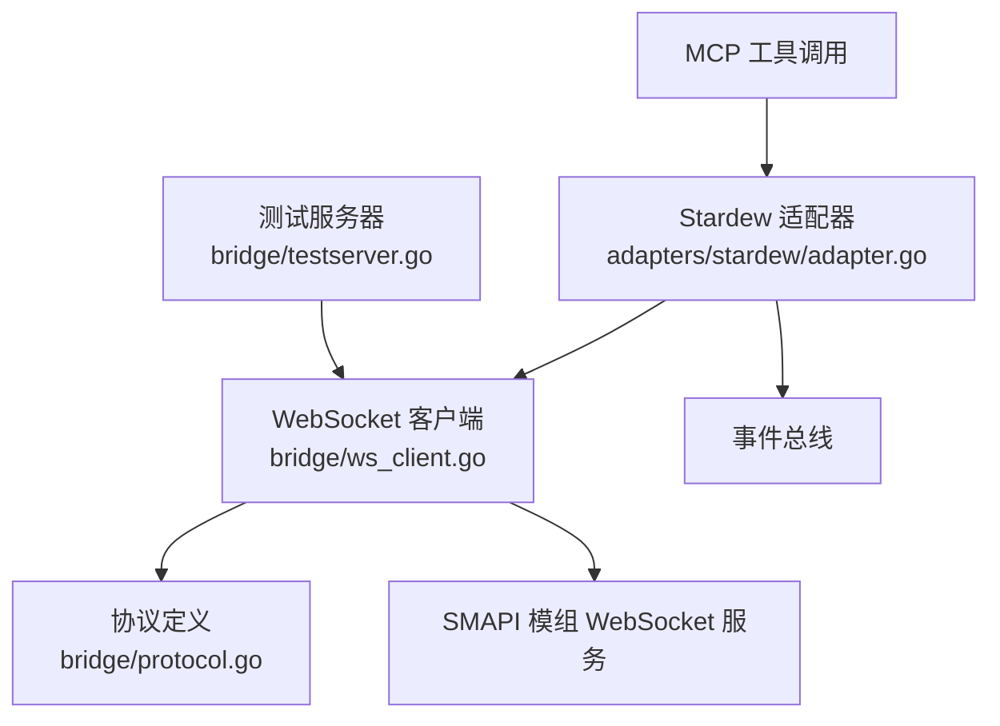
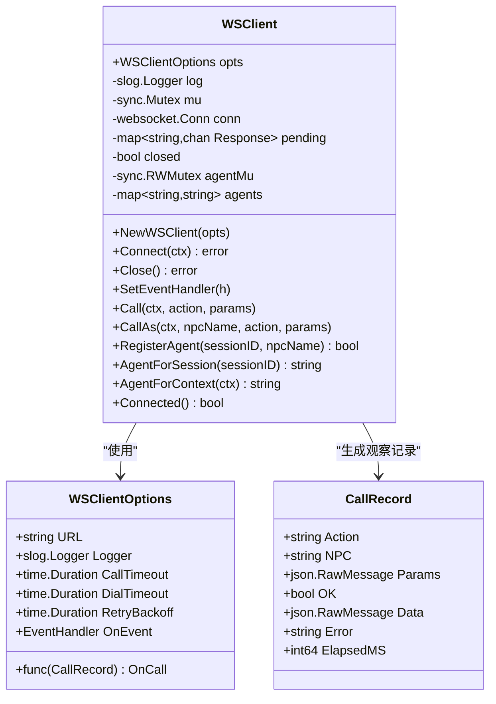
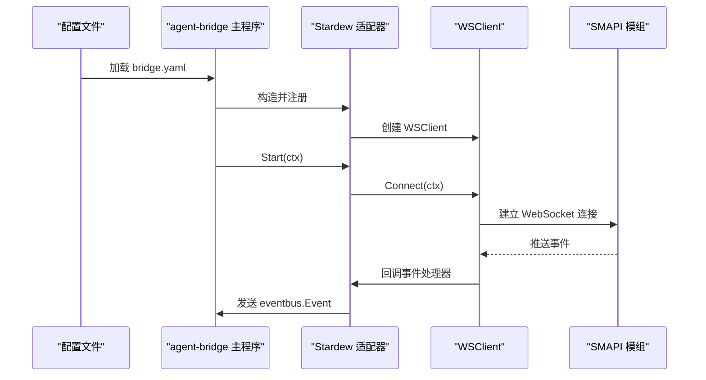
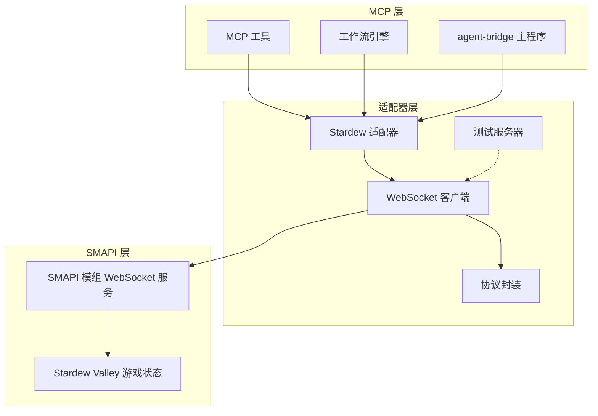
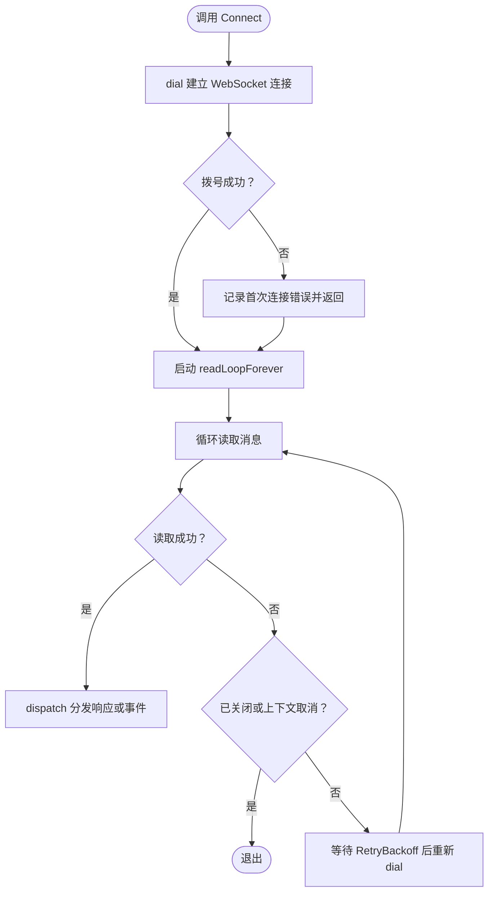
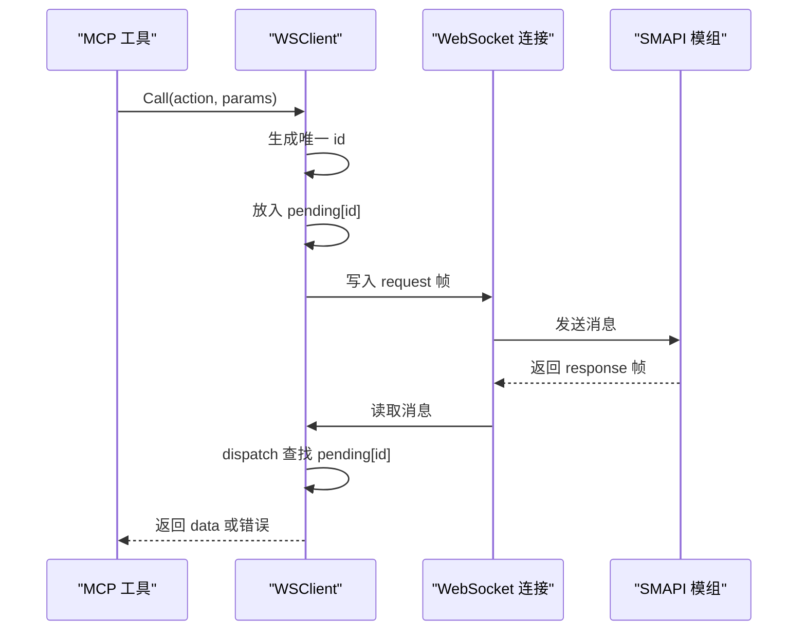
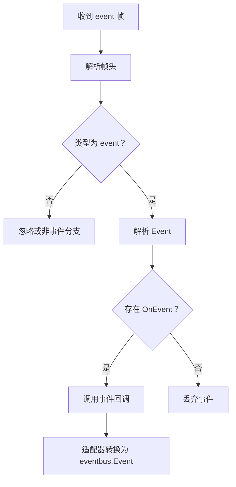
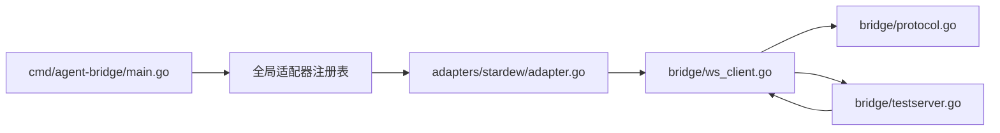
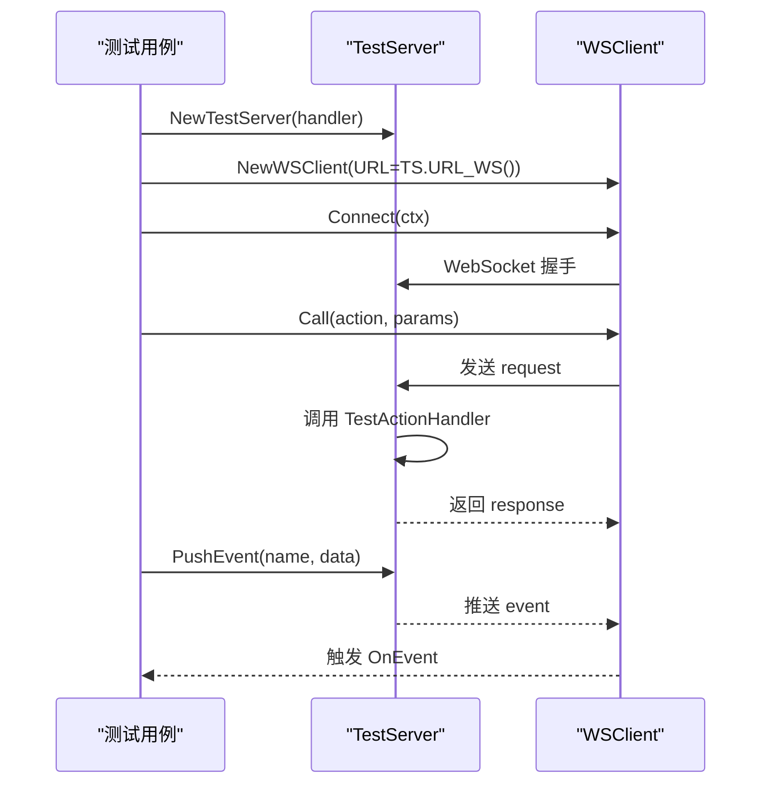
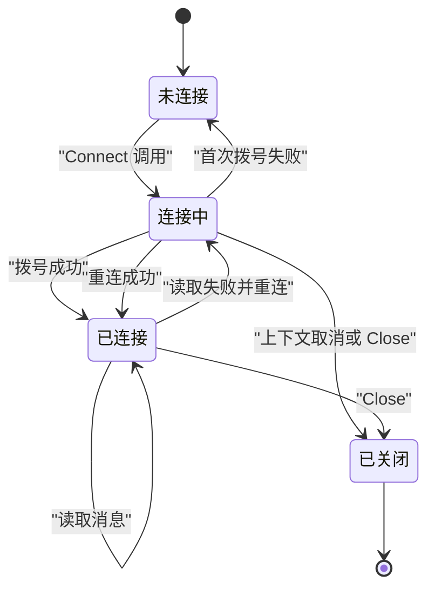

# SMAPI 适配器

<cite>
**本文引用的文件**   
- [ws_client.go](file://SmartNPC/smartnpc-mcp/adapters/stardew/bridge/ws_client.go)
- [protocol.go](file://SmartNPC/smartnpc-mcp/adapters/stardew/bridge/protocol.go)
- [testserver.go](file://SmartNPC/smartnpc-mcp/adapters/stardew/bridge/testserver.go)
- [ws_client_test.go](file://SmartNPC/smartnpc-mcp/adapters/stardew/bridge/ws_client_test.go)
- [adapter.go](file://SmartNPC/smartnpc-mcp/adapters/stardew/adapter.go)
- [main.go](file://SmartNPC/smartnpc-mcp/cmd/agent-bridge/main.go)
</cite>

## 目录

1. [简介](#简介)
2. [项目结构](#项目结构)
3. [核心组件](#核心组件)
4. [架构总览](#架构总览)
5. [详细组件分析](#详细组件分析)
6. [依赖关系分析](#依赖关系分析)
7. [性能与并发特性](#性能与并发特性)
8. [测试服务器与测试策略](#测试服务器与测试策略)
9. [连接状态、错误处理与超时机制](#连接状态错误处理与超时机制)
10. [调试技巧与常见问题排查](#调试技巧与常见问题排查)
11. [扩展协议消息类型](#扩展协议消息类型)
12. [结论](#结论)

## 简介

SMAPI 适配器是 SmartNPC 项目中将 MCP（Model Context Protocol）工具调用桥接到 Stardew Valley SMAPI 后端的中间层。其核心职责包括：

- 实现 WebSocket 客户端，负责与 SMAPI 模组提供的 `ws://127.0.0.1:18745/ws` 建立连接。
- 封装 JSON-RPC 风格的消息帧，把 MCP 工具调用转换为 SMAPI 协议中的请求帧。
- 管理连接生命周期、自动重连、心跳保活、超时与错误传播。
- 通过事件通道把服务端推送的 SMAPI 事件转发给上层事件总线。
- 提供测试服务器，使单元测试和集成测试无需启动真实 SMAPI 模组即可验证协议链路。
- 在 agent-bridge 框架中注册 Stardew 适配器，挂载工具集合并接入事件源。

本技术文档聚焦于 `adapters/stardew/bridge` 下的 WebSocket 客户端、协议定义、测试服务器，以及 `adapters/stardew` 适配器如何把这些能力暴露给 MCP 工具层。

## 项目结构

SMAPI 适配器相关代码主要位于 Go 模块 `smartnpc-mcp` 下，关键路径如下：

| 层级 | 路径 | 职责 |
|---|---|---|
| 适配器入口 | `adapters/stardew/adapter.go` | 构造 WSClient、注册事件源、挂载工具集合 |
| 协议定义 | `adapters/stardew/bridge/protocol.go` | 定义 Request、Response、Event、ActionName、EventName |
| WebSocket 客户端 | `adapters/stardew/bridge/ws_client.go` | 连接、重连、心跳、Call、事件分发 |
| 测试服务器 | `adapters/stardew/bridge/testserver.go` | 进程内 WebSocket 服务，用于测试 |
| 客户端测试 | `adapters/stardew/bridge/ws_client_test.go` | 成功调用、服务端错误、事件投递测试 |
| 通用桥接入口 | `cmd/agent-bridge/main.go` | 加载配置、组装适配器、运行 MCP 传输层 |

**图表来源**
- [adapter.go:1-163](file://SmartNPC/smartnpc-mcp/adapters/stardew/adapter.go#L1-L163)
- [ws_client.go:1-510](file://SmartNPC/smartnpc-mcp/adapters/stardew/bridge/ws_client.go#L1-L510)
- [protocol.go:1-172](file://SmartNPC/smartnpc-mcp/adapters/stardew/bridge/protocol.go#L1-L172)
- [testserver.go:1-147](file://SmartNPC/smartnpc-mcp/adapters/stardew/bridge/testserver.go#L1-L147)

**章节来源**
- [adapter.go:1-163](file://SmartNPC/smartnpc-mcp/adapters/stardew/adapter.go#L1-L163)
- [main.go:1-123](file://SmartNPC/smartnpc-mcp/cmd/agent-bridge/main.go#L1-L123)

## 核心组件

### WebSocket 客户端

`WSClient` 是 SMAPI 适配器的网络核心。它不是简单的一次性连接对象，而是具备以下能力的连接管理器：

| 能力 | 说明 |
|---|---|
| 连接建立 | 通过 `Connect` 发起拨号并启动读取循环 |
| 自动重连 | `readLoopForever` 在断开后按退避时间重试 |
| 心跳保活 | `pingLoop` 每 30 秒发送一次 Ping，防止 C# HttpListener 空闲断开 |
| 请求-响应关联 | 使用 UUID 作为 `id`，维护 `pending` 映射等待响应 |
| 事件分发 | 解析服务端推送的 `event` 帧，回调 `OnEvent` |
| 会话到 NPC 绑定 | 通过 `RegisterAgent` / `AgentForContext` 把 MCP session ID 映射到 NPC 名称 |
| 超时控制 | 每次 Call 使用 `CallTimeout` 限制等待响应的时间 |
| 关闭保护 | `Close` 标记 `closed`，阻止后续调用并释放连接 |

#### 关键数据结构

| 字段或类型 | 含义 |
|---|---|
| `opts` | 客户端配置，包含 URL、日志器、超时、重试间隔、事件回调、调用观察者 |
| `conn` | 当前 WebSocket 连接 |
| `pending` | 未完成的调用映射，键为请求 ID，值为接收响应的 channel |
| `agents` | MCP session ID 到 NPC profile 名称的映射表 |
| `callCtxKey` | 上下文键，用于从工具调用上下文提取 MCP session ID |
| `CallRecord` | 单次调用的观察记录，用于实验日志统计耗时、成功率等 |

#### 并发安全设计

`WSClient` 使用互斥锁保护共享状态：

- `mu` 保护 `conn`、`pending`、`closed` 和 `OnEvent`。
- `agentMu` 单独保护 `agents` 映射，读写分离使用 `sync.RWMutex`。
- 每个待处理调用使用带缓冲 channel，避免阻塞读循环。
- `Connected()` 显式标注“有竞争”的状态查询，适合状态展示而非强一致性判断。

**图表来源**
- [ws_client.go:1-510](file://SmartNPC/smartnpc-mcp/adapters/stardew/bridge/ws_client.go#L1-L510)

**章节来源**
- [ws_client.go:1-510](file://SmartNPC/smartnpc-mcp/adapters/stardew/bridge/ws_client.go#L1-L510)

### 协议封装层

协议层定义了客户端与服务端之间交换的 JSON 帧格式。它与 SMAPI 模组侧的 C# 协议定义保持一致，并通过常量集中管理动作名和事件名。

#### 帧类型

| 类型 | 用途 |
|---|---|
| `request` | 客户端向服务端发起工具调用 |
| `response` | 服务端对请求的响应 |
| `event` | 服务端主动推送事件 |

#### 请求结构

| 字段 | 类型 | 说明 |
|---|---|---|
| `type` | 字符串 | 固定为 `request` |
| `id` | 字符串 | 由客户端生成的 UUID，用于关联响应 |
| `action` | 字符串 | 动作名，对应 SMAPI 支持的工具操作 |
| `params` | 任意对象 | 动作参数，具体结构由动作决定 |
| `from_npc` | 可选字符串 | 发起方 NPC 名称；为空时由服务端回退到参数中的 NPC |

#### 响应结构

| 字段 | 类型 | 说明 |
|---|---|---|
| `type` | 字符串 | 固定为 `response` |
| `id` | 字符串 | 对应请求 ID |
| `ok` | 布尔值 | 表示服务端是否成功处理 |
| `data` | 原始字节消息 | 成功时的返回数据 |
| `error` | 错误对象 | 失败时的结构化错误信息 |

#### 事件结构

| 字段 | 类型 | 说明 |
|---|---|---|
| `type` | 字符串 | 固定为 `event` |
| `name` | 字符串 | 事件名，例如 `chat_message`、`npc_interact` |
| `data` | 原始字节消息 | 事件负载 |
| `timestamp` | 整数毫秒 | 服务端时间戳 |

#### 动作名分类

协议中将 `ActionName` 分为多个语义分组：

- 基础游戏查询：时间、天气、好友值、农场经济、玩家状态。
- NPC 交互：位置、方向、移动、召唤、表情、物品赠送、跟随、引导。
- 丰富行为：漫步、清理杂物、浇水、收割、寄存、发货、采集、喂动物、播种、耕地、检查对象、放置对象、破坏资源、施肥、补种。
- 社交表现：靠近并说话、表达情绪、害羞后退、气泡文本、待机活动、开心跳舞、惊讶反应、焦虑踱步。
- 库存操作：取物、存入、取出。

这些常量不仅是协议契约，也是 MCP 工具层的统一入口标识。

**章节来源**
- [protocol.go:1-172](file://SmartNPC/smartnpc-mcp/adapters/stardew/bridge/protocol.go#L1-L172)

### 适配器与 Agent Bridge 集成

`Adapter` 是 Stardew 适配器在 agent-bridge 框架中的运行时实体。它的主要职责：

1. 创建 `WSClient`，但不立即连接。
2. 在 `Start` 中连接 WebSocket，并把 WS 事件转换为 `eventbus.Event`。
3. 在 `Register` 中挂载事件源和工具集合。
4. 从事件负载中尽力提取 `Subject`，便于下游路由到特定 NPC。

**图表来源**
- [adapter.go:1-163](file://SmartNPC/smartnpc-mcp/adapters/stardew/adapter.go#L1-L163)
- [ws_client.go:1-510](file://SmartNPC/smartnpc-mcp/adapters/stardew/bridge/ws_client.go#L1-L510)

**章节来源**
- [adapter.go:1-163](file://SmartNPC/smartnpc-mcp/adapters/stardew/adapter.go#L1-L163)
- [main.go:1-123](file://SmartNPC/smartnpc-mcp/cmd/agent-bridge/main.go#L1-L123)

## 架构总览

从整体看，SMAPI 适配器处于三层之间的中间层：

- 上层：MCP 工具调用、工作流引擎、agent-bridge 调度。
- 中层：SMAPI 适配器与 WebSocket 客户端。
- 下层：SMAPI 模组提供的 WebSocket 服务，最终操作 Stardew Valley 游戏状态。

**图表来源**
- [adapter.go:1-163](file://SmartNPC/smartnpc-mcp/adapters/stardew/adapter.go#L1-L163)
- [ws_client.go:1-510](file://SmartNPC/smartnpc-mcp/adapters/stardew/bridge/ws_client.go#L1-L510)
- [protocol.go:1-172](file://SmartNPC/smartnpc-mcp/adapters/stardew/bridge/protocol.go#L1-L172)
- [testserver.go:1-147](file://SmartNPC/smartnpc-mcp/adapters/stardew/bridge/testserver.go#L1-L147)
- [main.go:1-123](file://SmartNPC/smartnpc-mcp/cmd/agent-bridge/main.go#L1-L123)

## 详细组件分析

### WebSocket 客户端连接流程

客户端的连接流程分为两个阶段：首次连接与后台重连。

**图表来源**
- [ws_client.go:201-510](file://SmartNPC/smartnpc-mcp/adapters/stardew/bridge/ws_client.go#L201-L510)

关键点：

- `Connect` 先尝试 `dial`；即使首次失败也会启动后台重连循环，让上层可以记录初始失败但继续运行。
- `readLoopForever` 是真正的长期运行循环；它在每次断线后执行退避重试。
- `dial` 成功后会启动 `pingLoop`，防止 C# HttpListener 因空闲而断开。
- `Close` 设置 `closed = true`，并在下一次循环中清理所有未完成调用。

**章节来源**
- [ws_client.go:201-510](file://SmartNPC/smartnpc-mcp/adapters/stardew/bridge/ws_client.go#L201-L510)

### 请求发送与响应匹配

MCP 工具调用通过 `Call` 或 `CallAs` 进入客户端，内部走 `doCall`。

**图表来源**
- [ws_client.go:201-510](file://SmartNPC/smartnpc-mcp/adapters/stardew/bridge/ws_client.go#L201-L510)

行为细节：

- 如果客户端已关闭或未连接，直接返回错误。
- 请求体包含 `type`、`id`、`action`、`params`、`from_npc`。
- 写失败、超时、连接丢失都会返回错误，而不是静默丢弃。
- 服务端返回 `ok=false` 时，会将结构化错误包装成 Go 错误。
- 响应到达后，从 `pending` 中删除对应 channel，避免内存泄漏。

**章节来源**
- [ws_client.go:201-510](file://SmartNPC/smartnpc-mcp/adapters/stardew/bridge/ws_client.go#L201-L510)
- [protocol.go:1-172](file://SmartNPC/smartnpc-mcp/adapters/stardew/bridge/protocol.go#L1-L172)

### 事件处理与 NPC 上下文注入

事件处理发生在读取循环中。当服务端推送 `event` 帧时，客户端会：

1. 反序列化为头部，确认类型为 `event`。
2. 解析完整事件结构。
3. 如果设置了 `OnEvent`，则调用回调。
4. 适配器层进一步把事件转为 `eventbus.Event`，并尽量提取 `Subject`。

同时，客户端支持将 MCP session ID 绑定到 NPC 名称。工具调用可以通过 `WithCallSession` 把 session ID 注入上下文，随后 `Call` 会自动填充 `from_npc`。对于调度器等非普通工具调用场景，可以使用 `CallAs` 显式指定 NPC。

**图表来源**
- [ws_client.go:201-510](file://SmartNPC/smartnpc-mcp/adapters/stardew/bridge/ws_client.go#L201-L510)
- [adapter.go:1-163](file://SmartNPC/smartnpc-mcp/adapters/stardew/adapter.go#L1-L163)

**章节来源**
- [ws_client.go:201-510](file://SmartNPC/smartnpc-mcp/adapters/stardew/bridge/ws_client.go#L201-L510)
- [adapter.go:1-163](file://SmartNPC/smartnpc-mcp/adapters/stardew/adapter.go#L1-L163)

## 依赖关系分析

SMAPI 适配器的依赖关系可以从包和运行时两个维度理解。

**图表来源**
- [main.go:1-123](file://SmartNPC/smartnpc-mcp/cmd/agent-bridge/main.go#L1-L123)
- [adapter.go:1-163](file://SmartNPC/smartnpc-mcp/adapters/stardew/adapter.go#L1-L163)
- [ws_client.go:1-510](file://SmartNPC/smartnpc-mcp/adapters/stardew/bridge/ws_client.go#L1-L510)
- [protocol.go:1-172](file://SmartNPC/smartnpc-mcp/adapters/stardew/bridge/protocol.go#L1-L172)
- [testserver.go:1-147](file://SmartNPC/smartnpc-mcp/adapters/stardew/bridge/testserver.go#L1-L147)

依赖特点：

- 主程序通过副作用导入注册 Stardew 适配器。
- 适配器依赖 `WSClient`，不直接持有 HTTP 或业务逻辑。
- 测试服务器独立于生产客户端，只依赖协议结构和 WebSocket 库。
- 协议定义是客户端和服务端共享的契约。

**章节来源**
- [main.go:1-123](file://SmartNPC/smartnpc-mcp/cmd/agent-bridge/main.go#L1-L123)
- [adapter.go:1-163](file://SmartNPC/smartnpc-mcp/adapters/stardew/adapter.go#L1-L163)

## 性能与并发特性

### 连接池与连接复用

当前实现采用单连接模型，而不是连接池：

- `WSClient` 内部只有一个 `conn`。
- 重连时会替换旧连接。
- 心跳循环会检查连接是否被替换，避免对旧连接持续 ping。
- `Connected()` 提供弱一致的状态快照。

这意味着该适配器更适合“一个 SMAPI 实例对应一个 WSClient”的场景。如果需要多 SMAPI 实例，应创建多个 `WSClient`，而不是在单个客户端内部维护多连接。

### 并发安全保证

- 所有共享可变状态都通过 `sync.Mutex` 或 `sync.RWMutex` 保护。
- `pending` 使用 map + channel 组合，避免在读循环中阻塞写。
- `agents` 使用读写锁，因为注册和查询更频繁，且更新较少。
- 事件回调在读取循环中被调用，文档明确要求长时间任务应异步处理。

### 超时与背压

| 场景 | 默认行为 | 可配置项 |
|---|---|---|
| 拨号超时 | 5 秒 | `DialTimeout` |
| 单次调用超时 | 60 分钟 | `CallTimeout` |
| 重连间隔 | 2 秒 | `RetryBackoff` |
| 心跳间隔 | 30 秒 | 硬编码 |
| 单次心跳超时 | 5 秒 | 硬编码 |
| 最大消息大小 | 1 MiB | 硬编码 |

注意：心跳和消息大小限制在当前实现中是硬编码的。若需要调整，应修改 `ws_client.go` 中对应的常量或选项。

**章节来源**
- [ws_client.go:1-510](file://SmartNPC/smartnpc-mcp/adapters/stardew/bridge/ws_client.go#L1-L510)

## 测试服务器与测试策略

### 测试服务器能力

`TestServer` 是一个基于 `httptest.Server` 的进程内 WebSocket 服务，主要用于：

- 替代真实 SMAPI 模组。
- 接受 `/ws` 上的 WebSocket 连接。
- 解析 `request` 帧并调用测试处理器。
- 返回 `response` 帧。
- 通过 `PushEvent` 主动推送事件。
- 支持拦截原始 `Request`，便于断言 `from_npc` 等协议字段。

**图表来源**
- [testserver.go:1-147](file://SmartNPC/smartnpc-mcp/adapters/stardew/bridge/testserver.go#L1-L147)
- [ws_client_test.go:1-121](file://SmartNPC/smartnpc-mcp/adapters/stardew/bridge/ws_client_test.go#L1-L121)

### 已有测试覆盖范围

现有测试覆盖了三个关键路径：

| 测试 | 目标 |
|---|---|
| `TestWSClient_CallSuccess` | 正常请求-响应链路 |
| `TestWSClient_ServerError` | 服务端返回错误的错误传播 |
| `TestWSClient_EventDispatch` | 事件推送与回调 |

### 推荐补充测试

虽然当前实现没有显式的重连测试，但建议补充以下场景：

- 连接断开后重连成功。
- 重连期间未完成的调用被清空。
- 心跳导致连接重建后的新连接仍可用。
- `RegisterAgent` 和 `AgentForContext` 的并发访问。
- `CallAs` 正确覆盖 `from_npc`。
- 超长参数或超大响应不会超过消息限制。

**章节来源**
- [testserver.go:1-147](file://SmartNPC/smartnpc-mcp/adapters/stardew/bridge/testserver.go#L1-L147)
- [ws_client_test.go:1-121](file://SmartNPC/smartnpc-mcp/adapters/stardew/bridge/ws_client_test.go#L1-L121)

## 连接状态、错误处理与超时机制

### 连接状态机

可以把 `WSClient` 的连接状态抽象为：

**图表来源**
- [ws_client.go:201-510](file://SmartNPC/smartnpc-mcp/adapters/stardew/bridge/ws_client.go#L201-L510)

### 错误分类

| 错误来源 | 行为 |
|---|---|
| 客户端已关闭 | `Call` 直接返回错误 |
| 客户端未连接 | `Call` 直接返回错误 |
| 写入失败 | 记录警告并返回写错误 |
| 调用超时 | 返回上下文超时错误 |
| 连接在调用过程中丢失 | 返回连接丢失错误 |
| 服务端返回 `ok=false` | 包装服务端错误码和消息 |
| 未知帧类型 | 记录警告并忽略 |
| 无效 JSON | 记录警告并忽略 |

### 超时边界

- 拨号超时不影响后台重连循环。
- 单次调用超时会取消该调用的等待，但不会终止整个客户端。
- 心跳失败会结束 ping 循环，但 `readLoopForever` 会在下次读取失败后触发重连。
- `Close` 会标记客户端关闭，阻止新的 pending 请求。

**章节来源**
- [ws_client.go:201-510](file://SmartNPC/smartnpc-mcp/adapters/stardew/bridge/ws_client.go#L201-L510)

## 调试技巧与常见问题排查

### 常用调试手段

| 问题 | 排查方法 |
|---|---|
| 无法连接 SMAPI | 检查 `ws_url`、端口 `18745`、防火墙、SMAPI 是否启动 |
| 调用无响应 | 检查 `CallTimeout` 是否过短，查看日志中的超时警告 |
| 连接频繁断开 | 检查心跳是否生效，确认 C# HttpListener 的空闲策略 |
| 事件未触发 | 检查 `OnEvent` 是否设置，确认事件名是否与协议一致 |
| NPC 路由错误 | 检查 `RegisterAgent` 是否调用，确认 `from_npc` 是否正确 |
| 测试失败 | 使用 `TestServer` 打印原始请求，或通过 `OnRawRequest` 断言协议字段 |

### 日志关键字

建议在日志搜索中使用以下关键词：

- `ws connected`：连接成功。
- `ws disconnected, reconnecting`：断线重连。
- `ws reconnect failed`：重连失败。
- `ws action timed out`：调用超时。
- `ws action returned not-ok`：服务端返回失败。
- `ws frame: unknown type`：未知帧类型。
- `ws event: invalid`：事件解析失败。

### 常见问题

| 现象 | 可能原因 | 建议修复 |
|---|---|---|
| 第一次连接失败但程序继续运行 | 这是预期行为，后台仍在重试 | 检查首次连接错误日志 |
| 多次调用后内存增长 | 可能是未正确 `Close` 或异常路径未清理 | 确保测试和生产环境都调用 `Close` |
| 事件回调阻塞 | 回调中执行了长任务 | 在回调中起 goroutine 处理耗时逻辑 |
| `from_npc` 为空 | 未注册 agent 或未使用 `WithCallSession` | 在工具调用前注入 session ID |
| 测试中事件未到达 | 未在 warmup 调用后推送事件 | 参考现有测试先触发一次 Call 再推事件 |

**章节来源**
- [ws_client.go:1-510](file://SmartNPC/smartnpc-mcp/adapters/stardew/bridge/ws_client.go#L1-L510)
- [ws_client_test.go:1-121](file://SmartNPC/smartnpc-mcp/adapters/stardew/bridge/ws_client_test.go#L1-L121)

## 扩展协议消息类型

添加新协议消息通常涉及三部分：协议定义、客户端支持、服务端实现。

### 新增服务端事件

步骤：

1. 在 `protocol.go` 的 `EventName` 区域添加新常量。
2. 在 SMAPI 模组侧实现事件推送。
3. 在适配器或上层消费者中订阅该事件名。
4. 如需在 `Subject` 中提取 NPC，扩展 `extractSubject`。

示例扩展点：

- `EventNpcPerceptionUpdate`
- `EventGameTimeTick`
- `EventOwnerDirective`

这些预留事件名表明协议设计允许上游消费者提前依赖事件契约，即使服务端尚未发出。

### 新增客户端动作

步骤：

1. 在 `protocol.go` 的 `ActionName` 区域添加新动作常量。
2. 在 MCP 工具层注册新工具，使用相同 `action` 字符串。
3. 在 SMAPI 模组侧实现该动作的业务逻辑。
4. 如需携带 NPC 上下文，使用 `Call` 或 `CallAs`。

### 新增响应错误类型

如果服务端返回的新错误需要更精细处理：

1. 在 `ResponseError` 结构中扩展字段。
2. 在 `dispatch` 中解析新字段。
3. 在上层错误处理中识别新错误码。

### 注意事项

- 所有动作名和事件名应保持向后兼容。
- 新增字段应为可选，避免破坏旧客户端或旧服务端。
- 测试中应同步增加 `TestServer` 处理器和 `ws_client_test.go` 用例。
- 如果新动作需要特殊超时或重试策略，应考虑扩展 `WSClientOptions`。

**章节来源**
- [protocol.go:1-172](file://SmartNPC/smartnpc-mcp/adapters/stardew/bridge/protocol.go#L1-L172)
- [adapter.go:1-163](file://SmartNPC/smartnpc-mcp/adapters/stardew/adapter.go#L1-L163)
- [testserver.go:1-147](file://SmartNPC/smartnpc-mcp/adapters/stardew/bridge/testserver.go#L1-L147)

## 结论

SMAPI 适配器通过清晰的分层设计，把 MCP 工具调用可靠地桥接到 Stardew Valley SMAPI 后端。其核心价值在于：

- 用 `WSClient` 统一管理 WebSocket 连接、重连、心跳、超时和错误。
- 用 `protocol.go` 明确定义请求、响应、事件的结构与常量。
- 用 `TestServer` 提供可复用的测试基础设施。
- 用 `Adapter` 把 WebSocket 能力接入 agent-bridge 的事件系统和工具系统。
- 用 session-to-NPC 映射解决多 NPC 上下文下的路由问题。

在生产环境中，运维者应重点关注连接日志、超时告警、事件回调性能和 `from_npc` 路由准确性；在开发环境中，应优先使用 `TestServer` 验证协议变更和新动作的正确性。