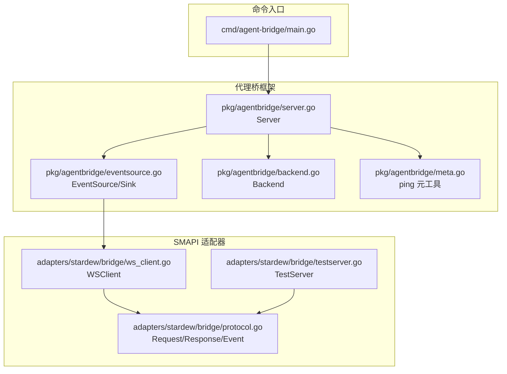
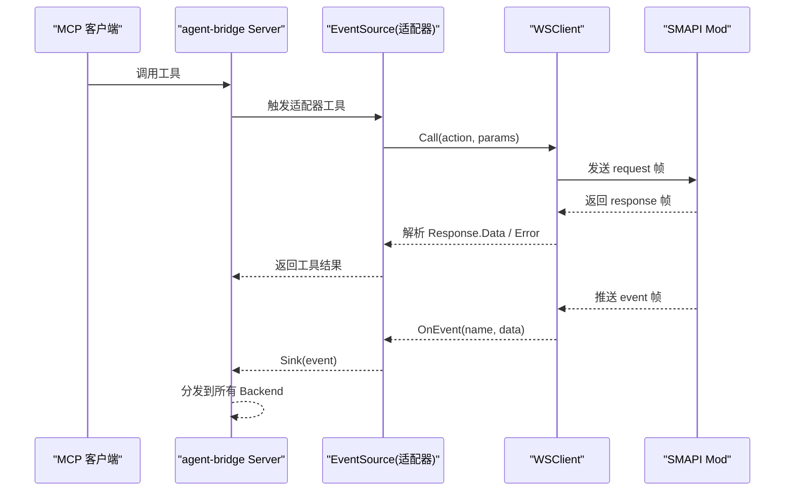
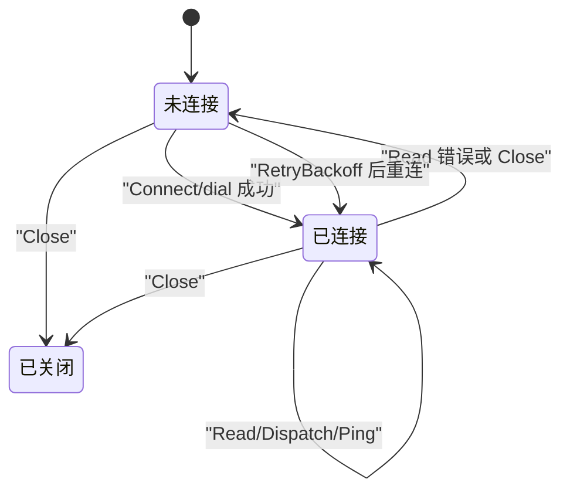
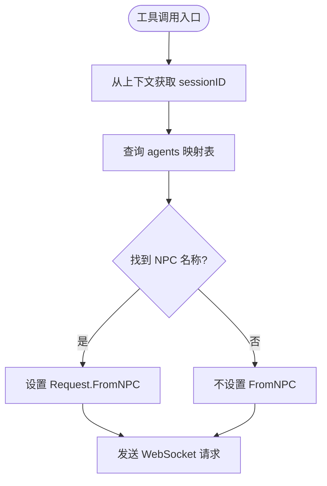
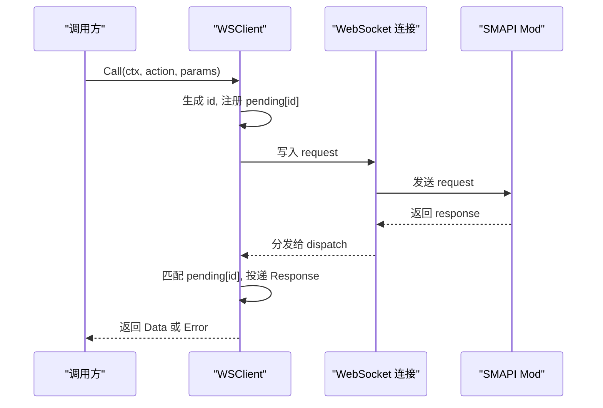
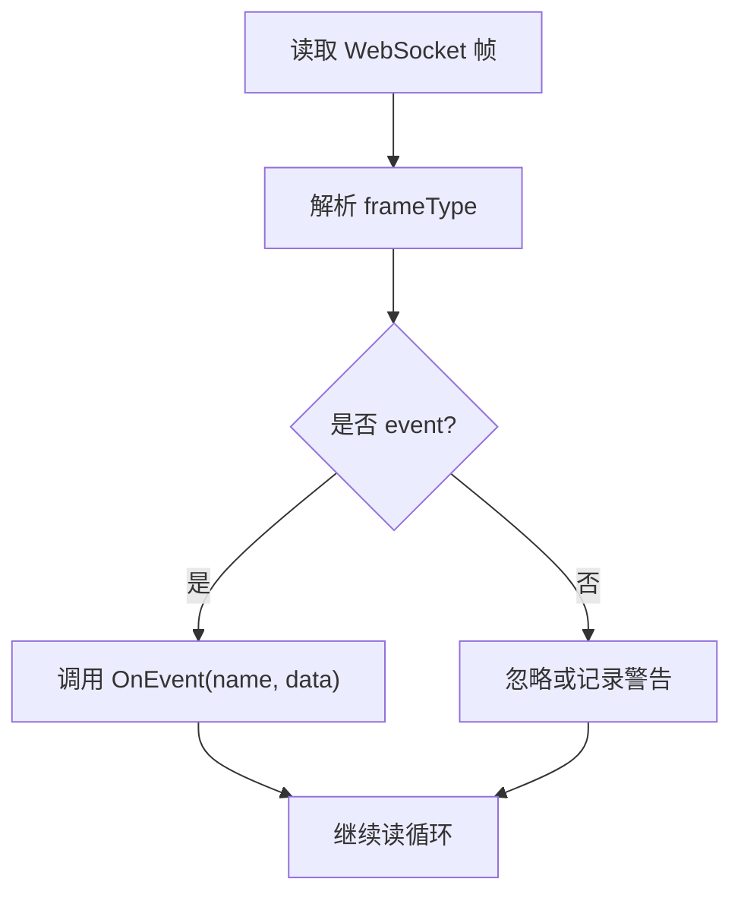
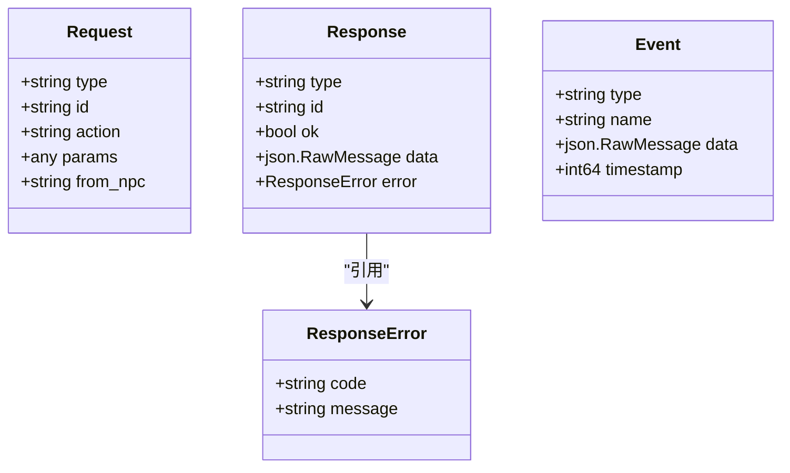
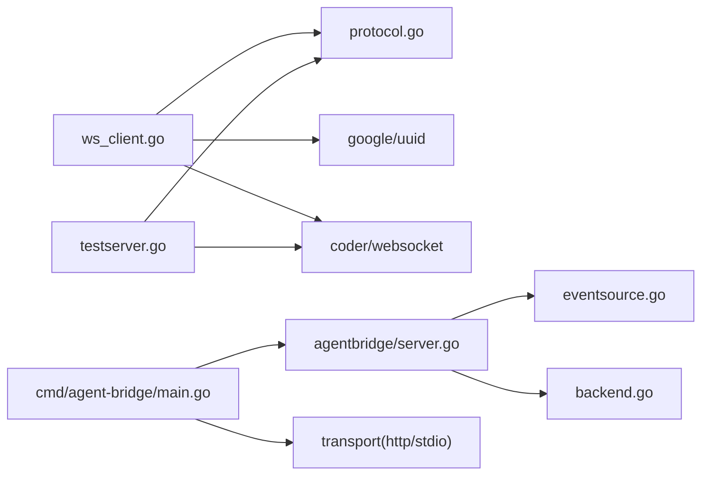
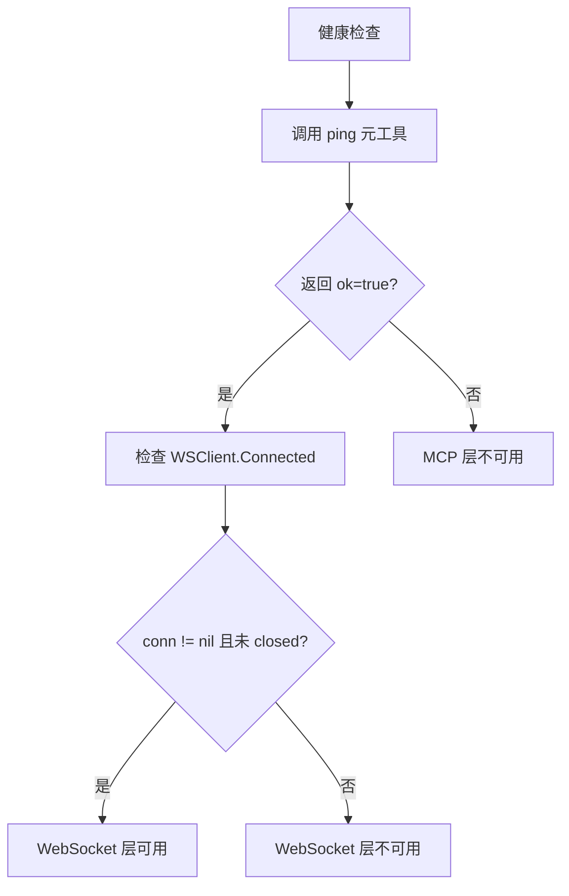

# WebSocket 客户端

<cite>
**本文引用的文件**   
- [ws_client.go](file://SmartNPC/smartnpc-mcp/adapters/stardew/bridge/ws_client.go)
- [protocol.go](file://SmartNPC/smartnpc-mcp/adapters/stardew/bridge/protocol.go)
- [testserver.go](file://SmartNPC/smartnpc-mcp/adapters/stardew/bridge/testserver.go)
- [ws_client_test.go](file://SmartNPC/smartnpc-mcp/adapters/stardew/bridge/ws_client_test.go)
- [eventsource.go](file://SmartNPC/smartnpc-mcp/pkg/agentbridge/eventsource.go)
- [backend.go](file://SmartNPC/smartnpc-mcp/pkg/agentbridge/backend.go)
- [server.go](file://SmartNPC/smartnpc-mcp/pkg/agentbridge/server.go)
- [meta.go](file://SmartNPC/smartnpc-mcp/pkg/agentbridge/meta.go)
- [main.go](file://SmartNPC/smartnpc-mcp/cmd/agent-bridge/main.go)
- [go.mod](file://SmartNPC/smartnpc-mcp/go.mod)
</cite>

## 目录
1. [引言](#引言)
2. [项目结构](#项目结构)
3. [核心组件](#核心组件)
4. [架构总览](#架构总览)
5. [详细组件分析](#详细组件分析)
6. [依赖关系分析](#依赖关系分析)
7. [性能与连接池设计](#性能与连接池设计)
8. [监控、诊断与故障恢复](#监控诊断与故障恢复)
9. [配置项与参数调优](#配置项与参数调优)
10. [常见问题排查](#常见问题排查)
11. [结论](#结论)

## 引言
本文件面向 SmartNPC 项目中与 SMAPI Mod 通信的 Go 端 WebSocket 客户端实现，围绕以下目标展开：
- 连接生命周期管理：建立、认证（上下文绑定）、重连策略。
- 消息收发机制：请求响应关联、事件推送、异步回调、错误传播。
- 连接池与多路复用：当前单连接模型、如何扩展为连接池。
- 心跳保活、网络异常处理、连接清理。
- 性能优化：连接预热、批量发送建议。
- 监控诊断：调用观测、日志指标、健康检查工具。
- 配置项：超时、重试、退避算法及最佳实践。

该 WebSocket 客户端位于适配器层，负责将 MCP 工具调用转换为对 SMAPI Mod 的 WebSocket JSON-RPC 风格请求，并接收服务端推送的事件。

**章节来源**
- [ws_client.go:1-60](file://SmartNPC/smartnpc-mcp/adapters/stardew/bridge/ws_client.go#L1-L60)
- [protocol.go:1-60](file://SmartNPC/smartnpc-mcp/adapters/stardew/bridge/protocol.go#L1-L60)

## 项目结构
WebSocket 客户端及相关桥接逻辑主要分布在以下模块：
- `adapters/stardew/bridge`：协议定义、WebSocket 客户端、测试服务器。
- `pkg/agentbridge`：通用代理桥框架，封装事件源、后端转发、MCP 服务组装。
- `cmd/agent-bridge`：命令行入口，加载配置、组装服务、启动传输层。

**图表来源**
- [main.go:1-123](file://SmartNPC/smartnpc-mcp/cmd/agent-bridge/main.go#L1-L123)
- [server.go:1-177](file://SmartNPC/smartnpc-mcp/pkg/agentbridge/server.go#L1-L177)
- [eventsource.go:1-40](file://SmartNPC/smartnpc-mcp/pkg/agentbridge/eventsource.go#L1-L40)
- [backend.go:1-36](file://SmartNPC/smartnpc-mcp/pkg/agentbridge/backend.go#L1-L36)
- [meta.go:1-43](file://SmartNPC/smartnpc-mcp/pkg/agentbridge/meta.go#L1-L43)
- [ws_client.go:1-60](file://SmartNPC/smartnpc-mcp/adapters/stardew/bridge/ws_client.go#L1-L60)
- [protocol.go:1-60](file://SmartNPC/smartnpc-mcp/adapters/stardew/bridge/protocol.go#L1-L60)
- [testserver.go:1-60](file://SmartNPC/smartnpc-mcp/adapters/stardew/bridge/testserver.go#L1-L60)

**章节来源**
- [main.go:1-123](file://SmartNPC/smartnpc-mcp/cmd/agent-bridge/main.go#L1-L123)
- [server.go:1-177](file://SmartNPC/smartnpc-mcp/pkg/agentbridge/server.go#L1-L177)

## 核心组件
- WSClient：封装 WebSocket 连接、请求响应关联、事件分发、自动重连、心跳保活。
- 协议类型：统一 Request/Response/Event 数据结构，包含动作名、事件名、ID 关联、错误码。
- EventSource/Sink：适配器侧事件源接口，把 WebSocket 事件转为框架级事件。
- Backend：下游后端接口，用于转发事件到具体实现（如 Hermes）。
- Server：聚合多个 EventSource 和 Backend，提供统一的 Run 调度。
- TestServer：进程内测试用 WebSocket 服务端，便于单元测试。

关键职责边界：
- WSClient 只关心与 SMAPI Mod 的 WebSocket 通信。
- agentbridge.Server 不解释游戏语义，仅做事件路由和后端转发。
- protocol.go 定义双方协议契约，是适配器和 Mod 之间的稳定接口。

**章节来源**
- [ws_client.go:1-120](file://SmartNPC/smartnpc-mcp/adapters/stardew/bridge/ws_client.go#L1-L120)
- [protocol.go:1-172](file://SmartNPC/smartnpc-mcp/adapters/stardew/bridge/protocol.go#L1-L172)
- [eventsource.go:1-40](file://SmartNPC/smartnpc-mcp/pkg/agentbridge/eventsource.go#L1-L40)
- [backend.go:1-36](file://SmartNPC/smartnpc-mcp/pkg/agentbridge/backend.go#L1-L36)
- [server.go:1-177](file://SmartNPC/smartnpc-mcp/pkg/agentbridge/server.go#L1-L177)
- [testserver.go:1-147](file://SmartNPC/smartnpc-mcp/adapters/stardew/bridge/testserver.go#L1-L147)

## 架构总览
WebSocket 客户端在整体系统中的位置如下：

**图表来源**
- [ws_client.go:201-510](file://SmartNPC/smartnpc-mcp/adapters/stardew/bridge/ws_client.go#L201-L510)
- [server.go:100-177](file://SmartNPC/smartnpc-mcp/pkg/agentbridge/server.go#L100-L177)
- [protocol.go:100-172](file://SmartNPC/smartnpc-mcp/adapters/stardew/bridge/protocol.go#L100-L172)

## 详细组件分析

### WebSocket 客户端连接生命周期
WSClient 的生命周期分为四个阶段：
- 构造：创建未连接实例，默认 URL、日志器、超时、重试间隔。
- 连接建立：Connect 先尝试 dial，成功后启动后台读循环；首次失败也会启动后台重连循环。
- 运行期：readLoopForever 不断读取消息，遇到断开则清理 pending、置空 conn，按 RetryBackoff 重拨。
- 关闭：Close 标记 closed、释放底层连接，后续 Call 会立即报错。

**图表来源**
- [ws_client.go:120-200](file://SmartNPC/smartnpc-mcp/adapters/stardew/bridge/ws_client.go#L120-L200)
- [ws_client.go:320-420](file://SmartNPC/smartnpc-mcp/adapters/stardew/bridge/ws_client.go#L320-L420)

关键点：
- Connect 返回首错但不会阻止后台重连。
- readLoopForever 使用固定 RetryBackoff，不是指数退避。
- pingLoop 每 30 秒 Ping，防止 C# HttpListener 空闲断连。
- 连接被替换或关闭时，pingLoop 会退出。

**章节来源**
- [ws_client.go:120-200](file://SmartNPC/smartnpc-mcp/adapters/stardew/bridge/ws_client.go#L120-L200)
- [ws_client.go:320-420](file://SmartNPC/smartnpc-mcp/adapters/stardew/bridge/ws_client.go#L320-L420)

### 认证与会话绑定
WSClient 没有传统意义上的用户名密码认证，而是通过“会话绑定”完成来源标识：
- WithCallSession 把 MCP 服务器 sessionID 注入 context。
- AgentForContext 从 context 提取 sessionID，再查 agents 映射得到 NPC 名称。
- Call 自动填充 Request.FromNPC；CallAs 允许显式指定 FromNPC。
- RegisterAgent 支持注册、覆盖、注销 session 到 NPC 的映射。

**图表来源**
- [ws_client.go:60-120](file://SmartNPC/smartnpc-mcp/adapters/stardew/bridge/ws_client.go#L60-L120)
- [ws_client.go:201-260](file://SmartNPC/smartnpc-mcp/adapters/stardew/bridge/ws_client.go#L201-L260)
- [protocol.go:140-172](file://SmartNPC/smartnpc-mcp/adapters/stardew/bridge/protocol.go#L140-L172)

注意：
- 当 MCP 传输不提供 sessionID 时，使用合成 key `__solo_session__` 保证单客户端场景可用。
- 如果未注册，FromNPC 为空，Mod 侧可能回退到 params.npc 或视为非代理调用。

**章节来源**
- [ws_client.go:60-120](file://SmartNPC/smartnpc-mcp/adapters/stardew/bridge/ws_client.go#L60-L120)
- [ws_client.go:201-260](file://SmartNPC/smartnpc-mcp/adapters/stardew/bridge/ws_client.go#L201-L260)

### 消息发送与接收机制
#### 请求响应关联
- 每次 Call 生成唯一 ID，并将 channel 放入 pending map。
- Write 成功后，select 等待 callCtx.Done() 或收到对应 Response。
- dispatch 根据 Response.ID 查找 pending channel 投递。
- 连接丢失时 failPending 通知所有挂起调用。

**图表来源**
- [ws_client.go:260-360](file://SmartNPC/smartnpc-mcp/adapters/stardew/bridge/ws_client.go#L260-L360)
- [ws_client.go:360-420](file://SmartNPC/smartnpc-mcp/adapters/stardew/bridge/ws_client.go#L360-L420)
- [protocol.go:140-172](file://SmartNPC/smartnpc-mcp/adapters/stardew/bridge/protocol.go#L140-L172)

#### 事件推送与回调
- 服务端推送 Type=event 帧，携带 name、data、timestamp。
- dispatch 解出 Event，若设置了 OnEvent，则同步调用回调。
- 文档明确提示：长耗时回调应自行 offload goroutine，避免阻塞读循环。

**图表来源**
- [ws_client.go:420-510](file://SmartNPC/smartnpc-mcp/adapters/stardew/bridge/ws_client.go#L420-L510)
- [protocol.go:100-140](file://SmartNPC/smartnpc-mcp/adapters/stardew/bridge/protocol.go#L100-L140)

#### 错误传播
- 写失败：返回包装错误，包含 write 动作和耗时。
- 读结束：readLoopOnce 返回，外层 readLoopForever 触发重连。
- 超时：callCtx 超时返回 ctx.Err()。
- 服务端非 OK：返回 mod error code 和 message。
- 连接丢失：pending channel 收到 nil，上层视为连接中断。

**章节来源**
- [ws_client.go:260-360](file://SmartNPC/smartnpc-mcp/adapters/stardew/bridge/ws_client.go#L260-L360)
- [ws_client.go:360-510](file://SmartNPC/smartnpc-mcp/adapters/stardew/bridge/ws_client.go#L360-L510)

### 重连策略与退避算法
当前实现采用固定间隔重连：
- readLoopForever 每次断开后 sleep RetryBackoff，然后 dial。
- dial 失败会记录 warn，但不影响下一次循环。
- 不支持指数退避或抖动；可通过扩展 retryer 实现更稳健的重试。

建议改进方向：
- 引入最小退避、最大退避、随机抖动。
- 区分瞬时网络抖动与持续不可达。
- 增加重连次数上限和熔断保护。

**章节来源**
- [ws_client.go:320-420](file://SmartNPC/smartnpc-mcp/adapters/stardew/bridge/ws_client.go#L320-L420)

### 心跳保活机制
- pingLoop 每 30 秒执行一次 conn.Ping。
- Ping 失败直接退出 goroutine，由 readLoopForever 接管重连。
- 这是针对 C# HttpListener WebSocket 空闲超时的补偿措施。

建议：
- 记录 Ping 成功/失败率作为连接质量指标。
- 可暴露 Connected 状态给监控系统。

**章节来源**
- [ws_client.go:320-380](file://SmartNPC/smartnpc-mcp/adapters/stardew/bridge/ws_client.go#L320-L380)
- [ws_client.go:480-510](file://SmartNPC/smartnpc-mcp/adapters/stardew/bridge/ws_client.go#L480-L510)

### 连接池设计与多路复用
当前 WSClient 是单连接模型：
- 一个 WSClient 维护一个 *websocket.Conn。
- pending map 基于 ID 做请求响应关联，天然支持多并发 Call。
- 没有内置连接池或多后端负载均衡。

多路复用体现在：
- 同一连接上同时存在多个未完成的请求。
- 事件可以异步推送到任意 OnEvent 回调。

如需连接池：
- 可按目标 URL、NPC 角色、负载策略创建多个 WSClient。
- 外部调度器选择连接，或按 NPC 分组复用连接。
- 需要解决跨连接的事务一致性、全局重连协调、资源泄漏防护。

**章节来源**
- [ws_client.go:1-120](file://SmartNPC/smartnpc-mcp/adapters/stardew/bridge/ws_client.go#L1-L120)
- [ws_client.go:260-360](file://SmartNPC/smartnpc-mcp/adapters/stardew/bridge/ws_client.go#L260-L360)

### 协议数据模型
协议采用 JSON 信封，区分三种帧类型：
- request：客户端发起，带 id、action、params、from_npc。
- response：服务端回复，带 id、ok、data、error。
- event：服务端推送，带 name、data、timestamp。

**图表来源**
- [protocol.go:100-172](file://SmartNPC/smartnpc-mcp/adapters/stardew/bridge/protocol.go#L100-L172)

**章节来源**
- [protocol.go:1-172](file://SmartNPC/smartnpc-mcp/adapters/stardew/bridge/protocol.go#L1-172)

## 依赖关系分析

**图表来源**
- [ws_client.go:1-60](file://SmartNPC/smartnpc-mcp/adapters/stardew/bridge/ws_client.go#L1-L60)
- [protocol.go:1-60](file://SmartNPC/smartnpc-mcp/adapters/stardew/bridge/protocol.go#L1-L60)
- [server.go:1-60](file://SmartNPC/smartnpc-mcp/pkg/agentbridge/server.go#L1-L60)
- [eventsource.go:1-40](file://SmartNPC/smartnpc-mcp/pkg/agentbridge/eventsource.go#L1-L40)
- [backend.go:1-36](file://SmartNPC/smartnpc-mcp/pkg/agentbridge/backend.go#L1-L36)
- [main.go:1-123](file://SmartNPC/smartnpc-mcp/cmd/agent-bridge/main.go#L1-L123)
- [testserver.go:1-60](file://SmartNPC/smartnpc-mcp/adapters/stardew/bridge/testserver.go#L1-L60)
- [go.mod:1-19](file://SmartNPC/smartnpc-mcp/go.mod#L1-L19)

耦合性分析：
- ws_client 与 protocol 强耦合，因为双方共享 Request/Response/Event。
- agentbridge 与 adapter 松耦合，adapter 通过 EventSource 接入。
- cmd 与 transport 松耦合，支持 stdio 和 http 两种模式。

潜在风险：
- 如果协议字段变化，需要同步更新 Mod 端和 Go 端。
- 事件处理链过长时，需关注后端 Forward 是否阻塞。

**章节来源**
- [go.mod:1-19](file://SmartNPC/smartnpc-mcp/go.mod#L1-L19)
- [main.go:1-123](file://SmartNPC/smartnpc-mcp/cmd/agent-bridge/main.go#L1-L123)

## 性能与连接池设计

### 连接预热
- Connect 完成后即可进行 warmup 调用，确保 readLoopForever 和 pingLoop 就绪。
- 测试用例中通过一次 echo 调用预热连接，再推送事件，提高稳定性。

推荐实践：
- 应用启动后延迟几秒执行一次轻量 Call，提前建立连接。
- 对高延迟链路，预热可降低首次调用尾延迟。

**章节来源**
- [ws_client.go:120-200](file://SmartNPC/smartnpc-mcp/adapters/stardew/bridge/ws_client.go#L120-L200)
- [ws_client_test.go:1-60](file://SmartNPC/smartnpc-mcp/adapters/stardew/bridge/ws_client_test.go#L1-L60)

### 批量发送
当前 WSClient.Call 是逐条发送。对于高频短消息，可考虑：
- 在调用方侧合并多条操作为单个 batch action。
- 在服务端提供批处理 action，减少握手和序列化开销。
- 注意：批处理会增加端到端延迟和错误粒度，需权衡。

### 并发安全
- WSClient 内部使用互斥锁保护 conn、pending、closed、OnEvent、OnCall。
- Call 并发安全，适合多个 goroutine 同时调用。
- OnEvent 回调必须在业务层避免阻塞，否则会影响事件吞吐。

**章节来源**
- [ws_client.go:201-360](file://SmartNPC/smartnpc-mcp/adapters/stardew/bridge/ws_client.go#L201-L360)

## 监控、诊断与故障恢复

### 调用观测
- SetCallObserver 可注册观察者，记录每个 Call 的 action、npc、ok、data、elapsed_ms、error。
- 常用于实验日志、性能统计、问题回溯。

### 日志指标
- 连接建立、Ping、Write 失败、超时、连接丢失、重连、无效帧等均有日志。
- 建议配合结构化日志系统采集关键字段：action、elapsed_ms、bytes_in、err。

### 健康检查
- meta.go 提供 ping 工具，可用于 MCP 层连通性检测。
- WSClient.Connected 可判断当前是否有 live 连接，但具有竞争条件，适合展示而非强一致判断。

**图表来源**
- [meta.go:1-43](file://SmartNPC/smartnpc-mcp/pkg/agentbridge/meta.go#L1-L43)
- [ws_client.go:480-510](file://SmartNPC/smartnpc-mcp/adapters/stardew/bridge/ws_client.go#L480-L510)

### 故障恢复最佳实践
- 对 OnEvent 长任务使用 goroutine 或队列，避免阻塞读循环。
- 对后端 Forward 使用异步派发，避免一个慢后端拖垮全部。
- 对重连失败增加告警，必要时降级功能或切换备用地址。
- 对 pending 调用设置合理超时，避免长期悬挂。

**章节来源**
- [ws_client.go:201-510](file://SmartNPC/smartnpc-mcp/adapters/stardew/bridge/ws_client.go#L201-L510)
- [server.go:120-177](file://SmartNPC/smartnpc-mcp/pkg/agentbridge/server.go#L120-L177)

## 配置项与参数调优

### 超时参数
- defaultCallTimeout：默认 60 分钟，实际接近禁用，适合长耗时工具调用。
- defaultDialTimeout：默认 5 秒，控制连接建立超时。
- Call 内部使用 context.WithTimeout 包裹读等待。

建议：
- 对交互型工具，可适当降低 CallTimeout，例如 10~30 秒。
- 对批处理或复杂动作，保持较高超时以避免误判。

### 重试次数与退避算法
- 当前 RetryBackoff 固定 2 秒。
- 无最大重试次数限制，直到 ctx 取消或 Close。

建议：
- 引入指数退避，初始 1 秒、上限 60 秒、加随机抖动。
- 在连续失败 N 次后进入冷却期，避免雪崩。
- 对网络抖动敏感环境，增加快速失败路径，减少无用重试。

### 连接池与多连接
- 当前无内置连接池，可对外暴露 NewWSClient 工厂。
- 按目标 URL、NPC 角色、优先级创建多个 WSClient。
- 使用外部负载均衡器或轮询策略分配 Call。

### 事件处理与背压
- OnEvent 必须非阻塞。
- 可在适配器层加入有界队列，消费者 goroutine 拉取处理。
- 对突发事件可做采样、合并、去重。

**章节来源**
- [ws_client.go:1-60](file://SmartNPC/smartnpc-mcp/adapters/stardew/bridge/ws_client.go#L1-L60)
- [ws_client.go:201-360](file://SmartNPC/smartnpc-mcp/adapters/stardew/bridge/ws_client.go#L201-L360)
- [ws_client.go:320-420](file://SmartNPC/smartnpc-mcp/adapters/stardew/bridge/ws_client.go#L320-L420)

## 常见问题排查

### 连接无法建立
现象：Connect 返回错误，或日志出现 ws dial 失败。
排查：
- 确认 DefaultWSURL 或 WSClientOptions.URL 是否正确。
- 检查 SMAPI Mod 是否监听 WebSocket。
- 检查网络防火墙、端口占用。

相关代码路径：
- [ws_client.go:120-160](file://SmartNPC/smartnpc-mcp/adapters/stardew/bridge/ws_client.go#L120-L160)
- [ws_client.go:320-360](file://SmartNPC/smartnpc-mcp/adapters/stardew/bridge/ws_client.go#L320-L360)

### 调用超时
现象：Call 返回 context deadline exceeded。
排查：
- 检查 CallTimeout 是否过短。
- 检查服务端处理逻辑是否卡住。
- 查看 elapsed_ms 日志定位慢调用。

相关代码路径：
- [ws_client.go:260-320](file://SmartNPC/smartnpc-mcp/adapters/stardew/bridge/ws_client.go#L260-L320)

### 事件未到达
现象：OnEvent 未触发。
排查：
- 确认 OnEvent 已设置。
- 确认连接已建立并完成一次 Call 预热。
- 检查服务端是否正确推送 event 帧。

相关代码路径：
- [ws_client.go:201-240](file://SmartNPC/smartnpc-mcp/adapters/stardew/bridge/ws_client.go#L201-L240)
- [ws_client_test.go:60-121](file://SmartNPC/smartnpc-mcp/adapters/stardew/bridge/ws_client_test.go#L60-L121)

### 重连风暴
现象：频繁重连、日志大量 warn。
排查：
- 检查网络稳定性。
- 评估是否需要指数退避。
- 确认服务端是否正常关闭连接。

相关代码路径：
- [ws_client.go:320-420](file://SmartNPC/smartnpc-mcp/adapters/stardew/bridge/ws_client.go#L320-L420)

### 调试与单元测试
- 使用 TestServer 模拟服务端，验证 Call、事件、错误路径。
- 可断言 FromNPC 是否被正确填充。
- 可模拟服务端返回错误，验证错误传播。

相关代码路径：
- [testserver.go:1-147](file://SmartNPC/smartnpc-mcp/adapters/stardew/bridge/testserver.go#L1-L147)
- [ws_client_test.go:1-121](file://SmartNPC/smartnpc-mcp/adapters/stardew/bridge/ws_client_test.go#L1-L121)

**章节来源**
- [ws_client.go:201-510](file://SmartNPC/smartnpc-mcp/adapters/stardew/bridge/ws_client.go#L201-L510)
- [testserver.go:1-147](file://SmartNPC/smartnpc-mcp/adapters/stardew/bridge/testserver.go#L1-L147)
- [ws_client_test.go:1-121](file://SmartNPC/smartnpc-mcp/adapters/stardew/bridge/ws_client_test.go#L1-L121)

## 结论
SmartNPC 的 WebSocket 客户端以 WSClient 为核心，实现了与 SMAPI Mod 的稳定通信：
- 连接生命周期清晰：构造、连接、运行、关闭。
- 请求响应通过 ID 精确关联，支持并发调用。
- 事件推送通过 OnEvent 回调暴露，强调异步处理和防阻塞。
- 心跳保活和固定间隔重连保障连接可用性。
- 当前为单连接模型，尚未实现连接池和多路复用负载均衡。
- 提供调用观测、日志指标、ping 元工具和测试服务器，便于监控和调试。

生产部署建议：
- 调整 CallTimeout、DialTimeout、RetryBackoff 以匹配业务特征。
- 在适配器层实现事件队列和后端异步转发。
- 未来可扩展指数退避、连接池、多后端故障转移。
- 建立连接质量、重连次数、调用延迟等监控指标。