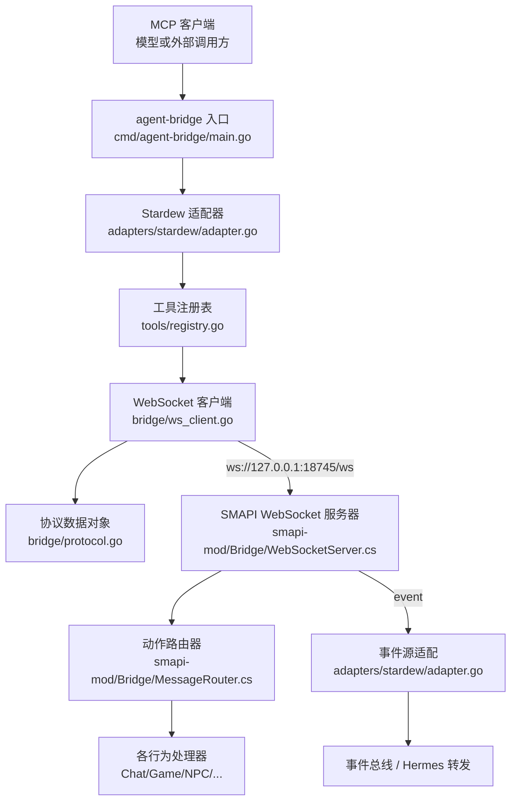
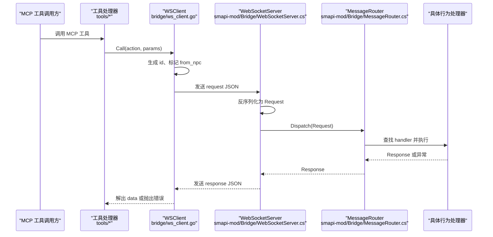
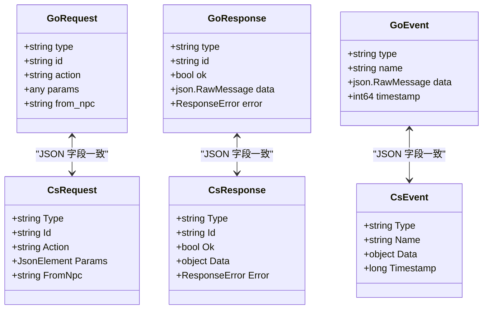
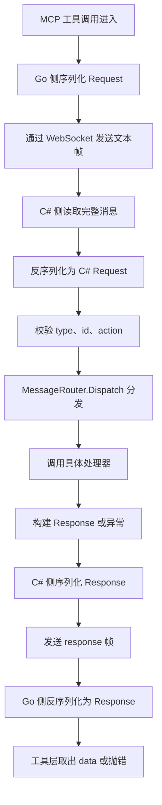
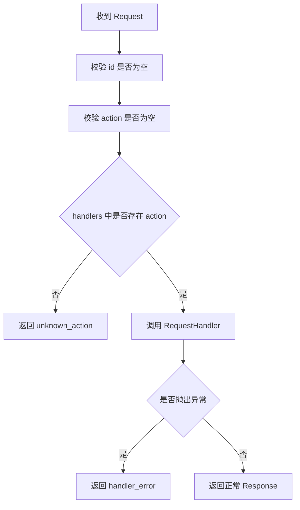
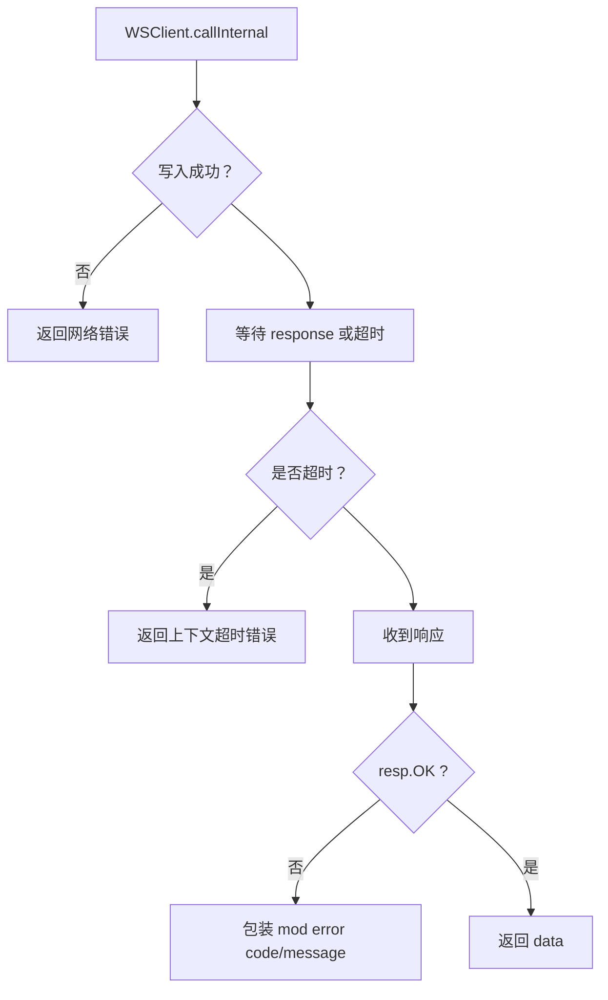
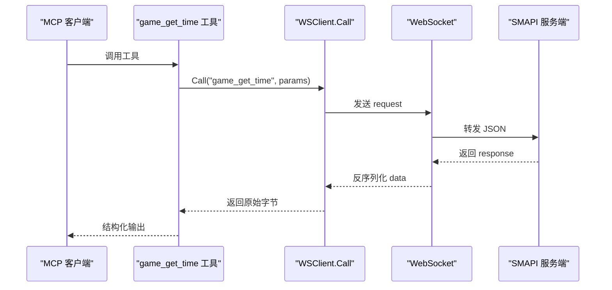
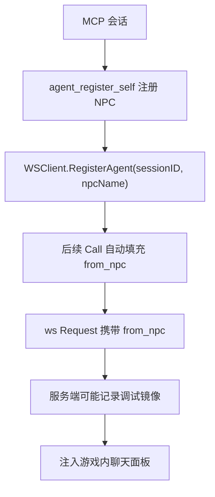
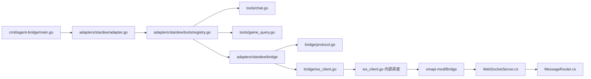

# 协议封装层

<cite>
**本文引用的文件**   
- [protocol.go](file://SmartNPC/smartnpc-mcp/adapters/stardew/bridge/protocol.go)
- [ws_client.go](file://SmartNPC/smartnpc-mcp/adapters/stardew/bridge/ws_client.go)
- [registry.go](file://SmartNPC/smartnpc-mcp/adapters/stardew/tools/registry.go)
- [chat.go](file://SmartNPC/smartnpc-mcp/adapters/stardew/tools/chat.go)
- [game_query.go](file://SmartNPC/smartnpc-mcp/adapters/stardew/tools/game_query.go)
- [adapter.go](file://SmartNPC/smartnpc-mcp/adapters/stardew/adapter.go)
- [main.go](file://SmartNPC/smartnpc-mcp/cmd/agent-bridge/main.go)
- [Protocol.cs](file://SmartNPC/smapi-mod/Bridge/Protocol.cs)
- [MessageRouter.cs](file://SmartNPC/smapi-mod/Bridge/MessageRouter.cs)
- [WebSocketServer.cs](file://SmartNPC/smapi-mod/Bridge/WebSocketServer.cs)
- [protocol.md](file://SmartNPC/docs/protocol.md)
- [mcp-tools.md](file://SmartNPC/docs/mcp-tools.md)
</cite>

## 目录
1. [引言](#引言)
2. [项目结构与定位](#项目结构与定位)
3. [核心组件](#核心组件)
4. [架构总览](#架构总览)
5. [详细组件分析](#详细组件分析)
6. [依赖关系分析](#依赖关系分析)
7. [性能与可靠性特征](#性能与可靠性特征)
8. [协议扩展点](#协议扩展点)
9. [调试与抓包指南](#调试与抓包指南)
10. [结论](#结论)

## 引言
本文聚焦 SmartNPC 项目中“MCP 工具调用 → SMAPI 游戏模组”的协议封装层。该层位于 Go 侧 MCP 适配器与 C# 侧 SMAPI 模组之间，承担以下职责：
- 将 MCP 工具调用序列化为 WebSocket JSON 帧。
- 将 SMAPI 返回的响应和事件反序列化为 MCP 工具结果或事件总线消息。
- 在两端 DTO 之间保持字段、错误码、动作名称的一致映射。
- 管理连接生命周期、重连、心跳、超时与请求-响应关联。
- 支持按 MCP 会话绑定 NPC 身份，实现调试镜像与消息路由。
- 提供版本契约文档（protocol.md）与工具目录（mcp-tools.md），作为协议稳定边界。

本说明面向两类读者：
- 需要理解“从 MCP 到 SMAPI 协议转换细节”的开发者。
- 需要扩展新工具、新事件或新错误类型的维护者。

## 项目结构与定位
协议封装层横跨两个子工程：

| 层级 | 代码位置 | 职责 |
|---|---|---|
| MCP 协议层 | `smartnpc-mcp` | 暴露 MCP 工具、注册工具、驱动 WSClient 发送 RPC |
| 桥接传输层 | `adapters/stardew/bridge` | 定义 wire DTO、WSClient 连接与帧调度 |
| 服务端协议层 | `smapi-mod/Bridge` | 解析 WS 帧、路由 action、序列化 response/event |
| 协议契约文档 | `docs/protocol.md`、`docs/mcp-tools.md` | 描述 envelope、action、事件、工具清单 |

**图表来源**
- [main.go:1-123](file://SmartNPC/smartnpc-mcp/cmd/agent-bridge/main.go#L1-L123)
- [adapter.go:1-163](file://SmartNPC/smartnpc-mcp/adapters/stardew/adapter.go#L1-L163)
- [registry.go:1-82](file://SmartNPC/smartnpc-mcp/adapters/stardew/tools/registry.go#L1-L82)
- [ws_client.go:1-200](file://SmartNPC/smartnpc-mcp/adapters/stardew/bridge/ws_client.go#L1-L200)
- [protocol.go:1-172](file://SmartNPC/smartnpc-mcp/adapters/stardew/bridge/protocol.go#L1-L172)
- [WebSocketServer.cs:1-200](file://SmartNPC/smapi-mod/Bridge/WebSocketServer.cs#L1-L200)
- [MessageRouter.cs:1-53](file://SmartNPC/smapi-mod/Bridge/MessageRouter.cs#L1-L53)

**章节来源**
- [main.go:1-123](file://SmartNPC/smartnpc-mcp/cmd/agent-bridge/main.go#L1-L123)
- [adapter.go:1-163](file://SmartNPC/smartnpc-mcp/adapters/stardew/adapter.go#L1-L163)

## 核心组件
协议封装层由五个关键部分组成：

| 组件 | 语言 | 主要类型/函数 | 作用 |
|---|---|---|---|
| 协议数据对象 | Go | `Request`、`Response`、`Event`、`ActionName*`、`EventName*` | 定义 JSON 信封、动作常量、事件常量 |
| WebSocket 客户端 | Go | `WSClient`、`Call`、`CallAs`、`Connect`、`SetEventHandler` | 建立连接、发送请求、关联响应、推送事件 |
| 工具注册层 | Go | `RegisterAll`、`registerChat`、`registerGameQuery` | 把 MCP 工具名映射到桥接 action |
| SMAPI 协议对象 | C# | `Request`、`Response`、`ResponseError`、`Event` | 与 Go DTO 对称的 JSON 结构 |
| 消息路由器 | C# | `MessageRouter.Dispatch` | 根据 action 分派到处理器并统一错误包装 |

**章节来源**
- [protocol.go:1-172](file://SmartNPC/smartnpc-mcp/adapters/stardew/bridge/protocol.go#L1-L172)
- [ws_client.go:1-200](file://SmartNPC/smartnpc-mcp/adapters/stardew/bridge/ws_client.go#L1-L200)
- [registry.go:1-82](file://SmartNPC/smartnpc-mcp/adapters/stardew/tools/registry.go#L1-L82)
- [Protocol.cs:1-67](file://SmartNPC/smapi-mod/Bridge/Protocol.cs#L1-L67)
- [MessageRouter.cs:1-53](file://SmartNPC/smapi-mod/Bridge/MessageRouter.cs#L1-L53)

## 架构总览
协议封装层采用“客户端-服务器 + 双向事件”的 WebSocket 架构：

- 客户端（Go）负责发起 RPC 和消费事件。
- 服务器（C#）负责接收请求、调用业务处理器、广播事件。
- 两端共享同一份 JSON envelope 语义，但各自拥有独立的数据结构。
- 协议文档是实际契约；源码中的常量和结构体是对契约的实现。

**图表来源**
- [ws_client.go:201-510](file://SmartNPC/smartnpc-mcp/adapters/stardew/bridge/ws_client.go#L201-L510)
- [WebSocketServer.cs:1-324](file://SmartNPC/smapi-mod/Bridge/WebSocketServer.cs#L1-L324)
- [MessageRouter.cs:1-53](file://SmartNPC/smapi-mod/Bridge/MessageRouter.cs#L1-L53)

## 详细组件分析

### 协议数据对象与消息格式
Go 侧的 `Request`、`Response`、`Event` 与 C# 侧的对应类一一对应，共同构成 wire protocol 的核心数据结构。

| 字段 | 方向 | 含义 | 备注 |
|---|---|---|---|
| `type` | 双向 | 信封类型 | `request`、`response`、`event` |
| `id` | 请求/响应 | 请求唯一标识 | 通常使用 UUIDv4 |
| `action` | 请求 | 要调用的动作 | 必须匹配注册的动作常量 |
| `params` | 请求 | 动作参数 | 可选，可为任意 JSON |
| `from_npc` | 请求 | 发起 NPC 名称 | 用于调试镜像与消息路由 |
| `ok` | 响应 | 成功标志 | `true` 时带 `data`，`false` 时带 `error` |
| `data` | 响应 | 成功负载 | JSON 原始字节，由工具层反序列化 |
| `error.code` | 响应 | 机器可读错误码 | 跨层稳定字符串 |
| `error.message` | 响应 | 人类可读信息 | 可包含底层异常信息 |
| `event.name` | 事件 | 事件名称 | 如 `schedule_trigger`、`day_ending` |
| `event.data` | 事件 | 事件负载 | 不同事件结构不同 |
| `event.timestamp` | 事件 | Unix 毫秒时间戳 | 服务端生成 |

**图表来源**
- [protocol.go:1-172](file://SmartNPC/smartnpc-mcp/adapters/stardew/bridge/protocol.go#L1-L172)
- [Protocol.cs:1-67](file://SmartNPC/smapi-mod/Bridge/Protocol.cs#L1-L67)

**章节来源**
- [protocol.go:1-172](file://SmartNPC/smartnpc-mcp/adapters/stardew/bridge/protocol.go#L1-L172)
- [Protocol.cs:1-67](file://SmartNPC/smapi-mod/Bridge/Protocol.cs#L1-L67)
- [protocol.md:1-200](file://SmartNPC/docs/protocol.md#L1-L200)

### 消息序列化与反序列化流程
序列化发生在 Go 侧发送前，反序列化发生在 C# 侧接收后。

**图表来源**
- [ws_client.go:201-510](file://SmartNPC/smartnpc-mcp/adapters/stardew/bridge/ws_client.go#L201-L510)
- [WebSocketServer.cs:201-324](file://SmartNPC/smapi-mod/Bridge/WebSocketServer.cs#L201-L324)
- [MessageRouter.cs:1-53](file://SmartNPC/smapi-mod/Bridge/MessageRouter.cs#L1-L53)

**章节来源**
- [ws_client.go:201-510](file://SmartNPC/smartnpc-mcp/adapters/stardew/bridge/ws_client.go#L201-L510)
- [WebSocketServer.cs:201-324](file://SmartNPC/smapi-mod/Bridge/WebSocketServer.cs#L201-L324)

### 协议版本与兼容性处理
当前协议为 v1，文档明确区分实验分支变更与历史兼容内容：

- 协议文档保留已移除 action 的历史说明，便于理解演进路径。
- 实验分支移除了玩家交互相关 action，例如 `mail_send`、`friendship_get`、`player_get_status`、`npc_summon`、`npc_give_item`、`npc_follow_start`、`npc_follow_stop`、`npc_lead_to`、`npc_approach_and_speak`、`npc_deliver_items`。
- 事件方面，`chat_message`、`chat_received`、`npc_interact`、`group_create` 不再产生；`schedule_trigger`、`day_ending`、`owner_directive` 等成为重点。
- Go 侧与 C# 侧没有显式版本号字段；兼容性主要通过“是否仍注册该 action”和“是否仍处理该事件”来体现。
- 向后兼容策略体现在：
  - 文档保留被移除 action 的字段说明。
  - 未注册 action 会返回 `unknown_action`。
  - `from_npc` 为空时服务端仍允许请求，只是调试镜像可能无法正确路由。
  - 客户端对未知 frame type 仅记录警告，不中断连接。

建议未来扩展时增加显式协议版本字段，以便客户端拒绝完全不可兼容的 server。

**章节来源**
- [protocol.md:1-200](file://SmartNPC/docs/protocol.md#L1-L200)
- [mcp-tools.md:1-200](file://SmartNPC/docs/mcp-tools.md#L1-L200)
- [MessageRouter.cs:1-53](file://SmartNPC/smapi-mod/Bridge/MessageRouter.cs#L1-L53)
- [ws_client.go:201-510](file://SmartNPC/smartnpc-mcp/adapters/stardew/bridge/ws_client.go#L201-L510)

### 消息路由机制
路由分为两条线：

1. **RPC 路由**：C# 侧 `MessageRouter` 根据 `action` 查找处理器。
2. **事件路由**：Go 侧 `adapter.go` 将 ws 事件转换为 `eventbus.Event`，再由上层决定是否需要唤醒 Hermes 或写入日志。

**图表来源**
- [MessageRouter.cs:1-53](file://SmartNPC/smapi-mod/Bridge/MessageRouter.cs#L1-L53)

事件路由的关键规则：
- 所有 ws 事件经 `WSClient.dispatch` 先按 `type` 分类。
- `event` 类型交给 `OnEvent` 回调。
- `adapter.go` 将事件名称直接用作 `eventbus.Event.Kind`。
- 同时尝试从事件负载中提取 `npc`、`target`、`to` 作为 Subject，辅助下游按 NPC 路由。

**章节来源**
- [MessageRouter.cs:1-53](file://SmartNPC/smapi-mod/Bridge/MessageRouter.cs#L1-L53)
- [adapter.go:1-163](file://SmartNPC/smartnpc-mcp/adapters/stardew/adapter.go#L1-L163)
- [ws_client.go:201-510](file://SmartNPC/smartnpc-mcp/adapters/stardew/bridge/ws_client.go#L201-L510)

### 错误码映射与错误传播
错误在三层之间传递，每层都有自身职责：

| 层级 | 错误处理方式 |
|---|---|
| WSClient | 网络写失败、连接丢失、超时、非 OK 响应都转为 Go 错误 |
| MessageRouter | 缺少 id、缺少 action、未知 action、处理器异常统一包装为 Response.Error |
| 工具层 | 将桥接错误包装为 MCP 工具错误，或直接返回结构化输出 |

典型错误映射如下：

| 场景 | Go 侧表现 | C# 侧错误码 | 说明 |
|---|---|---|---|
| 连接未建立 | 返回“ws client not connected” | 不适用 | 客户端内部状态错误 |
| 网络写入失败 | 返回“ws write”包装错误 | 不适用 | 传输层错误 |
| 调用超时 | 返回 context timeout 错误 | 不适用 | 默认调用超时约一小时 |
| 服务端返回非 OK | 包装 `mod error code: message` | 无 | 业务错误已由服务端写入 error |
| 缺少 id | 不适用 | `invalid_request` | 服务端基础校验失败 |
| 缺少 action | 不适用 | `invalid_request` | 服务端基础校验失败 |
| 未注册 action | 不适用 | `unknown_action` | 路由表找不到处理器 |
| 处理器抛异常 | 不适用 | `handler_error` | 业务逻辑异常 |

**图表来源**
- [ws_client.go:201-510](file://SmartNPC/smartnpc-mcp/adapters/stardew/bridge/ws_client.go#L201-L510)
- [MessageRouter.cs:1-53](file://SmartNPC/smapi-mod/Bridge/MessageRouter.cs#L1-L53)

**章节来源**
- [ws_client.go:201-510](file://SmartNPC/smartnpc-mcp/adapters/stardew/bridge/ws_client.go#L201-L510)
- [MessageRouter.cs:1-53](file://SmartNPC/smapi-mod/Bridge/MessageRouter.cs#L1-L53)

### 工具到协议的映射
Go 侧 MCP 工具并不直接操作游戏状态，而是通过 `bridge.WSClient.Call` 发送对应的 action。

以 `game_get_time` 为例：
1. MCP 客户端调用 `game_get_time`。
2. 工具处理器调用 `br.Call(bridge.ActionGameGetTime, in)`。
3. `WSClient` 构造 `Request{Type: "request", Action: "game_get_time", ...}`。
4. C# 端接收到 request，交由 `MessageRouter` 分发。
5. 对应处理器返回 game time 数据。
6. Go 端将 `response.data` 反序列化为 `GameGetTimeOutput`。

类似地，`chat_say` 工具不仅发送 action，还受 `ChatSayGuard` 限制，防止单次唤醒内重复发言。

**图表来源**
- [game_query.go:1-89](file://SmartNPC/smartnpc-mcp/adapters/stardew/tools/game_query.go#L1-L89)
- [ws_client.go:201-510](file://SmartNPC/smartnpc-mcp/adapters/stardew/bridge/ws_client.go#L201-L510)

**章节来源**
- [registry.go:1-82](file://SmartNPC/smartnpc-mcp/adapters/stardew/tools/registry.go#L1-L82)
- [game_query.go:1-89](file://SmartNPC/smartnpc-mcp/adapters/stardew/tools/game_query.go#L1-L89)
- [chat.go:1-200](file://SmartNPC/smartnpc-mcp/adapters/stardew/tools/chat.go#L1-L200)

### NPC 身份绑定与调试镜像
`from_npc` 是协议中重要的调试与路由字段：

- Go 侧通过 `WithCallSession` 和 `RegisterAgent` 将 MCP 会话绑定到 NPC。
- 每次 `Call` 自动注入 `from_npc`。
- C# 侧在 debug 模式下把 inbound request 推入聊天面板 UI，优先使用 `FromNpc`，回退到 `params.npc`。
- 如果两者都为空，debug 镜像可能被丢弃或进入系统通道。

**图表来源**
- [ws_client.go:1-200](file://SmartNPC/smartnpc-mcp/adapters/stardew/bridge/ws_client.go#L1-L200)
- [WebSocketServer.cs:201-324](file://SmartNPC/smapi-mod/Bridge/WebSocketServer.cs#L201-L324)

**章节来源**
- [ws_client.go:1-200](file://SmartNPC/smartnpc-mcp/adapters/stardew/bridge/ws_client.go#L1-L200)
- [WebSocketServer.cs:201-324](file://SmartNPC/smapi-mod/Bridge/WebSocketServer.cs#L201-L324)

## 依赖关系分析
协议封装层的依赖呈现清晰的单向分层：

**图表来源**
- [main.go:1-123](file://SmartNPC/smartnpc-mcp/cmd/agent-bridge/main.go#L1-L123)
- [adapter.go:1-163](file://SmartNPC/smartnpc-mcp/adapters/stardew/adapter.go#L1-L163)
- [registry.go:1-82](file://SmartNPC/smartnpc-mcp/adapters/stardew/tools/registry.go#L1-L82)
- [chat.go:1-200](file://SmartNPC/smartnpc-mcp/adapters/stardew/tools/chat.go#L1-L200)
- [game_query.go:1-89](file://SmartNPC/smartnpc-mcp/adapters/stardew/tools/game_query.go#L1-L89)
- [ws_client.go:1-510](file://SmartNPC/smartnpc-mcp/adapters/stardew/bridge/ws_client.go#L1-L510)
- [WebSocketServer.cs:1-324](file://SmartNPC/smapi-mod/Bridge/WebSocketServer.cs#L1-L324)
- [MessageRouter.cs:1-53](file://SmartNPC/smapi-mod/Bridge/MessageRouter.cs#L1-L53)

耦合特征：
- Go 侧工具层强依赖 `bridge.WSClient`。
- `adapter.go` 依赖 `tools.RegisterAll` 和 `eventbus`。
- C# 侧 `WebSocketServer` 依赖 `MessageRouter`，但不直接了解 MCP 工具语义。
- 协议常量集中在 `protocol.go`，降低 action 名称散乱风险。

潜在风险：
- 若新增 action 只在 Go 或 C# 一侧注册，会出现“注册不一致”。
- 如果事件结构变化但未同步更新 `extractSubject`，Subject 提取会失效。
- 调试镜像依赖 `FromNpc` 和 `params.npc`，任一缺失都会降级。

**章节来源**
- [registry.go:1-82](file://SmartNPC/smartnpc-mcp/adapters/stardew/tools/registry.go#L1-L82)
- [adapter.go:1-163](file://SmartNPC/smartnpc-mcp/adapters/stardew/adapter.go#L1-L163)

## 性能与可靠性特征
协议封装层在性能和可靠性上做了以下设计：

| 特性 | 实现方式 | 影响 |
|---|---|---|
| 长超时 | 默认调用超时约一小时 | 适合长时间游戏任务，但需配合业务取消 |
| 连接重试 | 断开后指数外固定间隔重连 | 提升短时断连恢复能力 |
| 心跳保活 | 客户端每 30 秒 Ping | 避免 HttpListener 空闲断开 |
| 单连接限制 | 服务端只保留最新连接 | 简化状态，但旧连接会被替换 |
| 请求-响应关联 | 基于 `id` 的 pending channel 映射 | 并发安全，支持多个 goroutine 调用 |
| 帧大小限制 | 读限制 1MiB | 防止超大消息占用内存 |
| 调试开销可控 | 调试镜像入队并在游戏 tick 消费 | 避免阻塞 WS 接收线程 |

需要注意：
- 默认 `CallTimeout` 非常宽松，不应被视为“快速失败”配置。
- `Connected()` 是有竞争的状态检查，仅适合状态展示。
- 服务端发送使用锁串行化，适合低吞吐但保证顺序。
- 调试队列无界，极端情况下可能增长，但当前设计认为请求量很小。

[本节为通用性能讨论，不直接分析具体代码片段]

## 协议扩展点

### 添加新的 WS action
添加新 action 需要至少修改两处：

1. **Go 侧注册**：在 `tools/registry.go` 或对应工具文件中注册 MCP 工具，并通过 `bridge.WSClient.Call` 调用新 action。
2. **C# 侧路由**：在 SMAPI 模组启动时向 `MessageRouter` 注册新 action 的处理器。
3. **协议文档**：在 `protocol.md` 中补充 action 的 params、data、errors。

推荐步骤：
- 先在 `protocol.go` 新增 `ActionXxx` 常量。
- 在 Go 工具文件中定义输入输出结构。
- 在 `registry.go` 中调用 `registerXxx(s, br)`。
- 在 C# 模组中注册 handler。
- 编写测试用例覆盖成功、参数无效、未加载存档等路径。

**章节来源**
- [protocol.go:1-172](file://SmartNPC/smartnpc-mcp/adapters/stardew/bridge/protocol.go#L1-L172)
- [registry.go:1-82](file://SmartNPC/smartnpc-mcp/adapters/stardew/tools/registry.go#L1-L82)
- [protocol.md:1-200](file://SmartNPC/docs/protocol.md#L1-L200)

### 添加新的事件类型
事件扩展更偏向服务端发布、客户端订阅：

1. 在 `protocol.go` 新增 `EventXxx` 常量。
2. 在 C# 服务端调用 `BroadcastEvent(name, data)`。
3. 在 Go 侧 `WSClient.dispatch` 中，`event` 类型已经通用处理，无需修改分发逻辑。
4. 如需识别事件主体，更新 `adapter.go` 的 `extractSubject`。
5. 如需过滤或唤醒特定 profile，更新 hermes relay 的事件白名单。

**章节来源**
- [protocol.go:1-172](file://SmartNPC/smartnpc-mcp/adapters/stardew/bridge/protocol.go#L1-L172)
- [adapter.go:1-163](file://SmartNPC/smartnpc-mcp/adapters/stardew/adapter.go#L1-L163)
- [WebSocketServer.cs:201-324](file://SmartNPC/smapi-mod/Bridge/WebSocketServer.cs#L201-L324)

### 添加新的错误码
错误码建议遵循“机器可读 + 人类可读”双字段模式：

- 新增业务错误码时，应在 C# 处理器中使用 `Response.Failure(id, code, message)`。
- Go 侧不要硬编码错误码判断，除非有明确的迁移策略。
- 在 `protocol.md` 中记录错误码语义，避免消费者自行猜测。
- 对网络层错误（write、timeout、connection lost）保持 Go 侧错误，不混入 `error.code`。

**章节来源**
- [MessageRouter.cs:1-53](file://SmartNPC/smapi-mod/Bridge/MessageRouter.cs#L1-L53)
- [Protocol.cs:1-67](file://SmartNPC/smapi-mod/Bridge/Protocol.cs#L1-L67)
- [ws_client.go:201-510](file://SmartNPC/smartnpc-mcp/adapters/stardew/bridge/ws_client.go#L201-L510)

## 调试与抓包指南

### 启用 SMAPI 调试镜像
当 `DebugLogIncomingRequests` 开启时，SMAPI 会把每个 inbound request 推送到游戏内聊天面板 UI：

- 服务端构建 `DebugRequestEvent`，包含 action、id、params 摘要、npc。
- 参数过长会被截断至 240 字符。
- 事件入队，由 `PumpOnGameTick` 在游戏线程消费。
- 如果 sink 不存在或开关关闭，不会报错，只会跳过。

适合用途：
- 确认 `from_npc` 是否正确。
- 查看 params 原始值。
- 观察请求是否到达服务端。
- 排查 NPC 对话路由问题。

**章节来源**
- [WebSocketServer.cs:1-324](file://SmartNPC/smapi-mod/Bridge/WebSocketServer.cs#L1-L324)

### 观察 WSClient 日志
Go 侧 `WSClient` 会在以下情况记录日志：
- 连接建立。
- 心跳 Ping。
- 写入失败。
- 调用超时。
- 连接断开并重连。
- 响应丢失。
- 未知 frame type。
- 无效 JSON。

这些日志有助于区分“MCP 层错误”和“协议层错误”。

**章节来源**
- [ws_client.go:201-510](file://SmartNPC/smartnpc-mcp/adapters/stardew/bridge/ws_client.go#L201-L510)

### 抓包方法
由于协议运行在本地 WebSocket：
- 目标地址：`ws://127.0.0.1:18745/ws`。
- 传输：WebSocket 文本帧。
- 编码：UTF-8 JSON。
- 推荐工具：浏览器开发者工具、Chrome/Firefox WebSocket 抓包、Wireshark 或浏览器代理工具。

抓取时注意：
- 只看 `/ws` 路径。
- 关注 `type=request`、`type=response`、`type=event` 三类帧。
- 用 `id` 关联请求和响应。
- 事件不需要 ack，因此不会看到反向响应。
- 若连接频繁断开，优先检查客户端 ping 和服务端空闲超时。

[本节为通用调试指导，不直接分析具体代码片段]

## 结论
协议封装层是 SmartNPC 中 MCP 工具与 SMAPI 游戏模组之间的关键桥梁。它通过统一的 JSON envelope、稳定的 action 与事件命名、以及 Go/C# 两侧对称的 DTO，实现了可观测、可扩展且相对稳健的跨进程通信。

在实际维护中，应始终遵循以下原则：
- 任何新 action 或事件都应同步更新 Go、C# 和文档。
- 错误码必须稳定、可解释、可测试。
- 调试功能应可开关，且不阻塞主流程。
- 协议扩展应保持向后兼容，尤其是历史 action 和事件。
- 对长耗时操作使用显式上下文取消，而不是依赖默认长超时。