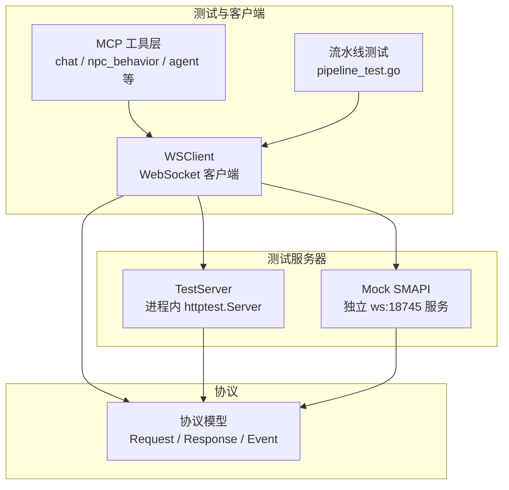
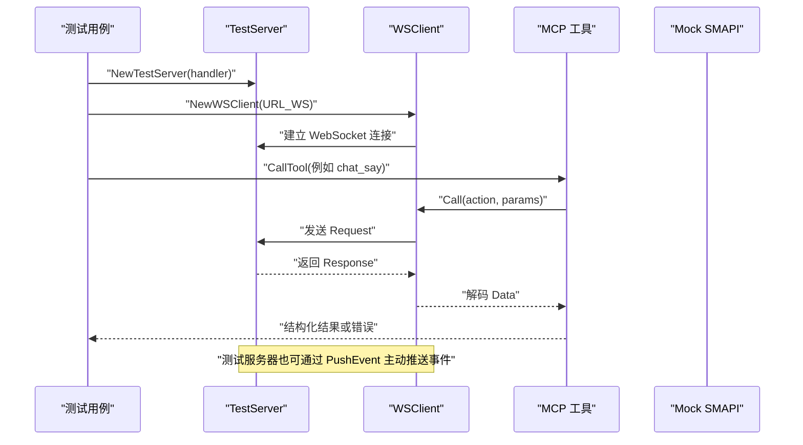
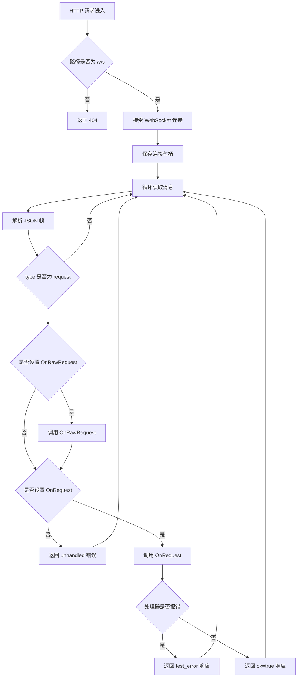
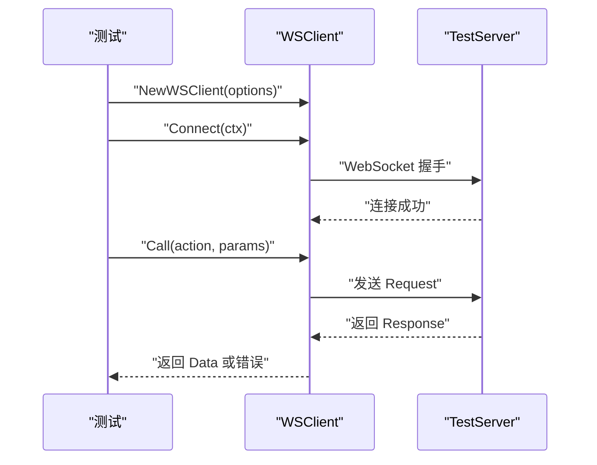
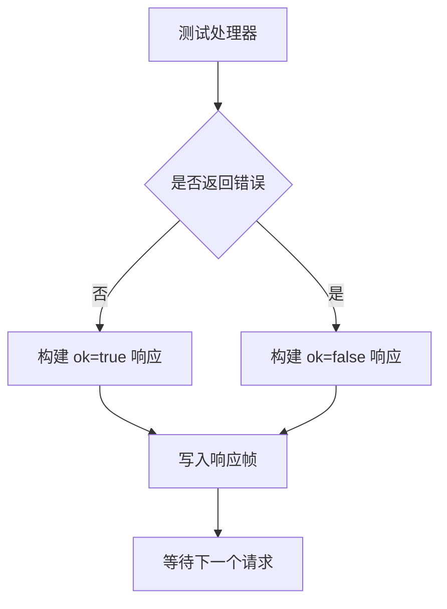
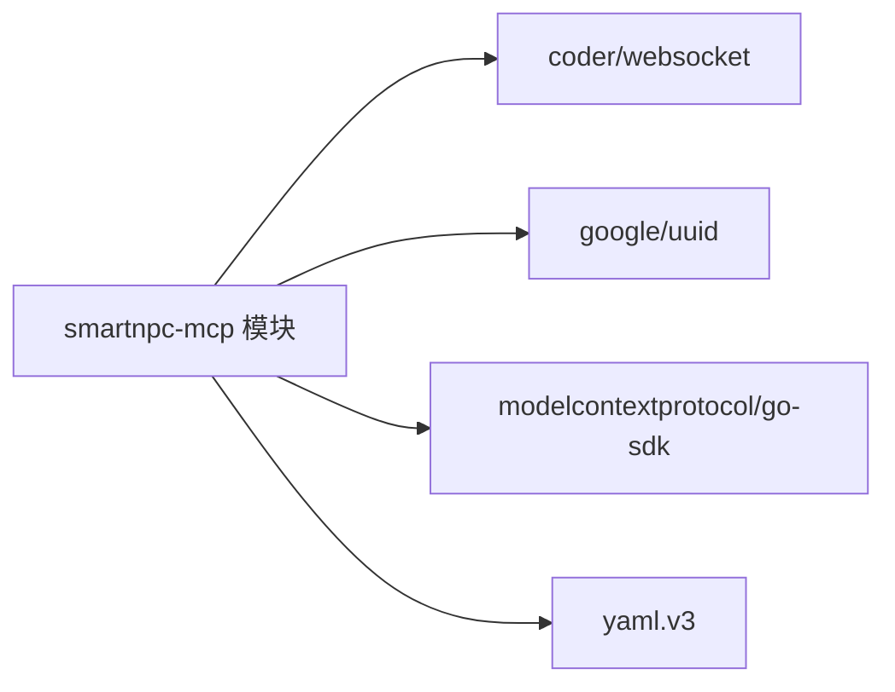

# 测试服务器

<cite>
**本文引用的文件**
- [testserver.go](file://SmartNPC/smartnpc-mcp/adapters/stardew/bridge/testserver.go)
- [ws_client.go](file://SmartNPC/smartnpc-mcp/adapters/stardew/bridge/ws_client.go)
- [protocol.go](file://SmartNPC/smartnpc-mcp/adapters/stardew/bridge/protocol.go)
- [ws_client_test.go](file://SmartNPC/smartnpc-mcp/adapters/stardew/bridge/ws_client_test.go)
- [main.go](file://SmartNPC/smartnpc-mcp/testdata/mock_smapi/main.go)
- [chat_test.go](file://SmartNPC/smartnpc-mcp/adapters/stardew/tools/chat_test.go)
- [agent_test.go](file://SmartNPC/smartnpc-mcp/adapters/stardew/tools/agent_test.go)
- [npc_behavior_test.go](file://SmartNPC/smartnpc-mcp/adapters/stardew/tools/npc_behavior_test.go)
- [pipeline_test.go](file://SmartNPC/smartnpc-mcp/cmd/smartnpc-mcp/pipeline_test.go)
- [main_test.go](file://SmartNPC/smartnpc-mcp/cmd/agent-bridge/main_test.go)
- [go.mod](file://SmartNPC/smartnpc-mcp/go.mod)
</cite>

## 目录
1. [简介](#简介)
2. [项目结构](#项目结构)
3. [核心组件](#核心组件)
4. [架构总览](#架构总览)
5. [详细组件分析](#详细组件分析)
6. [依赖关系分析](#依赖关系分析)
7. [性能与负载测试](#性能与负载测试)
8. [故障排查指南](#故障排查指南)
9. [结论](#结论)
10. [附录：常用测试模式与断言要点](#附录常用测试模式与断言要点)

## 简介
本仓库包含一个面向 Stardew Valley SMAPI 扩展的 Go 侧适配器层，其中实现了用于单元测试和集成测试的“测试服务器”。它模拟 SMAPI Mod 的 WebSocket 行为，提供可注入响应、错误、事件以及原始请求观察能力的轻量服务端。配合 `WSClient`、MCP 工具链以及 Hermes Relay，这些测试服务器可用于：
- 验证客户端连接、重连与事件分发；
- 验证 MCP 工具调用到 SMAPI 桥接层的端到端路径；
- 验证事件路由、多 NPC 过滤、工作流调度等复杂链路；
- 在不启动真实游戏或 SMAPI Mod 的情况下执行回归测试。

## 项目结构
测试服务器及相关代码集中在 Go 模块 `smartnpc-mcp` 中，关键位置如下：
- `adapters/stardew/bridge/testserver.go`：进程内测试服务器实现；
- `adapters/stardew/bridge/ws_client.go`：SMAPI 桥接 WebSocket 客户端；
- `adapters/stardew/bridge/protocol.go`：协议数据模型与常量；
- `adapters/stardew/bridge/ws_client_test.go`：客户端单测；
- `testdata/mock_smapi/main.go`：独立可运行的集成测试用 Mock SMAPI 服务；
- `adapters/stardew/tools/*_test.go`：基于测试服务器的工具级测试；
- `cmd/smartnpc-mcp/pipeline_test.go`：端到端流水线测试；
- `cmd/agent-bridge/main_test.go`：配置装配与未知适配器错误测试。

**图表来源**
- [testserver.go:1-147](file://SmartNPC/smartnpc-mcp/adapters/stardew/bridge/testserver.go#L1-L147)
- [ws_client.go:1-200](file://SmartNPC/smartnpc-mcp/adapters/stardew/bridge/ws_client.go#L1-L200)
- [protocol.go:1-172](file://SmartNPC/smartnpc-mcp/adapters/stardew/bridge/protocol.go#L1-L172)
- [main.go:1-90](file://SmartNPC/smartnpc-mcp/testdata/mock_smapi/main.go#L1-L90)

**章节来源**
- [testserver.go:1-147](file://SmartNPC/smartnpc-mcp/adapters/stardew/bridge/testserver.go#L1-L147)
- [ws_client.go:1-200](file://SmartNPC/smartnpc-mcp/adapters/stardew/bridge/ws_client.go#L1-L200)
- [protocol.go:1-172](file://SmartNPC/smartnpc-mcp/adapters/stardew/bridge/protocol.go#L1-L172)
- [main.go:1-90](file://SmartNPC/smartnpc-mcp/testdata/mock_smapi/main.go#L1-L90)

## 核心组件
### 测试服务器
测试服务器是一个进程内 WebSocket 服务，绑定在 `/ws` 路径上，供工具层和客户端测试使用。其职责包括：
- 接收 WebSocket 连接；
- 解析并校验 JSON 帧；
- 将请求分发给测试处理器；
- 返回成功或失败响应；
- 向已连接客户端推送事件；
- 暴露原始请求回调，便于断言协议字段。

关键特性：
- URL 生成器自动把 HTTP 测试地址转换为 WebSocket 地址；
- 通过 `OnRequest` 控制成功响应；
- 通过 `OnRawRequest` 捕获完整 `Request`，适合验证 `from_npc` 等路由字段；
- 通过 `PushEvent` 主动推送事件，支持无客户端时的错误提示；
- 线程安全地维护唯一连接句柄；
- `Close` 会关闭 WebSocket 连接并停止底层 HTTP 服务器。

**章节来源**
- [testserver.go:1-147](file://SmartNPC/smartnpc-mcp/adapters/stardew/bridge/testserver.go#L1-L147)

### WebSocket 客户端
`WSClient` 是生产环境连接真实 SMAPI Mod 的客户端，也是测试服务器的主要使用者。它负责：
- 连接默认地址 `ws://127.0.0.1:18745/ws`；
- 管理待处理请求映射；
- 通过 ID 关联请求与响应；
- 通过 `OnEvent` 回调分发服务器推送事件；
- 支持连接超时、调用超时、重试退避；
- 记录单次调用的观测记录；
- 维护会话到 NPC 名称的注册表，以便给下游请求打上 `from_npc`。

**章节来源**
- [ws_client.go:1-200](file://SmartNPC/smartnpc-mcp/adapters/stardew/bridge/ws_client.go#L1-L200)

### 协议模型
协议定义了三种帧类型：
- `request`：客户端发起 RPC；
- `response`：服务端回复；
- `event`：服务端主动推送。

同时定义了大量动作名和事件名，例如聊天、农场经济、NPC 行为、日程触发、调试触发等。请求体包含 `from_npc`，用于在多 NPC 场景中路由消息。

**章节来源**
- [protocol.go:1-172](file://SmartNPC/smartnpc-mcp/adapters/stardew/bridge/protocol.go#L1-L172)

### 独立 Mock SMAPI 服务
`testdata/mock_smapi/main.go` 是一个可单独运行的 Go 程序，监听 `127.0.0.1:18745`，模拟 SMAPI 的 WebSocket 行为：
- 接受一个客户端连接；
- 两秒后推送一条 `chat_received` 事件；
- 对标准请求格式返回成功响应；
- 打印收到的帧和发送的事件。

该服务适合集成测试场景，尤其是需要验证真实网络边界而非仅内存连接的用例。

**章节来源**
- [main.go:1-90](file://SmartNPC/smartnpc-mcp/testdata/mock_smapi/main.go#L1-L90)

## 架构总览
下图展示了测试服务器在单元测试、集成测试和端到端流水线中的位置。

**图表来源**
- [testserver.go:1-147](file://SmartNPC/smartnpc-mcp/adapters/stardew/bridge/testserver.go#L1-L147)
- [ws_client.go:1-200](file://SmartNPC/smartnpc-mcp/adapters/stardew/bridge/ws_client.go#L1-L200)
- [ws_client_test.go:1-121](file://SmartNPC/smartnpc-mcp/adapters/stardew/bridge/ws_client_test.go#L1-L121)

## 详细组件分析

### 测试服务器实现分析
测试服务器内部使用 `httptest.Server` 包装 HTTP 处理器，只允许 `/ws` 路径通过 WebSocket 握手。连接建立后：
- 设置最大读取限制；
- 保存当前连接；
- 循环读取消息；
- 跳过非 `request` 帧；
- 可选调用 `OnRawRequest`；
- 调用 `OnRequest` 生成响应；
- 若未设置处理器，返回未处理错误；
- 若处理器报错，返回带错误码的失败响应；
- 成功时返回携带 `Data` 的成功响应。

**图表来源**
- [testserver.go:49-147](file://SmartNPC/smartnpc-mcp/adapters/stardew/bridge/testserver.go#L49-L147)

**章节来源**
- [testserver.go:1-147](file://SmartNPC/smartnpc-mcp/adapters/stardew/bridge/testserver.go#L1-L147)

### 客户端连接与响应流程
`WSClient.Connect` 会拨号并启动读循环。测试中通常直接调用 `Connect`，然后使用 `Call` 发起 RPC。客户端的关键行为包括：
- 使用默认或配置的 URL；
- 使用上下文控制超时；
- 为每个请求分配 ID；
- 将响应按 ID 投递到等待通道；
- 将事件分发给 `OnEvent`；
- 支持重试退避；
- 支持实验日志记录。

**图表来源**
- [ws_client.go:1-200](file://SmartNPC/smartnpc-mcp/adapters/stardew/bridge/ws_client.go#L1-L200)
- [ws_client_test.go:1-121](file://SmartNPC/smartnpc-mcp/adapters/stardew/bridge/ws_client_test.go#L1-L121)

**章节来源**
- [ws_client.go:1-200](file://SmartNPC/smartnpc-mcp/adapters/stardew/bridge/ws_client.go#L1-L200)
- [ws_client_test.go:1-121](file://SmartNPC/smartnpc-mcp/adapters/stardew/bridge/ws_client_test.go#L1-L121)

### 模拟 SMAPI 行为
测试服务器模拟了以下 SMAPI 行为：
- **响应生成**：根据 `OnRequest` 返回的数据封装为 `Response.Data`；
- **错误模拟**：处理器返回错误时，服务端封装为 `ok=false` 且带错误码；
- **延迟注入**：独立 Mock SMAPI 服务会在两秒后推送事件，适合验证异步事件处理；
- **事件推送**：通过 `PushEvent` 主动推送任意事件；
- **原始请求观察**：通过 `OnRawRequest` 观察完整协议帧。

**图表来源**
- [testserver.go:89-147](file://SmartNPC/smartnpc-mcp/adapters/stardew/bridge/testserver.go#L89-L147)
- [main.go:28-90](file://SmartNPC/smartnpc-mcp/testdata/mock_smapi/main.go#L28-L90)

**章节来源**
- [testserver.go:1-147](file://SmartNPC/smartnpc-mcp/adapters/stardew/bridge/testserver.go#L1-L147)
- [main.go:1-90](file://SmartNPC/smartnpc-mcp/testdata/mock_smapi/main.go#L1-L90)

### 测试用例编写方法
#### 单元测试：客户端连接与响应
`ws_client_test.go` 展示了如何使用测试服务器验证：
- 成功调用；
- 服务端错误；
- 事件分发。

典型步骤：
1. 创建测试服务器；
2. 创建 `WSClient`；
3. 调用 `Connect`；
4. 调用 `Call`；
5. 断言返回值；
6. 使用 `PushEvent` 触发事件；
7. 断言事件回调参数。

**章节来源**
- [ws_client_test.go:1-121](file://SmartNPC/smartnpc-mcp/adapters/stardew/bridge/ws_client_test.go#L1-L121)

#### 工具层测试：MCP 工具到 SMAPI 桥接
工具层测试使用 `bridge.NewTestServer` 包裹真实的 `WSClient`，并通过 MCP 内存传输连接测试客户端与服务端。例如：
- `chat_test.go` 验证 `chat_say` 工具；
- `agent_test.go` 验证 `agent_register_self` 和 `from_npc` 路由；
- `npc_behavior_test.go` 验证 NPC 行为工具列表和执行。

通用模式：
1. 构造测试处理器；
2. 创建 `WSClient` 并连接；
3. 创建 MCP 服务端；
4. 注册对应工具；
5. 创建 MCP 客户端；
6. 调用工具；
7. 断言工具结果、结构化内容、是否到达桥接层。

**章节来源**
- [chat_test.go:1-200](file://SmartNPC/smartnpc-mcp/adapters/stardew/tools/chat_test.go#L1-L200)
- [agent_test.go:1-200](file://SmartNPC/smartnpc-mcp/adapters/stardew/tools/agent_test.go#L1-L200)
- [npc_behavior_test.go:1-200](file://SmartNPC/smartnpc-mcp/adapters/stardew/tools/npc_behavior_test.go#L1-L200)

#### 集成测试：端到端流水线
`pipeline_test.go` 构建了更完整的链路：
- 伪造 Hermes Gateway；
- 使用 `TestServer` 模拟 SMAPI；
- 连接 `WSClient`；
- 通过 `makeRouter` 路由事件；
- 断言最终 HTTP POST 是否正确。

典型场景包括：
- 所有者指令到达 Hermes；
- 非匹配 NPC 被过滤；
- 中继关闭时不发送 HTTP；
- 聊天事件过滤；
- 多 NPC 网关路由；
- 游戏时间刻度触发日程；
- 工作流从计划到引擎执行的完整路径。

**章节来源**
- [pipeline_test.go:1-200](file://SmartNPC/smartnpc-mcp/cmd/smartnpc-mcp/pipeline_test.go#L1-L200)
- [pipeline_test.go:201-644](file://SmartNPC/smartnpc-mcp/cmd/smartnpc-mcp/pipeline_test.go#L201-L644)

### 断言库使用方法
该项目主要使用 Go 标准测试包 `testing`，并结合以下断言方式：
- `t.Fatalf`：致命错误，立即终止测试；
- `t.Errorf`：非致命错误，继续执行；
- 自定义辅助函数如 `errContains`（在测试文件中）判断结构化错误内容；
- 通过 `res.IsError` 区分工具层结构化 no-op 与 Go 层错误；
- 通过计数器、原子变量、同步等待组验证并发和异步行为。

注意：
- 工具层错误应优先使用结构化 no-op，避免 LLM 重试；
- 异步事件断言应使用带超时的 `select` 或轮询；
- 对 MCP 工具结果的断言要分别检查 `IsError`、`Content` 和 `StructuredContent`。

**章节来源**
- [chat_test.go:1-200](file://SmartNPC/smartnpc-mcp/adapters/stardew/tools/chat_test.go#L1-L200)
- [pipeline_test.go:1-200](file://SmartNPC/smartnpc-mcp/cmd/smartnpc-mcp/pipeline_test.go#L1-L200)

## 依赖关系分析
Go 模块依赖如下：
- `github.com/coder/websocket`：WebSocket 通信；
- `github.com/google/uuid`：请求 ID 生成；
- `github.com/modelcontextprotocol/go-sdk`：MCP 客户端和服务端；
- `gopkg.in/yaml.v3`：配置文件解析；
- 其他间接依赖用于 JSON、OAuth 等。

**图表来源**
- [go.mod:1-19](file://SmartNPC/smartnpc-mcp/go.mod#L1-L19)

**章节来源**
- [go.mod:1-19](file://SmartNPC/smartnpc-mcp/go.mod#L1-L19)

## 性能与负载测试
现有测试主要集中在正确性、路由、事件处理和端到端链路，而不是传统意义上的高吞吐压力测试。不过仍可以基于现有基础设施扩展：

### 可扩展的性能测试方向
- **并发连接测试**：多个 `WSClient` 同时连接同一 `TestServer`，验证连接竞争和事件分发；
- **批量请求测试**：短时间内发送大量 `Call`，验证请求-响应匹配和 pending map 行为；
- **事件风暴测试**：高频推送事件，验证事件回调不会阻塞主读循环；
- **长连接稳定性测试**：长时间保持连接，验证重连逻辑和上下文取消；
- **Hermes 网关压力测试**：使用多个 fake gateway 和批量事件，验证路由分组和多 NPC 分流。

### 建议的性能测试配置
- 使用 `testing.TB.Cleanup` 确保测试资源释放；
- 使用 `sync.WaitGroup` 协调异步 goroutine；
- 使用 `atomic.Int32` 统计请求数、事件数、失败数；
- 使用 `time.After` 或带超时的 context 防止测试挂起；
- 使用 `httptest.NewServer` 替换外部依赖；
- 避免在测试中启动真实游戏或真实 SMAPI Mod。

### 当前仓库中的相关实践
- `pipeline_test.go` 使用 `httptest.NewServer` 模拟 Hermes Gateway；
- 使用 `sync.WaitGroup` 等待异步 POST；
- 使用 `atomic.Int32` 统计多网关命中；
- 使用固定超时防止测试无限等待。

**章节来源**
- [pipeline_test.go:1-200](file://SmartNPC/smartnpc-mcp/cmd/smartnpc-mcp/pipeline_test.go#L1-L200)
- [pipeline_test.go:201-644](file://SmartNPC/smartnpc-mcp/cmd/smartnpc-mcp/pipeline_test.go#L201-L644)

## 故障排查指南

### 常见问题
1. **测试服务器没有收到请求**
   - 检查测试处理器是否匹配目标 action；
   - 确认 `URL_WS()` 返回的是 WebSocket URL；
   - 确认客户端已调用 `Connect`。

2. **事件没有触发回调**
   - 确认 `PushEvent` 在连接建立后调用；
   - 确认客户端设置了 `OnEvent`；
   - 确认事件名与常量一致。

3. **from_npc 路由不正确**
   - 确认先调用 `agent_register_self`；
   - 确认后续调用使用相同会话上下文；
   - 使用 `OnRawRequest` 捕获原始请求验证。

4. **工具层返回结构化错误但测试误判为失败**
   - 区分 `IsError` 和 Go 层 error；
   - 检查结构化内容中的错误码；
   - 对于 private quota exhausted，应期望 no-op 而非 Go error。

5. **集成测试无法连接 18745**
   - 确认 Mock SMAPI 已启动；
   - 确认端口未被占用；
   - 检查防火墙或容器网络隔离。

**章节来源**
- [ws_client_test.go:1-121](file://SmartNPC/smartnpc-mcp/adapters/stardew/bridge/ws_client_test.go#L1-L121)
- [agent_test.go:1-200](file://SmartNPC/smartnpc-mcp/adapters/stardew/tools/agent_test.go#L1-L200)
- [chat_test.go:1-200](file://SmartNPC/smartnpc-mcp/adapters/stardew/tools/chat_test.go#L1-L200)
- [main.go:1-90](file://SmartNPC/smartnpc-mcp/testdata/mock_smapi/main.go#L1-L90)

## 结论
该测试服务器体系以 `TestServer` 为核心，围绕 WebSocket 协议、MCP 工具层和 Hermes Relay 构建了完整的测试闭环。它既能支撑简单的客户端单测，也能支撑复杂的端到端流水线测试。对于未来扩展，推荐：
- 继续使用 `TestServer` 作为首选单元测试后端；
- 使用 `testdata/mock_smapi` 进行网络边界集成测试；
- 通过 `OnRawRequest` 强化协议级断言；
- 通过 `PushEvent` 模拟 SMAPI 事件驱动行为；
- 在性能测试中复用现有 fake gateway 和测试服务器模式。

## 附录：常用测试模式与断言要点

### 基本测试服务器用法
- 创建处理器；
- 创建测试服务器；
- 获取 WebSocket URL；
- 连接客户端；
- 发起调用；
- 断言结果；
- 关闭服务器。

**章节来源**
- [testserver.go:1-147](file://SmartNPC/smartnpc-mcp/adapters/stardew/bridge/testserver.go#L1-L147)
- [ws_client_test.go:1-121](file://SmartNPC/smartnpc-mcp/adapters/stardew/bridge/ws_client_test.go#L1-L121)

### 事件断言模式
- 使用 channel 或 wait group 接收异步事件；
- 使用超时防止测试卡死；
- 断言事件名和数据；
- 使用 `PushEvent` 触发服务端事件。

**章节来源**
- [ws_client_test.go:60-121](file://SmartNPC/smartnpc-mcp/adapters/stardew/bridge/ws_client_test.go#L60-L121)
- [pipeline_test.go:1-200](file://SmartNPC/smartnpc-mcp/cmd/smartnpc-mcp/pipeline_test.go#L1-L200)

### from_npc 路由断言模式
- 使用 `OnRawRequest` 捕获原始请求；
- 断言 `FromNPC` 字段；
- 结合 `agent_register_self` 验证会话绑定；
- 覆盖空 session ID 和非空 session ID 两种情况。

**章节来源**
- [agent_test.go:1-200](file://SmartNPC/smartnpc-mcp/adapters/stardew/tools/agent_test.go#L1-L200)

### 工具层断言模式
- 断言工具列表；
- 断言结构化输出；
- 断言桥接层是否真正收到请求；
- 断言错误是否为结构化 no-op；
- 断言配额重置行为。

**章节来源**
- [chat_test.go:1-200](file://SmartNPC/smartnpc-mcp/adapters/stardew/tools/chat_test.go#L1-L200)
- [npc_behavior_test.go:1-200](file://SmartNPC/smartnpc-mcp/adapters/stardew/tools/npc_behavior_test.go#L1-L200)

### 端到端流水线断言模式
- 使用 fake Hermes Gateway 捕获 HTTP 请求；
- 断言路径、认证头、模型、对话 ID；
- 断言 NPC 过滤逻辑；
- 断言调度器和事件转换；
- 断言工作流执行链。

**章节来源**
- [pipeline_test.go:1-200](file://SmartNPC/smartnpc-mcp/cmd/smartnpc-mcp/pipeline_test.go#L1-L200)
- [pipeline_test.go:201-644](file://SmartNPC/smartnpc-mcp/cmd/smartnpc-mcp/pipeline_test.go#L201-L644)