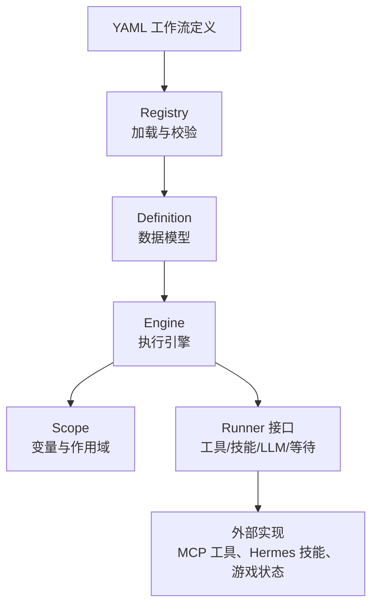
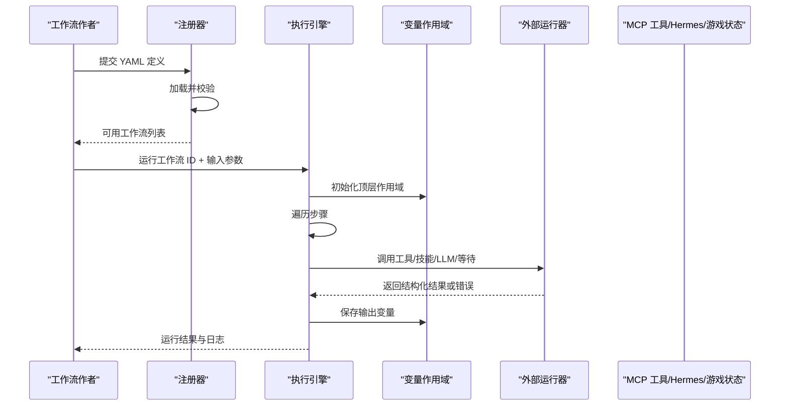
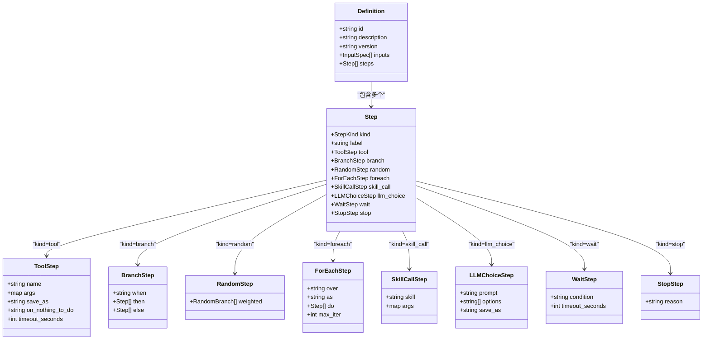
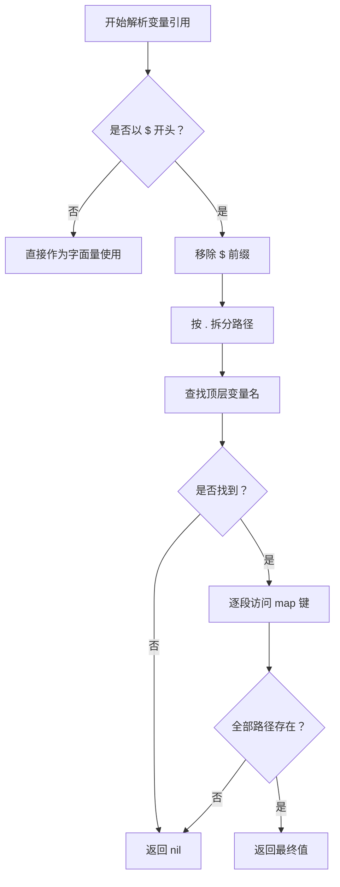
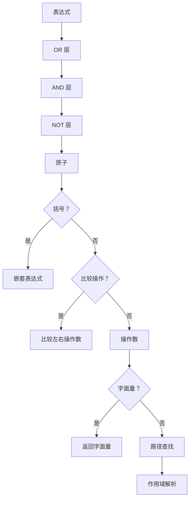
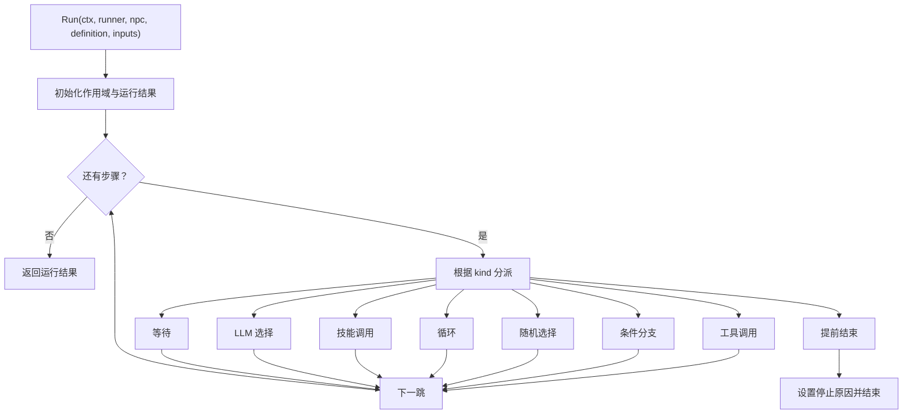
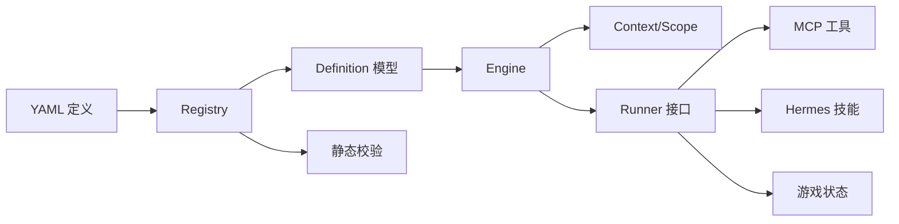

# 工作流定义格式

<cite>
**本文引用的文件**   
- [workflow-authoring.md](file://SmartNPC/docs/workflow-authoring.md)
- [definition.go](file://SmartNPC/smartnpc-mcp/pkg/workflow/definition.go)
- [engine.go](file://SmartNPC/smartnpc-mcp/pkg/workflow/engine.go)
- [context.go](file://SmartNPC/smartnpc-mcp/pkg/workflow/context.go)
- [registry.go](file://SmartNPC/smartnpc-mcp/pkg/workflow/registry.go)
</cite>

## 目录
1. [简介](#简介)
2. [项目结构](#项目结构)
3. [核心组件](#核心组件)
4. [架构总览](#架构总览)
5. [详细组件分析](#详细组件分析)
6. [依赖关系分析](#依赖关系分析)
7. [性能与可靠性](#性能与可靠性)
8. [故障排查指南](#故障排查指南)
9. [结论](#结论)
10. [附录：版本管理与迁移建议](#附录版本管理与迁移建议)

## 简介
本文件是 SmartNPC 工作流定义格式的完整参考文档。工作流是一组按顺序执行的步骤，用于驱动非玩家角色的多步行为，例如资源采集、社交互动、农场维护等。工作流以 YAML 声明式定义，由引擎在本地执行；除 `llm_choice` 和 `skill_call` 外，常规步骤不需要调用大语言模型，因此具有低延迟、可预测的执行特性。

该文档覆盖以下主题：
- YAML 语法规则：节点声明、属性配置、连接定义。
- 支持的节点类型：工具调用、条件分支、随机选择、循环、技能调用、大语言模型选项、等待、提前结束。
- 变量系统与上下文管理：作用域、数据传递、状态共享。
- 条件表达式语法：路径查找、比较、逻辑运算、字面量。
- 工作流版本管理、向后兼容策略与迁移指南。
- 模板示例与最佳实践（通过源码引用路径呈现）。

## 项目结构
工作流定义系统位于 Go 包 `smartnpc-mcp/pkg/workflow`，核心职责划分如下：
- `definition.go`：定义工作流的数据模型，包括工作流定义、输入规格、所有步骤类型。
- `engine.go`：工作流执行引擎，负责调度步骤、调用外部能力、收集运行结果。
- `context.go`：变量作用域、表达式解析与求值。
- `registry.go`：YAML 加载、内置工作流注册、静态校验与运行时覆盖。

**图表来源**
- [definition.go:1-234](file://SmartNPC/smartnpc-mcp/pkg/workflow/definition.go#L1-L234)
- [engine.go:1-200](file://SmartNPC/smartnpc-mcp/pkg/workflow/engine.go#L1-L200)
- [context.go:1-120](file://SmartNPC/smartnpc-mcp/pkg/workflow/context.go#L1-L120)
- [registry.go:1-120](file://SmartNPC/smartnpc-mcp/pkg/workflow/registry.go#L1-L120)

**章节来源**
- [definition.go:1-80](file://SmartNPC/smartnpc-mcp/pkg/workflow/definition.go#L1-L80)
- [registry.go:1-60](file://SmartNPC/smartnpc-mcp/pkg/workflow/registry.go#L1-L60)

## 核心组件
工作流系统的核心由四类构件组成：

| 组件 | 职责 | 关键行为 |
|---|---|---|
| 定义模型 | 描述工作流的标识、说明、版本、输入和步骤序列 | 使用标签联合表示不同步骤类型 |
| 注册器 | 加载 YAML、合并内置与自定义工作流、静态校验 | 支持 `builtin/*.yaml` 嵌入与外部目录覆盖 |
| 引擎 | 顺序执行步骤、处理分支/循环/随机、记录指标 | 暴露统一入口 `Run` |
| 上下文 | 提供变量作用域和表达式求值 | 支持路径查找、布尔语义、嵌套作用域 |

**章节来源**
- [definition.go:1-234](file://SmartNPC/smartnpc-mcp/pkg/workflow/definition.go#L1-L234)
- [registry.go:1-200](file://SmartNPC/smartnpc-mcp/pkg/workflow/registry.go#L1-L200)
- [engine.go:1-120](file://SmartNPC/smartnpc-mcp/pkg/workflow/engine.go#L1-L120)
- [context.go:1-120](file://SmartNPC/smartnpc-mcp/pkg/workflow/context.go#L1-L120)

## 架构总览
下图展示从 YAML 到执行结果的完整流程。

**图表来源**
- [registry.go:1-120](file://SmartNPC/smartnpc-mcp/pkg/workflow/registry.go#L1-L120)
- [engine.go:1-200](file://SmartNPC/smartnpc-mcp/pkg/workflow/engine.go#L1-L200)
- [context.go:1-120](file://SmartNPC/smartnpc-mcp/pkg/workflow/context.go#L1-L120)

## 详细组件分析

### 工作流定义与节点类型
工作流定义包含以下顶层字段：
- `id`：工作流唯一标识。
- `description`：可选的人类可读说明。
- `version`：可选的版本字符串，用于人类可读的工作流版本追踪。
- `inputs`：可选的命名输入参数列表，每个输入可带默认值。
- `steps`：必填的步骤序列，按顺序执行。

步骤采用“标签联合”结构：每个步骤有 `kind` 字段，决定具体子结构。当前支持的节点类型如下：

| 节点类型 | 用途 | 关键字段 | 行为要点 |
|---|---|---|---|
| `tool` | 调用 MCP 工具 | `name`、`args`、`save_as`、`on_nothing_to_do`、`timeout_seconds` | 将工具输出绑定到变量；根据 `nothing_to_do` 响应决定是否继续、停止或失败 |
| `branch` | 条件分支 | `when`、`then`、`else` | 表达式为真走 `then`，否则走 `else` |
| `random` | 加权随机选择 | `weighted` | 按权重归一化后选择一个分支执行 |
| `foreach` | 列表循环 | `over`、`as`、`do`、`max_iter` | 为每项创建子作用域，最多迭代默认 50 次 |
| `skill_call` | 触发 Hermes 技能 | `skill`、`args` | 通过运行器异步或同步触发技能 |
| `llm_choice` | 让大语言模型做选择 | `prompt`、`options`、`save_as` | 选择结果必须来自选项列表，否则回退到第一个选项 |
| `wait` | 等待 NPC 空闲 | `condition`、`timeout_seconds` | 目前仅支持 `idle`，默认超时 30 秒 |
| `stop` | 提前结束 | `reason` | 标记工作流已主动停止 |

**图表来源**
- [definition.go:1-234](file://SmartNPC/smartnpc-mcp/pkg/workflow/definition.go#L1-L234)

**章节来源**
- [definition.go:1-234](file://SmartNPC/smartnpc-mcp/pkg/workflow/definition.go#L1-L234)
- [workflow-authoring.md:1-172](file://SmartNPC/docs/workflow-authoring.md#L1-L172)

### 变量系统与上下文管理
变量系统基于作用域链实现，具有以下特性：
- 顶层作用域初始化为空。
- 工作流声明的 `inputs` 会绑定到顶层作用域；调用者传入的参数优先于默认值。
- `save_as` 将工具或 `llm_choice` 的结果写入当前作用域。
- `foreach` 每次迭代创建子作用域，父作用域的变量可见，但当前迭代的绑定不会污染外层。
- 同一作用域内不允许重复绑定同名变量，防止后续步骤产生歧义。
- 变量引用支持可选 `$` 前缀和点号路径，例如 `obs.water.count` 或 `$obs.water.count`。

变量解析规则：
- 如果路径第一段匹配作用域中的名称，则向下逐段查找 `map[string]any`。
- 未找到路径时返回 `nil`，表达式中视为假值。
- 工具参数中的字符串若以 `$` 开头，会被替换为解析后的值；其他类型直接透传。

**图表来源**
- [context.go:1-120](file://SmartNPC/smartnpc-mcp/pkg/workflow/context.go#L1-L120)
- [engine.go:520-626](file://SmartNPC/smartnpc-mcp/pkg/workflow/engine.go#L520-L626)

**章节来源**
- [context.go:1-120](file://SmartNPC/smartnpc-mcp/pkg/workflow/context.go#L1-L120)
- [engine.go:520-626](file://SmartNPC/smartnpc-mcp/pkg/workflow/engine.go#L520-L626)

### 条件表达式语法
表达式是一个轻量级 DSL，适合工作流中的判断逻辑。它不包含算术运算、函数调用或字符串插值；更复杂的计算应在 Go 侧完成并通过 `save_as` 暴露。

表达式语法要点：
- 支持操作符：`==`、`!=`、`<`、`<=`、`>`、`>=`。
- 支持逻辑运算符：`&&`、`||`、`!`。
- 支持括号分组。
- 支持字面量：数字、引号字符串、`true`、`false`、`nil`。
- 支持路径查找：变量名或点号路径。
- 布尔语义：
  - `nil` 为假。
  - 数字非零为真。
  - 非空字符串为真。
  - 非空列表或映射为真。
  - 未知类型默认按“存在即真”处理。

表达式解析顺序：
1. 先解析 `||`。
2. 再解析 `&&`。
3. 再处理 `!`。
4. 然后解析原子：括号、比较、路径或字面量。
5. 比较时优先数值比较，其次字符串比较；不匹配时返回假值而不是报错。

**图表来源**
- [context.go:120-452](file://SmartNPC/smartnpc-mcp/pkg/workflow/context.go#L120-L452)

**章节来源**
- [context.go:120-452](file://SmartNPC/smartnpc-mcp/pkg/workflow/context.go#L120-L452)
- [workflow-authoring.md:100-172](file://SmartNPC/docs/workflow-authoring.md#L100-L172)

### 执行引擎与控制流
引擎是工作流的中央调度器，主要职责包括：
- 初始化运行结果统计。
- 绑定输入变量。
- 顺序执行步骤。
- 根据步骤类型分派到对应处理器。
- 记录工具调用次数、无动作次数、早停原因、耗时等指标。

控制流关键点：
- 普通步骤失败会终止工作流。
- `stop` 节点标记主动停止，不视为错误。
- `tool` 的 `on_nothing_to_do` 支持三种策略：
  - `skip`：继续下一步。
  - `stop`：记录停止原因并结束。
  - `fail`：将“无工作可做”视为工作流错误。
- `foreach` 遇到早停会立即退出循环。
- `random` 将所有正权重归一化后抽样；权重全为 0 时跳过。
- `wait` 默认条件为空或 `idle`，默认超时 30 秒。
- `llm_choice` 若返回值不在选项中，回退到第一个选项。

**图表来源**
- [engine.go:1-200](file://SmartNPC/smartnpc-mcp/pkg/workflow/engine.go#L1-L200)
- [engine.go:201-626](file://SmartNPC/smartnpc-mcp/pkg/workflow/engine.go#L201-L626)

**章节来源**
- [engine.go:1-200](file://SmartNPC/smartnpc-mcp/pkg/workflow/engine.go#L1-L200)
- [engine.go:201-626](file://SmartNPC/smartnpc-mcp/pkg/workflow/engine.go#L201-L626)

### 工作流注册与加载
注册器负责：
- 读取嵌入的 `builtin/*.yaml` 工作流。
- 可选加载外部目录中的 YAML，并以相同 `id` 覆盖内置工作流。
- 对每个定义执行静态校验。
- 提供线程安全的读取接口。

覆盖策略：
- 外部工作流与内置工作流使用相同的 `id` 时，外部定义完全替换内置定义。
- 同一目录下不允许出现重复 `id`。
- 重复 `id` 会在注册阶段报错，便于早期发现冲突。

**章节来源**
- [registry.go:1-200](file://SmartNPC/smartnpc-mcp/pkg/workflow/registry.go#L1-L200)

### 静态校验规则
静态校验在工作流加载时执行，目的是尽早暴露定义错误，而不是等到运行时才失败。

主要规则：
- 定义不能为空。
- `id` 必填。
- `steps` 不能为空。
- `tool` 必须提供 `name`。
- `tool.save_as` 在同一作用域内不能重复。
- `tool.on_nothing_to_do` 只能是空、`skip`、`stop`、`fail`。
- `branch.when` 必填，且 `then` 与 `else` 至少有一个非空。
- `random.weighted` 必须非空，且至少一个分支权重大于 0。
- `foreach.over`、`as`、`do` 必填。
- `skill_call.skill` 必填，且禁止直接引用内部工作流工具名称。
- `llm_choice.save_as` 必填，`options` 非空，且 `save_as` 不重复。
- `wait.condition` 只能为空或 `idle`。

**章节来源**
- [registry.go:201-376](file://SmartNPC/smartnpc-mcp/pkg/workflow/registry.go#L201-L376)

## 依赖关系分析
工作流包的依赖关系清晰且分层明确：

**图表来源**
- [registry.go:1-120](file://SmartNPC/smartnpc-mcp/pkg/workflow/registry.go#L1-L120)
- [definition.go:1-80](file://SmartNPC/smartnpc-mcp/pkg/workflow/definition.go#L1-L80)
- [engine.go:1-120](file://SmartNPC/smartnpc-mcp/pkg/workflow/engine.go#L1-L120)
- [context.go:1-120](file://SmartNPC/smartnpc-mcp/pkg/workflow/context.go#L1-L120)

**章节来源**
- [registry.go:1-120](file://SmartNPC/smartnpc-mcp/pkg/workflow/registry.go#L1-L120)
- [definition.go:1-80](file://SmartNPC/smartnpc-mcp/pkg/workflow/definition.go#L1-L80)
- [engine.go:1-120](file://SmartNPC/smartnpc-mcp/pkg/workflow/engine.go#L1-L120)

## 性能与可靠性
- 引擎为每个工作流运行创建独立的随机数生成器和作用域，避免并发状态污染。
- 工具调用默认超时为 120 秒；可在 `tool.timeout_seconds` 中覆盖。
- `foreach` 默认最多迭代 50 次，防止异常数据导致无限循环。
- 表达式解析简单高效，只支持必要语法，避免引入复杂 AST 开销。
- 运行结果包含步骤数、工具调用数、无动作计数、早停原因、耗时等信息，便于监控与诊断。
- 工作流整体受传入 `context` 的生命周期控制，取消或超时会传播到步骤执行。

**章节来源**
- [engine.go:1-120](file://SmartNPC/smartnpc-mcp/pkg/workflow/engine.go#L1-L120)
- [engine.go:201-400](file://SmartNPC/smartnpc-mcp/pkg/workflow/engine.go#L201-L400)
- [engine.go:400-520](file://SmartNPC/smartnpc-mcp/pkg/workflow/engine.go#L400-L520)

## 故障排查指南
常见问题与定位方式：

| 现象 | 可能原因 | 排查建议 |
|---|---|---|
| 工作流启动时报错 | 缺少 `id`、`steps` 为空、步骤类型未知 | 检查 YAML 根字段和每个步骤的 `kind` |
| 工具调用失败 | 工具名不存在、参数无效、外部调用异常 | 查看引擎日志中的工具名称、参数和错误信息 |
| 工具返回“无工作可做” | 游戏状态不满足工具执行条件 | 调整 `on_nothing_to_do` 策略或使用 `branch` 前置判断 |
| 变量未生效 | `save_as` 拼写错误或作用域被覆盖 | 检查变量名是否重复绑定、路径是否正确 |
| 表达式结果为假 | 变量缺失、类型不匹配、比较不支持 | 打印中间变量，确认类型后再比较 |
| 循环未执行或过早结束 | `over` 不是列表、`max_iter` 过小、子步骤早停 | 检查循环数据来源和子步骤逻辑 |
| 随机分支未执行 | 所有权重为 0 或浮点舍入边界 | 确保至少一个分支权重为正 |
| 等待节点报错 | 使用了不支持的条件值 | 仅使用空值或 `idle` |
| 工作流提前结束 | `stop` 节点或 `on_nothing_to_do=stop` | 检查 `stop.reason` 和工具响应 |

**章节来源**
- [registry.go:201-376](file://SmartNPC/smartnpc-mcp/pkg/workflow/registry.go#L201-L376)
- [engine.go:201-626](file://SmartNPC/smartnpc-mcp/pkg/workflow/engine.go#L201-L626)

## 结论
SmartNPC 工作流定义格式采用简洁的 YAML 声明式 DSL，配合强类型的 Go 数据模型和严格静态校验，能够在不依赖每步大语言模型调用的前提下，可靠地编排 NPC 的多步行为。其变量作用域、表达式语法和执行引擎设计兼顾可读性、可测试性和可扩展性。对于需要动态决策的场景，可通过 `llm_choice` 和 `skill_call` 与大语言模型及 Hermes 技能集成；对于确定性流程，应优先使用 `branch`、`random`、`foreach` 等原生节点以获得稳定性能。

## 附录：版本管理与迁移建议

### 工作流版本字段
- `version` 是可选字符串，用于表达工作流的人类可读版本。
- 当前引擎未对 `version` 做强语义解析；它主要用于日志、调试和版本管理约定。
- 建议在变更工作流行为时递增 `version`，并在团队规范中约定语义版本规则。

**章节来源**
- [definition.go:20-60](file://SmartNPC/smartnpc-mcp/pkg/workflow/definition.go#L20-L60)
- [engine.go:60-120](file://SmartNPC/smartnpc-mcp/pkg/workflow/engine.go#L60-L120)

### 向后兼容策略
- 新增可选字段时应保持旧 YAML 仍可加载，例如 `description`、`version`、`label`、`timeout_seconds` 等。
- 新增必填字段时必须同时更新静态校验，并在发布说明中明确要求迁移。
- 改变现有字段语义时，应保留旧字段一段时间并给出弃用警告。
- 新步骤类型应通过 `kind` 扩展，而不是修改已有步骤结构，从而保持 JSON/YAML 兼容性。

**章节来源**
- [definition.go:1-234](file://SmartNPC/smartnpc-mcp/pkg/workflow/definition.go#L1-L234)
- [registry.go:201-376](file://SmartNPC/smartnpc-mcp/pkg/workflow/registry.go#L201-L376)

### 迁移指南
当工作流需要升级时，建议遵循以下步骤：

1. **识别变更范围**  
   确定是新增字段、新增步骤类型，还是修改现有行为。

2. **增加版本号**  
   在 `version` 中反映变更级别，并在变更日志中说明影响。

3. **保持旧定义可用**  
   如果旧 YAML 仍能加载，优先考虑兼容路径；否则明确标注破坏性变更。

4. **更新校验规则**  
   为新字段或新行为添加 `Validate` 检查，确保错误在加载期暴露。

5. **提供迁移示例**  
   通过工作流作者指南或内置示例，展示旧写法与新写法的对应关系。

6. **验证运行行为**  
   使用现有测试和工作流日志确认新版本行为符合预期。

### 工作流模板与最佳实践
以下模板概念来源于仓库中的工作流作者指南和代码模型，读者可据此编写自己的 YAML 工作流：

| 场景 | 推荐模板思路 |
|---|---|
| 基础工具调用 | 使用 `tool` 调用 MCP 工具，并通过 `save_as` 保存观察结果 |
| 条件处理 | 使用 `branch` 判断资源是否存在或天气状态 |
| 概率行为 | 使用 `random` 配置多种行为及其权重 |
| 批量操作 | 使用 `foreach` 遍历作物、物品或目标列表 |
| 复用复杂流程 | 使用 `skill_call` 调用已有的 Hermes 技能 |
| 动态决策 | 使用 `llm_choice` 让模型从固定选项中选择 |
| 安全暂停 | 使用 `wait` 等待 NPC 回到空闲状态 |
| 优雅退出 | 使用 `stop` 记录停止原因并结束工作流 |

推荐实践：
- 始终为关键 `tool` 指定 `save_as`，以便后续步骤消费结构化数据。
- 在 `branch.when` 中使用明确的比较表达式，避免依赖隐式类型转换。
- 对可能返回“无工作可做”的工具设置合理的 `on_nothing_to_do`。
- 为 `foreach` 设置 `max_iter`，防止异常数据导致长循环。
- 尽量使用确定性分支替代频繁调用大语言模型。
- 使用 `label` 为重要步骤添加可读标签，便于日志分析。
- 在部署前运行工作流校验工具，确保定义合法。

**章节来源**
- [workflow-authoring.md:1-172](file://SmartNPC/docs/workflow-authoring.md#L1-L172)
- [definition.go:1-234](file://SmartNPC/smartnpc-mcp/pkg/workflow/definition.go#L1-L234)
- [registry.go:1-200](file://SmartNPC/smartnpc-mcp/pkg/workflow/registry.go#L1-L200)