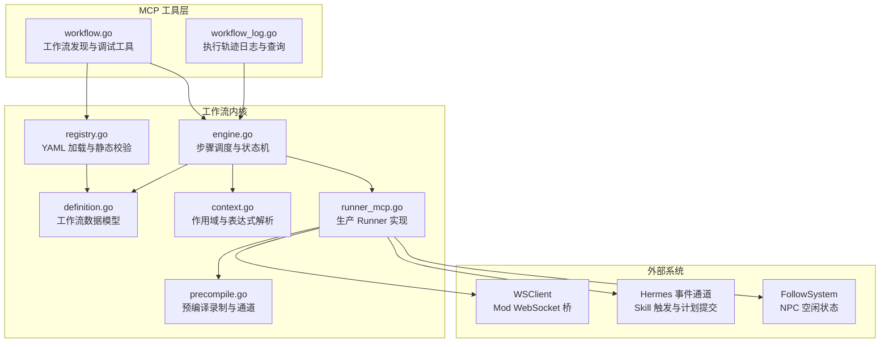
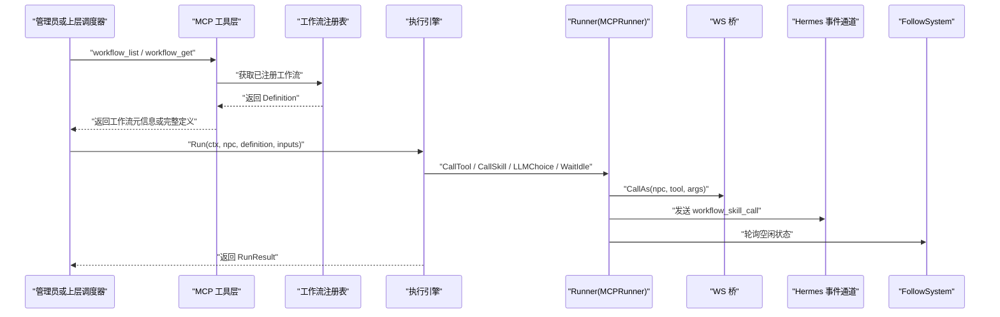
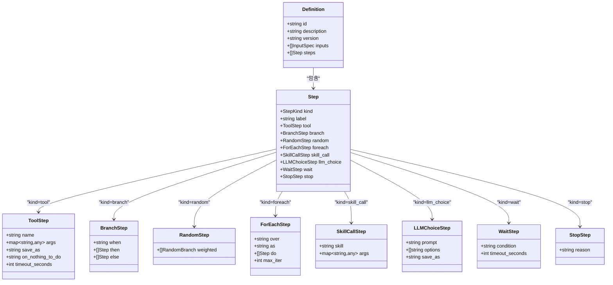
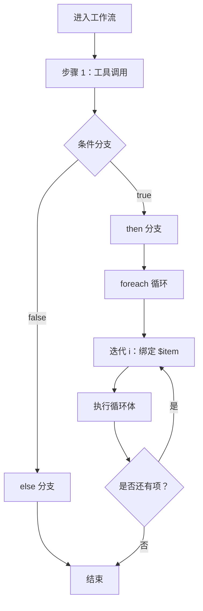
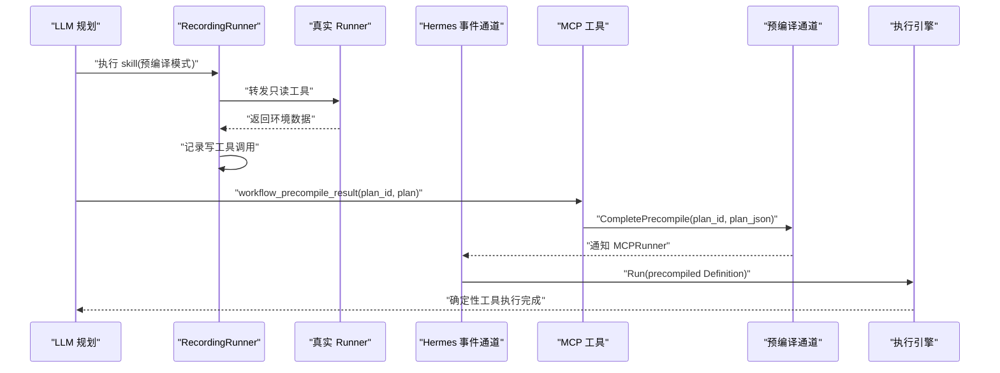
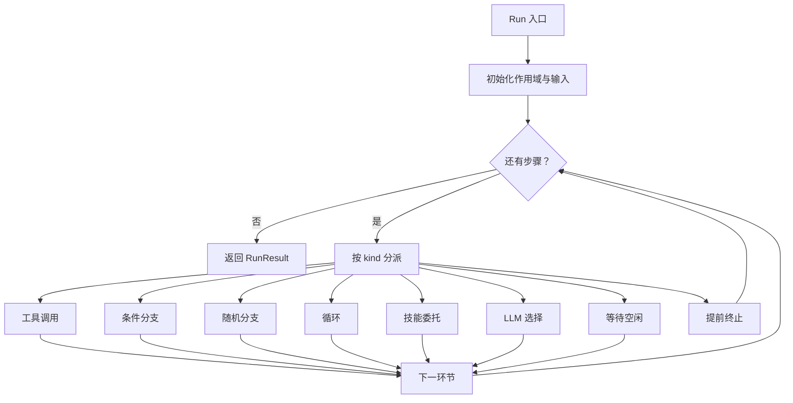
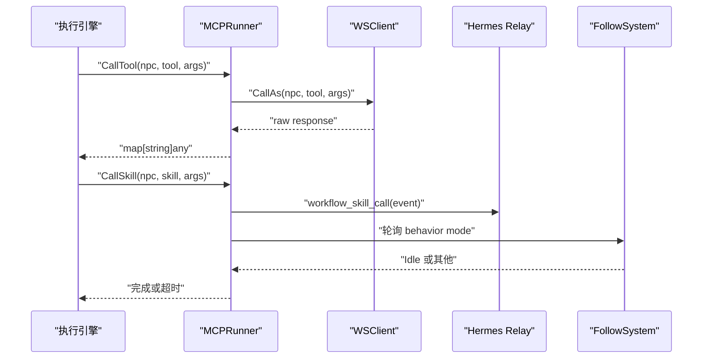
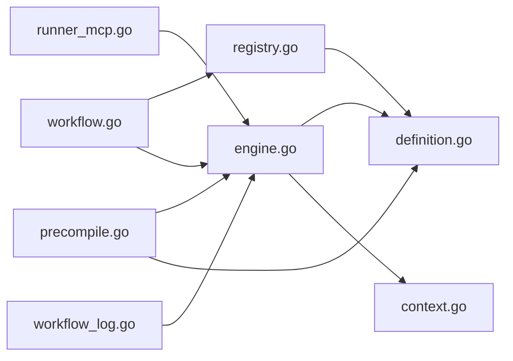
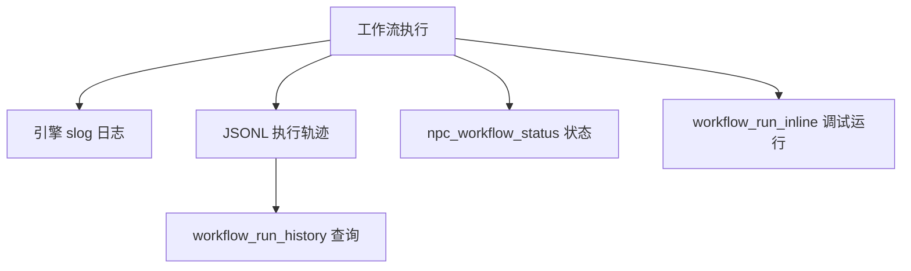

# 工作流引擎

<cite>
**本文引用的文件**   
- [definition.go](file://SmartNPC/smartnpc-mcp/pkg/workflow/definition.go)
- [precompile.go](file://SmartNPC/smartnpc-mcp/pkg/workflow/precompile.go)
- [engine.go](file://SmartNPC/smartnpc-mcp/pkg/workflow/engine.go)
- [runner_mcp.go](file://SmartNPC/smartnpc-mcp/pkg/workflow/runner_mcp.go)
- [context.go](file://SmartNPC/smartnpc-mcp/pkg/workflow/context.go)
- [registry.go](file://SmartNPC/smartnpc-mcp/pkg/workflow/registry.go)
- [workflow.go](file://SmartNPC/smartnpc-mcp/adapters/stardew/tools/workflow.go)
- [workflow_log.go](file://SmartNPC/smartnpc-mcp/adapters/stardew/tools/workflow_log.go)
</cite>

## 目录
1. [引言](#引言)
2. [项目结构](#项目结构)
3. [核心组件](#核心组件)
4. [架构总览](#架构总览)
5. [详细组件分析](#详细组件分析)
6. [依赖关系分析](#依赖关系分析)
7. [性能与复杂度](#性能与复杂度)
8. [调试与监控](#调试与监控)
9. [生命周期管理](#生命周期管理)
10. [设计模式与最佳实践](#设计模式与最佳实践)
11. [故障排查指南](#故障排查指南)
12. [结论](#结论)

## 引言
本技术文档面向 SmartNPC 项目中基于 Go 实现的工作流引擎。该引擎用于将复杂 NPC 行为组织为可配置、可预编译、可回放的工作流定义，并通过 MCP 工具暴露给上层 Agent/Hermes 调度器使用。工作流定义采用 YAML/JSON 描述，支持工具调用、条件分支、随机选择、循环、技能委托、LLM 决策、等待和提前终止等能力；执行引擎基于上下文驱动的状态机，配合 Runner 抽象桥接游戏状态、WebSocket 桥、Hermes 事件通道和 FollowSystem 空闲检测；同时提供预编译机制，把 LLM 规划过程录制为确定性工作流，在触发时以零延迟回放。

## 项目结构
工作流相关代码集中在 `smartnpc-mcp` 子模块中，分为两类：

- 工作流内核：`pkg/workflow`，包含数据模型、表达式解析、验证、注册表、执行引擎、Runner 接口以及 MCP 集成 Runner。
- MCP 工具适配层：`adapters/stardew/tools`，把工作流注册、查询、运行、历史日志、LLM 选择回复、预编译结果提交等能力暴露为 MCP 工具。

**图表来源**
- [workflow.go:1-120](file://SmartNPC/smartnpc-mcp/adapters/stardew/tools/workflow.go#L1-L120)
- [workflow_log.go:1-80](file://SmartNPC/smartnpc-mcp/adapters/stardew/tools/workflow_log.go#L1-L80)
- [registry.go:1-60](file://SmartNPC/smartnpc-mcp/pkg/workflow/registry.go#L1-L60)
- [definition.go:1-60](file://SmartNPC/smartnpc-mcp/pkg/workflow/definition.go#L1-L60)
- [context.go:1-40](file://SmartNPC/smartnpc-mcp/pkg/workflow/context.go#L1-L40)
- [engine.go:1-40](file://SmartNPC/smartnpc-mcp/pkg/workflow/engine.go#L1-L40)
- [runner_mcp.go:1-60](file://SmartNPC/smartnpc-mcp/pkg/workflow/runner_mcp.go#L1-L60)
- [precompile.go:1-40](file://SmartNPC/smartnpc-mcp/pkg/workflow/precompile.go#L1-L40)

**章节来源**
- [definition.go:1-60](file://SmartNPC/smartnpc-mcp/pkg/workflow/definition.go#L1-L60)
- [registry.go:1-60](file://SmartNPC/smartnpc-mcp/pkg/workflow/registry.go#L1-L60)
- [workflow.go:1-120](file://SmartNPC/smartnpc-mcp/adapters/stardew/tools/workflow.go#L1-L120)
- [workflow_log.go:1-80](file://SmartNPC/smartnpc-mcp/adapters/stardew/tools/workflow_log.go#L1-L80)

## 核心组件
工作流引擎由以下核心组件构成：

| 组件 | 职责 | 关键类型或入口 |
|---|---|---|
| 工作流定义 | 描述工作流 ID、输入参数、有序步骤 | `Definition`、`Step`、`ToolStep`、`BranchStep`、`RandomStep`、`ForEachStep`、`SkillCallStep`、`LLMChoiceStep`、`WaitStep`、`StopStep` |
| 注册表 | 从内置 YAML 与额外目录加载定义，去重并覆盖内置项 | `Registry`、`Init`、`Get`、`List`、`LoadDef`、`Validate` |
| 作用域与表达式 | 变量绑定、路径查找、布尔表达式求值 | `Scope`、`Resolve`、`EvalBool`、`Eval` |
| 执行引擎 | 按步骤调度、处理分支/随机/循环/技能/LLM 选择/等待/终止 | `Run`、`runSteps`、`runStep` |
| Runner 接口 | 封装工具调用、技能触发、LLM 选择、空闲等待、预编译 | `Runner` 接口 |
| MCP Runner | 生产环境 Runner，桥接 WS、Hermes、FollowSystem | `MCPRunner`、`NewMCPRunner` |
| 预编译 | 录制 LLM 规划中的只读观察与工具调用，生成可回放定义 | `RecordingRunner`、`RegisterPrecompile`、`CompletePrecompile`、`EncodePrecompilePayload` |
| MCP 工具 | 暴露工作流列表、详情、调试运行、历史查询、状态查询、LLM 选择回复、预编译结果提交 | `workflow_list`、`workflow_get`、`workflow_run_inline`、`workflow_run_history`、`npc_workflow_status`、`workflow_choice_reply`、`workflow_precompile_result` |

**章节来源**
- [definition.go:1-200](file://SmartNPC/smartnpc-mcp/pkg/workflow/definition.go#L1-L200)
- [registry.go:1-120](file://SmartNPC/smartnpc-mcp/pkg/workflow/registry.go#L1-L120)
- [context.go:1-120](file://SmartNPC/smartnpc-mcp/pkg/workflow/context.go#L1-L120)
- [engine.go:1-120](file://SmartNPC/smartnpc-mcp/pkg/workflow/engine.go#L1-L120)
- [runner_mcp.go:1-80](file://SmartNPC/smartnpc-mcp/pkg/workflow/runner_mcp.go#L1-L80)
- [precompile.go:1-120](file://SmartNPC/smartnpc-mcp/pkg/workflow/precompile.go#L1-L120)
- [workflow.go:1-200](file://SmartNPC/smartnpc-mcp/adapters/stardew/tools/workflow.go#L1-L200)
- [workflow_log.go:1-120](file://SmartNPC/smartnpc-mcp/adapters/stardew/tools/workflow_log.go#L1-L120)

## 架构总览
工作流引擎采用“定义 + 执行 + Runner 抽象”的分层架构：

- 定义层：YAML/JSON 定义工作流结构与步骤语义。
- 执行层：不直接依赖游戏或网络，仅通过 Runner 接口调用外部能力。
- Runner 层：根据部署环境注入真实实现，如 MCP Runner 桥接 Mod、Hermes 和 FollowSystem。
- 预编译层：在 LLM 规划阶段录制只读操作，生成确定性工作流定义，后续触发时直接回放。
- 工具层：通过 MCP 工具暴露发现、调试、查询和协作能力。

**图表来源**
- [workflow.go:120-220](file://SmartNPC/smartnpc-mcp/adapters/stardew/tools/workflow.go#L120-L220)
- [registry.go:60-120](file://SmartNPC/smartnpc-mcp/pkg/workflow/registry.go#L60-L120)
- [engine.go:40-120](file://SmartNPC/smartnpc-mcp/pkg/workflow/engine.go#L40-L120)
- [runner_mcp.go:60-160](file://SmartNPC/smartnpc-mcp/pkg/workflow/runner_mcp.go#L60-L160)

## 详细组件分析

### 工作流定义格式与节点类型
工作流定义是有序的步骤集合，每个步骤由 `kind` 区分具体语义。支持的节点类型包括：

| 节点类型 | 字段说明 | 行为 |
|---|---|---|
| `tool` | `name`、`args`、`save_as`、`on_nothing_to_do`、`timeout_seconds` | 调用 MCP 工具，可选保存返回值到作用域变量；对 `nothing_to_do=true` 响应支持 skip/stop/fail；支持单步超时。 |
| `branch` | `when`、`then`、`else` | 对表达式求值，真走 then，假走 else；至少一个分支非空。 |
| `random` | `weighted` | 按权重采样一个分支执行；权重为零的分支被禁用；至少一个正权重。 |
| `foreach` | `over`、`as`、`do`、`max_iter` | 遍历列表变量，每次迭代创建子作用域绑定当前项；默认最多 50 次迭代。 |
| `skill_call` | `skill`、`args` | 通过 Runner 触发 Hermes SKILL；适合复用现有提示词流程。 |
| `llm_choice` | `prompt`、`options`、`save_as` | 让 LLM 从固定选项中选择一个，结果保存到作用域；无效选项回退到第一个选项。 |
| `wait` | `condition`、`timeout_seconds` | 目前主要支持 idle 条件，轮询 FollowSystem 直到空闲或超时。 |
| `stop` | `reason` | 提前终止工作流，记录停止原因。 |

步骤还支持可选 `label`，便于追踪日志；`Args` 中的字符串若以 `$` 开头会被解析为作用域路径，例如 `$obs.water.count`。

**图表来源**
- [definition.go:1-200](file://SmartNPC/smartnpc-mcp/pkg/workflow/definition.go#L1-L200)

**章节来源**
- [definition.go:1-200](file://SmartNPC/smartnpc-mcp/pkg/workflow/definition.go#L1-L200)
- [registry.go:200-376](file://SmartNPC/smartnpc-mcp/pkg/workflow/registry.go#L200-L376)

### 连接关系、条件分支与循环控制
工作流没有显式的“边”数据结构，连接关系由步骤顺序表达：前一步的输出可通过 `save_as` 写入作用域，后一步通过 `$var.path` 引用；`branch` 控制条件分支，`random` 控制概率分支，`foreach` 控制线性循环。

- 条件分支：`when` 表达式使用最小表达式语言，支持变量路径、字面量、比较运算符、逻辑运算符和括号；未找到变量或 nil 被视为假值。
- 概率分支：权重归一化后随机采样，所有权重为零则跳过该节点。
- 循环控制：`foreach` 默认最大 50 次迭代，超出会记录日志并停止继续；每次迭代拥有独立子作用域，外层变量仍可访问。

**图表来源**
- [engine.go:200-420](file://SmartNPC/smartnpc-mcp/pkg/workflow/engine.go#L200-L420)
- [context.go:120-260](file://SmartNPC/smartnpc-mcp/pkg/workflow/context.go#L120-L260)

**章节来源**
- [engine.go:200-420](file://SmartNPC/smartnpc-mcp/pkg/workflow/engine.go#L200-L420)
- [context.go:120-260](file://SmartNPC/smartnpc-mcp/pkg/workflow/context.go#L120-L260)

### 预编译机制：语法检查、依赖分析与优化转换
预编译机制的目标是让 LLM 在规划阶段“观察世界但不修改世界”，然后把规划结果转换为可重复执行的确定性工作流。

- 录制 Runner：`RecordingRunner` 包装真实 Runner，拦截写操作的工具调用并记录；只读工具（如 `npc_inspect_*`、`game_get_*`、`player_query_*`、`workflow_*`、`npc_perception_*`）仍转发给真实 Runner，以保证规划时的环境观察准确。
- 构建定义：`BuildDefinition` 把录制的工具调用转换为纯 `tool` 步骤序列，生成 ID 为 `precompiled_` 前缀的 Definition。
- 通道协调：`RegisterPrecompile`、`CompletePrecompile`、`UnregisterPrecompile` 维护 planID 到 channel 的映射，供 LLM 通过 MCP 工具提交预编译结果。
- 负载编码：`EncodePrecompilePayload` 生成带 `precompile=true` 和 `plan_id` 的事件负载，发送给 Hermes。
- 生产 Runner 预编译：`MCPRunner.PrecompileSkill` 发送预编译请求，等待 LLM 调用 `workflow_precompile_result`，收到后反序列化为 Definition 并执行静态校验。

**图表来源**
- [precompile.go:1-120](file://SmartNPC/smartnpc-mcp/pkg/workflow/precompile.go#L1-L120)
- [precompile.go:200-226](file://SmartNPC/smartnpc-mcp/pkg/workflow/precompile.go#L200-L226)
- [runner_mcp.go:240-325](file://SmartNPC/smartnpc-mcp/pkg/workflow/runner_mcp.go#L240-L325)
- [workflow.go:420-512](file://SmartNPC/smartnpc-mcp/adapters/stardew/tools/workflow.go#L420-L512)

**章节来源**
- [precompile.go:1-120](file://SmartNPC/smartnpc-mcp/pkg/workflow/precompile.go#L1-L120)
- [precompile.go:200-226](file://SmartNPC/smartnpc-mcp/pkg/workflow/precompile.go#L200-L226)
- [runner_mcp.go:240-325](file://SmartNPC/smartnpc-mcp/pkg/workflow/runner_mcp.go#L240-L325)
- [workflow.go:420-512](file://SmartNPC/smartnpc-mcp/adapters/stardew/tools/workflow.go#L420-L512)

### 执行引擎核心逻辑：状态机、调度器与异常处理
执行引擎是一个步进式状态机：

- 初始化：检查 Definition 和 Runner 是否为空，创建作用域、绑定输入参数、初始化 RNG 和统计结果。
- 步骤调度：`runSteps` 按索引遍历步骤，每步调用 `runStep`；每一步都会增加 `StepCount`，工具成功执行会增加 `ToolCalls`。
- 步骤分发：根据 `step.kind` 分派到工具、分支、随机、循环、技能、LLM 选择、等待或终止处理器。
- 工具处理器：解析参数、调用 Runner、统计工具调用、处理 `nothing_to_do`、可选保存返回值。
- 分支处理器：求值 `when` 表达式，选择 then 或 else 子步骤集合并递归执行。
- 随机处理器：计算总权重，随机采样，执行选中分支。
- 循环处理器：限制最大迭代次数，为每项创建子作用域并执行循环体。
- 技能处理器：调用 Runner 的 `CallSkill`，失败时报错。
- LLM 选择处理器：调用 Runner 的 `LLMChoice`，校验返回值是否在选项中，否则回退到第一个选项并保存。
- 等待处理器：根据条件调用 Runner 的 `WaitIdle`，目前仅支持 idle。
- 异常处理：上下文取消标记为 stopped；未知 step kind 报错；工具错误、skill 错误、表达式错误均向上传播；`on_nothing_to_do=stop` 设置停止原因并提前结束；`fail` 转为错误。

**图表来源**
- [engine.go:40-120](file://SmartNPC/smartnpc-mcp/pkg/workflow/engine.go#L40-L120)
- [engine.go:200-626](file://SmartNPC/smartnpc-mcp/pkg/workflow/engine.go#L200-L626)

**章节来源**
- [engine.go:40-120](file://SmartNPC/smartnpc-mcp/pkg/workflow/engine.go#L40-L120)
- [engine.go:200-626](file://SmartNPC/smartnpc-mcp/pkg/workflow/engine.go#L200-L626)

### Runner MCP 集成：工作流执行与 MCP 工具调用
`MCPRunner` 是生产环境的 Runner 实现：

- `CallTool`：通过 WS 客户端以指定 NPC 身份调用 Mod 工具，自动补全 `npc` 参数，解析 JSON 响应；失败时记录警告并返回错误。
- `CallSkill`：向 Hermes relay 发送 `workflow_skill_call` 事件，然后等待实际 model turn 结束，再等待 FollowSystem 稳定空闲；支持 `relayBusy` 回调避免队列堆积导致并发问题。
- `LLMChoice`：当前默认实现返回第一个选项；预留 `ChoiceReply` 回调用于未来同步交互。
- `PrecompileSkill`：构造预编译 payload，通过 relay 发送，等待 LLM 通过 `workflow_precompile_result` 提交 plan；收到后校验并返回 Definition。
- `WaitIdle`：按固定间隔轮询 FollowSystem，直到空闲或超时。

**图表来源**
- [runner_mcp.go:60-200](file://SmartNPC/smartnpc-mcp/pkg/workflow/runner_mcp.go#L60-L200)
- [runner_mcp.go:200-325](file://SmartNPC/smartnpc-mcp/pkg/workflow/runner_mcp.go#L200-L325)

**章节来源**
- [runner_mcp.go:1-325](file://SmartNPC/smartnpc-mcp/pkg/workflow/runner_mcp.go#L1-L325)

### 工作流生命周期管理：创建、启动、暂停、恢复、终止
结合仓库实现，工作流生命周期可分为以下阶段：

| 阶段 | 对应机制 | 说明 |
|---|---|---|
| 创建 | YAML 加载与注册 | `Registry.Init` 扫描内置 YAML 与额外目录，`LoadDef` 解析并调用 `Validate`。 |
| 启动 | `workflow.Run` | 主入口，初始化作用域、执行步骤、统计指标。 |
| 运行 | 步骤调度 | 引擎按步骤推进，记录步骤数、工具调用数、nothing_to_do 计数、失败步骤。 |
| 暂停 | 上下文取消 | 通过 context 取消信号使工作流停止，标记 `Stopped` 并记录原因。 |
| 恢复 | 重新运行 | 当前实现未提供持久化恢复；恢复通常通过再次触发工作流或调度器重试。 |
| 终止 | `stop` 节点或 `on_nothing_to_do=stop` | 明确设置 `StopReason`，并提前结束。 |

此外，`npc_workflow_status` 工具可以查询当前正在运行的工作流、队列深度和待执行日程条目数量，帮助判断是否存在积压或阻塞。

**章节来源**
- [registry.go:60-120](file://SmartNPC/smartnpc-mcp/pkg/workflow/registry.go#L60-L120)
- [engine.go:40-120](file://SmartNPC/smartnpc-mcp/pkg/workflow/engine.go#L40-L120)
- [workflow.go:300-420](file://SmartNPC/smartnpc-mcp/adapters/stardew/tools/workflow.go#L300-L420)

## 依赖关系分析
工作流内核内部依赖关系如下：

- `registry.go` 依赖 `definition.go` 进行 YAML 解析和静态校验。
- `engine.go` 依赖 `definition.go` 和 `context.go`，并通过 `Runner` 接口解耦外部系统。
- `runner_mcp.go` 依赖 WS 桥、Hermes relay、FollowSystem 查询接口。
- `precompile.go` 依赖 `engine.go` 的 `Run` 和 `definition.go` 的数据结构。
- `workflow.go` 依赖 `registry.go` 与工作流内核，并把调试、历史、状态、选择回复、预编译结果等能力暴露为 MCP 工具。

**图表来源**
- [registry.go:1-120](file://SmartNPC/smartnpc-mcp/pkg/workflow/registry.go#L1-L120)
- [engine.go:1-120](file://SmartNPC/smartnpc-mcp/pkg/workflow/engine.go#L1-L120)
- [context.go:1-120](file://SmartNPC/smartnpc-mcp/pkg/workflow/context.go#L1-L120)
- [runner_mcp.go:1-120](file://SmartNPC/smartnpc-mcp/pkg/workflow/runner_mcp.go#L1-L120)
- [precompile.go:1-120](file://SmartNPC/smartnpc-mcp/pkg/workflow/precompile.go#L1-L120)
- [workflow.go:1-200](file://SmartNPC/smartnpc-mcp/adapters/stardew/tools/workflow.go#L1-L200)
- [workflow_log.go:1-120](file://SmartNPC/smartnpc-mcp/adapters/stardew/tools/workflow_log.go#L1-L120)

**章节来源**
- [registry.go:1-120](file://SmartNPC/smartnpc-mcp/pkg/workflow/registry.go#L1-L120)
- [engine.go:1-120](file://SmartNPC/smartnpc-mcp/pkg/workflow/engine.go#L1-L120)
- [workflow.go:1-200](file://SmartNPC/smartnpc-mcp/adapters/stardew/tools/workflow.go#L1-L200)

## 性能与复杂度
- 工作流步骤执行时间复杂度近似 O(S)，S 为步骤总数；分支和随机不会增加额外存储开销。
- `foreach` 最坏情况下执行 O(N×B)，N 为列表长度，B 为循环体内步骤数；默认最大迭代次数 50 防止无限扩展。
- 表达式求值使用递归下降解析，单次求值时间与表达式长度线性相关。
- 工具参数解析为浅拷贝 map，嵌套 map/list 递归替换 `$` 引用，复杂度与参数树大小线性相关。
- 预编译录制过程可能涉及多次只读工具调用，但写操作不真正执行，因此总体开销主要来自观察型工具和网络往返。
- `MCPRunner.CallSkill` 的等待逻辑包含轮询，存在网络延迟和状态轮询成本；通过 `relayBusy` 和稳定空闲时长降低并发干扰。

**章节来源**
- [engine.go:200-626](file://SmartNPC/smartnpc-mcp/pkg/workflow/engine.go#L200-L626)
- [context.go:120-452](file://SmartNPC/smartnpc-mcp/pkg/workflow/context.go#L120-L452)
- [runner_mcp.go:200-325](file://SmartNPC/smartnpc-mcp/pkg/workflow/runner_mcp.go#L200-L325)

## 调试与监控
工作流引擎提供多层调试与监控能力：

- 引擎日志：每一步开始、结束都记录 NPC、工作流 ID、步骤编号、类型、耗时、是否提前停止和错误。
- 工具调用日志：记录工具名称、参数、save_as、on_nothing_to_do 策略、耗时。
- 分支与随机日志：记录条件结果、分支名称、权重和选择索引。
- 循环日志：记录 over 变量名、as 变量名、项数和最大迭代限制。
- 技能委托日志：记录 skill 名称、参数、耗时。
- LLM 选择日志：记录 prompt、选项、save_as、最终选择。
- 执行轨迹日志：`LogWorkflowRun` 按 NPC、季节、日、年写入 JSONL 文件，包含步骤数、工具调用数、nothing_to_do 计数、停止原因、失败步骤、耗时、错误和输入参数。
- 历史查询：`workflow_run_history` 读取最近若干条记录，按时间倒序返回。
- 运行时状态：`npc_workflow_status` 查询每个 NPC 的运行工作流、耗时、队列深度和待执行日程条目。
- 调试运行：`workflow_run_inline` 使用 no-op runner 验证工作流结构，不修改游戏世界。

**图表来源**
- [engine.go:40-120](file://SmartNPC/smartnpc-mcp/pkg/workflow/engine.go#L40-L120)
- [workflow_log.go:1-120](file://SmartNPC/smartnpc-mcp/adapters/stardew/tools/workflow_log.go#L1-L120)
- [workflow.go:200-360](file://SmartNPC/smartnpc-mcp/adapters/stardew/tools/workflow.go#L200-L360)

**章节来源**
- [engine.go:40-120](file://SmartNPC/smartnpc-mcp/pkg/workflow/engine.go#L40-L120)
- [workflow_log.go:1-235](file://SmartNPC/smartnpc-mcp/adapters/stardew/tools/workflow_log.go#L1-L235)
- [workflow.go:200-512](file://SmartNPC/smartnpc-mcp/adapters/stardew/tools/workflow.go#L200-L512)

## 生命周期管理
工作流的生命周期由注册、运行、状态和日志共同体现：

- 创建工作流：编写 YAML 文件，放入内置目录或额外目录，启动时通过 `Registry.Init` 加载。
- 启动工作流：通过调度器或 MCP 工具调用 `workflow.Run`，传入 NPC、Definition 和输入参数。
- 暂停工作流：通过父上下文取消，引擎检测到取消后设置停止原因并返回。
- 恢复工作流：当前实现不支持断点恢复；通常通过重新触发或调度器重试实现。
- 终止工作流：使用 `stop` 节点，或在工具返回 `nothing_to_do` 且策略为 `stop` 时自动终止。
- 查询状态：使用 `npc_workflow_status` 查看运行中和排队情况。
- 审计轨迹：使用 `workflow_run_history` 查看过去执行记录。

**章节来源**
- [registry.go:60-120](file://SmartNPC/smartnpc-mcp/pkg/workflow/registry.go#L60-L120)
- [engine.go:40-120](file://SmartNPC/smartnpc-mcp/pkg/workflow/engine.go#L40-L120)
- [workflow.go:300-420](file://SmartNPC/smartnpc-mcp/adapters/stardew/tools/workflow.go#L300-L420)
- [workflow_log.go:120-235](file://SmartNPC/smartnpc-mcp/adapters/stardew/tools/workflow_log.go#L120-L235)

## 设计模式与最佳实践
- 分层定义：将复杂业务拆分为多个小型工作流，每个工作流负责单一职责，再通过 `skill_call` 组合已有技能。
- 只读优先：预编译模式下只使用只读工具观察环境，写操作放在预编译结果中，避免规划期副作用。
- 安全边界：`foreach` 使用 `max_iter` 防御大数据集；工具调用设置 `timeout_seconds` 防止长时间阻塞。
- 可观测性：为关键步骤添加 `label`，使用 `save_as` 传递中间结果，便于调试和追踪。
- 条件优先于随机：能用确定分支解决的问题不要用随机；随机更适合性格门控或轻量探索。
- 错误策略明确：对可能无工作的工具明确设置 `on_nothing_to_do`，常用 `skip`，关键任务用 `stop` 或 `fail`。
- 避免自引用：静态校验阻止工作流直接引用 MCP 工具作为 skill，防止简单自循环。
- 复用内置工作流：先调用 `workflow_list` 和 `workflow_get` 了解可用工作流，再决定调度策略。

**章节来源**
- [definition.go:1-200](file://SmartNPC/smartnpc-mcp/pkg/workflow/definition.go#L1-L200)
- [registry.go:200-376](file://SmartNPC/smartnpc-mcp/pkg/workflow/registry.go#L200-L376)
- [workflow.go:120-220](file://SmartNPC/smartnpc-mcp/adapters/stardew/tools/workflow.go#L120-L220)

## 故障排查指南
常见问题与定位方法：

| 现象 | 可能原因 | 排查方式 |
|---|---|---|
| 工作流未加载 | YAML 缺失、ID 冲突、语法错误 | 检查 `Registry.Init` 错误；确认 ID 唯一；查看 `Validate` 报错位置。 |
| 步骤报错 | 未知 step kind、缺少必填字段、save_as 重复 | 查看步骤编号和错误消息；检查 YAML 字段。 |
| 工具无工作 | 工具返回 `nothing_to_do=true` | 查看 `on_nothing_to_do` 策略；确认输入参数和环境状态。 |
| 工作流卡住 | LLM 选择未回复、Hermes relay 未就绪、FollowSystem 一直忙 | 检查 `workflow_choice_reply` 是否被调用；确认 relay 和桥接状态；查看轮询日志。 |
| 循环过多 | 列表过大或未设置 `max_iter` | 检查 `foreach.over` 数据规模；适当缩小 `max_iter`。 |
| 预编译超时 | LLM 未在 60 秒内提交 plan | 检查 Hermes 事件是否到达；确认 `workflow_precompile_result` 是否被调用。 |
| 执行轨迹缺失 | 季节/日期未正确填充 | 检查日志输出警告；确认实验 tracker 已更新。 |

**章节来源**
- [registry.go:120-200](file://SmartNPC/smartnpc-mcp/pkg/workflow/registry.go#L120-L200)
- [engine.go:200-626](file://SmartNPC/smartnpc-mcp/pkg/workflow/engine.go#L200-L626)
- [runner_mcp.go:200-325](file://SmartNPC/smartnpc-mcp/pkg/workflow/runner_mcp.go#L200-L325)
- [workflow_log.go:1-120](file://SmartNPC/smartnpc-mcp/adapters/stardew/tools/workflow_log.go#L1-L120)

## 结论
SmartNPC 工作流引擎以 YAML 定义为核心，通过 Runner 抽象隔离外部系统，实现了可扩展、可观测、可预编译的 NPC 行为编排。其优势在于：

- 定义清晰：步骤类型丰富，覆盖工具调用、条件、概率、循环、技能、LLM 选择和等待。
- 执行可控：上下文取消、超时、nothing_to_do 策略、最大迭代限制共同保障稳定性。
- 可观测性强：引擎日志、JSONL 轨迹、历史查询、状态查询形成完整诊断链。
- 预编译优化：把 LLM 规划转化为确定性工作流，减少触发时延迟。
- 易于集成：通过 MCP 工具暴露能力，便于上层调度器和 Agent 协作。

对于更复杂的场景，建议继续使用小粒度工作流组合、明确错误策略、利用预编译减少不确定性，并通过日志和状态工具持续观察运行效果。