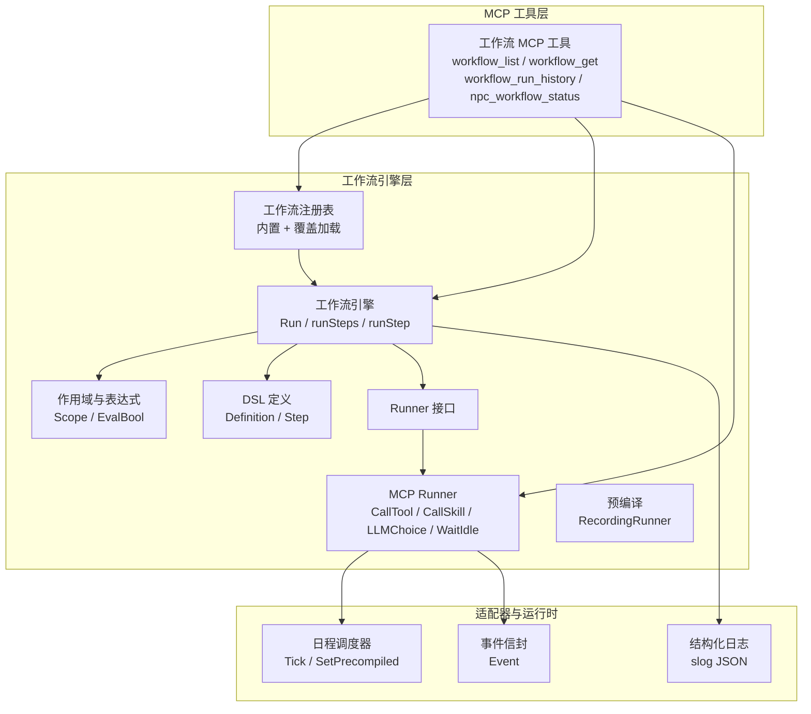
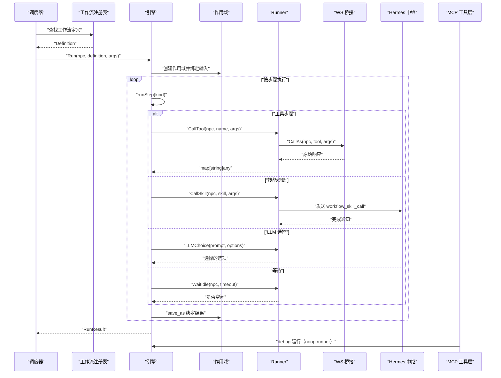
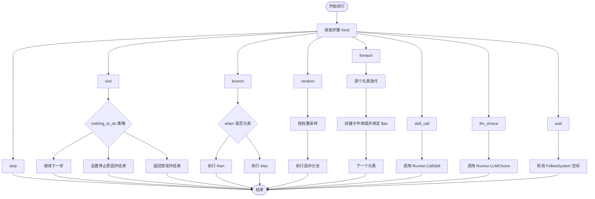
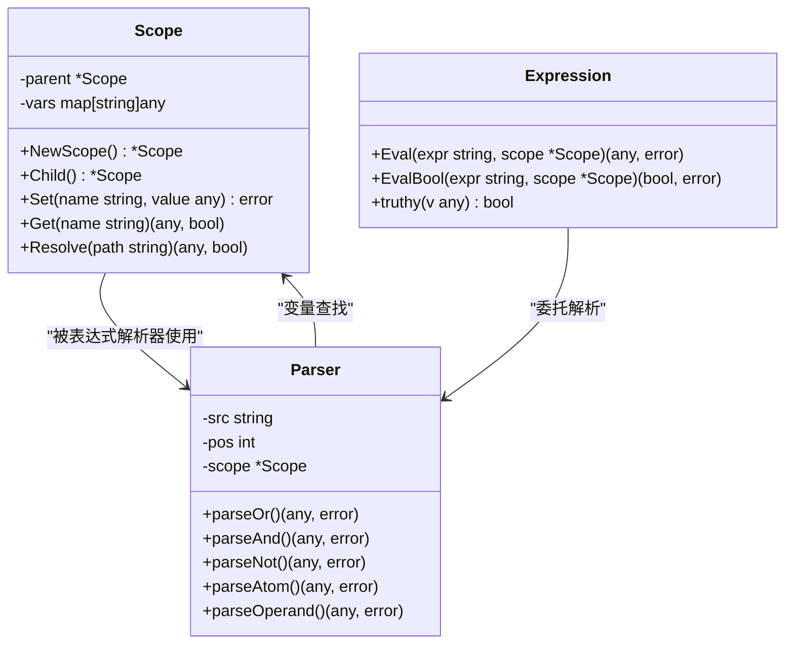
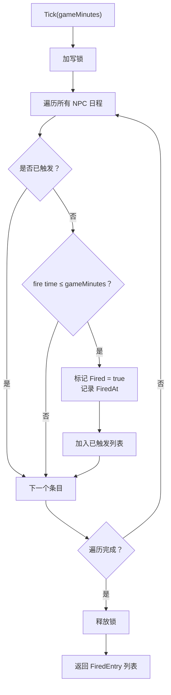
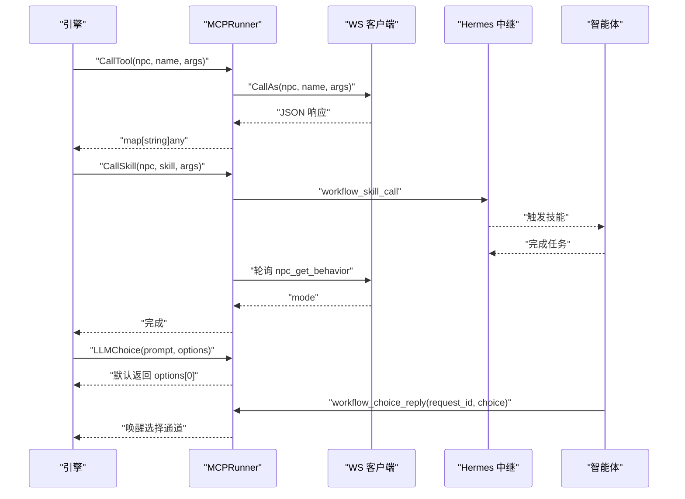
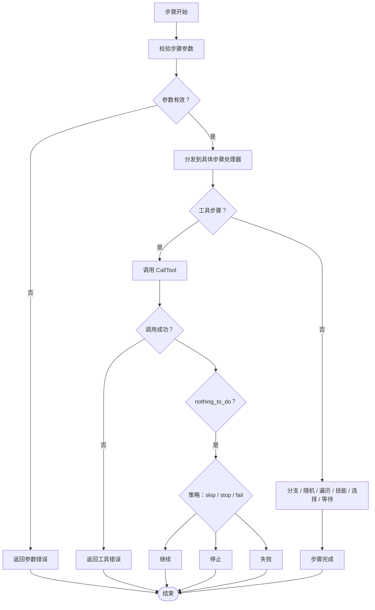
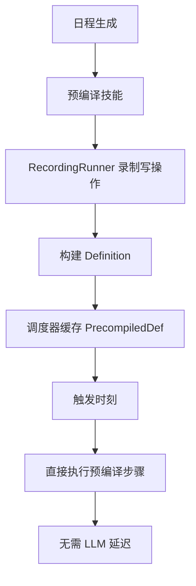
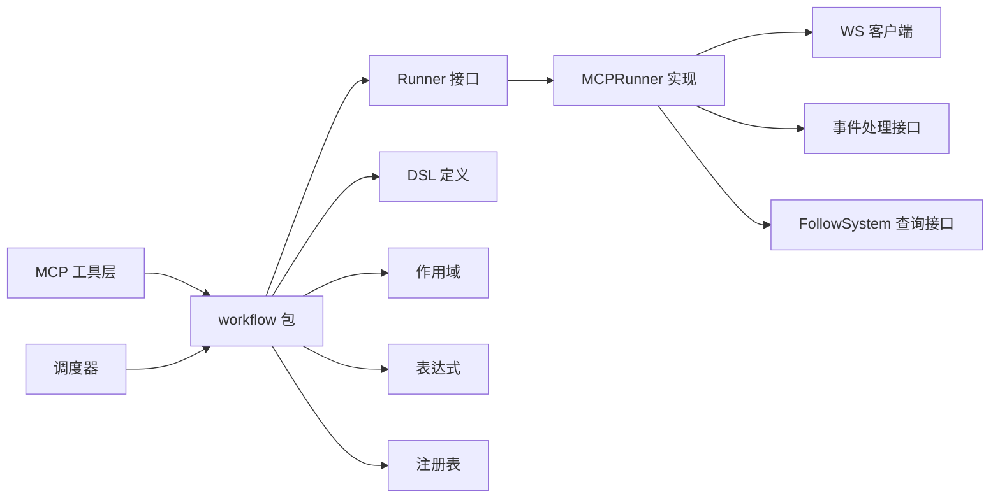
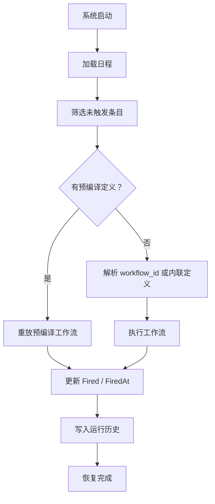

# 执行引擎

<cite>
**本文引用的文件**   
- [engine.go](file://SmartNPC/smartnpc-mcp/pkg/workflow/engine.go)
- [context.go](file://SmartNPC/smartnpc-mcp/pkg/workflow/context.go)
- [definition.go](file://SmartNPC/smartnpc-mcp/pkg/workflow/definition.go)
- [runner_mcp.go](file://SmartNPC/smartnpc-mcp/pkg/workflow/runner_mcp.go)
- [precompile.go](file://SmartNPC/smartnpc-mcp/pkg/workflow/precompile.go)
- [registry.go](file://SmartNPC/smartnpc-mcp/pkg/workflow/registry.go)
- [workflow.go](file://SmartNPC/smartnpc-mcp/adapters/stardew/tools/workflow.go)
- [scheduler.go](file://SmartNPC/smartnpc-mcp/adapters/stardew/scheduler/scheduler.go)
- [logger.go](file://SmartNPC/smartnpc-mcp/internal/log/logger.go)
- [event.go](file://SmartNPC/smartnpc-mcp/pkg/eventbus/event.go)
</cite>

## 目录
1. [引言](#引言)
2. [项目结构](#项目结构)
3. [核心组件](#核心组件)
4. [架构总览](#架构总览)
5. [详细组件分析](#详细组件分析)
6. [依赖关系分析](#依赖关系分析)
7. [性能与并发特性](#性能与并发特性)
8. [故障恢复与检查点](#故障恢复与检查点)
9. [调试与优化指南](#调试与优化指南)
10. [结论](#结论)

## 引言
本文件面向 SmartNPC 项目中基于 Go 的工作流执行引擎，聚焦以下目标：
- 解释状态机设计：步骤种类、执行上下文与作用域、数据流绑定规则。
- 说明调度器实现：按游戏时间触发、预编译工作流、并发安全。
- 文档化异常处理：工具返回“无事可做”策略、上下文取消、超时与回退。
- 解释 Runner MCP 集成：工作流步骤如何映射到 MCP 工具调用，以及技能预编译流程。
- 说明执行监控：进度统计、性能指标、运行历史查询。
- 提供故障恢复思路：基于日志与运行历史的断点续跑建议。
- 给出复杂工作流的调试和优化方法。

该执行引擎的核心思想是：**用声明式 YAML/JSON 定义工作流，由引擎顺序驱动步骤；通过 Runner 抽象屏蔽底层 WebSocket/MCP/Hermes 细节；通过调度器把 NPC 的日程与工作流生命周期连接起来**。

## 项目结构
SmartNPC 的执行引擎位于 `smartnpc-mcp` 子模块中，关键路径如下：
- `pkg/workflow`：工作流 DSL、引擎、作用域、表达式解析、注册表、Runner 抽象与 MCP Runner。
- `adapters/stardew/tools`：将工作流能力暴露为 MCP 工具，如列出工作流、查看定义、运行历史、选择回复、预编译结果提交等。
- `adapters/stardew/scheduler`：按游戏时间驱动的日程调度器，支持预编译工作流注入。
- `internal/log`：结构化日志，统一输出到标准错误，避免污染 MCP 协议通道。
- `pkg/eventbus`：跨适配器与中继的标准事件信封类型。

**图示来源**
- [workflow.go:1-200](file://SmartNPC/smartnpc-mcp/adapters/stardew/tools/workflow.go#L1-L200)
- [engine.go:1-120](file://SmartNPC/smartnpc-mcp/pkg/workflow/engine.go#L1-L120)
- [context.go:1-80](file://SmartNPC/smartnpc-mcp/pkg/workflow/context.go#L1-L80)
- [definition.go:1-120](file://SmartNPC/smartnpc-mcp/pkg/workflow/definition.go#L1-L120)
- [runner_mcp.go:1-120](file://SmartNPC/smartnpc-mcp/pkg/workflow/runner_mcp.go#L1-L120)
- [precompile.go:1-80](file://SmartNPC/smartnpc-mcp/pkg/workflow/precompile.go#L1-L80)
- [scheduler.go:1-120](file://SmartNPC/smartnpc-mcp/adapters/stardew/scheduler/scheduler.go#L1-L120)
- [event.go:1-76](file://SmartNPC/smartnpc-mcp/pkg/eventbus/event.go#L1-L76)
- [logger.go:1-35](file://SmartNPC/smartnpc-mcp/internal/log/logger.go#L1-L35)

**章节来源**
- [engine.go:1-120](file://SmartNPC/smartnpc-mcp/pkg/workflow/engine.go#L1-L120)
- [registry.go:1-60](file://SmartNPC/smartnpc-mcp/pkg/workflow/registry.go#L1-L60)
- [workflow.go:1-120](file://SmartNPC/smartnpc-mcp/adapters/stardew/tools/workflow.go#L1-L120)
- [scheduler.go:1-120](file://SmartNPC/smartnpc-mcp/adapters/stardew/scheduler/scheduler.go#L1-L120)

## 核心组件
执行引擎由以下核心组件组成：

| 组件 | 职责 | 关键行为 |
|---|---|---|
| 工作流定义 | 描述工作流 ID、输入、步骤序列 | 支持工具调用、分支、随机选择、遍历、技能调用、LLM 选择、等待、停止 |
| 作用域与表达式 | 维护变量绑定和表达式求值 | 支持 `$name.path`、比较、逻辑运算、惰性缺失变量 |
| 引擎 | 顺序驱动步骤并维护运行结果 | 统计步数、工具调用次数、“无事可做”计数、早停原因 |
| Runner 接口 | 抽象外部工具调用、技能触发、LLM 选择、空闲等待 | 让引擎不依赖具体 MCP/WS/Bridge 实现 |
| MCP Runner | 生产 Runner，桥接 WS、Hermes、FollowSystem | 发送合成事件、轮询空闲状态、预编译计划 |
| 预编译系统 | 录制 LLM 调用的工具调用，生成可重放定义 | 只记录写操作，读操作直接代理 |
| 调度器 | 按游戏时间触发 NPC 日程 | 支持预编译工作流注入、并发安全的日程存储 |
| MCP 工具 | 暴露工作流发现、调试、历史查询 | 供智能体在规划阶段使用 |
| 事件总线 | 标准化事件信封 | 解耦适配器与中继后端 |
| 日志系统 | 结构化日志输出 | 所有日志写入标准错误，附带源码位置 |

**章节来源**
- [definition.go:1-200](file://SmartNPC/smartnpc-mcp/pkg/workflow/definition.go#L1-L200)
- [context.go:1-120](file://SmartNPC/smartnpc-mcp/pkg/workflow/context.go#L1-L120)
- [engine.go:120-250](file://SmartNPC/smartnpc-mcp/pkg/workflow/engine.go#L120-L250)
- [runner_mcp.go:1-120](file://SmartNPC/smartnpc-mcp/pkg/workflow/runner_mcp.go#L1-L120)
- [precompile.go:1-120](file://SmartNPC/smartnpc-mcp/pkg/workflow/precompile.go#L1-L120)
- [scheduler.go:1-120](file://SmartNPC/smartnpc-mcp/adapters/stardew/scheduler/scheduler.go#L1-L120)
- [workflow.go:1-120](file://SmartNPC/smartnpc-mcp/adapters/stardew/tools/workflow.go#L1-L120)
- [event.go:1-76](file://SmartNPC/smartnpc-mcp/pkg/eventbus/event.go#L1-L76)
- [logger.go:1-35](file://SmartNPC/smartnpc-mcp/internal/log/logger.go#L1-L35)

## 架构总览
执行引擎的整体调用链可以理解为：

1. **调度器**在游戏小时变化时扫描日程，产出应触发的条目。
2. 如果条目携带**预编译工作流定义**，则直接交给引擎执行；否则由上层根据 `workflow_id` 或内联定义获取 Definition。
3. **引擎**创建作用域、绑定输入、依次执行步骤。
4. 每个步骤可能调用 **Runner**：
   - 工具步骤 → `CallTool` → MCP 工具或 WS Bridge。
   - 技能步骤 → `CallSkill` → Hermes 合成事件。
   - LLM 选择 → `LLMChoice` → 异步选择协议。
   - 等待步骤 → `WaitIdle` → 轮询 FollowSystem。
5. 引擎收集运行结果，并通过结构化日志记录执行轨迹。
6. MCP 工具层暴露工作流列表、定义、运行历史、状态查询等能力。

**图示来源**
- [scheduler.go:120-250](file://SmartNPC/smartnpc-mcp/adapters/stardew/scheduler/scheduler.go#L120-L250)
- [registry.go:60-160](file://SmartNPC/smartnpc-mcp/pkg/workflow/registry.go#L60-L160)
- [engine.go:60-250](file://SmartNPC/smartnpc-mcp/pkg/workflow/engine.go#L60-L250)
- [runner_mcp.go:80-220](file://SmartNPC/smartnpc-mcp/pkg/workflow/runner_mcp.go#L80-L220)
- [workflow.go:120-250](file://SmartNPC/smartnpc-mcp/adapters/stardew/tools/workflow.go#L120-L250)

## 详细组件分析

### 工作流 DSL 与状态机
工作流是一个有序步骤集合，每个步骤由 `Kind` 字段决定语义。引擎对每种 `Kind` 实现独立的处理分支，形成轻量级状态机。

| 步骤类型 | 含义 | 数据流影响 | 典型用途 |
|---|---|---|---|
| `tool` | 调用一个 MCP 工具 | 可选 `save_as` 绑定返回值 | 读写农场、NPC、世界状态 |
| `branch` | 条件分支 | 选择 `then` 或 `else` 子步骤 | 根据观察值走不同路径 |
| `random` | 加权随机选择 | 选择一个 `weighted` 分支 | 人格或环境随机性 |
| `foreach` | 遍历列表 | 每次迭代推入子作用域 | 批量处理作物、物品 |
| `skill_call` | 触发 Hermes SKILL | 通过 Runner 异步或同步调用 | 复用复杂提示流程 |
| `llm_choice` | 让 LLM 从固定选项中选择 | 将选择结果写入 `save_as` | 需要模型决策但限制选项范围 |
| `wait` | 等待条件成立 | 阻塞直到空闲或超时 | 防止并发动作冲突 |
| `stop` | 提前终止 | 设置 `StopReason` 并结束运行 | 明确无工作或策略停止 |

**图示来源**
- [definition.go:120-234](file://SmartNPC/smartnpc-mcp/pkg/workflow/definition.go#L120-L234)
- [engine.go:201-626](file://SmartNPC/smartnpc-mcp/pkg/workflow/engine.go#L201-L626)

**章节来源**
- [definition.go:1-234](file://SmartNPC/smartnpc-mcp/pkg/workflow/definition.go#L1-L234)
- [engine.go:201-626](file://SmartNPC/smartnpc-mcp/pkg/workflow/engine.go#L201-L626)

### 执行上下文与作用域
作用域是引擎的数据中心。它维护父子作用域链，保证变量查找具有词法可见性，同时强制**同一作用域内同名变量不可重复赋值**。

关键特性：
- `NewScope` 创建顶层作用域。
- `Child` 创建子作用域，用于 `foreach` 迭代。
- `Set` 绑定变量，已存在则报错。
- `Get` 沿父链查找变量。
- `Resolve` 支持 `$name` 和 `name.path` 形式的嵌套访问。
- 表达式解析器支持布尔逻辑、比较、括号、字面量、路径引用。
- 未找到变量时返回 `nil`，使表达式具备防御性。

**图示来源**
- [context.go:1-200](file://SmartNPC/smartnpc-mcp/pkg/workflow/context.go#L1-L200)
- [context.go:201-452](file://SmartNPC/smartnpc-mcp/pkg/workflow/context.go#L201-L452)

**章节来源**
- [context.go:1-452](file://SmartNPC/smartnpc-mcp/pkg/workflow/context.go#L1-L452)

### 调度器实现
调度器负责把“游戏时间”转换为“待执行的日程条目”。其核心约束包括：
- 每个 NPC 每天一份日程。
- 条目按游戏分钟排序，错过 tick 不会丢失。
- 条目支持三种执行负载：`WorkflowID`、内联 `Workflow`、预编译 `PrecompiledDef`。
- 并发安全：使用读写锁保护日程表。
- 支持注入预编译定义，减少触发时的 LLM 延迟。

调度器关键字段：
- `Entry.GameMinutes`：精确到 10 分钟的触发时间。
- `Entry.PrecompiledDef`：预先由 LLM 生成的工作流定义。
- `Fired` / `FiredAt`：标记是否已触发及触发时间。
- `SetPrecompiled`：在触发前填充预编译定义。
- `NextPendingEntry` / `PendingEntries`：用于状态查询与调试。

**图示来源**
- [scheduler.go:120-305](file://SmartNPC/smartnpc-mcp/adapters/stardew/scheduler/scheduler.go#L120-L305)

**章节来源**
- [scheduler.go:1-305](file://SmartNPC/smartnpc-mcp/adapters/stardew/scheduler/scheduler.go#L1-L305)

### Runner MCP 集成
Runner 是引擎与外部系统的边界。生产实现 `MCPRunner` 将工作流步骤映射到实际系统：

| 工作流步骤 | Runner 方法 | 实际行为 |
|---|---|---|
| `tool` | `CallTool` | 通过 WS 客户端调用 mod 工具 |
| `skill_call` | `CallSkill` | 向 Hermes 发送合成事件，并等待 NPC 空闲 |
| `llm_choice` | `LLMChoice` | 当前默认返回第一个选项；完整协议通过 `workflow_choice_reply` 补全 |
| `wait` | `WaitIdle` | 轮询 FollowSystem 模式 |
| 预编译 | `PrecompileSkill` | 向 Hermes 发送预编译请求，等待 `workflow_precompile_result` |

**图示来源**
- [runner_mcp.go:1-200](file://SmartNPC/smartnpc-mcp/pkg/workflow/runner_mcp.go#L1-L200)
- [runner_mcp.go:201-325](file://SmartNPC/smartnpc-mcp/pkg/workflow/runner_mcp.go#L201-L325)
- [workflow.go:201-512](file://SmartNPC/smartnpc-mcp/adapters/stardew/tools/workflow.go#L201-L512)

**章节来源**
- [runner_mcp.go:1-325](file://SmartNPC/smartnpc-mcp/pkg/workflow/runner_mcp.go#L1-L325)
- [workflow.go:201-512](file://SmartNPC/smartnpc-mcp/adapters/stardew/tools/workflow.go#L201-L512)

### 异常处理机制
引擎的异常处理遵循“分层防御”原则：

1. **参数校验**：未知步骤类型、缺少必要字段会立即返回错误。
2. **工具失败**：`CallTool` 出错直接返回错误，并由引擎记录警告日志。
3. **无事可做策略**：工具返回 `nothing_to_do=true` 时，根据 `on_nothing_to_do` 配置：
   - `skip`：继续执行后续步骤。
   - `stop`：记录停止原因并结束运行。
   - `fail`：返回错误并结束运行。
   - 其他值：视为非法配置并报错。
4. **上下文取消**：引擎在每个步骤入口检查 `ctx.Done()`，并将 `Stopped` 设为 `true`，`StopReason` 设为取消原因。
5. **超时处理**：
   - 工具调用可使用外层上下文截止时间。
   - `WaitIdle` 超时无误，仅返回未完成。
   - `CallSkill` 等待空闲超时属于软超时，不中断工作流。
   - 预编译等待超时无误，跳过预编译。
6. **LLM 选择回退**：若模型返回不在选项中的值，引擎回退到第一个选项。

**图示来源**
- [engine.go:201-626](file://SmartNPC/smartnpc-mcp/pkg/workflow/engine.go#L201-L626)

**章节来源**
- [engine.go:201-626](file://SmartNPC/smartnpc-mcp/pkg/workflow/engine.go#L201-L626)

### 执行监控
执行监控分为三类：

| 监控维度 | 实现方式 | 可观测信息 |
|---|---|---|
| 进度跟踪 | `RunResult.StepCount`、`ToolCalls`、`NothingToDoCt` | 已执行步骤、实际工具调用、无事可做次数 |
| 性能指标 | slog 日志中的 `elapsed_ms` | 单次运行耗时、单步耗时、工具调用耗时 |
| 执行日志 | `internal/log.New` 输出结构化 JSON | 包含 source 信息、NPC、工作流 ID、步骤、错误 |
| 运行历史 | `workflow_run_history` MCP 工具 | 过去某 NPC 在某天的工作流运行记录 |
| 实时状态 | `npc_workflow_status` MCP 工具 | 当前运行中的工作流、队列深度、待处理日程 |

**章节来源**
- [engine.go:60-120](file://SmartNPC/smartnpc-mcp/pkg/workflow/engine.go#L60-L120)
- [logger.go:1-35](file://SmartNPC/smartnpc-mcp/internal/log/logger.go#L1-L35)
- [workflow.go:350-512](file://SmartNPC/smartnpc-mcp/adapters/stardew/tools/workflow.go#L350-L512)

### 预编译与断点续跑能力
预编译机制是 SmartNPC 执行引擎的重要优化：

1. 调度器在日程生成阶段，可以让 LLM 以“预编译模式”执行技能。
2. `RecordingRunner` 拦截写操作，只记录工具名称和参数。
3. 生成不含 LLM 开销的 `Definition`，由调度器缓存到 `Entry.PrecompiledDef`。
4. 触发时直接执行预编译步骤，避免再次调用模型。
5. 如果预编译结果为空，表示没有可执行动作，调度器可安全跳过。

这构成了事实上的“检查点”：**工作流定义本身成为可持久化的执行计划**。虽然代码中没有显式的检查点文件或事务回滚，但可以通过以下方式实现断点续跑：
- 保存每份日程及其 `PrecompiledDef`。
- 记录已触发条目。
- 重启后加载日程，只执行未触发条目。
- 结合 `workflow_run_history` 和历史日志做一致性校验。

**图示来源**
- [precompile.go:1-200](file://SmartNPC/smartnpc-mcp/pkg/workflow/precompile.go#L1-L200)
- [scheduler.go:201-305](file://SmartNPC/smartnpc-mcp/adapters/stardew/scheduler/scheduler.go#L201-L305)

**章节来源**
- [precompile.go:1-200](file://SmartNPC/smartnpc-mcp/pkg/workflow/precompile.go#L1-L200)
- [scheduler.go:201-305](file://SmartNPC/smartnpc-mcp/adapters/stardew/scheduler/scheduler.go#L201-L305)

## 依赖关系分析
执行引擎对外部实现的依赖集中在 Runner 接口，内部模块之间耦合较低：

**图示来源**
- [runner_mcp.go:1-120](file://SmartNPC/smartnpc-mcp/pkg/workflow/runner_mcp.go#L1-L120)
- [definition.go:1-120](file://SmartNPC/smartnpc-mcp/pkg/workflow/definition.go#L1-L120)
- [context.go:1-120](file://SmartNPC/smartnpc-mcp/pkg/workflow/context.go#L1-L120)
- [registry.go:1-120](file://SmartNPC/smartnpc-mcp/pkg/workflow/registry.go#L1-L120)
- [workflow.go:1-120](file://SmartNPC/smartnpc-mcp/adapters/stardew/tools/workflow.go#L1-L120)
- [scheduler.go:1-120](file://SmartNPC/smartnpc-mcp/adapters/stardew/scheduler/scheduler.go#L1-L120)

**章节来源**
- [runner_mcp.go:1-120](file://SmartNPC/smartnpc-mcp/pkg/workflow/runner_mcp.go#L1-L120)
- [registry.go:1-120](file://SmartNPC/smartnpc-mcp/pkg/workflow/registry.go#L1-L120)
- [workflow.go:1-120](file://SmartNPC/smartnpc-mcp/adapters/stardew/tools/workflow.go#L1-L120)
- [scheduler.go:1-120](file://SmartNPC/smartnpc-mcp/adapters/stardew/scheduler/scheduler.go#L1-L120)

## 性能与并发特性
执行引擎的性能特征如下：

| 维度 | 实现特点 | 影响 |
|---|---|---|
| 步骤执行 | 顺序执行，无并行调度器 | 简单可靠，适合单个 NPC 的串行工作流 |
| 表达式求值 | 小型递归下降解析器 | 开销低，不支持算术和函数调用 |
| 作用域查找 | 父链线性查找 | 作用域层级浅时成本很低 |
| 随机选择 | 归一化权重后浮点采样 | 支持零权重禁用分支 |
| 遍历限制 | `MaxIter` 默认 50 | 防止大数据集导致无限循环 |
| 工具超时 | 外层上下文截止时间 | 避免长期挂起 |
| 空闲等待 | 250ms 轮询 | 平衡响应性与 CPU 占用 |
| 日志开销 | slog JSON + AddSource | 增加少量性能开销，但便于定位问题 |
| 并发安全 | 调度器使用读写锁 | 多 NPC 日程读取安全，写入集中管理 |

优化建议：
- 对重型工具调用显式设置较短超时，避免拖慢整个工作流。
- 优先使用预编译工作流，减少触发时的 LLM 延迟。
- 控制 `foreach` 的 `max_iter`，避免对超大列表进行逐条处理。
- 合理使用 `on_nothing_to_do=stop`，尽早结束无效工作流。
- 使用 `workflow_run_inline` 在开发阶段验证工作流结构，减少生产错误。

**章节来源**
- [engine.go:201-626](file://SmartNPC/smartnpc-mcp/pkg/workflow/engine.go#L201-L626)
- [context.go:1-452](file://SmartNPC/smartnpc-mcp/pkg/workflow/context.go#L1-L452)
- [runner_mcp.go:201-325](file://SmartNPC/smartnpc-mcp/pkg/workflow/runner_mcp.go#L201-L325)
- [logger.go:1-35](file://SmartNPC/smartnpc-mcp/internal/log/logger.go#L1-L35)

## 故障恢复与检查点
当前代码没有实现传统意义上的数据库事务、检查点文件或自动回滚。但其设计提供了足够的恢复基础：

### 可用的恢复材料
1. **日程定义**：`DaySchedule` 包含 NPC、日期、季节、年份、条目列表。
2. **预编译定义**：`PrecompiledDef` 是可独立重放的执行计划。
3. **触发标记**：`Fired` 和 `FiredAt` 可用于判断哪些条目已经执行。
4. **运行历史**：`workflow_run_history` 提供过去运行的摘要。
5. **结构化日志**：slog JSON 日志包含工作流 ID、步骤、工具、错误、耗时。

### 推荐恢复策略
- **策略一：按日程断点续跑**
  - 启动时加载最近一次 `DaySchedule`。
  - 过滤 `Fired=false` 的条目。
  - 对每条未触发条目，优先使用 `PrecompiledDef`。
  - 重新执行后更新 `Fired` 和 `FiredAt`。
- **策略二：按运行历史补偿**
  - 通过 `workflow_run_history` 查询已运行工作流。
  - 对比工作流最终状态与实际游戏状态。
  - 对失败或不一致的工作流重新触发。
- **策略三：日志驱动诊断**
  - 根据 slog 日志中的 `step`、`tool`、`err` 定位失败步骤。
  - 对频繁失败的步骤添加更严格的 `on_nothing_to_do` 策略。

**图示来源**
- [scheduler.go:120-305](file://SmartNPC/smartnpc-mcp/adapters/stardew/scheduler/scheduler.go#L120-L305)
- [workflow.go:350-512](file://SmartNPC/smartnpc-mcp/adapters/stardew/tools/workflow.go#L350-L512)
- [precompile.go:120-200](file://SmartNPC/smartnpc-mcp/pkg/workflow/precompile.go#L120-L200)

**章节来源**
- [scheduler.go:120-305](file://SmartNPC/smartnpc-mcp/adapters/stardew/scheduler/scheduler.go#L120-L305)
- [workflow.go:350-512](file://SmartNPC/smartnpc-mcp/adapters/stardew/tools/workflow.go#L350-L512)
- [precompile.go:120-200](file://SmartNPC/smartnpc-mcp/pkg/workflow/precompile.go#L120-L200)

## 调试与优化指南

### 调试工作流
1. 使用 `workflow_list` 查看所有可用工作流。
2. 使用 `workflow_get` 查看某个工作流的完整步骤。
3. 使用 `workflow_run_inline` 在无副作用环境中测试工作流。
4. 使用 `npc_workflow_status` 查看当前 NPC 是否正在运行工作流、队列积压情况。
5. 使用 `workflow_run_history` 查看历史运行结果。
6. 开启 debug 日志，观察 `workflow: step start`、`workflow: tool calling`、`workflow: step done`。

### 常见问题排查
| 现象 | 可能原因 | 排查方法 |
|---|---|---|
| 工作流立即停止 | `stop` 步骤或 `on_nothing_to_do=stop` | 检查 `StopReason` 和运行历史 |
| 工具未执行 | 分支条件为假、随机分支权重为 0 | 检查 `when` 表达式和 `weighted` 权重 |
| 遍历未生效 | 变量不是数组、`max_iter` 过小 | 检查 `over` 指向的值类型 |
| LLM 选择未返回 | 未接入完整选择协议 | 检查 `workflow_choice_reply` 是否被调用 |
| 工作流卡住 | 等待空闲超时、外部调用无响应 | 检查日志中的 `elapsed_ms` 和上下文取消 |
| 预编译为空 | LLM 认为没有可执行动作 | 检查技能环境和只读工具代理 |

### 优化建议
- **减少 LLM 调用**：尽量使用预编译工作流，避免每次触发都调用模型。
- **缩小工作流范围**：不要把过多业务塞进单一工作流，拆分为多个小工作流更易调试。
- **显式超时**：对重型工具设置 `timeout_seconds`。
- **防御性分支**：使用 `branch` 和 `random` 表达业务分支，而不是依赖 LLM 自由发挥。
- **合理命名**：为步骤添加 `label`，便于日志和调试界面识别。
- **避免深层嵌套作用域**：保持作用域扁平，降低变量查找复杂度。

**章节来源**
- [workflow.go:120-350](file://SmartNPC/smartnpc-mcp/adapters/stardew/tools/workflow.go#L120-L350)
- [engine.go:60-200](file://SmartNPC/smartnpc-mcp/pkg/workflow/engine.go#L60-L200)
- [precompile.go:120-200](file://SmartNPC/smartnpc-mcp/pkg/workflow/precompile.go#L120-L200)

## 结论
SmartNPC 的执行引擎是一个以工作流为中心、以 Runner 为扩展点的轻量级执行系统。它的优势在于：
- DSL 清晰，步骤类型覆盖常见自动化场景。
- 作用域和表达式足够简单，便于理解和调试。
- Runner 抽象允许替换底层实现，便于测试和扩展。
- 调度器支持预编译工作流，显著降低触发延迟。
- 结构化日志和 MCP 工具提供完整的可观测性。
- 虽然没有显式事务和检查点，但日程、预编译定义和运行历史足以支撑断点续跑和故障恢复。

未来改进方向可包括：
- 增加显式检查点和状态持久化。
- 支持更复杂的表达式和函数。
- 对工作流执行引入重试和补偿机制。
- 提供更丰富的运行时指标导出。
- 增强 LLM 选择协议的可靠性与超时控制。