# 预编译器

<cite>
**本文引用的文件**   
- [precompile.go](file://SmartNPC/smartnpc-mcp/pkg/workflow/precompile.go)
- [definition.go](file://SmartNPC/smartnpc-mcp/pkg/workflow/definition.go)
- [engine.go](file://SmartNPC/smartnpc-mcp/pkg/workflow/engine.go)
- [runner_mcp.go](file://SmartNPC/smartnpc-mcp/pkg/workflow/runner_mcp.go)
- [context.go](file://SmartNPC/smartnpc-mcp/pkg/workflow/context.go)
- [registry.go](file://SmartNPC/smartnpc-mcp/pkg/workflow/registry.go)
</cite>

## 目录
1. [简介](#简介)
2. [项目结构](#项目结构)
3. [核心组件](#核心组件)
4. [架构总览](#架构总览)
5. [详细组件分析](#详细组件分析)
6. [依赖分析与循环检测](#依赖分析与循环检测)
7. [优化策略](#优化策略)
8. [代码生成与执行过程](#代码生成与执行过程)
9. [错误报告与诊断](#错误报告与诊断)
10. [性能与增量编译](#性能与增量编译)
11. [故障排查](#故障排查)
12. [结论](#结论)

## 简介
本技术文档围绕 SmartNPC 的“工作流预编译器”展开，目标是将由大语言模型驱动的 Hermes 技能调用，从“每次触发都需要模型推理”的模式，转换为“预编译为确定性步骤序列、运行时零模型延迟”的可执行工作流。文档覆盖以下方面：
- 语法解析与 AST：表达式求值器、作用域变量解析、YAML/JSON 反序列化。
- 语法验证与语义检查：定义校验、步骤合法性、保存变量冲突、非法自引用。
- 依赖分析与循环检测：基于工作流步骤的静态检查与内置工具保护。
- 优化策略：只读工具代理、常量折叠（表达式层）、死代码消除（分支/随机/空循环）。
- 代码生成：将记录或 LLM 生成的计划编码为 `Definition`。
- 错误报告：行级/位置信息、建议、修复指导。
- 性能与缓存：预编译通道、超时控制、增量与缓存扩展建议。

## 项目结构
工作流子系统位于 Go 包 `pkg/workflow`，采用分层清晰的模块化组织：
- `definition.go`：工作流 DSL 的数据模型、步骤类型、JSON/YAML 反序列化。
- `registry.go`：内置 YAML 加载、外部 YAML 叠加、定义注册与静态校验。
- `context.go`：表达式解析、作用域变量查找、布尔求值。
- `engine.go`：工作流引擎调度器，驱动步骤执行。
- `runner_mcp.go`：生产环境 Runner，桥接 WebSocket、Hermes relay、FollowSystem。
- `precompile.go`：预编译通道、录制式 Runner、只读工具识别、预编译载荷编码。

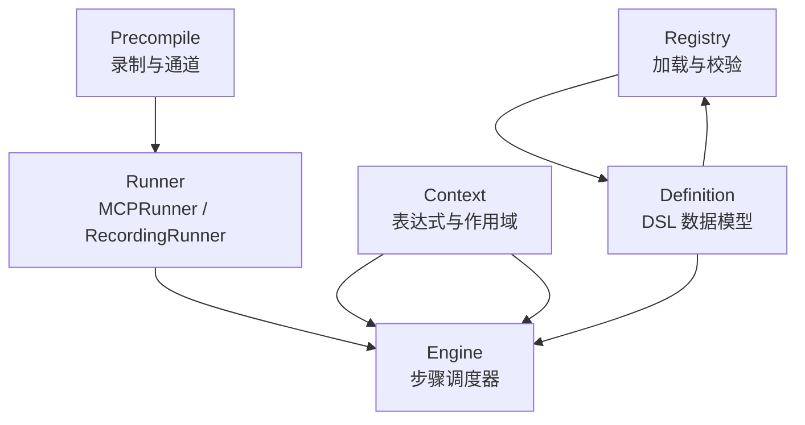

**图表来源**
- [registry.go:1-60](file://SmartNPC/smartnpc-mcp/pkg/workflow/registry.go#L1-L60)
- [definition.go:1-60](file://SmartNPC/smartnpc-mcp/pkg/workflow/definition.go#L1-L60)
- [context.go:1-40](file://SmartNPC/smartnpc-mcp/pkg/workflow/context.go#L1-L40)
- [engine.go:1-40](file://SmartNPC/smartnpc-mcp/pkg/workflow/engine.go#L1-L40)
- [runner_mcp.go:1-40](file://SmartNPC/smartnpc-mcp/pkg/workflow/runner_mcp.go#L1-L40)
- [precompile.go:1-40](file://SmartNPC/smartnpc-mcp/pkg/workflow/precompile.go#L1-L40)

**章节来源**
- [definition.go:1-60](file://SmartNPC/smartnpc-mcp/pkg/workflow/definition.go#L1-L60)
- [registry.go:1-60](file://SmartNPC/smartnpc-mcp/pkg/workflow/registry.go#L1-L60)
- [context.go:1-40](file://SmartNPC/smartnpc-mcp/pkg/workflow/context.go#L1-L40)
- [engine.go:1-40](file://SmartNPC/smartnpc-mcp/pkg/workflow/engine.go#L1-L40)
- [runner_mcp.go:1-40](file://SmartNPC/smartnpc-mcp/pkg/workflow/runner_mcp.go#L1-L40)
- [precompile.go:1-40](file://SmartNPC/smartnpc-mcp/pkg/workflow/precompile.go#L1-L40)

## 核心组件
- 工作流定义模型：包含 ID、描述、版本、输入规格、有序步骤列表。
- 步骤体系：工具调用、条件分支、随机选择、遍历、技能委托、LLM 选择、等待、停止。
- 表达式系统：支持变量路径、字面量、比较与逻辑运算，按优先级组合。
- 运行期作用域：父子作用域链，不可变绑定，逐作用域追踪 `save_as`。
- 引擎调度器：顺序执行步骤，统计运行指标，处理超时、取消、nothing_to_do。
- 生产 Runner：通过 WS 客户端调用 MCP 工具，发送 skill 事件到 Hermes，轮询行为模式。
- 预编译器：录制式 Runner 捕获变更工具调用；真实 Runner 可发起远程预编译并接收计划。
- 注册表：嵌入内置 YAML，叠加外部 YAML，重复 ID 报错，调用 Validate。

**章节来源**
- [definition.go:60-200](file://SmartNPC/smartnpc-mcp/pkg/workflow/definition.go#L60-L200)
- [engine.go:40-120](file://SmartNPC/smartnpc-mcp/pkg/workflow/engine.go#L40-L120)
- [context.go:40-120](file://SmartNPC/smartnpc-mcp/pkg/workflow/context.go#L40-L120)
- [runner_mcp.go:40-120](file://SmartNPC/smartnpc-mcp/pkg/workflow/runner_mcp.go#L40-L120)
- [precompile.go:40-120](file://SmartNPC/smartnpc-mcp/pkg/workflow/precompile.go#L40-L120)
- [registry.go:60-120](file://SmartNPC/smartnpc-mcp/pkg/workflow/registry.go#L60-L120)

## 架构总览
预编译流程分为两条路径：
1. 录制路径：RecordingRunner 包裹真实 Runner，在技能运行期间拦截变更工具调用，构建轻量 Definition。
2. 远程路径：MCPRunner 向 Hermes 发送带 `precompile=true` 和 `plan_id` 的事件，等待 agent 返回 JSON 计划，再校验并返回。

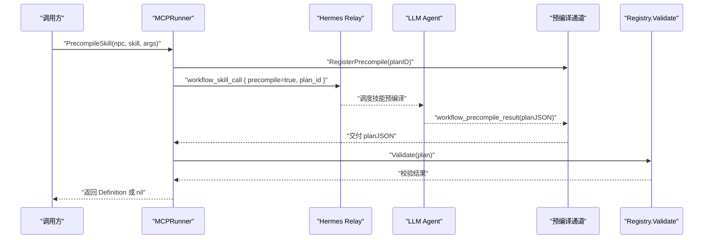

**图表来源**
- [runner_mcp.go:201-325](file://SmartNPC/smartnpc-mcp/pkg/workflow/runner_mcp.go#L201-L325)
- [precompile.go:1-80](file://SmartNPC/smartnpc-mcp/pkg/workflow/precompile.go#L1-L80)
- [registry.go:120-200](file://SmartNPC/smartnpc-mcp/pkg/workflow/registry.go#L120-L200)

**章节来源**
- [runner_mcp.go:201-325](file://SmartNPC/smartnpc-mcp/pkg/workflow/runner_mcp.go#L201-L325)
- [precompile.go:1-80](file://SmartNPC/smartnpc-mcp/pkg/workflow/precompile.go#L1-L80)
- [registry.go:120-200](file://SmartNPC/smartnpc-mcp/pkg/workflow/registry.go#L120-L200)

## 详细组件分析

### 工作流定义与步骤模型
- Definition：标识、描述、版本、输入规范、步骤列表。
- Step：统一 tagged union，Kind 决定子负载。
- 步骤类型：
  - ToolStep：名称、参数、输出绑定、nothing_to_do 策略、超时。
  - BranchStep：when 表达式、then/else 子步骤。
  - RandomStep：加权分支，权重归一化选择。
  - ForEachStep：over/as/do/max_iter。
  - SkillCallStep：委托已有 Hermes SKILL。
  - LLMChoiceStep：prompt/options/save_as。
  - WaitStep：condition/timeout。
  - StopStep：reason。

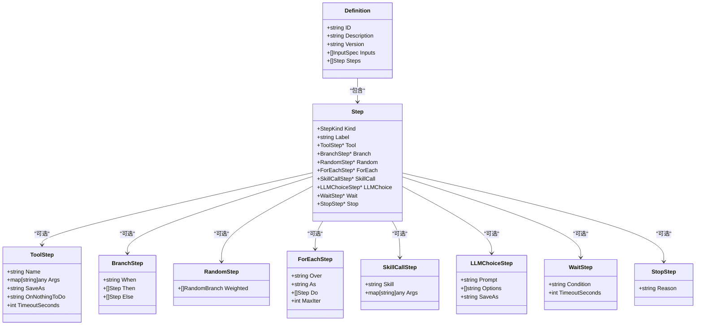

**图表来源**
- [definition.go:60-200](file://SmartNPC/smartnpc-mcp/pkg/workflow/definition.go#L60-L200)

**章节来源**
- [definition.go:60-200](file://SmartNPC/smartnpc-mcp/pkg/workflow/definition.go#L60-L200)

### 表达式解析与作用域
表达式解析器实现：
- 词法扫描：跳过空白、匹配运算符、字面量、路径。
- 语法树构造：or→and→not→atom，atom 含括号、比较、字面量或路径。
- 作用域查找：`$var.path` 形式，父作用域回溯，映射键导航。
- 布尔求值：nil、空串、零数、空集合为假。

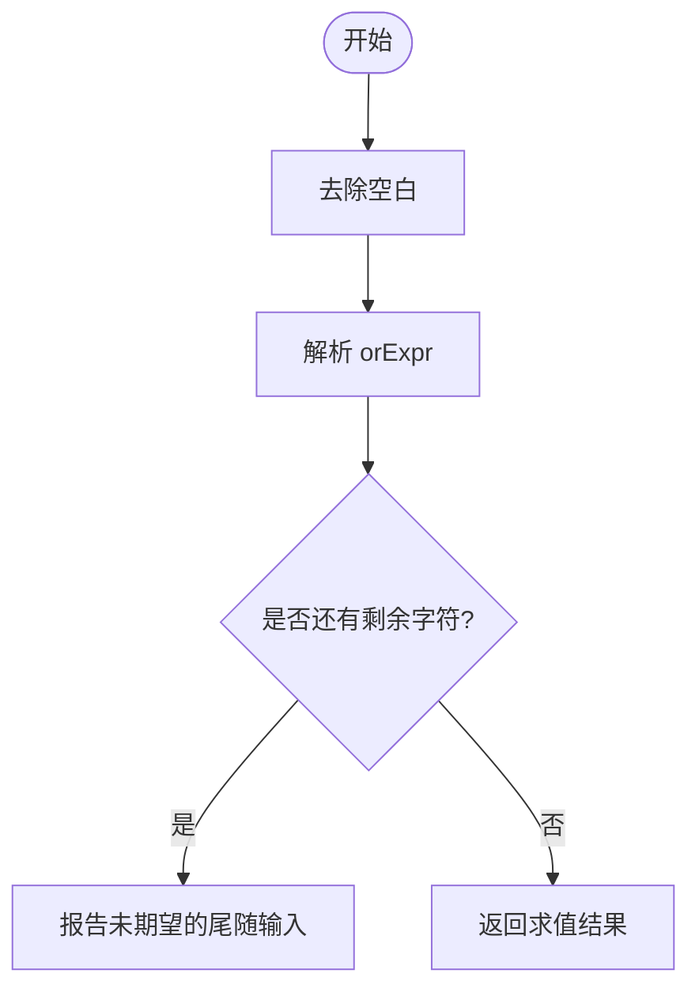

**图表来源**
- [context.go:120-200](file://SmartNPC/smartnpc-mcp/pkg/workflow/context.go#L120-L200)

**章节来源**
- [context.go:120-200](file://SmartNPC/smartnpc-mcp/pkg/workflow/context.go#L120-L200)

### 引擎调度器
引擎负责：
- 初始化作用域与输入绑定。
- 顺序执行步骤，维护运行统计。
- 工具调用：参数解析、上下文超时、nothing_to_do 策略、输出绑定。
- 分支与随机：表达式求值、权重采样。
- 遍历：逐项迭代，子作用域隔离。
- 技能委托：调用 Runner.CallSkill。
- LLM 选择：调用 Runner.LLMChoice。
- 等待：根据 condition 轮询。
- 停止：设置原因并终止。

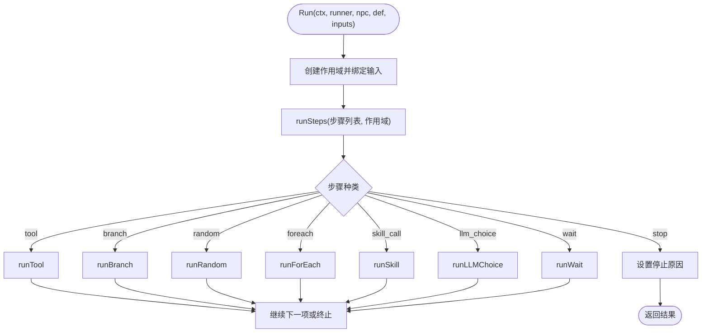

**图表来源**
- [engine.go:40-120](file://SmartNPC/smartnpc-mcp/pkg/workflow/engine.go#L40-L120)
- [engine.go:201-400](file://SmartNPC/smartnpc-mcp/pkg/workflow/engine.go#L201-L400)

**章节来源**
- [engine.go:40-120](file://SmartNPC/smartnpc-mcp/pkg/workflow/engine.go#L40-L120)
- [engine.go:201-400](file://SmartNPC/smartnpc-mcp/pkg/workflow/engine.go#L201-L400)

### 预编译通道与录制 Runner
预编译通道：
- RegisterPrecompile：为 planID 分配缓冲通道。
- CompletePrecompile：投递计划 JSON 并清理通道。
- UnregisterPrecompile：无投递清理。

录制 Runner：
- CallTool：只读工具直接转发；变更工具记录为 recordedStep。
- BuildDefinition：将记录转换为 Step 列表，生成 Definition。
- PrecompileSkill：包装 Definition，执行 Run，构建最终 Definition。

只读工具前缀：
- npc_inspect_、npc_find_、npc_get_、game_get_、player_get_、player_query_、workflow_list、workflow_get、npc_workflow_status、workflow_run_history、npc_perception_。

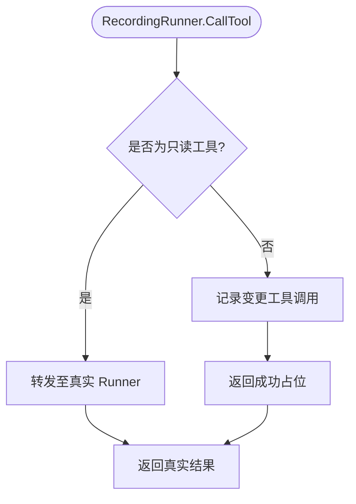

**图表来源**
- [precompile.go:80-200](file://SmartNPC/smartnpc-mcp/pkg/workflow/precompile.go#L80-L200)

**章节来源**
- [precompile.go:80-200](file://SmartNPC/smartnpc-mcp/pkg/workflow/precompile.go#L80-L200)

### 生产 Runner
MCPRunner：
- CallTool：通过 WS 客户端调用 MCP 工具，附加 npc，解析响应。
- CallSkill：发送 workflow_skill_call 事件，等待 Hermes relay 空闲与 FollowSystem idle。
- LLMChoice：默认回退首选项；未来集成 ChoiceReply。
- PrecompileSkill：封装预编译载荷，等待 planJSON，校验后返回。
- WaitIdle：每 250ms 轮询 FollowSystem。

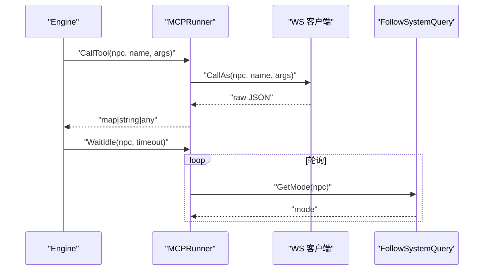

**图表来源**
- [runner_mcp.go:40-200](file://SmartNPC/smartnpc-mcp/pkg/workflow/runner_mcp.go#L40-L200)

**章节来源**
- [runner_mcp.go:40-200](file://SmartNPC/smartnpc-mcp/pkg/workflow/runner_mcp.go#L40-L200)

### 注册表与静态校验
注册表：
- Init：加载嵌入式 builtin YAML，叠加 extraDir YAML，重复 ID 报错。
- Get/List：线程安全读取。
- LoadDef：反序列化并调用 Validate。

静态校验：
- 必填字段：id、steps 非空。
- 步骤级别：kind、name、payload 完整性。
- save_as 去重：同作用域内重复报错。
- on_nothing_to_do：仅允许 skip/stop/fail。
- random：至少一个正权重分支，权重非负。
- foreach：over/as/do 必填，body 非空。
- skill_call：禁止自引用 MCP 工具名。
- llm_choice：save_as 必填，options 非空。
- wait：condition 为空或 idle。

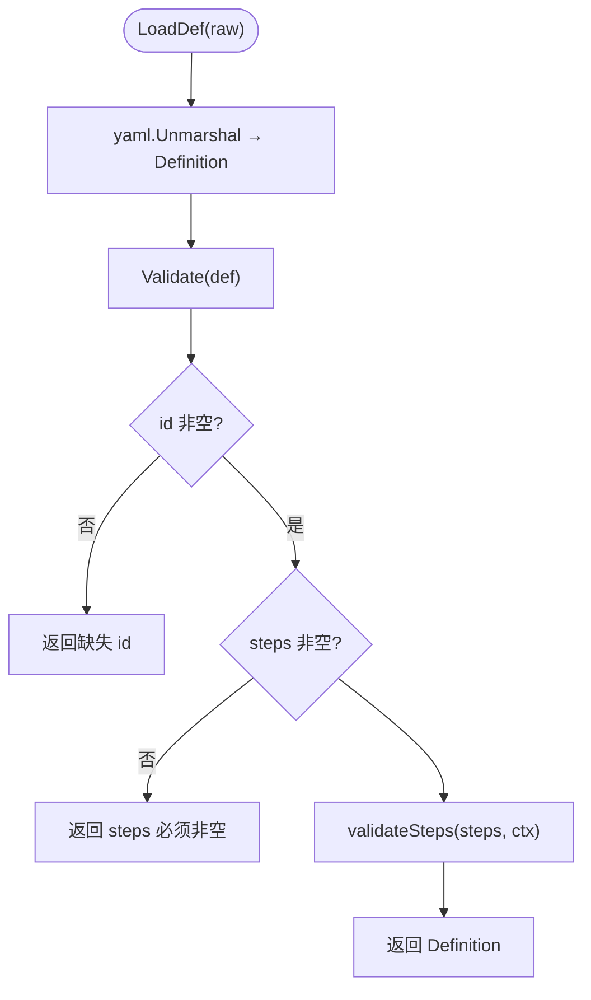

**图表来源**
- [registry.go:120-200](file://SmartNPC/smartnpc-mcp/pkg/workflow/registry.go#L120-L200)

**章节来源**
- [registry.go:120-200](file://SmartNPC/smartnpc-mcp/pkg/workflow/registry.go#L120-L200)

## 依赖分析与循环检测
当前实现的依赖分析主要体现在静态校验层面：
- 已知步骤类型依赖：每个 step 的 Kind 决定所需字段与子结构。
- 表达式依赖：when 表达式依赖作用域变量路径，解析失败会报位置错误。
- skill_call 自引用保护：禁止 workflow_run_inline、workflow_list、workflow_get，避免常见递归陷阱。
- 全量依赖图与拓扑排序：当前未实现完整工作流依赖图；如需对跨工作流调用进行循环检测，可在 P6 阶段引入 registry 依赖分析。

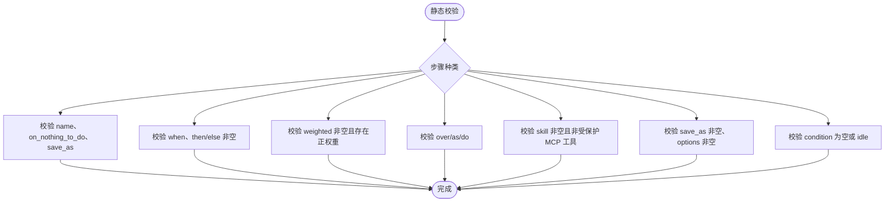

**图表来源**
- [registry.go:201-376](file://SmartNPC/smartnpc-mcp/pkg/workflow/registry.go#L201-L376)

**章节来源**
- [registry.go:201-376](file://SmartNPC/smartnpc-mcp/pkg/workflow/registry.go#L201-L376)

## 优化策略
- 节点合并：当前以步骤序列为主，未实现显式 DAG 合并；可通过后续优化阶段将相邻只读工具合并减少桥接开销。
- 常量折叠：表达式层已实现常量字面量与比较，但不在 AST 层做全局常量折叠；建议在解析后构建 AST 并执行常量传播。
- 死代码消除：
  - 分支：当 when 表达式可静态判定为 false 时，可消除 else 分支。
  - 随机：权重为 0 的分支被忽略；全部权重为零时整步跳过。
  - 遍历：max_iter 限制防无限迭代；若 over 为空集合，则 body 不执行。
  - nothing_to_do=stop：提前终止，避免后续无用步骤。
- 只读工具代理：RecordingRunner 对只读工具直接转发，减少录制噪声。

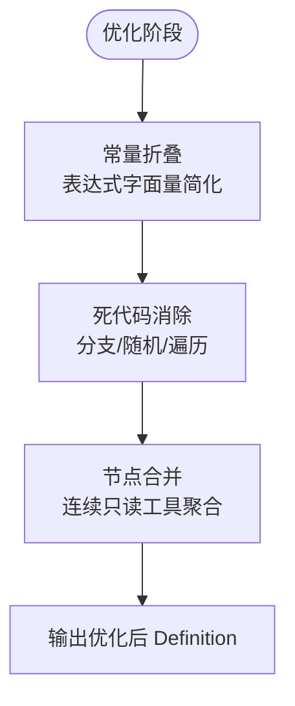

[本图为概念性流程图，无需图表来源]

**章节来源**
- [engine.go:201-400](file://SmartNPC/smartnpc-mcp/pkg/workflow/engine.go#L201-L400)
- [precompile.go:120-200](file://SmartNPC/smartnpc-mcp/pkg/workflow/precompile.go#L120-L200)

## 代码生成与执行过程
预编译代码生成：
- 录制路径：RecordingRunner.BuildDefinition 将 recordedStep 转为 Step.Tool 列表，ID 以 precompiled_ 前缀命名。
- 远程路径：MCPRunner.PrecompileSkill 接收 LLM 返回的 planJSON，反序列化为 Definition，校验后返回。

执行过程：
- Run 初始化作用域，绑定输入，调用 runSteps。
- runStep 分发到具体步骤处理器。
- tool 处理器解析参数、调用 Runner.CallTool、处理 nothing_to_do、绑定输出。
- branch 处理器求值 when 表达式，选择 then/else。
- random 处理器归一化权重并采样。
- foreach 处理器创建子作用域逐项执行。
- skill_call 处理器调用 Runner.CallSkill。
- llm_choice 处理器调用 Runner.LLMChoice。
- wait 处理器根据 condition 等待。
- stop 处理器设置原因并终止。

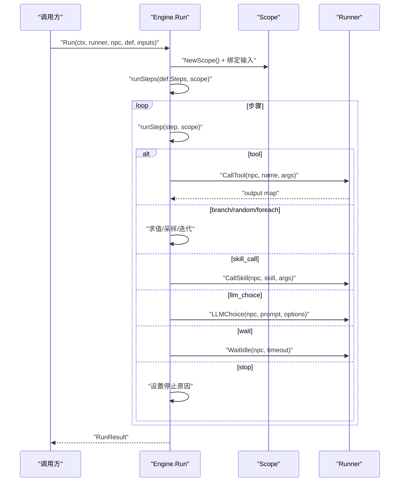

**图表来源**
- [engine.go:40-120](file://SmartNPC/smartnpc-mcp/pkg/workflow/engine.go#L40-L120)
- [engine.go:201-400](file://SmartNPC/smartnpc-mcp/pkg/workflow/engine.go#L201-L400)

**章节来源**
- [engine.go:40-120](file://SmartNPC/smartnpc-mcp/pkg/workflow/engine.go#L40-L120)
- [engine.go:201-400](file://SmartNPC/smartnpc-mcp/pkg/workflow/engine.go#L201-L400)

## 错误报告与诊断
- 表达式错误：
  - 未期望的尾随输入：报告位置与表达式内容。
  - 未闭合括号：报告缺少右括号。
  - 未终止字符串字面量：报告语法错误。
  - 未预期的字符：报告位置与字符。
  - 未结束的表达式：报告意外结束。
- 步骤校验错误：
  - 缺失 kind、name、payload。
  - duplicate save_as in scope。
  - unknown on_nothing_to_do。
  - random 无正权重或负权重。
  - foreach 缺少 over/as/body。
  - skill_call 引用受保护 MCP 工具。
  - llm_choice 缺少 save_as 或 options。
  - wait 未知 condition。
- 运行期错误：
  - nil definition/runner。
  - tool 调用失败。
  - nothing_to_do 策略非法。
  - skill_call relay 超时或取消。
  - WaitIdle 超时。

诊断建议：
- 表达式错误：检查 $ 前缀、路径段是否存在、引号配对、括号匹配。
- 步骤校验：确认 required 字段、save_as 唯一性、on_nothing_to_do 取值。
- 运行期：查看日志中的 elapsed_ms、step、err、stop_reason，定位瓶颈与失败点。

**章节来源**
- [context.go:200-400](file://SmartNPC/smartnpc-mcp/pkg/workflow/context.go#L200-L400)
- [registry.go:201-376](file://SmartNPC/smartnpc-mcp/pkg/workflow/registry.go#L201-L376)
- [engine.go:201-400](file://SmartNPC/smartnpc-mcp/pkg/workflow/engine.go#L201-L400)
- [runner_mcp.go:201-325](file://SmartNPC/smartnpc-mcp/pkg/workflow/runner_mcp.go#L201-L325)

## 性能与增量编译
- 预编译通道：
  - RegisterPrecompile/CompletePrecompile/UnregisterPrecompile 提供无阻塞投递。
  - 使用 channel 缓冲容量 1，避免阻塞发送端。
- 超时控制：
  - 工具默认超时 120s，可 per-step 配置。
  - skill_call 等待 maxWait 300s，pollInterval 2s，stableIdleDuration 5s。
  - PrecompileSkill 超时 60s，软超时不失败。
  - WaitIdle 每 250ms 轮询。
- 缓存与增量编译（扩展建议）：
  - 定义级缓存：以 (skill, argsHash) 为键缓存 Definition，命中则跳过录制。
  - 步骤级缓存：对纯只读步骤序列缓存执行结果，增量更新变更步骤。
  - 增量 AST：表达式 AST 缓存与增量求值，避免重复解析。
  - 热重载：Registry.Init 支持 extraDir 叠加，可实现运行时替换。

**章节来源**
- [precompile.go:1-80](file://SmartNPC/smartnpc-mcp/pkg/workflow/precompile.go#L1-L80)
- [engine.go:201-400](file://SmartNPC/smartnpc-mcp/pkg/workflow/engine.go#L201-L400)
- [runner_mcp.go:201-325](file://SmartNPC/smartnpc-mcp/pkg/workflow/runner_mcp.go#L201-L325)
- [registry.go:60-120](file://SmartNPC/smartnpc-mcp/pkg/workflow/registry.go#L60-L120)

## 故障排查
常见问题与定位方法：
- 预编译超时：检查 Hermes relay 是否可达、agent 是否收到 workflow_skill_call、是否返回 workflow_precompile_result。
- 空计划：LLM 判断无操作时返回空 steps，此时 PrecompileSkill 返回 nil，需检查 skill 逻辑与权限。
- 表达式错误：核对 $var.path 是否存在，字符串引号是否配对，括号是否闭合。
- 步骤校验失败：检查 step kind 与 payload，save_as 是否重复，on_nothing_to_do 是否合法。
- 工具调用失败：查看 bridge 调用日志、elapsed_ms、err，确认 WS 连接与权限。
- 行为模式等待超时：检查 FollowSystem.GetMode 返回值，确认 NPC 是否处于 idle。

**章节来源**
- [runner_mcp.go:201-325](file://SmartNPC/smartnpc-mcp/pkg/workflow/runner_mcp.go#L201-L325)
- [engine.go:201-400](file://SmartNPC/smartnpc-mcp/pkg/workflow/engine.go#L201-L400)
- [context.go:200-400](file://SmartNPC/smartnpc-mcp/pkg/workflow/context.go#L200-L400)
- [registry.go:201-376](file://SmartNPC/smartnpc-mcp/pkg/workflow/registry.go#L201-L376)

## 结论
该工作流预编译器通过 DSL 定义、表达式解析、静态校验、引擎调度与生产 Runner 协作，实现了从 LLM 驱动的技能调用到确定性步骤序列的转换。预编译通道与录制 Runner 提供了两种生成路径，结合丰富的诊断信息与超时控制，保障了开发体验与运行稳定性。未来可在依赖图构建、全局常量折叠、节点合并与缓存机制上进一步扩展，以提升性能与可维护性。