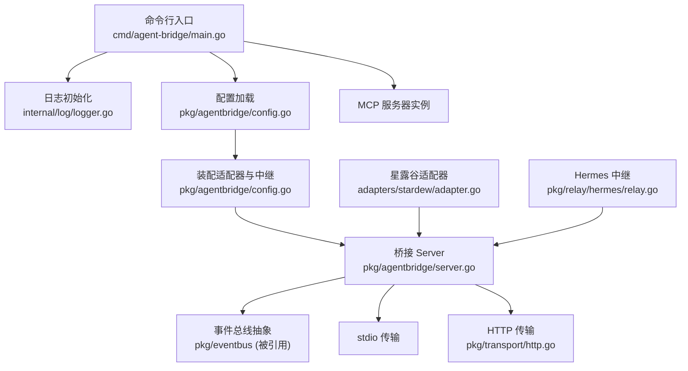
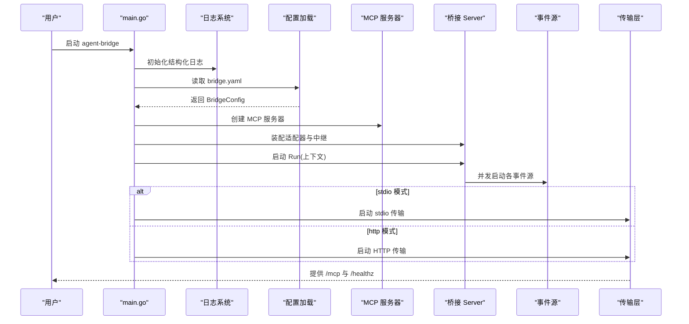
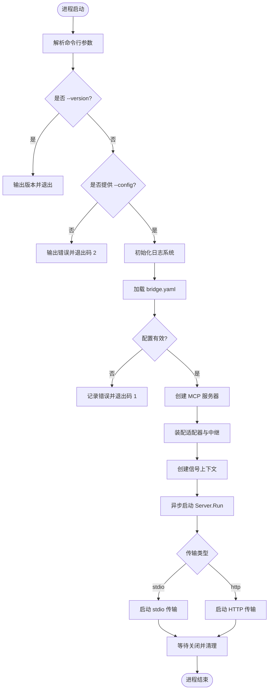
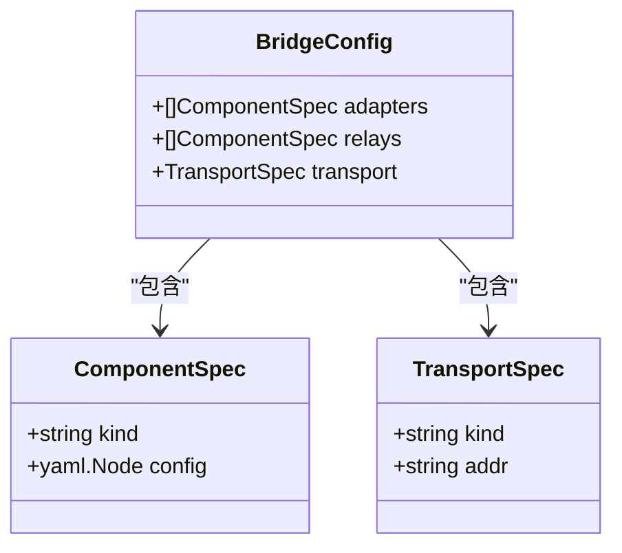
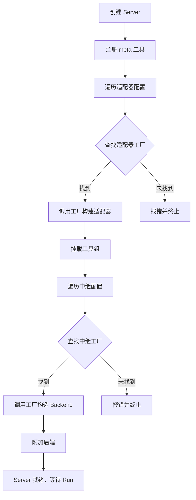
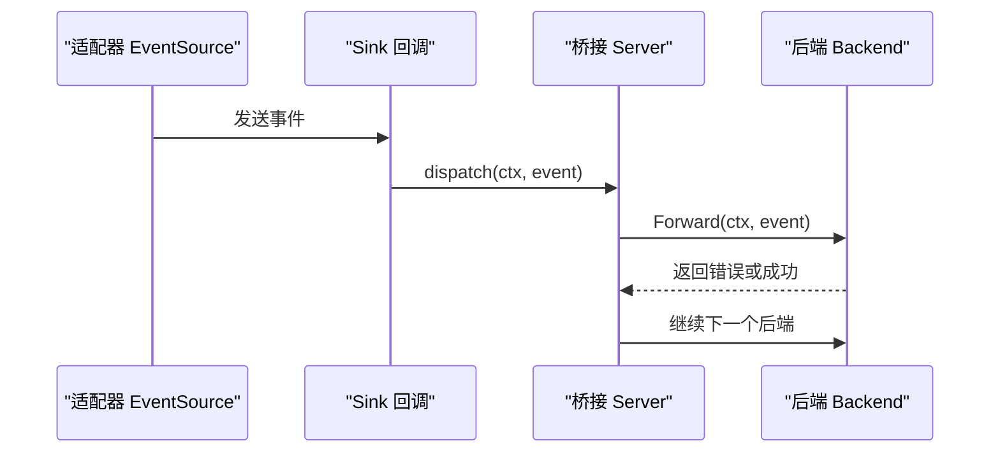
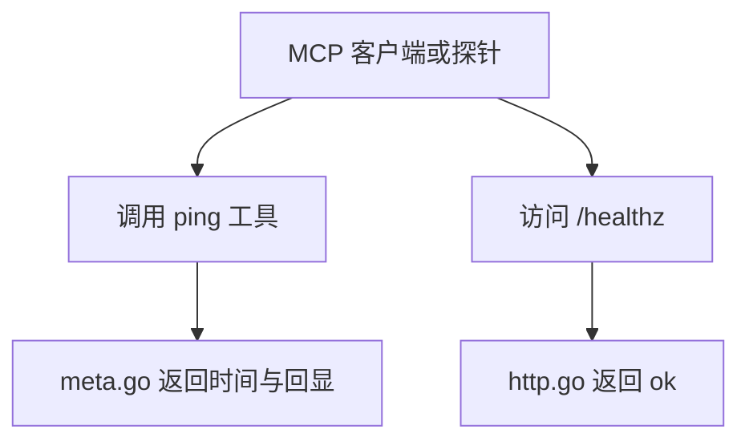
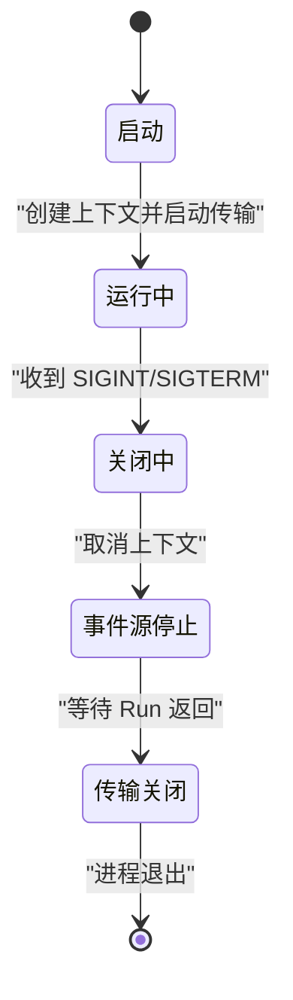
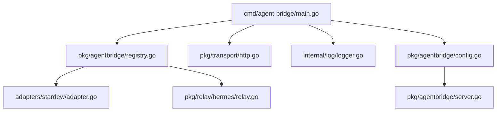

# 服务入口与配置

<cite>
**本文引用的文件**   
- [main.go](file://SmartNPC/smartnpc-mcp/cmd/agent-bridge/main.go)
- [config.go](file://SmartNPC/smartnpc-mcp/pkg/agentbridge/config.go)
- [server.go](file://SmartNPC/smartnpc-mcp/pkg/agentbridge/server.go)
- [backend.go](file://SmartNPC/smartnpc-mcp/pkg/agentbridge/backend.go)
- [eventsource.go](file://SmartNPC/smartnpc-mcp/pkg/agentbridge/eventsource.go)
- [meta.go](file://SmartNPC/smartnpc-mcp/pkg/agentbridge/meta.go)
- [registry.go](file://SmartNPC/smartnpc-mcp/pkg/agentbridge/registry.go)
- [http.go](file://SmartNPC/smartnpc-mcp/pkg/transport/http.go)
- [logger.go](file://SmartNPC/smartnpc-mcp/internal/log/logger.go)
- [adapter.go](file://SmartNPC/smartnpc-mcp/adapters/stardew/adapter.go)
- [relay.go](file://SmartNPC/smartnpc-mcp/pkg/relay/hermes/relay.go)
- [go.mod](file://SmartNPC/smartnpc-mcp/go.mod)
</cite>

## 目录
1. [简介](#简介)
2. [项目结构](#项目结构)
3. [核心组件](#核心组件)
4. [架构总览](#架构总览)
5. [详细组件分析](#详细组件分析)
6. [依赖关系分析](#依赖关系分析)
7. [性能与可扩展性](#性能与可扩展性)
8. [故障排查指南](#故障排查指南)
9. [结论](#结论)

## 简介
本文档聚焦 MCP 服务的入口程序与配置体系，围绕 `cmd/agent-bridge` 主程序展开，说明以下关键内容：
- 启动流程：命令行参数解析、日志系统初始化、MCP 服务器创建、配置加载、适配器与中继装配、事件源运行。
- 命令行选项：包括 `--version`、`--config`、`--log-level`、`--http-allow-any-origin` 等。
- 配置结构：`BridgeConfig`、`ComponentSpec`、`TransportSpec`，以及 YAML 配置文件 `bridge.yaml` 的语义和校验规则。
- 服务器生命周期：事件源并发运行、后端转发、优雅关闭机制。
- 健康检查：内置 `ping` 工具与 HTTP `/healthz` 端点。
- 扩展方式：如何注册新的适配器、中继和配置项。

## 项目结构
本项目的 MCP 服务由一个“通用桥接入口”和一个“可插拔运行时框架”组成：
- `cmd/agent-bridge/main.go`：二进制入口，负责 CLI 参数解析、日志初始化、MCP 服务器创建、配置加载与传输层选择。
- `pkg/agentbridge/*`：框架核心，定义 Server、EventSource、Backend、配置结构与装配逻辑。
- `pkg/transport/http.go`：HTTP 传输实现，暴露 `/mcp`、`/mcp/`、`/healthz`。
- `internal/log/logger.go`：结构化日志初始化，所有日志输出到标准错误流。
- `adapters/stardew/adapter.go`：星露谷适配器，作为 EventSource 并挂载游戏相关工具。
- `pkg/relay/hermes/relay.go`：Hermes 中继，将事件转发给外部 LLM 网关。
- `go.mod`：模块与依赖声明。

**图表来源**
- [main.go:20-123](file://SmartNPC/smartnpc-mcp/cmd/agent-bridge/main.go#L20-L123)
- [config.go:12-154](file://SmartNPC/smartnpc-mcp/pkg/agentbridge/config.go#L12-L154)
- [server.go:15-177](file://SmartNPC/smartnpc-mcp/pkg/agentbridge/server.go#L15-L177)
- [http.go:12-124](file://SmartNPC/smartnpc-mcp/pkg/transport/http.go#L12-L124)
- [adapter.go:15-163](file://SmartNPC/smartnpc-mcp/adapters/stardew/adapter.go#L15-L163)
- [relay.go:1-200](file://SmartNPC/smartnpc-mcp/pkg/relay/hermes/relay.go#L1-L200)

**章节来源**
- [main.go:20-123](file://SmartNPC/smartnpc-mcp/cmd/agent-bridge/main.go#L20-L123)
- [go.mod:1-19](file://SmartNPC/smartnpc-mcp/go.mod#L1-L19)

## 核心组件
本节从调用方视角梳理入口程序与框架的核心职责。

### 入口程序职责
- 解析 CLI 参数：`--version`、`--config`、`--log-level`、`--http-allow-any-origin`。
- 初始化日志系统：通过 `internal/log` 设置全局 `slog`。
- 创建 MCP 服务器实例：使用 `modelcontextprotocol/go-sdk/mcp`。
- 加载并装配配置：读取 `bridge.yaml`，构建 Server，注册元工具。
- 启动事件源：通过 `Server.Run` 在独立协程中运行所有 EventSource。
- 启动传输层：根据配置选择 stdio 或 HTTP。
- 优雅关闭：监听 `os.Interrupt`、`syscall.SIGTERM`，取消上下文并等待子任务退出。

### 框架核心类型
- `BridgeConfig`：描述整个桥接配置的根结构。
- `ComponentSpec`：描述一个适配器或中继的配置条目。
- `TransportSpec`：描述 MCP 传输类型与地址。
- `Server`：桥接运行时容器，管理工具组、事件源、后端。
- `EventSource`：事件生产者接口，如 WebSocket 适配器等。
- `Backend`：事件消费者接口，如 Hermes 中继。
- `Sink`：事件投递回调。

**章节来源**
- [main.go:40-123](file://SmartNPC/smartnpc-mcp/cmd/agent-bridge/main.go#L40-L123)
- [config.go:20-154](file://SmartNPC/smartnpc-mcp/pkg/agentbridge/config.go#L20-L154)
- [server.go:15-177](file://SmartNPC/smartnpc-mcp/pkg/agentbridge/server.go#L15-L177)
- [eventsource.go:10-40](file://SmartNPC/smartnpc-mcp/pkg/agentbridge/eventsource.go#L10-L40)
- [backend.go:1-36](file://SmartNPC/smartnpc-mcp/pkg/agentbridge/backend.go#L1-L36)

## 架构总览
下图展示一次完整启动的生命周期：从命令行参数到 MCP 客户端可连接为止。

**图表来源**
- [main.go:40-123](file://SmartNPC/smartnpc-mcp/cmd/agent-bridge/main.go#L40-L123)
- [config.go:80-154](file://SmartNPC/smartnpc-mcp/pkg/agentbridge/config.go#L80-L154)
- [server.go:95-177](file://SmartNPC/smartnpc-mcp/pkg/agentbridge/server.go#L95-L177)
- [http.go:45-124](file://SmartNPC/smartnpc-mcp/pkg/transport/http.go#L45-L124)

## 详细组件分析

### 主程序启动流程与命令行选项
`cmd/agent-bridge/main.go` 是通用 MCP 桥接入口。它不硬编码特定适配器或中继，而是通过 `bridge.yaml` 与全局注册表组装运行时。

#### 命令行选项
| 选项 | 类型 | 默认值 | 含义 |
|---|---|---:|---|
| `--version` | 布尔 | `false` | 打印版本后退出 |
| `--config` | 字符串 | 空 | `bridge.yaml` 路径；必填 |
| `--log-level` | 字符串 | `info` | 日志级别：`debug`、`info`、`warn`、`error` |
| `--http-allow-any-origin` | 布尔 | `true` | HTTP 模式下是否禁用来源与本地主机保护，允许跨主机客户端连接 |

#### 启动步骤
1. 解析命令行参数。
2. 如果请求版本，直接输出版本并退出。
3. 如果未提供 `--config`，输出错误并退出码 2。
4. 初始化日志系统，并设为全局默认日志器。
5. 加载 `bridge.yaml`，失败则记录错误并退出码 1。
6. 创建 MCP 服务器实例。
7. 调用配置的 `Assemble` 方法装配适配器与中继。
8. 创建带信号处理的上下文。
9. 异步启动 `Server.Run`，并将错误写入通道。
10. 根据 `Transport.Kind` 选择 stdio 或 HTTP 传输。
11. 传输层返回后取消上下文并等待事件源退出。
12. 输出干净关闭日志。

**图表来源**
- [main.go:40-123](file://SmartNPC/smartnpc-mcp/cmd/agent-bridge/main.go#L40-L123)

**章节来源**
- [main.go:20-123](file://SmartNPC/smartnpc-mcp/cmd/agent-bridge/main.go#L20-L123)

### 配置结构与文件格式
`pkg/agentbridge/config.go` 定义了 `bridge.yaml` 的数据模型与校验逻辑。

#### 配置结构
| 类型 | 字段 | 必填 | 说明 |
|---|---|---:|---|
| `BridgeConfig` | `adapters` | 是 | 适配器列表 |
| `BridgeConfig` | `relays` | 否 | 中继列表 |
| `BridgeConfig` | `transport` | 是 | MCP 传输配置 |
| `ComponentSpec` | `kind` | 是 | 适配器或中继的注册键 |
| `ComponentSpec` | `config` | 否 | 具体配置节点，由各工厂解码 |
| `TransportSpec` | `kind` | 是 | `stdio` 或 `http` |
| `TransportSpec` | `addr` | 条件必填 | `kind=http` 时必填 |

#### 配置文件示例语义
- `adapters` 使用列表形式，便于未来对同一 `kind` 配置多个实例。
- `relays` 使用列表形式，每个中继对应一个下游系统（例如不同 NPC 或不同 Hermes 配置）。
- `transport.kind` 决定 MCP 暴露方式。
- `transport.addr` 仅在 HTTP 模式下需要。
- `config` 以原始 YAML 节点传递，框架不枚举内部字段，由具体工厂解码。

#### 校验规则
- 至少需要一个适配器。
- 每个适配器和中继都必须指定 `kind`。
- `transport.kind` 必须是 `stdio` 或 `http`。
- `transport.kind=http` 时必须提供 `transport.addr`。

**图表来源**
- [config.go:20-79](file://SmartNPC/smartnpc-mcp/pkg/agentbridge/config.go#L20-L79)

**章节来源**
- [config.go:12-154](file://SmartNPC/smartnpc-mcp/pkg/agentbridge/config.go#L12-L154)

### 服务器初始化与依赖注入
`pkg/agentbridge/server.go` 中的 `Server` 是运行时容器，负责：
- 包装底层 `mcp.Server`。
- 维护已挂载的工具组。
- 管理事件源和中继后端。
- 并发启动事件源。
- 按顺序转发事件到所有后端。

#### 初始化流程
1. 调用 `New(mcpServer, Options)` 创建 Server。
2. 通过 `RegisterMeta` 注册框架级元工具。
3. 通过 `LoadConfig.Assemble` 遍历适配器与中继。
4. 适配器工厂调用 `AttachEventSource` 和 `Mount`。
5. 中继工厂构造 Backend 并调用 `AttachBackend`。
6. 最终由 `Run` 启动事件源循环。

**图表来源**
- [server.go:25-120](file://SmartNPC/smartnpc-mcp/pkg/agentbridge/server.go#L25-L120)
- [config.go:100-154](file://SmartNPC/smartnpc-mcp/pkg/agentbridge/config.go#L100-L154)

**章节来源**
- [server.go:15-177](file://SmartNPC/smartnpc-mcp/pkg/agentbridge/server.go#L15-L177)
- [config.go:80-154](file://SmartNPC/smartnpc-mcp/pkg/agentbridge/config.go#L80-L154)

### 事件源与后端转发
`pkg/agentbridge/eventsource.go` 与 `pkg/agentbridge/backend.go` 分别定义事件生产者与消费者接口。

- `EventSource.Start`：连接上游数据源，持续产生事件，直到上下文取消。
- `Sink`：非阻塞回调，适配器通过它把事件交给框架。
- `Backend.Forward`：接收事件并转发到下游；应异步处理慢操作。
- `Server.dispatch`：按附加顺序依次调用所有后端，单个后端错误不会中断其他后端。

**图表来源**
- [eventsource.go:10-40](file://SmartNPC/smartnpc-mcp/pkg/agentbridge/eventsource.go#L10-L40)
- [backend.go:10-36](file://SmartNPC/smartnpc-mcp/pkg/agentbridge/backend.go#L10-L36)
- [server.go:120-177](file://SmartNPC/smartnpc-mcp/pkg/agentbridge/server.go#L120-L177)

**章节来源**
- [eventsource.go:10-40](file://SmartNPC/smartnpc-mcp/pkg/agentbridge/eventsource.go#L10-L40)
- [backend.go:1-36](file://SmartNPC/smartnpc-mcp/pkg/agentbridge/backend.go#L1-L36)
- [server.go:95-177](file://SmartNPC/smartnpc-mcp/pkg/agentbridge/server.go#L95-L177)

### 健康检查与服务发现
项目提供两层健康检查能力：

#### 元工具 ping
- 工具名称：`ping`。
- 功能：返回服务器当前时间戳并回显输入消息。
- 特点：不访问游戏状态，适合启动阶段、连接存活检测。
- 注册位置：`pkg/agentbridge/meta.go`。

#### HTTP 健康端点
- 路径：`/healthz`。
- 响应：固定 JSON 体，表示 HTTP 服务正在监听。
- 用途：配合容器编排或负载均衡进行存活探测。
- 实现位置：`pkg/transport/http.go`。

**图表来源**
- [meta.go:10-43](file://SmartNPC/smartnpc-mcp/pkg/agentbridge/meta.go#L10-L43)
- [http.go:70-124](file://SmartNPC/smartnpc-mcp/pkg/transport/http.go#L70-L124)

**章节来源**
- [meta.go:10-43](file://SmartNPC/smartnpc-mcp/pkg/agentbridge/meta.go#L10-L43)
- [http.go:45-124](file://SmartNPC/smartnpc-mcp/pkg/transport/http.go#L45-L124)

### 优雅关闭机制
入口程序使用信号上下文协调关闭：
- 监听 `os.Interrupt` 与 `syscall.SIGTERM`。
- 取消上下文后，`Server.Run` 等待所有事件源退出。
- HTTP 传输在上下文取消后触发 `http.Server.Shutdown`，受 `ShutdownTimeout` 限制。
- stdio 模式下，传输层直接阻塞，取消上下文后也会退出。

**图表来源**
- [main.go:70-123](file://SmartNPC/smartnpc-mcp/cmd/agent-bridge/main.go#L70-L123)
- [server.go:120-177](file://SmartNPC/smartnpc-mcp/pkg/agentbridge/server.go#L120-L177)
- [http.go:90-124](file://SmartNPC/smartnpc-mcp/pkg/transport/http.go#L90-L124)

**章节来源**
- [main.go:70-123](file://SmartNPC/smartnpc-mcp/cmd/agent-bridge/main.go#L70-L123)
- [server.go:95-177](file://SmartNPC/smartnpc-mcp/pkg/agentbridge/server.go#L95-L177)
- [http.go:45-124](file://SmartNPC/smartnpc-mcp/pkg/transport/http.go#L45-L124)

### 日志系统
`internal/log/logger.go` 提供统一的日志初始化：
- 所有日志输出到标准错误流。
- 支持 `debug`、`info`、`warn`、`error` 四种级别。
- 启用源码信息，便于定位日志来源。
- 避免向标准输出写日志，防止破坏 stdio 模式的 MCP 协议流。

**章节来源**
- [logger.go:1-35](file://SmartNPC/smartnpc-mcp/internal/log/logger.go#L1-L35)
- [main.go:50-70](file://SmartNPC/smartnpc-mcp/cmd/agent-bridge/main.go#L50-L70)

### 适配器与中继扩展点
#### 星露谷适配器
- 适配器名称：`stardew`。
- 配置字段：`ws_url`，用于连接 SMAPI 模组 WebSocket。
- 行为：建立 WebSocket 连接，将游戏事件转换为 `eventbus.Event`，并通过 Sink 投递。
- 工具挂载：注册一组游戏领域工具，如聊天、移动、感知等。

#### Hermes 中继
- 作用：将事件转发到 Hermes Gateway。
- 配置字段：`URL`、`APIKey`、`Conversation`、`Model`、`NPCName`、`PersonaFile`、`CriticalPolicyFile`、`Timeout`、`DebugPayload`、`Store` 等。
- 行为：过滤事件、格式化负载、异步 POST、会话轮换、策略文件加载。

**章节来源**
- [adapter.go:15-163](file://SmartNPC/smartnpc-mcp/adapters/stardew/adapter.go#L15-L163)
- [relay.go:1-200](file://SmartNPC/smartnpc-mcp/pkg/relay/hermes/relay.go#L1-L200)

## 依赖关系分析
入口程序通过副作用导入注册适配器与中继，使二进制具备组合能力。

**图表来源**
- [main.go:20-40](file://SmartNPC/smartnpc-mcp/cmd/agent-bridge/main.go#L20-L40)
- [registry.go:1-119](file://SmartNPC/smartnpc-mcp/pkg/agentbridge/registry.go#L1-L119)
- [adapter.go:145-163](file://SmartNPC/smartnpc-mcp/adapters/stardew/adapter.go#L145-L163)
- [relay.go:1-60](file://SmartNPC/smartnpc-mcp/pkg/relay/hermes/relay.go#L1-L60)

**章节来源**
- [main.go:20-40](file://SmartNPC/smartnpc-mcp/cmd/agent-bridge/main.go#L20-L40)
- [registry.go:1-119](file://SmartNPC/smartnpc-mcp/pkg/agentbridge/registry.go#L1-L119)

## 性能与可扩展性

### 性能特性
- 事件源并发：每个事件源在独立协程中运行，互不阻塞。
- 后端串行转发：为保持顺序一致性，后端按附加顺序依次调用；慢后端会延迟后续后端。
- 日志开销：启用源码信息会带来少量调用栈采集成本，但日志量可控。
- HTTP 超时：读头超时与关闭超时有默认值，防止资源泄漏。

### 可扩展新配置项
要扩展新的配置选项，推荐遵循现有模式：
1. 在 `ComponentSpec.config` 中使用 `yaml.Node`，让具体工厂自行解码。
2. 在适配器或中继工厂中定义强类型配置结构。
3. 在 `bridge.yaml` 中新增字段，并在工厂中解码与校验。
4. 如需影响全局行为，可通过 `Options` 或环境变量控制。
5. 不要修改框架层的 `ComponentSpec` 结构来枚举所有下游字段，保持框架与业务解耦。

### 添加新适配器
- 在适配器包中定义 `RegisterAdapter(kind, factory)`。
- 工厂中解码 `yaml.Node`，构造适配器实例。
- 调用 `Server.AttachEventSource` 和 `Server.Mount` 注册事件源与工具。
- 确保适配器名称唯一，避免重复注册 panic。

### 添加新中继
- 在 relay 包中定义 `RegisterRelay(kind, factory)`。
- 工厂返回 `Backend` 实现，通常异步处理下游请求。
- 在 `bridge.yaml` 中添加中继条目，框架会自动装配。

**章节来源**
- [server.go:95-177](file://SmartNPC/smartnpc-mcp/pkg/agentbridge/server.go#L95-L177)
- [registry.go:30-119](file://SmartNPC/smartnpc-mcp/pkg/agentbridge/registry.go#L30-L119)
- [config.go:20-79](file://SmartNPC/smartnpc-mcp/pkg/agentbridge/config.go#L20-L79)

## 故障排查指南

### 常见问题与原因
| 现象 | 可能原因 | 排查建议 |
|---|---|---|
| 启动时报缺少 `--config` | 未传入 `bridge.yaml` 路径 | 确认命令行包含 `--config` |
| 配置加载失败 | 文件不存在或 YAML 解析错误 | 检查文件路径与格式 |
| 校验失败：缺少适配器 | `adapters` 为空 | 至少添加一个适配器 |
| 校验失败：未知 kind | 适配器或中继未在注册表中注册 | 检查副作用导入与注册名 |
| HTTP 端口占用 | 地址已被其他进程占用 | 更换端口或关闭冲突进程 |
| 跨主机客户端无法连接 | 来源保护未关闭 | 设置 `--http-allow-any-origin=true` |
| MCP 协议异常 | 日志写到标准输出 | 确认日志只输出到标准错误 |
| 事件未转发到 Hermes | 中继未启用或事件被过滤 | 检查中继配置与 NPC 过滤 |

### 诊断手段
- 使用 `--log-level=debug` 获取更详细日志。
- 调用 `ping` 工具验证 MCP 连接是否存活。
- 访问 `/healthz` 验证 HTTP 服务是否正常监听。
- 检查适配器 WebSocket URL 是否正确。
- 检查 Hermes URL、API Key、Conversation、Model 是否匹配目标配置。

**章节来源**
- [main.go:40-123](file://SmartNPC/smartnpc-mcp/cmd/agent-bridge/main.go#L40-L123)
- [config.go:60-154](file://SmartNPC/smartnpc-mcp/pkg/agentbridge/config.go#L60-L154)
- [http.go:45-124](file://SmartNPC/smartnpc-mcp/pkg/transport/http.go#L45-L124)
- [adapter.go:40-120](file://SmartNPC/smartnpc-mcp/adapters/stardew/adapter.go#L40-L120)
- [relay.go:60-160](file://SmartNPC/smartnpc-mcp/pkg/relay/hermes/relay.go#L60-L160)

## 结论
`cmd/agent-bridge` 提供了一个配置驱动的 MCP 服务入口，核心设计将“配置描述”与“运行时装配”分离：
- 启动流程清晰：参数解析、日志初始化、配置加载、MCP 服务器创建、事件源运行、传输层启动。
- 配置结构稳定：通过 `BridgeConfig`、`ComponentSpec`、`TransportSpec` 描述适配器、中继与传输。
- 生命周期可控：事件源并发运行，后端串行转发，优雅关闭保证资源释放。
- 扩展性强：通过注册表机制，可以新增适配器与中继，而不改动框架核心。
- 可观测性良好：结构化日志、`ping` 工具、`/healthz` 端点共同构成基础运维能力。

对于实际部署，推荐：
- 使用 HTTP 模式暴露 MCP 服务，并开启 API Key 认证。
- 使用 `bridge.yaml` 集中管理适配器与中继配置。
- 通过 `--http-allow-any-origin` 控制跨主机连接安全性。
- 使用 `--log-level` 调整生产环境日志粒度。
- 用 `ping` 与 `/healthz` 做健康检查与连通性验证。