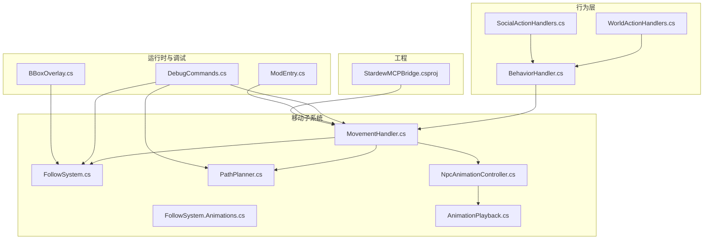
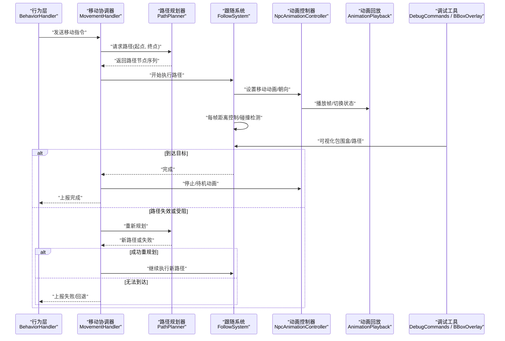
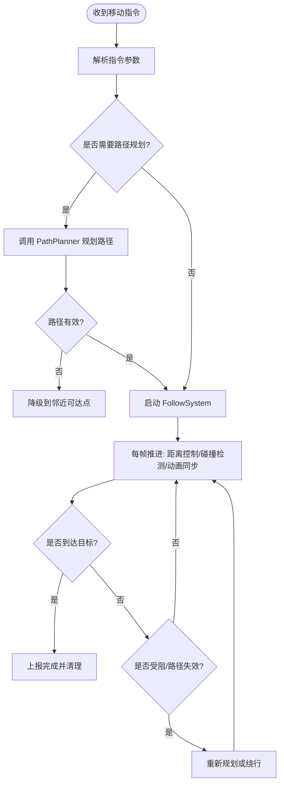
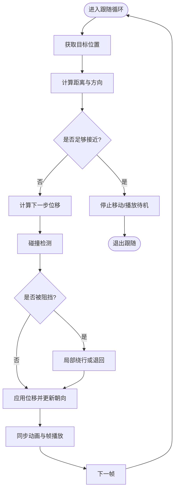
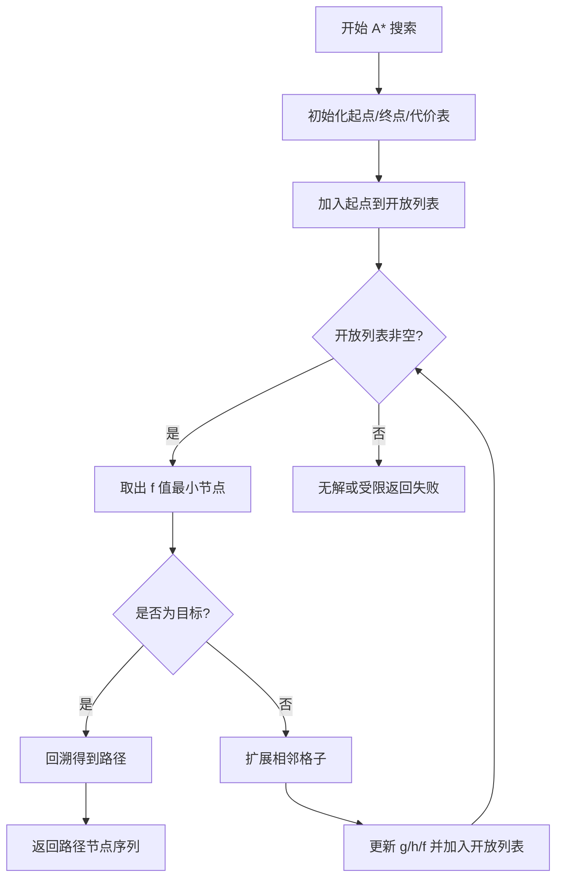
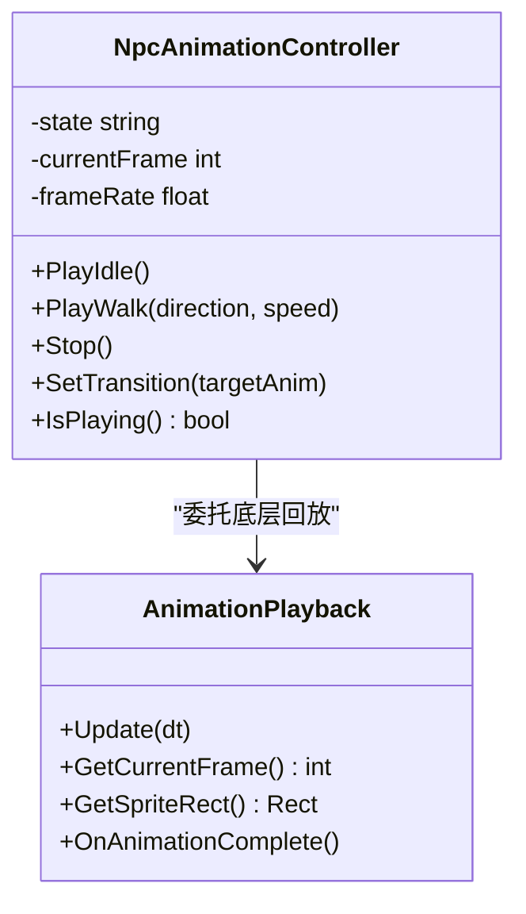
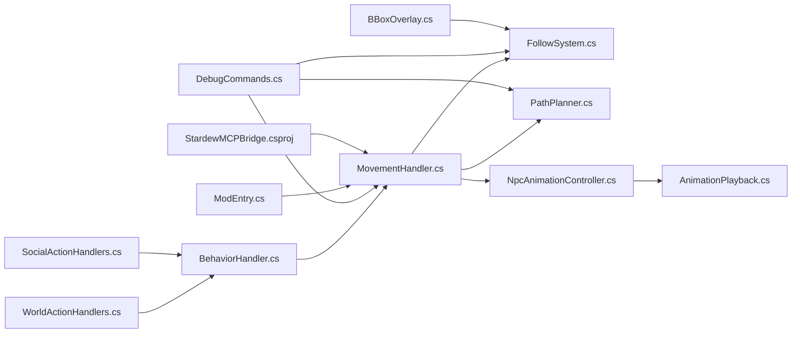

# NPC 移动系统

<cite>
**本文引用的文件**
- [MovementHandler.cs](file://SmartNPC/smap-mod/Movement/MovementHandler.cs)
- [FollowSystem.cs](file://SmartNPC/smap-mod/Movement/FollowSystem.cs)
- [FollowSystem.Animations.cs](file://SmartNPC/smap-mod/Movement/FollowSystem.Animations.cs)
- [PathPlanner.cs](file://SmartNPC/smap-mod/Movement/PathPlanner.cs)
- [NpcAnimationController.cs](file://SmartNPC/smap-mod/Movement/NpcAnimationController.cs)
- [AnimationPlayback.cs](file://SmartNPC/smap-mod/Movement/AnimationPlayback.cs)
- [BehaviorHandler.cs](file://SmartNPC/smap-mod/Movement/BehaviorHandler.cs)
- [WorldActionHandlers.cs](file://SmartNPC/smap-mod/Behavior/WorldActionHandlers.cs)
- [SocialActionHandlers.cs](file://SmartNPC/smap-mod/Behavior/SocialActionHandlers.cs)
- [ModEntry.cs](file://SmartNPC/smap-mod/ModEntry.cs)
- [DebugCommands.cs](file://SmartNPC/smap-mod/Debug/DebugCommands.cs)
- [BBoxOverlay.cs](file://SmartNPC/smap-mod/Debug/BBoxOverlay.cs)
- [StardewMCPBridge.csproj](file://SmartNPC/smap-mod/StardewMCPBridge.csproj)
</cite>

## 目录
1. [引言](#引言)
2. [项目结构](#项目结构)
3. [核心组件](#核心组件)
4. [架构总览](#架构总览)
5. [详细组件分析](#详细组件分析)
6. [依赖关系分析](#依赖关系分析)
7. [性能与优化](#性能与优化)
8. [故障排查指南](#故障排查指南)
9. [扩展指南](#扩展指南)
10. [结论](#结论)

## 引言
本文件聚焦于 SmartNPC 模组中的 NPC 移动子系统，围绕以下关键类展开：
- MovementHandler：移动指令解析、调度与生命周期协调。
- FollowSystem：跟随目标、距离控制与碰撞检测。
- PathPlanner：路径规划，包含 A* 算法、地形分析与动态障碍物处理。
- NpcAnimationController：动画播放、切换与状态同步。
- AnimationPlayback：底层动画回放抽象。
- BehaviorHandler：行为处理器入口，连接高层行为与移动子系统。

该文档面向希望理解并扩展 NPC 导航与动画系统的开发者，提供从系统架构到代码级细节的完整说明，并给出可操作的扩展示例、排错方法与性能调优建议。

## 项目结构
移动子系统位于 smapi-mod/Movement 目录下，并与上层行为层、调试工具、游戏入口和 MCP 桥接工程共同协作。下图展示与移动相关的核心文件和职责边界。

图表来源
- [MovementHandler.cs](file://SmartNPC/smap-mod/Movement/MovementHandler.cs)
- [FollowSystem.cs](file://SmartNPC/smap-mod/Movement/FollowSystem.cs)
- [PathPlanner.cs](file://SmartNPC/smap-mod/Movement/PathPlanner.cs)
- [NpcAnimationController.cs](file://SmartNPC/smap-mod/Movement/NpcAnimationController.cs)
- [AnimationPlayback.cs](file://SmartNPC/smap-mod/Movement/AnimationPlayback.cs)
- [BehaviorHandler.cs](file://SmartNPC/smap-mod/Movement/BehaviorHandler.cs)
- [WorldActionHandlers.cs](file://SmartNPC/smap-mod/Behavior/WorldActionHandlers.cs)
- [SocialActionHandlers.cs](file://SmartNPC/smap-mod/Behavior/SocialActionHandlers.cs)
- [ModEntry.cs](file://SmartNPC/smap-mod/ModEntry.cs)
- [DebugCommands.cs](file://SmartNPC/smap-mod/Debug/DebugCommands.cs)
- [BBoxOverlay.cs](file://SmartNPC/smap-mod/Debug/BBoxOverlay.cs)
- [StardewMCPBridge.csproj](file://SmartNPC/smap-mod/StardewMCPBridge.csproj)

章节来源
- [MovementHandler.cs](file://SmartNPC/smap-mod/Movement/MovementHandler.cs)
- [FollowSystem.cs](file://SmartNPC/smap-mod/Movement/FollowSystem.cs)
- [PathPlanner.cs](file://SmartNPC/smap-mod/Movement/PathPlanner.cs)
- [NpcAnimationController.cs](file://SmartNPC/smap-mod/Movement/NpcAnimationController.cs)
- [AnimationPlayback.cs](file://SmartNPC/smap-mod/Movement/AnimationPlayback.cs)
- [BehaviorHandler.cs](file://SmartNPC/smap-mod/Movement/BehaviorHandler.cs)
- [WorldActionHandlers.cs](file://SmartNPC/smap-mod/Behavior/WorldActionHandlers.cs)
- [SocialActionHandlers.cs](file://SmartNPC/smap-mod/Behavior/SocialActionHandlers.cs)
- [ModEntry.cs](file://SmartNPC/smap-mod/ModEntry.cs)
- [DebugCommands.cs](file://SmartNPC/smap-mod/Debug/DebugCommands.cs)
- [BBoxOverlay.cs](file://SmartNPC/smap-mod/Debug/BBoxOverlay.cs)
- [StardewMCPBridge.csproj](file://SmartNPC/smap-mod/StardewMCPBridge.csproj)

## 核心组件
本节概述各组件的职责与交互方式，帮助读者建立整体心智模型。

- MovementHandler：作为移动协调器，负责接收高层行为请求（如“移动到坐标”“跟随玩家”），将其解析为具体移动任务；调用 PathPlanner 生成路径；驱动 FollowSystem 执行位移；通过 NpcAnimationController 同步动画状态；并在完成或中断时回调行为层。
- FollowSystem：实现具体的跟随策略，包括目标选择、距离阈值判断、插值步进、与地形/实体的碰撞检测；在遇到障碍时触发重规划或绕行。
- PathPlanner：维护地图网格与通行代价，使用 A* 计算最短路径；支持静态地形权重与动态障碍物更新；输出节点序列供 FollowSystem 逐步执行。
- NpcAnimationController：封装帧播放、动画切换、朝向与速度映射；保证移动与动画状态一致，避免闪烁或不同步。
- AnimationPlayback：提供底层动画回放接口，便于在不同渲染管线或测试环境下替换实现。
- BehaviorHandler：统一入口，将工作流或 MCP 工具产生的动作转换为移动相关命令，并交由 MovementHandler 执行。

章节来源
- [MovementHandler.cs](file://SmartNPC/smap-mod/Movement/MovementHandler.cs)
- [FollowSystem.cs](file://SmartNPC/smap-mod/Movement/FollowSystem.cs)
- [PathPlanner.cs](file://SmartNPC/smap-mod/Movement/PathPlanner.cs)
- [NpcAnimationController.cs](file://SmartNPC/smap-mod/Movement/NpcAnimationController.cs)
- [AnimationPlayback.cs](file://SmartNPC/smap-mod/Movement/AnimationPlayback.cs)
- [BehaviorHandler.cs](file://SmartNPC/smap-mod/Movement/BehaviorHandler.cs)

## 架构总览
下图展示了 NPC 一次典型移动的生命周期：从高层行为发起，到路径规划、动画同步、碰撞检测，直至到达目标或失败回退。

图表来源
- [MovementHandler.cs](file://SmartNPC/smap-mod/Movement/MovementHandler.cs)
- [PathPlanner.cs](file://SmartNPC/smap-mod/Movement/PathPlanner.cs)
- [FollowSystem.cs](file://SmartNPC/smap-mod/Movement/FollowSystem.cs)
- [NpcAnimationController.cs](file://SmartNPC/smap-mod/Movement/NpcAnimationController.cs)
- [AnimationPlayback.cs](file://SmartNPC/smap-mod/Movement/AnimationPlayback.cs)
- [DebugCommands.cs](file://SmartNPC/smap-mod/Debug/DebugCommands.cs)
- [BBoxOverlay.cs](file://SmartNPC/smap-mod/Debug/BBoxOverlay.cs)

## 详细组件分析

### MovementHandler：移动协调器
- 职责
  - 解析高层移动指令，例如“移动到世界坐标”“跟随某实体”。
  - 管理移动任务的启动、推进、暂停、取消与完成。
  - 组合 PathPlanner、FollowSystem 与 NpcAnimationController。
  - 与行为层保持双向通信，上报进度、结果与异常。
- 关键流程
  - 指令解析：识别目标类型（坐标、实体）、约束条件（最大步数、超时）。
  - 路径请求：向 PathPlanner 发起规划，缓存并校验路径有效性。
  - 执行循环：每帧驱动 FollowSystem，更新动画状态，检查碰撞与到达条件。
  - 中断处理：当路径失效、目标消失或收到取消信号时，清理资源并通知上层。
- 错误处理
  - 路径为空或不可达：尝试重规划或降级为近似目标点。
  - 动画未就绪：延迟启动或回退到默认待机动画。
  - 外部输入冲突：优先响应更高优先级的中断事件。

图表来源
- [MovementHandler.cs](file://SmartNPC/smap-mod/Movement/MovementHandler.cs)
- [PathPlanner.cs](file://SmartNPC/smap-mod/Movement/PathPlanner.cs)
- [FollowSystem.cs](file://SmartNPC/smap-mod/Movement/FollowSystem.cs)

章节来源
- [MovementHandler.cs](file://SmartNPC/smap-mod/Movement/MovementHandler.cs)

### FollowSystem：跟随算法
- 目标追踪
  - 支持固定坐标与动态实体两类目标。
  - 对动态目标进行位置预测与平滑跟踪，避免抖动。
- 距离控制
  - 根据当前距离与目标半径决定移动步长。
  - 接近目标时采用减速曲线，确保停靠在期望范围内。
- 碰撞检测
  - 结合地形阻挡与实体包围盒，检测前方通行性。
  - 发生碰撞时触发局部绕行或退回上一节点。
- 与动画联动
  - 根据移动方向与速度切换行走/待机动画。
  - 在转向或停顿处插入过渡动画，提升视觉自然度。

图表来源
- [FollowSystem.cs](file://SmartNPC/smap-mod/Movement/FollowSystem.cs)
- [FollowSystem.Animations.cs](file://SmartNPC/smap-mod/Movement/FollowSystem.Animations.cs)
- [BBoxOverlay.cs](file://SmartNPC/smap-mod/Debug/BBoxOverlay.cs)

章节来源
- [FollowSystem.cs](file://SmartNPC/smap-mod/Movement/FollowSystem.cs)
- [FollowSystem.Animations.cs](file://SmartNPC/smap-mod/Movement/FollowSystem.Animations.cs)
- [BBoxOverlay.cs](file://SmartNPC/smap-mod/Debug/BBoxOverlay.cs)

### PathPlanner：路径规划器
- A* 算法实现
  - 以网格图为基础，每个格子具备地形代价。
  - 使用开放列表与关闭列表维护搜索过程，启发函数估计剩余代价。
- 地形分析
  - 区分可通行、半通行与不可通行区域。
  - 对不同地形赋予不同权重，影响路径选择（例如草地 vs 水塘）。
- 动态障碍物
  - 运行时更新占用格或临时障碍。
  - 在路径失效时触发增量重规划，减少全量计算开销。
- 性能优化
  - 缓存热点路径或最近可行邻居。
  - 限制搜索深度与分支因子，避免长时间阻塞主线程。

图表来源
- [PathPlanner.cs](file://SmartNPC/smap-mod/Movement/PathPlanner.cs)

章节来源
- [PathPlanner.cs](file://SmartNPC/smap-mod/Movement/PathPlanner.cs)

### NpcAnimationController：动画控制系统
- 帧播放
  - 按时间步进播放帧，支持循环与单次播放模式。
  - 与移动速度绑定，确保帧速率与移动节奏匹配。
- 动画切换
  - 基于移动状态机（待机、行走、转向、停止）切换动画。
  - 支持过渡动画与优先级，避免动画覆盖冲突。
- 状态同步
  - 与 FollowSystem 的方向、速度保持一致。
  - 在移动中断或目标变化时快速回落到待机状态。

图表来源
- [NpcAnimationController.cs](file://SmartNPC/smap-mod/Movement/NpcAnimationController.cs)
- [AnimationPlayback.cs](file://SmartNPC/smap-mod/Movement/AnimationPlayback.cs)

章节来源
- [NpcAnimationController.cs](file://SmartNPC/smap-mod/Movement/NpcAnimationController.cs)
- [AnimationPlayback.cs](file://SmartNPC/smap-mod/Movement/AnimationPlayback.cs)

### BehaviorHandler：行为入口
- 职责
  - 接收来自工作流或 MCP 工具的移动请求。
  - 将语义动作（如“前往农场门口”）转化为 MovementHandler 可调用的指令。
  - 与其他行为处理器（社交、世界交互）协调，避免移动冲突。
- 集成点
  - 与 WorldActionHandlers、SocialActionHandlers 协同，统一调度 NPC 行动。
  - 通过 ModEntry 在游戏生命周期中注册与启停。

章节来源
- [BehaviorHandler.cs](file://SmartNPC/smap-mod/Movement/BehaviorHandler.cs)
- [WorldActionHandlers.cs](file://SmartNPC/smap-mod/Behavior/WorldActionHandlers.cs)
- [SocialActionHandlers.cs](file://SmartNPC/smap-mod/Behavior/SocialActionHandlers.cs)
- [ModEntry.cs](file://SmartNPC/smap-mod/ModEntry.cs)

## 依赖关系分析
下图展示移动子系统与周边模块之间的依赖关系。

图表来源
- [BehaviorHandler.cs](file://SmartNPC/smap-mod/Movement/BehaviorHandler.cs)
- [WorldActionHandlers.cs](file://SmartNPC/smap-mod/Behavior/WorldActionHandlers.cs)
- [SocialActionHandlers.cs](file://SmartNPC/smap-mod/Behavior/SocialActionHandlers.cs)
- [MovementHandler.cs](file://SmartNPC/smap-mod/Movement/MovementHandler.cs)
- [FollowSystem.cs](file://SmartNPC/smap-mod/Movement/FollowSystem.cs)
- [PathPlanner.cs](file://SmartNPC/smap-mod/Movement/PathPlanner.cs)
- [NpcAnimationController.cs](file://SmartNPC/smap-mod/Movement/NpcAnimationController.cs)
- [AnimationPlayback.cs](file://SmartNPC/smap-mod/Movement/AnimationPlayback.cs)
- [DebugCommands.cs](file://SmartNPC/smap-mod/Debug/DebugCommands.cs)
- [BBoxOverlay.cs](file://SmartNPC/smap-mod/Debug/BBoxOverlay.cs)
- [ModEntry.cs](file://SmartNPC/smap-mod/ModEntry.cs)
- [StardewMCPBridge.csproj](file://SmartNPC/smap-mod/StardewMCPBridge.csproj)

章节来源
- [BehaviorHandler.cs](file://SmartNPC/smap-mod/Movement/BehaviorHandler.cs)
- [MovementHandler.cs](file://SmartNPC/smap-mod/Movement/MovementHandler.cs)
- [StardewMCPBridge.csproj](file://SmartNPC/smap-mod/StardewMCPBridge.csproj)

## 性能与优化
- 路径规划优化
  - 使用分层网格或预计算热点路径，降低 A* 搜索范围。
  - 对频繁访问的区域做路径缓存，命中时直接复用。
  - 限制每次规划的迭代次数，避免单帧耗时过长。
- 跟随步进优化
  - 使用自适应步长：远距离大步前进，近距离小步微调。
  - 将高频物理检测降频或在空闲线程中异步计算。
- 动画播放优化
  - 批量更新动画状态，减少每帧分配。
  - 使用对象池复用动画控制器实例。
  - 仅在可见 NPC 上启用完整动画逻辑，远处使用简化版。
- 内存使用优化
  - 及时释放已完成的移动任务与路径缓存。
  - 避免在热路径中进行字符串拼接或装箱操作。
  - 将大纹理图集按需加载与卸载。

[本节为通用性能指导，不直接分析特定文件]

## 故障排查指南
- 常见问题
  - NPC 卡住不动：检查路径是否为空或全部不可行；确认 FollowSystem 是否因碰撞检测持续失败。
  - 动画与移动不同步：核对 NpcAnimationController 的状态机是否与 MovementHandler 的指令一致。
  - 路径反复重规划：查看 PathPlanner 的动态障碍物是否在每帧误删或误增。
  - 调试面板无输出：确认 DebugCommands 已正确挂载且权限允许可视化。
- 诊断手段
  - 使用 DebugCommands 打印路径节点、当前目标与距离阈值。
  - 借助 BBoxOverlay 可视化碰撞体与检测范围。
  - 在 MovementHandler 的关键分支添加日志，记录指令解析与任务状态变更。
- 恢复策略
  - 路径失败时自动降级到最近可达点。
  - 动画缺失时回退到待机动画，等待资源就绪后再继续。
  - 高负载场景下自动降低跟随频率与动画刷新率。

章节来源
- [DebugCommands.cs](file://SmartNPC/smap-mod/Debug/DebugCommands.cs)
- [BBoxOverlay.cs](file://SmartNPC/smap-mod/Debug/BBoxOverlay.cs)
- [MovementHandler.cs](file://SmartNPC/smap-mod/Movement/MovementHandler.cs)
- [FollowSystem.cs](file://SmartNPC/smap-mod/Movement/FollowSystem.cs)
- [PathPlanner.cs](file://SmartNPC/smap-mod/Movement/PathPlanner.cs)
- [NpcAnimationController.cs](file://SmartNPC/smap-mod/Movement/NpcAnimationController.cs)

## 扩展指南
- 新增移动模式
  - 在 MovementHandler 中添加新的指令类型与解析逻辑。
  - 在 FollowSystem 中实现对应策略（例如巡逻、环绕、编队跟随）。
  - 在 NpcAnimationController 中增加相应动画状态与过渡。
- 自定义路径规则
  - 扩展 PathPlanner 的地形代价表，添加自定义地形权重。
  - 实现动态障碍物管理器，支持临时封路、季节变化等。
  - 引入多目标规划或团队避让，用于复杂场景。
- 集成物理引擎
  - 将 FollowSystem 的位移与碰撞检测接入物理引擎的射线检测或刚体查询。
  - 在 MovementHandler 中对物理引擎的异步结果进行聚合与重试。
  - 在 NpcAnimationController 中根据物理反馈调整动画姿态与速度。

[本节为概念性扩展指导，不直接分析特定文件]

## 结论
SmartNPC 的移动子系统以 MovementHandler 为核心协调器，结合 PathPlanner 的路径规划能力、FollowSystem 的跟随与碰撞检测、以及 NpcAnimationController 的动画同步，形成一条完整的 NPC 导航与表现链路。通过清晰的分层设计与可扩展接口，开发者可以方便地添加新的移动模式、自定义路径规则并集成物理引擎。配合调试工具与性能优化策略，可在保证流畅体验的同时稳定运行大规模 NPC 群体。

[本节为总结性内容，不直接分析特定文件]