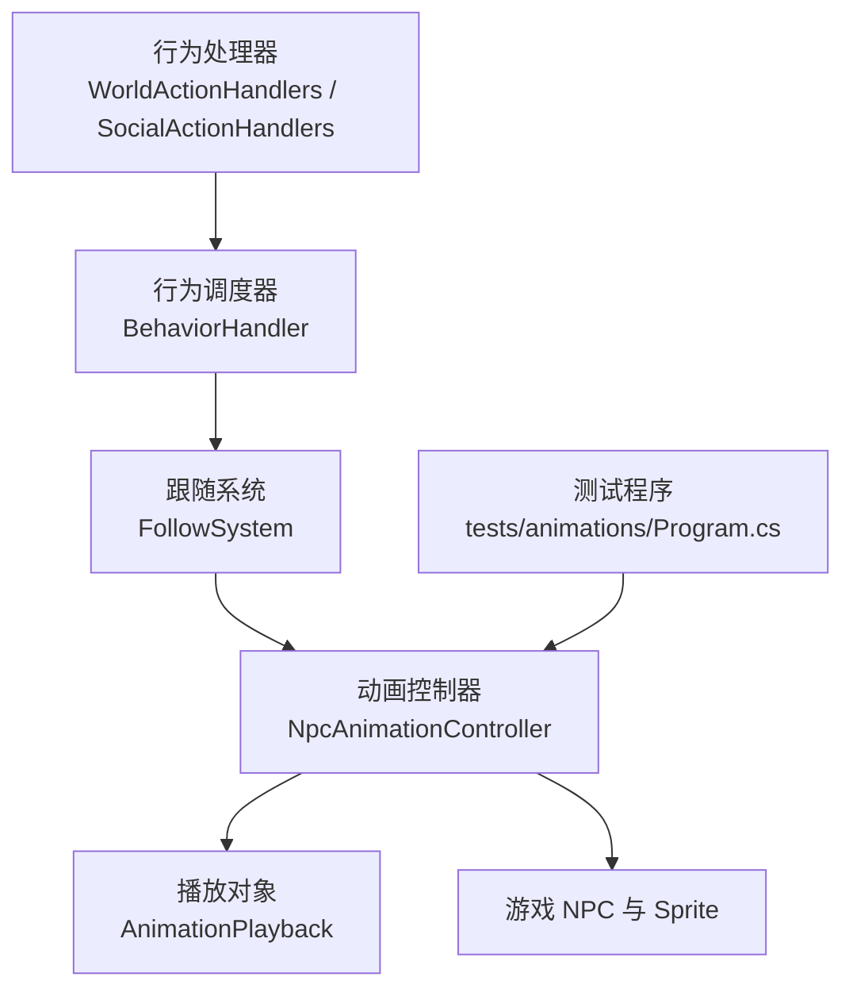
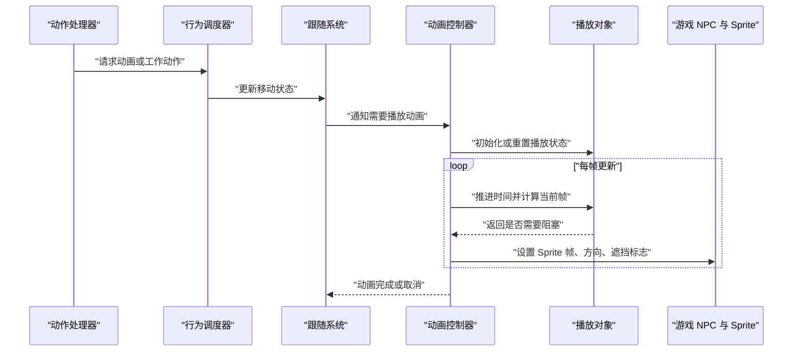
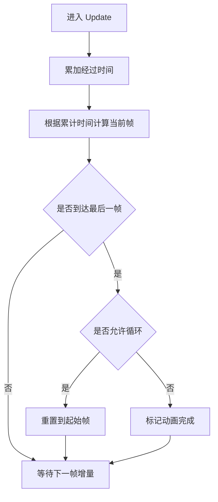
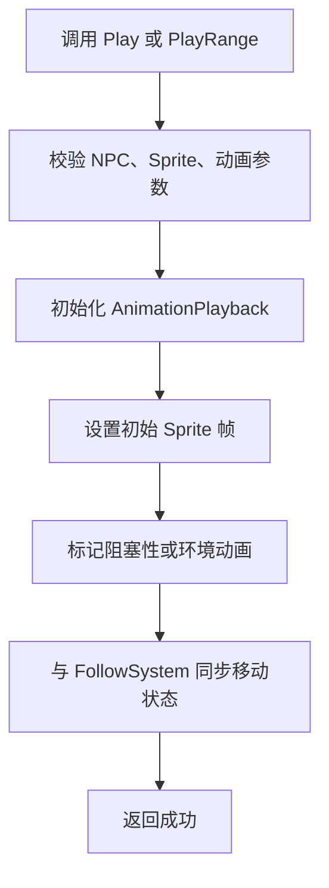
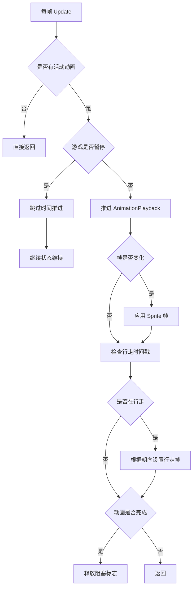
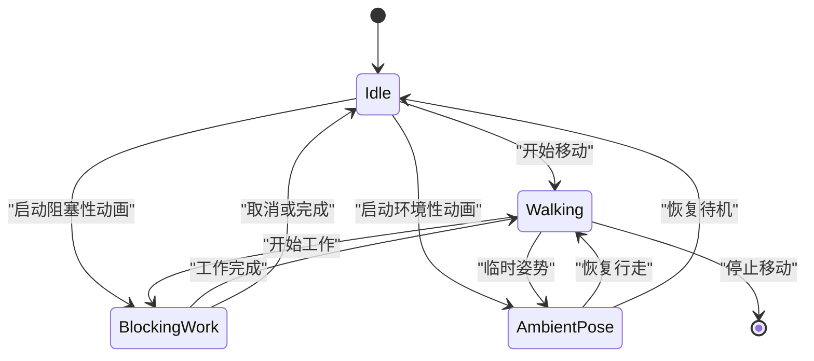
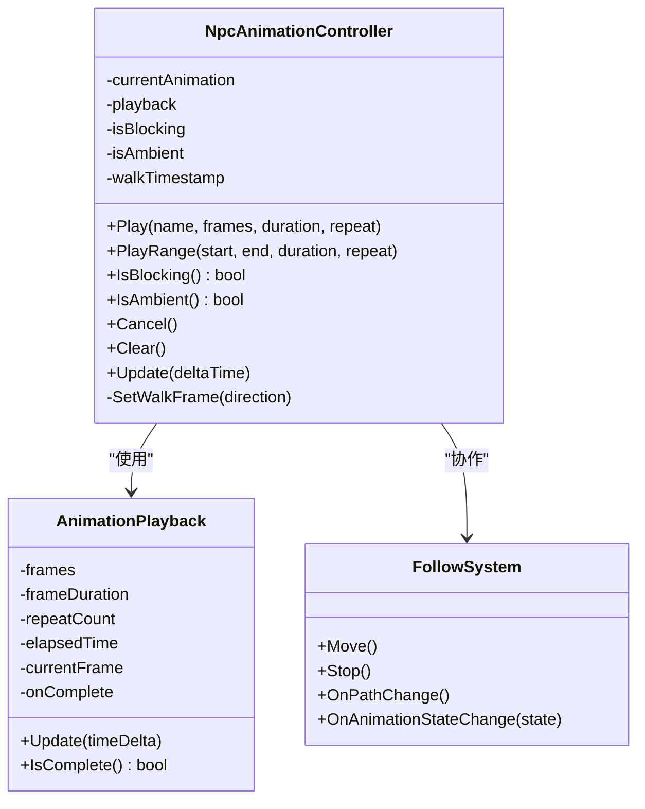

# 动画控制器 NpcAnimationController

<cite>
**本文引用的文件**   
- [xiami-animations.md](file://SmartNPC/docs/xiami-animations.md)
- [NpcAnimationController.cs](file://SmartNPC/smartnpc-mcp/smapimod/Movement/NpcAnimationController.cs)
- [AnimationPlayback.cs](file://SmartNPC/smartnpc-mcp/smapimod/Movement/AnimationPlayback.cs)
- [FollowSystem.Animations.cs](file://SmartNPC/smartnpc-mcp/smapimod/Movement/FollowSystem.Animations.cs)
- [FollowSystem.cs](file://SmartNPC/smartnpc-mcp/smapimod/Movement/FollowSystem.cs)
- [WorldActionHandlers.cs](file://SmartNPC/smartnpc-mcp/smapimod/Behavior/WorldActionHandlers.cs)
- [SocialActionHandlers.cs](file://SmartNPC/smartnpc-mcp/smapimod/Behavior/SocialActionHandlers.cs)
- [BehaviorHandler.cs](file://SmartNPC/smartnpc-mcp/smapimod/Movement/BehaviorHandler.cs)
- [Program.cs](file://SmartNPC/smartnpc-mcp/tests/animations/Program.cs)
</cite>

## 目录
1. [简介](#简介)
2. [项目结构](#项目结构)
3. [核心组件](#核心组件)
4. [架构总览](#架构总览)
5. [详细组件分析](#详细组件分析)
6. [依赖关系分析](#依赖关系分析)
7. [性能考虑](#性能考虑)
8. [故障排查指南](#故障排查指南)
9. [结论](#结论)
10. [附录：集成新动画类型](#附录集成新动画类型)

## 简介
本文件面向 XiaMi 自定义角色动画系统，重点解释 `NpcAnimationController` 与 `AnimationPlayback` 如何协同控制 NPC 的帧播放、时间管理、重复播放、阻塞性判断、环境性动画、状态清理以及行走方向映射。该系统的目标是在 SMAPI Mod 环境中为 XiaMi 角色提供一套独立于原版村民动画布局的视觉表现，同时不改变游戏世界状态；世界效果仍由行为处理器负责。

根据文档说明，XiaMi 的自定义精灵表包含 49 帧，按 4 列、每格 16×32 像素排列。原版行走动画的方向布局不同，因此 `NpcAnimationController` 在游戏更新后应用 XiaMi 的前/后/左三排各 8 帧，并将右移动镜像到左排。其他村民不会获得这些自定义帧号。

## 项目结构
动画相关代码集中在 SMAPI Mod 的 Movement 与 Behavior 子目录中：
- Movement：动画控制器、播放对象、跟随系统、路径规划等。
- Behavior：动作触发器与世界/社交行为处理器。
- tests/animations：轻量测试程序，校验动画时钟、暂停、重复、取消、恢复等行为。

**图示来源**
- [WorldActionHandlers.cs](file://SmartNPC/smartnpc-mcp/smapimod/Behavior/WorldActionHandlers.cs)
- [SocialActionHandlers.cs](file://SmartNPC/smartnpc-mcp/smapimod/Behavior/SocialActionHandlers.cs)
- [BehaviorHandler.cs](file://SmartNPC/smartnpc-mcp/smapimod/Movement/BehaviorHandler.cs)
- [FollowSystem.cs](file://SmartNPC/smartnpc-mcp/smapimod/Movement/FollowSystem.cs)
- [NpcAnimationController.cs](file://SmartNPC/smartnpc-mcp/smapimod/Movement/NpcAnimationController.cs)
- [AnimationPlayback.cs](file://SmartNPC/smartnpc-mcp/smapimod/Movement/AnimationPlayback.cs)
- [Program.cs](file://SmartNPC/smartnpc-mcp/tests/animations/Program.cs)

**章节来源**
- [xiami-animations.md:1-30](file://SmartNPC/docs/xiami-animations.md#L1-L30)

## 核心组件
- `NpcAnimationController`：按帧驱动 XiaMi 角色的动画显示，维护当前动画、是否阻塞、是否为环境动画、行走时间戳和朝向映射。
- `AnimationPlayback`：描述一段可重复或一次性播放的动画片段，包括帧序列、单帧时长、重复次数、结束回调等。
- `FollowSystem`：负责 NPC 的移动、路径和跟随逻辑；其扩展部分 `FollowSystem.Animations.cs` 将动画与移动生命周期结合。
- 行为处理器：`WorldActionHandlers` 与 `SocialActionHandlers` 根据工作、社交或情绪动作请求动画，并决定是否占用移动门控。

**章节来源**
- [NpcAnimationController.cs](file://SmartNPC/smartnpc-mcp/smapimod/Movement/NpcAnimationController.cs)
- [AnimationPlayback.cs](file://SmartNPC/smartnpc-mcp/smapimod/Movement/AnimationPlayback.cs)
- [FollowSystem.cs](file://SmartNPC/smartnpc-mcp/smapimod/Movement/FollowSystem.cs)
- [FollowSystem.Animations.cs](file://SmartNPC/smartnpc-mcp/smapimod/Movement/FollowSystem.Animations.cs)
- [WorldActionHandlers.cs](file://SmartNPC/smartnpc-mcp/smapimod/Behavior/WorldActionHandlers.cs)
- [SocialActionHandlers.cs](file://SmartNPC/smartnpc-mcp/smapimod/Behavior/SocialActionHandlers.cs)

## 架构总览
动画系统采用“请求者—调度器—控制器—播放器”的分层结构。上层动作处理器只关心“做什么”，控制器负责“怎么展示”，播放器负责“何时切换哪一帧”。

**图示来源**
- [WorldActionHandlers.cs](file://SmartNPC/smartnpc-mcp/smapimod/Behavior/WorldActionHandlers.cs)
- [SocialActionHandlers.cs](file://SmartNPC/smartnpc-mcp/smapimod/Behavior/SocialActionHandlers.cs)
- [BehaviorHandler.cs](file://SmartNPC/smartnpc-mcp/smapimod/Movement/BehaviorHandler.cs)
- [FollowSystem.cs](file://SmartNPC/smartnpc-mcp/smapimod/Movement/FollowSystem.cs)
- [NpcAnimationController.cs](file://SmartNPC/smartnpc-mcp/smapimod/Movement/NpcAnimationController.cs)
- [AnimationPlayback.cs](file://SmartNPC/smartnpc-mcp/smapimod/Movement/AnimationPlayback.cs)

## 详细组件分析

### AnimationPlayback：帧播放控制与时间管理
`AnimationPlayback` 是动画片段的数据与时间引擎。它保存：
- 帧索引列表或范围。
- 每帧持续时间。
- 是否允许循环播放。
- 已播放时间、当前帧、剩余次数。
- 可选的完成回调，用于释放资源或通知上层任务已完成。

关键行为包括：
- **启动**：根据传入的帧集合、时长和重复策略初始化内部计时器和帧位置。
- **推进**：每帧接收增量时间，累计后计算当前帧；若达到最后一帧且未循环，则标记完成。
- **重复**：当配置为循环时，到达末尾后回到起始帧并继续计时。
- **完成判定**：非循环动画在最后一帧播放结束后完成；循环动画通常由外部条件终止。

复杂度方面，逐帧推进的时间复杂度为 O(1)，空间复杂度取决于帧集合大小。由于每帧只做简单累加与比较，适合高频调用。

**图示来源**
- [AnimationPlayback.cs](file://SmartNPC/smartnpc-mcp/smapimod/Movement/AnimationPlayback.cs)

**章节来源**
- [AnimationPlayback.cs](file://SmartNPC/smartnpc-mcp/smapimod/Movement/AnimationPlayback.cs)

### NpcAnimationController：XiaMi 动画控制器
`NpcAnimationController` 持有 NPC 当前动画、播放对象、阻塞标志、环境动画标志、行走时间戳和朝向映射。它与 `FollowSystem` 协作，保证动画与移动状态一致。

主要职责：
- 根据动作请求启动特定动画。
- 在每帧更新中推进 `AnimationPlayback`。
- 根据 XiaMi 帧布局设置正确的 Sprite 帧。
- 区分阻塞性动画与环境性动画。
- 处理取消、清除、重定向和中断。
- 管理行走动画的方向和时间戳。

#### Play 与 PlayRange：启动动画
`Play` 用于启动单个动画名称或完整帧序列；`PlayRange` 用于启动指定范围的帧区间。二者通常执行以下流程：
1. 参数校验：检查 NPC 是否存在、Sprite 是否可用、动画名或帧范围是否合法。
2. 状态初始化：创建或复用 `AnimationPlayback`，设置帧序列、时长、重复策略和完成回调。
3. Sprite 操作：立即设置初始帧，避免首帧闪烁。
4. 状态标记：设置是否阻塞、是否环境动画、记录动画来源。
5. 与移动系统同步：如果动画会覆盖行走帧，则暂时抑制跟随系统对 Sprite 的默认更新。

**图示来源**
- [NpcAnimationController.cs](file://SmartNPC/smartnpc-mcp/smapimod/Movement/NpcAnimationController.cs)
- [AnimationPlayback.cs](file://SmartNPC/smartnpc-mcp/smapimod/Movement/AnimationPlayback.cs)
- [FollowSystem.Animations.cs](file://SmartNPC/smartnpc-mcp/smapimod/Movement/FollowSystem.Animations.cs)

**章节来源**
- [NpcAnimationController.cs](file://SmartNPC/smartnpc-mcp/smapimod/Movement/NpcAnimationController.cs)
- [AnimationPlayback.cs](file://SmartNPC/smartnpc-mcp/smapimod/Movement/AnimationPlayback.cs)
- [FollowSystem.Animations.cs](file://SmartNPC/smartnpc-mcp/smapimod/Movement/FollowSystem.Animations.cs)

#### IsBlocking 与 IsAmbient：阻塞性与环境性动画
- **阻塞性动画**：例如浇水、锄地、收割等工作时间段。这类动画会占用 NPC 的动作门控，阻止新的移动或工作动作抢占，直到最后一帧完成。
- **环境性动画**：例如 idle、rest、look_around 等氛围动画。它们不阻塞下一个作业，仅替换视觉表现。

实现上，这两个方法通常基于动画配置或来源动作类型进行判断。阻塞性动画会影响行为调度器的下一步决策；环境性动画则只影响渲染。

**章节来源**
- [NpcAnimationController.cs](file://SmartNPC/smartnpc-mcp/smapimod/Movement/NpcAnimationController.cs)
- [xiami-animations.md:17-24](file://SmartNPC/docs/xiami-animations.md#L17-L24)

#### Cancel 与 Clear：清理与恢复
- **Cancel**：主动取消当前动画，例如被更高优先级动作打断、玩家指令变更或路径中断。它会停止 `AnimationPlayback`，移除阻塞标志，必要时恢复原始行走帧。
- **Clear**：彻底清理动画状态，适用于场景切换、地图传送、存档重载或标题界面返回。它会确保 NPC 属性、Sprite 帧和移动标志恢复到稳定状态，避免残留遮挡或错误帧。

正确清理的关键是：
- 调用播放对象的取消或释放接口。
- 清空当前动画引用。
- 重置阻塞和环境动画标志。
- 恢复 NPC 的原始 Sprite 帧，尤其是行走帧。
- 向 `FollowSystem` 报告状态变化，使其重新接管移动渲染。

**章节来源**
- [NpcAnimationController.cs](file://SmartNPC/smartnpc-mcp/smapimod/Movement/NpcAnimationController.cs)
- [AnimationPlayback.cs](file://SmartNPC/smartnpc-mcp/smapimod/Movement/AnimationPlayback.cs)
- [xiami-animations.md:20-26](file://SmartNPC/docs/xiami-animations.md#L20-L26)

#### Update：动画更新与行走时间戳
每帧调用 `Update` 时，控制器执行：
1. 若没有活动动画，直接返回。
2. 若游戏暂停，跳过时间推进但保持状态。
3. 将增量时间交给 `AnimationPlayback`。
4. 根据播放对象返回的状态更新 Sprite 帧。
5. 对于行走动画，维护行走时间戳，并结合移动方向检测选择正确帧。
6. 若动画完成且为阻塞性动画，释放动作门控。
7. 若动画完成且为非阻塞性动画，可自动恢复默认行走帧或保留环境动画。

行走动画的时间戳用于平滑切换左右脚帧，避免帧率抖动导致的跳跃感。方向检测结合 NPC 当前移动向量，决定使用左排或镜像右排。

**图示来源**
- [NpcAnimationController.cs](file://SmartNPC/smartnpc-mcp/smapimod/Movement/NpcAnimationController.cs)
- [AnimationPlayback.cs](file://SmartNPC/smartnpc-mcp/smapimod/Movement/AnimationPlayback.cs)

**章节来源**
- [NpcAnimationController.cs](file://SmartNPC/smartnpc-mcp/smapimod/Movement/NpcAnimationController.cs)
- [xiami-animations.md:1-8](file://SmartNPC/docs/xiami-animations.md#L1-L8)

#### SetWalkFrame：行走帧方向映射
`SetWalkFrame` 根据 NPC 朝向设置正确的行走帧。XiaMi 的帧布局为前、后、左三排，每排 8 帧；右移动通过镜像左排实现。该方法通常：
- 读取 NPC 当前移动方向。
- 选择对应排的起始帧。
- 根据行走时间戳计算帧偏移。
- 对右侧移动做水平镜像。
- 写入 Sprite 的帧索引。

这样做的目的是绕过原版村民的方向布局假设，让 XiaMi 的自定义帧正确显示。

**章节来源**
- [xiami-animations.md:1-8](file://SmartNPC/docs/xiami-animations.md#L1-L8)
- [NpcAnimationController.cs](file://SmartNPC/smartnpc-mcp/smapimod/Movement/NpcAnimationController.cs)

### 与 FollowSystem 的协作
`FollowSystem` 负责 NPC 的路径、跟随和目标移动；`FollowSystem.Animations.cs` 将其与动画生命周期绑定。典型交互包括：
- 当 `FollowSystem` 检测到 NPC 开始行走时，控制器启用行走动画。
- 当路径中断、目标变更或导航失败时，控制器可能取消或重置动画。
- 当工作动画阻塞移动时，`FollowSystem` 应暂停新的移动决策，直到动画完成。
- 当环境动画结束时，`FollowSystem` 重新接管默认行走帧。

**图示来源**
- [FollowSystem.cs](file://SmartNPC/smartnpc-mcp/smapimod/Movement/FollowSystem.cs)
- [FollowSystem.Animations.cs](file://SmartNPC/smartnpc-mcp/smapimod/Movement/FollowSystem.Animations.cs)
- [NpcAnimationController.cs](file://SmartNPC/smartnpc-mcp/smapimod/Movement/NpcAnimationController.cs)

**章节来源**
- [FollowSystem.cs](file://SmartNPC/smartnpc-mcp/smapimod/Movement/FollowSystem.cs)
- [FollowSystem.Animations.cs](file://SmartNPC/smartnpc-mcp/smapimod/Movement/FollowSystem.Animations.cs)

## 依赖关系分析
- 动画控制器依赖 `AnimationPlayback` 进行时间推进和帧计算。
- 动画控制器依赖游戏 NPC 与 Sprite API 进行视觉输出。
- 动画控制器与 `FollowSystem` 双向耦合：控制器影响移动渲染，跟随系统影响动画生命周期。
- 行为处理器依赖控制器暴露的公共接口来触发动画。
- 测试程序依赖轻量游戏 API 双份实现，验证时钟、暂停、重复、取消、恢复、方向映射和卸载行为。

**图示来源**
- [NpcAnimationController.cs](file://SmartNPC/smartnpc-mcp/smapimod/Movement/NpcAnimationController.cs)
- [AnimationPlayback.cs](file://SmartNPC/smartnpc-mcp/smapimod/Movement/AnimationPlayback.cs)
- [FollowSystem.cs](file://SmartNPC/smartnpc-mcp/smapimod/Movement/FollowSystem.cs)

**章节来源**
- [NpcAnimationController.cs](file://SmartNPC/smartnpc-mcp/smapimod/Movement/NpcAnimationController.cs)
- [AnimationPlayback.cs](file://SmartNPC/smartnpc-mcp/smapimod/Movement/AnimationPlayback.cs)
- [FollowSystem.cs](file://SmartNPC/smartnpc-mcp/smapimod/Movement/FollowSystem.cs)

## 性能考虑
- **批量更新**：在同一帧内集中更新多个 NPC 的 Sprite 帧，减少 API 调用开销。
- **资源复用**：复用 `AnimationPlayback` 实例，避免频繁分配内存；仅在动画类型或参数变化时重建。
- **最小化 Sprite 写入**：只有帧索引发生变化时才更新 Sprite，避免无意义赋值。
- **谨慎循环**：长时间循环的环境动画应避免昂贵计算，仅更新必要字段。
- **与移动解耦**：移动逻辑与动画逻辑分离，使路径计算不受渲染细节干扰。
- **测试覆盖边界**：使用轻量测试程序验证大时间增量、暂停、重复、取消、恢复、传送、存档替换等边界情况。

**章节来源**
- [Program.cs](file://SmartNPC/smartnpc-mcp/tests/animations/Program.cs)
- [xiami-animations.md:27-30](file://SmartNPC/docs/xiami-animations.md#L27-L30)

## 故障排查指南
常见问题与定位建议：
- **帧不显示或错帧**：确认 XiaMi 帧布局是否为 4 列、16×32；检查 `SetWalkFrame` 是否正确镜像右侧。
- **动画卡住**：检查 `AnimationPlayback` 是否完成，`NpcAnimationController` 是否释放阻塞标志。
- **走路方向错误**：确认行走时间戳和方向检测是否同步，避免旧方向缓存。
- **取消无效**：检查 `Cancel` 是否调用了播放对象释放接口，并通知 `FollowSystem` 恢复默认帧。
- **传送或存档重载后异常**：确认 `Clear` 是否在所有场景切换入口被调用。
- **暂停后时间跳变**：确认 `Update` 在暂停时跳过时间推进，而不是累积大量增量。

官方测试覆盖了浇水帧、最终帧时长、暂停、大时间增量、重复、环境替换、移动恢复、传送、路径中断、存档替换、方向映射和卸载。可通过控制台命令预览浇水、锄头或全部帧，以快速验证控制器行为而不改变世界状态。

**章节来源**
- [xiami-animations.md:17-30](file://SmartNPC/docs/xiami-animations.md#L17-L30)
- [NpcAnimationController.cs](file://SmartNPC/smartnpc-mcp/smapimod/Movement/NpcAnimationController.cs)
- [AnimationPlayback.cs](file://SmartNPC/smartnpc-mcp/smapimod/Movement/AnimationPlayback.cs)

## 结论
`NpcAnimationController` 是 XiaMi 自定义角色动画系统的中枢。它通过 `AnimationPlayback` 精确控制帧时间和重复行为，通过 `FollowSystem` 协调移动与渲染，通过行为处理器对接工作、社交和情绪动作。正确理解 `Play`、`PlayRange`、`IsBlocking`、`IsAmbient`、`Cancel`、`Clear`、`Update` 和 `SetWalkFrame` 的职责，有助于稳定扩展新动画类型并避免常见动画状态问题。

## 附录：集成新动画类型
要添加新的 XiaMi 动画类型，建议遵循以下步骤：

1. **定义帧数据格式**
   - 确定帧索引列表或帧范围。
   - 指定每帧持续时间。
   - 标注是否允许循环。
   - 标注是否阻塞移动。
   - 标注是否属于环境动画。
   - 如有完成回调，定义回调职责（释放门控、恢复默认帧、触发世界效果等）。

2. **注册到动作处理器**
   - 在 `WorldActionHandlers` 或 `SocialActionHandlers` 中添加新动作映射。
   - 调用 `NpcAnimationController.Play` 或 `PlayRange` 启动动画。
   - 明确区分工作类动作（阻塞）与姿态类动作（环境）。

3. **确保方向与行走兼容**
   - 若新动画涉及行走，确认 `SetWalkFrame` 能正确处理左右方向。
   - 若新动画覆盖行走帧，确保与 `FollowSystem` 同步，避免两者同时写 Sprite。

4. **完善清理逻辑**
   - 在动画完成、取消、路径中断、传送、存档重载时调用 `Cancel` 或 `Clear`。
   - 确保 NPC 的原始属性和 Sprite 帧恢复。

5. **编写测试**
   - 使用轻量测试程序验证帧时钟、暂停、重复、取消、恢复、方向和卸载。
   - 覆盖边界值：零时长、超大时间增量、连续重复、并发取消。

6. **性能优化**
   - 复用播放对象。
   - 批量更新 Sprite。
   - 只在帧变化时写入 Sprite。
   - 对长循环动画做轻量更新。

**章节来源**
- [WorldActionHandlers.cs](file://SmartNPC/smartnpc-mcp/smapimod/Behavior/WorldActionHandlers.cs)
- [SocialActionHandlers.cs](file://SmartNPC/smartnpc-mcp/smapimod/Behavior/SocialActionHandlers.cs)
- [NpcAnimationController.cs](file://SmartNPC/smartnpc-mcp/smapimod/Movement/NpcAnimationController.cs)
- [AnimationPlayback.cs](file://SmartNPC/smartnpc-mcp/smapimod/Movement/AnimationPlayback.cs)
- [xiami-animations.md:1-30](file://SmartNPC/docs/xiami-animations.md#L1-L30)