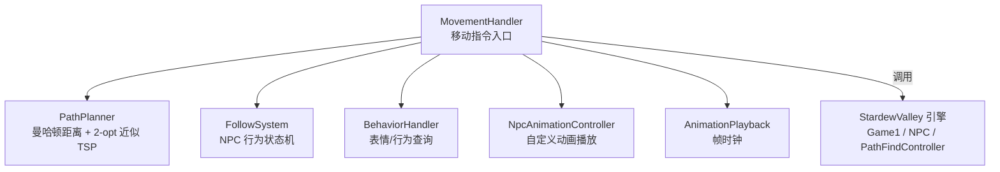
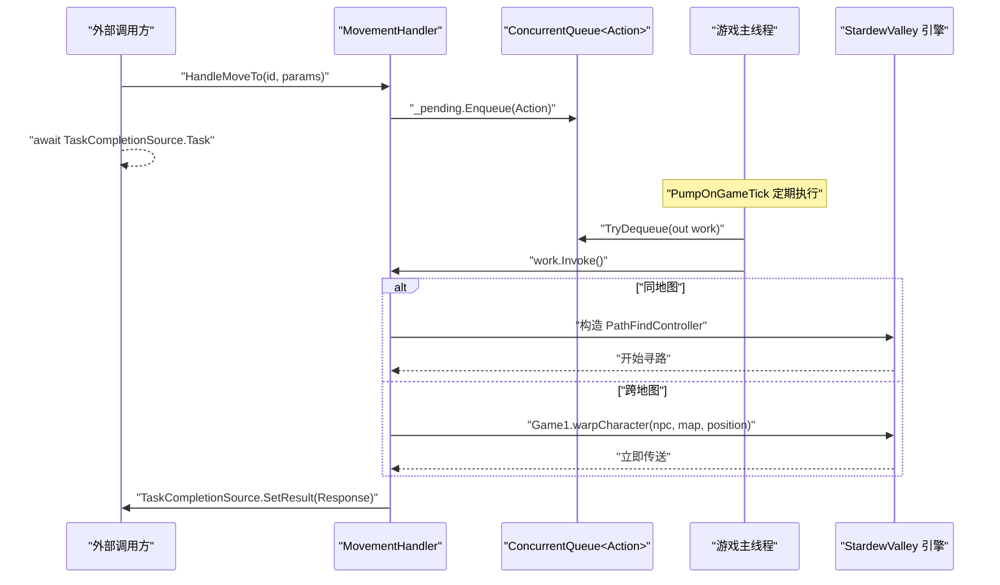
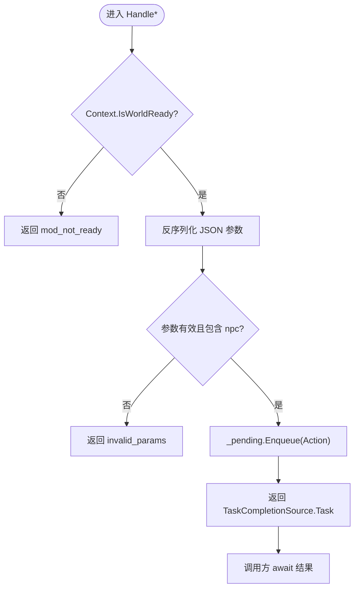
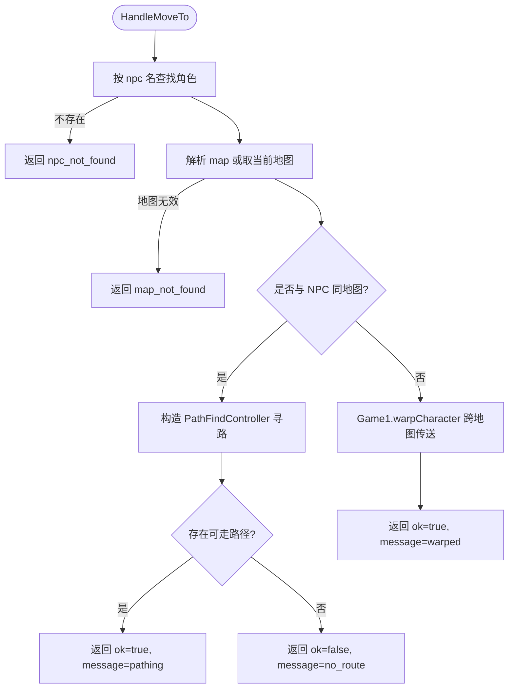
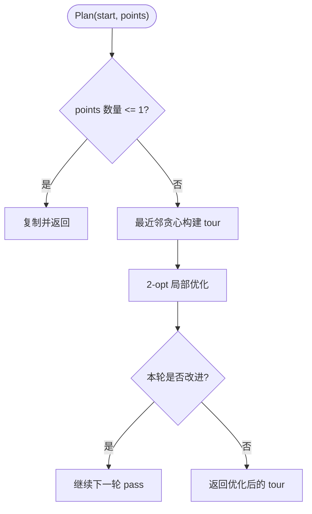
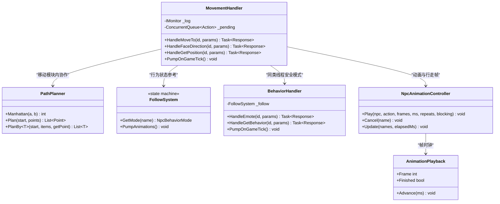

# 移动协调器 MovementHandler

<cite>
**本文引用的文件**   
- [MovementHandler.cs](file://SmartNPC/smapi-mod/Movement/MovementHandler.cs)
- [PathPlanner.cs](file://SmartNPC/smapi-mod/Movement/PathPlanner.cs)
- [FollowSystem.cs](file://SmartNPC/smapi-mod/Movement/FollowSystem.cs)
- [BehaviorHandler.cs](file://SmartNPC/smapi-mod/Movement/BehaviorHandler.cs)
- [NpcAnimationController.cs](file://SmartNPC/smapi-mod/Movement/NpcAnimationController.cs)
- [AnimationPlayback.cs](file://SmartNPC/smapi-mod/Movement/AnimationPlayback.cs)
</cite>

## 目录
1. [引言](#引言)
2. [项目结构](#项目结构)
3. [核心组件](#核心组件)
4. [架构总览](#架构总览)
5. [详细组件分析](#详细组件分析)
6. [依赖关系分析](#依赖关系分析)
7. [性能考量](#性能考量)
8. [故障排查指南](#故障排查指南)
9. [结论](#结论)
10. [附录：扩展与集成示例](#附录扩展与集成示例)

## 引言
MovementHandler 是 Stardew Valley SMAPI 模组 SmartNPC 中的 NPC 移动协调器，负责将来自外部（例如 WebSocket 或 MCP 工具）的移动指令转换为对游戏线程安全的操作。它统一处理三类命令：
- npc_move_to：让指定 NPC 移动到目标地图坐标；同地图走路径，跨地图直接传送。
- npc_face_direction：设置 NPC 朝向。
- npc_get_position：查询 NPC 的当前地图、坐标、朝向和是否正在移动。

该组件的关键设计原则是“接收侧不直接访问游戏状态”，所有会触碰 Game1、NPC、地图等对象的操作都通过 ConcurrentQueue<Action> _pending 队列转交给游戏主线程执行，并通过 TaskCompletionSource 实现异步响应。

## 项目结构
MovementHandler 位于 SmartNPC 模组的 Movement 模块中，与路径规划、行为状态机、动画控制等模块协作：

图示来源
- [MovementHandler.cs:1-324](file://SmartNPC/smapi-mod/Movement/MovementHandler.cs#L1-L324)
- [PathPlanner.cs:1-120](file://SmartNPC/smapi-mod/Movement/PathPlanner.cs#L1-L120)
- [FollowSystem.cs:1-200](file://SmartNPC/smapi-mod/Movement/FollowSystem.cs#L1-L200)
- [BehaviorHandler.cs:1-159](file://SmartNPC/smapi-mod/Movement/BehaviorHandler.cs#L1-L159)
- [NpcAnimationController.cs:1-109](file://SmartNPC/smapi-mod/Movement/NpcAnimationController.cs#L1-L109)
- [AnimationPlayback.cs:1-41](file://SmartNPC/smapi-mod/Movement/AnimationPlayback.cs#L1-L41)

章节来源
- [MovementHandler.cs:1-324](file://SmartNPC/smapi-mod/Movement/MovementHandler.cs#L1-L324)

## 核心组件
- MovementHandler：解析 JSON 参数、校验输入、查找 NPC、选择路径或传送、返回结构化 Response。
- PathPlanner：在网格上计算近似最优访问顺序，用于复杂行为动作的路径排序。
- FollowSystem：维护每个受管 NPC 的行为模式（待机、跟随、引导、漫游、采集、播种、浇水、收割等），并在游戏每 tick 推进。
- BehaviorHandler：提供表情和行为查询接口，同样采用“入队 + 游戏线程泵”模型。
- NpcAnimationController / AnimationPlayback：为特定 NPC（如 XiaMi）播放自定义帧动画，并管理行走帧切换。

章节来源
- [MovementHandler.cs:1-324](file://SmartNPC/smapi-mod/Movement/MovementHandler.cs#L1-L324)
- [PathPlanner.cs:1-120](file://SmartNPC/smapi-mod/Movement/PathPlanner.cs#L1-L120)
- [FollowSystem.cs:1-200](file://SmartNPC/smapi-mod/Movement/FollowSystem.cs#L1-L200)
- [BehaviorHandler.cs:1-159](file://SmartNPC/smapi-mod/Movement/BehaviorHandler.cs#L1-L159)
- [NpcAnimationController.cs:1-109](file://SmartNPC/smapi-mod/Movement/NpcAnimationController.cs#L1-L109)
- [AnimationPlayback.cs:1-41](file://SmartNPC/smapi-mod/Movement/AnimationPlayback.cs#L1-L41)

## 架构总览
MovementHandler 的运行时流程遵循“请求入队 → 游戏线程泵出 → 同步完成”的模式：

图示来源
- [MovementHandler.cs:1-324](file://SmartNPC/smapi-mod/Movement/MovementHandler.cs#L1-L324)

## 详细组件分析

### MovementHandler：移动指令解析与线程安全
MovementHandler 对外暴露三个主要方法：
- HandleMoveTo：处理 npc_move_to。
- HandleFaceDirection：处理 npc_face_direction。
- HandleGetPosition：处理 npc_get_position。

#### 线程安全模型
- 所有公共方法首先检查 Context.IsWorldReady，防止在无存档时操作。
- 使用 ConcurrentQueue<Action> _pending 收集待执行工作。
- PumpOnGameTick 在游戏主线程循环取出 Action 并执行，捕获异常后记录日志，避免中断后续任务。
- 每个请求创建独立的 TaskCompletionSource<Response>，在工作完成后 SetResult，使调用方可 await 结果。

图示来源
- [MovementHandler.cs:1-324](file://SmartNPC/smapi-mod/Movement/MovementHandler.cs#L1-L324)

#### HandleMoveTo：npc_move_to 的处理逻辑
HandleMoveTo 的核心分支如下：

1. 参数解析
   - 将 JsonElement 反序列化为 MoveToParams，包含 npc、x、y、map。
   - 若解析失败或缺少 npc，返回 invalid_params。

2. 查找 NPC
   - 通过 Game1.getCharacterFromName 查找 NPC。
   - 未找到则返回 npc_not_found。

3. 确定目标地图
   - 如果 map 为空，默认使用 NPC 当前地图。
   - 否则通过 Game1.getLocationFromName 解析地图名称。
   - 地图无效则返回 map_not_found。

4. 同地图路径规划
   - 当 NPC 当前地图等于目标地图时，构造 PathFindController，传入 NPC、目标地图、终点坐标。
   - 成功后根据 controller.pathToEndPoint 是否存在路径判断 ok 与 message。
   - 构造失败或无路径时分别返回 pathfind_error 或 no_route。

5. 跨地图传送
   - 当 NPC 当前地图不等于目标地图时，直接调用 Game1.warpCharacter 进行瞬移。
   - 返回 warped 成功结果。

6. 错误兜底
   - 任何未捕获异常都会进入 catch 分支，返回 handler_error。

图示来源
- [MovementHandler.cs:1-324](file://SmartNPC/smapi-mod/Movement/MovementHandler.cs#L1-L324)

章节来源
- [MovementHandler.cs:1-324](file://SmartNPC/smapi-mod/Movement/MovementHandler.cs#L1-L324)

#### HandleFaceDirection：方向设置逻辑
HandleFaceDirection 的流程：
- 反序列化为 FaceDirectionParams，要求包含 npc 和 direction。
- DirectionToInt 将 up/right/down/left 映射为 StardewValley 的方向整数。
- 非法方向返回 invalid_params。
- 在游戏线程中调用 npc.faceDirection(facing)，并返回 FaceDirectionResult，包含原始方向字符串、整型朝向、以及 ok 标志。

关键点：
- 方向映射严格限制四种值，避免无效方向污染游戏状态。
- 方向设置本身是瞬时操作，不涉及路径或地图变化。

章节来源
- [MovementHandler.cs:1-324](file://SmartNPC/smapi-mod/Movement/MovementHandler.cs#L1-L324)

#### HandleGetPosition：位置查询机制
HandleGetPosition 的流程：
- 反序列化为 GetPositionParams，只要求 npc。
- 在游戏线程中读取 NPC 的 Position、currentLocation、FacingDirection。
- 将像素坐标除以 64f 得到格点坐标 X、Y。
- 从 currentLocation.NameOrUniqueName 或 Name 获取地图名。
- IntToDirection 将整型朝向转为字符串方向。
- IsMoving 基于 npc.controller != null 判断 NPC 是否正在由控制器驱动移动。
- 返回 GetPositionResult，包含 ok、npc、x、y、map、facing、direction、is_moving。

注意：
- 该查询不会改变游戏状态，但仍放在游戏线程中以保证一致性。
- 若 NPC 已不存在，会在查找阶段返回 npc_not_found。

章节来源
- [MovementHandler.cs:201-324](file://SmartNPC/smapi-mod/Movement/MovementHandler.cs#L201-L324)

### PathPlanner：路径排序算法
PathPlanner 并非 MovementHandler 的直接依赖，而是 Movement 模块中与行为动作相关的路径排序工具。它解决的问题是：当 NPC 需要访问多个目标格点时，简单“最近优先”会导致折返、效率低下。其算法包括：

- Manhattan：曼哈顿距离，适合网格地图。
- Plan：以 NPC 起始点 start 为起点，对 points 重排，使总曼哈顿距离近似最小。
- PlanBy：泛型版本，允许携带额外元数据的同时按位置排序。

算法步骤：
1. 最近邻贪心构建初始路径。
2. 2-opt 局部优化：反转任意段 i..j，比较反转前后边权和，若更短则接受反转。
3. 最多进行若干轮 pass，保证复杂度可控。

时间复杂度：
- 最近邻阶段 O(n²)。
- 2-opt 每轮 O(n²)，总复杂度约 O(passes · n²)。
- 注释指出典型场景下 tile 数量较少，运行耗时极短，且不阻塞游戏线程。

图示来源
- [PathPlanner.cs:1-120](file://SmartNPC/smapi-mod/Movement/PathPlanner.cs#L1-L120)

章节来源
- [PathPlanner.cs:1-120](file://SmartNPC/smapi-mod/Movement/PathPlanner.cs#L1-L120)

### FollowSystem：行为状态机与移动协同
FollowSystem 维护每个 NPC 的行为模式，包括 Idle、Summoning、Following、Leading、Wander、以及各种资源交互行为。MovementHandler 与 FollowSystem 的关系体现在：
- MovementHandler 负责“点对点移动”和“方向/位置查询”。
- FollowSystem 负责“长时间行为”的状态推进，并在游戏每 tick 更新路径、动画、社交移动等。
- 两者都遵循相同的线程安全约定：外部调用只设置目标或状态，实际游戏状态修改发生在游戏线程。

章节来源
- [FollowSystem.cs:1-200](file://SmartNPC/smapi-mod/Movement/FollowSystem.cs#L1-L200)

### BehaviorHandler：表情与行为查询
BehaviorHandler 展示了与 MovementHandler 完全一致的“入队 + 泵”模式：
- HandleEmote：将表情字符串映射为 StardewValley 的表情 ID，再调用 npc.doEmote。
- HandleGetBehavior：读取 FollowSystem 中某个 NPC 的当前模式。
- PumpOnGameTick：在游戏线程中批量执行 pending 队列。

这种模式便于统一扩展新的行为命令，而不必重复实现线程安全逻辑。

章节来源
- [BehaviorHandler.cs:1-159](file://SmartNPC/smapi-mod/Movement/BehaviorHandler.cs#L1-L159)

### NpcAnimationController 与 AnimationPlayback：动画播放
NpcAnimationController 管理 XiaMi 等自定义 NPC 的动画播放：
- Play：暂停 NPC 移动、清除旧控制器、设置 ignoreMovementAnimation、锁定 Sprite 帧。
- Cancel：恢复之前的 ignoreMovementAnimation 和 flip，停止动画。
- Update：遍历已知 NPC，推进 AnimationPlayback，并根据是否移动设置行走帧。
- HasCustomSheet：仅对特定 NPC 应用自定义帧。

AnimationPlayback 是轻量级帧时钟：
- 支持固定帧数、帧间隔、重复次数。
- repeats 为 0 表示无限循环直到取消。
- Advance 累积毫秒数并计算当前帧。

章节来源
- [NpcAnimationController.cs:1-109](file://SmartNPC/smapi-mod/Movement/NpcAnimationController.cs#L1-L109)
- [AnimationPlayback.cs:1-41](file://SmartNPC/smapi-mod/Movement/AnimationPlayback.cs#L1-L41)

## 依赖关系分析
MovementHandler 的直接依赖包括：
- StardewModdingAPI.Context：判断世界是否就绪。
- StardewValley.Game1：查找角色、地图、传送。
- StardewValley.Pathfinding.PathFindController：同地图路径控制器。
- System.Text.Json：解析 JSON 参数。
- System.Collections.Concurrent.ConcurrentQueue：线程安全任务队列。
- System.Threading.Tasks.TaskCompletionSource：异步响应。

间接相关组件：
- PathPlanner：用于复杂行为的访问顺序优化。
- FollowSystem：长期行为状态机。
- BehaviorHandler：表情与行为查询。
- NpcAnimationController / AnimationPlayback：动画与行走帧。

图示来源
- [MovementHandler.cs:1-324](file://SmartNPC/smapi-mod/Movement/MovementHandler.cs#L1-L324)
- [PathPlanner.cs:1-120](file://SmartNPC/smapi-mod/Movement/PathPlanner.cs#L1-L120)
- [FollowSystem.cs:1-200](file://SmartNPC/smapi-mod/Movement/FollowSystem.cs#L1-L200)
- [BehaviorHandler.cs:1-159](file://SmartNPC/smapi-mod/Movement/BehaviorHandler.cs#L1-L159)
- [NpcAnimationController.cs:1-109](file://SmartNPC/smapi-mod/Movement/NpcAnimationController.cs#L1-L109)
- [AnimationPlayback.cs:1-41](file://SmartNPC/smapi-mod/Movement/AnimationPlayback.cs#L1-L41)

## 性能考量
- 入队与泵出：
  - 所有移动相关操作都通过 ConcurrentQueue<Action> 入队，避免 WebSocket 接收线程直接访问游戏对象。
  - PumpOnGameTick 一次性清空队列，减少锁竞争和上下文切换。
- 路径控制：
  - 同地图使用 PathFindController，由引擎负责寻路；MovementHandler 只负责构造控制器并判断是否有路径。
  - 跨地图使用 Game1.warpCharacter，避免复杂的跨地图链式寻路开销。
- 路径规划：
  - PathPlanner 使用曼哈顿距离和 2-opt 优化，适合小规模 tile 集合，通常毫秒级完成。
- 动画与行走帧：
  - AnimationPlayback 是纯数学计算，不依赖游戏状态。
  - NpcAnimationController 仅在必要时更新 Sprite 帧，并在控制器或地图变化时自动清理。

建议优化：
- 批量移动处理：将多个 npc_move_to 合并为一次 PumpOnGameTick 批处理，减少重复调度。
- 路径缓存：对相同起点、终点、地图的组合缓存 PathFindController 的结果，但需注意地图动态变化时的失效策略。
- 去重队列：对同一 NPC 的重复移动指令进行合并或丢弃，避免频繁重建控制器。
- 超时与取消：为长路径增加超时机制，或在 NPC 被其他行为接管时取消旧路径。

## 故障排查指南
常见错误与对应处理方式：
- 模组未就绪：
  - 现象：mod_not_ready。
  - 原因：Context.IsWorldReady 为 false，可能尚未加载存档。
  - 处理：等待存档就绪后再发送移动命令。
- 参数无效：
  - 现象：invalid_params。
  - 原因：JSON 反序列化失败，或缺少 npc、direction 等必填字段。
  - 处理：检查客户端传参是否符合 MoveToParams、FaceDirectionParams、GetPositionParams。
- NPC 不存在：
  - 现象：npc_not_found。
  - 原因：Game1.getCharacterFromName 返回 null。
  - 处理：确认 NPC 名称是否正确，或 NPC 是否已被移除。
- 地图无效：
  - 现象：map_not_found。
  - 原因：Game1.getLocationFromName 无法解析目标地图。
  - 处理：检查 map 名称是否为有效的地图名或唯一名。
- 路径不可达：
  - 现象：ok=false，message=no_route。
  - 原因：PathFindController 构造成功但没有生成到终点的路径。
  - 处理：检查目标格点是否被障碍物阻挡，或是否需要先清理地形。
- 寻路构造失败：
  - 现象：pathfind_error。
  - 原因：PathFindController 构造函数抛出异常。
  - 处理：检查传入的 NPC、地图、终点坐标是否合法。
- 通用处理器异常：
  - 现象：handler_error。
  - 原因：try/catch 捕获到未预期异常。
  - 处理：查看日志中 handler_error 的详细消息，定位具体异常类型。

章节来源
- [MovementHandler.cs:1-324](file://SmartNPC/smapi-mod/Movement/MovementHandler.cs#L1-L324)

## 结论
MovementHandler 是 SmartNPC 模组中 NPC 移动能力的核心入口。它通过严格的参数校验、线程安全入队、异步响应和明确的错误分类，将外部移动指令安全地转化为 Stardew Valley 引擎可理解的操作。同地图使用 PathFindController 寻路，跨地图使用 Game1.warpCharacter 传送，既保证了功能正确性，也避免了不必要的性能开销。配合 PathPlanner、FollowSystem、BehaviorHandler、NpcAnimationController 等组件，MovementHandler 构成了一个可扩展、可观测、可维护的 NPC 移动协调体系。

## 附录：扩展与集成示例

### 如何扩展新的移动命令
以新增 npc_set_animation 为例，可参考 MovementHandler 的结构：

1. 定义参数与结果 DTO：
   - 新增内部类，例如 SetAnimationParams、SetAnimationResult。
   - 使用 JsonPropertyName 标注字段。

2. 添加处理方法：
   - 新增 HandleSetAnimation(string id, JsonElement @params)。
   - 复用线程安全模式：检查世界就绪 → 解析参数 → 入队 → 返回 TaskCompletionSource.Task。

3. 在游戏线程中执行：
   - 在 _pending.Enqueue 的委托中调用 NpcAnimationController.Play 或相关 API。
   - 使用 TrySetResult 返回 Success 或 Failure。

4. 注册与调用：
   - 在 WebSocket 路由或 MCP 工具层新增命令映射。
   - 确保 PumpOnGameTick 已被游戏主线程周期性调用。

参考实现位置：
- [MovementHandler.cs:1-324](file://SmartNPC/smapi-mod/Movement/MovementHandler.cs#L1-L324)
- [BehaviorHandler.cs:1-159](file://SmartNPC/smapi-mod/Movement/BehaviorHandler.cs#L1-L159)

### 如何集成自定义路径算法
如果希望替换或增强现有寻路逻辑，可按以下方式集成：

1. 保留 MovementHandler 的线程安全外壳：
   - 不要直接在外部线程调用 Game1 或 PathFindController。
   - 继续使用 ConcurrentQueue<Action> 和 PumpOnGameTick。

2. 封装自定义路径算法：
   - 新增一个 IPathAlgorithm 接口，定义 Plan(start, target, location) 等方法。
   - 实现基于 A*、RVO、或领域专用启发式的算法。

3. 在 HandleMoveTo 的同地图分支中替换 PathFindController 构造逻辑：
   - 先尝试自定义算法生成路径。
   - 若失败，回退到 PathFindController 作为默认方案。
   - 将结果写入 NPC.controller 或自定义移动状态。

4. 测试与监控：
   - 对极端地图、障碍物密集区域、动态地形进行测试。
   - 记录路径长度、计算耗时、失败率。

参考实现位置：
- [MovementHandler.cs:1-324](file://SmartNPC/smapi-mod/Movement/MovementHandler.cs#L1-L324)
- [PathPlanner.cs:1-120](file://SmartNPC/smapi-mod/Movement/PathPlanner.cs#L1-L120)