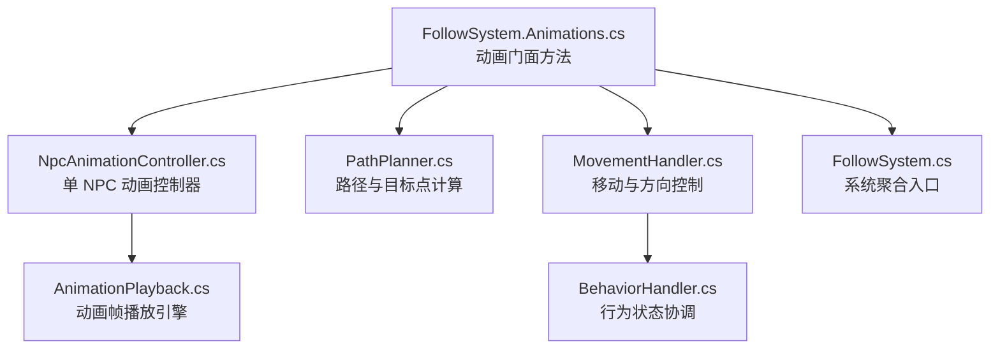
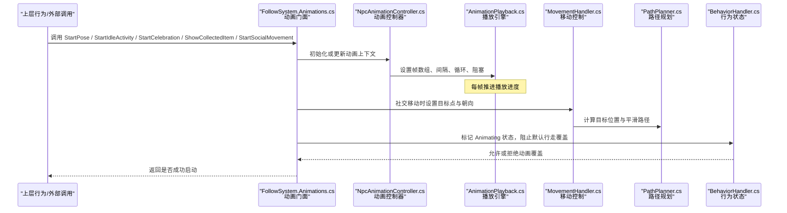
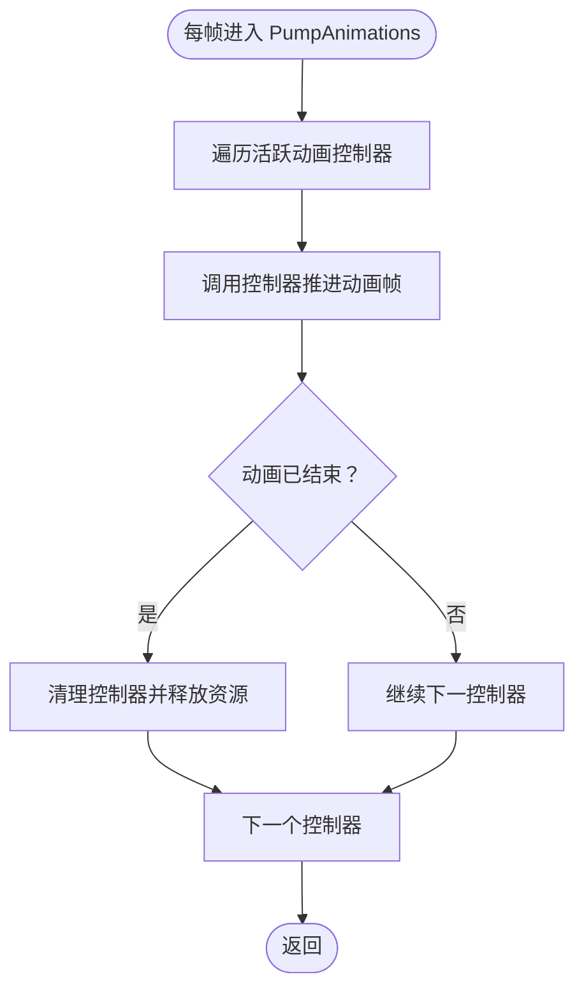
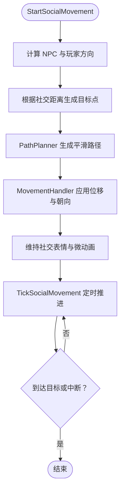
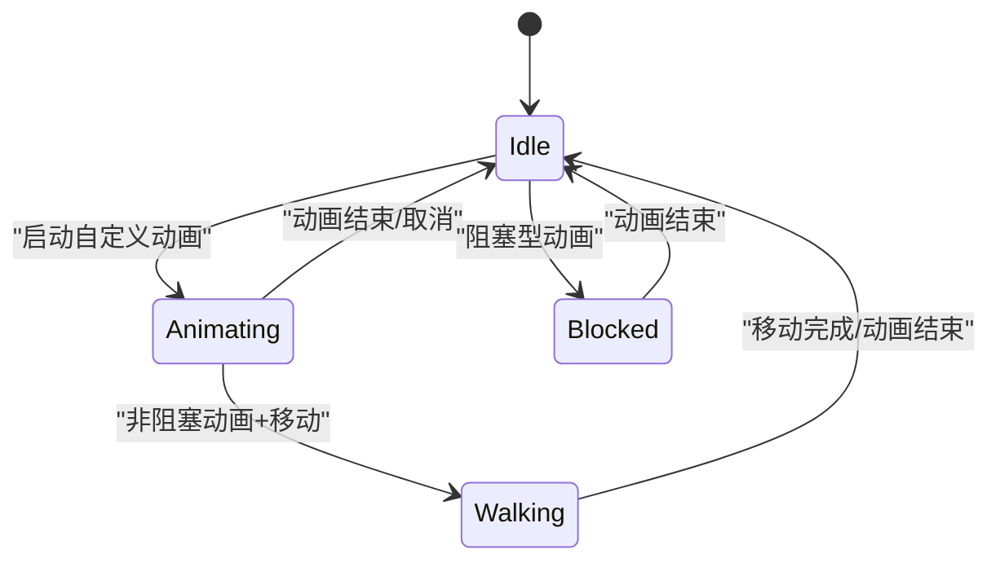
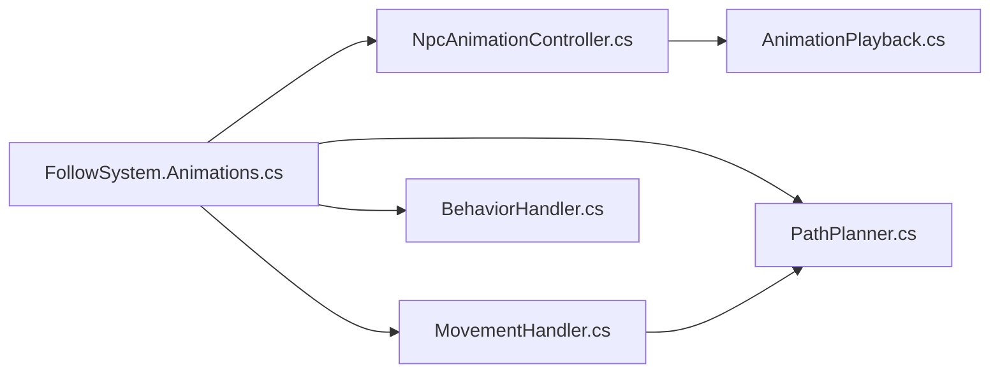

# 动画系统集成

<cite>
**本文引用的文件**   
- [FollowSystem.Animations.cs](file://SmartNPC/smapimod/Movement/FollowSystem.Animations.cs)
- [NpcAnimationController.cs](file://SmartNPC/smapimod/Movement/NpcAnimationController.cs)
- [AnimationPlayback.cs](file://SmartNPC/smapimod/Movement/AnimationPlayback.cs)
- [PathPlanner.cs](file://SmartNPC/smapimod/Movement/PathPlanner.cs)
- [MovementHandler.cs](file://SmartNPC/smapimod/Movement/MovementHandler.cs)
- [BehaviorHandler.cs](file://SmartNPC/smapimod/Movement/BehaviorHandler.cs)
- [FollowSystem.cs](file://SmartNPC/smapimod/Movement/FollowSystem.cs)
</cite>

## 目录
1. [引言](#引言)
2. [项目结构](#项目结构)
3. [核心组件](#核心组件)
4. [架构总览](#架构总览)
5. [详细组件分析](#详细组件分析)
6. [依赖关系分析](#依赖关系分析)
7. [性能与稳定性考虑](#性能与稳定性考虑)
8. [故障排查指南](#故障排查指南)
9. [结论](#结论)
10. [附录：自定义动画开发指南](#附录自定义动画开发指南)

## 引言
本文聚焦 SmartNPC 的 FollowSystem 动画集成子系统，目标是帮助开发者理解游戏循环中如何安全地更新 NPC 自定义动画，同时避免覆盖原版行走动画。文档将系统说明以下关键能力：
- 在每帧驱动中推进动画播放，并保证与行走状态协调。
- StartPose 方法的参数语义：动作名称、帧数组、间隔、循环、阻塞。
- 预设动画：StartIdleActivity（farm/rest/look_around/hold_* 等）的实现思路。
- StartCelebration 庆祝动画：惊喜与欢呼两种模式的表情与跳跃效果。
- ShowCollectedItem 收集物品动画：根据南瓜、农作物、花朵选择持物帧。
- StartSocialMovement/TickSocialMovement 社交移动：后退靠近、路径规划与表情配合。
- 行为状态协调：Animating 模式、动画取消与重置逻辑。
- 自定义动画的开发流程：帧数据准备、注册方式与调用入口。

## 项目结构
动画相关代码集中在 SMAPI 扩展模块的 Movement 命名空间下，按职责拆分到多个文件：
- FollowSystem.Animations.cs：面向上层调用的动画门面方法，包括 StartPose、StartIdleActivity、StartCelebration、ShowCollectedItem、StartSocialMovement 等。
- NpcAnimationController.cs：负责单个 NPC 的动画控制器，维护当前动画、表情、计时器与生命周期。
- AnimationPlayback.cs：动画帧播放引擎，处理帧切换、间隔、循环、阻塞等通用播放逻辑。
- PathPlanner.cs：路径计算工具，为社交移动提供目标点生成与平滑过渡。
- MovementHandler.cs：移动控制层，协调位置移动、方向朝向与动画播放。
- BehaviorHandler.cs：行为状态机，负责将“正在动画”的状态与其他行为（如行走、交互）进行协调。
- FollowSystem.cs：跟随系统的入口或聚合类，通常作为外部行为与动画子系统的桥接点。

**图示来源**
- [FollowSystem.Animations.cs:1-200](file://SmartNPC/smapimod/Movement/FollowSystem.Animations.cs#L1-L200)
- [NpcAnimationController.cs:1-200](file://SmartNPC/smapimod/Movement/NpcAnimationController.cs#L1-L200)
- [AnimationPlayback.cs:1-200](file://SmartNPC/smapimod/Movement/AnimationPlayback.cs#L1-L200)
- [PathPlanner.cs:1-200](file://SmartNPC/smapimod/Movement/PathPlanner.cs#L1-L200)
- [MovementHandler.cs:1-200](file://SmartNPC/smapimod/Movement/MovementHandler.cs#L1-L200)
- [BehaviorHandler.cs:1-200](file://SmartNPC/smapimod/Movement/BehaviorHandler.cs#L1-L200)
- [FollowSystem.cs:1-200](file://SmartNPC/smapimod/Movement/FollowSystem.cs#L1-L200)

**章节来源**
- [FollowSystem.Animations.cs:1-200](file://SmartNPC/smapimod/Movement/FollowSystem.Animations.cs#L1-L200)
- [NpcAnimationController.cs:1-200](file://SmartNPC/smapimod/Movement/NpcAnimationController.cs#L1-L200)
- [AnimationPlayback.cs:1-200](file://SmartNPC/smapimod/Movement/AnimationPlayback.cs#L1-L200)
- [PathPlanner.cs:1-200](file://SmartNPC/smapimod/Movement/PathPlanner.cs#L1-L200)
- [MovementHandler.cs:1-200](file://SmartNPC/smapimod/Movement/MovementHandler.cs#L1-L200)
- [BehaviorHandler.cs:1-200](file://SmartNPC/smapimod/Movement/BehaviorHandler.cs#L1-L200)
- [FollowSystem.cs:1-200](file://SmartNPC/smapimod/Movement/FollowSystem.cs#L1-L200)

## 核心组件
- 动画门面：FollowSystem.Animations.cs 暴露高层 API，屏蔽底层控制器细节，供行为系统与外部调用。
- 动画控制器：NpcAnimationController.cs 管理单个 NPC 的当前动画、表情、计时器、取消与重置。
- 播放引擎：AnimationPlayback.cs 实现帧序列播放、时间推进、循环与阻塞策略。
- 路径规划：PathPlanner.cs 提供目标点与平滑插值，服务于社交移动。
- 移动控制：MovementHandler.cs 负责位置变化、朝向更新、速度限制以及与动画的配合。
- 行为协调：BehaviorHandler.cs 维护 Animating 等状态，决定何时允许动画覆盖默认行为。
- 系统聚合：FollowSystem.cs 作为整体入口，串联行为、移动与动画。

**章节来源**
- [FollowSystem.Animations.cs:1-200](file://SmartNPC/smapimod/Movement/FollowSystem.Animations.cs#L1-L200)
- [NpcAnimationController.cs:1-200](file://SmartNPC/smapimod/Movement/NpcAnimationController.cs#L1-L200)
- [AnimationPlayback.cs:1-200](file://SmartNPC/smapimod/Movement/AnimationPlayback.cs#L1-L200)
- [PathPlanner.cs:1-200](file://SmartNPC/smapimod/Movement/PathPlanner.cs#L1-L200)
- [MovementHandler.cs:1-200](file://SmartNPC/smapimod/Movement/MovementHandler.cs#L1-L200)
- [BehaviorHandler.cs:1-200](file://SmartNPC/smapimod/Movement/BehaviorHandler.cs#L1-L200)
- [FollowSystem.cs:1-200](file://SmartNPC/smapimod/Movement/FollowSystem.cs#L1-L200)

## 架构总览
下图展示了从上层动画门面到下层控制器、播放引擎、路径与移动控制的调用链，以及行为状态对动画优先级的影响。

**图示来源**
- [FollowSystem.Animations.cs:1-200](file://SmartNPC/smapimod/Movement/FollowSystem.Animations.cs#L1-L200)
- [NpcAnimationController.cs:1-200](file://SmartNPC/smapimod/Movement/NpcAnimationController.cs#L1-L200)
- [AnimationPlayback.cs:1-200](file://SmartNPC/smapimod/Movement/AnimationPlayback.cs#L1-L200)
- [PathPlanner.cs:1-200](file://SmartNPC/smapimod/Movement/PathPlanner.cs#L1-L200)
- [MovementHandler.cs:1-200](file://SmartNPC/smapimod/Movement/MovementHandler.cs#L1-L200)
- [BehaviorHandler.cs:1-200](file://SmartNPC/smapimod/Movement/BehaviorHandler.cs#L1-L200)

## 详细组件分析

### 动画门面与游戏循环集成：PumpAnimations
- 职责：在每帧被调用，驱动所有活跃动画的播放进度；确保动画状态与移动、行为协调；防止 vanilla 行走动画覆盖自定义姿势。
- 关键点：
  - 遍历当前活跃的动画控制器，调用其 Tick 或 Update 方法推进帧。
  - 检查动画是否结束；若结束且非循环，则清理控制器并释放资源。
  - 若行为状态处于 Animating，则禁止默认行走动画覆盖当前姿势。
  - 对阻塞型动画，在未完成前不执行其他需要自由姿态的行为。

**图示来源**
- [FollowSystem.Animations.cs:1-200](file://SmartNPC/smapimod/Movement/FollowSystem.Animations.cs#L1-L200)
- [NpcAnimationController.cs:1-200](file://SmartNPC/smapimod/Movement/NpcAnimationController.cs#L1-L200)
- [BehaviorHandler.cs:1-200](file://SmartNPC/smapimod/Movement/BehaviorHandler.cs#L1-L200)

**章节来源**
- [FollowSystem.Animations.cs:1-200](file://SmartNPC/smapimod/Movement/FollowSystem.Animations.cs#L1-L200)
- [NpcAnimationController.cs:1-200](file://SmartNPC/smapimod/Movement/NpcAnimationController.cs#L1-L200)
- [BehaviorHandler.cs:1-200](file://SmartNPC/smapimod/Movement/BehaviorHandler.cs#L1-L200)

### StartPose 方法参数语义
- action：动作名称，用于标识动画类型（如 idle、celebrate、hold_pumpkin）。
- frames：帧数组，表示动画逐帧显示的图像索引或资源键集合。
- interval：播放间隔，单位通常为毫秒或帧数，决定帧切换节奏。
- loop：循环标志，true 表示无限循环，false 表示播放一次后自动结束。
- blocking：阻塞标志，true 表示动画期间锁定某些行为（例如禁止自由行走），false 表示可与其他行为并行。

该方法是自定义动画的统一入口，内部会创建或复用 NpcAnimationController，并将参数传递给 AnimationPlayback。

**章节来源**
- [FollowSystem.Animations.cs:1-200](file://SmartNPC/smapimod/Movement/FollowSystem.Animations.cs#L1-L200)
- [NpcAnimationController.cs:1-200](file://SmartNPC/smapimod/Movement/NpcAnimationController.cs#L1-L200)
- [AnimationPlayback.cs:1-200](file://SmartNPC/smapimod/Movement/AnimationPlayback.cs#L1-L200)

### 预设动画：StartIdleActivity
StartIdleActivity 支持多种待机活动，常见类型包括：
- farm：锄地动画，适合表现农作中的间歇性劳作。
- rest：休息，角色呈现放松姿态。
- look_around：环顾四周，增强 NPC 的自然感。
- hold_pumpkin / hold_crop / hold_flower / hold_chicken：手持物品动画，根据具体物品选择对应帧。

实现要点：
- 根据传入的活动类型匹配对应的帧序列。
- 对于 hold_* 类型，需结合 ShowCollectedItem 的逻辑选择合适持物帧。
- 非阻塞场景下可与轻度移动并存；阻塞场景下应冻结行走。

**章节来源**
- [FollowSystem.Animations.cs:1-200](file://SmartNPC/smapimod/Movement/FollowSystem.Animations.cs#L1-L200)

### 庆祝动画：StartCelebration
StartCelebration 提供惊喜与欢呼两种模式：
- 惊喜模式：表情呈现惊讶，配合短暂停顿或小幅度跳跃。
- 欢呼模式：表情呈现开心，伴随连续小跳或原地弹跳。

实现要点：
- 根据模式选择不同表情和跳跃帧序列。
- 使用较短的 interval 营造轻快节奏。
- 通常为一次性动画，loop=false；可根据需要改为循环庆祝。

**章节来源**
- [FollowSystem.Animations.cs:1-200](file://SmartNPC/smapimod/Movement/FollowSystem.Animations.cs#L1-L200)

### 收集物品动画：ShowCollectedItem
ShowCollectedItem 根据收集到的物品类型选择合适的持物帧：
- 南瓜：选择 hold_pumpkin 帧。
- 农作物：选择 hold_crop 帧。
- 花朵：选择 hold_flower 帧。
- 其他物品：可选择默认持物帧或忽略。

实现要点：
- 通过物品分类映射到具体的动画动作名。
- 保持与 StartIdleActivity 的 hold_* 系列一致，便于统一渲染。
- 可在动画结束后恢复原表情或默认姿态。

**章节来源**
- [FollowSystem.Animations.cs:1-200](file://SmartNPC/smapimod/Movement/FollowSystem.Animations.cs#L1-L200)

### 社交移动动画：StartSocialMovement 与 TickSocialMovement
StartSocialMovement 负责让 NPC 以社交距离靠近或远离玩家：
- 后退：当玩家过近时，NPC 向后平滑移动并保持友好表情。
- 靠近：当玩家稍远时，NPC 向前平滑移动并展示关注表情。

TickSocialMovement 负责定时推进社交移动：
- 计算当前 NPC 与玩家的相对方向。
- 基于目标距离生成目标点。
- 使用 PathPlanner 生成平滑路径。
- 结合 MovementHandler 逐步更新位置与朝向。
- 在移动过程中维持合适的表情与轻微动画（如摇摆或点头）。

**图示来源**
- [FollowSystem.Animations.cs:1-200](file://SmartNPC/smapimod/Movement/FollowSystem.Animations.cs#L1-L200)
- [PathPlanner.cs:1-200](file://SmartNPC/smapimod/Movement/PathPlanner.cs#L1-L200)
- [MovementHandler.cs:1-200](file://SmartNPC/smapimod/Movement/MovementHandler.cs#L1-L200)

**章节来源**
- [FollowSystem.Animations.cs:1-200](file://SmartNPC/smapimod/Movement/FollowSystem.Animations.cs#L1-L200)
- [PathPlanner.cs:1-200](file://SmartNPC/smapimod/Movement/PathPlanner.cs#L1-L200)
- [MovementHandler.cs:1-200](file://SmartNPC/smapimod/Movement/MovementHandler.cs#L1-L200)

### 动画与行为状态的协调机制
- Animating 模式：当 NPC 处于动画播放期，行为系统将其标记为 Animating，避免默认行走动画覆盖自定义姿势。
- 动画取消：遇到强打断事件（如对话、受伤、强制停止）时，立即取消当前动画并恢复默认状态。
- 动画重置：动画结束后，若未循环，则清理控制器并重置表情与姿态。
- 优先级：阻塞型动画具有最高优先级，非阻塞动画允许与轻量移动共存。

**图示来源**
- [BehaviorHandler.cs:1-200](file://SmartNPC/smapimod/Movement/BehaviorHandler.cs#L1-L200)
- [NpcAnimationController.cs:1-200](file://SmartNPC/smapimod/Movement/NpcAnimationController.cs#L1-L200)

**章节来源**
- [BehaviorHandler.cs:1-200](file://SmartNPC/smapimod/Movement/BehaviorHandler.cs#L1-L200)
- [NpcAnimationController.cs:1-200](file://SmartNPC/smapimod/Movement/NpcAnimationController.cs#L1-L200)

## 依赖关系分析
动画门面依赖控制器、播放引擎、路径规划与移动控制；行为处理器协调动画与默认行为之间的冲突。

**图示来源**
- [FollowSystem.Animations.cs:1-200](file://SmartNPC/smapimod/Movement/FollowSystem.Animations.cs#L1-L200)
- [NpcAnimationController.cs:1-200](file://SmartNPC/smapimod/Movement/NpcAnimationController.cs#L1-L200)
- [AnimationPlayback.cs:1-200](file://SmartNPC/smapimod/Movement/AnimationPlayback.cs#L1-L200)
- [PathPlanner.cs:1-200](file://SmartNPC/smapimod/Movement/PathPlanner.cs#L1-L200)
- [MovementHandler.cs:1-200](file://SmartNPC/smapimod/Movement/MovementHandler.cs#L1-L200)
- [BehaviorHandler.cs:1-200](file://SmartNPC/smapimod/Movement/BehaviorHandler.cs#L1-L200)

**章节来源**
- [FollowSystem.Animations.cs:1-200](file://SmartNPC/smapimod/Movement/FollowSystem.Animations.cs#L1-L200)
- [NpcAnimationController.cs:1-200](file://SmartNPC/smapimod/Movement/NpcAnimationController.cs#L1-L200)
- [AnimationPlayback.cs:1-200](file://SmartNPC/smapimod/Movement/AnimationPlayback.cs#L1-L200)
- [PathPlanner.cs:1-200](file://SmartNPC/smapimod/Movement/PathPlanner.cs#L1-L200)
- [MovementHandler.cs:1-200](file://SmartNPC/smapimod/Movement/MovementHandler.cs#L1-L200)
- [BehaviorHandler.cs:1-200](file://SmartNPC/smapimod/Movement/BehaviorHandler.cs#L1-L200)

## 性能与稳定性考虑
- 帧率稳定：合理设置 interval，避免过小导致频繁重绘。
- 内存控制：及时清理已结束的动画控制器，防止泄漏。
- 并发行为：非阻塞动画应避免与重型行为同时运行。
- 路径优化：社交移动的路径计算应缓存或限制频率，减少每帧开销。
- 回退策略：当动画资源缺失或加载失败时，回退到默认 idle 或 walk。

[本节为通用指导，不直接分析具体文件]

## 故障排查指南
常见问题与定位建议：
- 动画被 vanilla 行走覆盖：检查是否在 Animating 模式下正确阻止默认行走；确认 PumpAnimations 未被跳过。
- 动画不播放：检查 frames 是否为空、interval 是否过大、loop 与 blocking 配置是否正确。
- 社交移动卡顿：检查 PathPlanner 的目标点生成是否频繁刷新；确认 MovementHandler 的位移增量是否合理。
- 表情异常：核对庆祝或持物动画的表情帧是否与动作匹配。
- 动画无法取消：检查取消逻辑是否被阻塞行为拦截；确认控制器清理是否被执行。

**章节来源**
- [FollowSystem.Animations.cs:1-200](file://SmartNPC/smapimod/Movement/FollowSystem.Animations.cs#L1-L200)
- [NpcAnimationController.cs:1-200](file://SmartNPC/smapimod/Movement/NpcAnimationController.cs#L1-L200)
- [BehaviorHandler.cs:1-200](file://SmartNPC/smapimod/Movement/BehaviorHandler.cs#L1-L200)

## 结论
FollowSystem 动画集成通过门面方法统一调度，结合控制器与播放引擎，实现了与游戏循环紧密耦合的自定义动画系统。通过行为状态协调，避免了与 vanilla 行走动画冲突；通过社交移动与路径规划，增强了 NPC 的自然互动体验。开发者可以依据本文档的指引，安全地扩展新动画类型，并确保其在复杂行为场景下的稳定运行。

[本节为总结，不直接分析具体文件]

## 附录：自定义动画开发指南
- 帧数据准备：
  - 准备帧数组 frames，确保顺序正确、资源可加载。
  - 为不同类型物品准备对应持物帧（南瓜、农作物、花朵）。
- 动画注册：
  - 在 StartIdleActivity 中添加新的活动类型分支。
  - 在 ShowCollectedItem 中映射物品到动画动作名。
- 调用方式：
  - 使用 StartPose(action, frames, interval, loop, blocking) 启动任意自定义动画。
  - 使用 StartCelebration(mode) 启动庆祝动画。
  - 使用 StartSocialMovement() 启动社交移动，并通过 TickSocialMovement() 推进。
- 最佳实践：
  - 为非阻塞动画选择较小的 interval，保持流畅。
  - 对阻塞动画明确标注，避免与行走冲突。
  - 在动画结束时重置表情与姿态，保证后续行为正常。

**章节来源**
- [FollowSystem.Animations.cs:1-200](file://SmartNPC/smapimod/Movement/FollowSystem.Animations.cs#L1-L200)
- [NpcAnimationController.cs:1-200](file://SmartNPC/smapimod/Movement/NpcAnimationController.cs#L1-L200)
- [AnimationPlayback.cs:1-200](file://SmartNPC/smapimod/Movement/AnimationPlayback.cs#L1-L200)