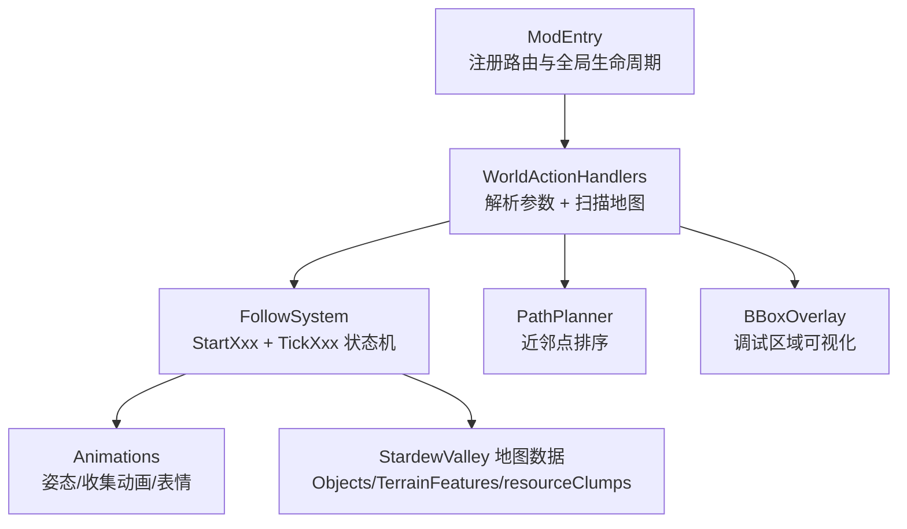
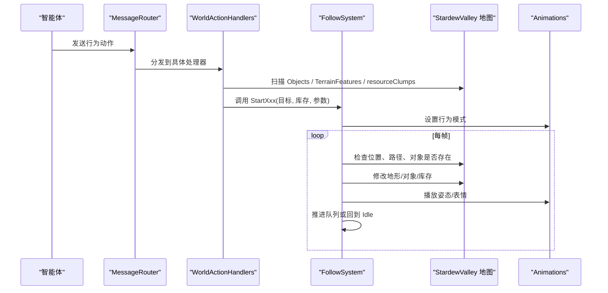
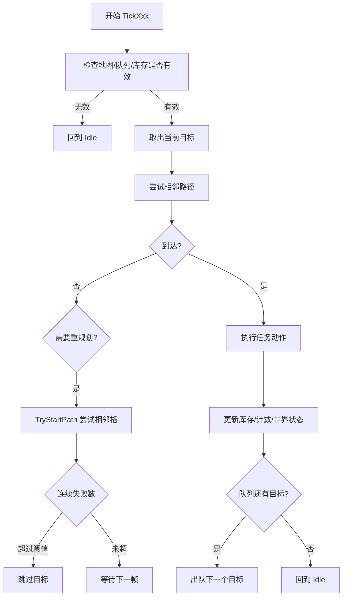
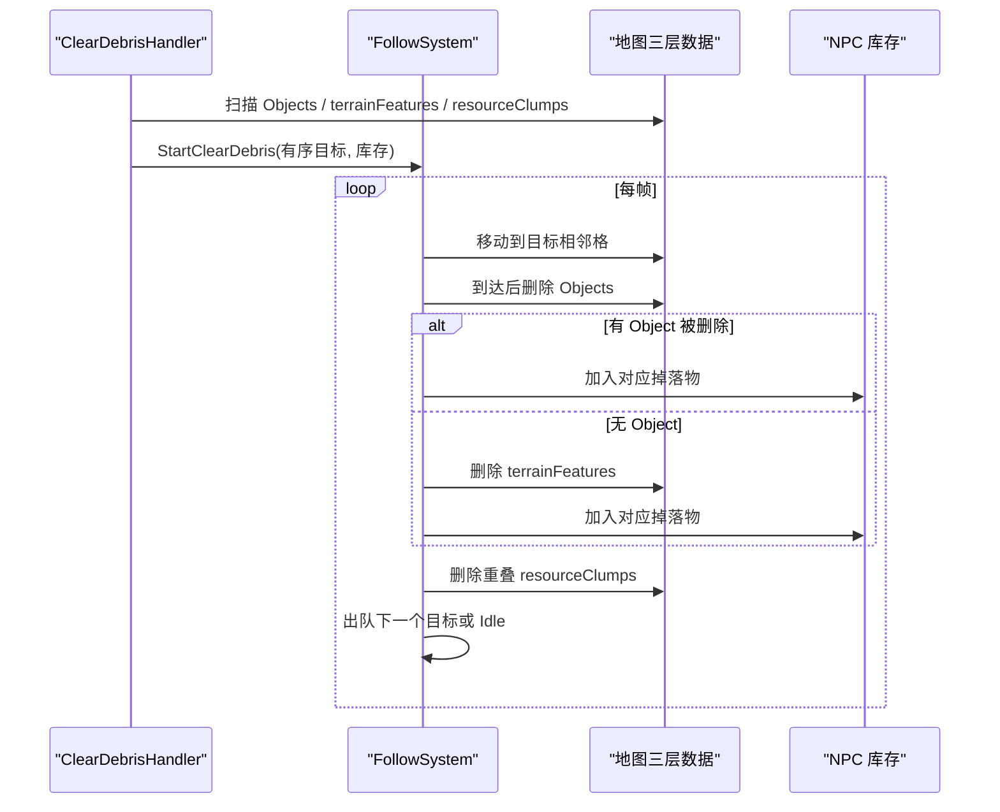
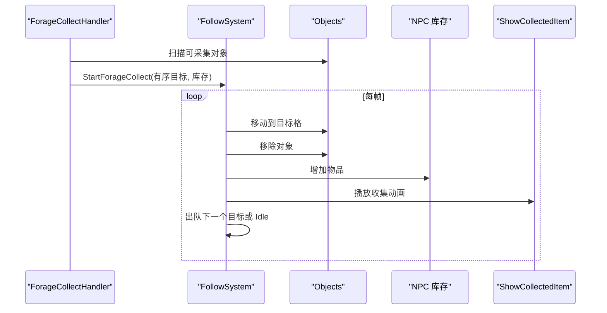
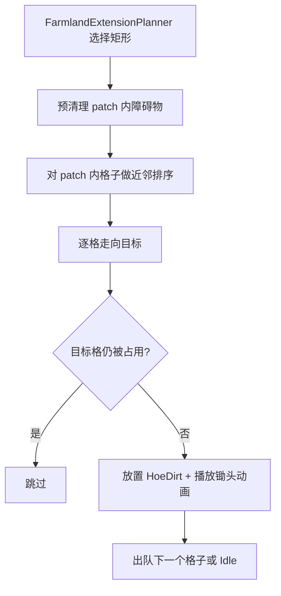
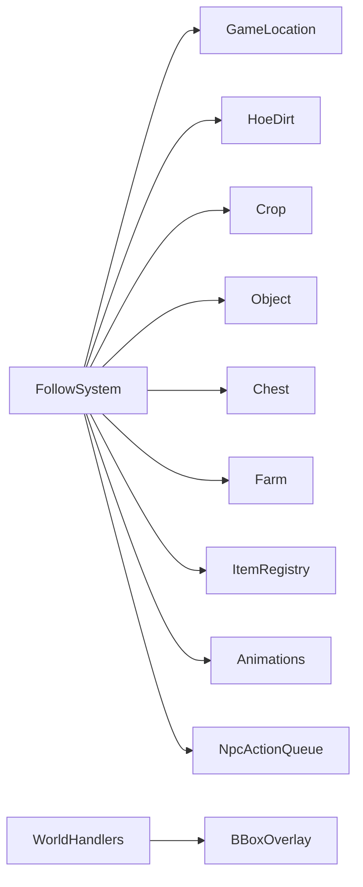
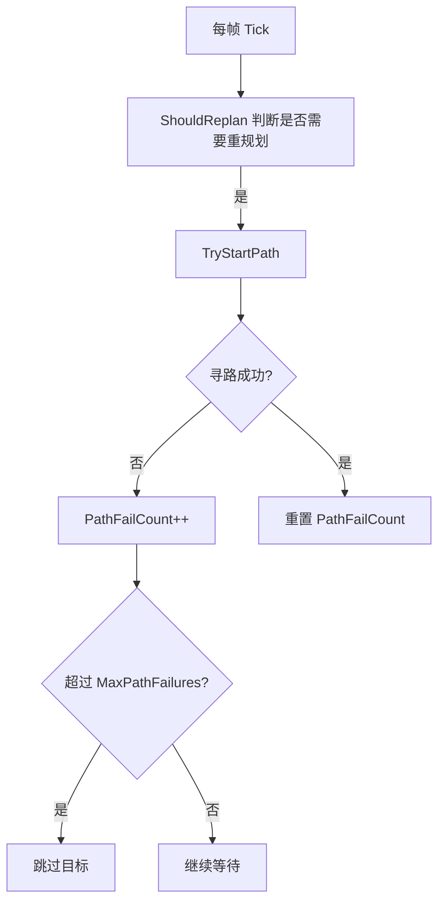

# 工作任务系统

<cite>
**本文引用的文件**   
- [FollowSystem.cs](file://SmartNPC/smapi-mod/Movement/FollowSystem.cs)
- [FollowSystem.Animations.cs](file://SmartNPC/smapi-mod/Movement/FollowSystem.Animations.cs)
- [WorldActionHandlers.cs](file://SmartNPC/smapi-mod/Behavior/WorldActionHandlers.cs)
- [ModEntry.cs](file://SmartNPC/smapi-mod/ModEntry.cs)
</cite>

## 目录
1. [引言](#引言)
2. [项目结构](#项目结构)
3. [核心组件](#核心组件)
4. [架构总览](#架构总览)
5. [详细任务分析](#详细任务分析)
6. [依赖关系分析](#依赖关系分析)
7. [性能与调度特性](#性能与调度特性)
8. [故障排查指南](#故障排查指南)
9. [结论](#结论)
10. [附录：新增工作任务的开发指南](#附录新增工作任务的开发指南)

## 引言
本文件面向 SmartNPC SMAPI 模组中的 FollowSystem 工作任务系统，系统性解释 NPC 如何接收、排队、定位、规划路径、执行并结束各类农场与物品管理任务。文档覆盖以下主题：

- 通用队列、目标定位、路径规划、进度跟踪和错误处理机制。
- ClearDebris 清理碎片任务：扫描 Objects、terrainFeatures、resourceClumps 三层数据，处理杂草、树桩、石头等障碍物，收集掉落物并更新库存。
- ForageCollect 采集资源任务：遍历可采集对象，拾取后播放收集动画和表情。
- 农场相关任务：TillSoil 翻地（支持预清理障碍物）、PlantSeeds 播种（需要种子 ID 和库存）、WaterCrops 浇水、HarvestCrops 收割成熟作物。
- 物品管理任务：DepositItems 存入箱子（支持按物品 ID 过滤）、ShipItems 放入运输箱、WithdrawItems 从箱子取出物品、BreakResource 破坏资源。
- Fertilize 施肥与 FillGaps 填补空隙任务的工作机制。
- 任务状态持久化与超时保护设计说明。
- 添加新工作任务的模板式开发指南。

## 项目结构
FollowSystem 工作任务系统由四个关键源码文件构成：

| 文件 | 职责 |
|---|---|
| `Movement/FollowSystem.cs` | 维护每个 NPC 的行为模式、任务队列、目标状态、路径失败计数、动作气泡；实现所有 StartXxx 启动方法和 TickXxx 执行逻辑。 |
| `Movement/FollowSystem.Animations.cs` | 提供自定义姿态、收集动画、庆祝表情、社交移动等动画控制入口。 |
| `Behavior/WorldActionHandlers.cs` | 将外部行为动作解析为具体任务参数，扫描游戏世界数据，调用 FollowSystem 的 StartXxx 方法。 |
| `ModEntry.cs` | 注册 WebSocket 路由、行为处理器、UI、调试命令，并把 NpcActionQueue 与 FollowSystem 关联起来。 |

**图表来源**
- [ModEntry.cs:1-200](file://SmartNPC/smapi-mod/ModEntry.cs#L1-L200)
- [WorldActionHandlers.cs:1-200](file://SmartNPC/smapi-mod/Behavior/WorldActionHandlers.cs#L1-L200)
- [FollowSystem.cs:1-200](file://SmartNPC/smapi-mod/Movement/FollowSystem.cs#L1-L200)
- [FollowSystem.Animations.cs:1-120](file://SmartNPC/smapi-mod/Movement/FollowSystem.Animations.cs#L1-L120)

**章节来源**
- [ModEntry.cs:1-200](file://SmartNPC/smapi-mod/ModEntry.cs#L1-L200)

## 核心组件
### 行为模式枚举
FollowSystem 使用一个集中枚举描述 NPC 当前行为：Idle、Summoning、Following、Leading、Wander、ClearDebris、ForageCollect、DepositItems、ShipItems、TillSoil、PlantSeeds、WaterCrops、HarvestCrops、WithdrawItems、BreakResource、Fertilize、FillGaps、PetAnimal、Animating、SocialMovement。每种模式对应一个 TickXxx 主循环分支。

### 每 NPC 状态容器
NpcBehaviorState 是 FollowSystem 为每个 NPC 持有的可变状态，包含：

| 字段类别 | 含义 |
|---|---|
| 基础模式 | Mode、LastPathTick、ActionBubble、ActionStartedAt |
| 引导与漫游 | LeadTarget、LeadMap、WanderTarget、WanderRadius、约束矩形 |
| 清理碎片 | DebrisQueue、DebrisInventory、DebrisTarget、DebrisPathed |
| 存箱 | DepositChestTile、DepositChestMap、DepositItemIds、DepositInventory、DepositedCount |
| 运输箱 | ShipInventory、ShipBinTile、ShippedCount、ShipItemIds |
| 翻地 | TillQueue、TillTarget、TillPreClearTiles、TillPreBreakTiles、TillCount |
| 采集 | ForageQueue、ForageTarget、ForageInventory |
| 植物 | PlantSeedQueue、PlantSeedTarget、PlantSeedID、PlantSeedInventory、PlantSeededCount |
| 浇水 | WaterCropQueue、WaterCropTarget、WaterCropCount |
| 收割 | HarvestQueue、HarvestTarget、HarvestInventory、HarvestedCount |
| 取物 | WithdrawChestTile、WithdrawChestMap、WithdrawInventory、WithdrawItemID、WithdrawCount、WithdrawnTotal |
| 破坏资源 | BreakResourceQueue、BreakResourceTarget、BreakResourceInventory、BreakResourceCount |
| 施肥 | FertilizeQueue、FertilizeTarget、FertilizeID、FertilizeInventory、FertilizedCount |
| 填坑 | FillGapsQueue、FillGapsTarget、FillGapsCount |
| 社交移动 | SocialTargets、SocialDeadline、SocialPathed |
| 路径健康 | PathFailCount |

这些字段共同完成“选择目标 → 入队 → 出队 → 寻路 → 到达 → 修改世界 → 更新库存 → 进入下一个目标或 Idle”的完整闭环。

**章节来源**
- [FollowSystem.cs:1-200](file://SmartNPC/smapi-mod/Movement/FollowSystem.cs#L1-L200)

## 架构总览
FollowSystem 的任务架构采用“处理器 + 状态机”分层：

1. **外部触发层**：WebSocket 消息通过 MessageRouter 路由到 NpcActionHandlerBase 子类。
2. **解析与扫描层**：WorldActionHandlers 解析 JSON 参数，读取 Stardew Valley 地图数据，生成任务目标序列。
3. **调度与执行层**：FollowSystem.StartXxx 把目标写入 NpcBehaviorState，PumpOnGameTick 驱动 TickXxx 逐帧推进。
4. **世界交互层**：直接调用 Game1、GameLocation、Object、TerrainFeature、Crop、ItemRegistry、Shipping Bin、Chest 等游戏 API。
5. **表现层**：FollowSystem.Animations 控制行走之外的自定义姿态、收集动画、表情和社交移动。

**图表来源**
- [ModEntry.cs:120-200](file://SmartNPC/smapi-mod/ModEntry.cs#L120-L200)
- [WorldActionHandlers.cs:1-200](file://SmartNPC/smapi-mod/Behavior/WorldActionHandlers.cs#L1-L200)
- [FollowSystem.cs:200-350](file://SmartNPC/smapi-mod/Movement/FollowSystem.cs#L200-L350)
- [FollowSystem.Animations.cs:1-120](file://SmartNPC/smapi-mod/Movement/FollowSystem.Animations.cs#L1-L120)

**章节来源**
- [ModEntry.cs:1-200](file://SmartNPC/smapi-mod/ModEntry.cs#L1-L200)
- [WorldActionHandlers.cs:1-200](file://SmartNPC/smapi-mod/Behavior/WorldActionHandlers.cs#L1-L200)
- [FollowSystem.cs:200-400](file://SmartNPC/smapi-mod/Movement/FollowSystem.cs#L200-L400)

## 详细任务分析

### 通用队列管理与路径机制
所有多目标任务共享相同模式：

- **入队**：StartXxx 接收 IEnumerable<Point> 或结构化目标，创建 Queue<Point> 或等价队列，并记录库存、目标、已寻路标记、计数。
- **出队**：首次启动时 Dequeue 当前目标；完成后再次 Dequeue 下一个。
- **相邻寻路**：多数任务不会直接走向障碍中心，而是尝试目标下方、上方、右侧、左侧的相邻格；若全部失败则累计 PathFailCount。
- **失败跳过**：连续寻路失败达到 MaxPathFailures 时，丢弃当前目标并切换到下一个；如果队列为空则回到 Idle。
- **到达判定**：通常以距离小于等于 1.5 格且控制器路径为空作为“到达”。
- **计时器**：LastPathTick 控制重规划频率；ActionStartedAt 配合 _tickCounter 用于超时保护。
- **强制空闲**：ForceIdle 清空所有队列、单目标状态、计数器和气泡，停止 NPC，并清空 NpcActionQueue。

**图表来源**
- [FollowSystem.cs:1400-1566](file://SmartNPC/smapi-mod/Movement/FollowSystem.cs#L1400-L1566)
- [FollowSystem.cs:1567-1933](file://SmartNPC/smapi-mod/Movement/FollowSystem.cs#L1567-L1933)
- [FollowSystem.cs:1934-2264](file://SmartNPC/smapi-mod/Movement/FollowSystem.cs#L1934-L2264)

**章节来源**
- [FollowSystem.cs:200-350](file://SmartNPC/smapi-mod/Movement/FollowSystem.cs#L200-L350)
- [FollowSystem.cs:1400-1566](file://SmartNPC/smapi-mod/Movement/FollowSystem.cs#L1400-L1566)

### ClearDebris 清理碎片任务
#### 启动流程
ClearDebrisHandler 接收 radius、max_count、extend、bbox 等参数，并按以下步骤构建目标：

1. 根据 bbox 或 NPC 周围半径计算初始搜索范围。
2. 先扫描 HoeDirt，确定是否存在农田区域；若存在，则扩展农田包围盒。
3. 扫描 Objects：杂草、树枝、垃圾、小石头。
4. 扫描 terrainFeatures：树桩、小树、草。
5. 扫描 resourceClumps：树桩簇、空心原木。
6. 按 NPC 当前位置到目标的距离排序。
7. 使用 PathPlanner.PlanBy 做近邻访问顺序优化。
8. 限制单次最多清理数量，默认硬上限为 15。
9. 调用 FollowSystem.StartClearDebris。

#### 三层数据结构处理
| 数据层 | 清理条件 | 掉落物 |
|---|---|---|
| Objects | 杂草、树枝、垃圾、小石头 | 木、混合种子、石头 |
| terrainFeatures | 树桩、成长阶段小于 5 的树、草 | 硬木、混合种子、木头 |
| resourceClumps | parentSheetIndex 为树桩或空心原木 | 硬木 |

#### 执行流程
TickClearDebris 每帧：

1. 检查 ClearDebrisMaxTicks 超时，默认约 15 秒，超时后 ForceIdle。
2. 走到目标相邻格。
3. 到达后依次尝试删除 Objects、terrainFeatures、resourceClumps。
4. 任一删除成功即视为清理完成，记录掉落物 ID，添加到 NPC 库存。
5. 显示感叹号表情。
6. 出队下一个目标；队列为空则 Idle。
7. 连续寻路失败超过阈值时跳过该目标。

**图表来源**
- [WorldActionHandlers.cs:200-543](file://SmartNPC/smapi-mod/Behavior/WorldActionHandlers.cs#L200-L543)
- [FollowSystem.cs:1400-1566](file://SmartNPC/smapi-mod/Movement/FollowSystem.cs#L1400-L1566)

**章节来源**
- [WorldActionHandlers.cs:200-543](file://SmartNPC/smapi-mod/Behavior/WorldActionHandlers.cs#L200-L543)
- [FollowSystem.cs:1400-1566](file://SmartNPC/smapi-mod/Movement/FollowSystem.cs#L1400-L1566)

### ForageCollect 采集资源任务
ForageCollectHandler 扫描 location.Objects 中 IsSpawnedObject=true 的可采集对象，按距离排序并优化访问顺序，然后交给 FollowSystem 逐格拾取。

TickForageCollect 的执行要点：

- 到达目标格后从 Objects 移除对象。
- 将掉落物加入 NPC 库存。
- 调用 ShowCollectedItem 播放收集动画。
- 显示喜悦表情。
- 广播 forage_collected 事件，携带 NPC、物品 ID、物品名、数量、坐标和地图名。
- 出队下一个目标；失败次数过多则跳过。

**图表来源**
- [WorldActionHandlers.cs:1000-1243](file://SmartNPC/smapi-mod/Behavior/WorldActionHandlers.cs#L1000-L1243)
- [FollowSystem.cs:1567-1933](file://SmartNPC/smapi-mod/Movement/FollowSystem.cs#L1567-L1933)
- [FollowSystem.Animations.cs:60-80](file://SmartNPC/smapi-mod/Movement/FollowSystem.Animations.cs#L60-L80)

**章节来源**
- [WorldActionHandlers.cs:1000-1243](file://SmartNPC/smapi-mod/Behavior/WorldActionHandlers.cs#L1000-L1243)
- [FollowSystem.cs:1567-1933](file://SmartNPC/smapi-mod/Movement/FollowSystem.cs#L1567-L1933)
- [FollowSystem.Animations.cs:1-120](file://SmartNPC/smapi-mod/Movement/FollowSystem.Animations.cs#L1-L120)

### 农场相关任务

#### TillSoil 翻地
TillSoilHandler 使用 FarmlandExtensionPlanner 在给定矩形内寻找合适的 patch_w × patch_h 农田块。它支持：

- 输入 bbox 或半径。
- 仅允许农场或温室地图。
- 预清理阶段：在 NPC 开始走之前，同步删除 patch 内的杂草、树枝、小石头、树桩、小树、草、树桩簇、空心原木。
- 对成熟非 tapped 树：砍倒并在地面生成掉落木头。
- 对每个目标格：再次检查是否仍被占用；若未被占用，则放置 HoeDirt 并播放锄头动画。
- 记录 TillCount。

**图表来源**
- [WorldActionHandlers.cs:1243-1560](file://SmartNPC/smapi-mod/Behavior/WorldActionHandlers.cs#L1243-L1560)
- [FollowSystem.cs:1934-2264](file://SmartNPC/smapi-mod/Movement/FollowSystem.cs#L1934-L2264)

**章节来源**
- [WorldActionHandlers.cs:1243-1560](file://SmartNPC/smapi-mod/Behavior/WorldActionHandlers.cs#L1243-L1560)
- [FollowSystem.cs:1934-2264](file://SmartNPC/smapi-mod/Movement/FollowSystem.cs#L1934-L2264)

#### PlantSeeds 播种
PlantSeedsHandler 要求 seed_id，并检查：

- 地图是否为可种植地图（农场、温室、岛屿农场）。
- 背包中是否有该种子。
- 扫描 HoeDirt 且 crop==null 的空地。
- 背包有种子时，effectiveCap 受种子数量限制；背包没有种子时，bbox 模式下播满整个矩形，自由模式下只受 max_count 限制。
- 播种时直接使用 Crop 构造并赋值给 HoeDirt.crop，同时可选消耗背包种子。

**章节来源**
- [WorldActionHandlers.cs:891-1243](file://SmartNPC/smapi-mod/Behavior/WorldActionHandlers.cs#L891-L1243)
- [FollowSystem.cs:2265-2582](file://SmartNPC/smapi-mod/Movement/FollowSystem.cs#L2265-L2582)

#### WaterCrops 浇水
WaterCropsHandler 扫描 HoeDirt 且 crop!=null、crop.dead=false、state.Value 不等于 watered 的地块。TickWaterCrops 会：

- 设置 dirt.state.Value = HoeDirt.watered。
- 播放浇水动画。
- 校验 state 写入是否生效，防止其他钩子覆盖。
- 统计 WaterCropCount。

**章节来源**
- [WorldActionHandlers.cs:543-891](file://SmartNPC/smapi-mod/Behavior/WorldActionHandlers.cs#L543-L891)
- [FollowSystem.cs:2265-2582](file://SmartNPC/smapi-mod/Movement/FollowSystem.cs#L2265-L2582)

#### HarvestCrops 收割成熟作物
HarvestCropsHandler 使用 IsCropHarvestable 判断作物是否可收割：死亡跳过、最终生长阶段前跳过、多收作物处于再生倒计时时跳过。

TickHarvestCrops 的核心逻辑：

- 调用 crop.harvest()。
- 因为 SDV 会把收获物放进玩家背包，代码先快照玩家背包总数，再对比差异，把增量转移到 NPC 库存。
- 捡回 harvest 产生的地面掉落 debris。
- 对单收作物清理 HoeDirt.crop 引用，避免重复收割。
- 统计 HarvestedCount。

**章节来源**
- [WorldActionHandlers.cs:543-891](file://SmartNPC/smapi-mod/Behavior/WorldActionHandlers.cs#L543-L891)
- [FollowSystem.cs:2265-2582](file://SmartNPC/smapi-mod/Movement/FollowSystem.cs#L2265-L2582)

### 物品管理任务

#### DepositItems 存入箱子
DepositItemsHandler 支持 auto_find、chest_x/y、map、item_ids。FollowSystem.StartDepositItems：

- 支持指定地图。
- 自动查找最近 Chest。
- 校验指定坐标确实是 Chest。
- 存储 DepositItemIds 过滤集合。

TickDepositItems：

- 到达 Chest 相邻格。
- 读取 NPC 库存并按 item_ids 过滤。
- 逐个 ItemRegistry.Create 后 chest.addItem。
- 成功部分扣除 NPC 库存，记录 DepositedCount。
- 箱子满或无可存物品时记录警告或返回 Idle。

**章节来源**
- [WorldActionHandlers.cs:543-891](file://SmartNPC/smapi-mod/Behavior/WorldActionHandlers.cs#L543-L891)
- [FollowSystem.cs:557-910](file://SmartNPC/smapi-mod/Movement/FollowSystem.cs#L557-L910)
- [FollowSystem.cs:1567-1933](file://SmartNPC/smapi-mod/Movement/FollowSystem.cs#L1567-L1933)

#### ShipItems 放入运输箱
ShipItemsHandler 找到 Farm 上的 Shipping Bin，并让 NPC 把背包物品放入运输箱。TickShipItems：

- 确保 NPC 在农场地图。
- 不在农场时 warp 到 Shipping Bin。
- 到达后遍历过滤后的物品，调用 farm.getShippingBin(player).Add。
- 从 NPC 库存扣除，统计 ShippedCount 和预估售价。
- 显示运输提示和喜悦表情。

**章节来源**
- [WorldActionHandlers.cs:891-1243](file://SmartNPC/smapi-mod/Behavior/WorldActionHandlers.cs#L891-L1243)
- [FollowSystem.cs:910-1200](file://SmartNPC/smapi-mod/Movement/FollowSystem.cs#L910-L1200)
- [FollowSystem.cs:1567-1933](file://SmartNPC/smapi-mod/Movement/FollowSystem.cs#L1567-L1933)

#### WithdrawItems 从箱子取出物品
WithdrawFromChestHandler 请求从 Chest 取指定 itemId 和 count 到 NPC 背包。FollowSystem.StartWithdrawItems 与 DepositItems 类似，但方向相反：

- 支持自动找箱或指定坐标。
- 支持指定 map。
- 记录 WithdrawItemID、WithdrawCount、WithdrawnTotal。

TickWithdrawItems 会在后续实现中负责从 Chest 取物并加入 NPC 库存（启动逻辑与状态字段已在 FollowSystem 中定义）。

**章节来源**
- [WorldActionHandlers.cs:1875-2100](file://SmartNPC/smapi-mod/Behavior/WorldActionHandlers.cs#L1875-L2100)
- [FollowSystem.cs:1200-1566](file://SmartNPC/smapi-mod/Movement/FollowSystem.cs#L1200-L1566)

#### BreakResource 破坏资源
BreakResource 使用 ResourceTarget 描述目标：树、树桩或大石头。FollowSystem.StartBreakResource 接受 ResourceTarget 列表，并记录 BreakResourceInventory。

ResourceTarget 包含 Tile、IsTree、IsStump、TreeType、StoneIndex。该任务适合破坏成熟树木、树桩和大石头，区别于 ClearDebris 的小规模清理。

**章节来源**
- [FollowSystem.cs:1-200](file://SmartNPC/smapi-mod/Movement/FollowSystem.cs#L1-L200)
- [FollowSystem.cs:1200-1566](file://SmartNPC/smapi-mod/Movement/FollowSystem.cs#L1200-L1566)

### Fertilize 施肥
Fertilize 任务在 NpcBehaviorState 中定义了 FertilizeQueue、FertilizeTarget、FertilizeInventory、FertilizeID、FertilizePathed、FertilizedCount。其结构与 PlantSeeds 高度相似：目标为空的 HoeDirt，操作需要肥料 ID 和 NPC 库存。

虽然仓库未展示完整 TickFertilize 实现，但其字段表明它是一个队列型任务：StartFertilize 初始化队列和目标，TickFertilize 应遵循其他同类任务的路径规划和执行模板。

**章节来源**
- [FollowSystem.cs:1-200](file://SmartNPC/smapi-mod/Movement/FollowSystem.cs#L1-L200)
- [FollowSystem.cs:1200-1566](file://SmartNPC/smapi-mod/Movement/FollowSystem.cs#L1200-L1566)

### FillGaps 填补空隙
FillGaps 任务在 NpcBehaviorState 中定义了 FillGapsQueue、FillGapsTarget、FillGapsPathed、FillGapsCount。farm_actions 的 inspect_object 结果中包含 fill 和 fill_blocked 分组：

- fill：空地、可通行、Diggable=T，可直接填补。
- fill_blocked：有杂物对象、地形杂物或成熟非 tapped 树的空隙，需要先清理或破坏。

FillGaps 的语义是“把农田范围内的空洞变成 HoeDirt”，与 TillSoil 的“扩展农田块”互补。

**章节来源**
- [FollowSystem.cs:1-200](file://SmartNPC/smapi-mod/Movement/FollowSystem.cs#L1-L200)
- [WorldActionHandlers.cs:1560-1875](file://SmartNPC/smapi-mod/Behavior/WorldActionHandlers.cs#L1560-L1875)

## 依赖关系分析
FollowSystem 依赖多个 SMAPI 和游戏子系统：

| 依赖 | 用途 |
|---|---|
| StardewValley.GameLocation | 访问 Objects、terrainFeatures、resourceClumps、isTilePassable、doesTileHaveProperty |
| StardewValley.Pathfinding | 路径规划 |
| StardewValley.TerrainFeatures.HoeDirt | 翻地、浇水、播种、收割 |
| StardewValley.Crop | 判断成熟度、收割 |
| StardewValley.Object | 杂物、石头、掉落物 |
| StardewValley.Objects.Chest | 存取物品 |
| StardewValley.Farm | 运输箱 |
| ItemRegistry | 创建物品、查询种子数据 |
| NpcAnimationController | 自定义姿态和动画 |
| NpcActionQueue | 串行动作队列 |
| BBoxOverlay | 调试区域可视化 |

**图表来源**
- [FollowSystem.cs:1-200](file://SmartNPC/smapi-mod/Movement/FollowSystem.cs#L1-L200)
- [WorldActionHandlers.cs:1-200](file://SmartNPC/smapi-mod/Behavior/WorldActionHandlers.cs#L1-L200)

**章节来源**
- [FollowSystem.cs:1-200](file://SmartNPC/smapi-mod/Movement/FollowSystem.cs#L1-L200)
- [WorldActionHandlers.cs:1-200](file://SmartNPC/smapi-mod/Behavior/WorldActionHandlers.cs#L1-L200)

## 性能与调度特性
### 路径重规划间隔
FollowSystem 使用 ReplanIntervalTicks=30 控制 Following/Leading 的重规划频率，减少每帧寻路开销。各任务也使用 LastPathTick 控制 ShouldReplan。

### 最大路径失败次数
MaxPathFailures=5 用于跳过不可达目标，避免 NPC 无限重试同一块无法通行的格子。

### 超时保护
- ClearDebris 有独立超时：ClearDebrisMaxTicks=900，约 15 秒。
- 通用 MaxActionTicks 默认为 int.MaxValue，注释说明实际生命周期由 Go 侧工作流上下文控制。
- 超时后调用 ForceIdle，清空所有队列和状态。

### 工作速度
WorkSpeed=5 使代理驱动的 NPC 比普通行走更快；回到 Idle 后恢复 DefaultSpeed=2。

### 队列串行化
NpcActionQueue.Configure(_follow) 把每个 NPC 的动作串行化，避免多个长任务同时抢占。

**图表来源**
- [FollowSystem.cs:200-350](file://SmartNPC/smapi-mod/Movement/FollowSystem.cs#L200-L350)
- [FollowSystem.cs:1400-1566](file://SmartNPC/smapi-mod/Movement/FollowSystem.cs#L1400-L1566)

**章节来源**
- [FollowSystem.cs:200-350](file://SmartNPC/smapi-mod/Movement/FollowSystem.cs#L200-L350)
- [FollowSystem.cs:1400-1566](file://SmartNPC/smapi-mod/Movement/FollowSystem.cs#L1400-L1566)

## 故障排查指南
### 常见问题定位
| 现象 | 可能原因 | 排查建议 |
|---|---|---|
| NPC 一直绕圈但不执行任务 | 目标不可达，PathFailCount 达到阈值 | 查看日志中的 pathing ok/fails 和 giving up on 目标信息 |
| 清理碎片没有效果 | 目标已被其他程序清理，或超出 farmland bbox | 确认 ClearDebris 的 farmlandFound 和 extend 参数 |
| 浇水后作物仍显示未浇水 | 其他钩子覆盖了 HoeDirt.state.Value | 查看 WaterCrops 的 write did not stick 警告 |
| 收割后作物仍可收割 | 单收作物未清理 HoeDirt.crop 引用 | 检查 TickHarvestCrops 中对 crop 的处理 |
| 存入箱子失败 | 箱子不存在、箱子已满、物品 ID 无效 | 查看 DepositItems 的 chest gone 或 chest full 日志 |
| 运输箱任务失败 | 农场没有 Shipping Bin 建筑 | 查看 ShipItems 的 no Shipping Bin building 日志 |
| 清理任务长时间不结束 | 任务超时保护未触发或目标太多 | 检查 ClearDebrisMaxTicks 和队列剩余数量 |
| 任务状态残留 | 上一次任务异常中断 | 检查 ForceIdle 是否被调用，或重新触发任务 |

### 日志关键字
- `[FollowSystem/ClearDebris]`
- `[FollowSystem/ForageCollect]`
- `[FollowSystem/DepositItems]`
- `[FollowSystem/ShipItems]`
- `[FollowSystem/TillSoil]`
- `[FollowSystem/WaterCrops]`
- `[FollowSystem/HarvestCrops]`
- `[npc_clear_debris]`
- `[npc_forage_collect]`
- `[npc_water_crops]`
- `[npc_harvest_crops]`
- `[npc_till_soil]`

**章节来源**
- [FollowSystem.cs:1400-1566](file://SmartNPC/smapi-mod/Movement/FollowSystem.cs#L1400-L1566)
- [FollowSystem.cs:1567-1933](file://SmartNPC/smapi-mod/Movement/FollowSystem.cs#L1567-L1933)
- [FollowSystem.cs:1934-2264](file://SmartNPC/smapi-mod/Movement/FollowSystem.cs#L1934-L2264)
- [WorldActionHandlers.cs:200-543](file://SmartNPC/smapi-mod/Behavior/WorldActionHandlers.cs#L200-L543)

## 结论
FollowSystem 工作任务系统通过清晰的分层实现了“外部意图 → 地图扫描 → 任务入队 → 路径规划 → 逐帧执行 → 世界变更 → 状态回归 Idle”的完整闭环。它的优势在于：

- 统一的状态机和队列模型，便于扩展新任务。
- 三层数据扫描能力，能准确识别杂草、树桩、石头和资源簇。
- 成熟的失败跳过和超时保护机制。
- 丰富的农场工具：翻地、播种、浇水、收割、施肥、填坑。
- 完整的物品管理：存箱、取箱、运输箱、破坏资源。
- 可视化反馈：动作气泡、收集动画、表情、调试矩形。

对于开发者而言，新增任务的关键是理解 NpcBehaviorState 字段、StartXxx 入队逻辑、TickXxx 执行逻辑、路径失败处理和 ForceIdle 清理语义。

[本节不直接分析具体代码片段，因此不附加章节来源]

## 附录：新增工作任务的开发指南

### 一、定义 Queue 字段
在 NpcBehaviorState 中添加与新任务对应的字段，至少包括：

| 字段 | 推荐命名 | 含义 |
|---|---|---|
| 队列 | XxxQueue | Queue<Point> 或结构化目标队列 |
| 当前目标 | XxxTarget | Point 或复合目标 |
| 库存引用 | XxxInventory | NpcInventory? |
| 参数 | XxxID 或其他 | 种子 ID、肥料 ID、物品 ID、数量等 |
| 已寻路标记 | XxxPathed | bool |
| 进度计数 | XxxCount | int |

示例命名约定：

- 队列：`DebrisQueue`、`ForageQueue`、`TillQueue`、`PlantSeedQueue`、`WaterCropQueue`、`HarvestQueue`、`BreakResourceQueue`、`FertilizeQueue`、`FillGapsQueue`。
- 当前目标：`DebrisTarget`、`ForageTarget`、`TillTarget`、`PlantSeedTarget`、`WaterCropTarget`、`HarvestTarget`、`BreakResourceTarget`、`FertilizeTarget`、`FillGapsTarget`。
- 已寻路：`DebrisPathed`、`ForagePathed`、`TillPathed`、`PlantSeedPathed`、`WaterCropPathed`、`HarvestPathed`、`BreakResourcePathed`、`FertilizePathed`、`FillGapsPathed`。

**章节来源**
- [FollowSystem.cs:1-200](file://SmartNPC/smapi-mod/Movement/FollowSystem.cs#L1-L200)

### 二、实现 StartXxx 方法
StartXxx 的职责是：

1. 获取或创建 NpcBehaviorState。
2. 把目标序列包装成 Queue。
3. 记录库存、参数、已寻路标记、计数。
4. 若队列为空，记录调试日志并返回。
5. Dequeue 第一个目标作为当前目标。
6. 设置 Mode 为新任务模式。
7. 重置 LastPathTick。
8. 记录启动日志。

参考已有实现：StartClearDebris、StartForageCollect、StartPlantSeeds、StartWaterCrops、StartBreakResource、StartFertilize。

**章节来源**
- [FollowSystem.cs:557-910](file://SmartNPC/smapi-mod/Movement/FollowSystem.cs#L557-L910)
- [FollowSystem.cs:1200-1566](file://SmartNPC/smapi-mod/Movement/FollowSystem.cs#L1200-L1566)

### 三、实现 TickXxx 执行逻辑
TickXxx 应遵循以下模板：

1. **上下文检查**：location、XxxQueue、XxxInventory 是否为空；为空则回到 Idle。
2. **获取当前目标**：st.XxxTarget。
3. **到达判定**：距离 <= 1.5 且控制器路径为空。
4. **执行动作**：
   - 修改 world：删除对象、添加地形、修改作物状态等。
   - 更新 inventory：Add 或 Take。
   - 更新计数：XxxCount++。
   - 播放动画或表情。
5. **队列推进**：队列为空则回到 Idle；否则 Dequeue 下一个目标，重置 XxxPathed 和 LastPathTick。
6. **寻路阶段**：
   - 尝试相邻格：下方、上方、右侧、左侧。
   - 记录 XxxPathed、LastPathTick。
   - PathFailCount++ 或重置。
   - 连续失败超过 MaxPathFailures 时跳过目标。

参考实现：TickClearDebris、TickForageCollect、TickTillSoil、TickPlantSeeds、TickWaterCrops、TickHarvestCrops、TickDepositItems、TickShipItems。

**章节来源**
- [FollowSystem.cs:1400-1566](file://SmartNPC/smapi-mod/Movement/FollowSystem.cs#L1400-L1566)
- [FollowSystem.cs:1567-1933](file://SmartNPC/smapi-mod/Movement/FollowSystem.cs#L1567-L1933)
- [FollowSystem.cs:1934-2264](file://SmartNPC/smapi-mod/Movement/FollowSystem.cs#L1934-L2264)
- [FollowSystem.cs:2265-2582](file://SmartNPC/smapi-mod/Movement/FollowSystem.cs#L2265-L2582)

### 四、实现处理器
WorldActionHandlers 中新处理器应继承 NpcActionHandlerBase，并实现：

- ActionName：如 `npc_xxx_task`。
- RefuseWhileBusy：通常为 true。
- ResolveBubble：返回人类可读的调试气泡文本。
- Execute：解析 JsonElement 参数，扫描地图，生成目标，调用 FollowSystem.StartXxx。
- 可选 GetResult：返回任务计划摘要，例如 TillSoil 返回 patch 矩形和相邻信息。

参考实现：ClearDebrisHandler、ForageCollectHandler、PlantSeedsHandler、WaterCropsHandler、HarvestCropsHandler、DepositItemsHandler、ShipItemsHandler、TillSoilHandler。

**章节来源**
- [WorldActionHandlers.cs:1-200](file://SmartNPC/smapi-mod/Behavior/WorldActionHandlers.cs#L1-L200)
- [WorldActionHandlers.cs:200-543](file://SmartNPC/smapi-mod/Behavior/WorldActionHandlers.cs#L200-L543)
- [WorldActionHandlers.cs:891-1560](file://SmartNPC/smapi-mod/Behavior/WorldActionHandlers.cs#L891-L1560)

### 五、注册处理器
在 ModEntry 中：

1. 创建处理器实例。
2. 传入 IMonitor、showBubble、NpcInventory、FollowSystem。
3. 加入 actionHandlers 数组。
4. 通过 _router.Register(h.ActionNamePublic, h.Handle) 注册。

注意：如果新任务需要 NpcInventory，必须传入 `_npcInventory`；如果不需要，则只传 FollowSystem。

**章节来源**
- [ModEntry.cs:120-200](file://SmartNPC/smapi-mod/ModEntry.cs#L120-L200)

### 六、常见注意事项
- 不要直接在 WebSocket 回调中执行复杂游戏线程操作；解析参数可以异步，但真正修改世界应在 SMAPI 游戏线程上执行。
- 始终考虑目标可能被其他程序提前清理的情况。
- 使用 IsCropHarvestable、IsDebris、IsTerrainDebris、IsResourceClumpDebris 等分类函数保持 observe/select/execute 一致。
- 对需要长期执行的任务，考虑超时保护和 ForceIdle。
- 对 UI 反馈，优先复用 ShowCollectedItem、StartCelebration、doEmote、showTextAboveHead。
- 对调试，使用 BBoxOverlay.Instance.MarkAction 和 IMonitor.Log。

[本节为开发模板说明，不直接引用具体代码行，因此不附加章节来源]