# 行为状态机与模式切换

<cite>
**本文引用的文件**   
- [FollowSystem.cs](file://SmartNPC/smapi-mod/Movement/FollowSystem.cs)
- [NpcActionHandlerBase.cs](file://SmartNPC/smapi-mod/Behavior/NpcActionHandlerBase.cs)
- [WorldActionHandlers.cs](file://SmartNPC/smapi-mod/Behavior/WorldActionHandlers.cs)
- [SocialActionHandlers.cs](file://SmartNPC/smapi-mod/Behavior/SocialActionHandlers.cs)
- [Protocol.cs](file://SmartNPC/smartnpc-mcp/adapters/stardew/bridge/protocol.go)
- [npc_world_action.go](file://SmartNPC/smartnpc-mcp/adapters/stardew/tools/npc_world_action.go)
</cite>

## 目录
1. [引言](#引言)
2. [项目结构](#项目结构)
3. [核心组件](#核心组件)
4. [架构总览](#架构总览)
5. [详细组件分析](#详细组件分析)
6. [依赖关系分析](#依赖关系分析)
7. [性能考量](#性能考量)
8. [故障排查指南](#故障排查指南)
9. [结论](#结论)

## 引言
本文聚焦 SmartNPC 的 FollowSystem 行为状态机，系统化说明 `NpcBehaviorMode` 中定义的所有模式职责、适用场景、状态转换逻辑、路径重规划策略、Wander 随机目标约束、任务队列优先级规则，以及 `NpcBehaviorState` 字段如何驱动长期动作、失败保护与动作气泡。文档同时给出状态机流程图和常见使用场景的代码级调用链路说明，帮助读者从“业务意图”到“代码实现”建立完整理解。

## 项目结构
FollowSystem 相关逻辑主要分布在 SMAPI Mod 层（C#）与 MCP 工具适配层（Go）之间：

- SMAPI 层负责游戏线程上的状态机推进、寻路、传送、动画、动作气泡等具体行为。
- MCP 层暴露结构化工具接口（例如 `npc_wander`、`npc_clear_debris`、`npc_water_crops`），把高层工作流决策映射为对 FollowSystem 的启动指令。

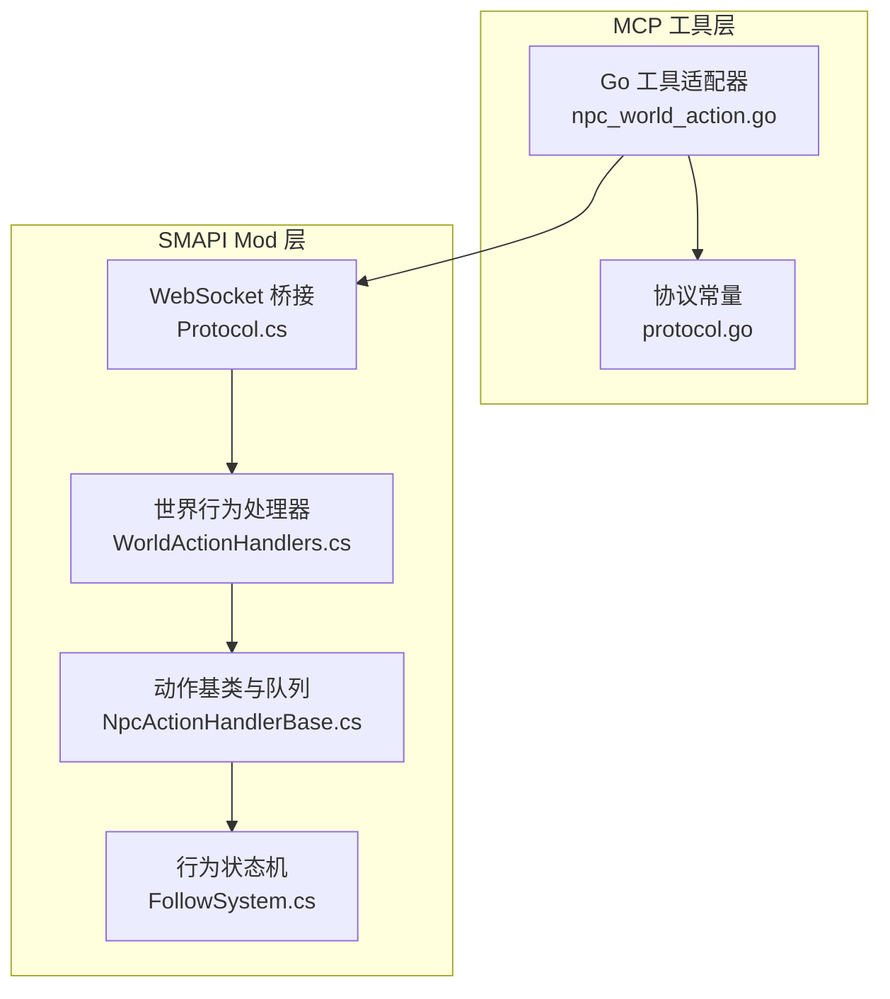

**图表来源**
- [npc_world_action.go:201-453](file://SmartNPC/smartnpc-mcp/adapters/stardew/tools/npc_world_action.go#L201-L453)
- [Protocol.cs:1-172](file://SmartNPC/smartnpc-mcp/adapters/stardew/bridge/protocol.go#L1-L172)
- [WorldActionHandlers.cs:1-200](file://SmartNPC/smapi-mod/Behavior/WorldActionHandlers.cs#L1-L200)
- [NpcActionHandlerBase.cs:1-200](file://SmartNPC/smapi-mod/Behavior/NpcActionHandlerBase.cs#L1-L200)
- [FollowSystem.cs:1-120](file://SmartNPC/smapi-mod/Movement/FollowSystem.cs#L1-L120)

**章节来源**
- [FollowSystem.cs:1-120](file://SmartNPC/smapi-mod/Movement/FollowSystem.cs#L1-L120)
- [NpcActionHandlerBase.cs:1-200](file://SmartNPC/smapi-mod/Behavior/NpcActionHandlerBase.cs#L1-L200)
- [WorldActionHandlers.cs:1-200](file://SmartNPC/smapi-mod/Behavior/WorldActionHandlers.cs#L1-L200)
- [Protocol.cs:1-172](file://SmartNPC/smartnpc-mcp/adapters/stardew/bridge/protocol.go#L1-L172)
- [npc_world_action.go:201-453](file://SmartNPC/smartnpc-mcp/adapters/stardew/tools/npc_world_action.go#L201-L453)

## 核心组件
FollowSystem 的核心由三类对象构成：

| 组件 | 职责 | 关键位置 |
|---|---|---|
| `NpcBehaviorMode` | 枚举所有 NPC 行为模式，包括 Idle、Summoning、Following、Leading、Wander、ClearDebris、ForageCollect、DepositItems、ShipItems、TillSoil、PlantSeeds、WaterCrops、HarvestCrops、WithdrawItems、BreakResource、Fertilize、FillGaps、PetAnimal、Animating、SocialMovement。 | [FollowSystem.cs:34-55](file://SmartNPC/smapi-mod/Movement/FollowSystem.cs#L34-L55) |
| `NpcBehaviorState` | 每个受管 NPC 的持久状态容器，保存当前模式、目标坐标、队列、库存引用、路径重规划时间戳、失败计数、动作气泡等。 | [FollowSystem.cs:120-209](file://SmartNPC/smapi-mod/Movement/FollowSystem.cs#L120-L209) |
| `FollowSystem` | 状态机引擎，提供 Summon / StartFollow / StopFollow / LeadTo / StartWander / StartClearDebris 等启动方法，并在每帧 `PumpOnGameTick` 中按模式分派处理。 | [FollowSystem.cs:240-338](file://SmartNPC/smapi-mod/Movement/FollowSystem.cs#L240-L338)、[FollowSystem.cs:1023-1140](file://SmartNPC/smapi-mod/Movement/FollowSystem.cs#L1023-L1140) |

**章节来源**
- [FollowSystem.cs:34-55](file://SmartNPC/smapi-mod/Movement/FollowSystem.cs#L34-L55)
- [FollowSystem.cs:120-209](file://SmartNPC/smapi-mod/Movement/FollowSystem.cs#L120-L209)
- [FollowSystem.cs:240-338](file://SmartNPC/smapi-mod/Movement/FollowSystem.cs#L240-L338)
- [FollowSystem.cs:1023-1140](file://SmartNPC/smapi-mod/Movement/FollowSystem.cs#L1023-L1140)

## 架构总览
FollowSystem 采用“单帧驱动 + 多模式分派”的设计：外部请求只修改状态，真正移动、寻路、传送、动画、气泡刷新都在 `PumpOnGameTick` 中执行。

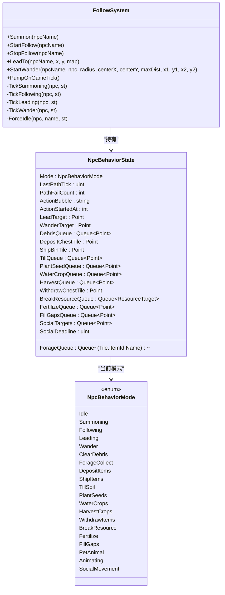

**图表来源**
- [FollowSystem.cs:34-55](file://SmartNPC/smapi-mod/Movement/FollowSystem.cs#L34-L55)
- [FollowSystem.cs:120-209](file://SmartNPC/smapi-mod/Movement/FollowSystem.cs#L120-L209)
- [FollowSystem.cs:240-338](file://SmartNPC/smapi-mod/Movement/FollowSystem.cs#L240-L338)
- [FollowSystem.cs:1023-1140](file://SmartNPC/smapi-mod/Movement/FollowSystem.cs#L1023-L1140)

## 详细组件分析

### NpcBehaviorMode 模式职责与适用场景

| 模式 | 职责 | 适用场景 | 结束条件 |
|---|---|---|---|
| `Idle` | 空闲；恢复默认速度，清除动作气泡，阻止游戏注入的路径控制器接管。 | NPC 未被调度时的默认状态。 | 被其他模式覆盖。 |
| `Summoning` | 召唤：跨地图传送到玩家附近，再移动到玩家前方相邻格。 | 玩家主动召唤 NPC 汇合。 | 到达玩家附近后回到 `Idle`。 |
| `Following` | 跟随：每隔约 30 帧检测距离，超出跟随半径时重新寻路到玩家后方。 | NPC 持续跟随玩家移动。 | 显式停止或超时。 |
| `Leading` | 引导：分段寻路前往最终目标，每段最多 5 格。 | 把 NPC 带到指定位置。 | 到达最终目标后回到 `Idle`。 |
| `Wander` | 漫游：随机选择可通行格子并循环行走，支持中心约束、最大距离约束、矩形边界约束。 | NPC 空闲漫游、自然活动。 | 被显式停止、无可用目标、连续寻路失败过多。 |
| `ClearDebris` | 清理杂物：按队列逐个清理杂物并收集。 | 清理农场或路径杂物。 | 队列为空或达到 15 秒硬上限。 |
| `ForageCollect` | 采集野外物品：走到生成物处拾取。 | 采集地面掉落物。 | 队列为空。 |
| `DepositItems` | 存入箱子：走到箱子存放背包中的物品。 | 整理背包物品。 | 完成过滤后的物品存入。 |
| `ShipItems` | 发货：走到农场出货箱出售携带物品。 | 将 NPC 背包物品卖给农场。 | 完成发货。 |
| `TillSoil` | 耕地：逐个把空地翻成可种植地块。 | 大面积准备农田。 | 队列为空。 |
| `PlantSeeds` | 播种：在已耕地上播种子。 | 播种作业。 | 队列为空。 |
| `WaterCrops` | 浇水：给未浇水作物浇水。 | 日常农活。 | 队列为空。 |
| `HarvestCrops` | 收割：成熟作物放入背包。 | 收获成熟作物。 | 队列为空。 |
| `WithdrawItems` | 取物：从箱子取出物品到背包。 | 领取种子、肥料等。 | 完成提取。 |
| `BreakResource` | 破坏资源：砍树、挖树桩、敲石头并收集掉落。 | 采集木材、石头等资源。 | 队列为空。 |
| `Fertilize` | 施肥：给已耕地施加肥料。 | 提升作物品质或成长。 | 队列为空。 |
| `FillGaps` | 补地：把农田缝隙填为可耕地。 | 修复不规则农田。 | 队列为空。 |
| `PetAnimal` | 抚摸动物：走到玩家宠物猫狗乌龟处抚摸。 | 增加宠物亲密度。 | 到达并抚摸。 |
| `Animating` | 播放一次性动画：非阻塞或阻塞结束后回到 `Idle`。 | 展示角色动作或姿势。 | 动画播放完成。 |
| `SocialMovement` | 社交移动：带截止时间的目标移动，用于害羞后退、焦虑踱步等社交表现。 | NPC 社交行为。 | 到达截止时间或目标列表耗尽。 |

**章节来源**
- [FollowSystem.cs:34-55](file://SmartNPC/smapi-mod/Movement/FollowSystem.cs#L34-L55)
- [FollowSystem.cs:1023-1140](file://SmartNPC/smapi-mod/Movement/FollowSystem.cs#L1023-L1140)

### 状态转换总流程

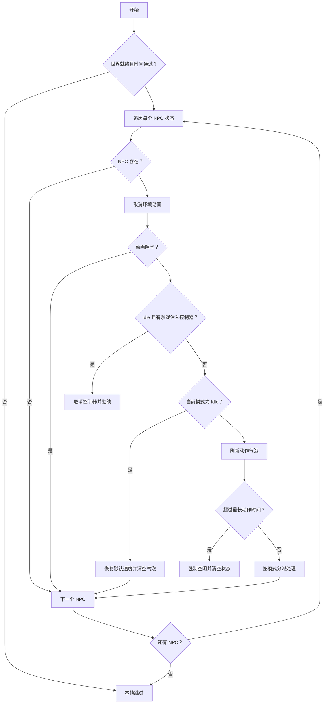

**图表来源**
- [FollowSystem.cs:1023-1140](file://SmartNPC/smapi-mod/Movement/FollowSystem.cs#L1023-L1140)

**章节来源**
- [FollowSystem.cs:1023-1140](file://SmartNPC/smapi-mod/Movement/FollowSystem.cs#L1023-L1140)

### Summoning 模式：传送到玩家附近并移动到玩家前方

Summoning 的处理分为两步：

1. 如果 NPC 与玩家不在同一地图，则传送到玩家所在地图的玩家后方相邻格。
2. 在同一地图后，向玩家前方相邻格发起寻路；当 NPC 与玩家距离小于等于 1.5 格且没有活跃路径时，面向玩家并回到 `Idle`。

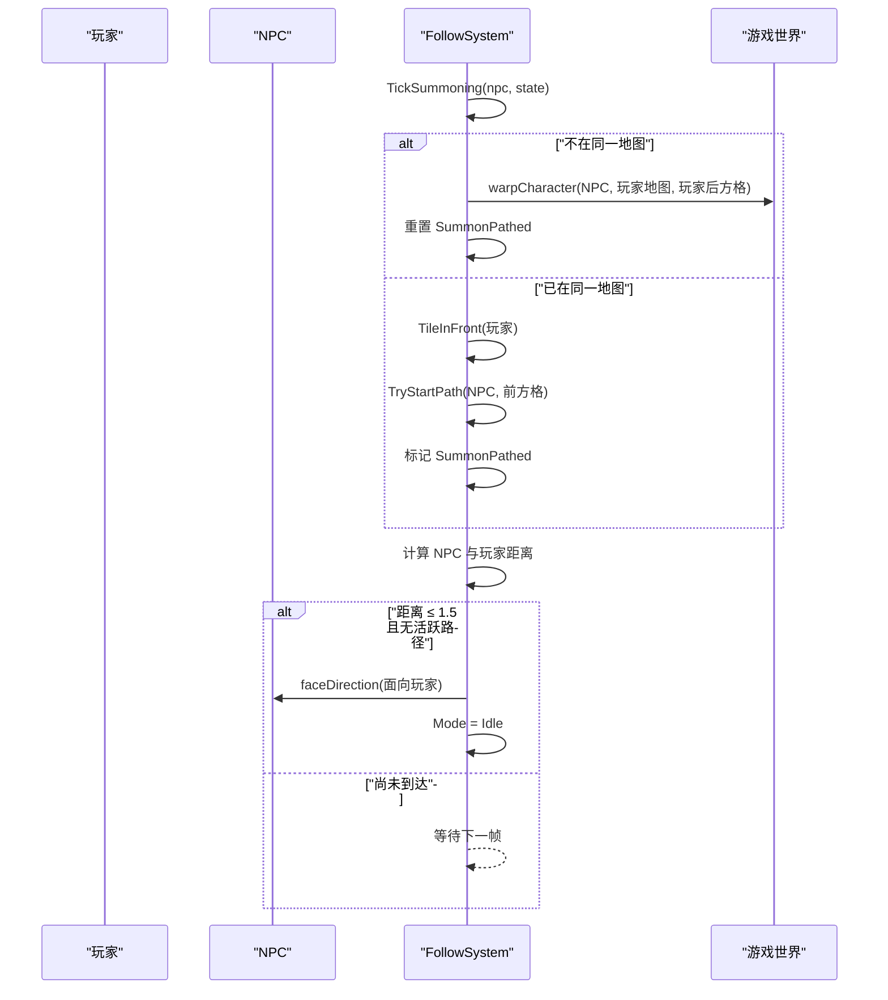

**图表来源**
- [FollowSystem.cs:1140-1195](file://SmartNPC/smapi-mod/Movement/FollowSystem.cs#L1140-L1195)

**章节来源**
- [FollowSystem.cs:286-310](file://SmartNPC/smapi-mod/Movement/FollowSystem.cs#L286-L310)
- [FollowSystem.cs:1140-1195](file://SmartNPC/smapi-mod/Movement/FollowSystem.cs#L1140-L1195)

### Following 模式：每 30 帧检测距离并重新寻路到玩家后方

Following 的关键点是“周期性检查 + 距离阈值 + 后方跟随”：

- 重规划间隔：`ReplanIntervalTicks = 30`。
- 跟随半径：`FollowRadiusTiles = 3`。
- 如果 NPC 与玩家不同图，先传送到玩家地图的后方格。
- 如果距离小于等于 3 格，不再重新寻路。
- 如果距离大于 3 格，重新寻路到玩家后方格，并记录 `LastPathTick`。

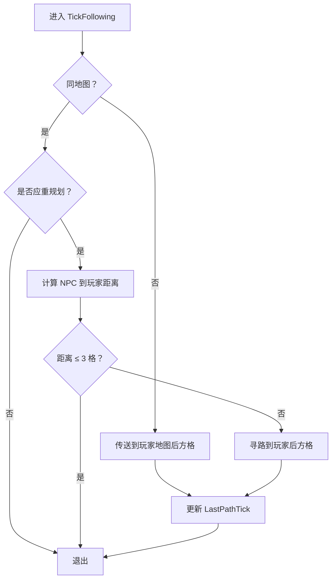

**图表来源**
- [FollowSystem.cs:1195-1245](file://SmartNPC/smapi-mod/Movement/FollowSystem.cs#L1195-L1245)

**章节来源**
- [FollowSystem.cs:255-270](file://SmartNPC/smapi-mod/Movement/FollowSystem.cs#L255-L270)
- [FollowSystem.cs:1195-1245](file://SmartNPC/smapi-mod/Movement/FollowSystem.cs#L1195-L1245)

### Leading 模式：分段路径规划直到最终目标

Leading 不是直接寻路到终点，而是每次只走不超过 5 格的子段：

1. 解析目标地图；如果 NPC 不在目标地图，传送到目标位置。
2. 如果曼哈顿距离小于等于 1，视为到达，设置朝向并回到 `Idle`。
3. 如果未到且需要重规划，计算 `SegmentTarget`，即朝目标方向前进最多 5 格的中间点。
4. 对该中间点发起寻路，并更新 `LastPathTick`。

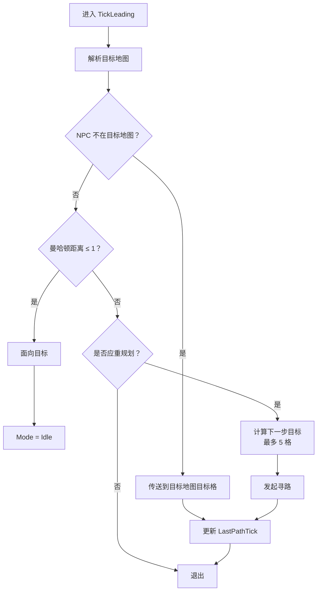

**图表来源**
- [FollowSystem.cs:1245-1295](file://SmartNPC/smapi-mod/Movement/FollowSystem.cs#L1245-L1295)

**章节来源**
- [FollowSystem.cs:320-338](file://SmartNPC/smapi-mod/Movement/FollowSystem.cs#L320-L338)
- [FollowSystem.cs:1245-1295](file://SmartNPC/smapi-mod/Movement/FollowSystem.cs#L1245-L1295)

### Wander 模式：随机目标选择与三种约束

Wander 模式支持以下约束：

| 约束 | 字段 | 含义 |
|---|---|---|
| 基础范围 | `WanderRadius` | 以 NPC 当前位置为中心，随机选取范围内格子。 |
| 中心约束 | `WanderCenterX`、`WanderCenterY`、`WanderMaxDistance` | 以指定中心为锚点，限制曼哈顿距离。 |
| 矩形边界 | `WanderX1`、`WanderY1`、`WanderX2`、`WanderY2` | 只在矩形区域内随机选点。 |

算法要点：

- 最多尝试 40 次。
- 如果设置了矩形边界，优先在矩形内随机选点；否则在 NPC 当前位置 ± `WanderRadius` 范围内随机选点。
- 如果设置了 `WanderMaxDistance > 0`，则额外检查曼哈顿距离是否超过限制。
- 最终必须满足“可通行且无物体”。
- 若 40 次均失败，返回 `null`，调用方会放弃本次漫游。

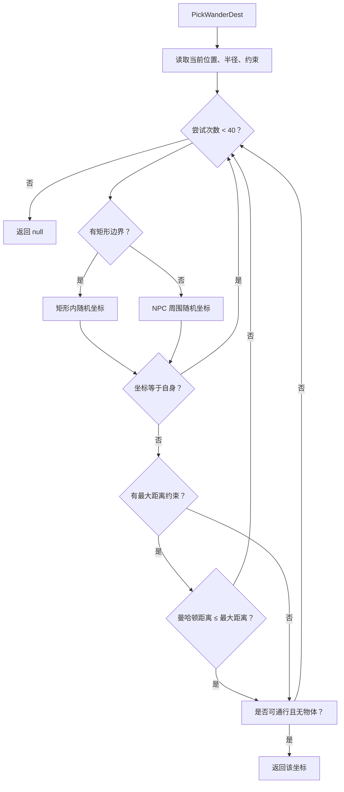

**图表来源**
- [FollowSystem.cs:415-485](file://SmartNPC/smapi-mod/Movement/FollowSystem.cs#L415-L485)

**章节来源**
- [FollowSystem.cs:395-485](file://SmartNPC/smapi-mod/Movement/FollowSystem.cs#L395-L485)
- [WorldActionHandlers.cs:50-120](file://SmartNPC/smapi-mod/Behavior/WorldActionHandlers.cs#L50-L120)

### 状态切换触发条件与优先级规则

#### 新工作如何中断当前行为

行为处理器根据 `RefuseWhileBusy` 和 `IsPreemptable` 分类：

| 类型 | 特征 | 示例 | 行为 |
|---|---|---|---|
| 简单动作 | `RefuseWhileBusy = false` | 聊天、表情、查看对象、空闲动作 | 立即排队执行，不改变 FollowSystem 模式。 |
| 可抢占模式 | `RefuseWhileBusy = true`、`IsPreemptable = true` | `npc_wander` | 高优先级任务到来时，调用 `FollowSystem.Stop` 打断漫游，然后立即执行新任务。 |
| 串行独占模式 | `RefuseWhileBusy = true`、`IsPreemptable = false` | 清理、采集、种地、浇水、收割、存取物、破坏资源、施肥、补地、抚摸动物等 | 新任务加入 per-NPC 队列，等当前独占动作完成后才执行。 |

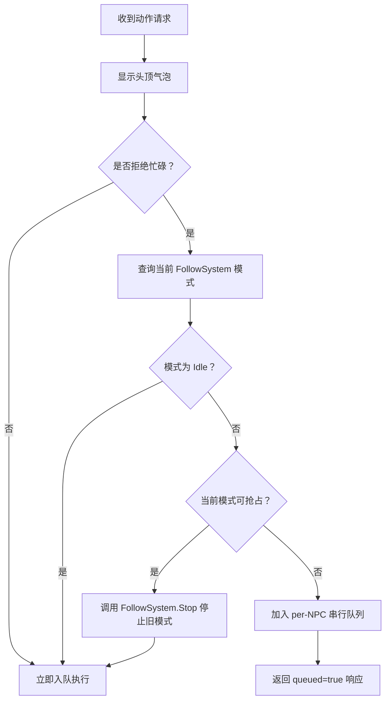

**图表来源**
- [NpcActionHandlerBase.cs:200-357](file://SmartNPC/smapi-mod/Behavior/NpcActionHandlerBase.cs#L200-L357)
- [WorldActionHandlers.cs:18-45](file://SmartNPC/smapi-mod/Behavior/WorldActionHandlers.cs#L18-L45)

**章节来源**
- [NpcActionHandlerBase.cs:1-200](file://SmartNPC/smapi-mod/Behavior/NpcActionHandlerBase.cs#L1-L200)
- [NpcActionHandlerBase.cs:200-357](file://SmartNPC/smapi-mod/Behavior/NpcActionHandlerBase.cs#L200-L357)
- [NpcActionHandlerBase.cs:385-478](file://SmartNPC/smapi-mod/Behavior/NpcActionHandlerBase.cs#L385-L478)
- [WorldActionHandlers.cs:18-45](file://SmartNPC/smapi-mod/Behavior/WorldActionHandlers.cs#L18-L45)

#### ForceIdle 强制空闲逻辑

当某个长动作超过 `MaxActionTicks`，`ForceIdle` 会：

1. 取消动画。
2. 清空所有队列状态：杂物、采集、耕地、播种、浇水、收割、破坏资源、施肥、补地。
3. 清空单项状态：箱子坐标、地图、物品集合、库存引用、路径标记、计数。
4. 重置 `PathFailCount`、`LastPathTick`、`ActionBubble`、`ActionStartedAt`。
5. 设置模式为 `Idle`。
6. 停止 NPC、移除控制器、恢复默认速度。
7. 清空 per-NPC 串行队列，避免旧任务在清理后立刻重新触发。

这保证了“工作流侧可能已经认为任务超时，但游戏内 NPC 仍可能长时间运行”的场景不会卡死。

**章节来源**
- [FollowSystem.cs:344-394](file://SmartNPC/smapi-mod/Movement/FollowSystem.cs#L344-L394)
- [FollowSystem.cs:1067-1082](file://SmartNPC/smapi-mod/Movement/FollowSystem.cs#L1067-L1082)

### NpcBehaviorState 字段状态管理

| 字段 | 作用 | 复杂度与注意事项 |
|---|---|---|
| `Mode` | 当前行为模式。 | O(1) 读写；`PumpOnGameTick` 中按模式分支。 |
| `LastPathTick` | 控制重规划间隔；避免每帧都重新寻路。 | 比较 `tickCounter - LastPathTick` 是否达到 `ReplanIntervalTicks`。 |
| `PathFailCount` | 防止对不可达目标无限重试；Wander 模式下连续失败过多会退回到 `Idle`。 | 成功到达后清零。 |
| `ActionBubble` | 持久动作气泡文本，例如 `[清理]`。 | 每帧刷新，但每秒追加一次耗时计数。 |
| `ActionStartedAt` | 记录动作开始时的 tick，用于超时判断和气泡计时。 | 与 `tickCounter` 差值决定超时或时长。 |
| `SummonPathed` | 标记 Summoning 模式中是否已发起最终同地图路径。 | 防止重复发路。 |
| 各队列字段 | `DebrisQueue`、`ForageQueue`、`TillQueue`、`PlantSeedQueue`、`WaterCropQueue`、`HarvestQueue`、`BreakResourceQueue`、`FertilizeQueue`、`FillGapsQueue`。 | 每个队列代表一批待处理目标；队列为空表示动作完成。 |
| 各单项目标字段 | `DebrisTarget`、`ForageTarget`、`DepositChestTile`、`ShipBinTile`、`TillTarget`、`PlantSeedTarget`、`WaterCropTarget`、`HarvestTarget`、`WithdrawChestTile`、`BreakResourceTarget`、`FertilizeTarget`、`FillGapsTarget`。 | 记录当前正在处理的单个目标。 |
| 各路径标记字段 | `DebrisPathed`、`ForagePathed`、`DepositPathed`、`ShipPathed`、`TillPathed`、`PlantSeedPathed`、`WaterCropPathed`、`HarvestPathed`、`WithdrawPathed`、`BreakResourcePathed`、`FertilizePathed`、`FillGapsPathed`、`PetAnimalPathed`、`SocialPathed`。 | 避免重复发起路径。 |
| 各计数字段 | `DepositedCount`、`ShippedCount`、`TillCount`、`PlantSeededCount`、`WaterCropCount`、`HarvestedCount`、`WithdrawnTotal`、`BreakResourceCount`、`FertilizedCount`、`FillGapsCount`。 | 用于统计实际完成数量。 |
| 社交移动字段 | `SocialTargets`、`SocialDeadline`。 | 社交移动按截止时间驱动，而不是普通任务队列。 |

**章节来源**
- [FollowSystem.cs:120-209](file://SmartNPC/smapi-mod/Movement/FollowSystem.cs#L120-L209)
- [FollowSystem.cs:344-394](file://SmartNPC/smapi-mod/Movement/FollowSystem.cs#L344-L394)
- [FollowSystem.cs:1023-1140](file://SmartNPC/smapi-mod/Movement/FollowSystem.cs#L1023-L1140)

### 常见使用场景与调用链路

#### 场景一：让 NPC 跟随玩家

1. MCP 层通过 WebSocket 发送 `ActionNpcFollowStart`。
2. SMAPI 层调用 `FollowSystem.StartFollow`。
3. `PumpOnGameTick` 进入 `TickFollowing`。
4. 每 30 帧检查距离，超出 3 格则重新寻路到玩家后方。

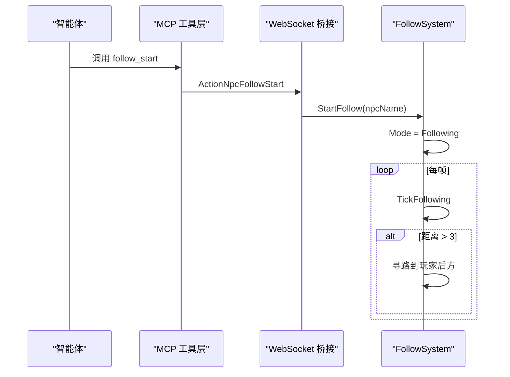

**图表来源**
- [Protocol.cs:60-110](file://SmartNPC/smartnpc-mcp/adapters/stardew/bridge/protocol.go#L60-L110)
- [FollowSystem.cs:296-310](file://SmartNPC/smapi-mod/Movement/FollowSystem.cs#L296-L310)
- [FollowSystem.cs:1195-1245](file://SmartNPC/smapi-mod/Movement/FollowSystem.cs#L1195-L1245)

#### 场景二：让 NPC 漫游并限制区域

1. Go 工具层暴露 `npc_wander`。
2. 参数包含 `radius`、`center_x`、`center_y`、`max_distance`、`x1/y1/x2/y2`。
3. SMAPI 的 `WanderHandler` 解析参数并调用 `FollowSystem.StartWander`。
4. `StartWander` 调用 `PickWanderDest` 选择第一个目标。
5. `TickWander` 在每个目标到达后重新选择下一个目标，直到被停止或找不到可达目标。

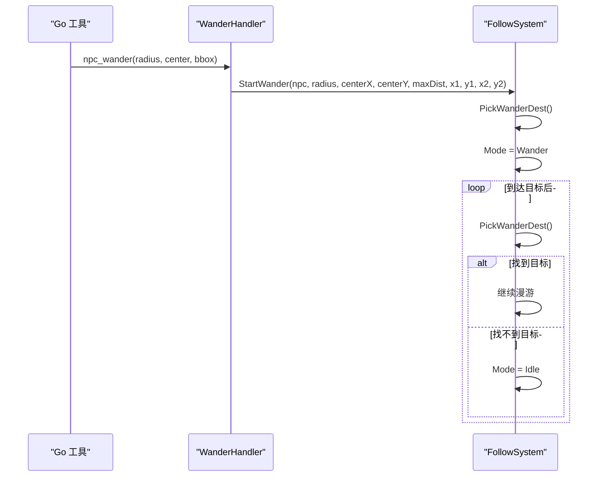

**图表来源**
- [npc_world_action.go:201-453](file://SmartNPC/smartnpc-mcp/adapters/stardew/tools/npc_world_action.go#L201-L453)
- [WorldActionHandlers.cs:18-120](file://SmartNPC/smapi-mod/Behavior/WorldActionHandlers.cs#L18-L120)
- [FollowSystem.cs:395-485](file://SmartNPC/smapi-mod/Movement/FollowSystem.cs#L395-L485)
- [FollowSystem.cs:1295-1383](file://SmartNPC/smapi-mod/Movement/FollowSystem.cs#L1295-L1383)

#### 场景三：NPC 被更高优先级任务抢占漫游

1. NPC 当前处于 `Wander`。
2. 新的独占任务到来，例如清理杂物或收割。
3. `NpcActionQueue.IsPreemptableMode(Wander)` 为真。
4. 调用 `FollowSystem.Stop` 中断漫游。
5. 新任务立即执行。

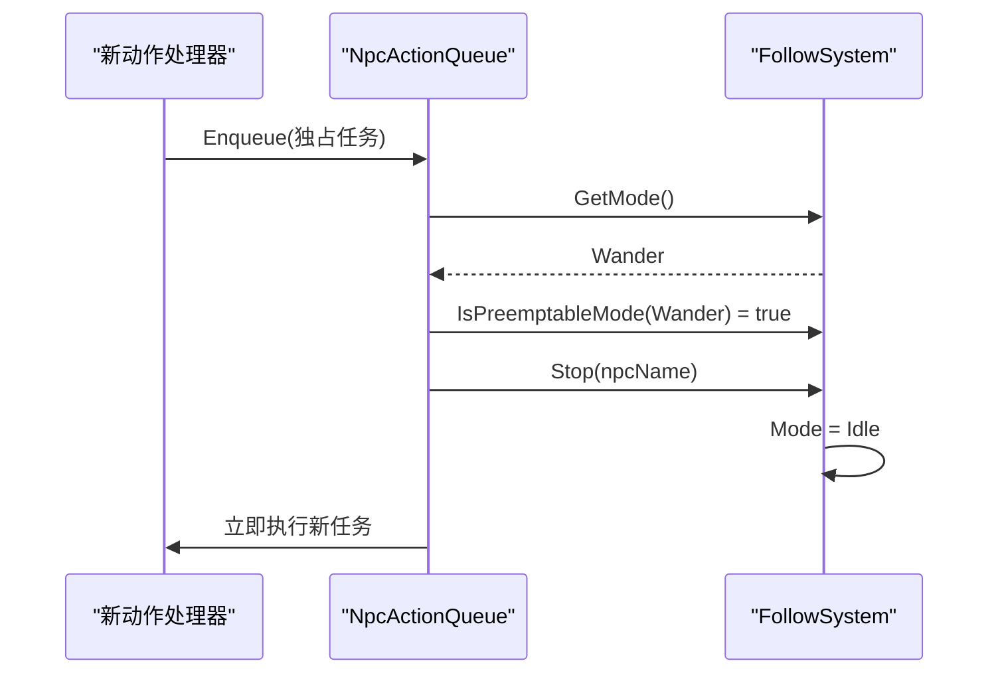

**图表来源**
- [NpcActionHandlerBase.cs:305-357](file://SmartNPC/smapi-mod/Behavior/NpcActionHandlerBase.cs#L305-L357)
- [NpcActionHandlerBase.cs:418-448](file://SmartNPC/smapi-mod/Behavior/NpcActionHandlerBase.cs#L418-L448)

## 依赖关系分析

FollowSystem 并不直接暴露给 WebSocket 接收线程；它通过以下方式与系统其他部分协作：

- `ModEntry` 或调度器在每帧调用 `PumpOnGameTick`。
- `NpcActionHandlerBase` 维护 per-NPC 串行队列，并通过 `NpcActionQueue.DrainReadyTasks` 在 `Idle` 时派发任务。
- `NpcAnimationController` 提供动画播放、暂停、阻塞能力，影响 `GetMode` 返回值和状态机推进。
- Go 层工具只关心协议常量与 JSON 数据结构，不直接操作游戏对象。

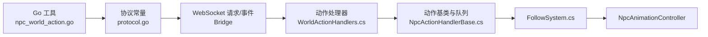

**图表来源**
- [npc_world_action.go:201-453](file://SmartNPC/smartnpc-mcp/adapters/stardew/tools/npc_world_action.go#L201-L453)
- [Protocol.cs:1-172](file://SmartNPC/smartnpc-mcp/adapters/stardew/bridge/protocol.go#L1-L172)
- [NpcActionHandlerBase.cs:385-478](file://SmartNPC/smapi-mod/Behavior/NpcActionHandlerBase.cs#L385-L478)
- [FollowSystem.cs:240-338](file://SmartNPC/smapi-mod/Movement/FollowSystem.cs#L240-L338)

**章节来源**
- [Protocol.cs:1-172](file://SmartNPC/smartnpc-mcp/adapters/stardew/bridge/protocol.go#L1-L172)
- [npc_world_action.go:201-453](file://SmartNPC/smartnpc-mcp/adapters/stardew/tools/npc_world_action.go#L201-L453)
- [NpcActionHandlerBase.cs:385-478](file://SmartNPC/smapi-mod/Behavior/NpcActionHandlerBase.cs#L385-L478)
- [FollowSystem.cs:240-338](file://SmartNPC/smapi-mod/Movement/FollowSystem.cs#L240-L338)

## 性能考量

FollowSystem 的性能设计重点在于“减少每帧重规划”和“防止不可达目标无限重试”：

1. **重规划节流**  
   `LastPathTick` 配合 `ReplanIntervalTicks = 30`，使 Following 和 Leading 不会每帧重新寻路。

2. **失败保护**  
   `PathFailCount` 在 Wander 模式下累计连续寻路失败次数；达到 `MaxPathFailures = 5` 时退回 `Idle`，避免卡住。

3. **动作超时保护**  
   `MaxActionTicks` 作为全局动作上限；`ClearDebrisMaxTicks = 900`（约 15 秒）专门限制清理杂物动作。超时后调用 `ForceIdle` 清空所有队列和状态。

4. **气泡刷新节流**  
   `ActionBubble` 每帧检查，但仅每 60 帧追加一次耗时计数，降低 UI 刷新压力。

5. **动画阻塞隔离**  
   阻塞动画期间 `PumpOnGameTick` 跳过该 NPC 的状态推进，避免动画未完成时错误推进路径或状态。

6. **Idle 守卫**  
   即使游戏内部为 NPC 注入路径控制器，只要 FollowSystem 处于 `Idle`，也会立即取消控制器，保证 Agent 对 NPC 行为的控制权不被游戏默认逻辑劫持。

**章节来源**
- [FollowSystem.cs:255-270](file://SmartNPC/smapi-mod/Movement/FollowSystem.cs#L255-L270)
- [FollowSystem.cs:344-394](file://SmartNPC/smapi-mod/Movement/FollowSystem.cs#L344-L394)
- [FollowSystem.cs:1023-1140](file://SmartNPC/smapi-mod/Movement/FollowSystem.cs#L1023-L1140)
- [FollowSystem.cs:1140-1295](file://SmartNPC/smapi-mod/Movement/FollowSystem.cs#L1140-L1295)

## 故障排查指南

| 问题现象 | 可能原因 | 排查建议 |
|---|---|---|
| NPC 一直停在原地 | 当前模式为 `Idle`；或动画阻塞；或世界未就绪。 | 检查 `PumpOnGameTick` 是否提前返回、是否因 `Animations.IsBlocking` 跳过。 |
| 跟随 NPC 总是落后玩家 | 玩家与 NPC 不同地图未触发传送；或距离未超过 3 格；或寻路失败。 | 检查 `TickFollowing` 的同地图判断、`TryStartPath` 结果、`LastPathTick`。 |
| 召唤后 NPC 没有靠近玩家 | 跨地图传送失败；或到达判定条件未满足。 | 检查 `TickSummoning` 的 `warpCharacter` 异常处理和到达距离判断。 |
| 漫游突然停止 | 连续寻路失败超过 5 次；或 40 次随机选点都失败。 | 检查 `PathFailCount`、`PickWanderDest` 返回 `null` 的原因。 |
| 清理杂物一直运行 | 未达到 15 秒上限；或任务队列仍在增长。 | 检查 `ClearDebrisMaxTicks` 和 `ForceIdle` 是否被触发。 |
| 动作气泡不显示 | 动作不是长动作；或 `SetActionBubble` 未调用；或模式已回到 `Idle`。 | 检查 `RefuseWhileBusy`、`SetActionBubble`、`RefreshPersistentBubble`。 |
| 新任务没有执行 | 任务被排队；或当前模式不可抢占；或队列头任务仍在执行。 | 检查 `NpcActionQueue.Enqueue`、`DrainReadyTasks`、`IsPreemptableMode`。 |
| 社会行为中途停止 | 达到 `SocialDeadline` 或目标列表为空。 | 检查 `StartSocialMovement` 设置的截止时间和 `TickSocialMovement`。 |

**章节来源**
- [FollowSystem.cs:344-394](file://SmartNPC/smapi-mod/Movement/FollowSystem.cs#L344-L394)
- [FollowSystem.cs:1023-1140](file://SmartNPC/smapi-mod/Movement/FollowSystem.cs#L1023-L1140)
- [FollowSystem.cs:1140-1383](file://SmartNPC/smapi-mod/Movement/FollowSystem.cs#L1140-L1383)
- [NpcActionHandlerBase.cs:200-357](file://SmartNPC/smapi-mod/Behavior/NpcActionHandlerBase.cs#L200-L357)
- [SocialActionHandlers.cs:71-149](file://SmartNPC/smapi-mod/Behavior/SocialActionHandlers.cs#L71-L149)

## 结论
FollowSystem 是一个围绕 `NpcBehaviorMode` 展开的多模式行为状态机。它将“玩家交互行为”和“农场工作行为”统一在一个每帧推进的状态机中，通过 `NpcBehaviorState` 管理目标、队列、失败保护和视觉反馈，通过 `PumpOnGameTick` 统一驱动，通过 `NpcActionHandlerBase` 和 `NpcActionQueue` 协调抢占与串行执行。

对于扩展者来说，新增一个工作行为通常只需：

1. 在枚举中添加新模式。
2. 在 `NpcBehaviorState` 中添加目标、队列、计数和路径标记。
3. 添加 `StartXxx` 启动方法。
4. 在 `PumpOnGameTick` 的分派分支中添加对应处理。
5. 在超时或完成时回到 `Idle`，必要时清空状态。

这样既能保持状态机清晰可控，又能让上层工作流通过 MCP 工具稳定驱动 NPC 行为。